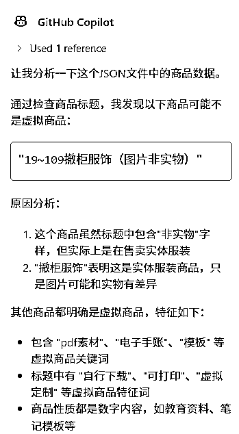

# 1216条📕虚拟商品实测数据，附上关键词与玩法思路

作者：Rand0mWalk
时间：2025-03-26

最近把📕上的虚拟商品数据整理了一版，目前样本量已经到 1216 条，拿出来和大家一起盘一盘。

先说一下这批数据的来历和边界。

抓取逻辑是用一组基础关键词去搜索，然后把结果拉下来。关键词覆盖面比较泛，包含：可打印、电子、素材、网盘发货、清单、合集、可编辑、模板、源文件、虚拟资料、资源、课、应用、软件、app、笔记、自行下载、ppt、pdf、手绘、手抄报、虚拟定制、非实物。

筛选规则上，按销量排序，只保留销量超过 3000 的商品。这样做肯定会漏掉不少潜力品，但作为起步的底座数据，体量已经够用。

数据清洗目前只做了 AI 的初筛，主要是看商品标题来判断是不是虚拟类目，所以难免会有重复或者少量非虚拟商品混进来。更严谨的做法其实可以结合商品详情页里的预计发货时长来判断，因为虚拟品普遍发货很快，不过这次没去抓预计发货时间，这一步就没做。好在 AI 先筛一遍，至少能把后面人工整理的工作量降不少。

为什么要做这件事？

从近期📕的站内风向来看，虚拟商品是明显被鼓励的方向。龙哥在群里和问答里多次提到，本来就想做一期关于📕虚拟商品的超级标，也强调过这类数据的参考价值很大。

目前📕并没有一个统一的入口能直接找到虚拟商品的汇总数据，这也是大家比较头疼的地方。虚拟产品板块正处在航海期，缺的就是一个可参考的地图。

我自己在跑 web 网站航海时，顺手把抓到的数据搭了个小站点。数据量不算巨大，但足够用来继续深挖店铺和长尾关键词。

想自己玩的可以直接用这个 RPA：[`api.winrobot360.com/redirect/robot/share?inviteKey=adbfcbb6d1699901`](https://api.winrobot360.com/redirect/robot/share?inviteKey=adbfcbb6d1699901)

数据还在持续补充，天气热得 RPA 都快把电脑烤冒烟了，随时可以来看看。

---

评论区补充

阿宝：能不能顺便抓出来类目？
Rand0mWalk：📕官方没对外展示类目数据，灰豚这类第三方会展示。要是官方有统一虚拟类目，爬起来会方便很多。

花椒大王：能不能用无物流发货来判断是不是虚拟？
Rand0mWalk：这个数据目前拿不到。

PeterZEN：感谢分享，赛道选择和市场验证都省事了。
Rand0mWalk：把这批数据丢给 AI 做下分析，启发会更大。

Lucia：大佬分享太有价值了！