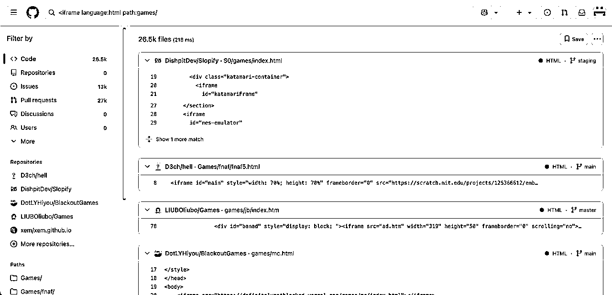
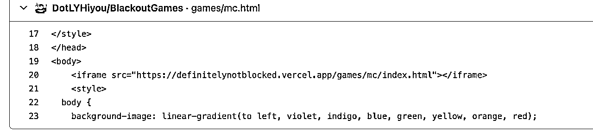
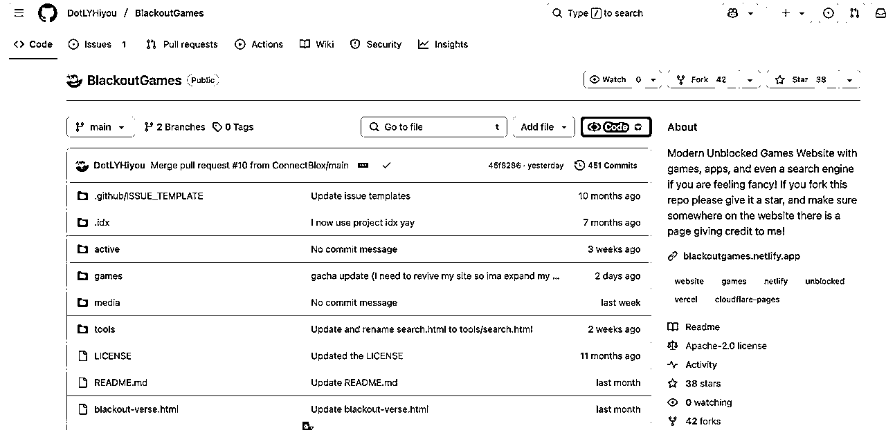
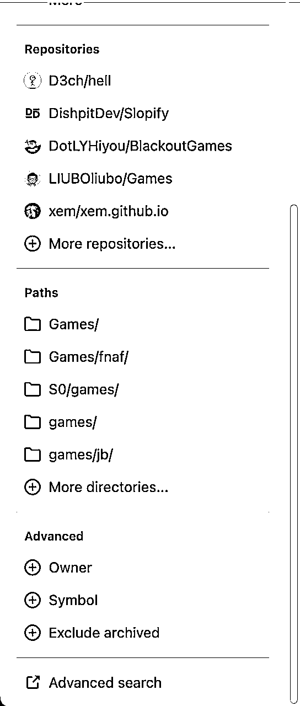
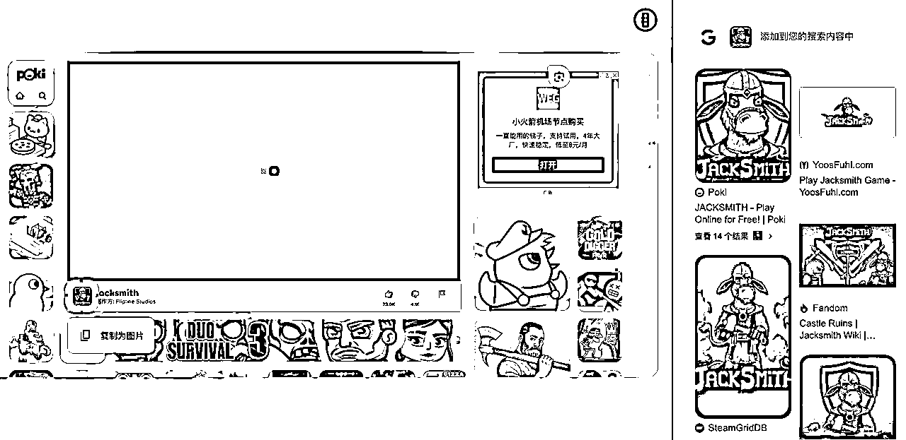
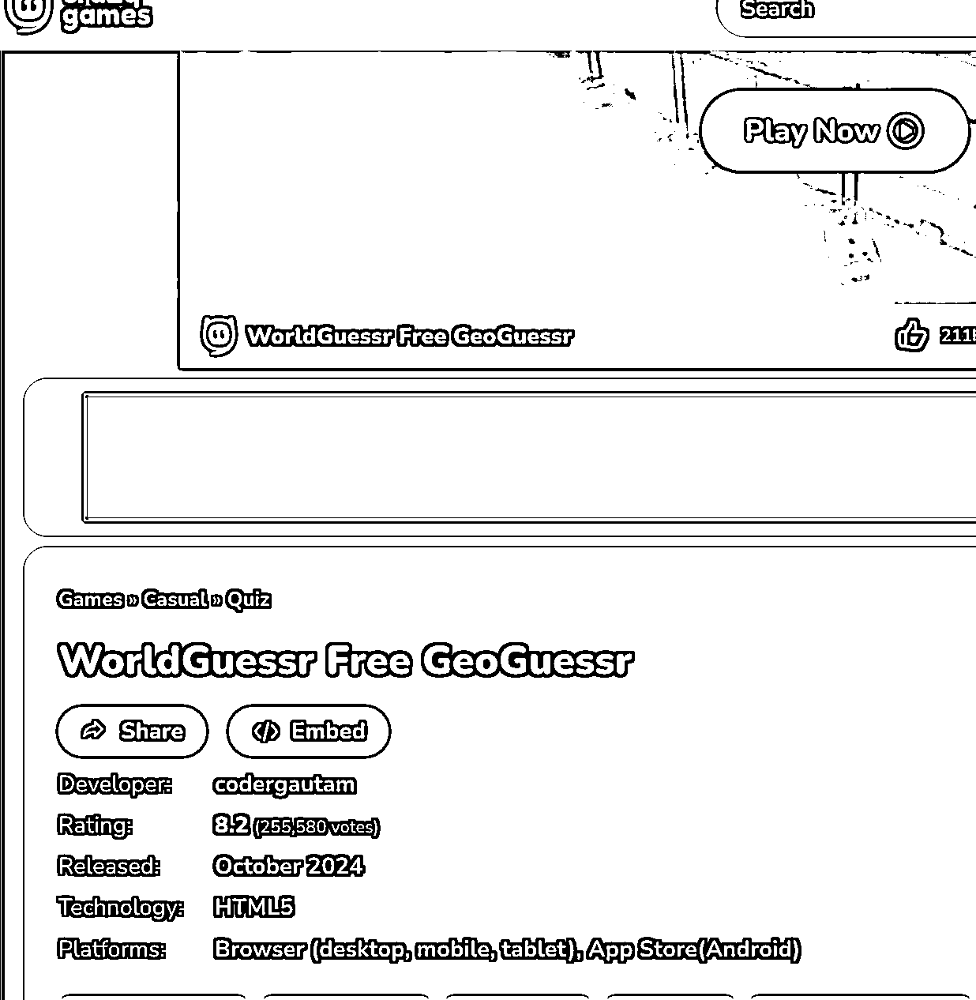
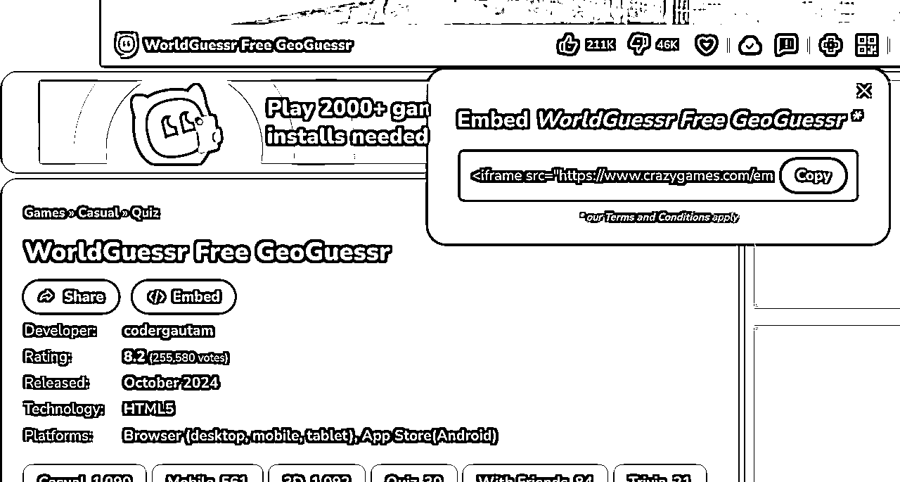
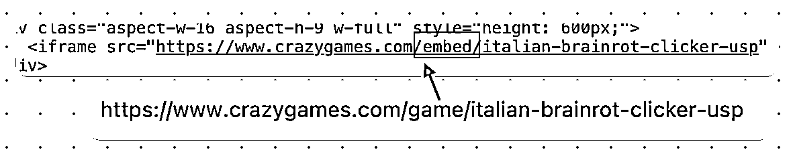

# 玩不腻的游戏库怎么来？老站长分享7个实用招数

我是龙哥，去年8月第一次参加【chatgpt+海外工具】航海，从挖需求、做开发、搞推广、做变现一路走过来，赚到了人生第一笔美元。当时AI写代码还不太好使，我一边自学html/css/javascript，一边用免费的ChatGPT硬撑，做了第一个网站，也拿到了第一笔美金。

一年多时间，我陆续做了十多个网站，游戏站、工具站、内容站、导航站、AI工具站都有。最快的站8小时就通过了Adsense审核，慢的也就两三天。就算新站流量不多，有的全站只有几百UV，照样能过审。

眼下我正忙活着从1到10的事。最近几个月在专攻游戏站，也参加了这次的【AI 应用 - Web 网站】航海，聊聊我的一些体会。

## 先说说手册里提到的iframe

### iframe是什么？

iframe就是网页里的“小窗口”，能在一个页面里直接嵌入另一个网页的内容。相当于你在墙上开了扇窗，透过它能看到另一个空间里的景色，比如视频、地图、表单等。

它最大的作用就是嵌入外部内容。比如在博客里插YouTube视频，或者加载Google地图。这些内容看起来在当前页面上，其实是从别的网站加载的。嵌入的内容跟原网页互不干扰，就算嵌入的地图崩了，也不影响你网站正常访问。

详情可以看：https://developer.mozilla.org/en-US/docs/Web/HTML/Element/iframe

用法很简单：

[目标网站网页的url](目标网站网页的url)

### iframe的好处和坑

好处：

- 建站速度飞快，省时省力。时间就是钱，省下的时间能用来搞流量。游戏站、工具站都适用，尤其是MVP阶段，根本不用花大力气做开发。
- 新手能很快看到正反馈。几十分钟就能上线一个站，立刻有成就感。

坏处：

- 源头网站不可控。今天能用明天可能就失效了，得定期检查。
- 源站的广告会干扰用户体验。
- 会流失用户。比如itch.io，一旦检测到iframe，会提示用户别在你的站上玩，还会露出别人家的品牌。

## 那游戏资源怎么找？

搞清楚了iframe的用法和利弊，接下来就是找游戏资源的事。

### 一、把搜索用到极致

*   用谷歌等搜索引擎搜关键词：比如“iframe games”“embed games”“game distribution”，也可以让AI帮你拓展一堆词再去搜。
*   用GitHub搜。这个我是从群友分享里学到的，以前也不知道。在GitHub搜索框输入指令：

像这个例子：

[https://definitelynotblocked.vercel.app/games/mc/index.html](https://definitelynotblocked.vercel.app/games/mc/index.html)

直接把链接复制到浏览器打开看看，能玩就能用。

点那个黑色加粗的文字，进到代码仓库，看看别人都放了哪些游戏。

其实GitHub还有高级搜索功能，就在左下角的【advanced search】，感兴趣可以自己摸索。

*   用谷歌镜头搜。看上一款游戏，但找不到它的iframe资源？谷歌镜头能帮忙。比如你看上poki的jacksmith，但poki不给你iframe链接。那就用游戏图标去搜，右侧结果里可能会有别的游戏站，进去看看有没有提供iframe。进到游戏网站，先看有没有embed代码，没有就用浏览器开发者模式找找看。

光靠搜索+开发者模式，就能挖到不少iframe链接。

*   用带搜索功能的AI工具。

### 二、借助游戏平台和网站

全球类似4399、crazygames的游戏平台多的是，有些会提供embed代码，也就是iframe代码给你用。

crazygames.com就是典型提供embed的站点。

航海手册里提到的itch.io，只有部分游戏允许iframe。

重点说说怎么在crazygames.com找iframe代码——找“embed”这个关键词就行。

另外，不同平台的embed位置不一样，可能在游戏框附近，比如点赞功能旁边，多看看。比如https://www.crazygames.com/game/worldguessr 这个游戏，找到embed，点进去。

然后你会拿到iframe代码，复制下来，放到你自己的网页代码里。不会放？叫AI帮你放。

你可能发现，crazygames这样的平台居然也用iframe来提供游戏，而且还会套一层iframe，带着自己的品牌名给你。

几个月前，这个游戏点play后，crazygames其实iframe的是https://www.worldguessr.com/，现在变了。另外，crazygames不是所有游戏都提供embed，但绝大多数都有。

【更新】

最近crazygames调整了，不再主动给embed代码。不过测试发现，7月份以前的大部分游戏，只要你把url里的“game”改成“embed”，照样可以拿来iframe。

那些提供embed的游戏网站，其实也有自己的算盘：1. 赚外链，对SEO帮助大。2. 拿流量来源，别人iframe了它的游戏，用户顺着链接就能到它的网站。3. 多收入，它会在iframe里放广告，你越用它越赚钱。

类似crazygames这样可以提供embed的站还有：

https://www.onlinegames.io/

https://gamedistribution.com/games/

https://www.twoplayergames.org/

这类网站很多，用之前说的“iframe games”等关键词就能搜到一堆。

就算有些游戏站不提供embed，但如果没设置跨域限制，你同样能用开发者模式找到iframe链接，照拿不误。

分享个小例子：前阵子很火的stimulation clicker，官方链接是https://neal.fun/stimulation-clicker/。有人注册了stimulationclicker.com这个域名，一开始想用iframe方式嵌入游戏，但发现跨域访问行不通，只能先用跳转对付。游戏开发者看到自己网站排名不是第一，气得不行，还跑去谷歌投诉，在推特论坛上号召大家抵制那个站。后来两边沟通好了，允许iframe了，于是stimulationclicker.com上就能直接玩了。可见，跨域限制不是绝对，是可以谈的。

有些游戏网站防盗做得很狠，一有iframe就提醒用户。比如itch.io，有的游戏不支持iframe，还会弹提示。

### 三、直接搞游戏源文件

游戏源代码文件，GitHub上能拿到很多，不细说了。

还有交易平台，比如

https://codecanyon.net/category/html5/games?sort=date

https://buy.html5games.com/

国内的闲鱼、淘宝也能买。

还有很多游戏能在俄语区的游戏站找到资源，有的手游被破解出来，用浏览器就能玩。

实在不行，你甚至可以让AI帮你写一个游戏。

## 再说说两种老游戏的浏览器游玩方式

DOS游戏和Flash游戏。多亏一些技术大佬，现在还能在浏览器里玩当年的经典。

DOS游戏：游戏文件资源+大神写的JS脚本，比如js-dos。比如dos.zone这个网站，就能在浏览器里玩DOOM和GTA1。你用开发者模式就能看到它是怎么加载游戏文件的，有些云文件的链接可直接拿来做。

Flash游戏：游戏资源文件+flash脚本，比如ruffle。很多玩flash游戏的网站都在用。flash游戏资源文件格式是swf，放本地或云存储都行。

有人基于ruffle做了插件，专门让那些没升级技术的flash游戏网站也能在浏览器里玩。

不知道怎么做的话，可以看这个代码仓库：

https://github.com/GeekGallifrey/GamesPlayOnWeb

它用简单的HTML代码，在网页上实现了DOS和Flash游戏玩法，能直接部署到Vercel或Cloudflare Page上。

其实还有很多有意思的脚本，比如任天堂的游戏也能模拟运行。搜“emulator js”“emulator game”就好。

## 最后几句大实话

游戏供给解决了，接下来才是重点——流量。游戏站做好只是开始，流量才是大头，有了流量变现就顺理成章。

变现方面，一开始申请不到Adsense，可以用Monetag。我第一笔收入就是靠Monetag，秒过审核。Adsense下来之前，就用monetag.com或者Adsterra。

流量玩法有两种思路：一种是一开始就找有热度有流量的游戏，快速上站、推广、抢流量。另一种是先把游戏站打磨好，再做推广和变现。不管走社媒引流、付费投放还是SEO，都能走通。