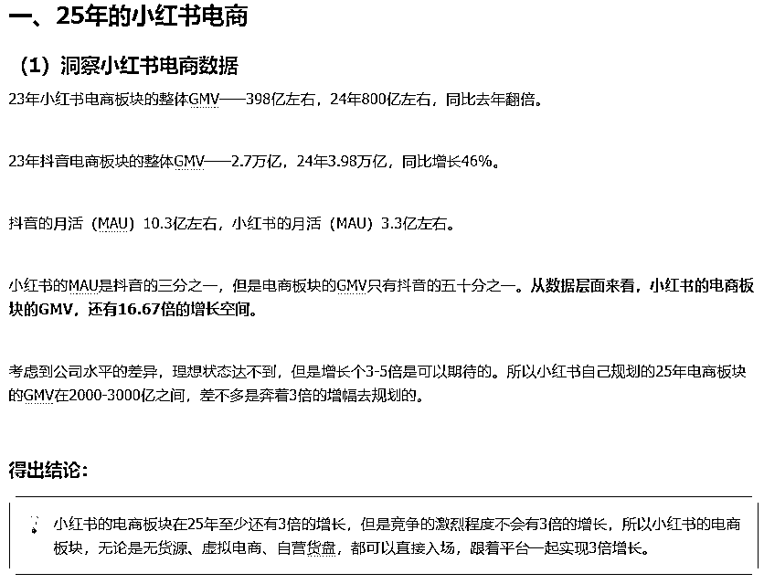
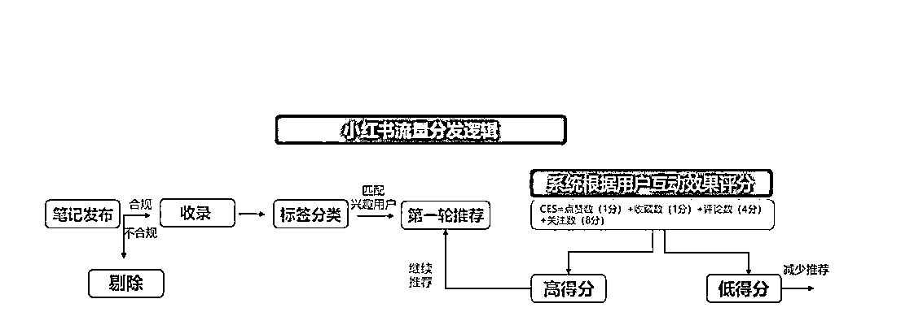
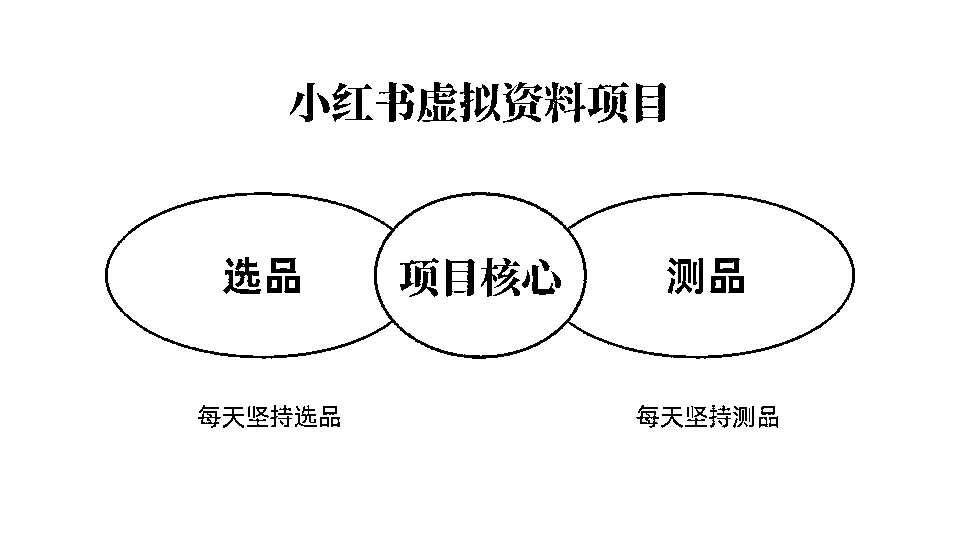
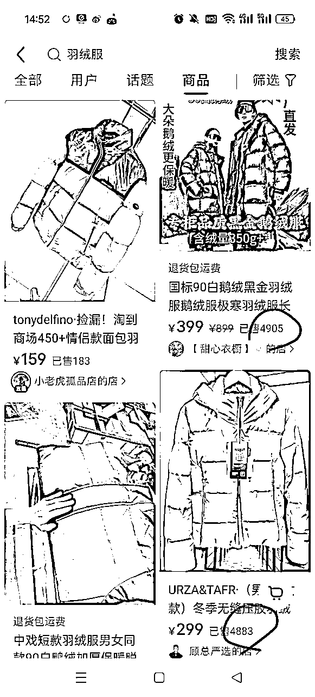
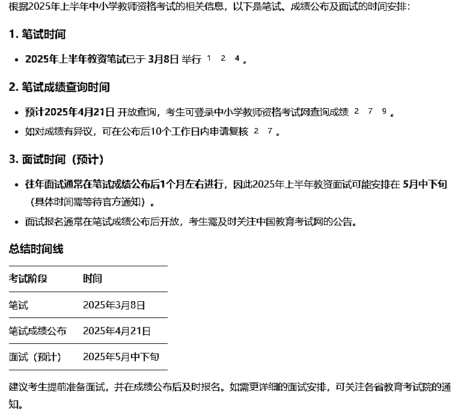
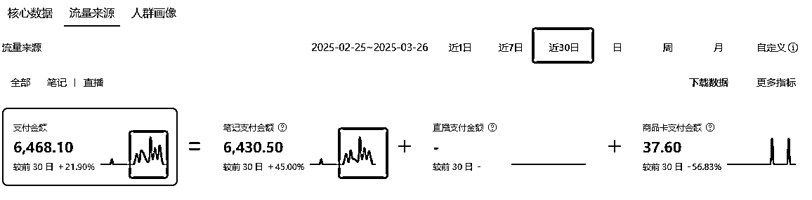
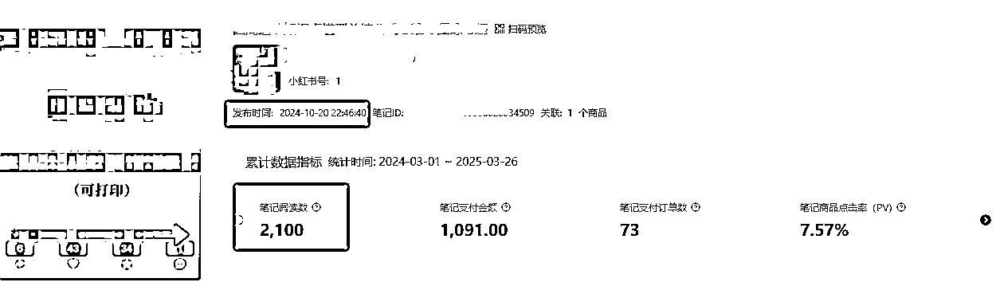

# 如何提高做📕虚拟电商的成功概率？

熟悉📕生态的朋友，应该都听说过“虚拟电商”这个赛道。最近越来越多人在问：现在入局到底晚不晚？实际赚不赚？我认真研究了圈内一位实战派教练的复盘，发现里面有几个观点，非常值得拿出来聊聊。不是操作层面的琐碎技巧，而是认知层面的关键判断——看完你会少走很多弯路。

先说结论：📕的虚拟电商，未来还有很大的想象空间。根据平台的电商布局和近期的政策动向，整个📕电商板块在2025年很早之前就被预测会有非常明显的增长，而虚拟电商作为其中的一部分，自然不会掉队。事实也证明，平台确实在不断加码相关功能，这个趋势已经很明显了。

很多人一提到📕卖虚拟产品，第一反应还是“引流到私域成交”。这是绝大多数人的惯性思维。但说实话，这种玩法不仅麻烦，而且是在跟平台规则对着干。店铺的开通成本很低，转化路径也短，更重要的是，开店是顺应平台鼓励的方向，从转化率到信任度，都远胜于把用户拖到🛰️。用户加了🛰️不代表就属于你，真正的价值是用户愿意在平台内直接下单。所以，那些还在执着于私域的人，跟认真开店的人根本不在同一个竞争维度上。

另外，虚拟产品不等于教辅资料、学习资料。只要不需要快递物流就能履约的订单，统统可以算作虚拟产品。这是一块巨大的隐形蛋糕，那些被大家吐槽“卷到不行”的资料类目，实际上连一角都算不上。尤其是现在有了AI工具的加持，完全可以按用户的具体需求快速产出对应的数字产品。就像AI代写，本质上也是虚拟产品，只是需求更定制化。记住，不是“你有什么卖什么”，而是“用户要什么，你就做什么来解决他的需求”。

所以我的判断是，📕虚拟电商至少还有一年半以上的红利期。在这个窗口期，只要持续发笔记，哪怕笔记质量不是顶尖，也有机会赚到钱。甚至可以说，凡是围绕📕展开的项目，目前都可以大胆入场——📕本身，就是一种红利。

但很多人的卡点，并不是项目不行，而是“笔记小眼睛太少”。这里要分清平台的两种流量逻辑。

推荐流量，占平台总流量约三成。它的核心是你刷到笔记，也就是笔记主动来找你。平台会用赛马机制来判断笔记好坏：先把笔记推给一小波人，比如50到100人，看他们的点赞、收藏、评论、转发等行为，再给笔记打分。分数高，就推给更多人；分数低，就停止推送。这个过程中充满不确定性，因为算法推给谁不固定，即便是两篇完全一样的笔记，也可能有一篇爆，一篇没动静。而且同一个人在不同时间心情不同，看到笔记后的反应也可能完全不一样。所以不要发了几篇没流量就喊限流，更不要因为一篇爆了就觉得自己多厉害。

想对冲这种不确定性，一是靠数量，多写多发，总能碰到对的人群和时间；二是靠投放，人为校准目标人群。

搜索流量，才是📕真正的大头，占总流量约65%。它的核心是用户主动搜，也就是人找内容。想要在搜索结果里排前面，主要看三个要素：关键词匹配度、搜索满意度、笔记发布时间。关键词匹配度靠你提前布局长尾词；搜索满意度靠笔记质量，用户愿意停下来、点进来看、跟你互动；发布时间则是平台会给新笔记一些倾斜，所以老笔记适当二创重发也有好处。

同时你要明白，搜索排名不是固定的，不同人搜出来的结果不同。发完笔记不要反复去搜自己的账号，搜不到就心态崩了，其实没有意义。只要关键词搭好、内容过关、发布时间合理，没有违规，那流量一定会来，只是早晚的问题。搜索流量有很强的滞后性，通常发出去之后，前几天的推荐流量是主力，但真正稳定的搜索流量，可能要等一到三个月才慢慢起来。很多人以为没流量，其实是把推荐流量和搜索流量搞混了。

这里还有个反常识的点：小眼睛多，未必是好事。平台卖货只有两条路，一条做大流量基数，以量取胜；一条做精准流量，以高转化率取胜。后者永远优于前者。流量一旦变大，一定意味着人群开始泛化，吸引来的多半是看热闹的，不是买货的。为了博眼球，笔记内容容易走偏，最后账号还容易违规。那些小眼睛暴涨的笔记，往往只是自嗨，并没有对应真实需求。而硬广商品笔记，虽然天然流量低，但来的全是精准客户。一个小眼睛的价值，可能比一万个泛粉都要高。所以不要觉得“先做内容养号，再挂商品链接”才是对的，直接挂商品，才是拿最有价值的流量。

记住一句话：在平台上做生意，核心动作就两个——选品和测品。其他花里胡哨的操作，都不重要。

选品从来不是看某个品过去卖得好不好，而是看这个品背后的用户需求，在当下和未来是不是在涨。比如现在棉服羽绒服数据再好，你也不会在这个时间点去卖，因为需求季节过了。虚拟产品也一样，教资笔试刚结束的时候，你去卖面试资料，发现卖不动，为什么？因为笔试成绩还没出，大家不确认自己能不能过，根本没心思准备面试。这就是没有抓住用户需求的动态变化。

这里分享一个很实用的DeepSeek提示词，帮你拆解每个品的真实需求，可以作为选品参考：

“我现在做在📕开店卖虚拟资料，看中一个品，是xxx。现在我想知道四个问题，请你详细帮我分析一下，便于我去决定要不要选这个品，以及便于我后续去做内容。第一个问题：什么样的人会来买这些资料？第二个问题：他们买这些资料用来干什么？第三个问题：他们在什么时候买这个资料的可能性最大？第四个问题：他们对这个资料的需求是怎样随着时间线进行变化的？”

记住，选品不是选品，是挖掘需求。

很多人卖不出去货，总觉得是笔记质量不够好。其实你想反了，如果你笔记质量真的差到没法看，你根本就不会发出来。大多数时候，你发的笔记跟同行没什么差别。真正没流量的原因只有两个：第一，你发得不够多。你看同行发一篇爆一篇，以为人家天赋异禀，其实人家背后是几十上百个矩阵号，几百篇笔记在轰炸，你只看到了其中爆的那几篇。没有数量做支撑，谈质量就是耍流氓。第二，品本身没有当下的热度需求。笔记是品的展示形式，品没有需求，笔记哪来的流量？

还有一点，时间是最大的壁垒。很多人不是能力不行，是不愿意在一件事上持续投入。而时间会奖励那些不放弃的人。有人去年十月份做了一个品，当时笔记发出去就几个小眼睛，偶尔出单，不温不火。后来都快忘了，但几个月后，这个品突然开始每天出很多单，之前那些只有十几个小眼睛的笔记，慢慢涨成了几百、几千。之所以爆发，是因为用户需求周期到了，而你只需要没有把它删掉，交给时间就好。只要选品时挖清了动态需求，笔记又不是自己随便乱写的，那现在的没出单，一定只是延迟出单。

最后，想劝大家一点：判断任何事情，都要多次实验取平均值。别因为用蓝V号发一篇笔记流量少，就说平台限流；用普通号发一篇流量多，就说蓝V有额外权重。这种单次实验没有意义，偶然性因素太大了。要尊重客观规律。比如“挂了商品链接会被限流”这句话，就经不起推敲。你仔细想想，平台现在巴不得商家多开店卖货，怎么可能因为挂商品就故意压你流量？挂链接确实会影响流量结构，但很可能不是变少，而是变得精准，甚至带来更多收益。

与其被一堆未经思考的“注意事项”困住，不如把注意力放在选品、真实需求和持续测试上。这个项目的本质，并不复杂。

📕现在把电商GMV当成主攻方向，我在笔记里挂上商品链接，本质上就是在帮平台完成这项KPI。反过来想，假如我的内容在同样曝光条件下，能带来更高的成交效率，平台有什么理由要压我的推荐权重？

# 五、收束陈词

想把📕做虚拟电商这件事做成，你得先搞懂平台是怎么推流的，不要被“小眼睛”太少这件事吓到。选品测试要一直做，做完测试就继续沉淀，坚持一段周期之后，如果数据还是上不去，欢迎回来找我算账。

落幕收工。

如果你读到这里感觉有点用，

就给我一个赞吧，

感谢你的支持！