# 无痛跳槽到📕做高客单，我是怎么把龙哥盟用活的

大家好，我是珍妮子。借助龙哥盟，我完成了一次几乎零成本的职业切换。现在的主线业务，是为那些已经跑通0到1的高客单IP做流量放大和私域成交，并从中拿到签单提成。涉及的赛道包括留学、旅行、房产、教育等多个高客单领域。

与此同时，我也带着一群擅长做流量的操盘手一起成长。他们的问题很像：会做流量，却找不到能复利的项目；账号没有鲜明的IP标签，只能靠低价比拼，每天盯着手机秒回消息，评论区还随时被同行截流。

我的做法是让他们先脱离那种没有IP加持的项目，跟着我去撬动“已验证”高客单IP的影响力，从而吃到签单提成。

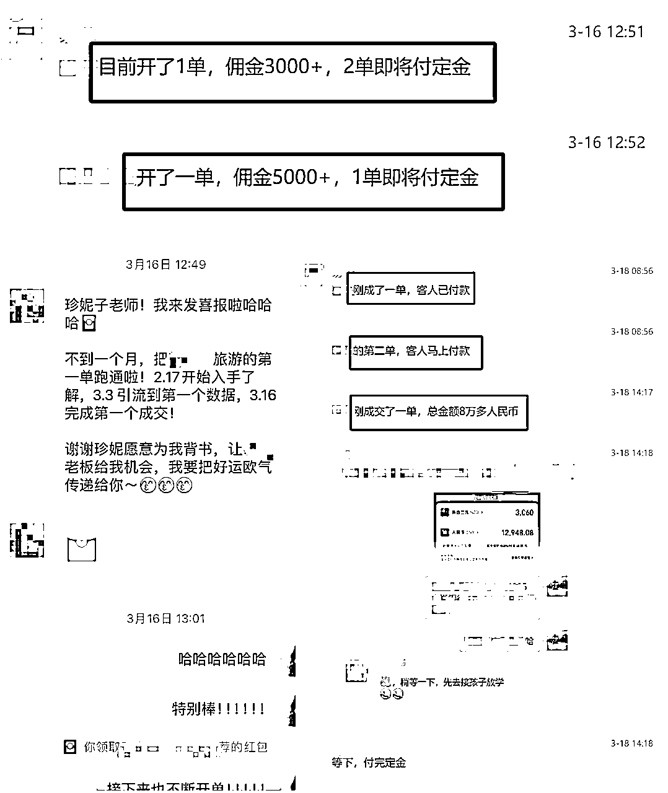

另外，我也在帮那些“流量不精通，但想靠高客单项目变现”的朋友。我把过去几年沉淀的「📕70+高客单赛道实操SOP」打包拿出来，带他们快速入门流量运营。

节奏是先从我筛选过的、门槛低的📕代运营类项目做起，先拿基础服务费，再拿成交分润，把获客的路子跑熟。等上手了，再逐步进攻更高难度、更高客单的IP项目。

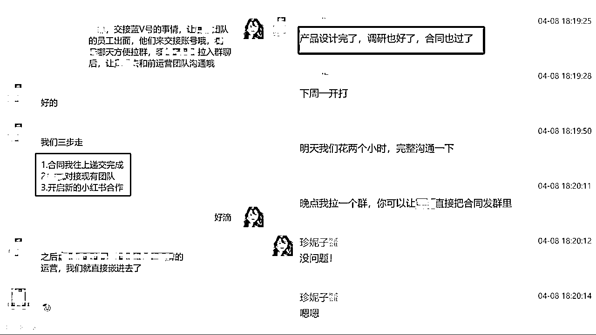

2022年我入圈龙哥盟，中间经历过一次创业高光，也遇到过被迫转行的低谷。可以说我经历过的每个项目，都离不开赚钱的加持。在这里我找到了好项目、靠谱合伙人，也有了随时能交流的同行者。遇到运营卡点时，赚钱里总能搜到对应的干货，甚至直接找到幕后作者沟通。

今天就具体聊聊，想无痛转行去做📕高客单业务，该怎么用好龙哥盟。

# 赚钱新朋友，这份使用说明书给你

## 适合谁、能解决什么问题

想转行但无从下手

你主业稳定但想开辟第二曲线，文中会拆解如何做到平滑过渡。

找不到合适合伙人

项目启动了却不知道找谁一起干，这里会讲如何甄别和吸引能同频的伙伴。

项目卡在1后放大不了

0到1做到了，想做大却缺同盟者的思路。

怕被大佬合作后淘汰

遇到愿意带你的前辈，又担心被替代，会教你如何持续获得信任和支持。

目录如下：

1. 我的转行实录

1. 主业在走下坡路，想无痛转行做副业，怎么用龙哥盟？

2.1 赚钱上分享即是收获

2.2 在赚钱里找到对的人：观察、再观察

2.2.1 看ta在赚钱的足迹

2.2.2 看ta在群里的提问和发言

2.2.3 看ta的真实行动

2.3 选定人选和项目后，这套心法助你转行

2.3.1 输出情绪价值，不索取情绪价值

2.3.2 输出实用价值

2.3.3 输出资金和资源

1. 附录1：我快速读赚钱文章的小技巧

1. 附录2：我和合伙人的转行故事

# 转行经历

我是珍妮子。2022到2023年，我在📕留学赛道自营+代运营，累计做到约2700万营收。2023年，我听了贵人姐姐的IP课，提前感知到留学赛道将要下滑，焦虑感上来后立刻决定转型，试了几条路都磕碰不断。

转机在2024年到来，得益于龙哥盟。我从代运营切入📕房产单边代理，两个月内帮老板成交约1亿的房源。此后陆续有赚钱里的老板约我合作，做完一个接着一个。

在赚钱，我认识了大量可靠的同行，于是顺利完成身份转换，现在已是做高客单操盘的公司创始人。我们团队的核心工作，就是为已跑通0到1的高客单IP解决流量增长和私域转化问题，并从中获取提成。

想了解更详细的转行过程，可以看我和合伙人在赚钱发布的帖子，链接在文末。

# 主业在衰退，想无痛转行做副业，怎么用好龙哥盟

## 分享即受益

2022年加入龙哥盟后第一年，我几乎潜水，只把赚钱当成资料库。看到感兴趣的赛道，就去检索学习。

2023年，我开始思考：我也可以输出价值。于是我发了第一篇帖子，复盘了我和合伙人陈铭Ivy从0到1搭建团队的方法。

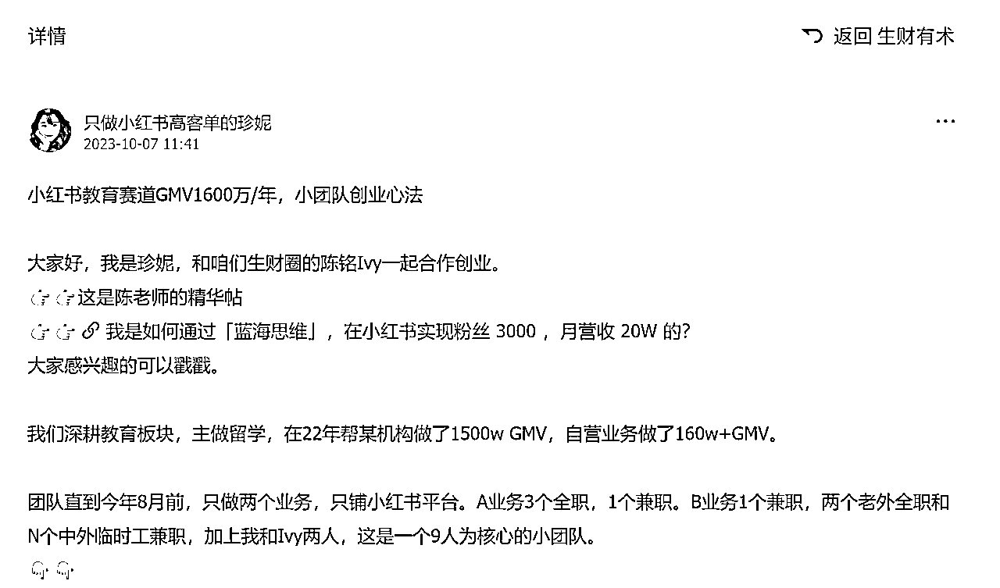

帖子被评为精华，留学赛道的老板纷纷加我🛰️，其中还有平时只存在于新闻里的头部大厂负责人。后来我们建立了合作关系，变成了利益共同体。

同年，我把对留学各细分赛道的实测结果做了整理，有的赚钱、有的亏钱，汇总成一份「老板避雷手册」发在赚钱，没想到反响很大。

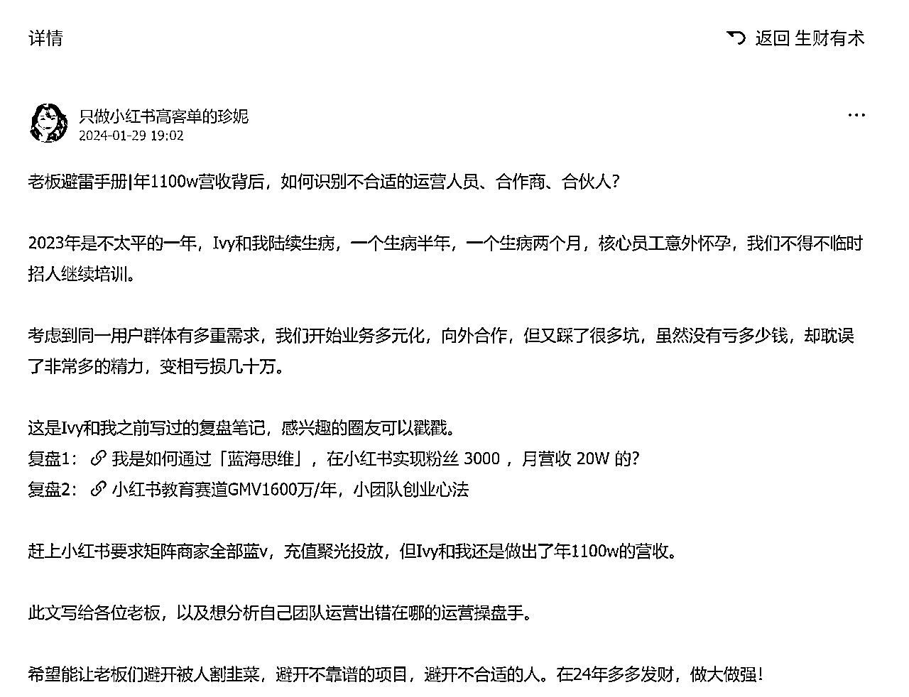

这份手册也成为我后面顺利转行的关键资产。因为它爆了，我受邀做赚钱直播，曝光度提升，也因此结识了现在的合伙人。

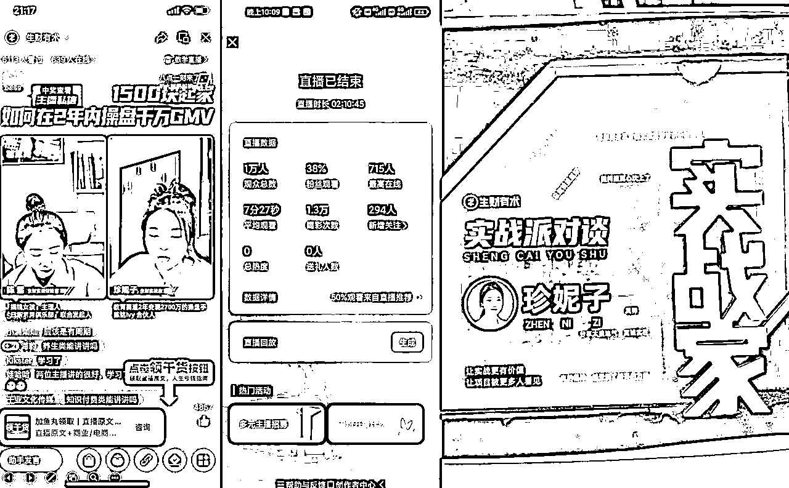

## 在赚钱里找到合适的人：观察三步法

### 观察ta的赚钱足迹

看到一篇高质量精华，我会把作者历史帖子全部翻一遍，看他做过什么。听到圈内大佬也在赚钱，我就会去星球检索昵称，看他的发文记录。还会留意他在评论区的互动方式，情绪平稳、有礼貌的人，我会主动约聊。

### 观察ta在社群的发言与提问

确认意向对象后，我会去传术师群、航海家群等社群，看他日常发言的风格、情绪状态和提问质量。

有一次朋友想跟投某个项目，我提醒他别去，并把我在社群里观察到的对方沟通截图给他看。朋友听了，换了另一个项目，最终实现60万佣金收益。

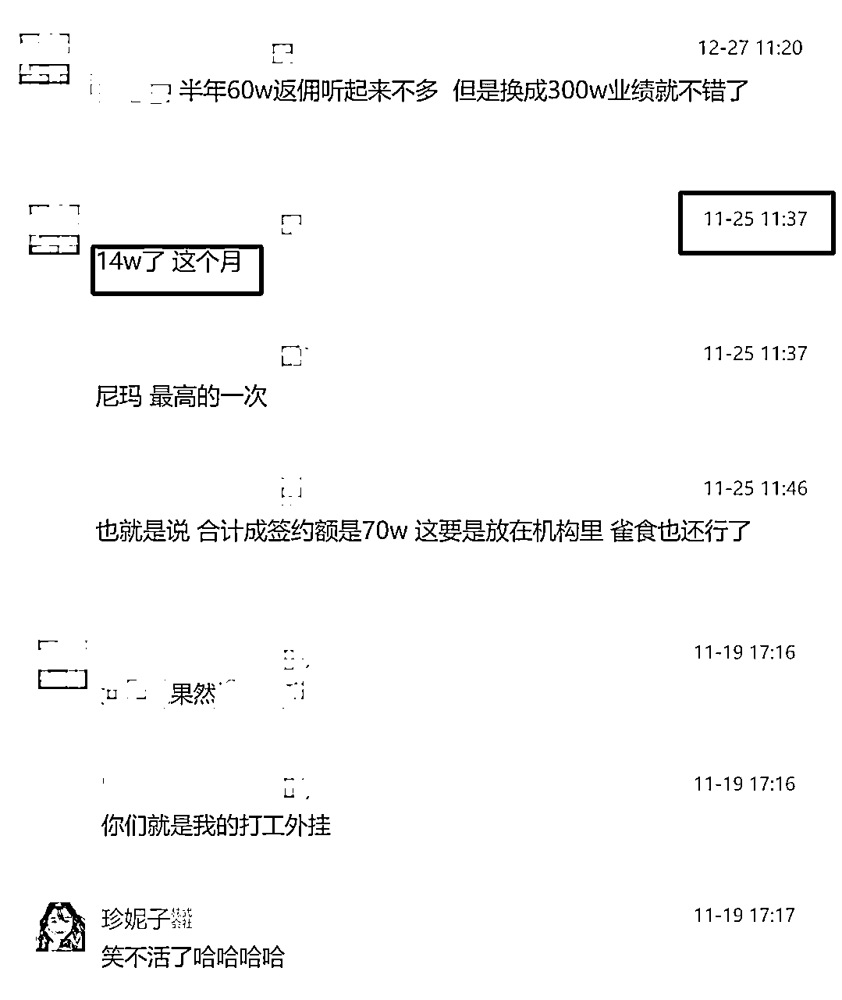

### 观察ta的实际行动

核心就两件事：花钱和行动。

比如我在赚钱认识一泽。

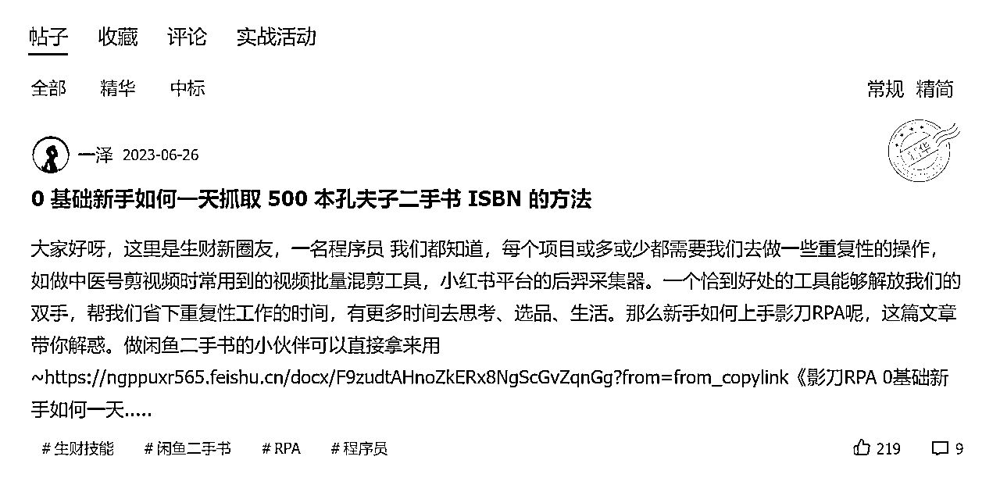

看完他在赚钱的分享，我顺藤摸瓜看了他B站的内容，觉得很靠谱。于是我付费请他定制了专门面向📕运营者的扒数据工具，去掉了冗余功能，只保留获客分析。

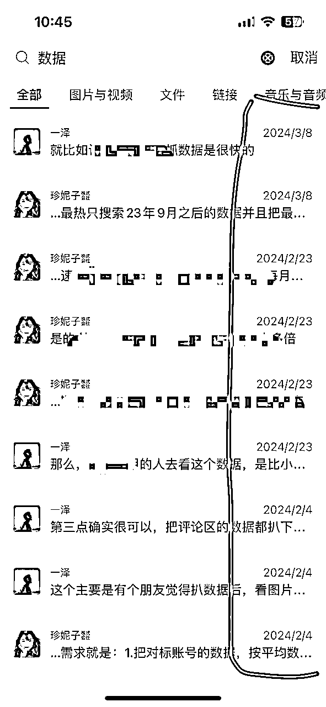

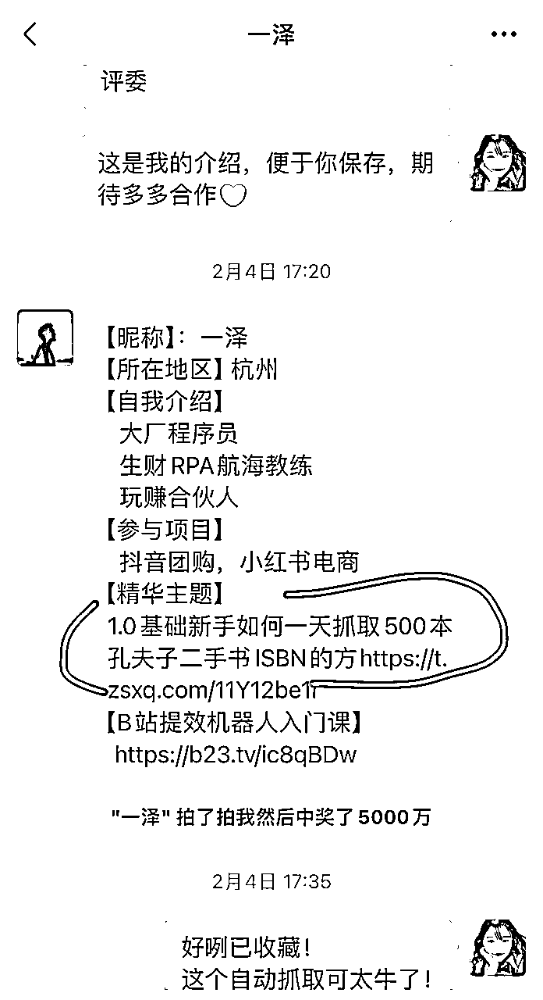

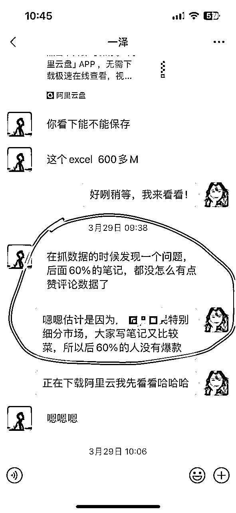

沟通是在年前开始的，我并不急，但他推进极快。我们一起明确了老板和新手真正需要的功能边界，他能做什么、做什么会降低体验。我通过付费合作更贴近了解了他。他非常负责，工具价格远低于市面同类，性价比极高。

买完后我没再操心，没想到他后来还主动迭代了新功能。

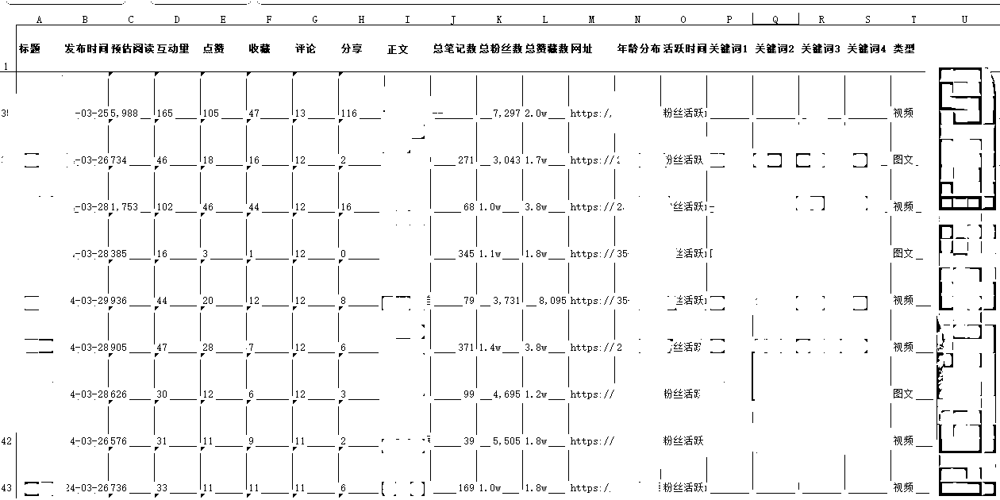

除此之外，我还长期默默观察别人的行动力。有人说想学、想做好，却从未开始；有人坚持几天就放弃；有人边做边抱怨；有人今天A明天B不聚焦。而优秀的人，比如我观察的易寒老板，他在赚钱分享了从211事业编辞职、在新西兰做旅行社的起伏。

我当时随口提了一句旅游行业必须整顿交付端、必须做IP。他真的回去把交付端重做了。

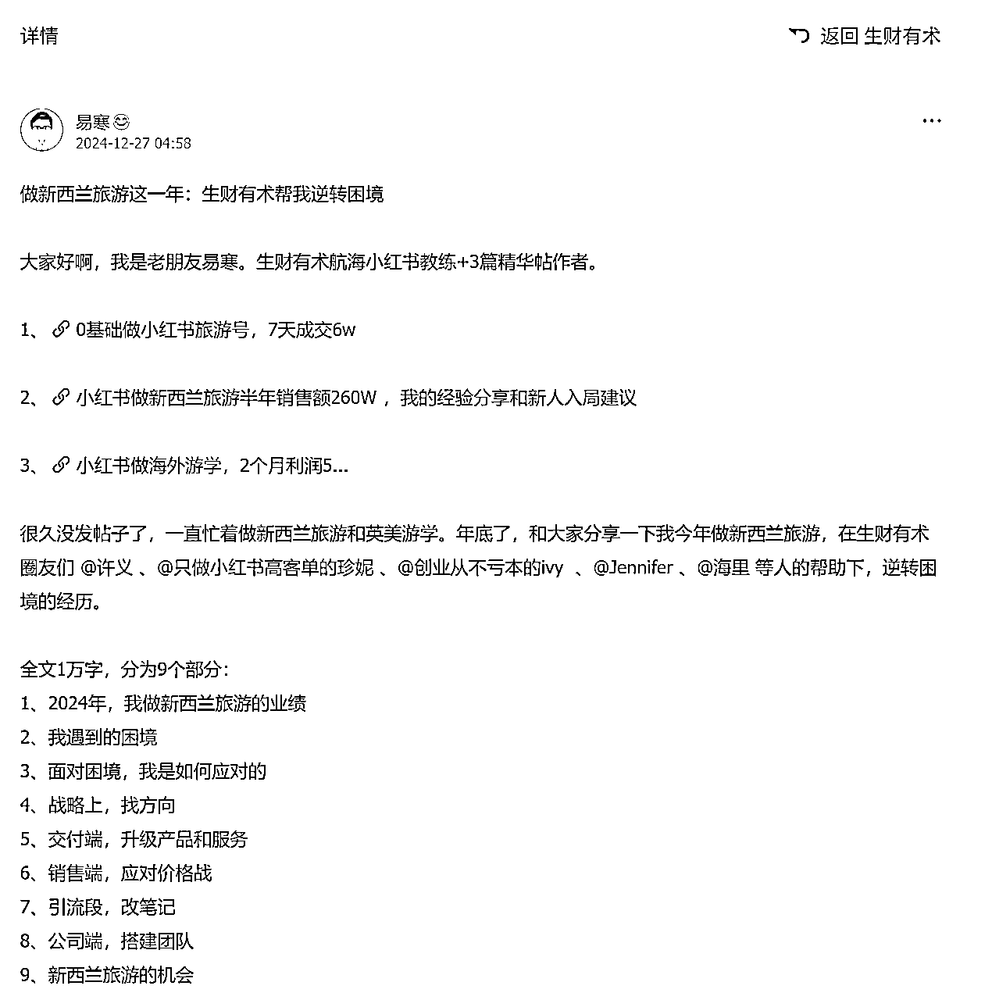

就这样，我通过赚钱认识了易寒，现在我正帮他在境外商家做📕代运营。

通过付费和观察行动力，我筛出了真正能合作的人。后来我又在房产单边代理业务里遇到现在的运营合伙人，他踏实、执行力强、风控意识好，正是我长期寻找的类型。我创业多年想培养，也不如直接从赚钱圈子里吸引过来。

能顺利转行、组建战队，核心在于我在赚钱持续分享经验扩大影响力，让合适的人来找我，再由我筛选出真正能同行的人。时间会帮我把合适的人留下来。

## 选定项目和人后，用这套心法转行

心法分三块：给情绪价值不索取、给实用价值、给钱和资源。

### 给情绪价值/不索取情绪价值

正确做法：

1）自己情绪自己消化，别把负面情绪甩给跟随你的人。消化不了就看专业理论，比如石剪布相关内容，降低心气。
2）有能力就花钱买心理咨询，别硬扛。
3）想展示成功，就请客送礼，把钱花出去，而不是只让人听钱袋子的响。

我在转行期大量加班，带娃陪家人的时间被压缩，很多是家人在付出。所以我更珍惜这份支撑。熬夜干活时，我会去娃粉星球反思，看到别人资源更好却心气更低，就提醒自己要更踏实。

转行困难时，我清楚自己是高攀了这个行业，辛苦是应得的代价。没有在赛道深耕，怎么可能赚钱？我从留学到房产的迁移，并不是因为我懂房产，而是借了老板的势能。我转行的速度能快一点，也源于2016年起就在新媒体长期练手，👸号、斗鱼、知乎都做过。

转行很难，尤其是有娃的女性创业者更难。遇到瓶颈就花500-700/小时找咨询师，比自己死扛强。

我同学里算混得不错的了，聚会我都买单准备礼物。想要不索取情绪价值，就要敢花钱。

错误做法非常多，总结下来就是总想让别人给你情绪价值，却不愿付出。

### 给实用价值

正确做法：

1）能干活，能打，能扛住。
2）主动汇报进展、卡点和解决方案。
3）盘点自身资源，问领导哪里能帮上忙。

转行必备素质就是能干、身体好、执行力强。我除了卷自己，还能5分钟内秒回金主消息，除非特殊情况。

我在赚钱发过留学赛道2700万营收后的趋势分析，爆了后被地产老板看到。他买了我一个付费社群，我在社群里一周六更分享赛道运营打法，他觉得SOP够细，给了我代运营费带我进入房产。

指哪打哪是基本功，但遇到判断与贵人相悖时，我也会试错。撞墙后我马上认错转账送礼道歉。

转行前先想清楚这三件事，否则你很容易“出局”

很多人以为转行拼的是机遇和冲动，但珍妮用亲身经历告诉你：转行这场硬仗，拼的是身体、心态和为人处世的底层逻辑。

**先把身体照顾好，别让“状态”拖后腿**

转行需要时间和大量精力，所以珍妮在日常保养上从不偷懒。晚上睡在砭石床垫上，白天坐在砭石坐垫里，脚下时不时开着足灸仪；每隔一段时间还要专门回长沙做身体护理、正骨和刮痧。她心里很清楚：只有身体状况在线，才能为别人提供价值。要是身体先垮了，对别人来说你还有多少用处？转行自然也无从谈起。

**向上汇报，不是让你表忠心，而是让贵人看见你的进度**

带她入行的房地产老板教过她一套工作复盘框架：主动汇报自己每天在做什么，讲清楚眼下遇到哪些阻碍、想解决什么问题，以及自己打算怎么解决。这套框架思维，她以前从来没有过。主动汇报不只是为了交差，更是为了借贵人的经验校准方向。

**主动问那句：有什么我能帮上忙的吗？**

每次开口之前，她都会先盘点自己手头有什么资源和能力，确认自己能匹配什么需求。有些事不需要等指令，要靠自己观察，发现能补位的时候，马上伸手。

---

**八种心态，中了两条，就先别转行**

1. 遇到麻烦不好好解决，一心等着贵人给自己兜底。
2. 没学会就怨贵人没“好好教”。可人家凭什么教？真想学，交学费回学校去。
3. 身体欠佳就三天两头请假，把“调理”当成了旷工的理由。
4. 赛道一不顺就想换赛道、抱新大腿，折腾一整年却什么水花都没有。
5. 仗着过去辉煌，觉得摆烂也无所谓，自己迟早能东山再起。
6. 见领导不管，就开心摸鱼划水。
7. 进度条不好看，立刻想着“关我什么事”，把责任推给别人。
8. 拿着不错的薪水就舍不得走，天天表演努力，能力却一直不涨，直到被出局都没想明白为什么。

珍妮说，这八条里只要占了两条，第一件事不是转行，而是调整心态。这样的状态特别危险，而且非常伤贵人缘。一个地位比你高、需要你去向上社交的人，一定在某些方面远比你有能力，你是在划水还是真输出，对方一眼就能看穿。需要向上社交，意味着你是这段关系里较弱的一方；弱者不仅不提供价值，还划水、不忠诚、想让人兜底，那等待你的只会是被淘汰。

更何况，弱者的忠诚不值钱——那只是弱者用来安身立命的救命稻草；强者的忠诚，才真正贵重。

---

**金钱和资源，该怎么给？**

正确做法有四条：

1. 无论自己的处境有多难，都别随便给贵人添麻烦。除非你给的钱足够多、带去的资源足够硬，才有资格“麻烦”对方。
2. 用心打造自己的影响力，让自己成为一个手里有资源的人。
3. 帮过你的人，要赶紧找个由头送礼、送钱。
4. 能顺手助人的时候别犹豫，达则兼济天下。

珍妮转行时很少轻易开口求助。她每次准备向人求助，都会先问自己：我能和对方交换什么？我给的东西，真的是对方需要的吗？她平时也会花时间经营自己的影响力，因为她知道，任何关系要长久，就得是并肩同行，而不是强者俯视弱者。想掌握选择权，就要让对方多占点便宜。

转行的人，注定要先抱别人大腿，承认自己是弱者没关系，重要的是好好干活、积累影响力，慢慢变强，然后回报那些帮助过你的人。这样关系才能越走越远。

她赚到钱以后，会特意找机会给贵人送礼或送钱。情分是攒在日常里的，而不是等到危机出现才临时抱佛脚。

和家人相处，她也有一套不动声色的体贴。有次她收到一笔大额收入，知道公婆不好意思收钱，便借口自己的收款码出问题，顺势给公公转了6万块；公公想把钱还给他们，她就和老公说：“现在收不了钱，先放您那儿。”婆婆过生日，她到老凤祥买金饰。道理很简单：婆婆平时就爱送老凤祥的金饰，一个人送什么，往往代表她自己也喜欢什么。她那些送香水、送彩妆、送鞋、送养生品的朋友也一样，她照着对方喜欢的品类去回礼，准不会错。

她还在闲鱼上长期用9折价格收家门口超市的购物卡，再充进婆婆的超市账户，方便老人家日常购物。

为了把礼物送到心坎里，她准备了好几个方向：入了一款大健康产品的代理，可以便宜买到靠谱的无烟艾灸仪、砭石坐垫、砭石床垫；特别爱买砭石坐垫送给需要久坐的人，因为真的好用且不上火。如果家人怕她花钱，她就直接送金条，再搭上几百块买条烟或秋衣秋裤。遇到爱漂亮的女人，就送化妆品、饰品、鲜花——她们喜欢送什么，她就照着那个方向去选。

这就是她理解的“达则兼济天下”。帮别人，其实就是在给自己积攒好运；好运不是求来的，是靠“给别人带来多少好处”换来的。

她在南山文体中心旁听到有人唱歌，会给歌手打200块钱。那里听歌的人很多，唱歌的人很少；她觉得自己虽不是大富大贵，但日子已经比许多人好了，没给社会帮上太多忙，那就让歌手多唱几首，让深圳打拼的人多一点快乐，这总做得到。

点外卖时，如果外卖员填错地址却还是把餐送到，她会发红包，还专门给平台打电话，点名表扬这位外卖员。

在广州买房时，房子急着出租，小细节没处理完又没时间，她便请中介帮忙，然后寄了几百块草莓到门店，特意让店长和同事们一起尝。店长自然会觉得：这房东真用心，还给中介送礼。服务业的人很看重客户评价，方便做宣传，所以她还会给中介写长长的好评，方便对方拿去介绍自己。

也正因平时攒下这些情分，她转行时有一次差点因身体缺氧出事，恰好晕在正骨医生的床上，被第一时间救了回来；每次遇到危机，也总有人及时帮她一把。

---

**金钱和资源的错误用法，同样致命**

- 觉得对方找你合作就是有求于你，哪怕人家请吃饭也看不上；就算自己跌进泥里，也曾是天上最耀眼的那颗星，开口就是“你算老几”。
- 自己什么都不懂，只是日子不好过，就给下面的人猛加KPI，结果钱花了、活没干成，局面越搞越烂。
- 自己懒得要命，却天天抽鞭子催别人干活；工资不涨，还不满马儿跑不快。
- 自己多吃多占、不思进取，反过来指责下属不够努力。
- 拿着老板的钱做自己的事，还侥幸地想：他应该发现不了吧？
- 完全不关心钱和资源到底花在了哪里。
- 抠门到极点，钱进了口袋就出不来；别人为你花一万，你为别人花一百都心疼，恨不得全世界都归自己。

珍妮提醒：以上只要占两条，就很危险了，转行失败的概率高达99%。

---

**附录一：怎样快速读懂一篇文章？**

珍妮摘抄赚钱文章时，会按六个维度来记录：

A. 文章标题  
B. 发布时间  
C. 文章链接  
D. 文章框架  
E. 我觉得有用的观点  
F. 我觉得有用的证据  

为什么这么分？记标题，是为了琢磨别人怎么取精华文标题，以后自己写时也能模仿；记发布时间，是为了判断内容有没有时效性，会不会过时，还是可以当成经典反复看；记链接，是为了有疑问时能一键跳回原文；记框架，是为了快速理出文章结构，找到重点；记“有用的观点”，是为了提取适合自己赛道的信息；记“有用的证据”，则是把观点对应的正文存下来，随时回看，加深理解。

除了读文章，还要琢磨运营者背后的思路。只有理解对方为什么会这样设计，你才能拥有全局思维，知道劲该往哪使。

以龙哥盟为例：进圈后第一件事，是急着搜内容、刷屏吗？不是。一个圈子的创始人，一定会被成员反复问同样的问题，所以必然有新手指南；圈子里精华内容很多，精华中的精华在哪里？不同内容适合哪些人？运营者一定做了归类；几万人的社区，每天内容海量，这些内容如何分类、每个按钮代表什么意思？也一定会被讲清楚。想理解这些版块，最聪明的入口就是“置顶”部分——把置顶看完，关键信息也就拿到了。

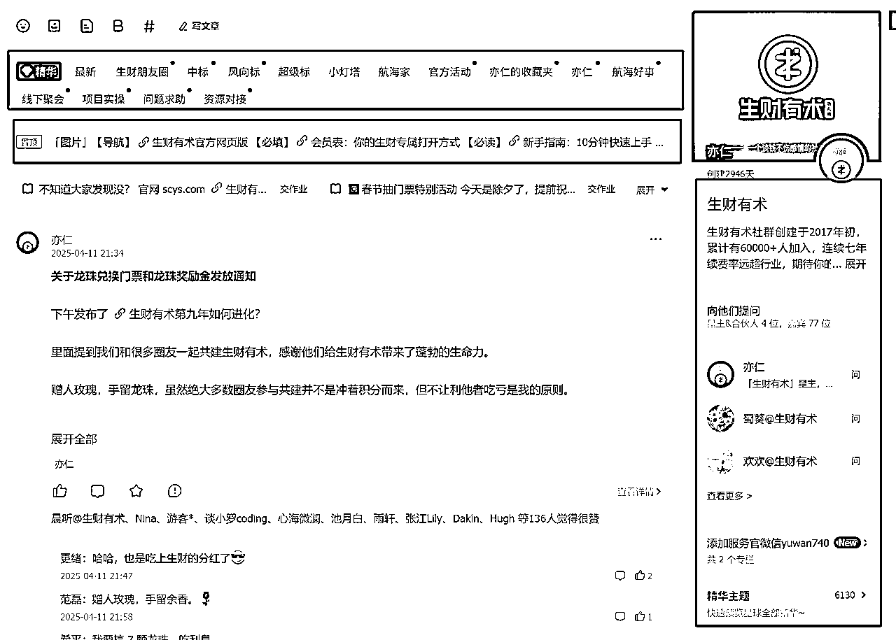

记住：进入一个新圈子，第一件事永远是看群规、置顶和新人指南。但总有人跳过这些，立刻开始问一些指南里早就有答案的问题。这样不仅效率低下，还会让别人觉得你根本不用心。想快速获取信息，别小看“置顶”两个字。

---

**附录二：珍妮的经历，都在这些文章里**

2022到2023年，她深耕📕留学赛道，两年做到2700万营收；2024年转战房产和旅游赛道，转行两个月就卖出1个小目标。她把经验写成了一系列文章，包括：留学行业趋势分析；📕教育赛道GMV1600万/年的团队心法；粉丝3000月营收20万的低粉高变现蓝海攻略；留学从业者转行至大蓝海后的复盘；哪些赛道该“提桶跑路”及蓝海在哪里；未来十年普通人还能走的高利润赛道——房产单边代理趋势分析；卖房单边代理的赚钱环节拆解；卧底深圳房产中介后发现的获客误区；海外旅游赛道的破局思路。还有一套“老板避雷手册”：教人识别不合适的运营、合作商与合伙人，以及运营端容易忽视的坑、合伙人产品要避开的雷区、如何招聘和筛选📕运营；以及“老板识人大法”和“老板家庭关系”等内容。

我是珍妮，很高兴在赚钱与你相遇。赚钱真的是一个能让命运转弯的地方。如果你也准备转行或发展副业，期待你能在这里顺风顺水。