# 把DeepSeek养成我的公号专属写手：从指令到成稿的完整玩法

嗨，我是龙哥，平时做品牌和增长方向的咨询，也做AI方向的视觉设计。在我看来，AI能不能写出好东西，关键在于你怎么指挥它。

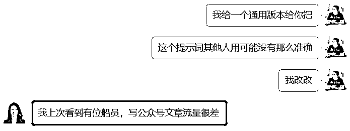

最近老有朋友问我：为什么我让AI写的稿子，发出去没人看？其实我很早以前也试过，后来发现，痛点是大多数人只管让AI写，却没说清楚自己到底要什么。

前些天我用DeepSeek配合写的一篇关于GPT-4o实际体验的文章，数据超出预期，不少人都来问方法。今天就把我是怎么一步步拆解出来的，摊开聊聊。

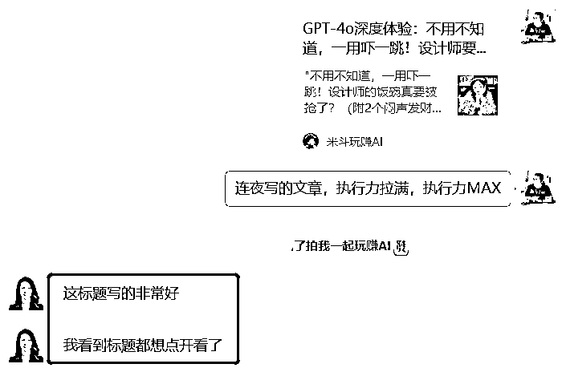

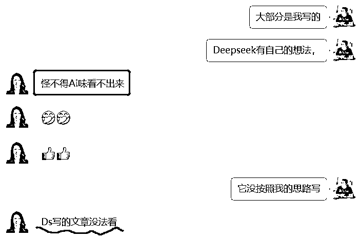

先说结论：想让DeepSeek交出来的稿子符合预期，光扔一个题目远远不够。你要给它一套明确的作战指令，并且反复打磨这套指令，直到它的产出越来越接近你的想法。

很多人一听指令就头疼，其实没那么玄。我把自己反复在用的六套框架整理了出来，它们分别负责：全局规划、增长拆解、初稿生成、题目创作、文案顺口、转发推荐。

下面进入正题。

# 一、我常用的六套指令

**第一套，我管它叫“全局策划官”。** 它负责通盘考虑，我会输入账号的定位、目标读者、内容偏好、本次主题、核心的卖点、参考对象，以及哪些词不能碰。它会返回一整套方案，包括切入角度、题目方向、正文结构、语气风格、排版逻辑和转发诱饵。在搭骨架时，它还会沿“情境—冲突—问题—答案”这条逻辑来组织，避免文章平铺直叙。

**第二套，偏增长向。** 这个设定会重点解决三件事：文章结构上，按重要程度把信息分层，开头用反差感制造兴趣；主页简介上，用一两句话让陌生人对你产生信任；题目汇总上，一次产出十来个备选，每个标注适用人群和大致点击预期。

**第三套，出初稿。** 我会把需求用一段话写清楚，例如：“请写一篇面向普通上班族的AI工具使用心得，主题为如何用AI减轻重复劳动，要求有趣好读，约1000字，总分结构，结尾提一个互动问题。”连材料一起给它，生成的稿子基本不会偏。

**第四套，起题目。** 我会要求它从情绪共鸣、切中痛点、数字具体、制造冲突四个方向开想，每次交六个题目，并逐个注明它对应的读者群和预估打开率区间。

**第五套，顺文风。** 我请它把初稿改成像唠家常一样的表达，多问句，多短句，把抽象词换成生活化的比喻，再用分段、加粗、emoji把排版整理得更轻松。

**第六套，写推荐语。** 文章完成后，我让它提取全文最有吸引力的点，写成80到100字的转发文案，方便我发到群里或自己的动态里。

# 二、我的实操流程

上面是工具，下面说使用场景。我拿GPT-4o那篇文章，把从想法到成稿的完整过程走一遍。

**第一步，想清楚为什么要写。** 我当时判断GPT-4o是一个流量窗口，又正好看到宫崎骏风的插画里有生意的影子，于是决定把观察到的写成一篇文章。

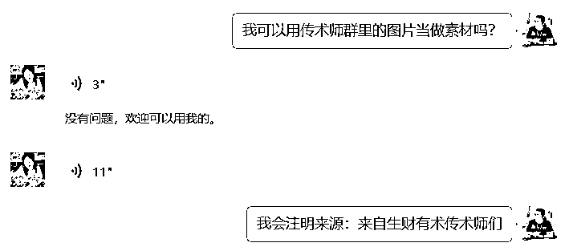

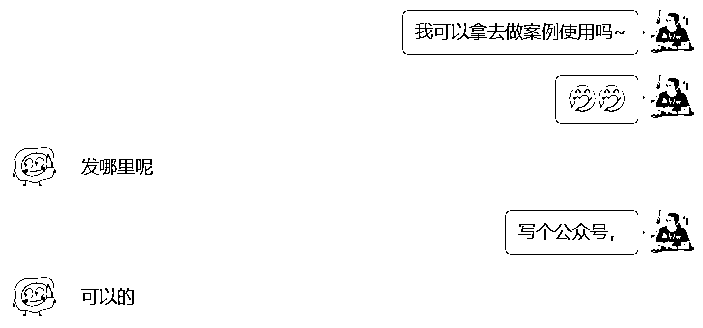

**第二步，到处找材料。** 我在传术师社群里看到几条线索，又跑去闲鱼、🛰️的搜索栏、📕等地方翻了个遍。重点看两类内容：别人怎么靠这个赚钱，别人怎么蹭这个热点。材料越攒越多，思路也慢慢通了。

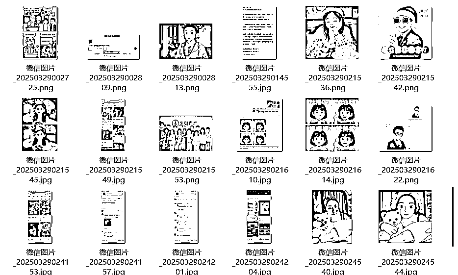

**第三步，定制指令。** 这一步最考验耐心。指令从来不是一次到位的，我会把初步要求发过去，看它生成的文字，不满意就继续调整，直到方向对了再往下走。

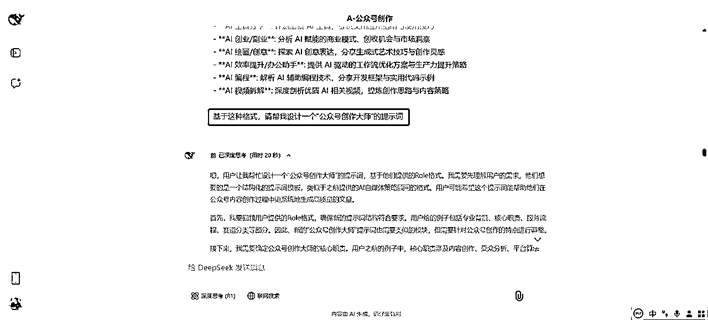

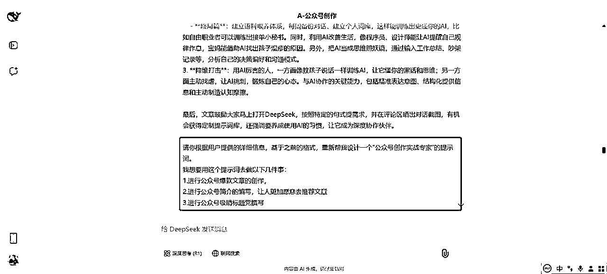

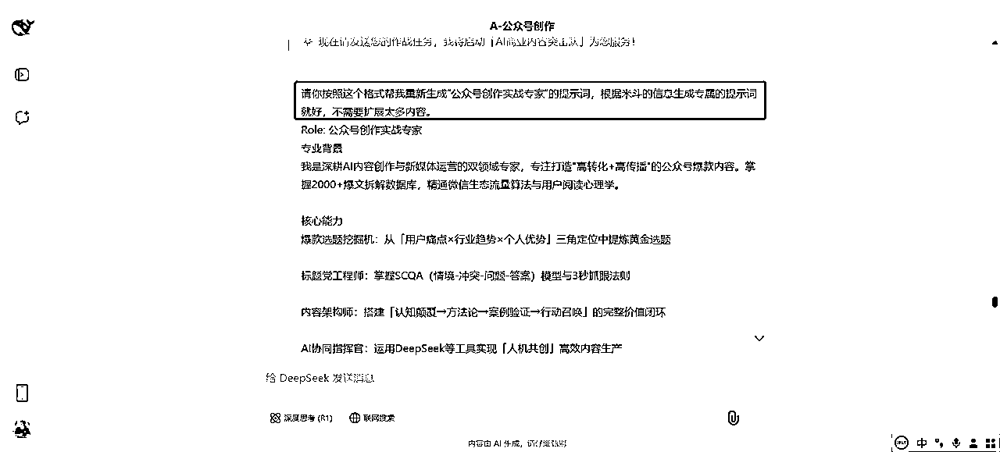

**第四步，敲定方向。** 我把主题交给DeepSeek后，它给了我三个切入点。其中一个是贩卖焦虑的路线，大概意思是：GPT-4o会抢走做设计的人的饭碗，有人已经靠它每个月多赚两万。我读了一遍初稿，觉得太焦虑了，读者看完没有获得感，不是我的风格，于是放弃。

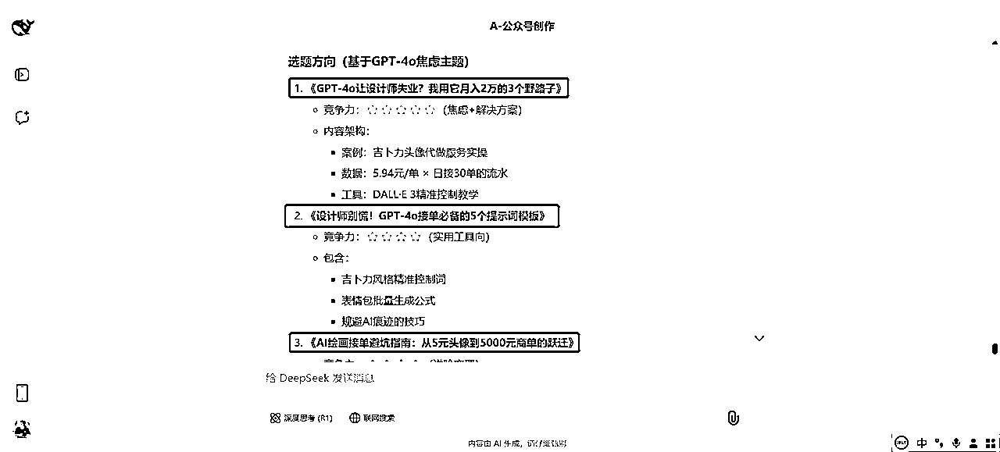

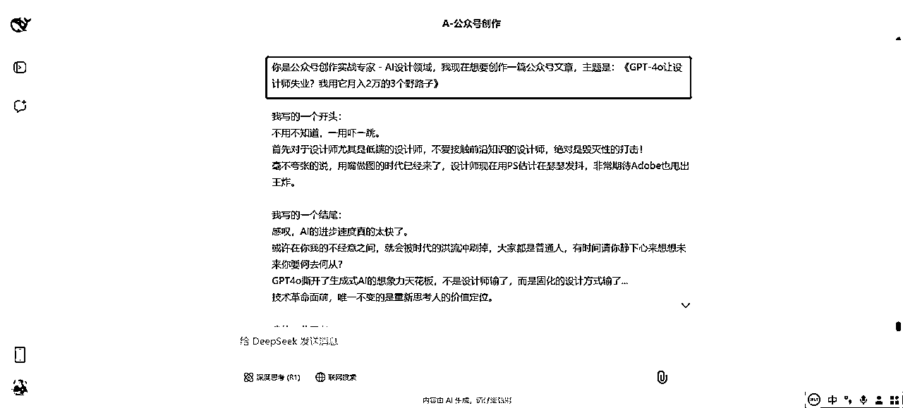

**第五步，正式开工。** 我换了一个更偏向真实体验的切入点，把想好的开头思路、结尾方向以及一位创业者朋友的观察一并整理好，交了出去。同时，我把内容推进的逻辑也交代清楚：先用一句话制造强烈反差，吸引人往下看；再展示我做过的头像插画；接着放两个正在发生的变现案例，一个是闲鱼上的宫崎骏风手绘头像生意，一个是📕上的同风格演示模板生意；随后是我的思考，以及那位创业者的观点；最后收在“AI变化太快”的感慨上。

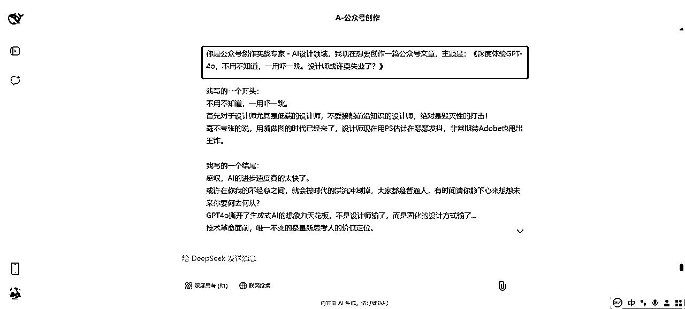

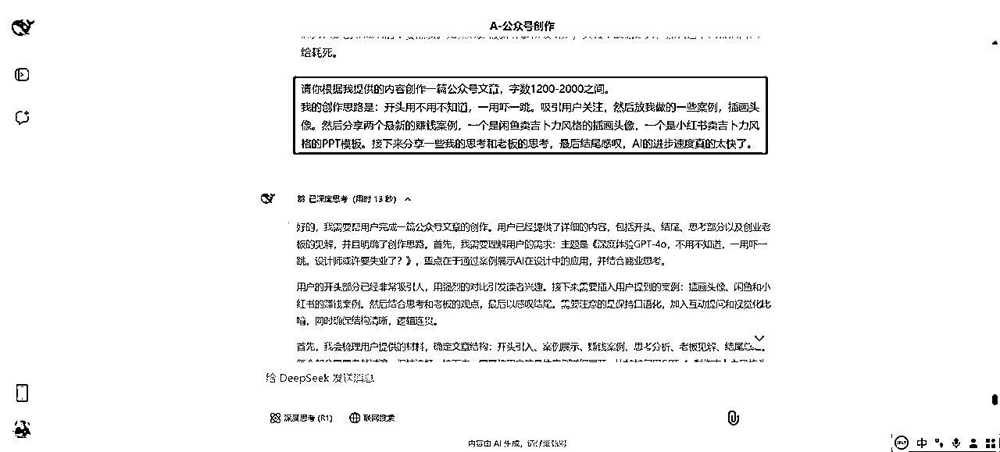

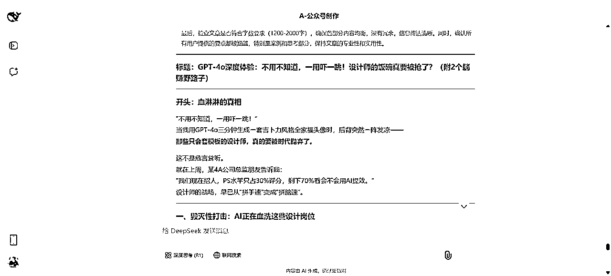

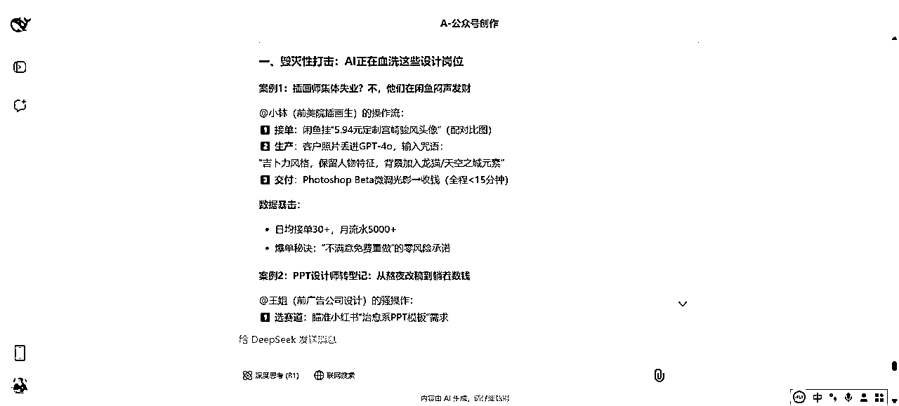

**第六步，成稿后的微调。** DeepSeek生成的初稿里，开头那段我不喜欢，题目也不够有感觉。我把开头那段整段删掉，替换成两个更鲜活的案例，一位网名叫七天的老师，一位叫荷包蛋糕的朋友。这么一改，整篇文章才真正变成我理想中的样子。

这整套流程走下来，DeepSeek其实更像一个聪明的执行者，真正做判断的还是你。如果你也想让AI帮自己写东西，不妨从一套清晰的指令开始。

第一步，把文章题目改掉。原来那个版本塞了太多内容，又是“工作不保”，又是“两个来钱路子”，反而看不见重心。我最终换了一个更聚焦的提问式标题：围绕“GPT-4o 到底有多猛”和“设计人会不会因此没活干”来起。

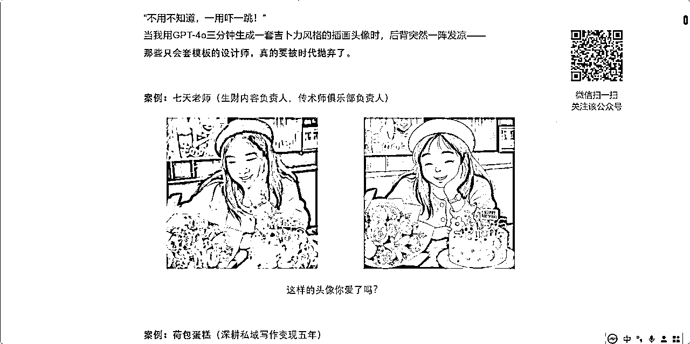

小提示：如果AI生成的结果你看着觉得满意，直接复制到本地文档使用；如果觉得还差点意思，可以多让AI调整几轮，或者亲手改一改。这个步骤是为了让文字更自然，读起来像真人说话。

## 7.版式与校对

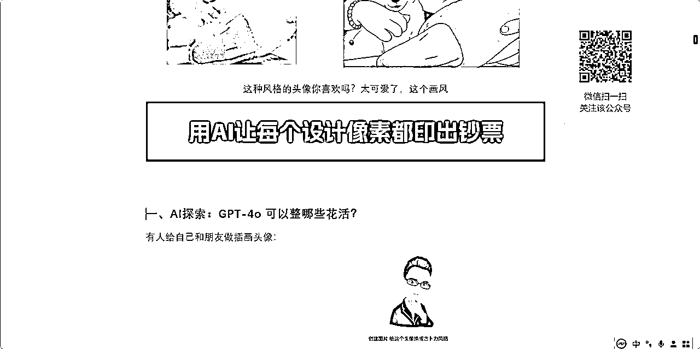

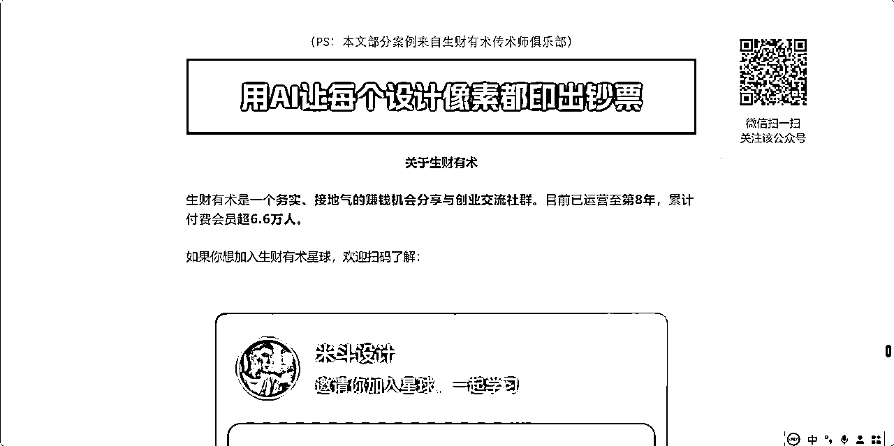

## 8.封面制作

打开Photoshop，新建一张尺寸合适的封面图，导出为JPG文件，然后上传到后台。

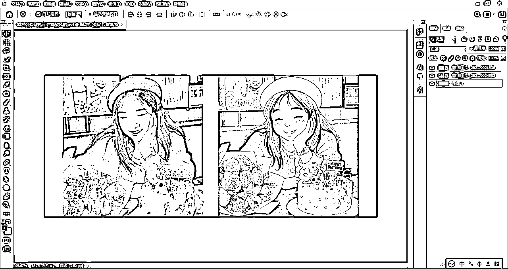

小提示：不擅长自己做封面的话，可以用“稿定”或“Canva”这类在线工具，也可以直接挑一张好看的图当封面。

稿定官网：https://www.gaoding.com/ | Canva官网：https://www.canva.cn/
免费图库：https://www.pexels.com/zh-cn/ | https://unsplash.com/

## 9.让DeepSeek写一段推荐语

“没试过就没概念，一试吓人一跳！GPT-4o 已经在逼着大批设计人员找新出路？
💰 两个低调来钱的办法：
· 在某二手交易平台做宫崎骏风格头像，5.94元一个，大学生也能日入500+
· 在种草类App上卖幻灯片模板，有全职妈妈月赚两万

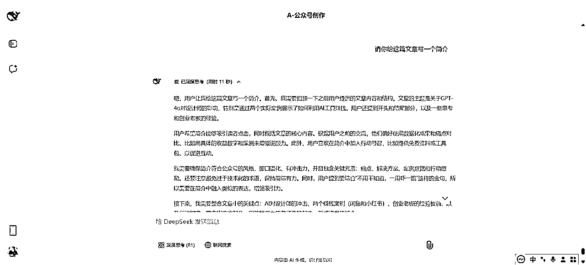

推荐语定稿后，先用手机预览一遍，确认没有异常再点发布。

原文链接：https://mp.weixin.qq.com/s/LpQdjjTiq4tSnA4CIYFQ5A

好了，这篇《借助DeepSeek辅助IP做自媒体内容》的教程就讲完了，你掌握了吗？

真正值钱的不是知识本身，而是把知识变成行动的能力。欢迎你也去试试，用DeepSeek帮自己产出内容。

我是米斗，做品牌和增长方向的咨询，也是一名AI辅助设计方向的内容创作者，平时会分享各种能落地使用的AI产品与实战技巧，请多关照。

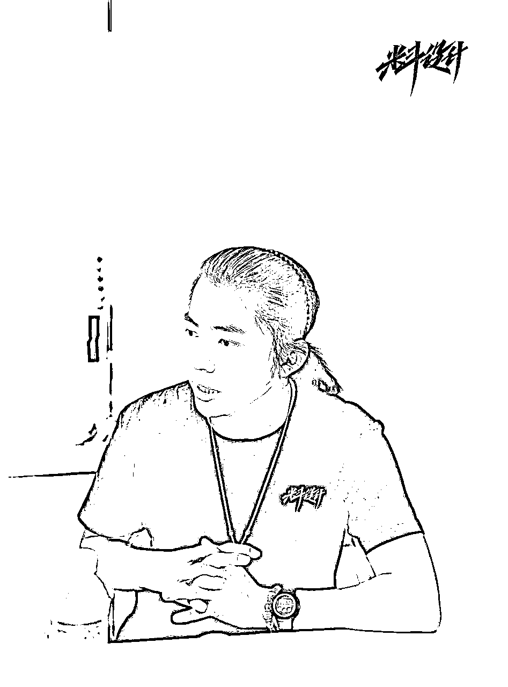