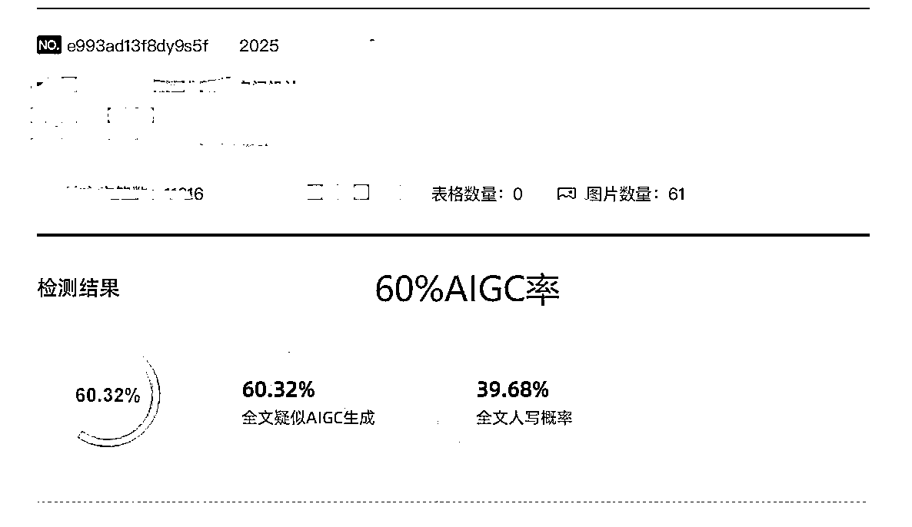
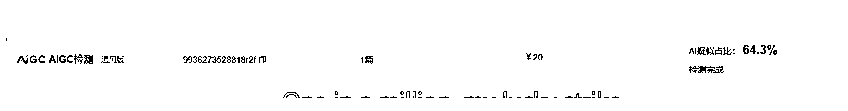
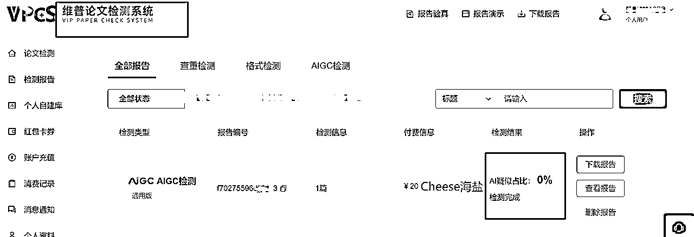
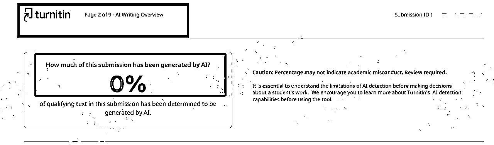
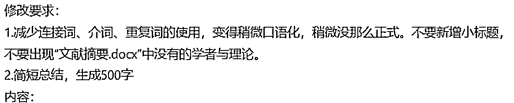
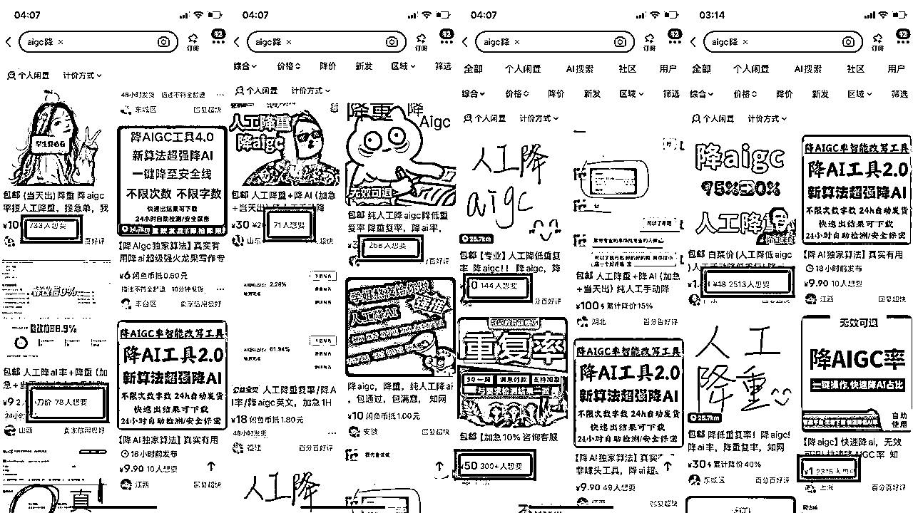

# 客户指着AI检测报告要退款？我把这套“降AI率”实战打法全盘托出
作者：龙哥

> 做AI写作服务的同行们，是不是天天被客户拿检测报告砸脸？

你是不是也经历过这种场面——客户丢过来一张截图，知网、维普、格子达、超星大雅、万方，甚至那个让人一看就血压飙升的PaperPass，AI率标红显示60%，然后劈头盖脸一句：“你们这是AI糊弄我的垃圾吧？退款！”

遇到这种情况，咱们手里其实有一套久经考验的沟通话术，基本能稳住绝大多数客户。核心逻辑就一句话：全球AIGC检测技术目前都谈不上成熟，误判率极高，不同平台之间的结果甚至能差出天际。所以，客户拿任何一个平台测出来的数字，都不具备绝对参考价值。

关键操作是——问清楚学校最终指定哪个平台（一般是知网或维普这类付费系统），以及具体的AI率红线是多少（比如15%以下）。然后告诉客户：拿着学校指定平台的检测报告来找我们，我们针对性地降，基本一到两轮就能达标。如果学校没明确要求，那这个钱完全没必要花。

这套话术虽然管用，但说实话，沟通成本高得离谱。碰上较真的客户，能跟你掰扯几百个来回，有这功夫订单都接好几单了。更扎心的是，我们其实是在替整个行业的教育买单——很多客户自己手写的稿子，丢进格子达一查，AI率照样52%。这玩意儿就是个随机的玄学，跟稿子是不是人写的压根没关系。

没办法，AI时代就是这么拧巴：大家一边用AI提效，一边被一套全球都不靠谱的检测机制按在地上摩擦。

但换个角度想，这不就是商机吗？

## 一、四类检测平台，四套破解方案

**知网/维普系：** 用“香蕉降AIGC工具”（https://banana.paperjai.com/#/），基本一键就能把AI率干到10%以下。降完记得人工通读一遍，别偷懒。备选方案是“爽歪歪工具”（syypaper.com），也能降到10%以下，就是价格稍贵。

**PaperYY/PaperPass免费系：** 同样可以用香蕉降AIGC工具（http://banana.modifypaper.com/），能显著压低AI率，但不保证稳破10%。备选爽歪歪也能降，同样不保证10%，价格略高。

**Turnitin国际系：** 这个最省事。先用中文写好高质量稿件——核心是去除AI结构和AI高频词汇，让中文稿彻底“无人化”——然后丢Google翻译成英文，直接过关。屡试不爽。

**格子达系：** 最棘手的一个，目前没有工具能一键搞定。唯一被大量测试验证有效的，是传统降重工具“火龙果写作”（https://www.mypitaya.com/）。它改出来的文字虽然丑得一批，但确实能改变AI结构特征，再配合人工润色，才能稳住格子达的检测。

## 二、三大工具，拆开来看

**爽歪歪：** 主打“逻辑重组+风格迁移”，改出来的内容人味儿很足，甚至带点口水词。所以正式场合的稿件——比如领导演讲稿——务必人工修饰，否则分分钟从正式发言变成脱口秀段子。

**火龙果：** 典型的“句式变换+插词逻辑”。500字的稿子它能轻松注水到1000字，那叫一个啰嗦。最费人工，但也是目前唯一能搞定格子达的工具。

**香蕉：** 走的是“全篇近义词替换”路线，主谓宾定状补全给你换成同义表达，句子依然通顺。传统改写降重算法的底子，但用起来真香。

工具用对了事半功倍，用错了就等着通宵改稿吧。

说到底，这些降AI工具的底层逻辑，最后拼的还是语料库的丰富程度。想纯靠AI算法打败AI检测？难。因为检测本身就不准，各平台结果互相矛盾，逻辑上就站不住脚。我们试过无数种方法，最后发现最好用的竟然是传统的降重人机算法。早期测试火龙果时也是误打误撞，用的压根不是它的降AI功能，而是双重强力改写模式。

## 三、降AI的核心方法论

拆解了这么多工具，你会发现有效算法的共性就三条：

语义层面——打破AI那种工整的模板化结构，把长句拆短，把段落逻辑顺序重新洗牌。

词汇层面——替换高概率AI词。“综上所述”改成“换句话说”，“首先其次”改成“说实话”“有一说一”。增加口语化表达。

风格层面——植入个人化痕迹，加主观评论，塞行业黑话，让文字有“人味”。

另外提醒一句，别迷信什么朱雀大模型检测，测了八百遍，真不准，偶尔蒙对一次纯属概率事件。也别指望靠提示词让AI自己降AI率，网上流传的那些“魔法咒语”模板，基本不好使。

降AIGC率本质上就是走迷宫：检测平台换一个，你的改法就得拐个弯。碰壁了？撞墙了？换个方向再来。直到找到替换近义词这个突破口，持续打乱、持续测试，最后走出一条路来，让AI痕迹彻底“隐身”，然后底气十足跟客户拍胸脯：“这稿子，纯手搓的！”（其实手搓真写不了这么好。）

教育行业嘛，需要这种善意的谎言。

手搓时代，一篇稿子改三天；AI赋能时代，一小时产出三篇合规稿件（含AI率合规）。拒绝无效内卷，让AI替咱们打工，咱们专心服务客户。

## 四、说点实在的

从去年8月第一波降AIGC教程流出来之后，不少圈友已经跑通了闭环。听说有个圈友专做降AIGC这一件事，单兵作战，月利润做到3到6万。当然，现在是个人都能干，价格已经卷到千字20到40块。但信息差的钱，足够赚一阵子了。

天下武功，唯快不破。打开闲鱼，借鉴一下同行怎么玩，然后开干就是了。

