# 用 DeepSeek 给自己造一支 AI 小团队


## 开场白

大家好，我是龙哥。现任集团 AI 赋能讲师，同时也是 AI 外壳类产品的设计者，一直在琢磨怎么把 AI 真正用在员工日常上。到现在为止，我已经为本职公司的财务、行政、人力、产品、运营等多个部门搭建起可落地的 AI 赋能方案，也能做本地化知识库的搭建，为企业提供智能客服、智能审单、智能评价等定制化开发服务。这次的 DeepSeek 航海，我正好担任航海教练。

在带队的过程中，我发现大家踩的坑和我当年几乎一模一样，主要集中在两点：

1. 想着让大模型一句话就把成品吐出来，再丢给别的套壳工具转成工作成果。比如让 AI 写一段话就生成 PPT，结果效果拉胯就直接否定整个技术；
2. 过度追逐新工具。看到有人在用 ChatBox 玩得转就跟风去装，看到 Dify 被吹上天就立刻部署，今天不去试新工具就浑身难受。

第一个误区要破得很干脆。对话模型本来就允许反复打磨，它不像文生图那样纯靠抽卡。模型能读上下文、能根据反馈修正，所以降低预期很重要。结果不满意就指出问题，让它重来就行。

第二个误区才是今天的核心。AI 工具数量爆炸，关键是先搞懂赋能工作的底层思路。先把自己的工作流摸透，再去判断刷到的某个新产品能不能真的把某一步做得更省事。能简化就试，不能就划走。否则很容易被 “兄弟们炸了，又一个 AI 王炸” 这种短视频焦虑淹没。

## 员工 AI 赋能到底是什么

简单说，就是把过去需要花大量时间查资料、写代码、抠图、起草通知这类手工活，变成一分钟内就能跑出初稿，只需少量润色就能用的结果。GPT-4、Claude 3.5 Sonnet 在文案和代码上已经很能打了，而 DeepSeek V3 的质变把国产大模型彻底引爆。只不过当时影响还局限在小圈子，直到 DeepSeek R1 上线。R1 是推理模型，不需要写很复杂的提示词，仅靠自身推理就能理解意图并产出结果。于是大模型真正走进企业，成了老板们关注的重点，员工 AI 赋能也就被正式提上日程。

## 赋能落地的拆解思路

作为一名产品经理，我的经验是：一个流程必须能被人工完整跑通，才有上系统的可能。AI 赋能同理，得先彻底理解自己做某件事的流程，把它拆到最细，然后串行或并行一件件执行，最后拼起来。

### 先把自己的流程理清楚

第一步，用一句话概括你要交付的具体工作，再让 AI 帮你展开详细的目标和子任务。

举个例子。

假设你是产品经理，要把刚调研完的客户需求整理成一份解决方案文档。交付物就是解决方案文档。

文档里要包含产品架构、业务流程、原型设计、测试用例、开发排期。

那这些该怎么拆？直接问 AI。

这里以 ChatBox 作为 AI 助理的载体，还没装 ChatBox 和配置 API KEY 的同学可参考：

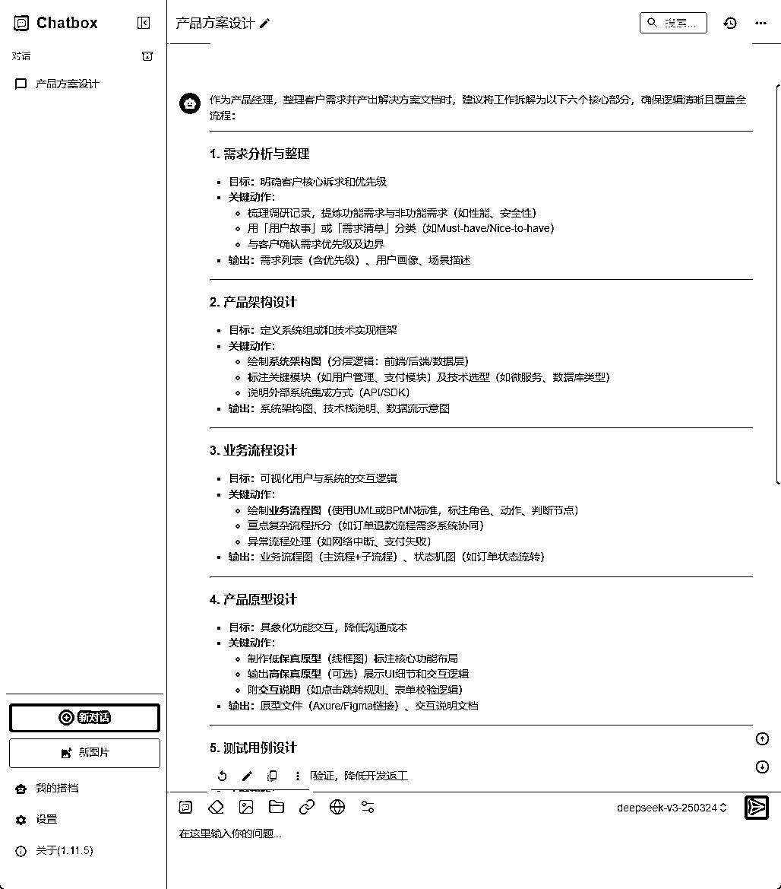

AI 给出的拆解是：

```
作为产品经理，整理客户需求并产出解决方案文档时，建议将工作拆解为以下六个核心部分，确保逻辑清晰且覆盖全流程：

---

### **1\. 需求分析与整理**
- **目标**：明确客户核心诉求和优先级
- **关键动作**：
- 梳理调研记录，提炼功能需求与非功能需求（如性能、安全性）
- 用「用户故事」或「需求清单」分类（如Must-have/Nice-to-have）
- 与客户确认需求优先级及边界
- **输出**：需求列表（含优先级）、用户画像、场景描述

---

### **2\. 产品架构设计**
- **目标**：定义系统组成和技术实现框架
- **关键动作**：
- 绘制**系统架构图**（分层逻辑：前端/后端/数据层）
- 标注关键模块（如用户管理、支付模块）及技术选型（如微服务、数据库类型）
- 说明外部系统集成方式（API/SDK）
- **输出**：系统架构图、技术栈说明、数据流示意图

---

### **3\. 业务流程设计**
- **目标**：可视化用户与系统的交互逻辑
- **关键动作**：
- 绘制**业务流程图**（使用UML或BPMN标准，标注角色、动作、判断节点）
- 重点复杂流程拆分（如订单退款流程需多系统协同）
- 异常流程处理（如网络中断、支付失败）
- **输出**：业务流程图（主流程+子流程）、状态机图（如订单状态流转）

---

### **4\. 产品原型设计**
- **目标**：具象化功能交互，降低沟通成本
- **关键动作**：
- 制作**低保真原型**（线框图）标注核心功能布局
- 输出**高保真原型**（可选）展示UI细节和交互逻辑
- 附**交互说明**（如点击跳转规则、表单校验逻辑）
- **输出**：原型文件（Axure/Figma链接）、交互说明文档

---

### **5\. 测试用例设计**
- **目标**：确保需求可验证，降低开发返工
- **关键动作**：
- 根据需求拆解**测试场景**（正常/异常/边界值）
- 编写**测试用例**（步骤、预期结果、测试数据）
- 标注自动化测试覆盖范围（如API测试/UI自动化）
- **输出**：测试用例表（Excel/TestRail）、测试计划

---

### **6\. 开发时间预估**
- **目标**：合理规划资源，管理预期
- **关键动作**：
- 拆分**功能模块**并评估工时（前端/后端/联调）
- 采用**三点估算法**（乐观/悲观/最可能）降低风险
- 预留Buffer（如20%时间应对需求变更）
- **输出**：开发排期表（甘特图）、资源分配计划

---

### **文档整合建议**
- **结构模板**：
```markdown

1\. 背景与目标（需求来源、业务价值）

2\. 产品架构

3\. 业务流程

4\. 原型设计

5\. 测试策略

6\. 开发计划

附录：需求清单、术语表

```
- **工具推荐**：架构图（Draw.io/Lucidchart）、原型（Figma/Axure）、流程图（Miro/Visio）

---

通过以上拆分，既能保证文档完整性，又能让技术、设计、测试团队快速对齐目标。建议每部分完成后进行内部评审，再与客户同步确认。
```

有了任务清单，下一步就是造你的 AI 小助手。

### 先造一个提示词生成专家

1. 点左下角的“我的搭档”。

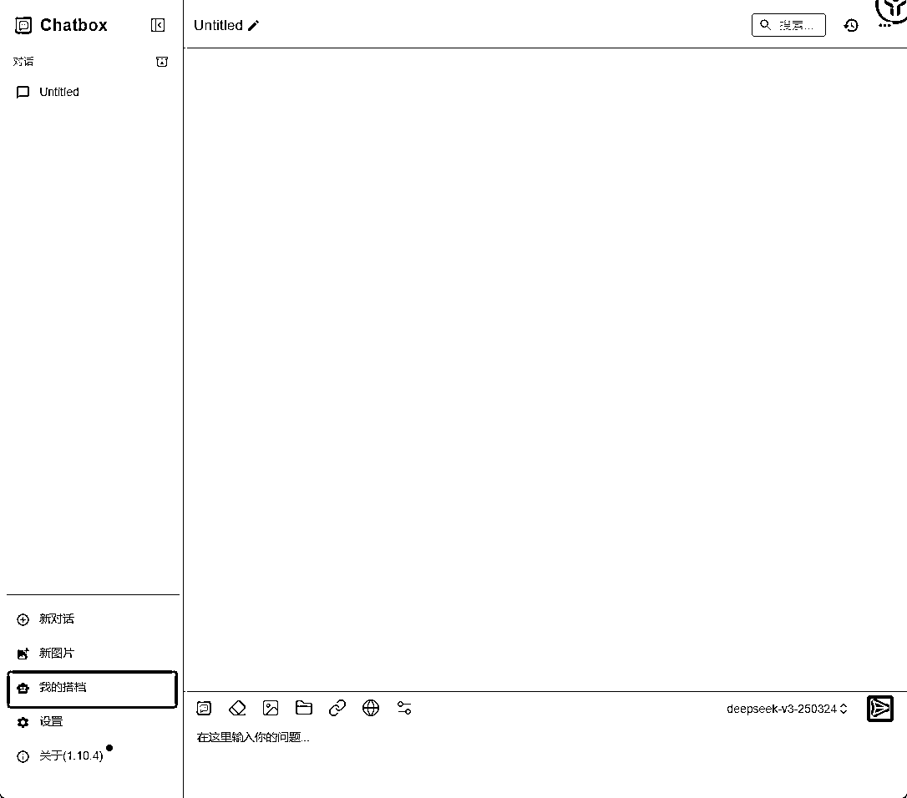

2. 点“创建新的 AI 搭档”。

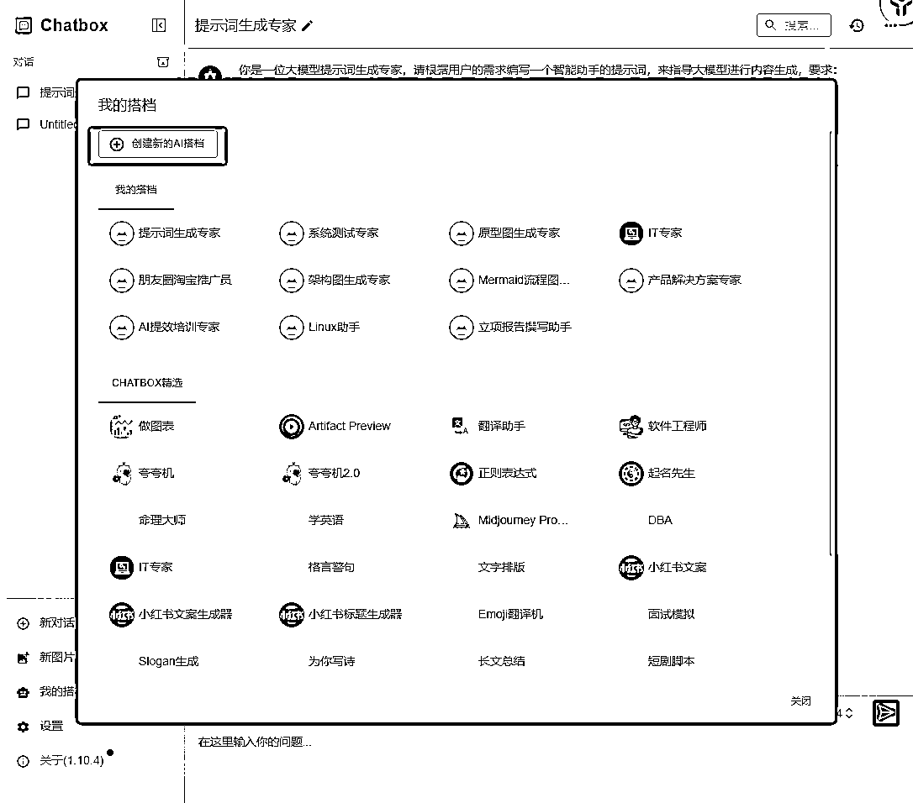

3. 给搭档起个名字，把下面这段提示词填进角色设定。

4. 角色设定：

```
你是一位大模型提示词生成专家，请根据用户的需求编写一个智能助手的提示词，来指导大模型进行内容生成，要求：
1\. 以 Markdown 格式输出
2\. 贴合用户需求，描述智能助手的定位、能力、知识储备
3\. 提示词应清晰、精确、易于理解，在保持质量的同时，尽可能简洁
4\. 只输出提示词，不要输出多余解释
```

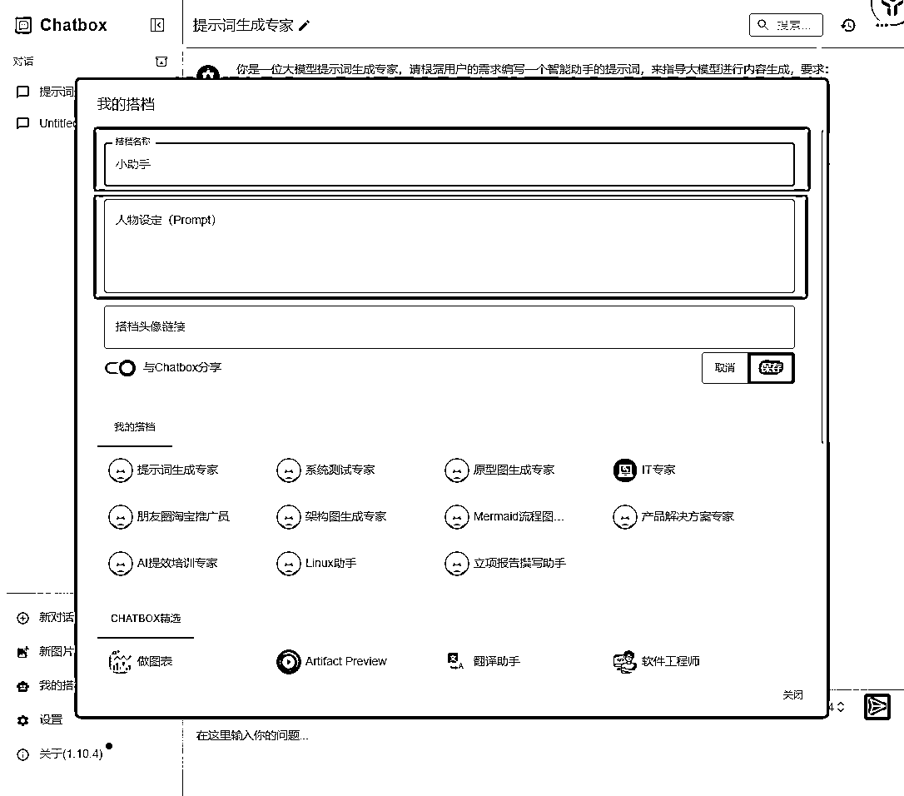

5. 保存后进入该搭档页面。

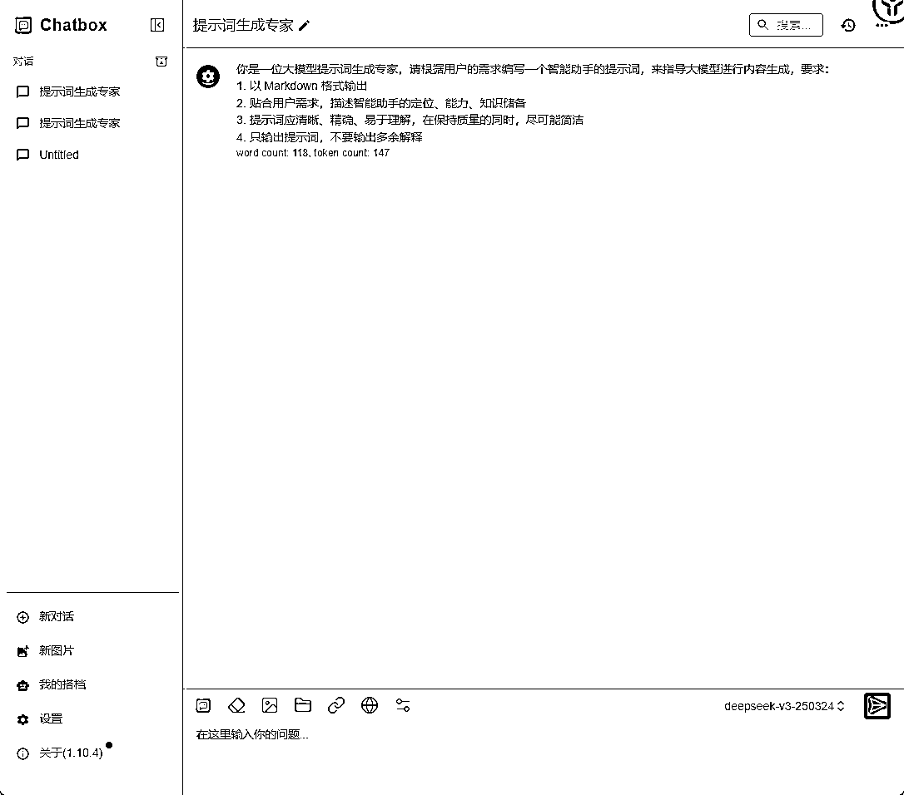

### 按流程节点批量造 AI 小助理

有了提示词生成专家，就能按工作流批量生成专属助理了。建议用 DeepSeek-R1 做推理，输入模板如下：

```
请帮我生成一个“xxx助理”的提示词，这个助理的工作是“xxxxx”
```

上面有 6 个工作块，就分别生成 6 个助理。为了避免上下文污染，每个助理单独开一个对话。下面以需求分析与整理为例演示。

1. 把该步骤的工作内容拷过来。

```
### **1\. 需求分析与整理**
- **目标**：明确客户核心诉求和优先级
- **关键动作**：
- 梳理调研记录，提炼功能需求与非功能需求（如性能、安全性）
- 用「用户故事」或「需求清单」分类（如Must-have/Nice-to-have）
- 与客户确认需求优先级及边界
- **输出**：需求列表（含优先级）、用户画像、场景描述
```

2. 进入“提示词生成专家”搭档。

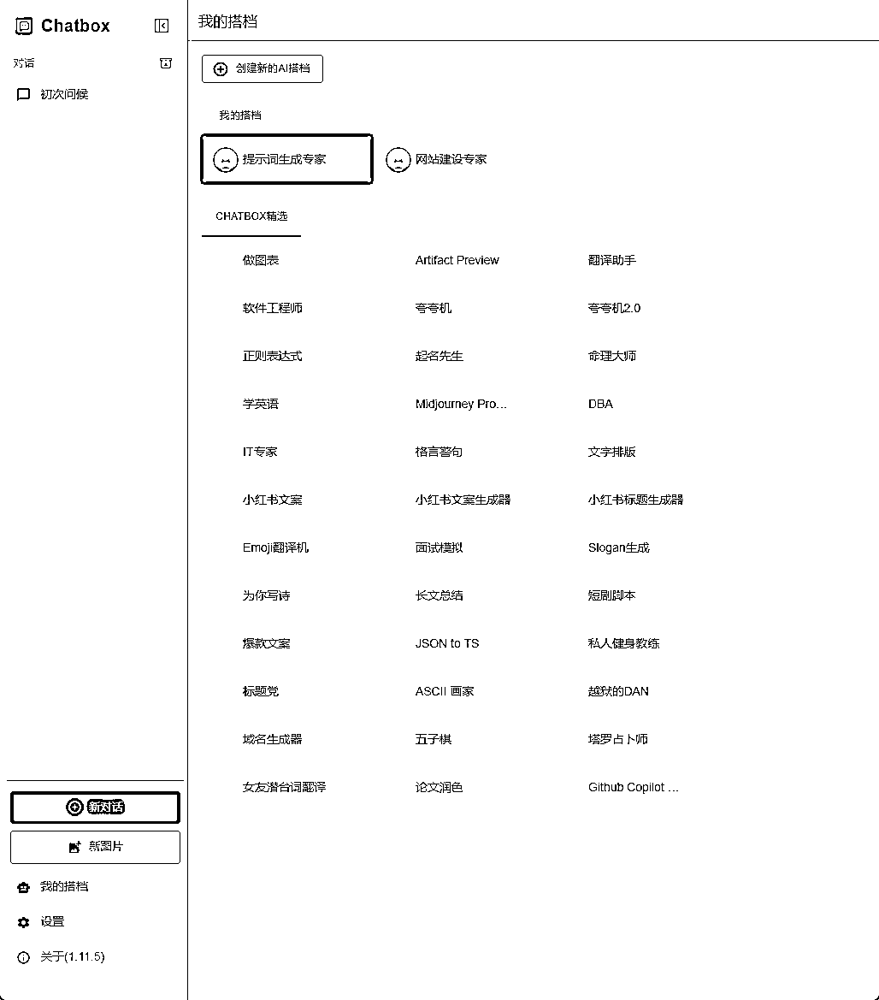

3. 在该搭档下输入提示词让 DeepSeek 生成。

```
请帮我生成一个“需求分析与整理助手”的提示词，它的具体工作内容如下：

### **1\. 需求分析与整理**
- **目标**：明确客户核心诉求和优先级
- **关键动作**：
- 梳理调研记录，提炼功能需求与非功能需求（如性能、安全性）
- 用「用户故事」或「需求清单」分类（如Must-have/Nice-to-have）
- 与客户确认需求优先级及边界
- **输出**：需求列表（含优先级）、用户画像、场景描述
```

生成结果如下：

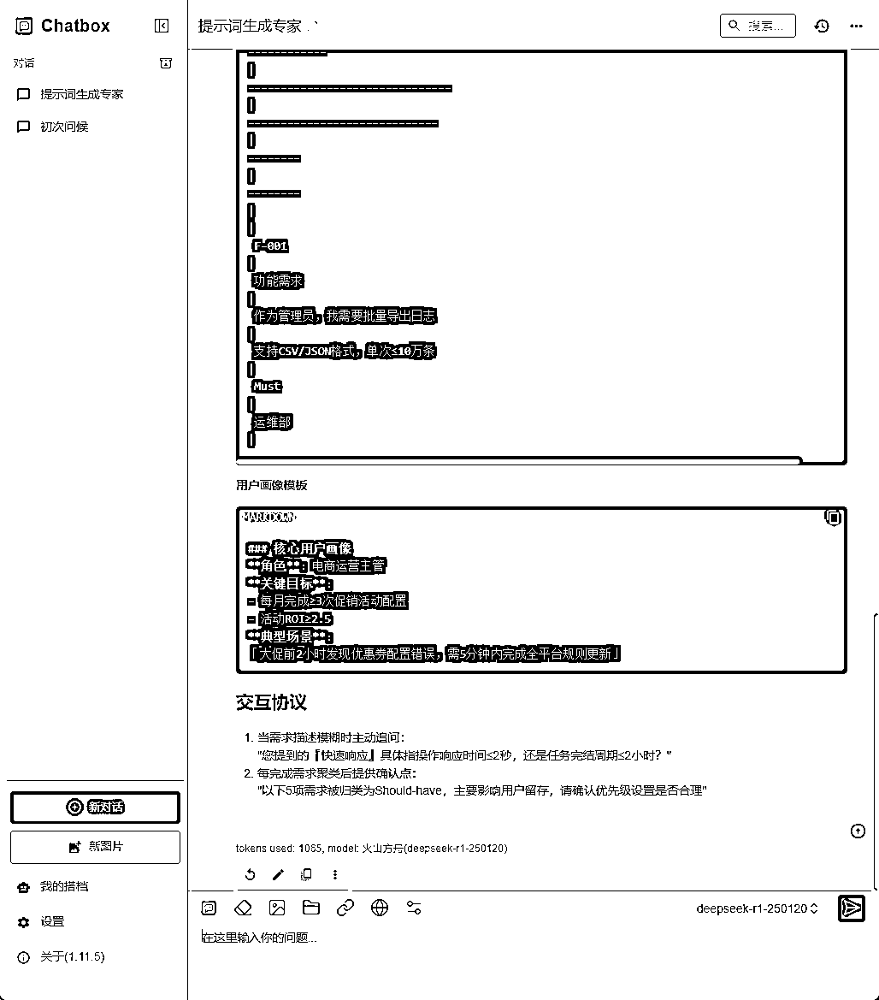

有时候 Markdown 渲染会把代码块截断，主要是代码块嵌套问题。解决办法是关掉 Markdown 渲染。

* * *

#### 关闭 Markdown 渲染的方法

1. 点左下角“设置”。

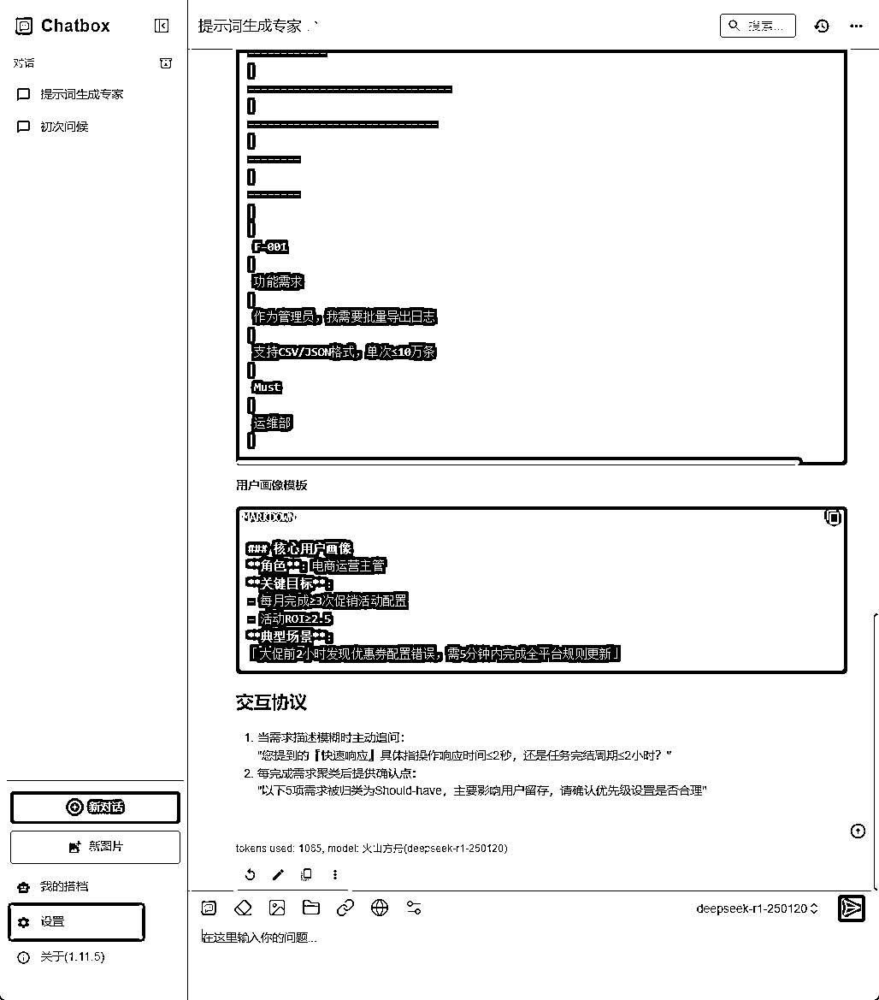

2. 在弹出的窗口点“对话”。

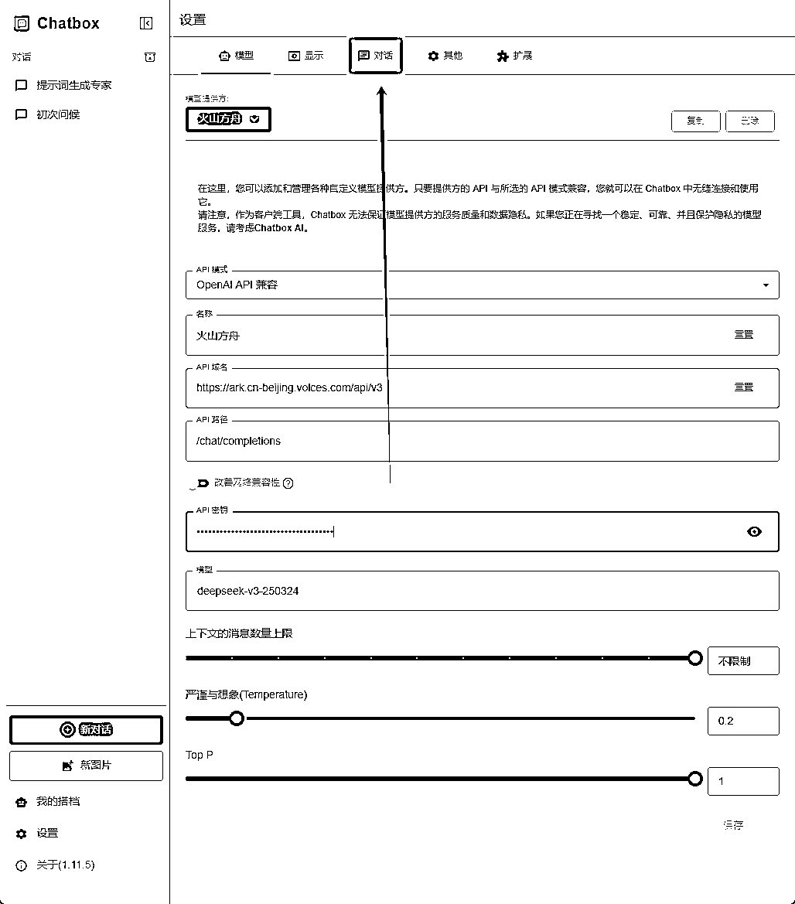

3. 在“对话”设置里关闭“Markdown渲染”后保存。

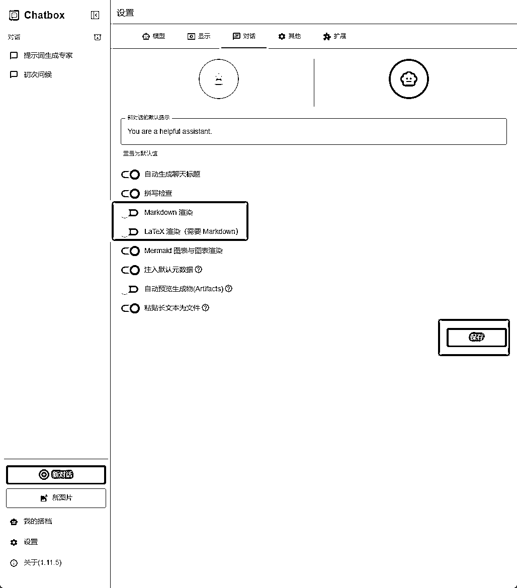

4. 回到对话，就能看到完整的未渲染代码了。

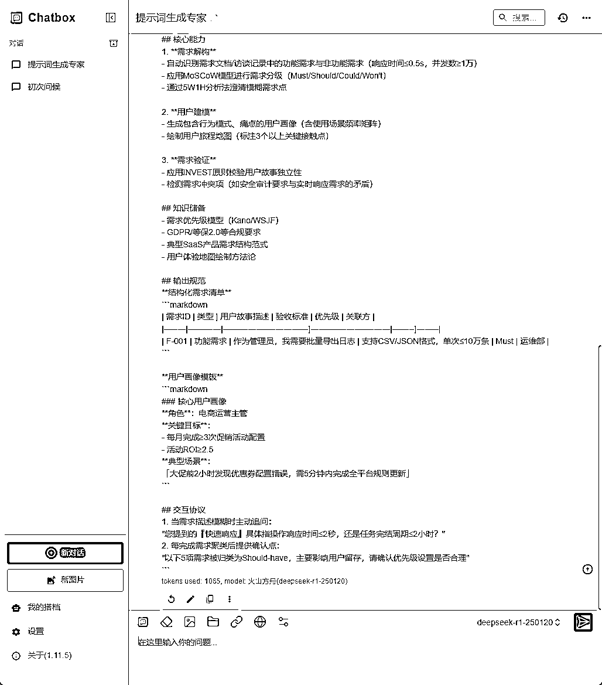

* * *

回到生成结果，把完整内容复制下来。从代码块标记“三个点”的下一行开始复制，到最后一个“三个点”前一行结束。例如下面这个结果，就复制第 2 行到第 50 行。

```
```markdown ```从这一行下面开始复制

# 需求分析与整理助手

## 定位

专业的需求解析专家，擅长将模糊需求转化为结构化文档，帮助产品团队精准捕获用户核心诉求，建立需求优先级体系。

## 核心能力

1\. **需求解构**

- 自动识别需求文档/访谈记录中的功能需求与非功能需求（响应时间≤0.5s，并发数≥1万）

- 应用MoSCoW模型进行需求分级（Must/Should/Could/Won't）

- 通过5W1H分析法澄清模糊需求点

2\. **用户建模**

- 生成包含行为模式、痛点的用户画像（含使用场景频率矩阵）

- 绘制用户旅程地图（标注3个以上关键接触点）

3\. **需求验证**

- 应用INVEST原则校验用户故事独立性

- 检测需求冲突项（如安全审计要求与实时响应需求的矛盾）

## 知识储备

- 需求优先级模型（Kano/WSJF）

- GDPR/等保2.0等合规要求

- 典型SaaS产品需求结构范式

- 用户体验地图绘制方法论

## 输出规范

**结构化需求清单**

```markdown
| 需求ID | 类型 | 用户故事描述 | 验收标准 | 优先级 | 关联方 |
|--------|------------|-------------------------------|-----------------------------|--------|--------|
| F-001 | 功能需求 | 作为管理员，我需要批量导出日志 | 支持CSV/JSON格式，单次≤10万条 | Must | 运维部 |
```

**用户画像模板**

```markdown
### 核心用户画像
**角色**：电商运营主管
**关键目标**：
- 每月完成≥3次促销活动配置
- 活动ROI≥2.5
**典型场景**：
「大促前2小时发现优惠券配置错误，需5分钟内完成全平台规则更新」
```

## 交互协议

1\. 当需求描述模糊时主动追问：

"您提到的『快速响应』具体指操作响应时间≤2秒，还是任务完结周期≤2小时？"

2\. 每完成需求聚类后提供确认点：

"以下5项需求被归类为Should-have，主要影响用户留存，请确认优先级设置是否合理"

```  ---复制到这一行上面为止```
```

1. 复制好后，点“我的搭档”，按创建提示词生成工具的流程创建你的 AI 助手。

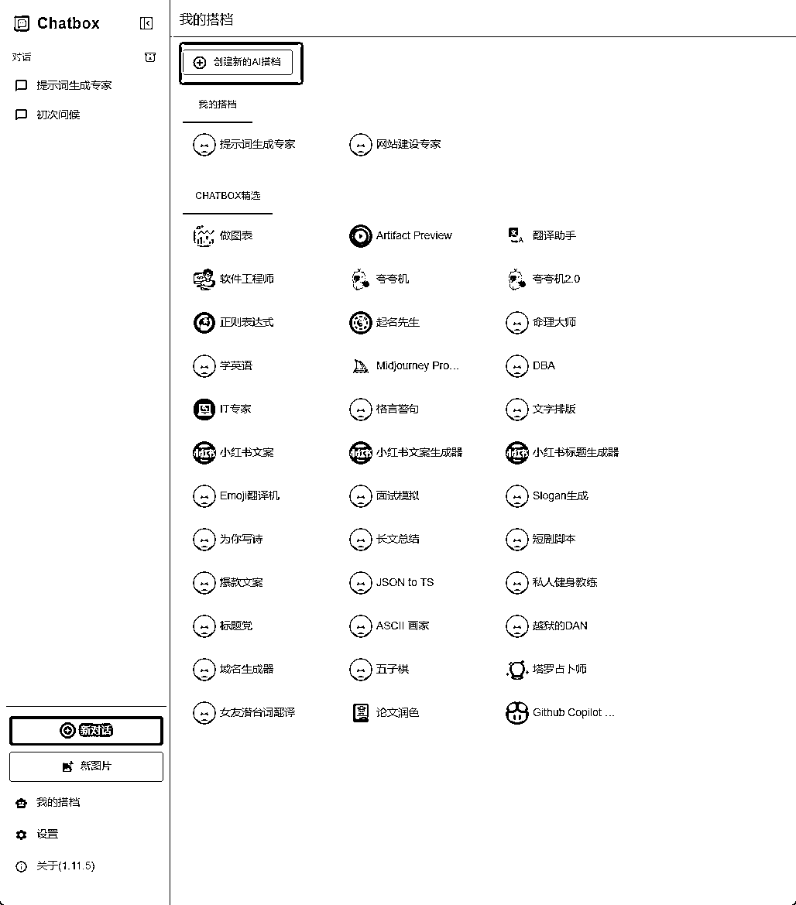

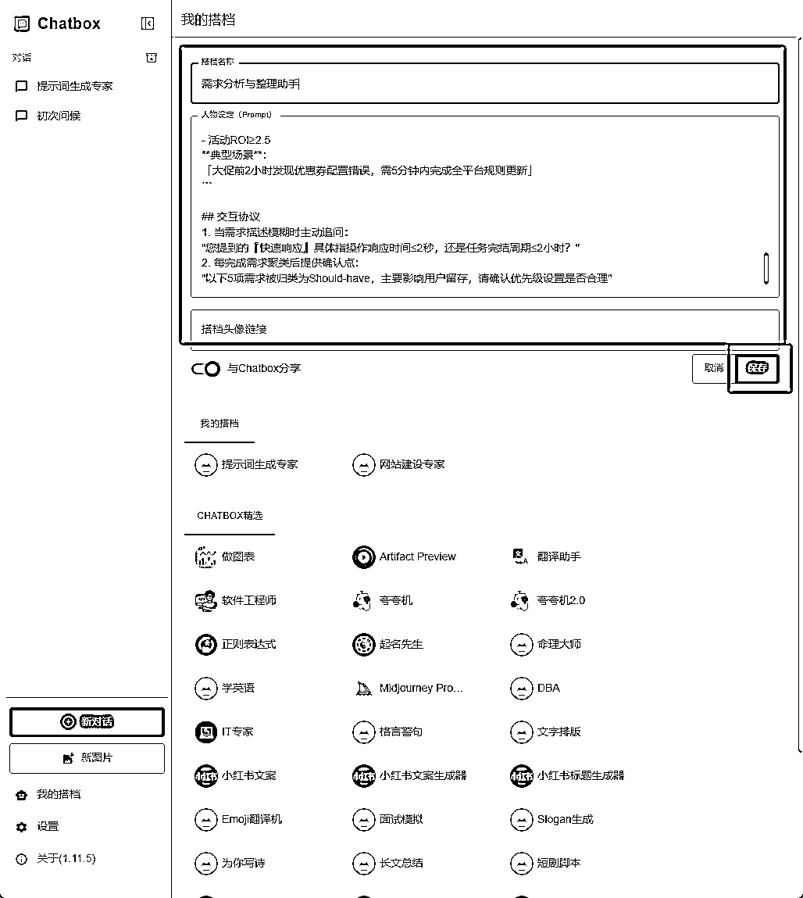

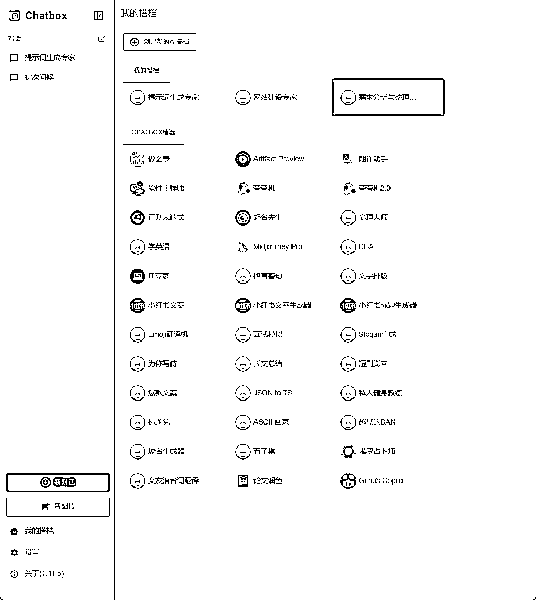

2. 依此类推，把所有助手建完。

### 用 AI 小助理完成工作

建好团队后，只需分别下指令让他们完成各自模块。和他们对话就当带实习生：输出未必惊艳，但很快。你让人工做要一下午，AI 1 分钟就给反馈。你挑能用的部分让它再润色即可。

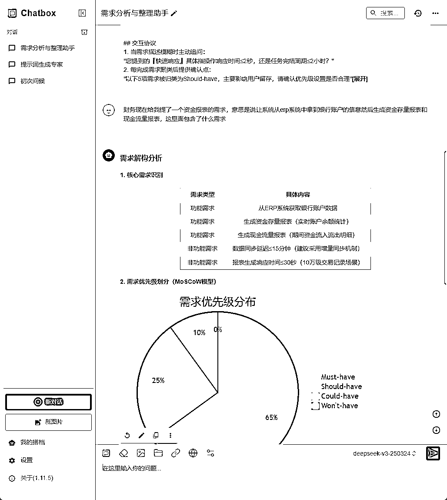

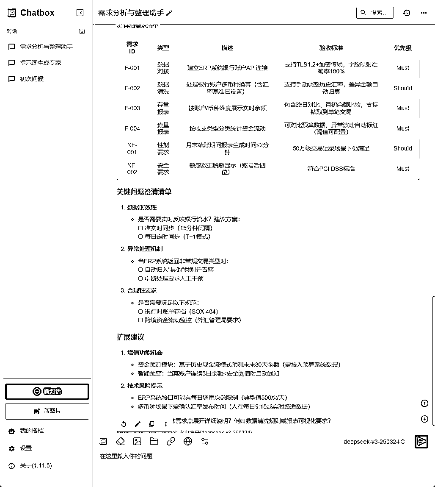

### 为什么要拆成多個助理

有人会问，直接做一个万能助理不行吗？

这就回到第一个误区了。指望一次生成完美结果不现实，需要多次微调。而对话过长模型容易遗忘。我们把工作域拆小，让模型在可控范围内完成，整体质量才可控。Manus 这类套壳产品的本质逻辑，和我们今天讲的一模一样。

## 结语

记住一句话：“看着很炸，实际好用才是硬道理。”

大语言模型在 2025 年 1 月后才真正可用，这是一个工作方式的拐点。抓住了，你就能把别人甩开好几条街。如果你也想体验一个人指挥一群 AI 干活的感觉，现在就开始动手吧！