# GPT-4o深度体验：不用不知道，一用吓一跳！设计师失业了吗？

GPT-4o这波更新，我亲测了一把，结果后背发凉：不会用AI的设计师，真的要慌了吗？

> 来源：龙哥盟传术师俱乐部相关体验分享

大家好，我是米斗。平时我的身份是品牌商业增长顾问，也是一名专注AI视觉营销的设计师，平时最喜欢研究那些真正能落地解决问题的AI工具和方法，欢迎多多交流～

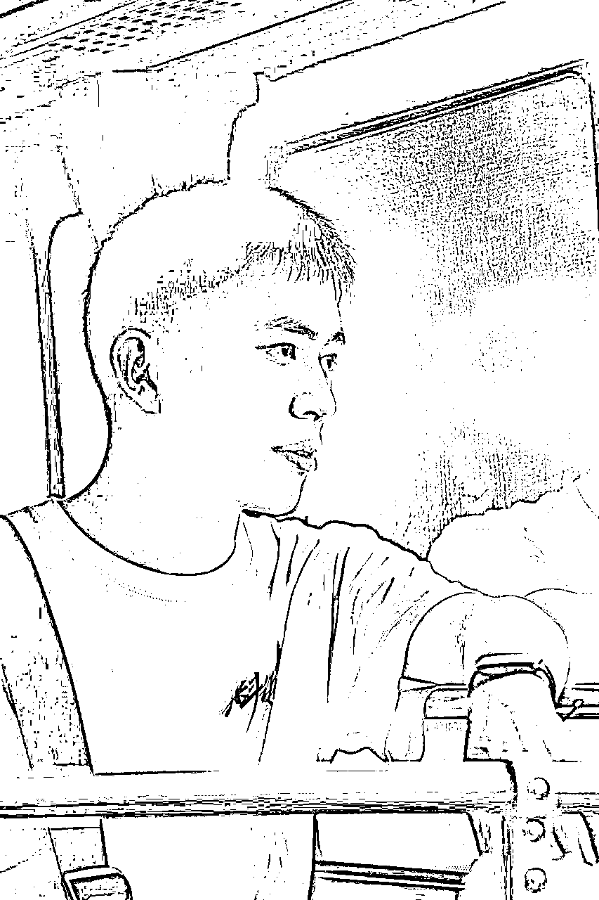

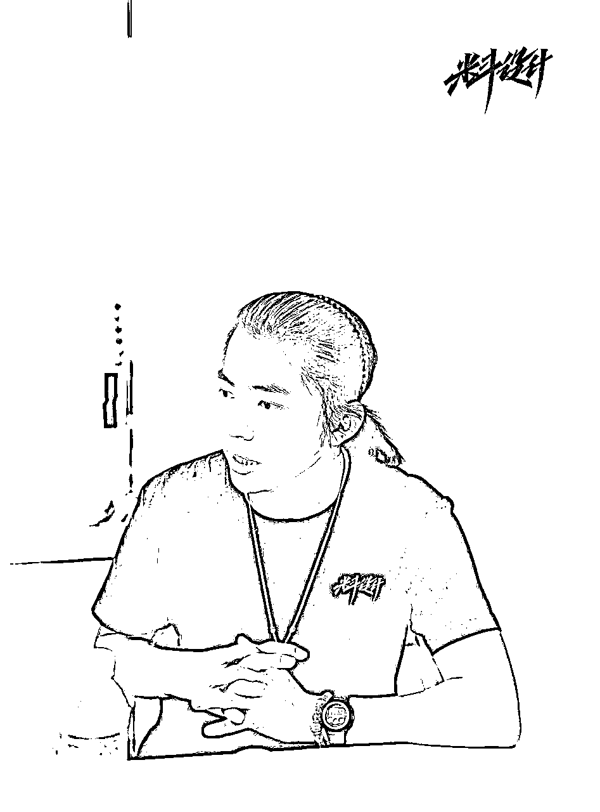

3月26日，OpenAI给GPT-4o的文生图能力做了一次大升级。现在，付费用户直接在ChatGPT里就能调用4o来生成或修改图片，再也不用依赖之前那个DALL-E模型了。就在消息放出后短短一天里，网上那些近年刷屏的照片、经典meme图，几乎全被网友用4o重新“画”了一遍，其中传播最疯的当属宫崎骏画风。

“不用不知道，一用吓一跳！”

我只花了三分钟，就用GPT-4o做出一整套吉卜力动画风格的插画头像。那一刻，后背忽然有点发凉——

那些只会套固定模板的设计师，恐怕真的要面对被淘汰的危机了。

第一个案例：七天老师，赚钱内容负责人，也是传术师俱乐部主理人。

这样的头像，你心动了没？

再看一个：荷包蛋糕，深耕私域写作变现五年。

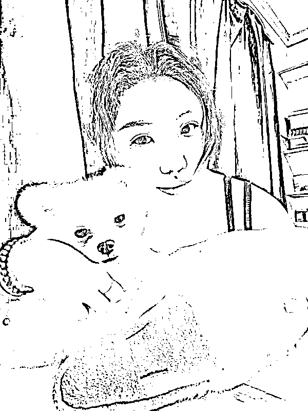

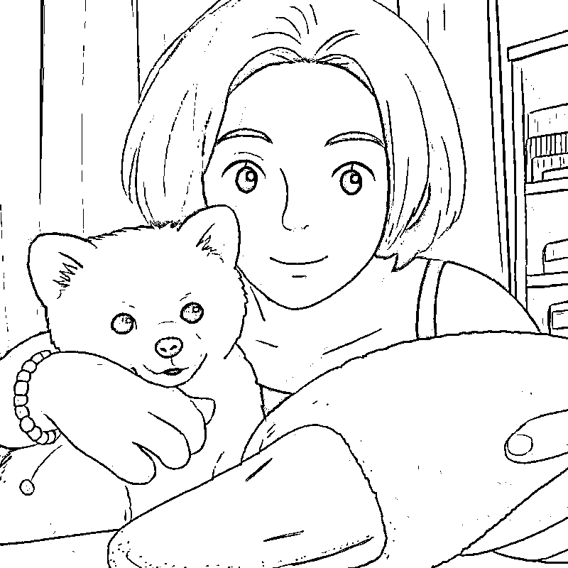

这种画风你会喜欢吗？真的太萌了，非常治愈系。

* * *

### 一、AI能玩出哪些花样？我帮你盘了盘

有人给自己和好友整了一组插画头像：

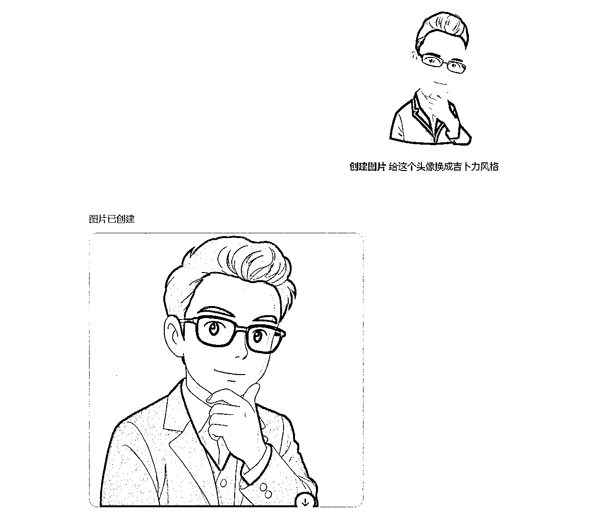

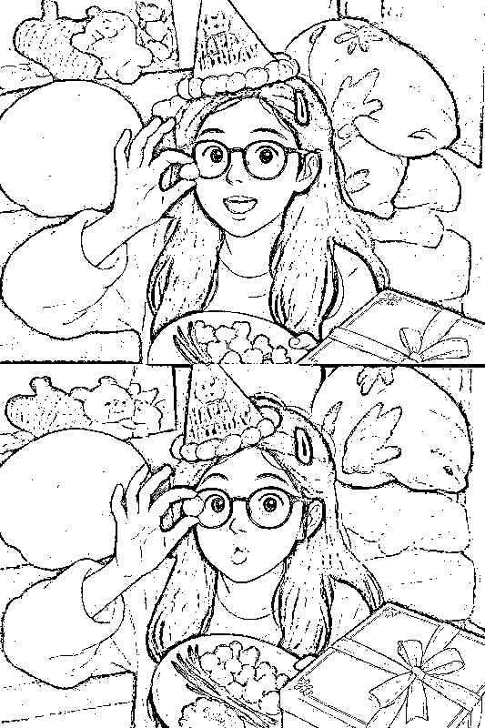

有人直接拿它画漫画：

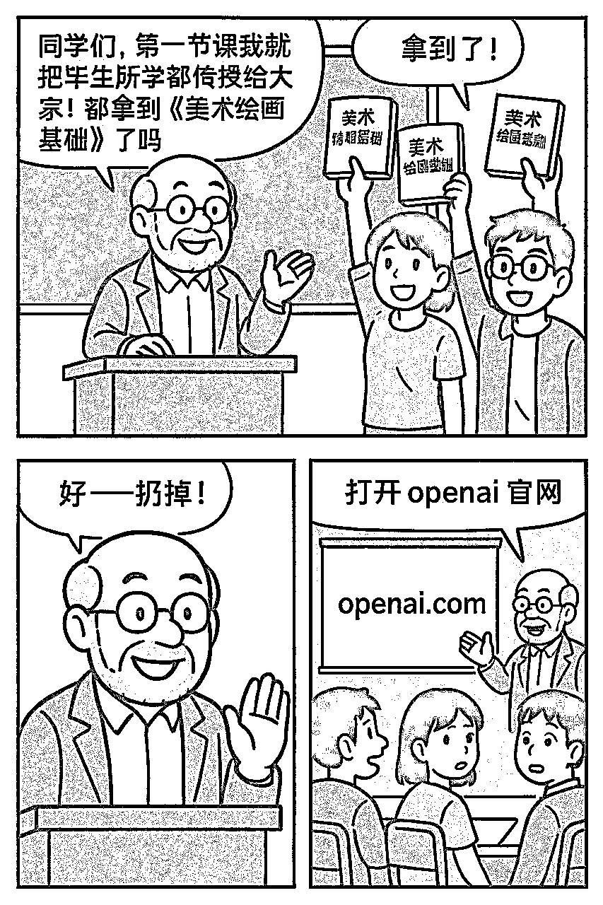

有人用它做梗图，玩得不亦乐乎：

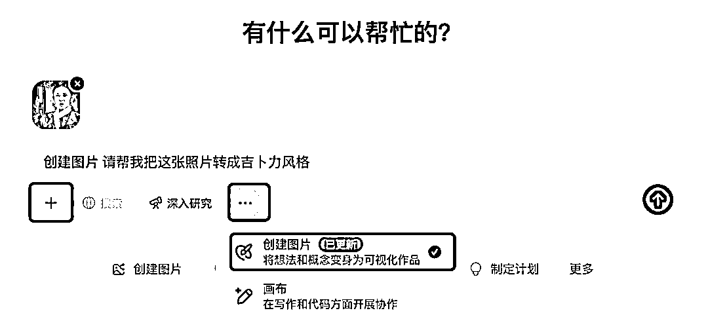

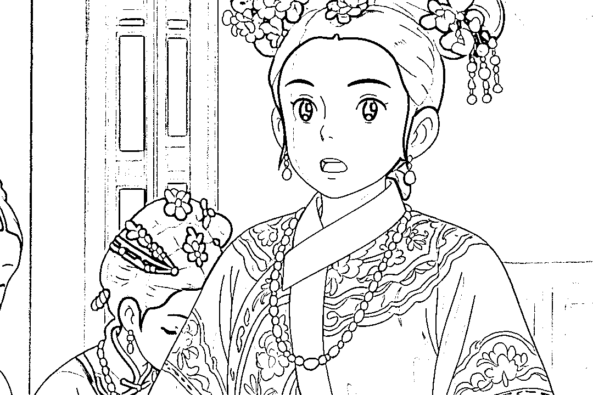

还有人干脆批量做表情包：

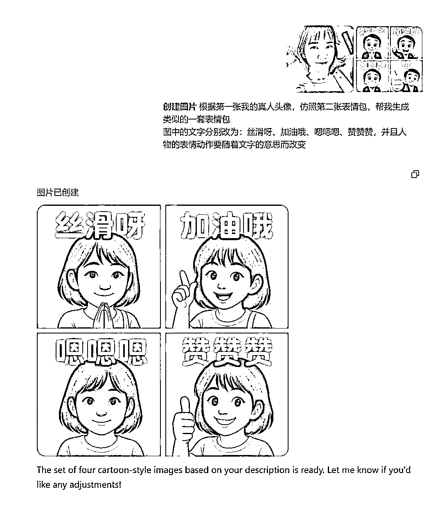

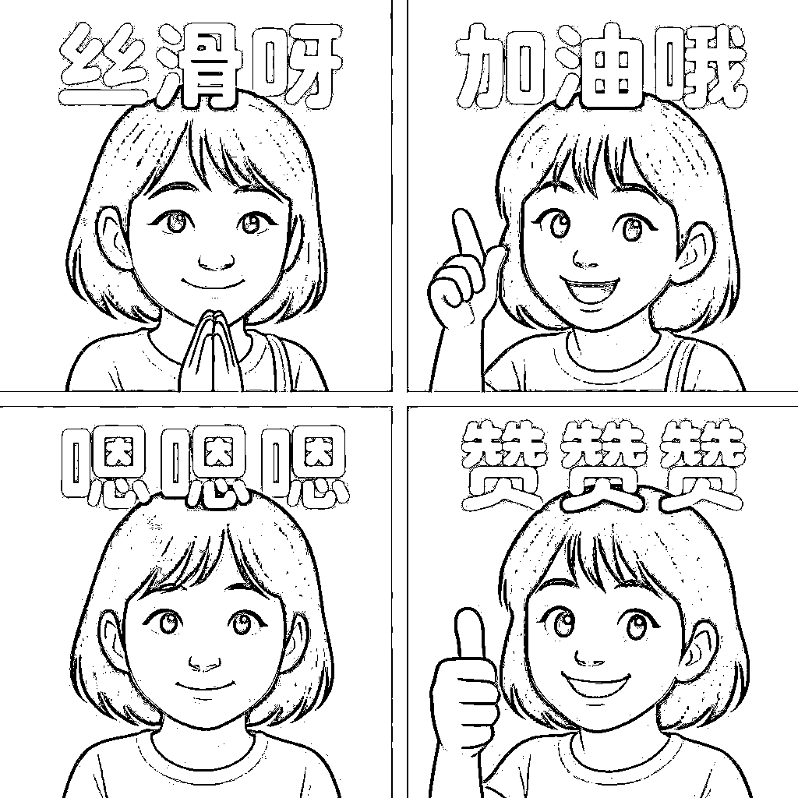

那么，你有没有想过，这个热点也是可以变现的？这难道不是一次商业机会吗？

我的答案是：确实是。但前提是，你得有商业嗅觉，更得有执行速度。

有人只用一天时间，靠AI生成的吉卜力动画风格头像变现了几百块；有人抓住这波热度，在📕发笔记，两天粉丝涨了3000多；还有人更狠，直接做出吉卜力动画风格的PPT模板，一个模板卖出了2000多块。

所以，读到这里的你，有没有认真想过：能不能蹭这波热点涨点粉、赚点小钱，甚至用它来解决眼下的商业难题？哪怕只是去体验一把GPT-4o，给自己生成一张专属头像呢？

* * *

### 二、踩过坑才懂：这几条血泪教训千万记住

1. 别跟AI拼技术，要跟人性做生意

客户真正想要的，从来不是“最精致”，而是“最省心”。

记住这句核心话术：“您只需要描述需求，剩下的修改交给我。”

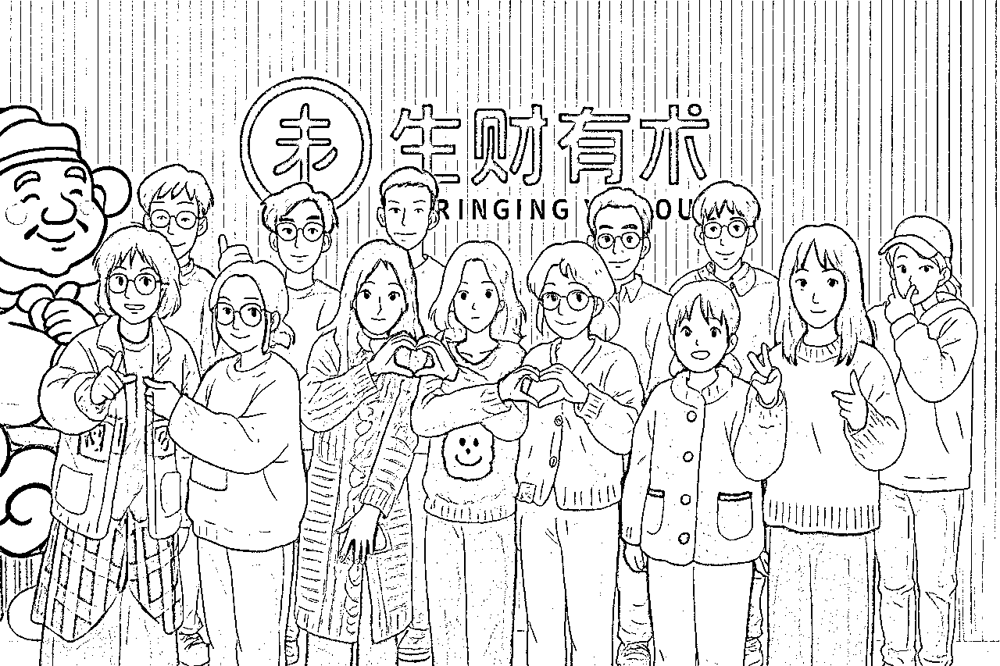

2. 小心炫技陷阱

我见过太多设计师，整天沉迷研究AI绘画参数，研究得头头是道。

❌ 他们最爱的动作，是反复调参数、试提示词。
✅ 聪明人已经在卖“插画头像、表情包、PPT”这些能直接拿走的产品。

真相是什么？

中小老板只愿意为“降低传播成本”付钱，而不是为所谓的“艺术价值”付钱。

3. 把自己变成AI的老板，而不是AI的对手

我（米斗）作为95后新锐设计师创业者，现在的做法是：

让助理去操作GPT-4o，自己只专注三件事——
① 挖掘客户隐性需求（很多客户自己都说不清想要什么）
② 设计溢价服务（比如“品牌视觉诊断报告”）
③ 收钱时笑着问一句：要开发票吗？

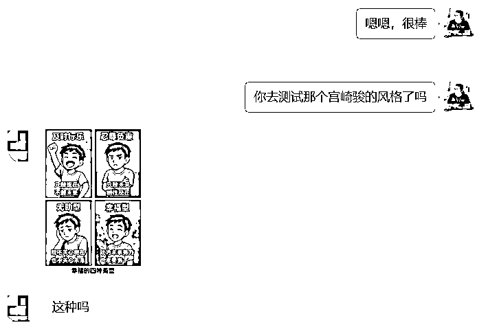

* * *

### 三、普通人怎么靠这波赚钱？附实操方法

#### 野路子1：闲鱼做吉卜力头像，堪称印钞机

1️⃣ 起号话术这样写：
“不会画画也能拥有宫崎骏同款！不满意重做10次！”

2️⃣ 溢价玩法：

加19.9元，解锁“动态眨眼版”；
加99元，升级“全家福系列+手机壁纸”。

3️⃣ 避坑要点：
▶️ 千万别承诺“和原作100%一样”
▶️ 务必说：“AI创作有随机性，这才是独家定制的魅力呀”

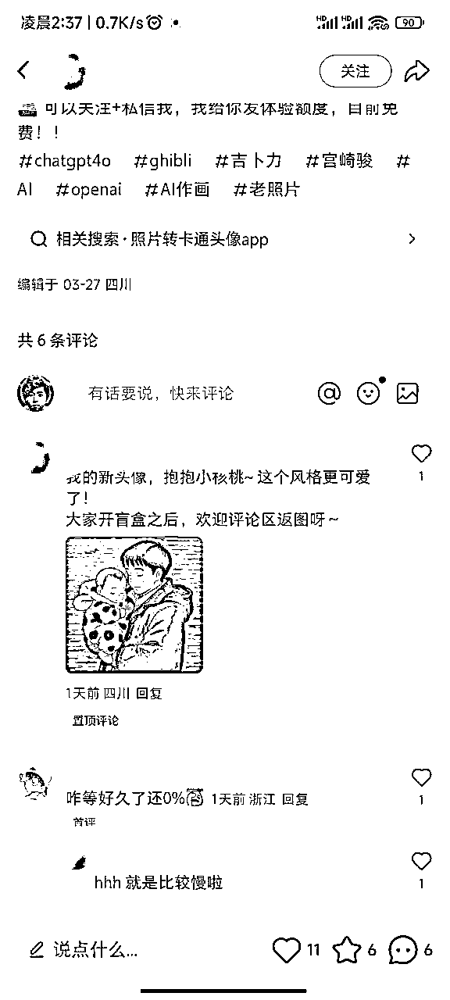

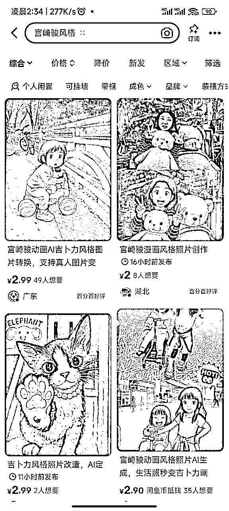

#### 野路子2：📕卖PPT模板，躺着赚

1️⃣ 流量密码：

▶️ 封面大字：“打工人必备！吉卜力风PPT模板”
▶️ 内容关键词：“治愈系”“免费可商用”“幼儿园家长会”

2️⃣ 交付神器：

▶️ 用Canva设置自动发货系统
▶️ 配套赠送“GPT-4o修改教程”（有效提升复购率）

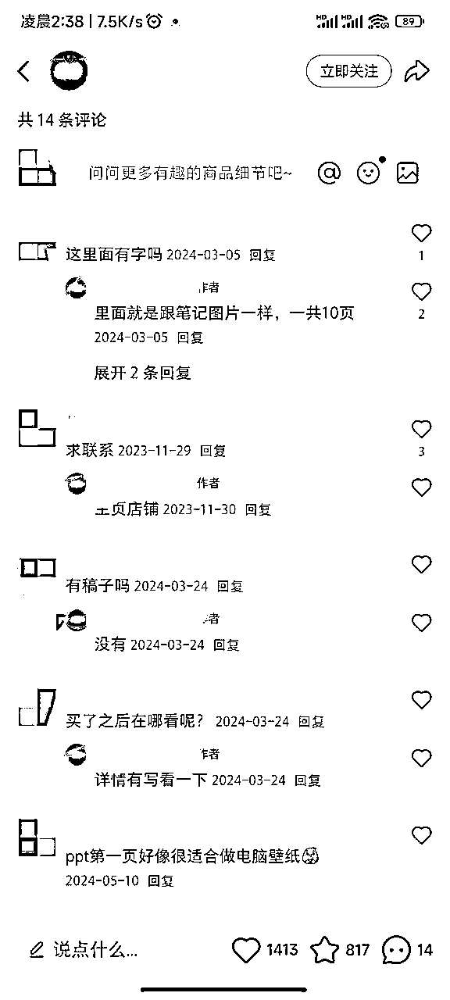

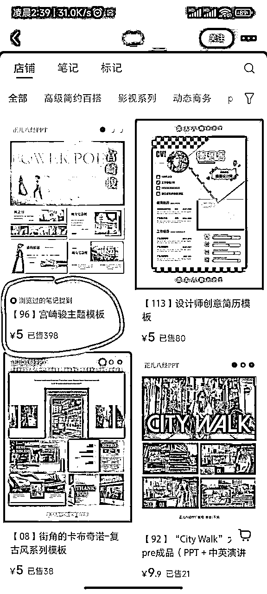

如果你也想借这个热点赚点零花钱，请把执行力拉到最满。这事真不难，干就完事了，加油！

* * *

### 四、创业老兵张昭老板的3点思考

1️⃣ 空杯心态，才是终极武器

作为一个长期泡在传统产业的80后，坦白讲，除了积累下来的创业认知，我感觉自己很难跟上时代的变化。但正因为如此，反而被迫学会放空自己，奇怪的是，焦虑感反而消失了。

2️⃣ AI时代，真正值钱的能力是什么

我跟别人交流，从来不是为了直接拿到一个答案，而是想借助不同视角，丰富自己的思维结构。自从AI出现后，尤其是它展现出的深度思考过程，给了我特别大的启发。当你把传术师群当成一个“多人AI”来看，你会觉得特别有意思。

3️⃣ 给普通人的一句忠告

你不必永远当主角。偶尔做个观众，能说的时候就说两句，不想说的时候，屏蔽掉，去休息。钝感力，也是创业成功的一种重要品质。如果一看到新东西就被勾走，失去战略定力，迟早把自己耗死。

米斗也送大家一句话：“不要追技术，要追人性。未来能赚到钱的人，永远是读懂需求的人，而不是玩转参数的人。”

* * *

### 最后：要么进化，要么出局

GPT-4o这次撕开的，不只是技术的天花板，更是许多固守旧思维设计师的遮羞布。当同行已经开始用AI批量生产头像代做服务，当客户张口就是“给我10个吉卜力风格方案来选”，

真正值得恐惧的，不是AI变得多强，而是你还用着2020年的老思路做设计。

现在，请回答自己一个问题：你现在的技能，在AI时代还能卖出比昨天更高的价格吗？

一个人命运走向哪，关键只有一条：你每天努力的方向，到底对不对？

我们都是普通人，如果时间允许，请静下来认真想一想：未来，你究竟要去哪里？

技术革命面前，唯一不变的，是重新思考人的价值定位。

（PS：本文部分案例来自龙哥盟传术师俱乐部）

我是米斗，品牌商业增长顾问，AI视觉营销设计师。我会持续分享那些真正能解决实际问题的AI工具和方法，欢迎多多交流～

