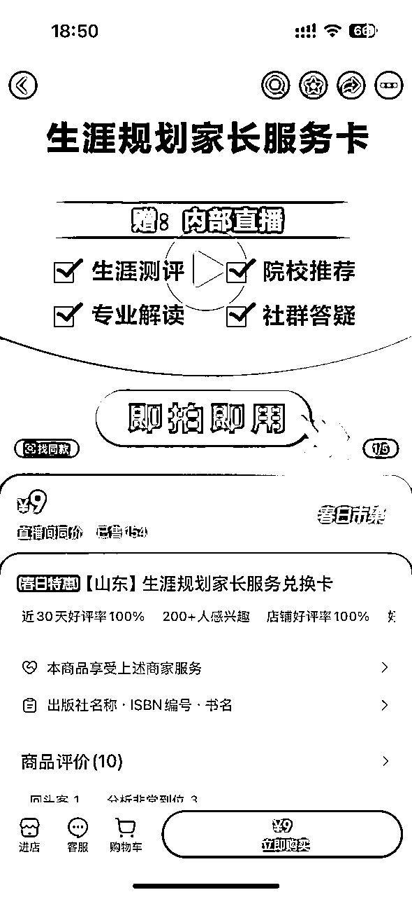
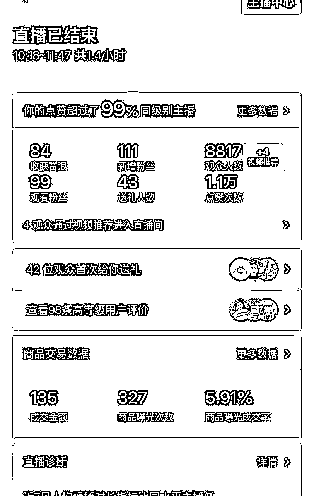
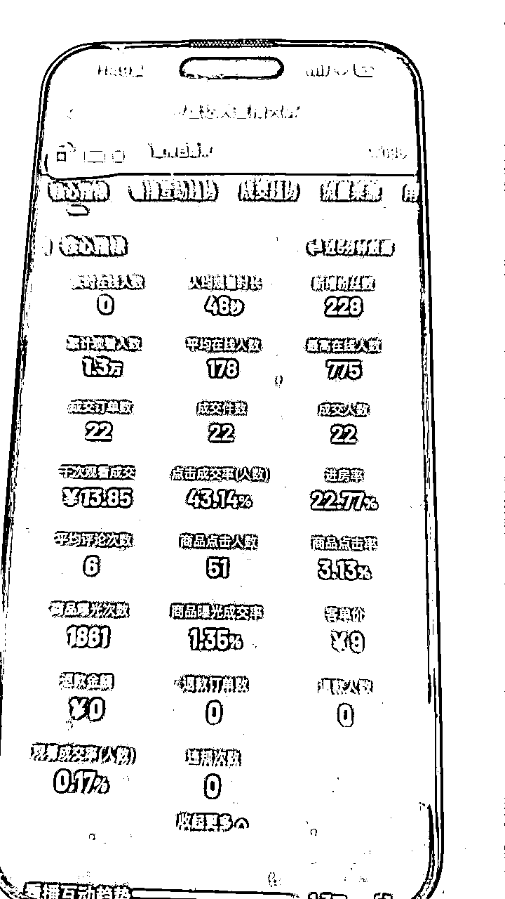
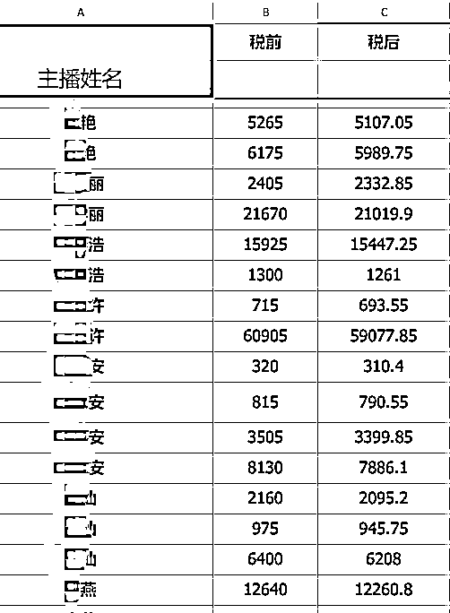
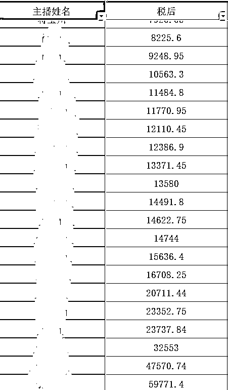

# 从考研到高报：我们把教育直播做成一条可复制的航线

大家好，我是 Lemon。老朋友应该清楚，我在教育直播这条赛道已经深耕多年。

2020 年起步是考研直播，2021 年转向少儿编程，2022 年起重心放在高中升学上。至今在同城教育流量获取领域，我们已经做到行业头部。公司现役主播规模在 500 人上下，累计帮助超过千人通过教育类流量实现六位数收益。一直以来，我们的核心能力就是教育流量的获取与转化。

从 2023 年开始，我们在直播之外，基于专业积累孵化出了【一对一高考志愿填报指导】业务，后文简称高报。

起初接高报单子只是顺手而为，并没有单独规划。真正将其独立成业务线是在去年。转折点有两处：一是张雪峰老师的爆发，让我们看到约 60% 的家长需求已从线下搬到线上，而我们本就具备线上基因；二是服务过程中我们明显感受到，家长对志愿填报几乎是一片空白。结合自身经历，我越来越觉得，志愿填报不只是生意，更是一件关乎孩子未来的社会价值。

# 我们到底在做哪件事

高考志愿填报随着高考规模扩大与新高考推进，市场需求持续攀升。据了解，七八成家长会为规避填报风险而购买志愿填报服务，这也让高报市场形成接近 10 亿元的规模。

过去我们主要覆盖本地家长。随着线上化加速，过去两年里接受线上填报的家长比例已接近六成。因此从去年 9 月开始，我们开始系统培养高报规划师，截至目前已培育近 200 人。2025 年起，我们全面复用过往线上教培的打法来做高报：前端直播间以低价引流课包做获客，后端承接 1 对 1 志愿填报服务。主播聚焦前端成交，公司按单结算佣金。

坦率讲，2025 年是第一次把志愿填报套用教培课包获客模型。选择这种打法，首要考虑的是平台合规。大家都清楚，平台对引流管控趋严，用订单化承接能让获客合规化。虽然从订单到私域加微会有一定损耗，但只有合规才能走量、走远。

产品上线初期，市场反应一般。3 月初刚发布时，主播多为新人，且当时家长焦虑值未起来。但我们对流程有信心。去年 10 月在没有引流品的情况下，纯卖 300+ 元前置志愿产品，一场也能卖出 20 多单。历经 3 月份的持续迭代后，各测试间的销量已趋于稳定。下面是该产品在抖音的直播数据。

综合平台产出看，视频号的潜力远大于抖音。抖音我们已相对饱和，而视频号仍有巨大空白。所以当下全部资源倾斜视频号。以下是视频号相关数据：

# 这件事为什么能做

## 能力可沉淀

直播获客本身投入门槛低，且具有长期复用价值。即使本项目未取得预期收益，过程中积累的内容表达能力、高报专业知识，都能为后续业务提供赋能。

## 装备极简

一张桌子、一台电脑、一部手机，最好是 iPhone，再配一个手机支架、一块平板或一张白纸，网络稳定、环境安静即可。对大多数人来说，几乎无需额外投入。

## 不露脸、不怯场

直播采用手播形式，无需出镜、不必脱稿，熟练掌握话术即可。直播焦虑感很低。

## 时间可控

稳定后每日固定时段开播即可，每场 1.5 到 2 小时，每天 3 到 4 场，整体时间宽松，能按个人节奏安排。

## 顺势而为

正值高考志愿旺季，起号与引流效率更高。团队已形成成熟的起号方法论，严格执行基本可实现 100% 起号，一般 10 天左右即可见到正反馈。

航海期间会提供完整起号方案、直播话术，并由专职运营老师一对一跟进与复盘。

## 复制性强

个体成功可能是偶然，但从项目启动至今，团队已带上千人实现六位数变现，仍有近 500 名主播在持续播出。

图里仅展示部分主播变现截图，部分主播多账号运营所以会出现百位数。项目收入逻辑清晰，按每条 leads 佣金 25 元计算，日进量即可估算收益。合理运营下，年变现 15 至 20 万是常见区间。

## 可长期经营

教育始终是值得深耕的赛道，门槛虽高，但高考志愿填报市场大、门槛相对友好，且受人口与政策红利双重影响。高报直播获客是切入该行业的高效入口，能快速获得反馈与现金流。

# 我们的底牌

其一，起号与变现逻辑完善且可复制。已有千名主播通过该项目实现六位数变现，目前持续直播者年收入多维持在六位数以上。

其二，先发与迭代。我们是行业早鸟，抄袭者众，这反而倒逼我们持续迭代。内容始终保持行业领先。航海期间会不定期更新内容并培训，确保签约老师第一时间同步。

其三，对抗周期。针对高报的淡旺季，我们会通过内容与产品迭代来平滑周期，确保淡季仍有收入保障。

其四，佣金及时结算。行业黑幕与克扣屡见不鲜，我们每月按时按量结算，以此作为对每一位伙伴的承诺。

# 做这件事会遇到什么

正反馈延迟

项目方法相同，执行者不同，结果也会有差异。即使方法正确，账号差异、直播表现、话术节奏都可能影响效果。有人起步快，有人厚积薄发，都是常态。起号本质是平台在测试你的内容是否能留住用户，运气、能力、账号都会产生波动。切勿因他人进度焦虑或沮丧。

持续学习要求

教育直播不是速成。想要持续进步，需要不断强化专业知识，才能从容应对直播间提问，获取更好结果。

此次与赚钱合作线下航海，一方面希望帮助对教育感兴趣的朋友找到长期事业，另一方面也想借助伙伴力量快速占领视频号市场。视频号目前仍有巨大缺口，基于“肥水不流外人田”的思路，我们促成了此次合作。接下来会详细介绍参与方式。

# 孵化计划

很多人都在抄我们。若单打独斗依然可行，但需自行承担迭代、转单与交付压力。我们合作，你只需把直播做好，转型交付由我们全权负责。

## 1. 合作模式

我们提供直播培训陪跑、脚本迭代、运营指导以及转单交付，你负责开播。按直播间订单结算。

## 2. 合作机制

付费门槛：2980 元

签约机制：

*   加入航海 2 天后需与公司签约，绑定 MCN。两年内公司同类型产品下【高报引流课程包、高报引流服务包、K12 学科引流课包】仅可销售我方提供的产品。绑定为个人而非账号，同行勿扰。

*   合约期内享受长期孵化服务

高报具有季节性。为对冲淡季，我们通常在 7 月后会上架次年志愿填报录播课程及工具包，用来平衡淡季引流，除成本外全部费用作为前端佣金返还，比例高于 60%。

写这篇时有伙伴问我：“高报直播能做多久？市场被蚕食后两年大盘会不会下滑？”

说实话，我也不确定。互联网业务注定会卷，就像我们的学科小课包，两年前就有人说做不下去了，但我们这两年仍在持续增长。对我而言，卷是浪潮退去后裸泳者被淘汰。浪潮后的平静反而是最舒服的游泳时段。

我设计的约束机制只是为了规避同行分流。创业本就辛苦，没精力浪费在无关消耗上。若未来收入预期不符，所学直播能力可迁移至所有知识直播领域，这本身就是最大收获。若哪天不想播了，所学高报专业知识也足以支撑你在行业内找到其他角色。

退出机制：

*   航海 2 天内可无理由退出
*   航海结束后，对直播不积极者，公司将清退并解约解绑账号

## 3. 孵化流程

孵化意味着手把手带。每一天都有会议与复盘，每个直播间配备一线运营老师。仅用 2 天进行理论学习，第 3 天全体上播，在实战中迭代成长，直至拿到结果。对我而言这件事是 100% 可复制，而非概率游戏。

# 适合谁来

*   愿意深耕高报行业并主动学习专业知识的人
*   可于 4 月前往济南参与线下学习的人
*   时间相对宽松，能稳定直播的人
*   有抗压能力，愿意照单执行的伙伴
*   具备沟通与学习能力的人

感兴趣的朋友可参照以下脚本提前录制一段模拟直播视频作为报名材料。

说在最后：

我自认表达能力一般，与赚钱的合作从去年酝酿至今，我也不清楚具体合作点在哪。我唯一想要的是靠近能带来能量的组织，靠近一群正向交流的人。我们慧校教育自 2020 年创立以来始终稳健增长，女性创业相对谨慎，但我们始终保持持续向好。在这个内卷的市场里，我们不断向内求、穿越周期。这次航海，一方面希望更靠近赚钱，另一方面也希望从过去“只培养不筛选”转向“可以筛选”的阶段。