# 一张封面，决定你笔记的死活

> 来源：[https://urh4zarsm8.feishu.cn/docx/FHAPdo8u1ohgb4x98ZvcIQUrnNb](https://urh4zarsm8.feishu.cn/docx/FHAPdo8u1ohgb4x98ZvcIQUrnNb)

带过不少做AI媒体的船员后，我发现一个普遍卡点：好多人根本不知道封面该怎么弄。

辛辛苦苦写的内容挺有分量，结果头图太劝退，刷到的人压根不想点。

于是我把那些跑出过效果的封面打法重新做了梳理，配着真实案例拆给你看，一步步带你把点击率做起来。

# 新人做封面，最容易掉进这三个坑

## 坑一：需求错位

老想着“我能写啥”，而不是“读者要啥”。就像在沙漠里扛着高端伞叫卖，货再好也卖不动。太多人习惯从自己的视角出发，做自己拿手或感兴趣的主题，压根没研究过目标人群到底为什么焦虑。这种自嗨式产出，数据自然惨淡。

举例：

*   你憋了一篇《AI 绘画的高阶秘籍》，可大家真正搜的是《AI 绘画零基础：五分钟就能上手》。

*   你砸重金做了一款贵妇面霜，但市场缺的只是一支不过百的补水面乳。

症结所在：

*   以个人能力为圆心选方向，而不是围绕受众需求做文章。

*   忘了一个基本事实——“用户要什么”才是选题的第一出发点。

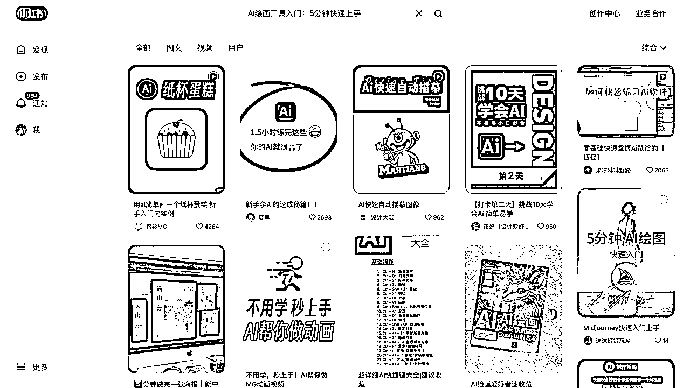

## 坑二：数据绝缘

你精心打磨的封面、文案、标题，说白了就是没上过战场的“实验室样品”。那些能反复出爆款的人，不过是先过了用户手指投票这一关。很多人喜欢闷头自嗨，认定自己作品足够牛，可真实反馈往往教做人。

举例：

*   你憋了一整周写出一篇万字长文，但用户只舍得花半分钟刷完一条短平快。

*   你费半天劲做出个精致封面，结果大家更关心标题有没有戳到痛处。

症结所在：

*   全程没有采集过真实用户的行为反馈，全凭感觉。

*   忽略了“用户行为数据”才是验证内容价值的唯一试金石。

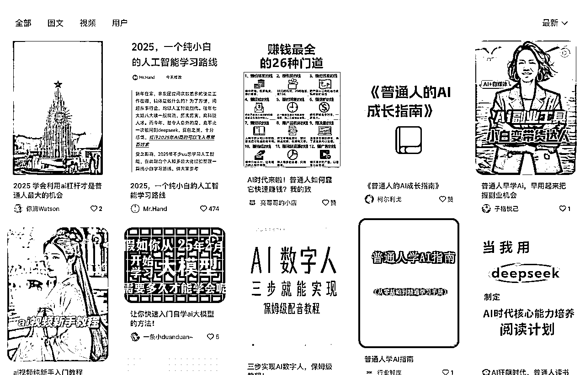

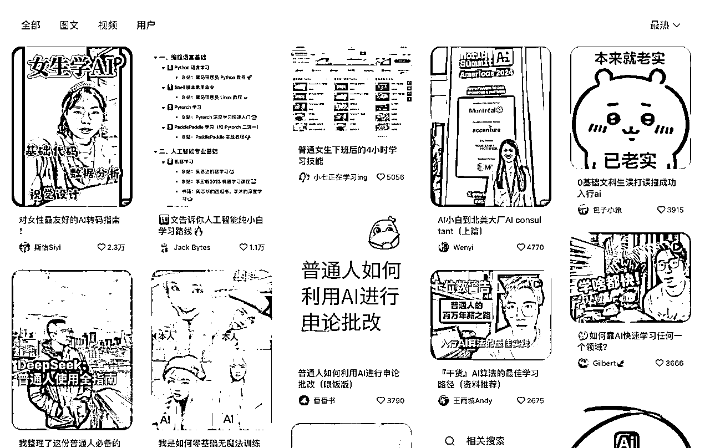

## 坑三：创新幻觉

新手总憋着要搞点不一样的，但能在商业上站住脚的内容，大多是“七成已验证的成熟框架+三成微调”。和连锁餐饮的爆品公式一个道理：经典口味不动，换换限定包装。太多人把“创新”当成爆款通行证，可用户真正买单的，是在熟悉体验里尝到一点新意。

举例：

*   你鼓捣了一种前所未有的呈现方式，可用户还是习惯看图配文的传统版式。

*   你开了一个全新领域的话题，可用户优先关注的仍是那些被反复验证过的热门选题。

症结所在：

*   过于迷恋新鲜感，忽视了人对“熟悉感”的本能依赖。

*   没站在成熟框架里做小改动，结果内容直接飞出用户的认知轨道。

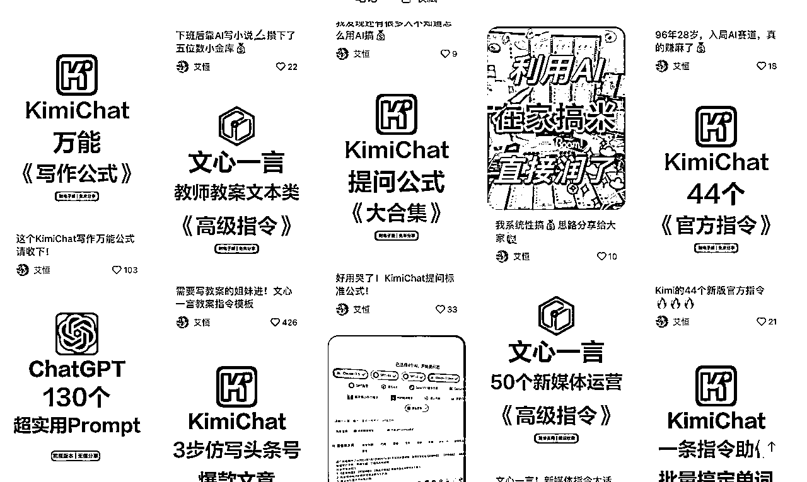

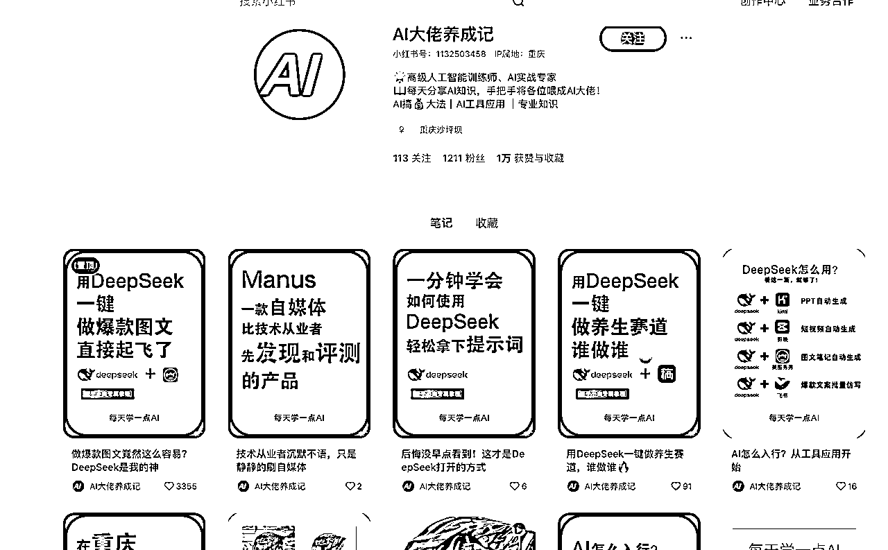

# 1. 破局思路：先从思维下手

心法要诀 - 守 破 离——来自刘小排老师

https://scys.com/articleDetail/xq_topic/582855552858284

能走出这个困局，我最该感谢的是刘小排老师的一篇分享。

那篇内容直接帮我扫清了做项目的第一个障碍。

没流量、不知道从何下手？怎么办。

答案只有四个字：像素级模仿！

下面把文章开篇的部分节选出来，供大家参考。

话先说在前头。想把别人的认知和经验真正接过来用，我始终信奉的口诀是——「守 破 离」。

这套方法最早源于日本剑道的修炼路径，后来被引入了更多领域。

「守」说的是初学阶段先老老实实照老师教的做，练到熟练为止。

「破」指的是在扎实的基础上尝试突破原有规则。

「离」则是跳出框架，自创招式，走出一条自己的路。

在生财有术这个圈子里，第一阶段的功课只有一件：守。

用圈内熟悉的说法来翻译：

「守」 = 像素级模仿

别人让你怎么操作，你就怎么操作，一个细节都别改。

不要偷懒，别想着跳过哪一步，哪怕那一步看起来毫无意义——因为你是新人，你还不懂它存在的逻辑。

不要耍小聪明，别想着改掉哪一步，哪怕那一步看起来很蠢——因为你是新人，你根本无法保证自己的改动能超过原有方案。

不要带偏见，哪怕你看不上这个项目——有些项目在外人眼里确实不高级，你可能心里犯嘀咕。但是，在你真正弄懂之前，先收住这份轻视。偏见的底子是傲慢。《三体》里那句话戳中了很多人：“弱小和无知不是生存的障碍，傲慢才是。”

说得直白点——偏见会锁死你的学习。偏见会锁死你的收入。

马云有句话也很到位：很多人输就输在，对新鲜事物，第一看不见，第二看不起，第三看不懂，第四来不及。看不见、看不起、看不懂、来不及，全占齐了。

如果你“懒得”做像素级模仿，那请警惕，你大概率正卡在“看不懂”的自信里，或者“看不起”的傲慢里。

想做好「守」，记住一句话——当一个肯下笨功夫的明白人。

那什么时候才算熬过了「守」？

——当你跑完全程拿到真金白银的反馈时、当你按“保姆级教程”完整复刻一遍并且真的赚到钱时。

# 2\. 实操：封面该怎么做

下面这些问题，是不是也让你头疼过？

❌ 内容明明不错，可封面一放出来就没人点

❌ 照着大V的版式改了好几版，总感觉差了口气

❌ 颜色调了俩小时，还不如随手一弄来得顺眼

✅别急，跟着下面的流程走，哪怕用美图秀秀这种免费工具也能整出能打的封面👇

##### 2.1 先把版式定下来

*   单张还是多张：先看参考账号的用法。新手期建议从单张做起，好拿捏。

*   为什么：单张版面聚焦感更强，适合讲清楚一件事；多张版面能容纳更多场景和信息量，适合内容层次丰富的笔记。

*   放在AI场景里：拿DeepSeek这类智能工具举例，单张能放产品主界面或核心能力的截图；多张则可以分别展示文案生成、表格分析等实际玩法。

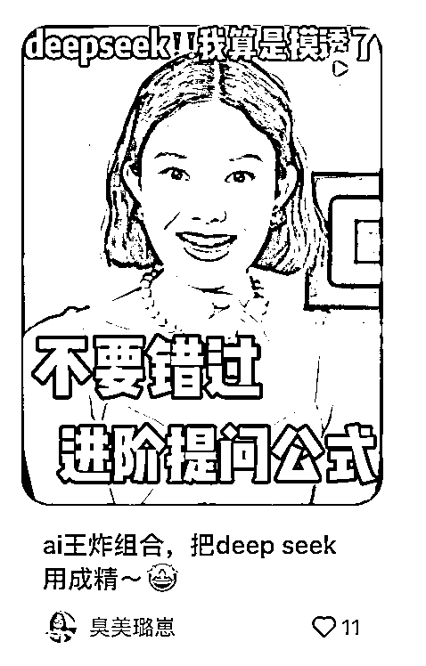

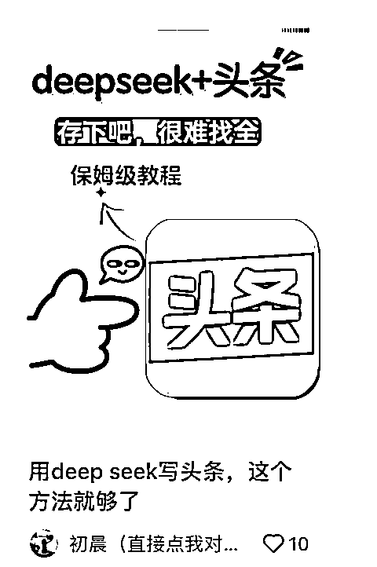

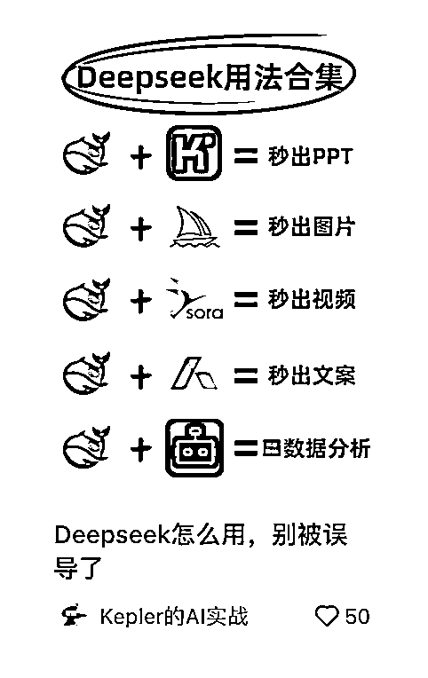

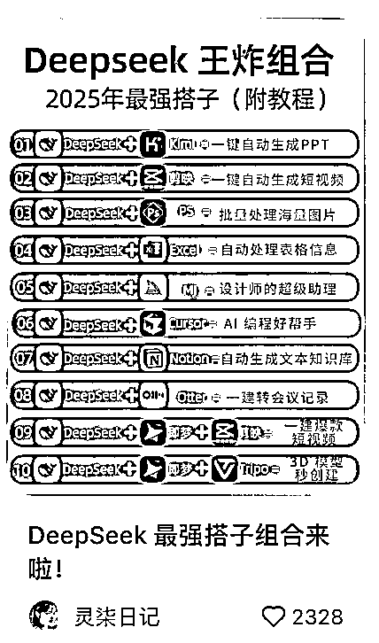

*   文字摆哪里：照着参考账号的习惯来。一般来说，标题放在画面正中或靠下位置更抓眼。

*   为什么：人眼扫封面是有顺序的，文字方位直接决定第一眼落在哪。居中排版最容易制造视觉焦点，放底部则能给上方图案腾出呼吸感。

*   放在AI场景里：推广智能工具时，标题可以直接压画面中央，把“5分钟上手DeepSeek”这种卖点一眼甩出来。

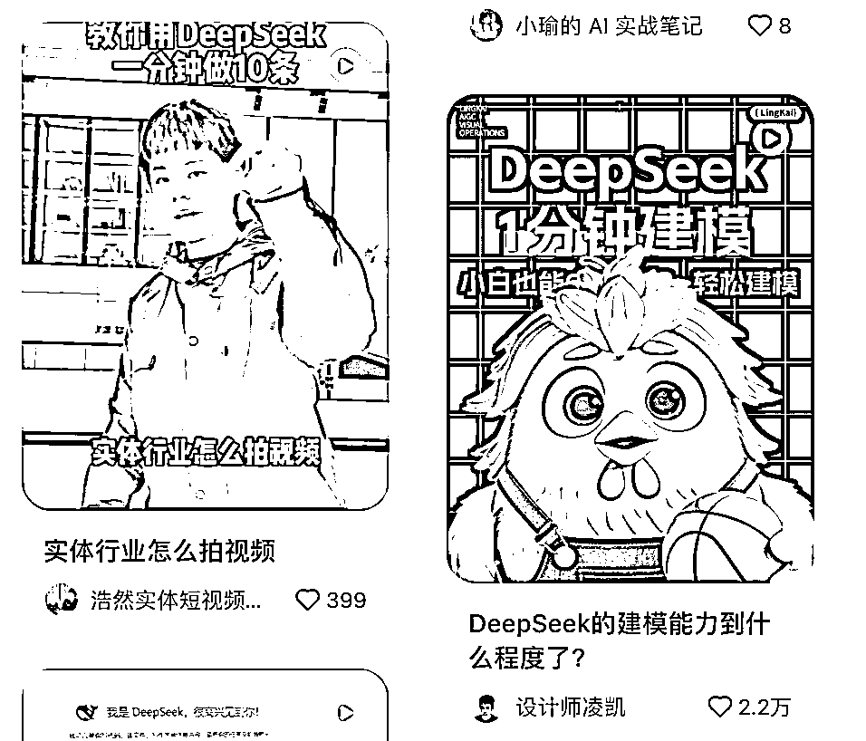

*   图和字各占多少：参考对标账号的比例。如果对方的画面几乎被图占满，你也别把字堆太大。

*   为什么：这个比例决定了画面的重心。图多的时候，眼睛先被视觉内容吸走；字多的时候，标题就变成主角。

*   放在AI场景里：推智能工具时，大图展示产品界面或生成效果，文字走精简路线点出核心卖点就能。

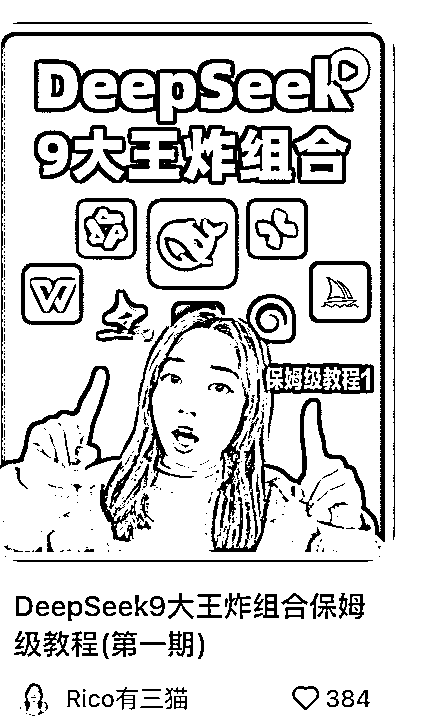

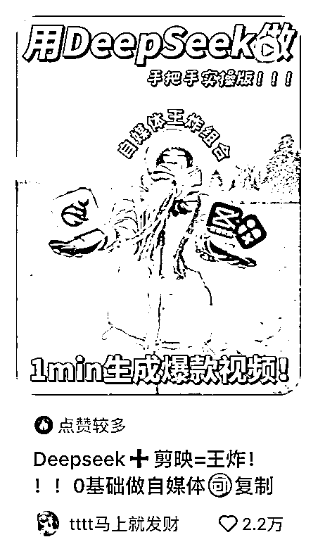

##### 2.2 把配色搞定

*   主色调：先从参考账号那儿借色。拿不准的话，用Photoshop的吸管功能直接取色就行。

*   为什么：颜色定了整个画面的情绪基调。明快的色调传达轻松感，容易吸引年轻群体；深色系则更显稳重，和技术类内容很搭。

*   放在AI场景里：深蓝底配白字的组合很适合智能工具，既显专业又不失清爽。

*   对比度：文字和底色之间拉不开差距？高对比的搭配（比如白字叠黑底）最抢眼。

*   为什么：反差越大，文字跳出来的速度越快，信息传递效率也越高。

*   放在AI场景里：想突出“5分钟学会DeepSeek”这句卖点，白字黑底就是最稳的选择。

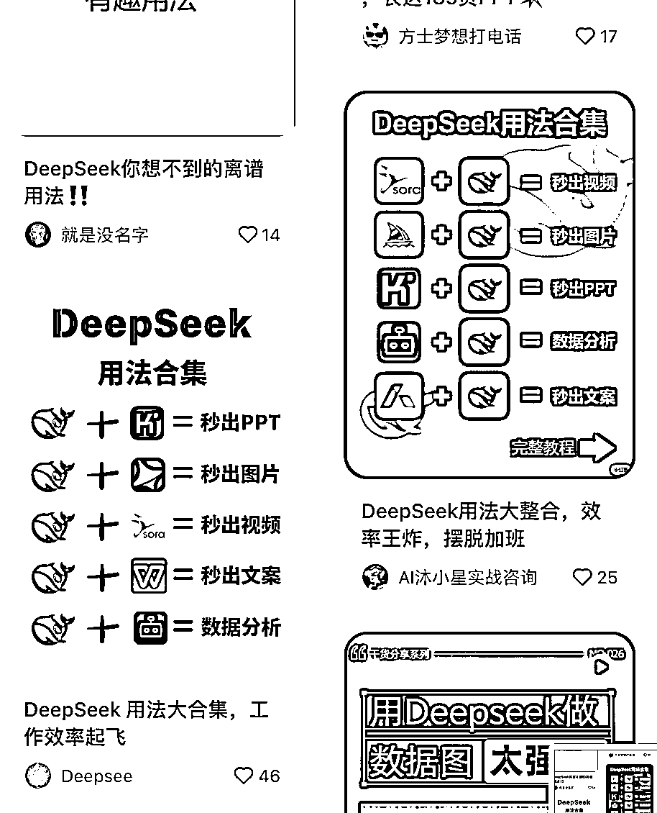

##### 2.3 把字体选对

*   字形气质：选和参考账号气质接近的就行。实在找不到同款，风格类似的也能顶上。

*   为什么：字体自带情绪。无衬线体干净利落，适合科技向内容；手写体亲切随性，适合情感向表达。

*   放在AI场景里：面向智能工具的内容，用Arial、Helvetica这类无衬线字，专业感立刻拉满。

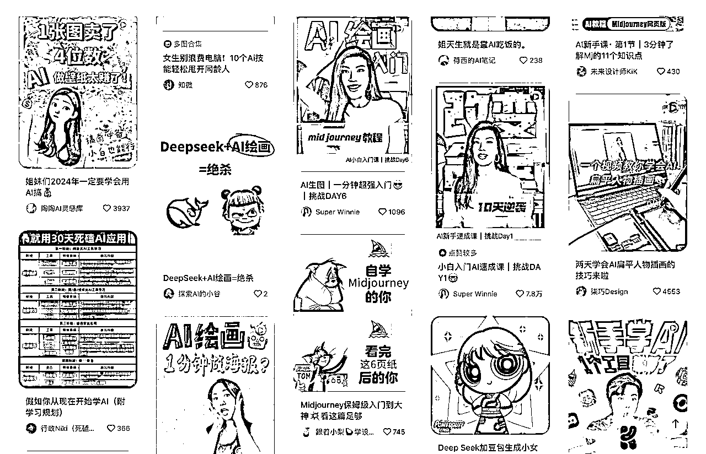

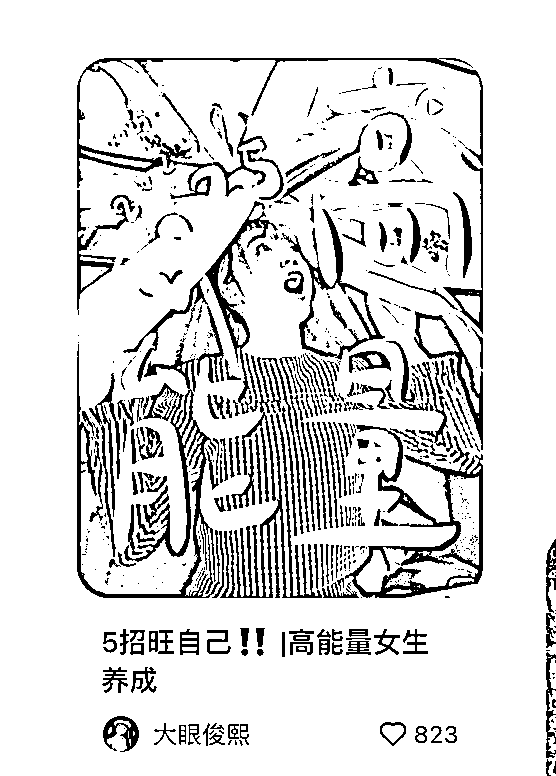

*   字号大小：标题字号务必给足，要保证缩略图阶段也看得清。

*   为什么：字号直接决定标题的存在感。字够大，用户快速滑动时才能一秒锁定。

*   放在AI场景里：标题可以给到48pt以上，确保“5分钟学会DeepSeek”在信息流里不会被吞掉。

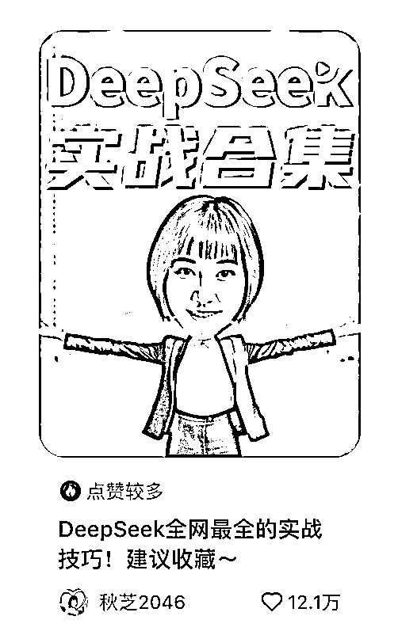

*   字体颜色：跟着背景色来选，底线是看得清。

*   为什么：字色和底色的关系就是可读性的命门。对比强，阅读零负担。

*   放在AI场景里：深蓝背景上用白字，这套组合基本不出错。

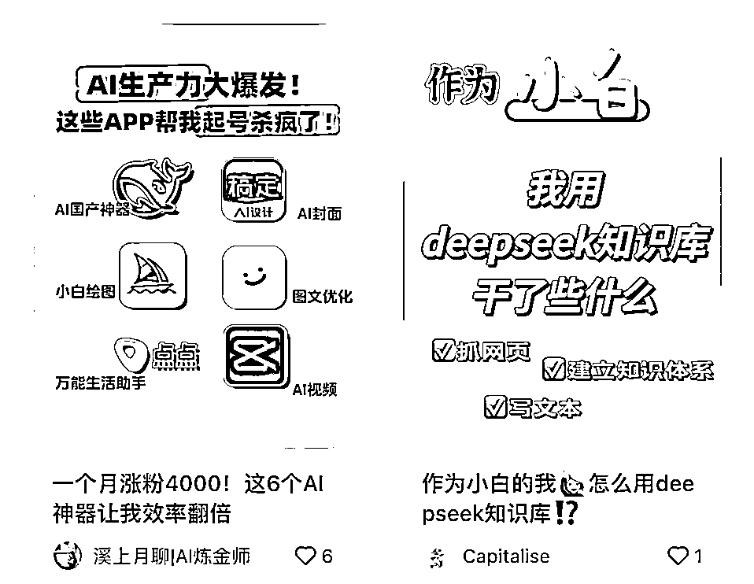

##### 2.4 挑对图片内容

*   图的方向：你的参考账号用的是产品图、场景图还是真人图？

*   为什么：不同图种传递的信息重点不同。产品图主打功能展示，场景图讲的是应用氛围，真人图则负责拉近距离。

*   放在AI场景里：推DeepSeek时，直接截产品界面；想加温度，就放张使用者在电脑前操作的场景照。

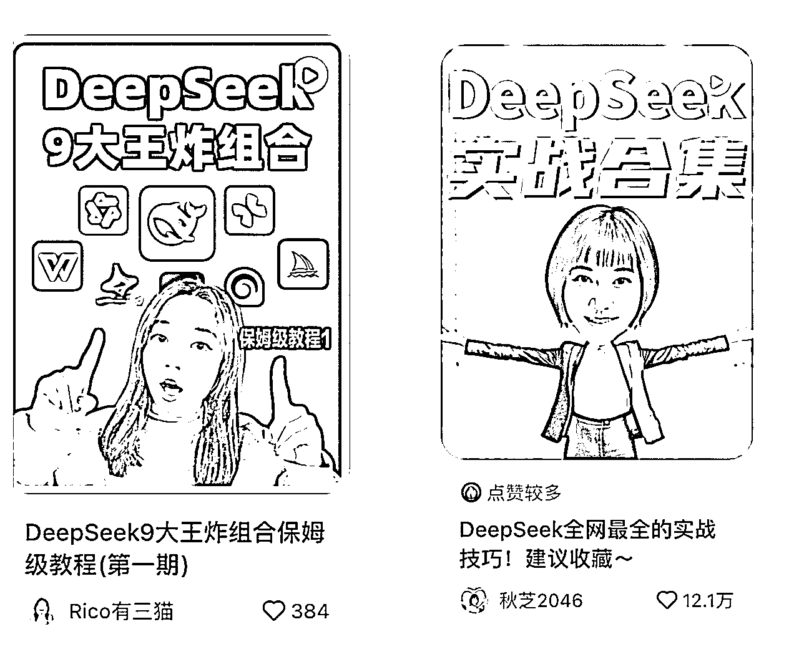

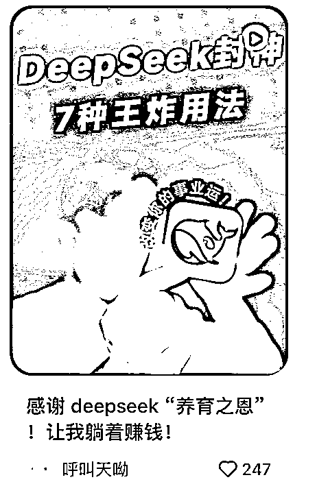

##### 2.5 加点细节元素

*   图标/装饰：封面上有没有小图形、描边之类的点缀？它们有没有让画面变得更有层次？

*   为什么：这些小东西能丰富视觉层级，让封面经得起多看两眼。

*   放在AI场景里：右下角放个AI芯片小图标，专业感马上就上来了。

*   品牌标识：参考账号如果是品牌方，有没有带Logo？

*   为什么：品牌标识是信任放大器，能直接提升辨识度。

*   放在AI场景里：如果你有自己的品牌Logo，别藏着，放封面角落就行。

# 三种落地封面玩法，照着做就行

AI内容赛道越来越卷，封面就是0.5秒定胜负的冲锋号。

我挨个测过不少AI方向的账号，结论很直接：

✅ 强人设路线——信任转化率上浮50%（真人出镜+专业环境）

✅ 海报大字路线——点击率提升30%（大标题+强对比配色）

✅ 低成本模板路线——出图效率翻5倍（固定模板+智能生成）

这堂课不讲美学理论，只讲怎么精准拦截流量。

下面3套在AI内容领域验证过的封面打法，直接给你抄作业。

### 第1套：强人设封面

#### 拆解一下

*   是什么：靠真人形象撑起信任感，适合有个人IP或想用脸熟吸粉的账号。

*   特征：

*   真人出镜：画面主体就是人。

*   背景干净：纯色或简单场景，不抢戏。

*   标题醒目：精简几个字，直给信息。

*   AI领域对标：

*   杜老师AIGC：本人出镜，背景是简单的办公环境，标题写着“5分钟学会AI绘画”。

*   秋芝：本人出镜，背景纯色，标题为“AI工具实战指南”。

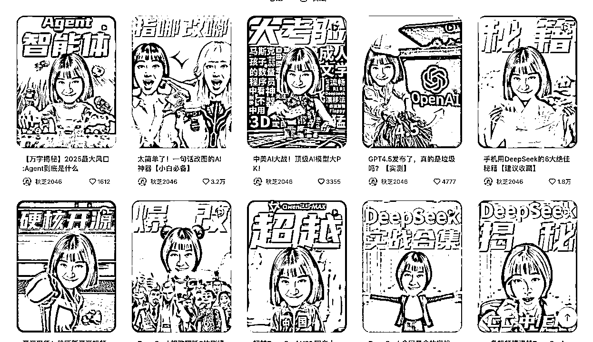

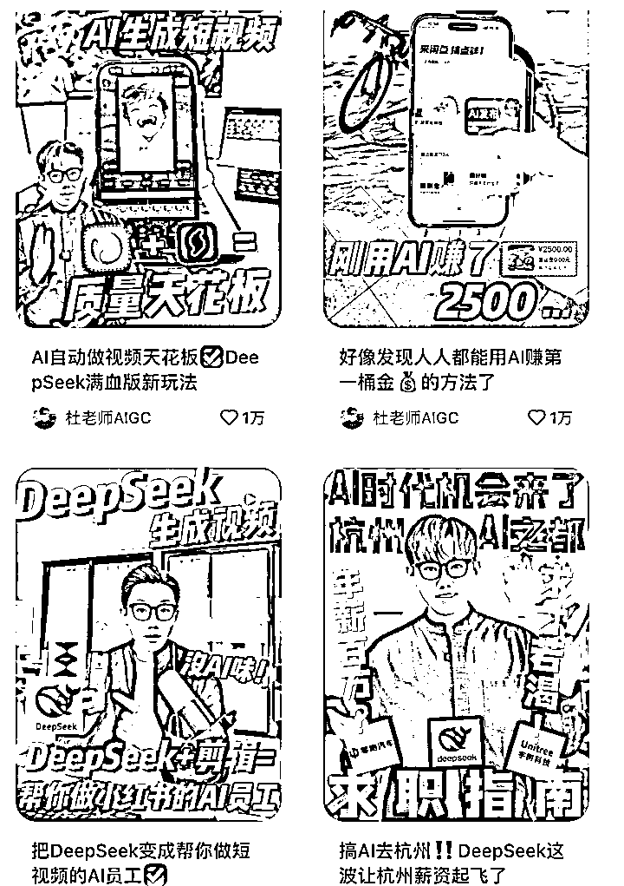

#### 操作流程

1.  准备人物素材：挑一张清晰度高、背景不乱的人物照和一张背景图。

（用美图秀秀把人物抠出来，贴到备好的背景上。

1.  打字上去：把标题排在画面中央或上方，字体选利落的无衬线体。

1.  微调配色：整体色系统一不打架，保证标题能从背景里弹出来。

1.  检查细节：调整人物和文字的相对位置，确认视觉平衡。

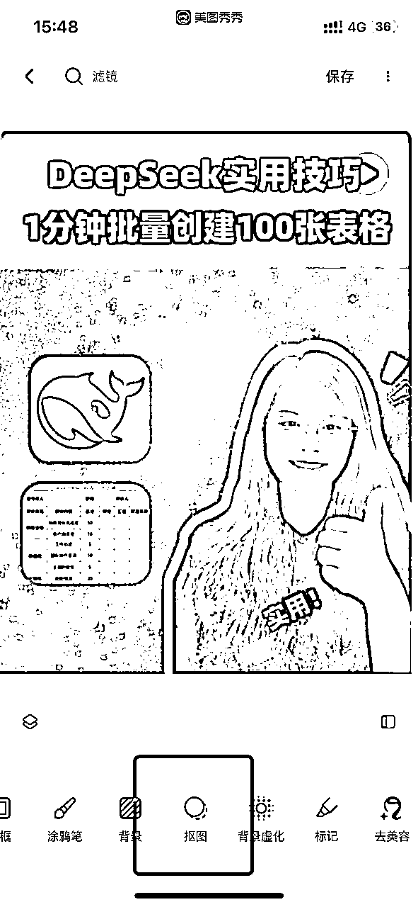

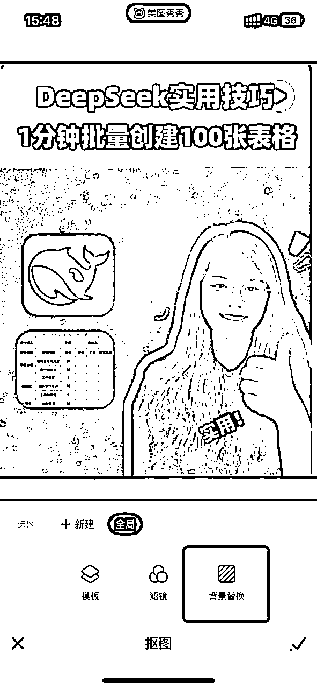

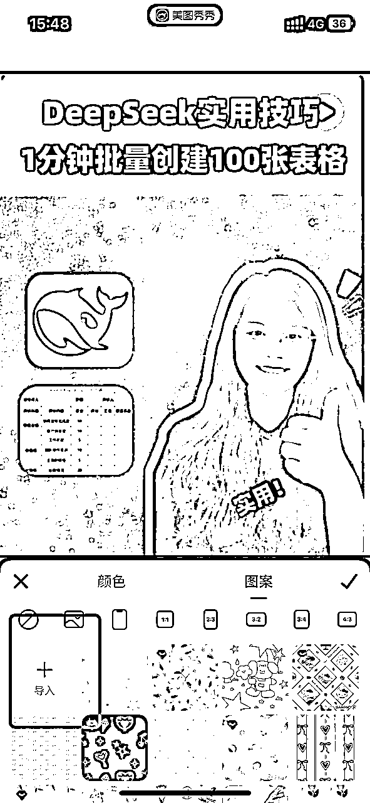

#### 上手演示

*   直播过一遍：从挑图、抠图、打字到调色，完整演示给你看。

*   工具清单：Canva或者Photoshop，选一个顺手的就够。

* * *

### 第2套：海报型封面

#### 拆解一下

*   是什么：直接用大字排版输出核心信息，不想露脸的人首选。

*   特征：

*   大字占屏：标题就是视觉主体，字体大而醒目。

*   背景极简：纯色或简洁纹理，不干扰文字。

*   无人出镜：不靠脸，全靠文字和构图抓人。

*   AI领域对标：

先别急着嘲笑那些看着很low的项目。在你成为专家之前，请把偏见收起来。偏见说白了就是傲慢。还记得《三体》里那句被疯狂转发的话吗？真正让生命栽跟头的，从来不是弱小和无知，而是傲慢。翻译成大白话：偏见会让你学不到东西，也赚不到钱。

关于新兴事物，马云有句很扎心的总结：大多数人先是无视它，然后轻视它，接着看不懂它，最后追不上它。如果你打心底里不屑于“像素级模仿”，那你很可能正站在“看不懂”的自信里，或者陷在“看不起”的偏见里。想做好“守”，核心只有一条：当一个愿意下笨功夫的聪明人。那什么时候能离开“守”？当你从实操中拿到真实反馈，或者完整跑通一套保姆级教程并且赚到钱的时候。

很多做AI内容的朋友都有类似的困惑：干货笔记写得再认真，封面平平无奇，根本没人点；照着大V的封面改，却总觉得哪里不对；调了半天颜色和字体，效果还不如随手做的好。其实问题不是你不会设计，而是没掌握一套可复制的封面方法论。哪怕只用美图秀秀，也能做出专业感。

第一步，定布局。先看对标账号，决定用单图还是多图。新手建议从单图开始，因为更容易聚焦，适合讲清楚一个核心信息；多图则能展示多个产品、场景或更丰富的内容。比如你推荐DeepSeek，单图可以放工具界面或核心功能，多图可以分别展示文案生成、数据分析等场景。文字位置也有门道：居中的标题能第一时间抓住视线，放底部则给图片上方留出呼吸感。想突出“5分钟学会DeepSeek”，就把标题居中。图片占比也要跟对标账号保持一致：图片占大部分，用户先看画面；文字占大部分，用户先看标题。

第二步，配色。主色调参考对标账号，不确定就用取色器提取。颜色决定氛围：明亮色轻松活泼，深色系专业稳重。AI类内容常选深蓝背景+白字，专业又现代。还要注意文字和背景的对比度，白字黑底这种强对比最抓眼球。

第三步，字体。字体风格跟着对标走，找不到同款就找相近的。无衬线字体现代简洁，适合技术内容；手写体亲切有温度，适合情感类。标题字号一定要够大，比如48pt，保证快速浏览时一眼看到。字体颜色则跟着背景走，高对比才清晰，比如深蓝底配白字。

第四步，选图。对标账号用的是产品图、场景图还是人物图？产品图秀功能，场景图讲故事，人物图拉近距离。推广AI工具，界面截图或用户使用场景都是好选择。

第五步，加元素。小图标、边框、装饰能增加层次感。比如在右下角加一个AI小图标，专业感立刻上来。如果有自己的品牌Logo，也别忘了放上去，辨识度和信任感都会提升。

AI内容越来越同质化，封面的作用就是0.5秒内决定用户点不点。我拆解了大量AI账号后发现：强人设封面能让信任转化率提升50%，海报型封面点击率能涨30%，低成本封面生产效率能提升5倍。这不是设计课，而是流量狙击战。下面三套经过验证的公式，直接抄。

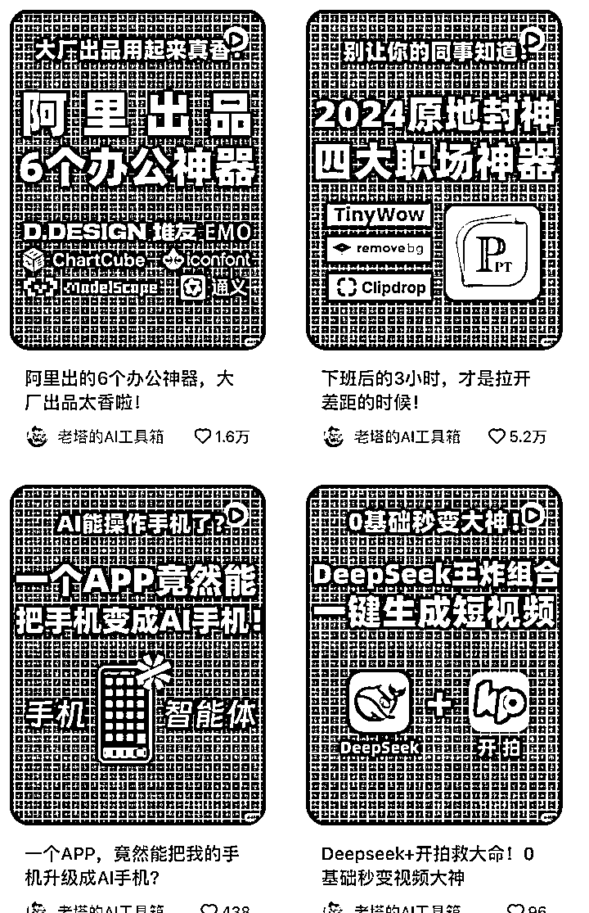

先看强人设封面。简单说，就是真人出镜+简洁背景+大字标题。适合有个人IP、想靠亲切感建立信任的账号。比如杜老师AIGC，办公室背景+本人出镜+“5分钟学会AI绘画”；秋芝则是纯色背景+“AI工具实战指南”。怎么做？先准备一张高清模特图和干净的背景，用美图秀秀抠图换背景；然后加上无衬线大字标题，放在中央或顶部；再调整配色，让标题和背景形成强对比；最后微调人物和标题的位置，让画面平衡。可以用Canva或Photoshop操作。

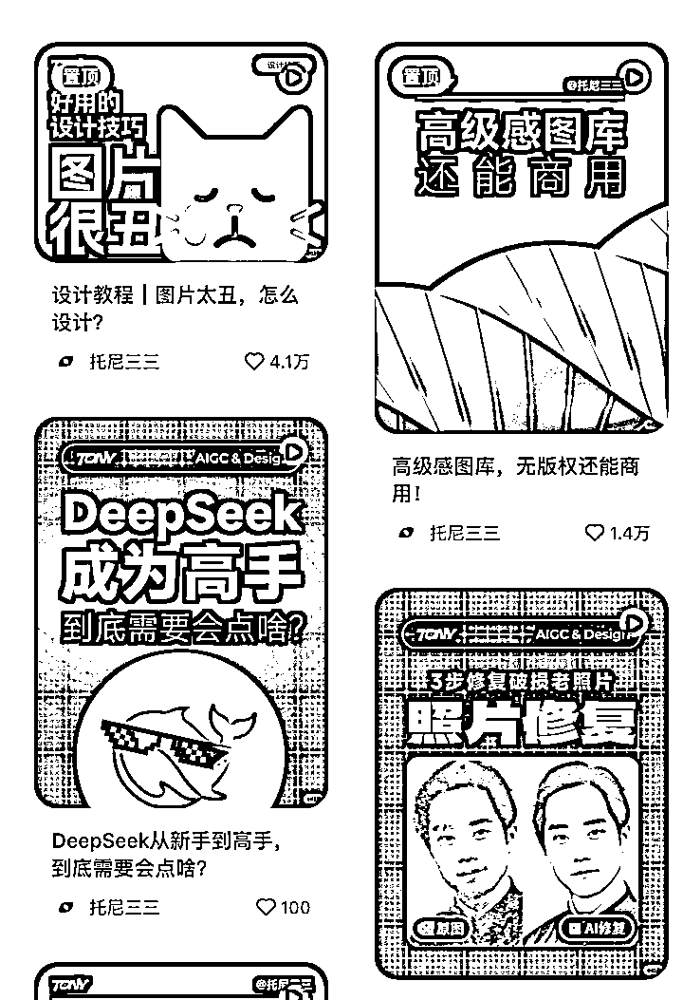

再看海报型封面。不想露脸？那就让标题当主角。大字标题+纯色背景，简单粗暴。比如托尼三三的深蓝底白字“AI工具实战指南”，老塔的AI工具箱是黑底黄字“AI工具大全”。步骤也不复杂：选一个纯色或简单图案背景，居中放大一个无衬线标题，确保和背景对比强烈，比如白字黑底、黄字蓝底，再微调大小和位置。工具推荐Canva或Figma。

最后是低成本封面。新手或时间不够，用固定模板批量生产。比如媛媛的AI笔记，用一张星巴克底图，每次只改标题。具体参数可以是：多图布局、标题置顶、底部图片占大比例；深灰背景+白字；较大号无衬线字体；图片用AI工具界面截图。模仿时，先选单图布局、文字居中，然后深灰底白字，字体大小适中，配上相关界面截图，最后在右下角加一个AI小图标，专业感就出来了。

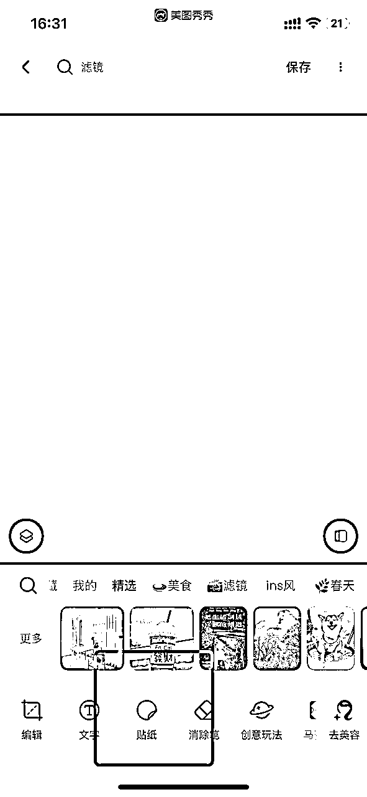

工具方面，手机党5分钟出片：美图秀秀适合抠图+文字，记得用AI消除笔去杂物，直接套“配方”模板；黄油相机擅长可爱字体和贴纸，花字模板一键生成ins风标题。电脑小白：Canva搜“AI科技”“极客风”免费模板，用Magic Design输入文案自动生成封面；创客贴中文模板更接地气，直接搜“ChatGPT”“AI绘画”，网址分别是canva.cn和chuangkit.com。团队协作：Figma用组件库统一风格，可以装“封面设计系统”插件自动规范字号色值；Clipchamp是Win11自带，免安装，适合快速做动态封面。专业玩家：Photoshop学智能对象和图层样式，用神经滤镜自动调色；Remove.bg一键抠图，导出带阴影的PNG更自然。选工具三句话：新手先用手机APP练手，批量制作转战Canva/创客贴，专业号必须用Figma+PS。

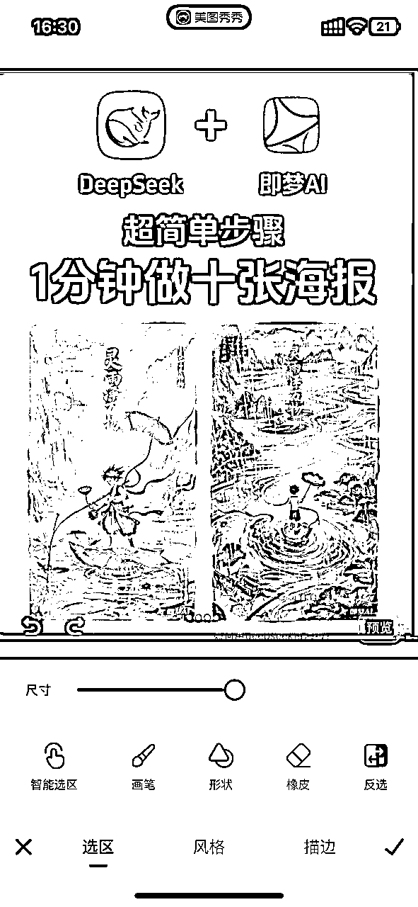

个人实战心得，这3条铁律是从踩坑里捡回来的。第一条，抄作业才是最快的学习。别自己瞎试错，直接拆解10个万粉账号的封面库，用收藏夹分类。我以前也看不上某些“土味”封面，结果同样的内容，别人点击率是我的5倍。第二条，数据比审美更靠谱。建一个封面实验室，起号阶段每次换封面都记录点击率。结果我发现我觉得丑的荧光绿标题，比高级灰高了40%。第三条，标准化才能规模化。整理一份封面设计SOP文档，把字号、色值、边距、底图全部定死。以前做一张封面要2小时，现在15分钟搞定。技巧上，可以在模仿基础上加一个自己的“记忆点”，比如固定放在角落的签名图标，我用一个电路板小图标，账号辨识度直接提升70%。手机作图用好美图秀秀的“配方”保存参数，黄油相机的“模板共享”也能直接套AI领域设计师的模板。

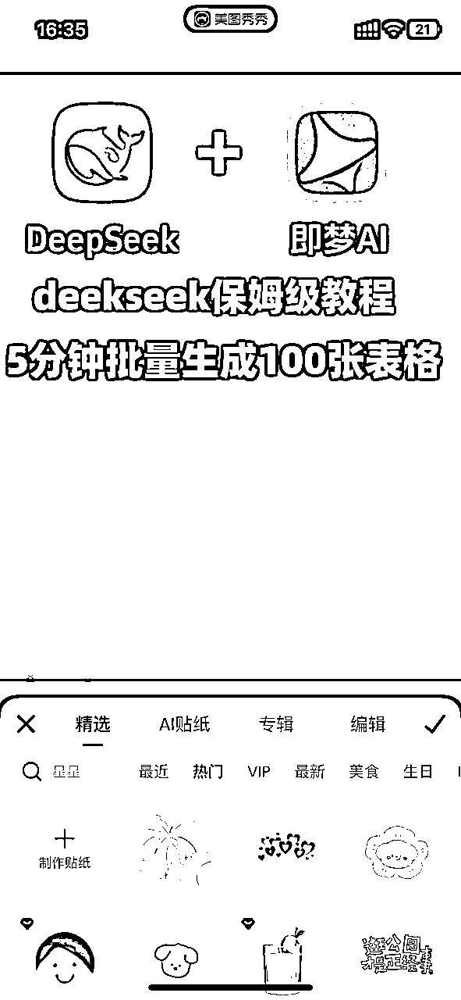

下面进入百问百答。

基础操作类：
Q1 怎么找对标账号？A：在抖音、B站、小红书搜“AI工具”“AIGC”，按最多点赞排序，优先看粉丝1-10万的腰部账号。头部大号背后有专业团队，你学不来。
Q2 必须真人出镜吗？A：技术解析类可以不露脸，但教学类账号真人出镜转化率更高。
Q3 手机能做出专业封面吗？A：实测美图秀秀+黄油相机足够，关键是会用“消除笔”和“文字透视”。

设计技巧类：
Q4 文字总被平台压缩怎么办？A：记住最小字号标准：安卓标题48px、正文36px；iOS标题52px、正文40px。
Q5 工具界面截图怎么变高级？A：三个技巧：用“壳子”APP加手机边框；用PS加内阴影，参数建议不透明度20%、大小10px；背景叠一层科技感网格素材。
Q6 不会配色怎么办？A：用这两组安全牌：权威感是深蓝#0F4C81+银灰#E5E7EB，活力感是黑色#000000+霓虹绿#00FFA3。

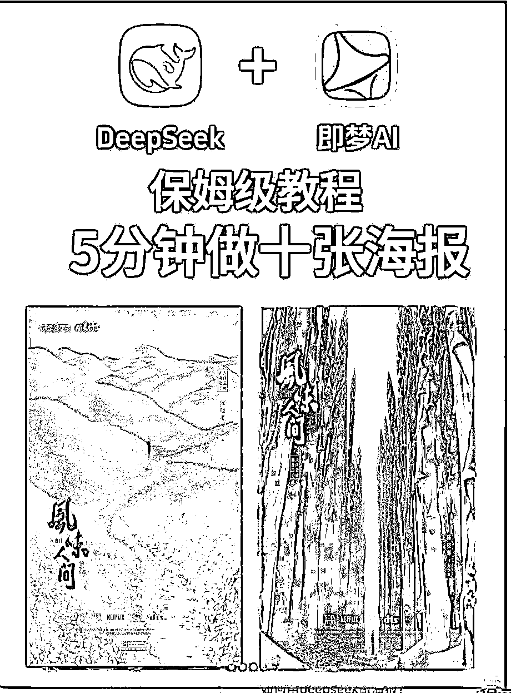

工具类：
Q7 Canva模板太普通？A：先用Magic Design生成基础模板，再导入PS添加AI元素，素材可以到Flaticon找免费科技图标。
Q8 怎么快速统一多封面风格？A：用Figma，创建颜色样式库、制作自动布局组件、再装一个“封面设计系统”插件。
Q9 不会抠图？A：Remove.bg上传时加指令“保留电脑/手机元素”，导出时选“带阴影”格式，效果更自然。

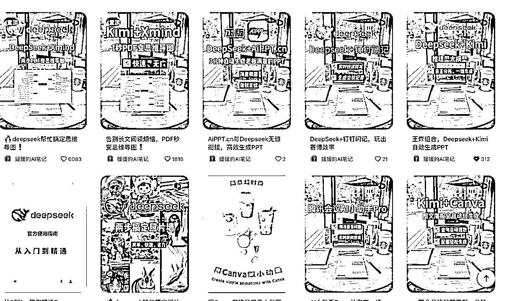

数据优化类：
Q10 怎么判断封面合不合格？A：看两个指标：点击率≥5%，3秒完播率≥40%。
Q11 改了封面没效果？A：用单变量测试法，每周只动一个元素，比如这周只调标题位置，下周只改主色调。
Q12 爆款封面能复用吗？A：建一个封面元素拆解表，把不同爆款的元素组合起来，比如A封面的配色+B封面的布局。

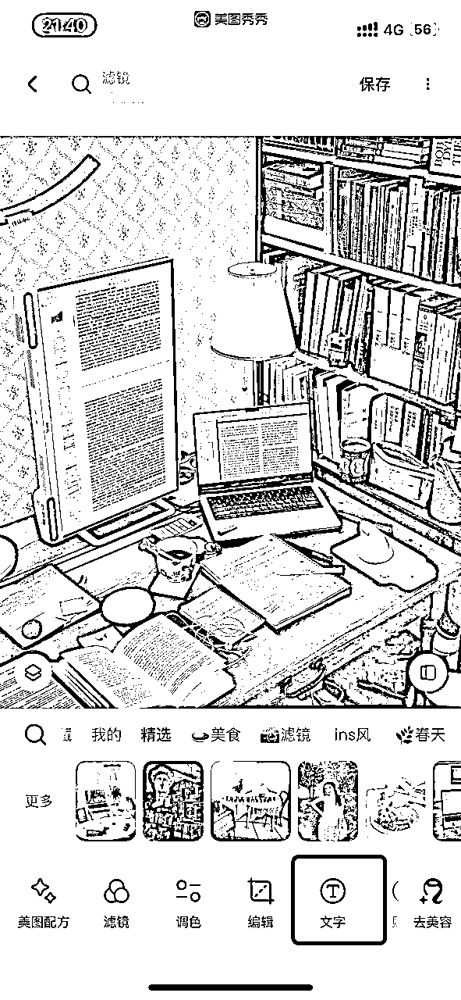

文章有点长，谢谢你看到这里。有问题欢迎留言，我会尽量回复。

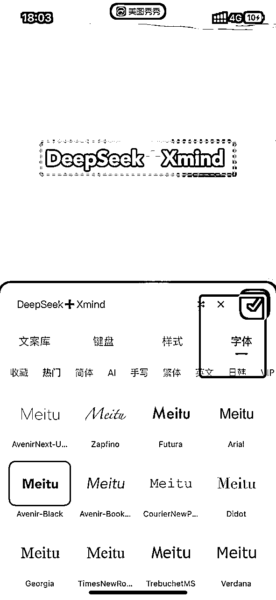

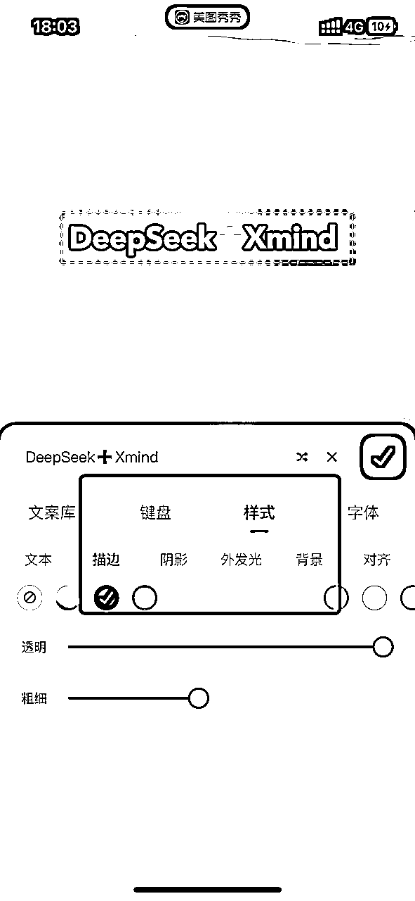

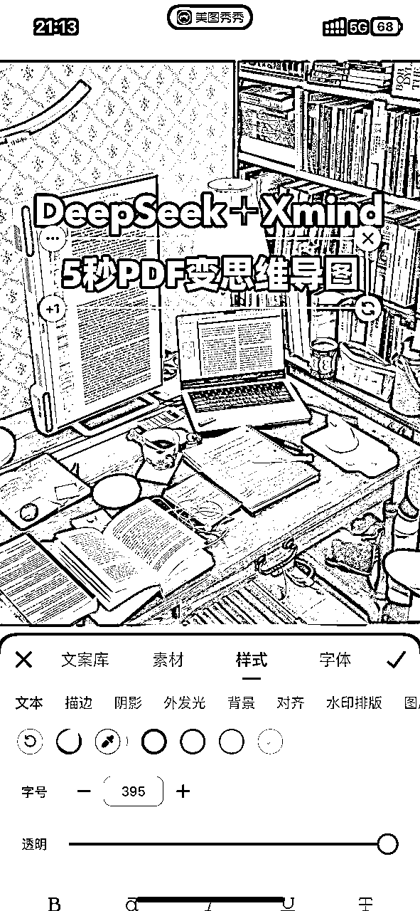

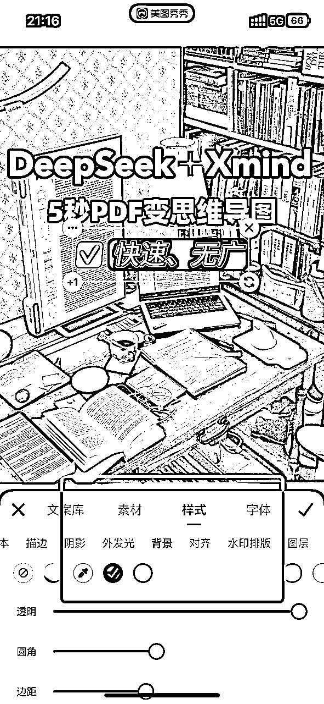

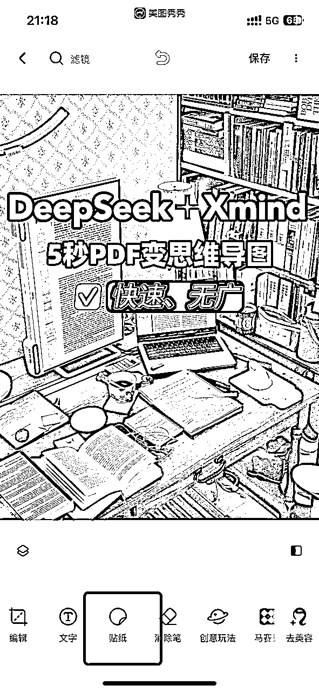

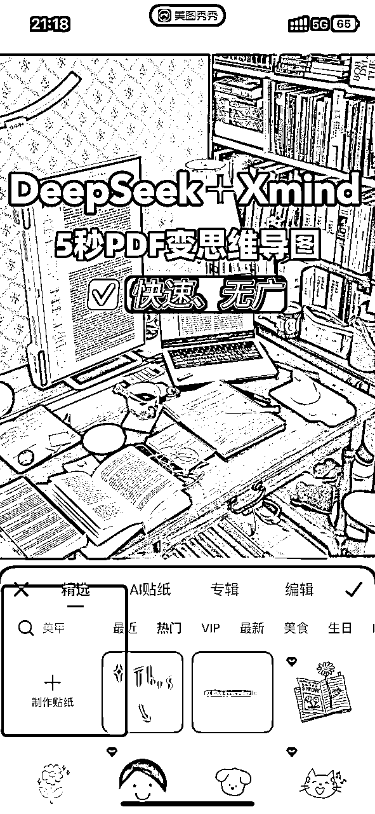

# 封面总做不好？AI 方向的成片方法论整理

不管是靠手机随手出片，还是想在电脑上精细打磨，甚至是团队协作批量产出，下面这套工具清单和实操经验，可以帮你把路径找准。

## 一、按使用场景选工具

### 📱 移动端快速出图

* **美图秀秀**：抠像换底、叠加文字都很顺手。核心在于善用「AI消除笔」清理杂物，再配合「配方」一键套用成熟模版。
* **黄油相机**：字体和贴纸资源丰富。「花字」系列模版能直接做出社媒感的标题，适合审美要求不高但求速度的场次。

### 💻 个人电脑入门友好

* **Canva**：海量免费模版，检索「AI科技」「极客风」即可。进阶用法是「Magic Design」，把文案丢进去自动拼装版式。官网：https://www.canva.cn
* **创客贴**：中文语境下的模版更贴近国人口味。直接检索「ChatGPT」「AI绘画」等关键词即可拿到可用稿。官网：https://www.chuangkit.com

### 👥 多人协同作业

* **Figma**：组件库可实现风格统一。装入「封面设计系统」插件后，字号色值会自动归一，多人合稿也不会冲突。
* **Clipchamp**：Windows 11 自带，微软出品免安装。擅长制作动态封面，例如加入进度条、数据跳动等小动画。

### 🖥️ 高精度专业向

* **Photoshop**：智能对象加图层样式是基础，再配合「神经滤镜」做AI 辅助调色，效率和可控度兼得。
* **Remove.bg**：专攻抠图，人像或产品 1 秒分离。导出 PNG 后可直接拖入其他软件继续编排。

💡 **选型建议：**

1. 入门阶段用手机 App 热身，美图秀秀与黄油相机搭配已足够。
2. 需要量产就转到 Canva 或创客贴，复用模版节省时间。
3. 品牌号运营建议配置 Figma+PS，才能把视觉规范吃透。

建议自建一份对比清单，从上手难度、适用情境、学习投入三个角度打分，选型更清晰。

## 二、从踩坑到熟练的个人经验

### 💡 心态层面

#### 1. 模仿拆解比闭门造车快
别自己从零试错。把十个万粉号的封面合集扒下来，用收藏夹分类归档。我曾嫌弃某土味封面，结果同主题内容点击差距达到五倍。

#### 2. 用数据否定直觉
起号期我建了个「封面试验场」，每版都记下点击表现。让人意外的是，我主观认为难看的荧光绿标题，表现比高级灰高出四成。

#### 3. 流程标准化才能提效
把制作步骤固化成「封面 SOP」，明确字体大小、色号、留白、底图规范。现在一张从两小时压到十五分钟。

### 🛠️ 操作层面

1. **微创新记忆点**：在模仿基础上加一个固定符号，比如我在角落统一放电路板小徽标，账号辨识度提升很明显。
2. **移动端复用技巧**：美图秀秀的「配方」可保存成功参数直接调用；黄油相机可关注领域设计师，模板共享后直接套用。

## 三、AI 封面制作高频疑问

### 基础执行类

**Q1：怎么找合适的对标对象？**
A：在抖音、B站、小红书搜「AI工具」「AIGC」→按点赞数排序→挑粉丝 1-10 万的中腰部账号。头部大号多为团队作业，不易复制。

**Q2：必须露脸吗？**
A：技术拆解类可纯图文，教学类带真人出镜的转化通常更高。

**Q3：手机能做到专业水准吗？**
A：美图秀秀加黄油相机组合足够，关键是把「消除笔」「文字透视」用熟。

### 版式技巧类

**Q4：文字被平台压缩怎么办？**
A：谨记移动端最小规范：安卓标题 48px/正文 36px；iOS 标题 52px/正文 40px。

**Q5：截图怎么显得高级？**
A：三点处理：用「壳子」App 加手机边框；在 PS 里加轻微内阴影，不透明度约 20%、半径 10px；背景铺科技网格素材。

**Q6：配色无从下手？**
A：两个安全组合：沉稳感 深蓝 #0F4C81 + 银灰 #E5E7EB；活力感 纯黑 #000000 + 霓虹绿 #00FFA3。

### 工具使用类

**Q7：Canva 模版太千篇一律？**
A：先用「Magic Design」生成初稿，再导入 PS 增加 AI 元素，Flaticon 的免费科技图标是常用补充。

**Q8：多图风格如何统一？**
A：Figma 三步走：建立颜色样式库、制作自动布局组件、接入封面设计系统插件。

**Q9：抠图困难？**
A：Remove.bg 进阶：上传时提示保留电脑/手机主体，导出选带阴影版本更自然。

### 数据优化类

**Q10：封面达标线是什么？**
A：点击率不低于 5% 为行业基准，3 秒完播率目标 40% 以上。

**Q11：修改后仍无起色？**
A：采用单变量测试，每周只动一个要素，如仅调整标题位置或仅更换主色。

**Q12：爆款能否复用？**
A：可以。建立元素拆解表，把成功组合拆开重组，例如 A 的配色搭配 B 的版式。

全文篇幅较长，谢谢你读到这里。
有任何疑问欢迎留言交流。