# 爆款拆解：暖心长者插画+视频号收益分成实操全流程

> 来源：[https://bcn7jh9fl49y.feishu.cn/docx/REG8d0y8gohOVqx7ajncg15PnAc](https://bcn7jh9fl49y.feishu.cn/docx/REG8d0y8gohOVqx7ajncg15PnAc)

# 一、起盘背景与数据验证

## 1.切入点

近期在跑热门短片二次剪辑结合绘画模型+视频号分成这条赛道，对抖音、视频号上表现优异的账号十分敏感。

与此同时，圈内@浮生若梦提到一个风向：视频号里那种温情长者图文系列的热度非常高。

这种图文/短视频形态的原创度感强，批量图像生成具备全自动化的可能，且不需要真人露脸，实名压力小。

于是开始围绕标杆进行复盘，并进入实测阶段。

## 2.对标案例

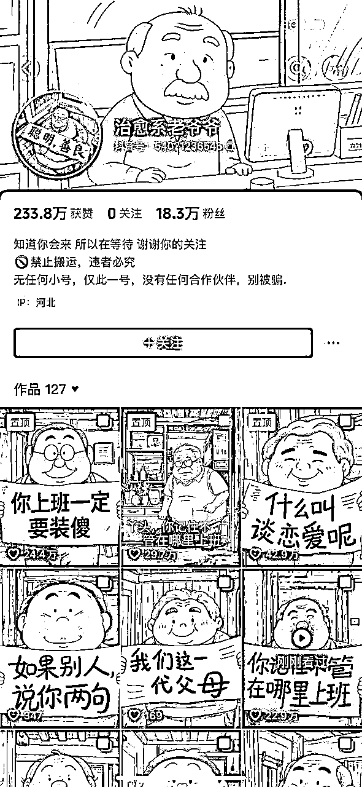

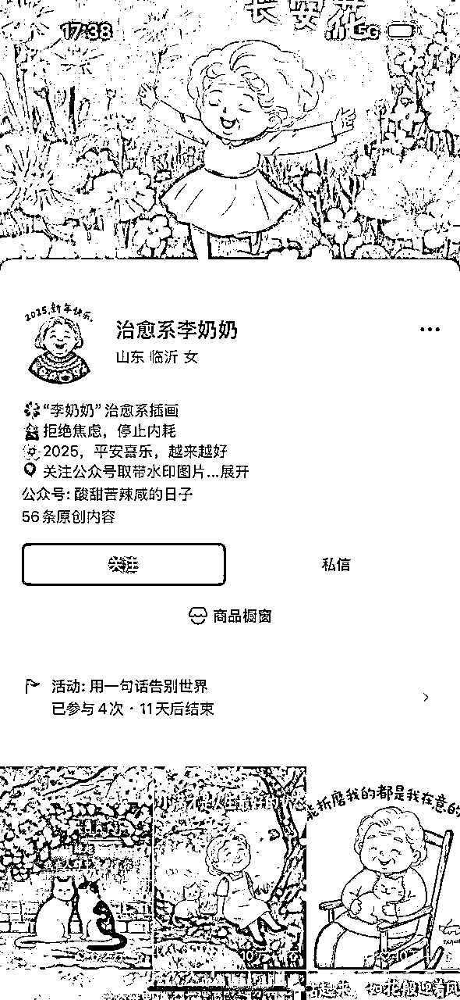

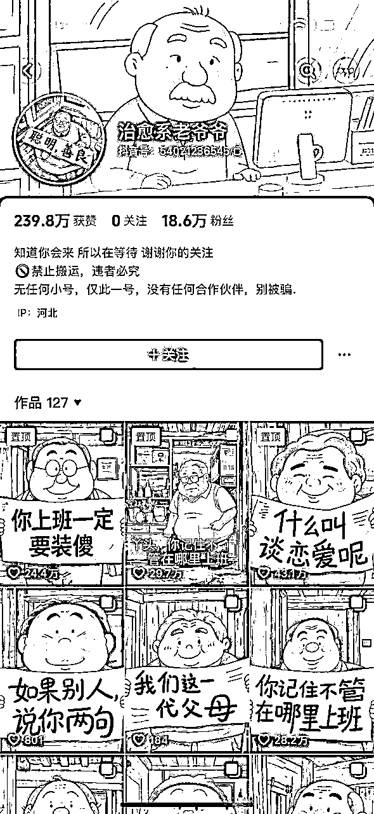

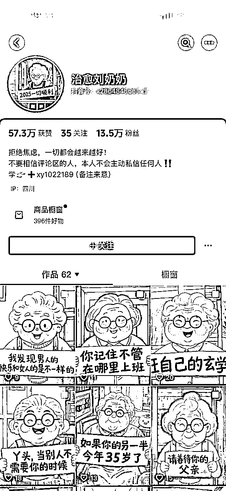

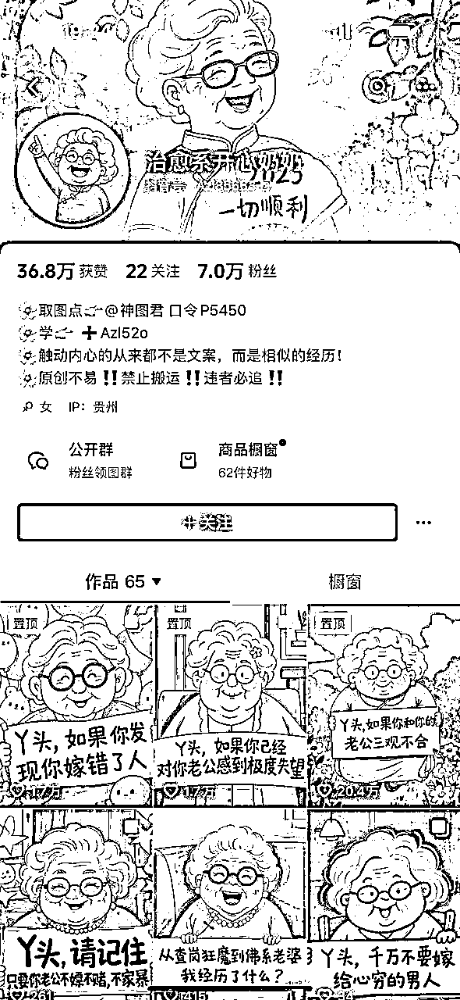

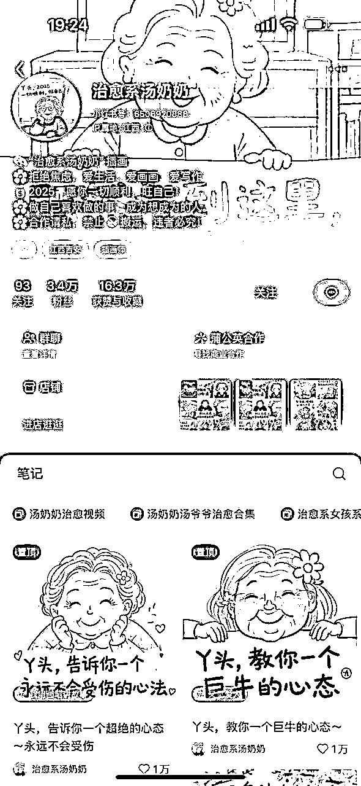

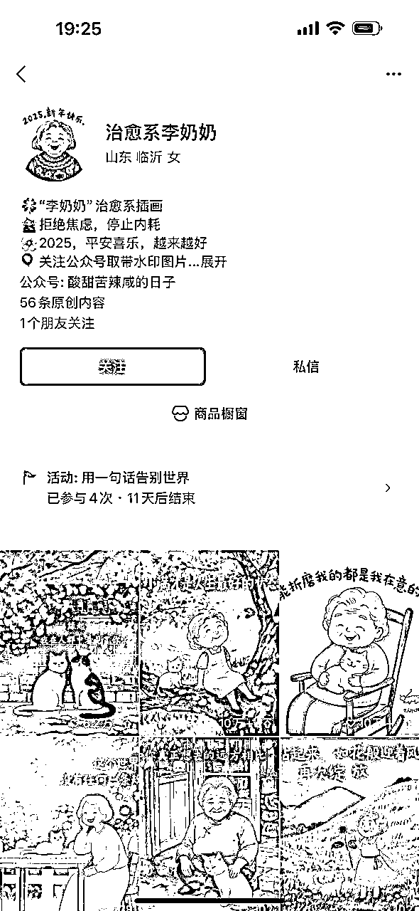

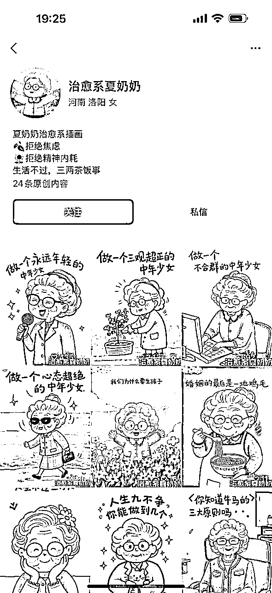

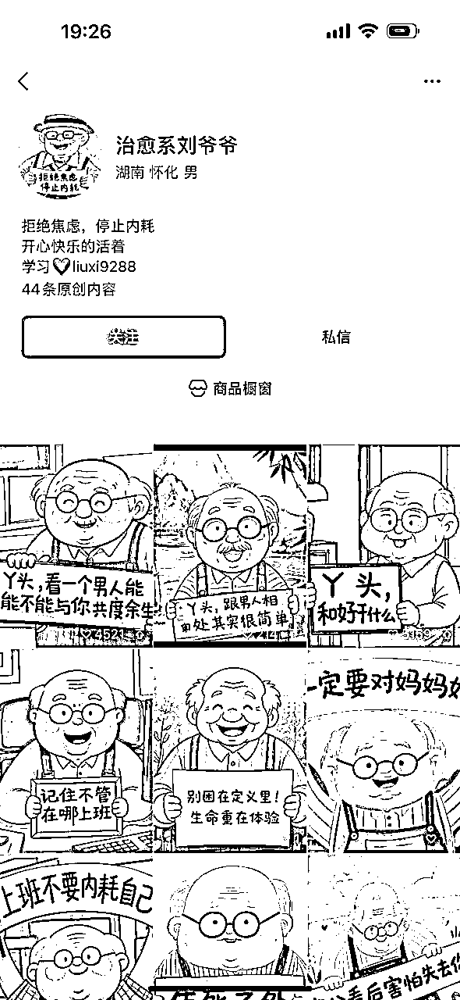

## 3.测试进度

4月1日开始打磨绘画指令，4月2日开始上线作品。抖音和视频号各开2个号，内容双端同步。截至目前视频号已跑出6条300万+播放的作品【视频号侧目前以视频化图文呈现】，抖音端的数据体感更优。

# 二、暖心长者+绘画模型项目实操

## 1.文案获取方式

在笔记类平台搜索【暖心文案】，或在短视频平台搜【清醒奶奶】系列，均可获得大量素材。直接对标同行账号扒取效率最高。

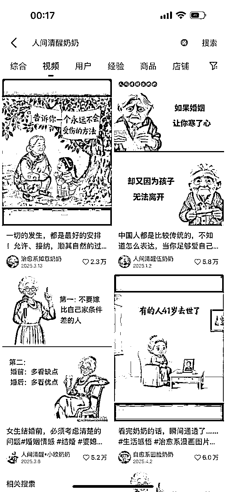

## 2.分平台投放方法

抖音、快手、笔记平台多为图文形式发布，笔记平台不建议加音乐，抖音快手可配已收藏的治愈风格BGM。视频号必须先用剪映将图集合成视频再上传。

视频制作参考模板：

1.单张画面停留3秒左右
2.加入翻页转场
3.匹配情绪的背景音乐，不确定可直接参考同行

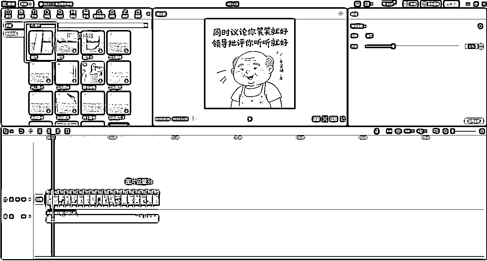

【剪映电脑版设置-全局设置-剪辑-图片默认时长，可自行调节单张停留秒数。】

## 3.绘画指令案例

1.一位中国白发秃顶老者，手绘笔触，圆润身材，笑眼，慈祥气质，治愈系插画，佩戴近视眼镜，黄色格子衬衫，蓝色牛仔背带，黄色背心，卡通萌趣，可爱，图中文字突出，Q版，极简，高清，文字清晰，加粗放大，人物略显童趣，头顶悬挂黑底大字横幅“下班回家，能有个人一起吃饭”，童趣可爱，与老伴共餐场景

2，一位中国白发秃顶老者，手绘笔触，圆润身材，笑眼，慈祥气质，治愈系插画，佩戴近视眼镜，黄色格子衬衫，蓝色牛仔背带，黄色背心，卡通萌趣，可爱，图中文字突出，Q版，极简，高清，文字清晰，加粗放大，人物略显童趣，头顶悬挂黑底大字横幅“这是我听到的非常喜欢的一个答案了”，客厅喝茶场景，童趣可爱

3.一位中国白发秃顶老者，手绘笔触，圆润身材，笑眼，慈祥气质，治愈系插画，佩戴近视眼镜，黄色格子衬衫，蓝色牛仔背带，黄色背心，卡通萌趣，可爱，图中文字突出，Q版，极简，高清，文字清晰，加粗放大，人物略显童趣，双手举黑底横幅“迷失自我去爱别人，挺没意思”，童趣，风景背景

4.一位中国白发秃顶老者，手绘笔触，圆润身材，笑眼，慈祥气质，治愈系插画，佩戴近视眼镜，黄色格子衬衫，蓝色牛仔背带，黄色背心，卡通萌趣，可爱，图中文字突出，Q版，极简，高清，文字清晰，加粗放大，人物略显童趣，双手举黑底横幅“迷失自我去爱别人，挺没意思”，童趣，风景背景

5.一位中国白发秃顶老者，圆润身材，手绘笔触，笑眼，治愈系插画，佩戴眼镜，卡通萌趣，可爱，慈祥，吃饭场景，背景简洁，头顶黑底大字“慢慢你会发现，娘家不是那么好回得”，线条插画，Q版，极简，高清

6.一位中国白发老奶奶，短发，手绘笔触，笑眼，圆润身材，治愈系插画，粉色毛衣，卡通萌趣，可爱，悠闲，戴眼镜，手举牌子，书桌旁坐姿，配文加粗黑字“丫头啊，他为了睡你，假装很爱你”，线条插画，Q版，极简，高清

## 4.指令公式总结

### 1.公式提炼

人物外形描写+服饰描写+场景描写+行为描写+文案描写+绘画素描风格

### 2.实战拆解

示例:

人物外形{一位中国白发秃顶老者，圆润身材，笑眼，慈祥，佩戴近视眼镜，卡通萌趣}

服饰{黄色格子衬衫，蓝色牛仔背带，黄色背心}

场景{室内木质结构，有窗，窗外蓝天，氛围温馨}

行为{双手举白纸，上面写着}

文案{“有人说你好也摆，有人说你坏也摆”}

绘画素描风格{治愈插画，手绘笔触，图中文字突出，Q版，极简，高清，文字清晰，加粗放大}

组合后：一位中国白发秃顶老者，圆润身材，笑眼，慈祥，佩戴近视眼镜，卡通萌趣，黄色格子衬衫，蓝色牛仔背带，黄色背心，室内木质结构，有窗，窗外蓝天，氛围温馨，双手举白纸，上面写着，“有人说你好也摆，有人说你坏也摆”，治愈插画，手绘笔触，图中文字突出，Q版，极简，高清，文字清晰，加粗放大

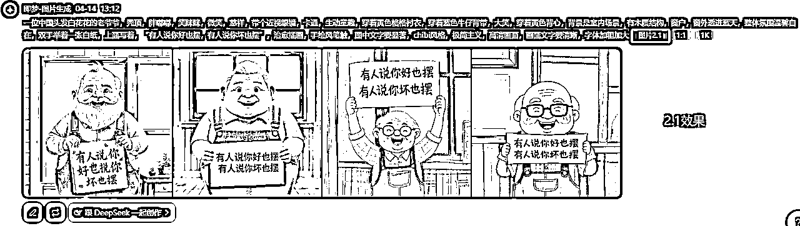

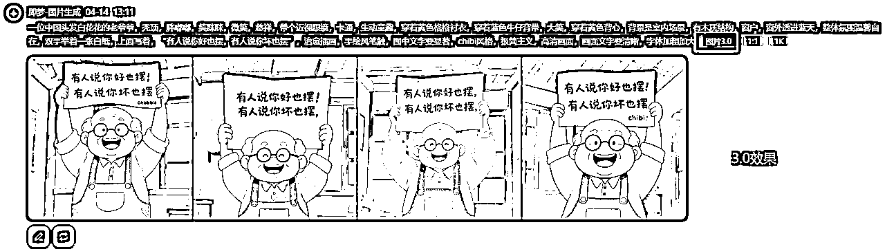

## 5.实操视频教程

## 6.常用工具

即梦入口：https://m.jimeng.jianying.com/s/5krk4fASm3c/?t=-3

剪映入口：https://www.capcut.cn/

视频号分成计划航海手册：3 月航海|视频号分成计划|实战手册

# 三、关键要点

## 1.封面决定推荐

这类赛道推荐权重高度依赖封面。抖音图文流以封面点击为主要分发依据，点击率越高，推流越强。

## 2.音乐匹配

忧伤文案配忧伤音乐，暖心文案配暖心音乐，情绪统一。不确定可直接抄同行。

## 3.文案优先于画面

画面精致更好，画面普通也能接受，但文案必须醒目。用户看的是金句，画面是载体。文案要一眼可读，每张图都制造继续看的欲望。文字不清、过长、混乱，用户会立刻划走，完播率下降。

## 4.对标与爆款

想知道当下什么文案火，去同类型标杆账号看爆款。同行是最好的学习样本。

## 5.快速跟进

看到标杆上午发布，中午点赞过千，马上跟进模仿，这就是跟爆款。

## 6.IP置换

跟爆款文案时可更换人设。标杆用老者，你可用老奶奶；标杆用老奶奶，你可用老者。换皮后仍有爆发的机会。

# 四、当前卡点

## 1.问题描述

近期即梦更新至3.0模型，2.1模型暂不可用。3.0出图文字更清晰、细节更丰富、更写实，但漫画质感有所下降，不如2.1有味道。

## 2.应对思路

近期同类账号画质普遍受影响，可先用3.0过渡，后续官方大概率优化，非致命问题。

【2.1模型官网已下线，但接口仍存，可自建服务器调用API。技术门槛较高，不适合零基础。2.1模型我已部署API，原计划通过Coze做成小程序分享，因精力有限暂缓。有开发经验的朋友可通过鱼丸联系链接继续推进。目前建议先用3.0实操。】

# 四、下一步迭代方向

核心瓶颈在文案采集与图像生成，工作量大。未来可向自动化靠拢：用Coze工作流调用API实现文案抓取-作画，配合影刀RPA实现本地下载保存及多号自动发布。欢迎有经验的朋友交流。

# 五、复盘总结

暖心长者+绘画模型上手门槛低，新手易获正反馈。与热门短片二剪+绘画漫画相比，播放表现更优，且规避非原创风险。试错成本低，适合快速验证。有兴趣的新手建议尽快入场，已有成果者欢迎一起迭代。

# 六、结语

问题可留言，接下来3天评论区有问必答，最后做总结。