大家好，我是亿舟。最近在“生财 AI 网站开发 4 群”当志愿者，群里的消息实在太多，经常有人错过不少干货问答。为了自己回顾方便，我整理了一份文档；后来看到 Claude 3.7 生成的页面很养眼，干脆又做了一个网页版，手机上电脑上都能直接看。多亏领队 @土豆君 提醒，才想到把操作过程写出来，给其他志愿者参考。

先说说怎么收集群消息。最简单是直接手动整理，毕竟自己也想回看一遍。如果想省事，可以这样操作：在聊天记录里多选内容并“收藏”，然后进入收藏页，点开那条聊天记录，再点右上角菜单里的“转存为笔记”，这样就能得到一份完整的聊天内容。

拿到聊天记录后，交给 Claude 来做信息整理。因为群消息通常很长，建议单独建一个 Claude Project，一个 Project 里可以同时开多个对话，还配有公共知识库，非常适合理资料这种活儿。

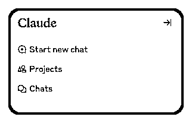

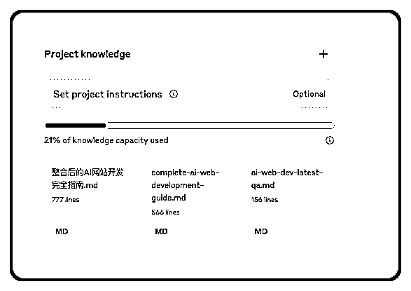

说实话，我给 Claude 的提示词很简单，只说清楚我想要的分类效果，结果它自己就把内容整理得清清楚楚。

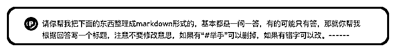

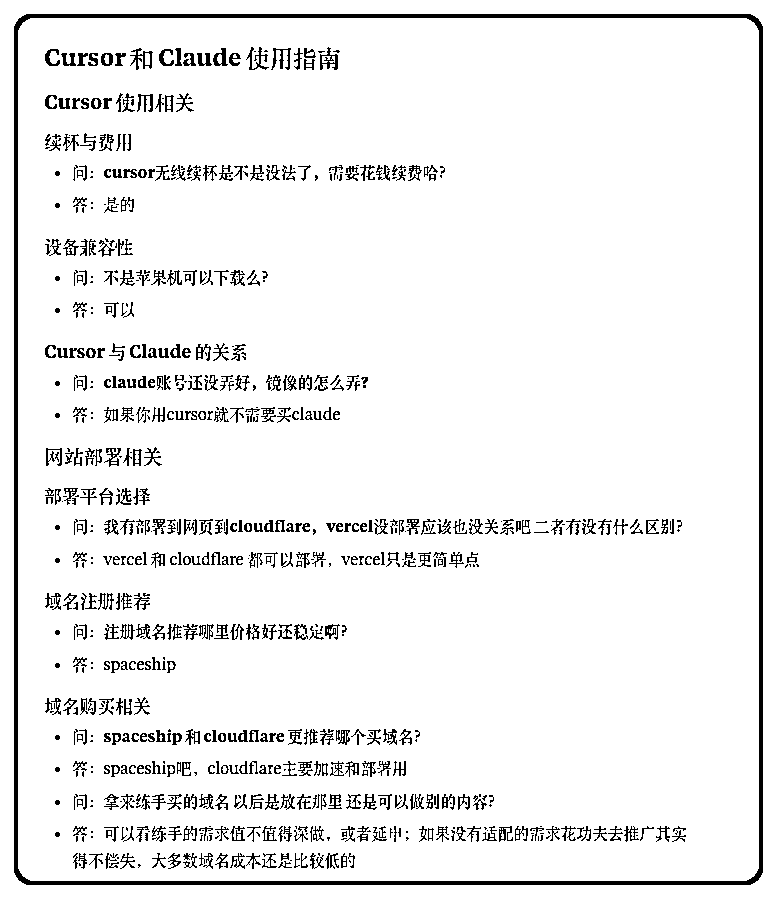

接下来是 Cursor 生成网页。先把整理好的文档下载下来，放进 Cursor 的项目目录里。

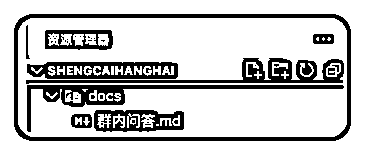

然后像这样引用文件：@群内问答.md，再配合下面这段提示词（来自群友 @天辉，我微调过），等页面生成就好。如果内容太多导致 Cursor 卡住，可以让它分段生成。

提示词大致是：把上传内容转换成美观漂亮的中文可视化网页，标题为“生财 AI 网站开发 4 群群内问答”，页面底部标注“来源：生财 AI 网站开发 4 群”；设计风格参考 Linear App 的简约现代路线，视觉层级清晰，配色专业耐看；技术栈用 HTML5、TailwindCSS 3.0+（通过 CDN 引入）和必要的 JavaScript，输出一个完整可运行的单一 HTML 文件；页面要面向手机、平板、桌面全适配，移动端触控要顺手；图标用 Font Awesome 或 Material Icons 这类专业库，避免用 emoji；交互上加上按钮悬停放大变色、卡片悬停阴影边框、平滑滚动、区块淡入等微动效；性能方面不要引入大型资源，图片用 WebP 并压缩，长页面用懒加载；代码符合 W3C 标准，不同浏览器表现一致。说白了，就是根据上传的文件类型，生成最适合的展示页面。

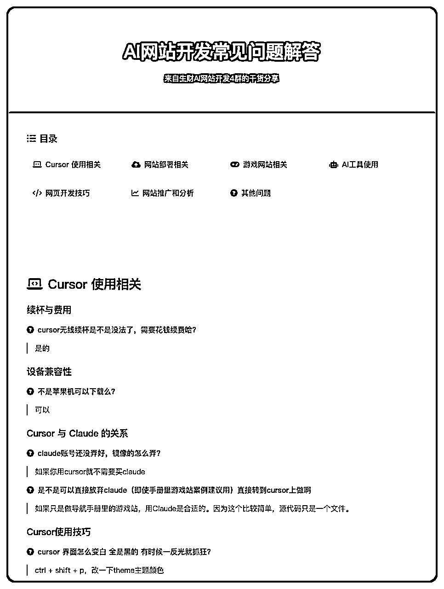

网页生成完，接着放到 GitHub 上。先在 GitHub 首页点 New，填好仓库名，不想公开代码就选 Private，然后点 Create repository。

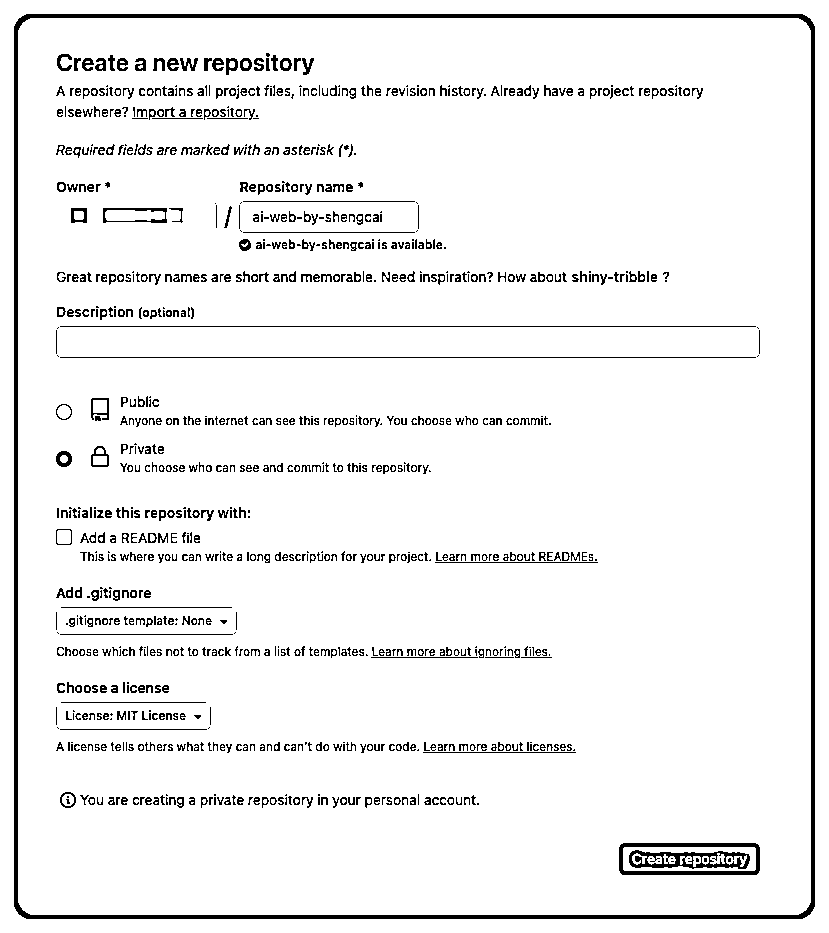

回到仓库页面，点“Add file”，再选“Upload files”。

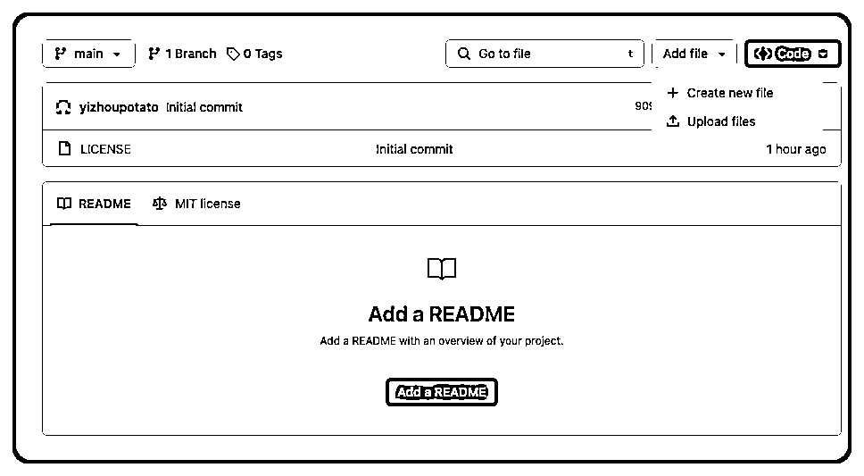

把 Cursor 生成的 html 文件拖进去，注意文件名改成 index.html，然后点“Commit changes”。

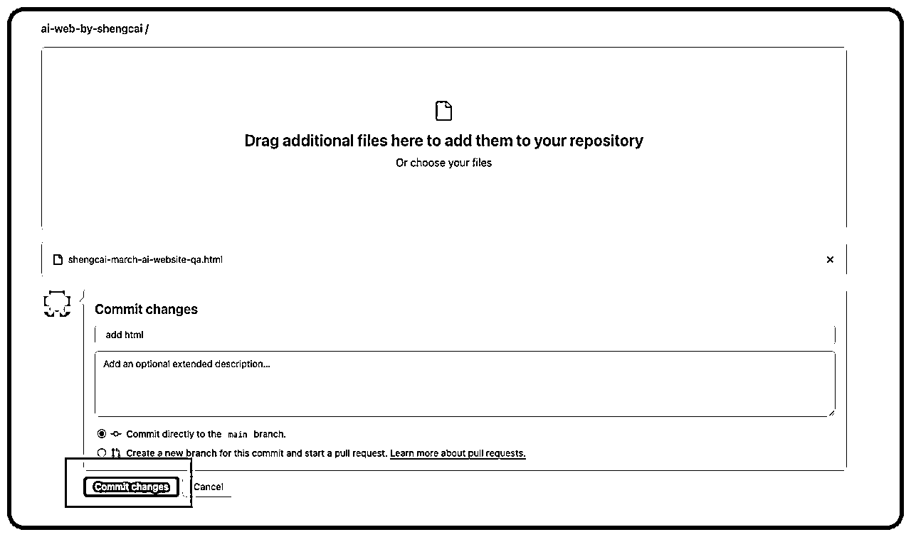

最后一站是 Vercel 部署。打开 Vercel 首页，点 Import，选择“Only select repositories”，把刚建好的 GitHub 仓库勾选上，再点 Install。

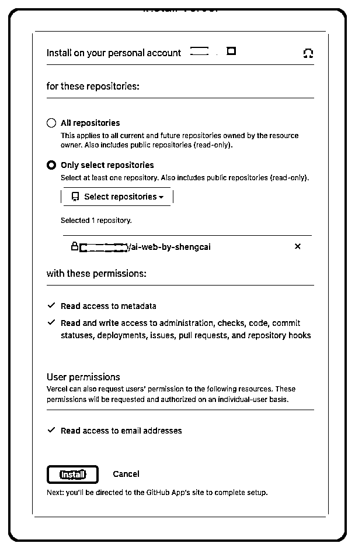

接着点“Import”。

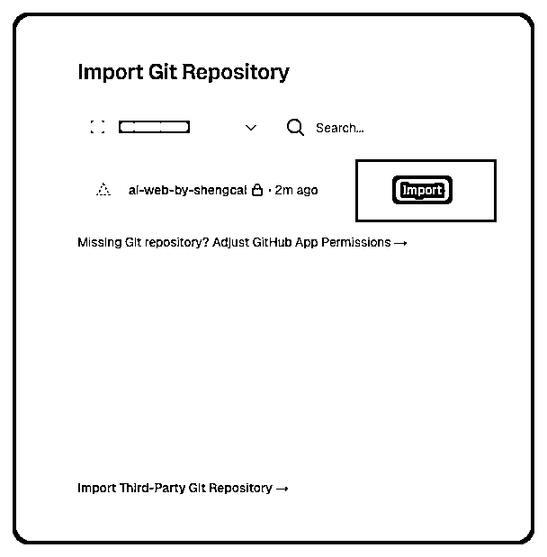

再点“Deploy”。

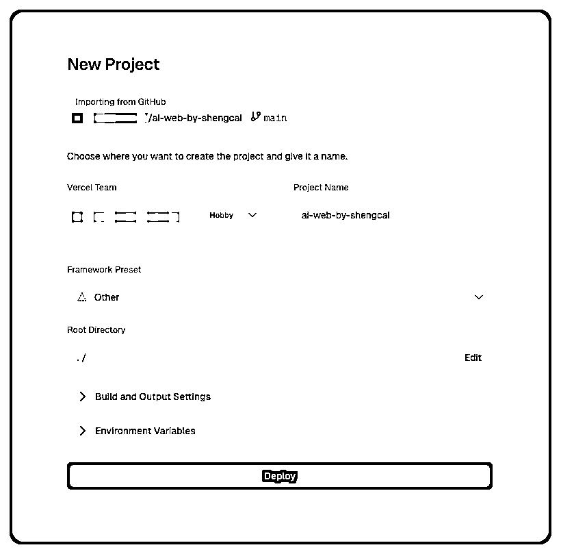

部署完成后，回到项目页面就能看到 Vercel 生成的域名，点开就能访问刚刚上线的网站了。

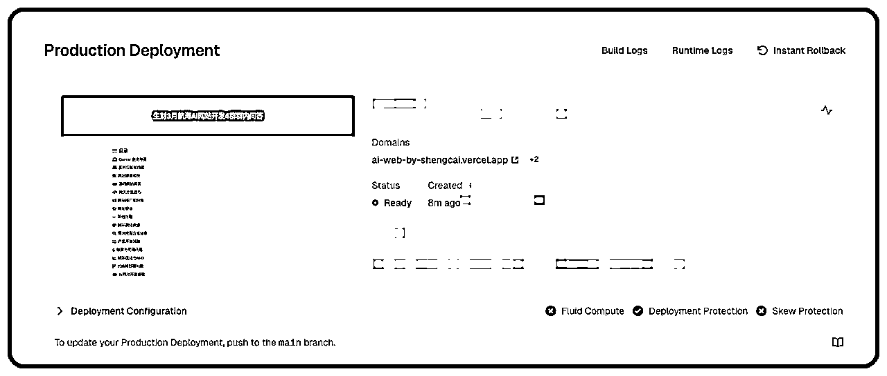

时间比较赶，写得不算细致，如果有遗漏的地方，欢迎评论区补充。希望这个小教程能帮到你。