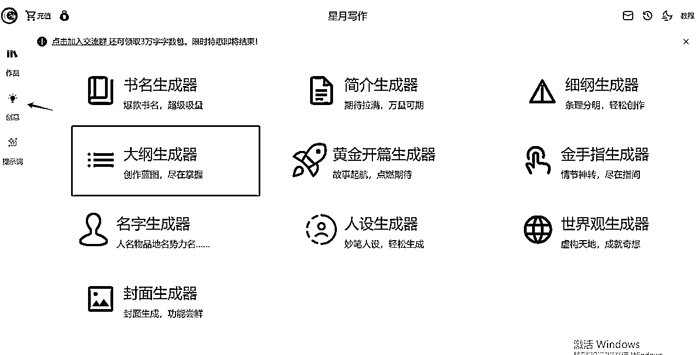
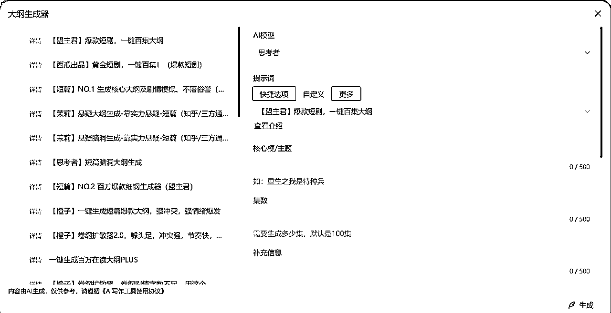
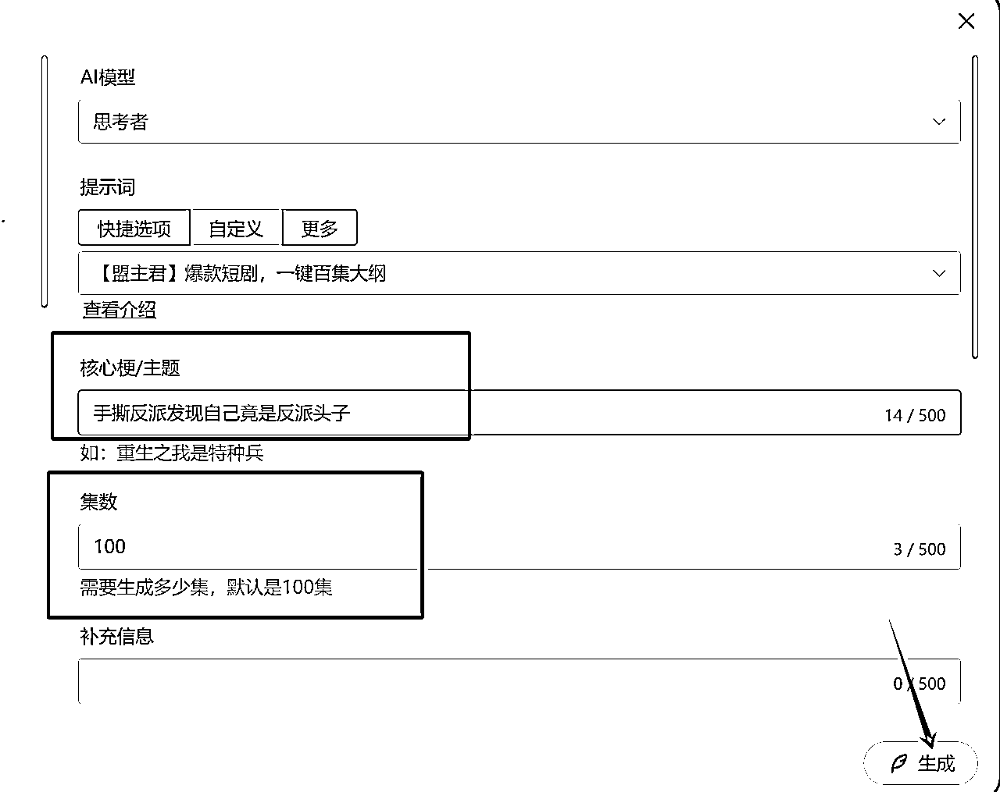
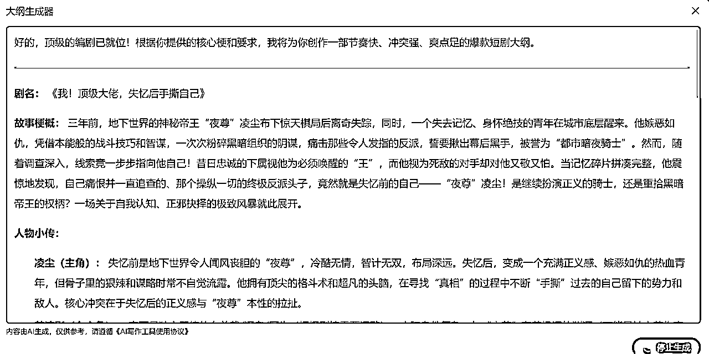
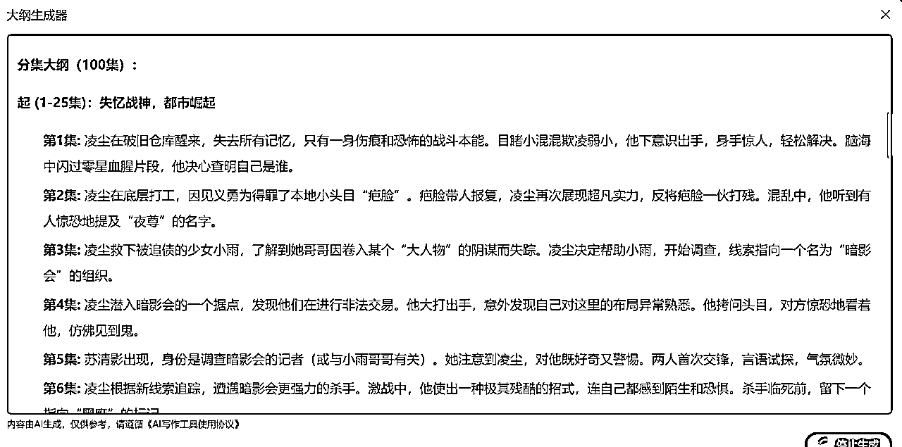
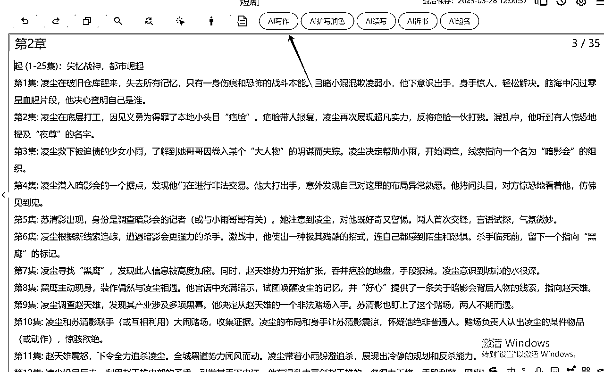
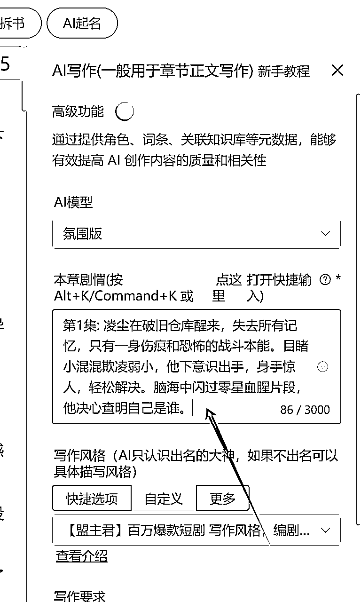
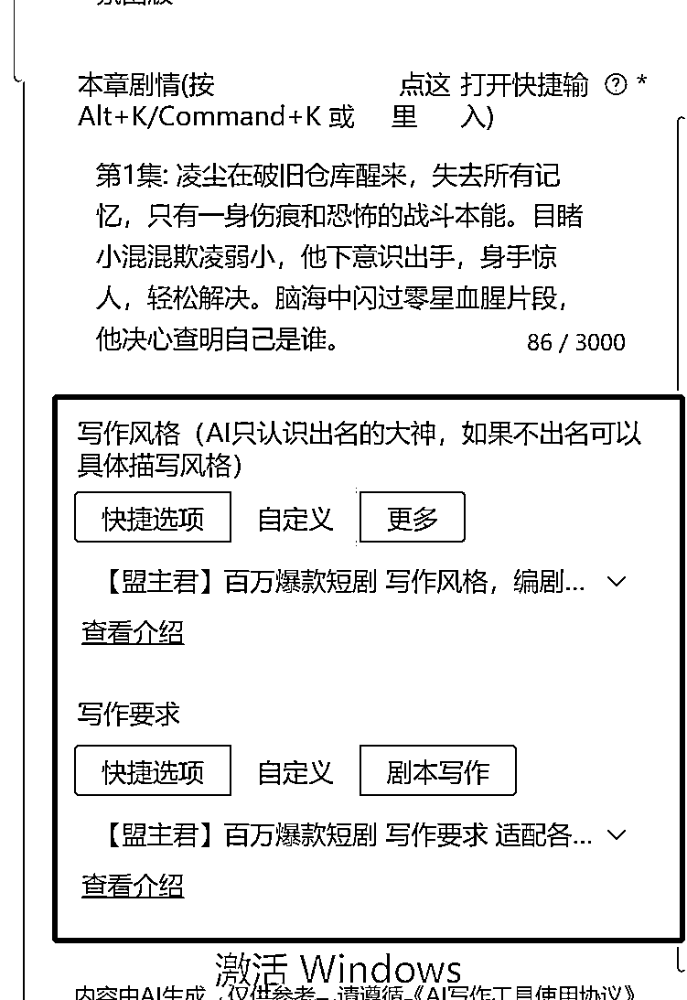
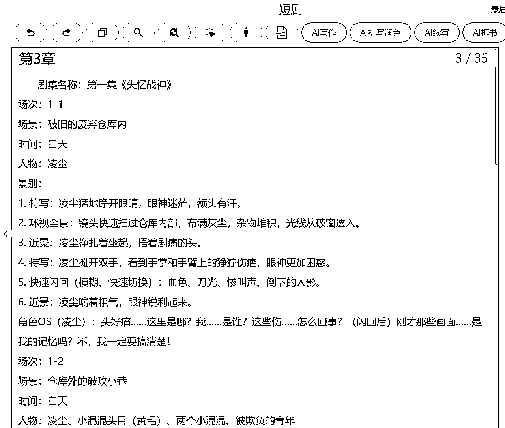

# AI短剧时代来了：一套工作流，批量生成百集剧本
作者：龙哥

2025年，AI短剧正在成为内容行业的新风口。

过去，写一部完整短剧，往往需要编剧反复打磨人物、冲突、节奏和分集结构。现在借助AI工具，从故事设定到百集大纲，再到每一集的完整剧本，都可以通过一套标准化流程快速完成。

先来看看AI生成的剧本成片效果。

## 第十六集：《信号中断，叛徒惊魂》

### 场次：16-1

**场景：**敌方生化武器研究点内部通道  
**时间：**夜晚  
**人物：**林峰、赵天明、陈浩、高磊、其他队员、敌人  
**景别：**近景、特写、中景快速切换

枪火在通道中不断闪烁，爆炸声接连响起。林峰带领队员依托地形展开反击，双方陷入激烈交火。

【近景】林峰沉着开枪，一名刚从掩体后探出头的敌人被精准击中。

【中景】高磊贴着掩体迅速更换弹匣，冲林峰大喊：“林峰！左边火力太密集，我们快撑不住了！”

【林峰（通过耳麦，冷静）】：陈浩，绕到侧面！高磊，手雷准备掩护，三秒后行动！

【陈浩（通过耳麦）】：收到！

【高磊（通过耳麦）】：明白！

高磊拔出手雷扔向敌方阵地。爆炸过后，浓烟迅速弥漫。陈浩抓住机会，借着烟雾掩护向侧翼移动。

【近景】赵天明躲在断裂的金属管道后方，神情阴沉。他悄悄掏出一台小型卫星通讯设备。

【赵天明 OS】：林峰，你以为自己什么都算到了？只要把你们的位置传出去，外面的支援就能锁定目标。今天你们谁也别想活着离开！

赵天明快速输入加密指令，试图发送坐标。

【特写】设备屏幕上出现提示：“正在搜索信号……发送失败。”

【赵天明 OS】：怎么回事？信号被屏蔽了？这不可能！

他再次尝试发送，结果依旧失败。

【近景】另一侧，林峰趁着射击间隙扫了一眼赵天明藏身的方向，嘴角露出一丝冷意。

【林峰 OS】：赵天明，你以为我没注意到你的小动作？我一直在等你露出马脚。

林峰突然朝赵天明附近开枪。子弹击穿管道，火星四处飞溅。

【林峰（大喊）】：赵天明！别愣着，敌人已经逼近了！

赵天明猛然回神，迅速将通讯器收起，仓促举枪还击，险些被乱飞的子弹击中。

【赵天明 OS】：难道他已经察觉了？不，应该只是巧合……可是这里的信号到底出了什么问题？

---

### 场次：16-2

**场景：**研究点能源控制室附近指定位置  
**时间：**夜晚  
**人物：**陈浩  
**景别：**近景、特写

陈浩遵照林峰此前的安排，避开正面战场，快速抵达一只布满线路的控制箱旁。

【近景】他从战术背心中取出一枚黑色的特殊装置——这是林峰交给他的强干扰设备。

【特写】陈浩低头确认手表，时间刚好吻合。

【陈浩 OS】：峰哥果然提前做好了安排，就是现在！

陈浩目光坚定，将装置固定到控制箱的指定接口上，随后按下启动键。

【特写】装置发出低沉的嗡鸣，指示灯随之亮起。无形的电磁干扰波迅速向四周扩散。

---

### 场次：16-3

**场景：**敌方指挥所  
**时间：**夜晚  
**人物：**敌方指挥官、通讯兵  
**景别：**中景、特写

敌方指挥官盯着战场监控，屏幕上的画面不断闪烁，现场情况已经难以辨认。

【敌方指挥官】：怎么还没有收到赵天明的坐标？外面的火力支援为什么还没到？

【通讯兵（焦急）】：报告！所有对外通讯都失效了，现场出现强电磁干扰！我们已经无法和外界取得联系，备用线路也全部中断！

【特写】通讯设备屏幕上布满雪花状杂讯与乱码。

【敌方指挥官（震怒）】：什么？电磁干扰？他们怎么可能提前部署这种东西？该死！

---

### 场次：16-4

**场景：**敌方生化武器研究点内部通道  
**时间：**夜晚  
**人物：**林峰、赵天明、高磊、陈浩、队员  
**景别：**中景、近景

战场上，部分敌人的耳机里也开始传出刺耳的电流声。通讯失灵让他们的队形迅速出现混乱。

【近景】林峰立刻捕捉到这一变化。

【林峰（通过耳麦，果断）】：敌方通讯已经瘫痪！所有人听令，扩大火力，分割包围！高磊，带人从右侧突破！陈浩，守住后方通道！

【高磊、陈浩（通过耳麦）】：收到！

队员们士气大振，攻势随即全面加强。

【近景】赵天明看着敌人阵脚大乱，又看着林峰从容掌控战局，脸色一点点变得苍白。

【赵天明 OS】：通讯真的被切断了，连敌人的设备都失效了……林峰，一定是他！他到底是什么人？竟然连这一步都提前算到了！

赵天明死死攥紧拳头，眼里充满恐惧与不甘。但当林峰冰冷的目光扫来时，他只能压下异样情绪，继续投入战斗。

【特写】林峰捕捉到赵天明转瞬即逝的慌乱，目光越发锐利。

【林峰 OS】：赵天明，你已经没有多少时间了。

从剧集名称、场景安排、人物设置，到具体对白和镜头提示，AI都可以直接生成。

这意味着，普通人也能借助工具快速完成短剧创作。人人都能参与编剧的时代，正在真正到来。

下面直接分享完整操作流程。

## 第一步：生成百集短剧大纲

首先打开AI写作网：

https://xingyuexiezuo.com/?inviter=11011#/register

注册后输入“AI联盟888”，即可免费兑换字数额度。

进入星月后台后，点击“创意”，找到“大纲生成器”。

在大纲生成器中，选择【盟主君】爆款短剧，并点击“一键百集”：

https://xingyuexiezuo.com/?shortcut=18854

接着输入故事核心设定、主要冲突以及计划创作的集数，然后点击生成。

系统会自动输出一套完整的百集短剧规划，通常包括：

- 剧集名称  
- 故事整体梗概  
- 主要人物小传  
- 人物关系与角色定位  

此外，还会继续生成每一集的剧情安排，帮助我们快速搭建完整故事框架。

## 第二步：把大纲扩写成完整剧本

将刚刚生成的百集大纲复制到新建作品中。

随后点击“使用【AI写作】”功能。

在右侧AI写作区域，将第一集的剧情内容粘贴到“情节”输入框。

接下来，在写作风格中选择：

【盟主君】百万爆款短剧写作风格，编剧亲自指导

https://xingyuexiezuo.com/?shortcut=18854

在写作要求中选择：

【盟主君】百万爆款短剧写作要求，适配各种题材

https://xingyuexiezuo.com/?shortcut=18885

设置完成后，点击生成，系统就会根据当前集数的剧情梗概，扩写出一集相对完整的短剧剧本。

之后只需要按照同样的方法，依次处理后续剧情，就能逐步完成100集剧本创作。

## AI短剧剧本如何变现？

完成剧本后，可以尝试通过以下方式实现收益：

1. 向短剧剧本投稿平台投稿；
2. 联系短剧制作公司或影视工作室；
3. 与编剧团队、制片方展开合作；
4. 进一步利用AI完成分镜、配音、画面和剪辑，独立制作短剧作品。

过去，写剧本需要专业团队长期协作；如今，AI正在把创作流程拆解成普通人也能掌握的步骤。

只要有故事、有想法，再配合合适的工具，每个人都有机会成为短剧创作者。