# 工业物资零库存网销：一段从零起步的亲历复盘

# 一、这个项目到底做什么

一句话讲明白：依托1688、京东这类B2B平台，再加淘系C端流量入口，做不囤货、转单直发的产业用品网销生意。借用平台的自然流量和付费流量，与上游工厂协同，替中小微企业搞定一站式采买，利润来自货品差价、定制方案费和后续的长期服务。

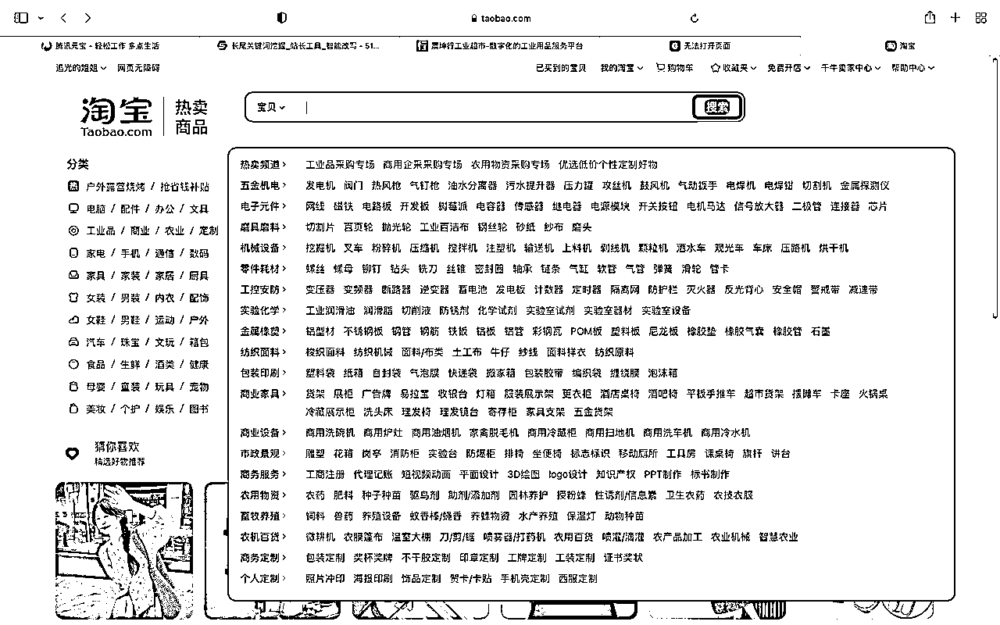

利润来源拆成三块：

1. 价差空间：大致在15%-35%浮动，例如一笔2万的单子，我们能落下约5千；
2. 定制项：根据客户需求调整设备配套方案，收取设计咨询费用；
3. 长线收益：设备保养年费。现有客户复购比例超过40%，有位客户去年买下89万设备，今年光是保养续费就带来15万。

##### 营收的几个节点

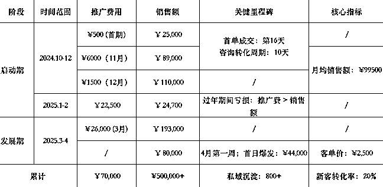

1. 试探期 2024.10-12：运气不错，第一单2.5万直接拿下，当月完成跑通。前两个月平均每个月做到将近10万，但春节前后走了一段弯路；
2. 拉升期 2025.3-4：3月做到接近20万，成交比例约30%。4月1日当天签下4.4万，到清明前累计8万；
3. 已经积累了800多私域联系人，新客成交比例20%。正在洽谈的合同总额超过300万，已推进到验厂。老板流量获取成本和传统渠道获客比，确实便宜不少。4月10日又到账一笔86万合同款。

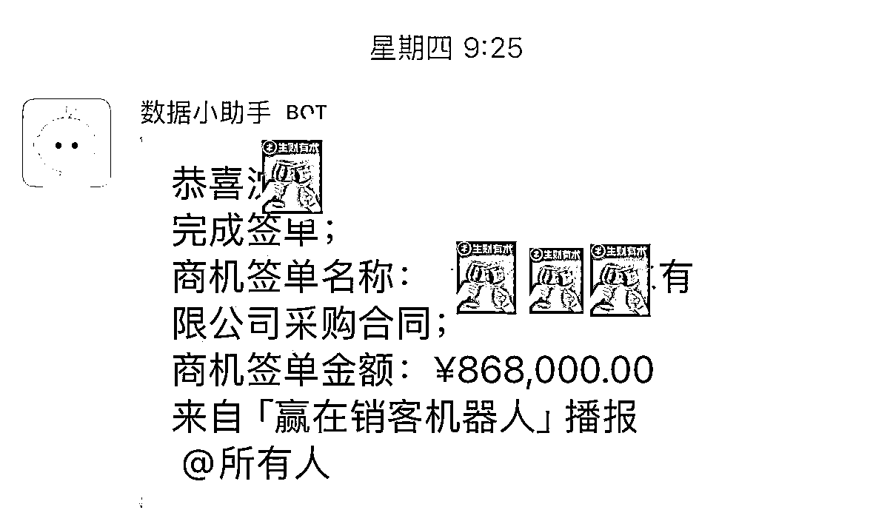

客户终身价值 CLV= 流量 × 转化率 × 首次购买客单价 + Σ（流量 × 转化率 × 复购率ⁿ× 复购客单价）

# 二、为什么选这个方向

一句话概括：政策在推、盘子大、涨得快。

公司本来就有产业基因，所以谈不上选赛道，更多是验证过来的。判断依据：一家企业的成长 = 宏观经济红利 + 产业红利 + 模式红利 + 运营红利。

1. 政策端表现：

“十四五”规划点名支持工业互联网和产业数字化，2024年又有“数据要素×”三年行动方案，2025年工业互联网渗透率要打到45%。这个目标意味着市场不会温和线性上涨，很可能是跳变式爆发。数据出自工信部。

托比研究院那边给的数据：产业用品电商年增速14%，2025年预计到1.36万亿，但MRO线上化渗透还不到5%；
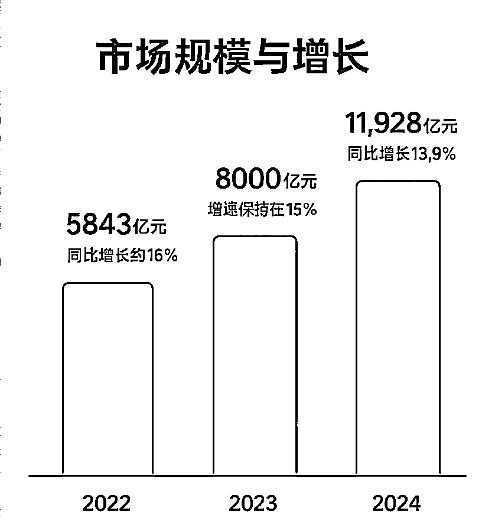
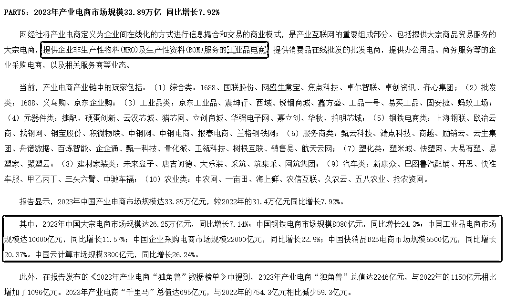
福建商务厅的《2023中国电商市场数据报告》也提到，7000多万人从事电商，产业用品是下一个增长点。

2. 市场缺口可见：

90%的中小企业采买效率只有制造业平均线的60%左右。政策拉动加上企业供应链提效的压力，线上采购需求被快速激发，带火了平台服务（年复合增长约25%）、保养服务（毛利50%以上）这些细分赛道。

| 市场空间 |
| 指标 | 2025年预测 | 年复合增速 | 出处 |
| 整体规模 | 1.36万亿元 | 20% | 赛迪顾问、工信部赛迪研究院 |
| 细分占比 |
| 平台服务 | 45%（约6750亿元） | 25% | 按行业毛利测算，硬件利润2700×22%=594亿元 |
| 解决方案 | 32%（约4800亿元） | 18% |  |
| 硬件设备 | 18%（约2700亿元） | 10% |  |
| 数据服务 | 5%（约750亿元） | 50%* |  |

3. 客户确实有痛点：

中小微企业贡献六成以上工业产值，但数字化程度低，采买还是老办法。大企业虽已把采买搬上线，但要的是更顺滑的供应链协同。

痛点主要集中在：品类杂、比价寻源费时；库存积压和临时采购加价；伪劣产品多、质检环节不透明；中小企业IT能力弱，难以系统对接。

结论：政策和数据都指向一个事实——万亿体量、双位数增速，确定性相当高。

##### 试水验证的打法

核心思路：用可控预算买真实数据，再拿数据换判断。投一笔小钱，观察转化效率、复购意愿、投入产出比，快速确认需求真伪。

结果：投放后第17天拿到真实客户，首单2.5万。

1. 线上数据验证：

找了南京一家头部电商公司合作，调了它们的后台数据——单系列产品年销2亿，还在以40%的速度增长。再用生意参谋看搜索热度和成交情况，判断市场分散但没饱和，单店月营收模型做到50-100万是有可能的，跑得通。

我们的收款渠道占比
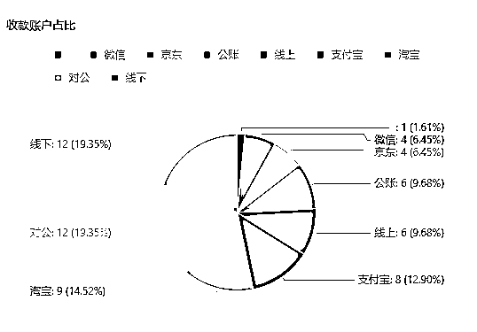

2. 线下验证：

行业里做得大的年营收1-8亿，但市占率不到1%。我们的订单90%引导到线下成交，按这个路子单店保守月销100万-400万，模式可复制。白牌多店矩阵轻资产、迭代快，正好对上客户“看产品不看牌子”的习惯。线上引路→线下看货体验→再购，这个闭环粘性很强。

最后定的策略：用多店白牌快速吃下分散的市场份额，先跑通单店模型，再复制矩阵放大供应链和流量优势，靠规模和复购滚动增长。

3. 小结：

2天完成数据梳理和同行拆解，1周内上架10款产品，开了两个投放计划（搜索词+全站推），靠动销迅速拉起权重，白牌模式验证通过。

淘宝C店，新店上线第7天就有真实询单，第16天拿下2.5万订单。

# 三、从零到一的完整拆解

##### 3.1 店铺搭建与投放节奏

开店本身不复杂，难的是选品——盯高频刚需品类。上架细节直接参考同行，做微调优化。

把对手拆到最细，看评价里的抱怨点，用5118、生意参谋这些工具，研究头部卖家怎么解决这些问题，先抄再超。

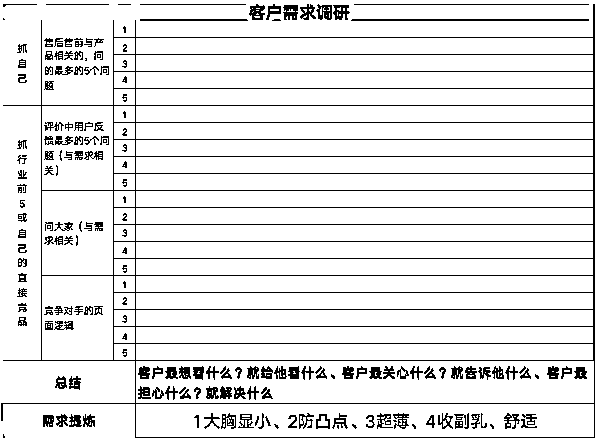
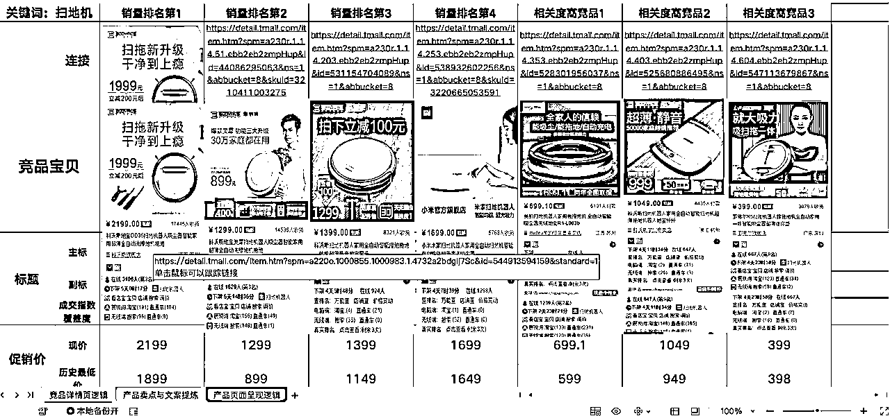
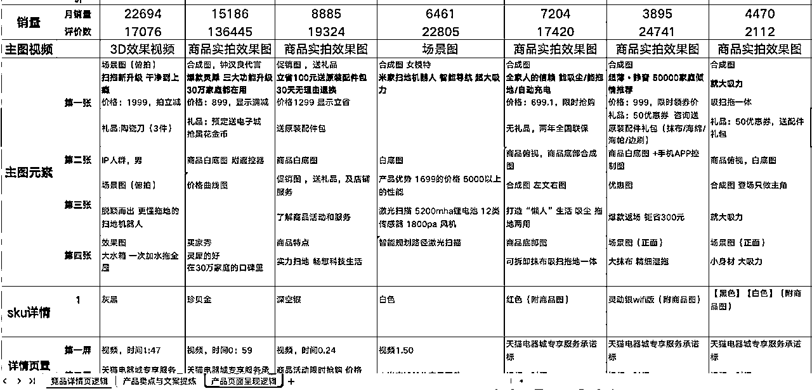
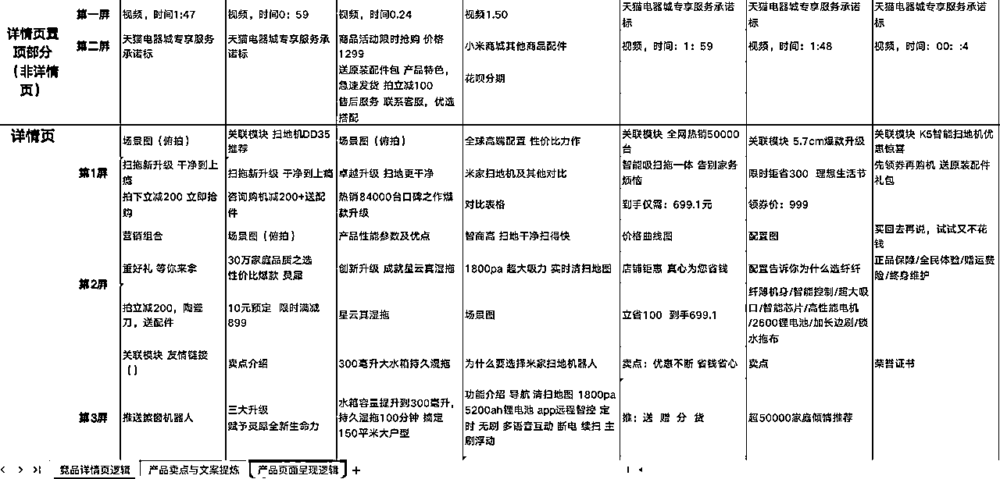

详情页的转化路径：吸睛→勾兴趣→树信任→促下单

▸ 场景化痛点图（设备故障现场）
▸ 参数对比表（对标同行）
▸ 客户实拍视频（工厂场景）
▸ 资质背书（需厂家授权并打码）
▸ 售后承诺（物流、质保、服务、特殊说明）

##### 3.2 流量获取与转化

第一批上了10款产品，推广开了两个计划：搜索词和全站推。

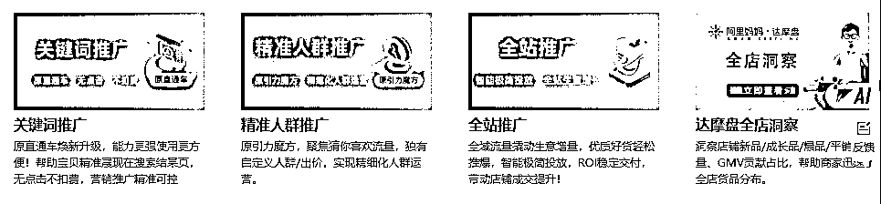

第一笔投放500元，换回2.5万销售额。10月10日到11月10日这30天，15万次展示、2000多次点击、5000多推广费、成交6万多，单均3000元。

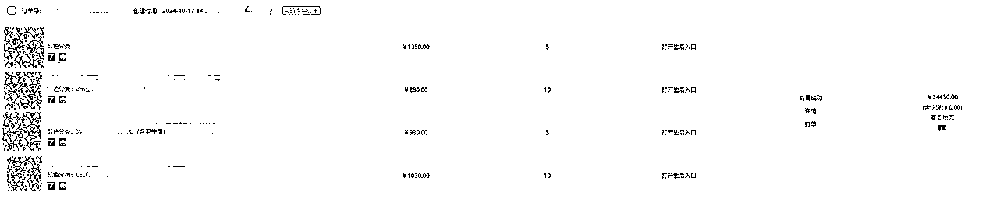
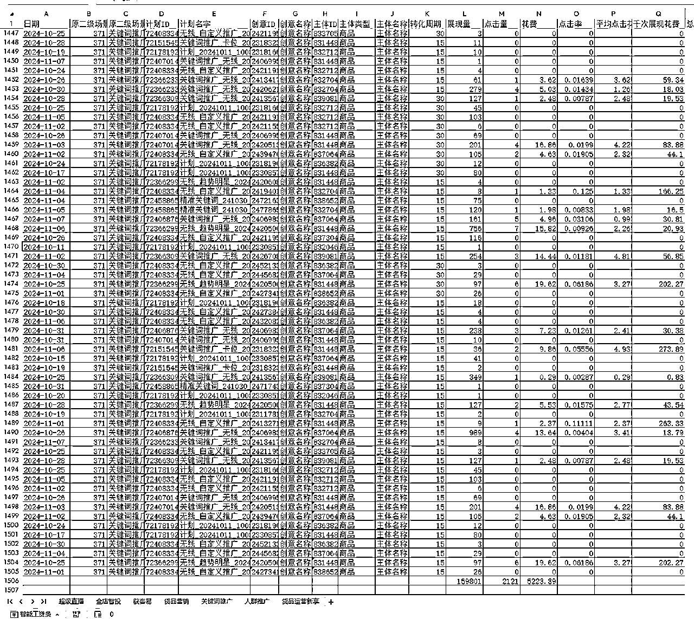

销售额 = 曝光量 × 点击率 × 转化率 × 客单价

工具配置：5118找长尾词、生意参谋盯转化，百度/谷歌/微信指数辅助参考。生意参谋比较友好，成交一单隔天就能免费开。

测品控成本的办法：每个词单独建最低预算计划，没数据就停，有苗头就加预算。同时大力发展供货渠道。

##### 3.3 供货渠道建设

转单直发让我们用最少资金、最低风险起步。新手阶段按“资质→能力→成本→质量→服务”的顺序筛选，先下小单测试，再逐步加深合作。

找货源的路径主要是1688和爱采购，AI也能帮忙拉一张渠道清单。
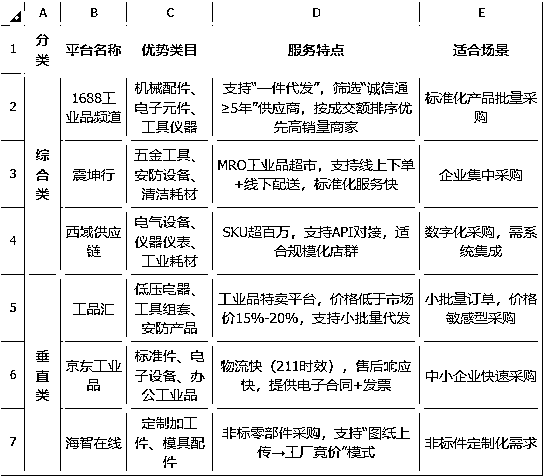

最笨但最有效的办法：多问几家、反复比价。我们同一款产品拿到过相差近十倍的报价，不一定是谁在乱报，更多是工艺差别。可以问AI：“同样型号的XX，为什么价格差这么多？决定价格的核心因素有哪些？”

验厂妙招：突然打视频电话让对方带着镜头逛一圈厂区。
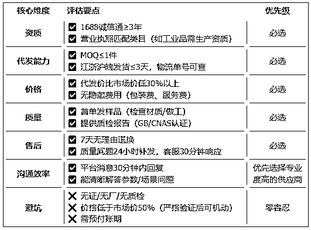

沟通上的心得：很多厂家人手紧、回复慢，尤其在你量小的时候。这时候要会说话——把目标对齐：“我这边出单就是帮你出货。”前期把对接流程理顺，后面直接带单来，不用天天无效拉扯。大部分销售都愿意配合。另外尽量找本地的厂，能上门聊，效率完全不一样。
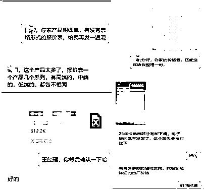

操作细节：需要资料时，自己先把模板做好让厂家填空，比让厂家从零做省事得多，特别是你还没有话语权的时候。

##### 3.4 沟通与成交转化

业务能跑起来，销售同事的跟进功不可没。电商和线下一样，转化率就是生命线。

1. 会问问题才是销售的基本功

客户分大小，需求完全不同：大客户看服务稳不稳、产品靠不靠谱；小客户只看价格便不便宜。核心技巧：多问，把他真正在意的点挖出来。
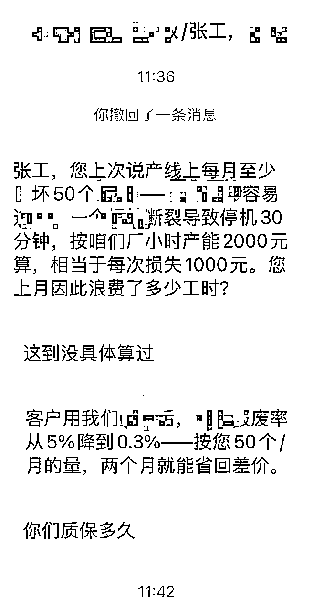
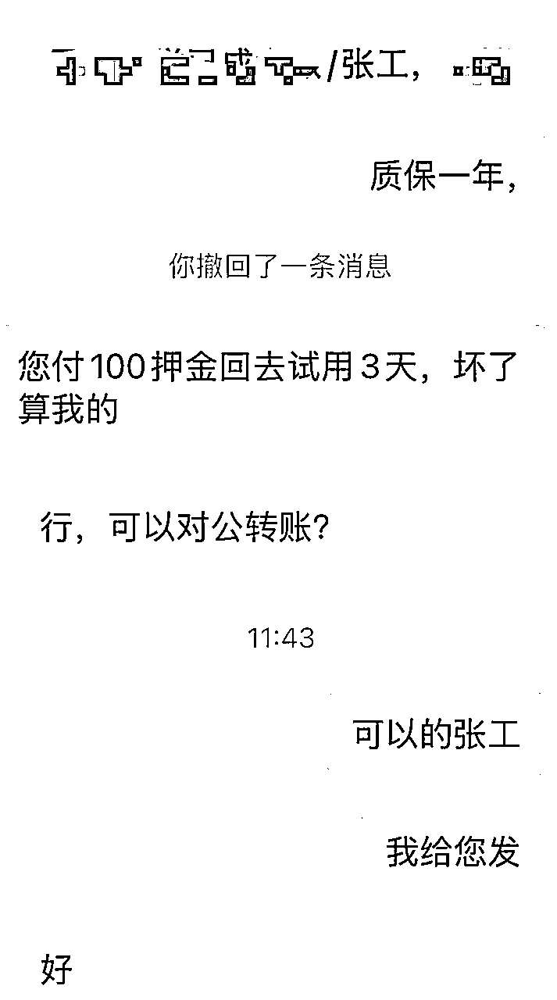

2. 帮客户理清需求

很多买家其实自己也说不清要什么。要三步走：问透（业务卡点、目标、预算）→判断（哪些是真需求、哪些可以引导）→出方案（对着问题给最合适的选项）。

AI用法：不知道怎么开场就问AI，比如：“客户要买智慧路灯，什么信息都没给，我应该从哪几个问题入手？”

3. 演示要打中场景

遇到比价的客户别慌，别一上来就报低价。把话题引到他的实际工况上，讲清楚你的方案怎么解决问题、长期成本怎么省。

4. 升单靠案例和差异化服务

同行业的成功案例比什么广告都好使。周期性地发行业动态和优化建议，增值服务自然就被带出来了。

# 四、眼下的难点

流量端还有压力。头部玩家的获客成本能压在5%-8%，我们目前还做不到。另外电商团队的运营管理也是短板，希望圈里有做产业用品电商的朋友多多交流，欢迎合作。

# 五、给新入局者的几点建议

##### 1 工具清单

流量分析：5118拉长尾词、生意参谋盯数据
客户管理：企微SCRM自动打标签、Excel预测模型。个人玩家没有CRM就用多维表格，提醒功能很好用
供应链：1688诚信通筛选工厂、物流时效地图对比快递

##### 2 三个核心动作

选品：3个月深耕一个细分品类（比如液压设备），摸透行业走向
同行分析：每周拆一个同行店铺——标题、主图、详情、差评都要看
知识储备：建“产品手册+案例库+问答库”

##### 3 执行要点

每天看：UV、转化率、CVR，对标行业参考值
每周做：清洗低效关键词
避坑：别盲目铺货、别指望纯自然流量（付费推广得跟上）、差评24小时内处理

类目选对了，竞争远没有想象中激烈。新手从最熟或最易上手的品类进，比如安全帽。产业用品的客户群相对固定，维护比拉新更重要，复购和增值服务才是长期利润的发动机。

感谢赚钱，祝各位都找到属于自己的蓝海，一起龙哥盟。