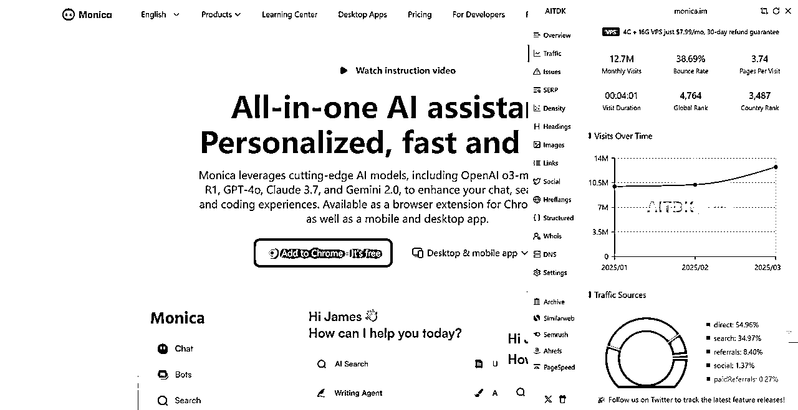
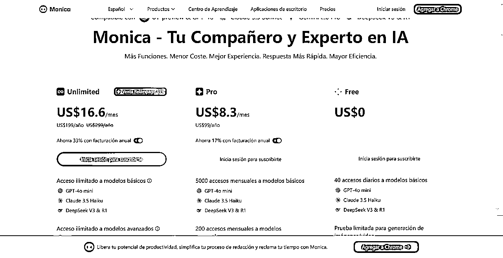
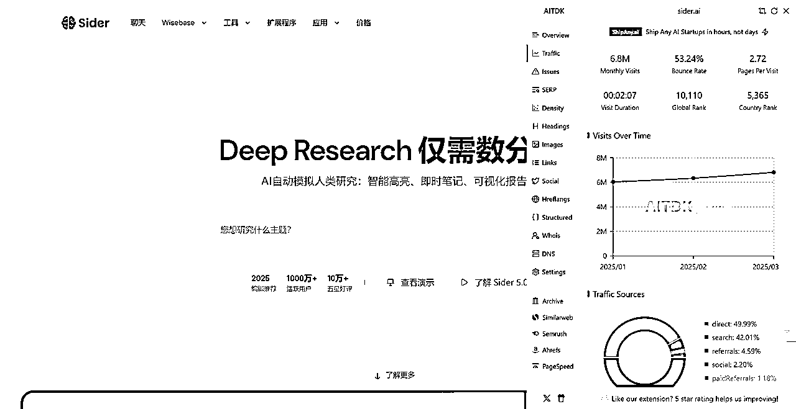
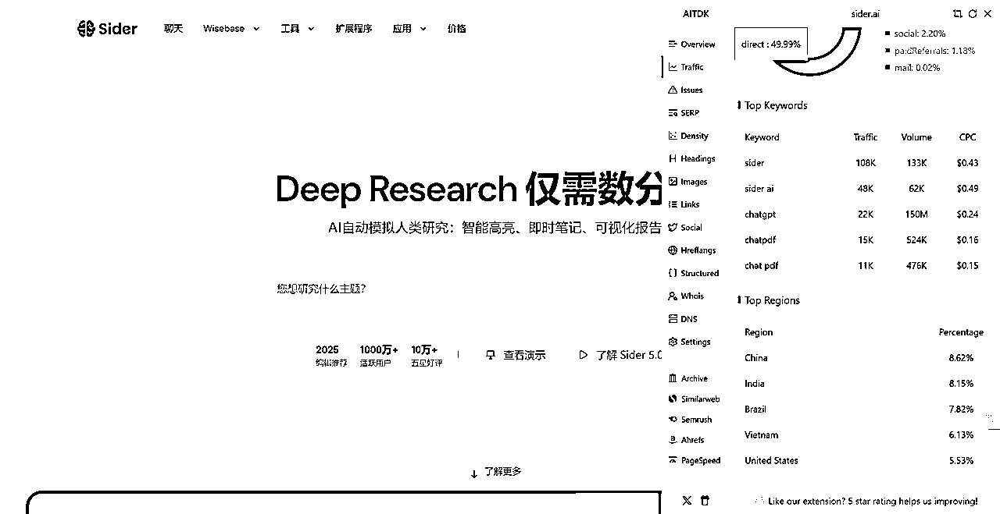
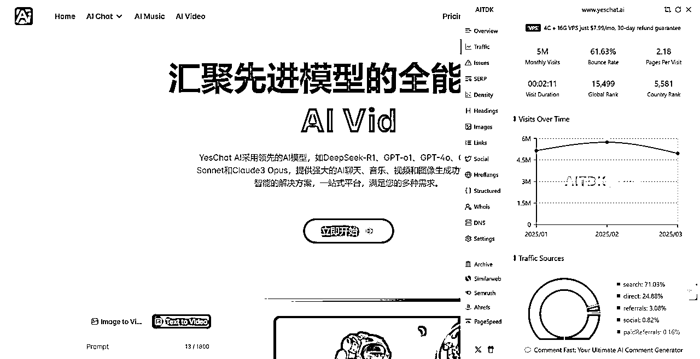
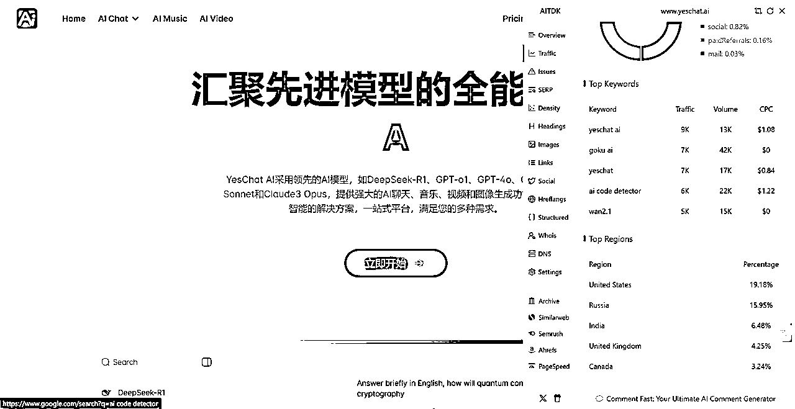
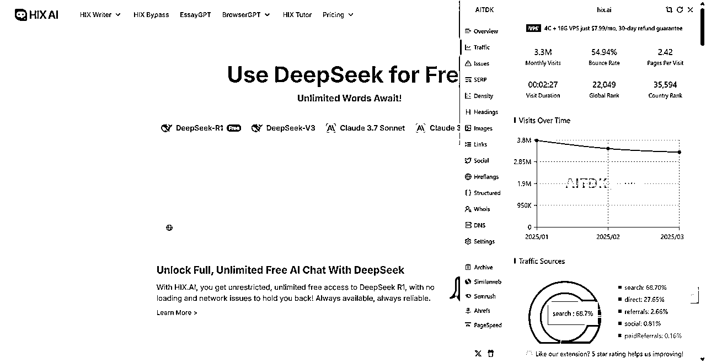
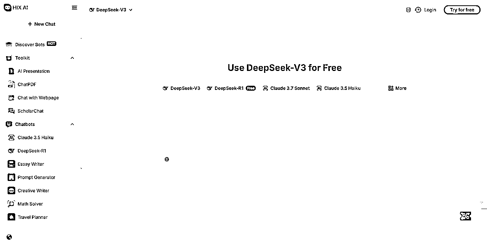
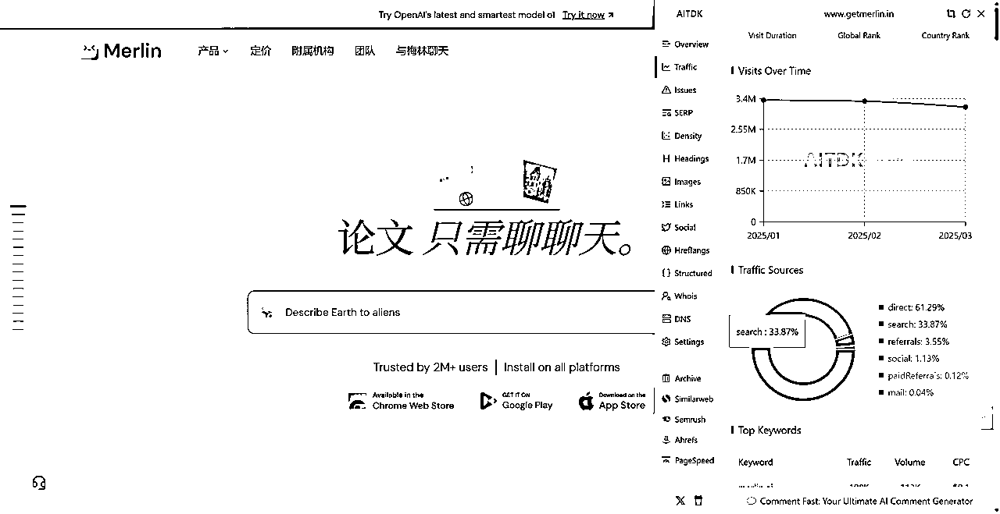

# All in one AI List 01

> 来源：[https://vz1gcav68m.feishu.cn/docx/HZvHdOKn6o78DFxZRVhcaXUCncd](https://vz1gcav68m.feishu.cn/docx/HZvHdOKn6o78DFxZRVhcaXUCncd)

## 重点产品分析 Top 5 by Traffic

### Monica.im

*   产品名称: Monica
*   产品官方网站链接: https://monica.im/
*   其他相关链接: Chrome Web Store、Edge Add-ons 等浏览器插件商店均有入口。

#### 💡 产品价值：解决了什么核心问题？

*   核心价值: Monica 自定位为个人全能 AI 副驾，核心形态是浏览器插件。目标是把网页浏览、内容产出、信息获取与处理等环节的效率拉满。把对话、写作、阅读理解、翻译、搜索增强、图像生成等能力打包在一起，用户无需跳出当前页面即可完成多项任务。
*   细分市场: AI 助手 / AI Copilot / 浏览器功能增强 / 生产力工具。

#### 👤 目标用户

*   特征: 日常高度依赖浏览器完成工作、学习、创作的人群。典型包括知识工作者、学生、科研人员、市场营销从业者、内容创作者、开发者以及需要大量文本处理或跨语言沟通的用户。覆盖个人及潜在的团队场景。
*   细分: 可按使用意图分为写作增强型、信息梳理/研究型、日常效率提升型。

#### 🤔 用户需求与痛点

*   痛点:
    *   在 ChatGPT、Claude、Midjourney 等多个 AI 工具间来回切换，操作碎片化。
    *   长网页、报告、邮件阅读与处理耗时。
    *   写作时缺少灵感或需要润色、改写。
    *   网页内容需快速翻译、跨语言交流。
    *   搜索与信息甄别效率低。
*   解决方式: 通过插件形态把多款 AI 功能聚合到浏览器内，形成一站式工作台，降低上下文切换成本。配合快捷指令与预设模板，让操作更轻。

#### 🗣️ 用户评价

*   好评: 功能集合度高、一站搞定；插件形态便捷；支持多模型接入如 GPT-4、Claude；模板丰富；在写作与阅读场景提效明显。
*   差评: 存在 Bug、稳定性欠佳；界面交互有优化空间；免费配额有限；付费价格偏高；AI 回复质量不稳定；浏览器插件权限引发隐私顾虑。

#### 🔍 获客渠道

*   主要渠道:
    *   浏览器插件商店: Chrome Web Store、Edge Add-ons 是核心获客口，依赖排名与推荐。
    *   SEO: 围绕 AI 助手、ChatGPT 插件等关键词做内容沉淀。
    *   内容营销: 借助博客、社媒输出功能教程与使用技巧。
    *   口碑裂变: 体验顺畅后带来自然传播。
    *   12.7M 的月访问量显示其在插件商店表现突出，并拥有较强的 SEO 与增长飞轮。

#### 💰 商业模式与收入

*   商业模式: Freemium 免费增值。提供基础免费版，限次数与功能；付费订阅解锁更高用量、高级模型、更快的响应与优先支持，通常分多档。
*   收入粗估:
    *   假设月访问量 12.7M，有效 UV 约 12.7M/2。付费转化率按 1% 计，ARPU 按 $10/月估算。
    *   MRR ≈ 12.7M/2 × 1% × $10 ≈ $655,000/月。
    *   说明: 粗略推算，真实转化率与 ARPU 可能偏差较大。流量数据亦存在误差，未公开融资与财报信息。

#### 🧠 可借鉴之处

*   集成与无缝嵌入: 把 AI 能力植入用户既有工作流，浏览器即战场。
*   Freemium 策略: 先用免费获取规模，再通过增值转化。
*   全能定位: All-in-One 降低用户寻找替代工具的动机。

#### 🚧 挑战与壁垒

*   技术整合难度: 同时接入维护 GPT、Claude 等多模型 API 并保证流畅体验，需要较强工程实力。
*   插件开发门槛: 跨浏览器兼容、性能优化、安全性、商店审核政策变化等。
*   先发优势: 已累积的用户规模与品牌心智难以短期复制。
*   获客成本: 同质化竞争下维持高流量需持续投入。

#### 🤗 电梯演讲

*   "Monica 把终极 AI 助手装进你的浏览器，任何网页都能即时对话、写作、阅读与创作，效率直接翻倍。"

#### 🚀 差异化创新机会

*   垂直深耕: 为开发者、医疗、法律等专业人群定制功能与 Prompt 库。
*   极致 UX/UI: 更简洁、个性化、可定制的界面。
*   隐私优先: 本地化处理或更透明的数据策略。
*   社区驱动: 共享 Prompt、工作流与最佳实践。
*   定价创新: 更具竞争力的定价或按需计费。
*   深度集成: 与 Notion、Slack、Google Workspace 等工作流工具联动。

#### 🎉 可行性评估

*   资源需求: 全栈工程师、熟悉多模型 API 的 AI 工程师、优秀 UX/UI 设计师、浏览器插件开发经验、市场推广资源、启动资金覆盖 API 调用与服务器成本。

### Sider.ai

*   产品名称: Sider
*   产品官方网站链接: https://sider.ai/
*   其他相关链接: 主流浏览器插件商店均有上架。

#### 💡 产品价值

*   核心价值: 类似 Monica，Sider 以浏览器侧边栏形态提供 AI 助手，涵盖对话、写作、阅读理解、代码解释、图像生成等功能，提升浏览与办公效率。
*   细分市场: AI 助手 / AI Copilot / 浏览器增强 / 生产力工具。

#### 👤 目标用户

*   特征: 与 Monica 高度重合，以需要借助 AI 提升浏览器内效率的个人与专业用户为主。
*   细分: 根据宣传侧重点略有差异，如对开发者友好度、写作模板丰富度。

#### 🤔 用户需求与痛点

*   痛点与 Monica 接近: 多工具切换、信息处理慢、创作受阻。
*   满足方式: 侧边栏插件聚合多 AI 能力，实现一站式服务。

#### 🗣️ 用户评价

*   好评: 功能齐全、界面友好、响应快、支持多模型、Prompt 可自定义。
*   差评: 免费额度受限、部分高级功能付费、偶发 Bug、与竞品同质化严重。

#### 🔍 获客渠道

*   主要渠道: 插件商店、SEO、内容营销、口碑传播。6.8M 流量显示其获客能力强，插件商店排名靠前或 SEO 效果好。域名注册于 2023/2/14，属于 ChatGPT 浪潮后快速起量的产品。

#### 💰 商业模式与收入

*   商业模式: Freemium，提供免费版与多档付费订阅。
*   收入粗估:
    *   UV ≈ 6.8M/2，转化率 1%，ARPU $10/月。
    *   MRR ≈ 6.8M/2 × 1% × $10 ≈ $340,000/月。
*   说明: 粗略估算，仅供参考。

#### 🧠 可借鉴之处

*   快速响应市场: AI 浪潮兴起后迅速上线并获取流量。
*   侧边栏交互体验: 对浏览场景的交互打磨。
*   多模型策略: 让用户自由选择底层模型。

#### 🚧 挑战与壁垒

*   快速扩量难度: 短时间内做到百万级流量需强增长策略。
*   工程迭代效率: 保持功能竞争力。
*   品牌区隔: 在众多同类产品中建立认知。

#### 🤗 电梯演讲

*   "Sider 是你浏览器里的智能侧边栏，把聊天、写作、阅读等 AI 超能力集中起来，让上网更快更聪明。"

#### 🚀 差异化创新机会

*   强化代码辅助、更丰富多模态支持、开放插件与集成生态。

### YesChat.ai

*   产品名称: YesChat.ai
*   产品官方网站链接: https://yeschat.ai/

#### 💡 产品价值

*   核心价值: 聚合并提供对 GPT-4、Claude 等先进大模型的免费访问入口，绕开官方付费门槛或访问限制。核心是低门槛、便捷地体验顶尖模型对话。
*   细分市场: AI 聊天聚合平台 / 免费模型访问入口。

#### 👤 目标用户

*   特征: 追求免费或低成本体验最新模型的用户、对价格敏感、受地理限制无法访问官方服务的人群。包括学生、AI 爱好者、预算有限的开发者与小团队。
*   细分: 免费体验用户、高阶模型探索者、特定区域用户。

#### 🤔 用户需求与痛点

*   痛点:
    *   官方模型多为付费订阅。
    *   部分地区无法正常访问 OpenAI、Anthropic 等。
    *   希望在一处对比多模型。
    *   官方工具使用配额受限。
*   满足方式: 提供集中、免注册或低门槛的模型访问界面。

#### 🗣️ 用户评价

*   好评: 可免费使用 GPT-4/Claude 3 等高级模型、免注册、界面简洁、访问方便。
*   差评: 稳定性不足、响应慢、隐私安全风险、功能单一、存在合规与关停风险。

#### 🔍 获客渠道

*   主要渠道:
    *   SEO: 围绕 "free GPT-4"、"Claude online free" 等关键词优化。
    *   社交媒体与论坛传播: Reddit、Discord、Telegram、技术论坛。
    *   口碑传播: 免费高级模型口口相传。
    *   域名注册于 2023/10/11，属新锐产品，5M 流量印证免费需求旺盛。

#### 💰 商业模式与收入

*   可能模式:
    *   广告投放。
    *   用户捐赠。
    *   导流至付费服务或合作产品。
    *   付费增值如提速、高配额、API 访问。
    *   部分服务可能依赖非正规渠道获取 API，成本结构不明，盈利可持续性存疑。
*   收入估算: 难以估算。广告 CPM 不高，捐赠不稳定。若依赖灰色渠道则无法评估。其高流量主要由免费驱动。

#### 🧠 可借鉴之处

*   需求洞察: 精准捕捉免费体验顶尖模型的需求。
*   流量打法: 用 SEO 与社区传播快速放大。

#### 🚧 挑战与壁垒

*   合规与可持续性: 非官方渠道存在法律与运营风险。
*   稳定性: 依赖第三方接口难以保证持续服务。
*   盈利难题: 纯免费难以覆盖 API 与服务器成本。

#### 🤗 电梯演讲

*   "YesChat.ai 让你免注册、免费畅快体验包括 GPT-4 和 Claude 在内的全球顶尖 AI 模型。"

#### 🚀 差异化创新机会

*   合规聚合: 与模型方正式合作，提供可合法切换对比的平台。
*   任务优化: 针对翻译、代码生成等场景优化调用与 Prompt。
*   教育配套: 加入模型能力、局限与最佳实践说明。
*   工具集成: 将多模型访问嵌入生产力工具。

### Hix.ai

*   产品名称: HIX.AI
*   产品官方网站链接: https://hix.ai/

#### 💡 产品价值：这个 SaaS 产品解决了什么核心问题？

最近扒了两款AI产品，一个做写作工具，一个做浏览器助手。它们同处AI应用赛道，却走出了完全不同的路子。今天从产品定位、用户画像、获客手段、商业模式等角度逐个拆解，顺便聊聊我对这个市场的观察。

### HIX.AI：把AI能力做成“写作工具箱”

HIX.AI不是那种只陪你聊天的机器人。它的定位是一站式内容创作平台，核心卖点是结构化写作工具——文章生成、邮件撰写、社媒帖子、广告文案、改写润色、摘要提炼，样样都有。目的很直接：帮你克服“写不出来”，让你更快地产出合格内容。

什么人需要它？营销人员、SEO优化师、博主、专职文案、每天跟邮件报告打交道的商务人士，以及要写论文的学生。他们的共同痛点是什么？写作太慢、开场太难、不同平台要不同风格、还要考虑搜索优化。HIX.AI的解法就是给模板、给引导，用户填几个关键信息，就能生成一篇有结构的文本，同时还内置了关键词建议、语法检查、风格调整这些辅助功能。

用户口碑怎么样？喜欢的说它模板覆盖面广，生成质量说得过去，界面干净，还有浏览器插件能走到哪儿用到哪儿。吐槽的也有：内容原创性和深度不够，有些模板很鸡肋，免费额度太抠，订阅价格不便宜，AI味儿重，不人工改一遍没法用。

说到获客，HIX.AI把SEO做得很猛。围绕“AI writer”“content generator”这类词，铺了大量工具页；再加上内容营销、联盟合作、付费广告和浏览器插件，形成了一个挺完整的流量入口组合。赚钱方式则是标准的Freemium：先给你一点免费额度，想用更多、更高级的模板，就按月或年付费订阅，套餐按功能、字数和模板等级划分。如果大概估一下：每月约330万访问量，付一半有效用户，1.5%转化率，客单价15美元，那月度经常性收入可能达到37万美元——只是一个粗略算法，当个参考就好。

可以学什么？第一，把AI能力工具化、场景化，用户不需要懂Prompt也能用；第二，SEO驱动增长，网站结构就是为了获客设计的；第三，产品矩阵思维，不只是写作，还有AI检测、聊天之类的附加功能。但难点也很大：上百种模板需要持续开发和优化，这是重活；SEO做到那个流量高度不容易；生成速度和内容质量之间的平衡更是长期挑战。

如果用一句话推销它：“HIX.AI是你的全能AI写作搭档，120+精准工具，让你几秒钟就搞定博客、广告、邮件和社媒内容。”要是做同类产品，差异化方向可以试试：品牌声音定制，让文风更贴合某个品牌；集成事实核查，给生成内容配上可靠来源；加协作功能，方便团队一起编辑审阅；或者干脆做垂直行业模型，比如金融、法律、医疗领域；再就是将工作流跟WordPress、社媒管理工具深度打通。

### Merlin：把AI塞进浏览器的每个角落

Merlin是一款浏览器AI助手插件，跟市面上一批同类插件长得挺像。它的价值很直白：让你在浏览网页的任何时候，都能呼出AI来聊天、总结、写文案、回邮件，不用再跳来跳去地切工具，生产力自然就上来了。

它的目标用户非常宽泛——只要用浏览器、想顺手用AI的人，几乎都是潜在用户。评价方面，优点是方便、功能集成度高、效率提升明显，YouTube摘要这个功能尤其讨喜；缺点则是免费额度限制太严、订阅定价偏高、偶尔不稳定、跟其它插件区分度不大，还有人担心隐私。

获客主要靠浏览器插件商店，尤其是Chrome Web Store，然后配合SEO、内容营销和口碑。虽然用的是.in域名，但那不代表它只做印度市场，实际上已经全球铺开了，每月差不多320万访问量。商业模式也是Freemium，免费版加多个付费等级。按类似离谱估算：320万访问量，一半有效，1%转化率，客单价15美元，月收入大概是24万美元。

Merlin值得借鉴的地方在于：浏览器插件作为AI入口，这条路被验证过了；快速跟进AI浪潮，能抢到一波红利；用YouTube摘要这类具体场景做小差异。可是它的挑战也摆在那儿——百万级月活不是一天堆出来的，功能高度同质化，要持续创新才能留下来，插件商店里同类竞品一堆，排位战很难打。

一句话销售话术可以是：“Merlin把ChatGPT的魔力带到你浏览的每一个页面，随时随地总结、写作、回复，让AI成为你的上网超能力。”如果想做差异，方向跟前面类似：更强多语言支持、专注移动端浏览器体验、跟特定软件深度集成、把隐私保护做得更透明。

### 放在一起看到的趋势和思路

两款产品放在类比里，有几个共同点：都是拿AI提效，都用Freemium变现，都靠SEO或者插件商店获客，也都依赖底层大模型的能力。而不同点也很清晰：HIX.AI是深耕写作场景，Merlin是抢占浏览器里的泛用入口；一个偏“专”，一个偏“广”。另外，市场上还出现了不少针对特定地域、特定语言的工具，像印尼、阿拉伯语市场都有本地玩家。

我更关注的是一些深层趋势。AI应用市场竞争已经非常拥挤，但需求并没有被填满，因为用户是真的在用AI解决痛点。对于通用助手来说，浏览器插件是最重要的战场，不做插件基本等于放弃核心入口。免费策略确实能带来巨大流量，但合规性和可持续性问题也很大，不适合有野心的团队长期跟随。

怎么突围？差异化是唯一的答案。要么垂直做深，服务某类职业或任务；要么把体验做到极致，快、稳、好看；要么靠技术创新，利用新模型或独家数据；要么建社区、做生态；要么就扎根本地语言市场。那些老牌公司如果能把AI整合进原有用户群，反而有信任优势。AIGC尤其是视频方向，可能是下一波增长机会。至于变现，大家都还在探索，AI调用成本高、研发投入大，提高付费率是长期命题。

总之，这个赛道机会很大，但门槛也高得吓人。团队既要懂AI技术，又要懂产品和增长，还得扛住模型成本和激烈的同行竞争。对于个人用户来说，反而是一个幸福的时代——选择很多，认真挑一款适合自己的吧。