# MAC端强制休息神器 Time Out，怎么把吓人的图标和锁定弹窗一起换掉
作者：龙哥

## 为什么想折腾它

整天窝在椅子上，动都不想动，身体吃不消。闹钟提醒又太生硬，用起来很别扭。折腾一阵后，决定找个软件来强制自己起来活动一下，筛选下来就定了 Time Out。

软件功能没问题，唯独一个槽点：自带的图标实在太惊悚。小时候看还行，长大后尤其是晚上用，压迫感拉满。

先看看原来的样子：

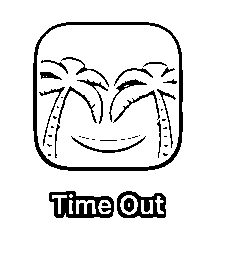

这兄弟的画风属实有点不让人安心，那就干脆给它换张脸。

本机环境：MacBook Pro 13寸 M1 2020 / macOS Monterey 12.7.6 21H1320 / Apple M1 芯片

## 想达成的目标

就是把 Time Out 的应用图标和它弹出锁屏时的图标都换成自己喜欢的。

## 动手过程

先从最简单的开始。网上有教程，方法也好懂：找张要替换的图片 Command+C 复制，然后 Finder -> 应用程序 -> 找到 Time Out.app，右键显示简介，选中左上角的图标预览区 Command+V 粘贴，预览就跟着变了。

提醒一下：改图标有一定风险，可能导致程序不稳定，建议先复制一份备份。

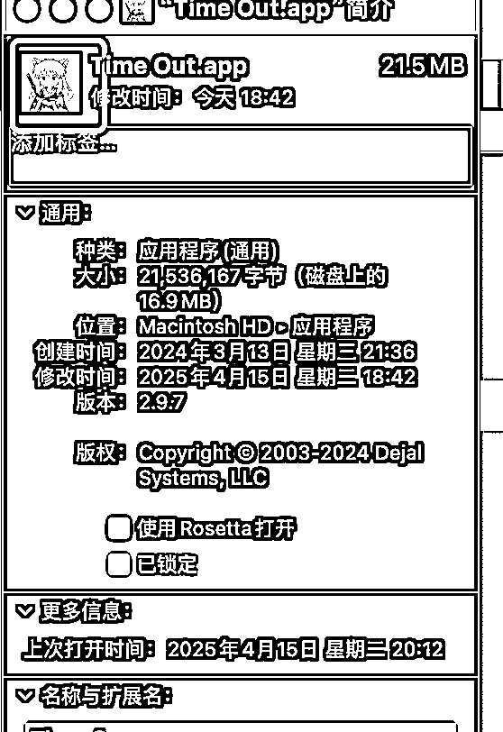

预览成功变化后，第一步算是达成了。

可问题没完，强制休息时弹出的锁屏还是那个笑脸，观感还是不对。看来得进包里动手。

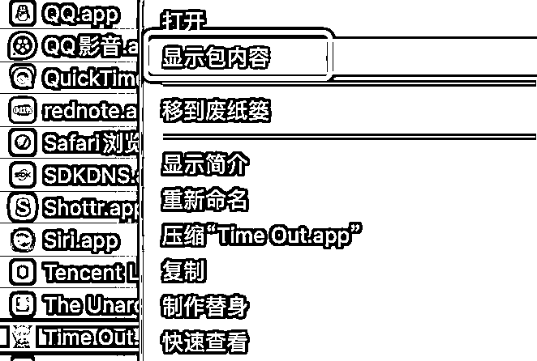

接着继续替换，连 xpc 里面的图标都一起换了。

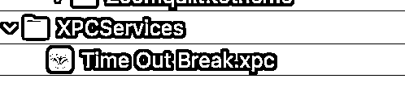

结果依然没变。换了几次思路也乱了，最后把改动又撤了回来。

后来注意到包里有个叫 Themes 的文件夹，难道它还有主题系统？回到软件设置里一看，Appearance 下当前主题确实是 Icon，分辨率找到了。

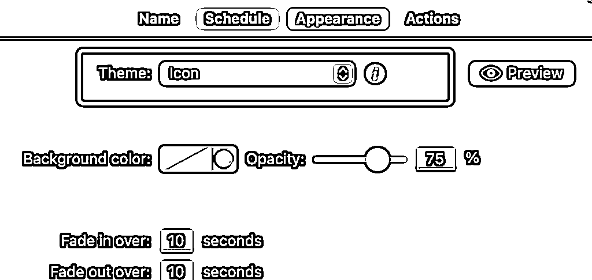

在 Icon v4 目录下开搞，

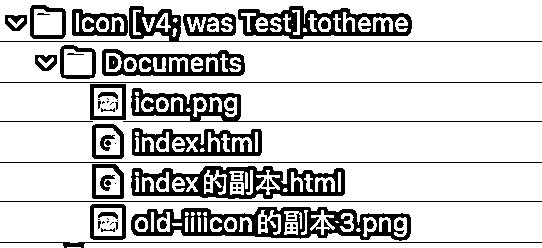

想粘贴新图却发现没权限，原来是文件夹被锁定了，先把权限加上。

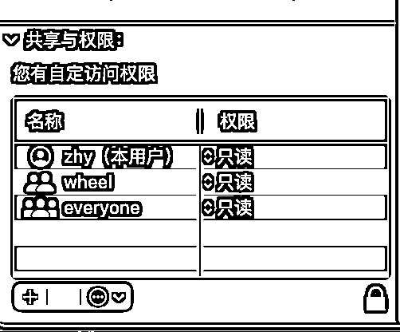

点右下角的小锁，没有本用户就点左边的 + 号添加，有的话直接把权限改成可读写。

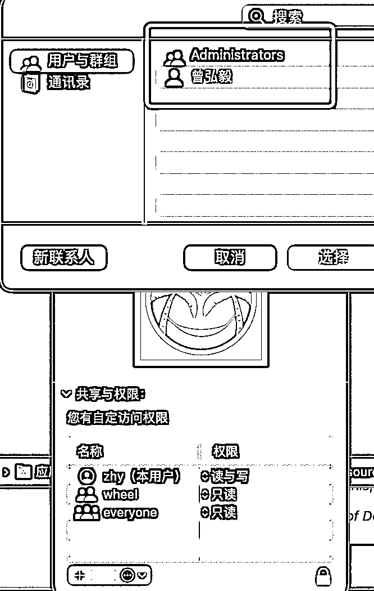

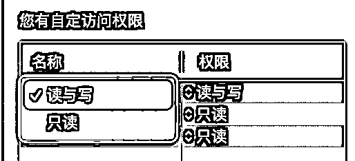

权限搞定后，再次复制图片，选中左上角的原图标替换。

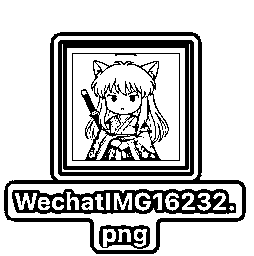

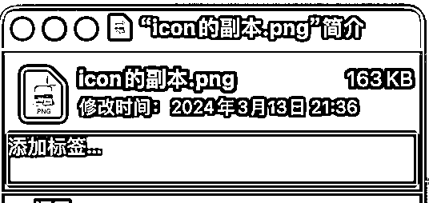

这时进入选中状态，Command+V 粘贴要替换的图片。

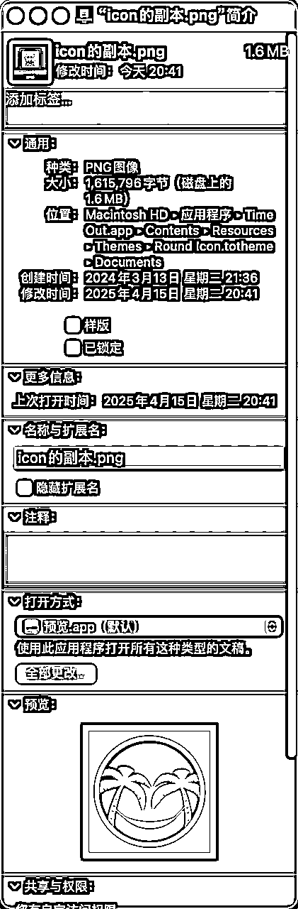

粘贴完成，但预览依旧没变化。网上有人说要重建缓存、执行一堆命令甚至重启，我觉得不太靠谱。

于是去看配套的 json 和 html 说明，发现里面指向的确实是 icon。

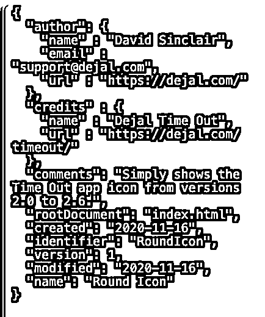

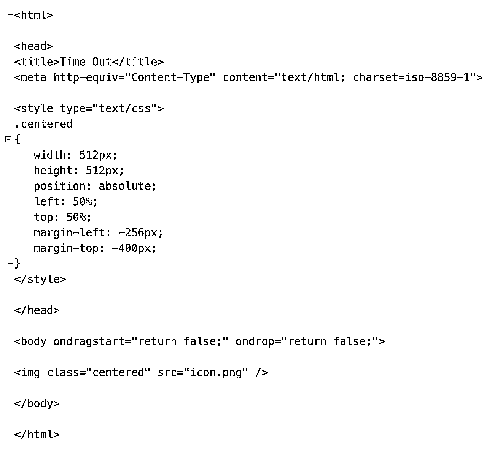

到底卡在哪了呢？

换了好几次都没效果，后来在 Time Out.app 内全局搜索，发现图标文件不止一个。挨个替换也不行，最后怀疑是不是选错了主题。

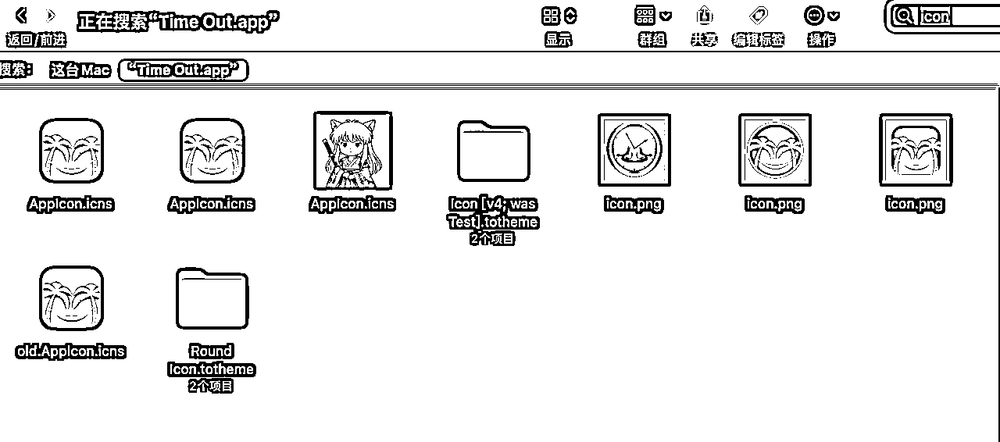

仔细核对后，发现根本就没有第二个 icon 主题。

比对不到就只能扩大搜索范围。

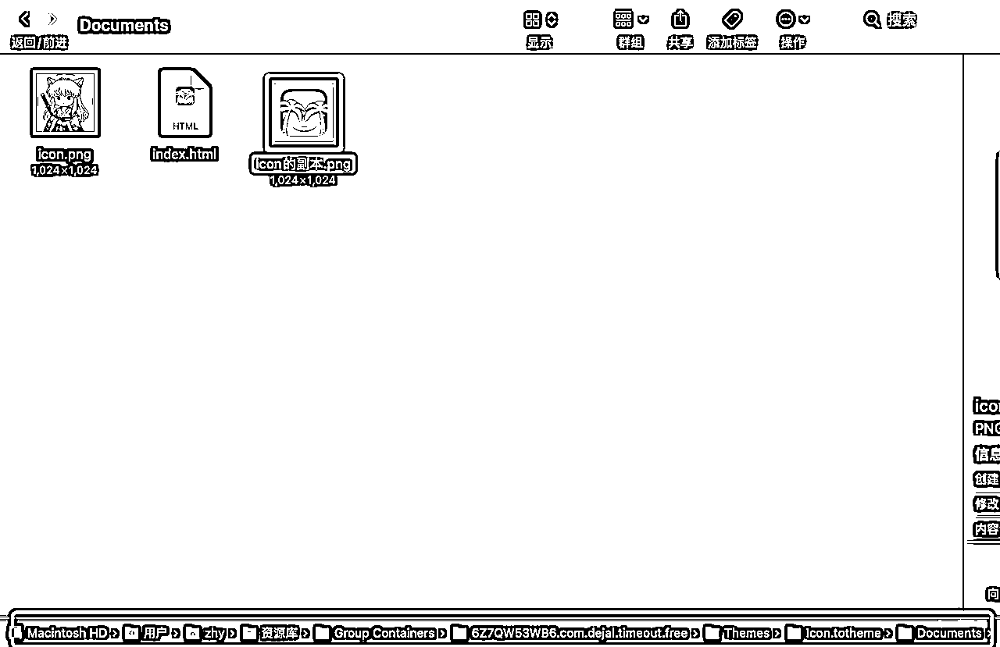

最终才锁定到真正生效的位置，上图是我已经按前面步骤替换成功后的状态。

## 最终呈现

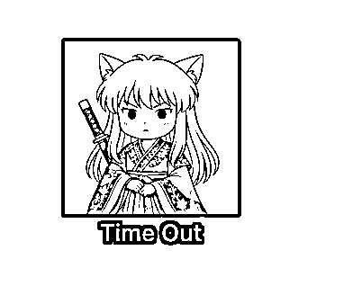

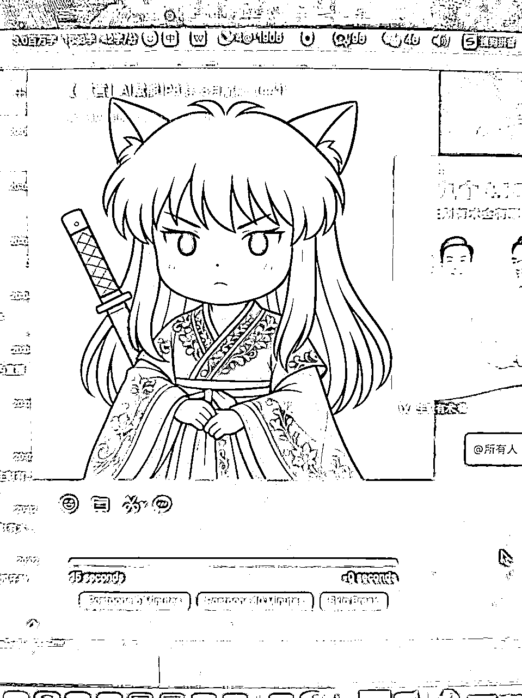

大功告成。

同类软件的图标自定义大同小异，唯一要记住的是：动手之前备份，备份，再备份。