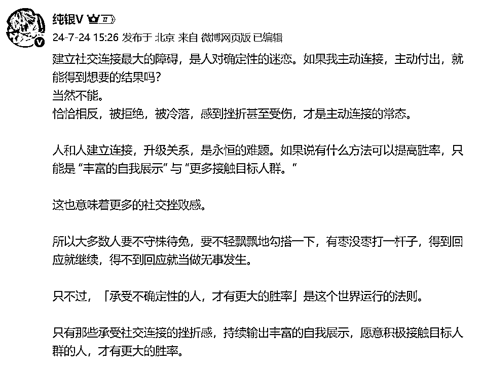
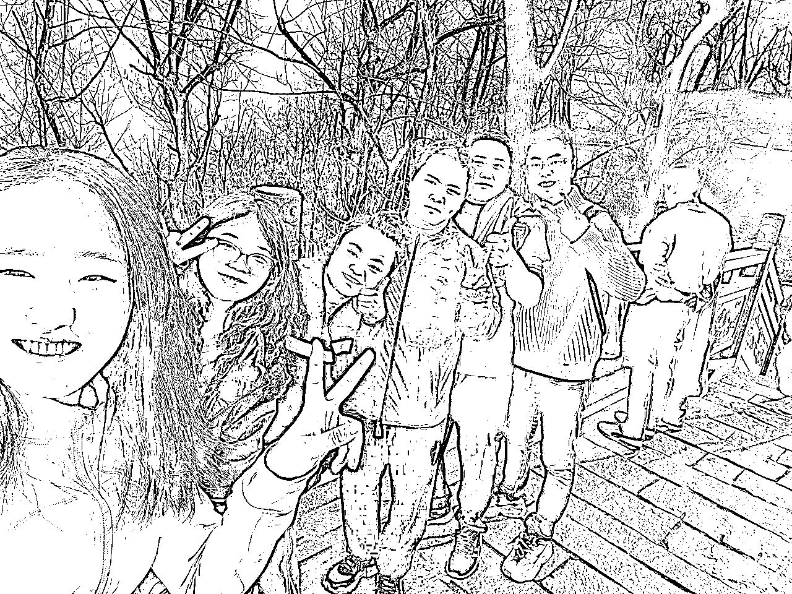
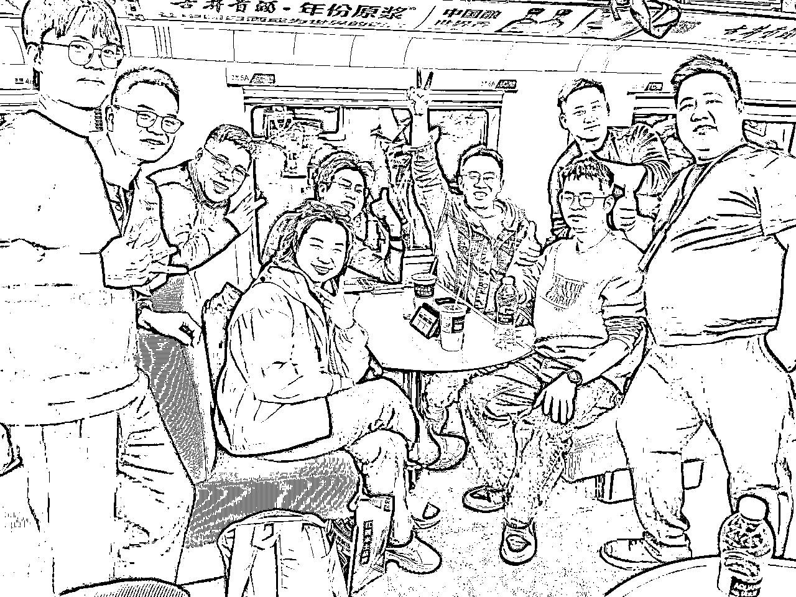
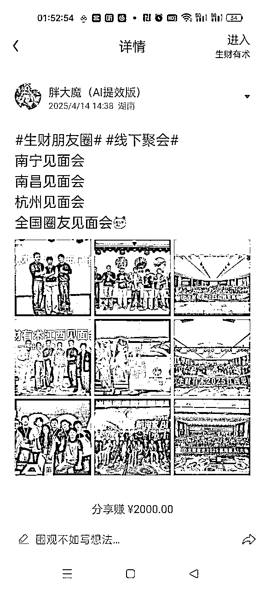
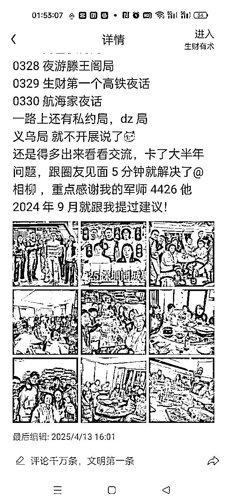

# 内向者也能在互联网找到位置：我的同城组局实战笔记

# 胖大魔的来信

嗨，我是胖大魔。看到你，我大概能想起两年前那个34岁的我。

那时我在长沙做装修小老板，生意停滞不前，每天被甲方和师傅轮番轰炸，想把生意做轻、转到线上，却被海量的互联网项目砸得眼花缭乱。更要命的是，我天生不爱凑热闹，一开口就紧张，见完人回家要躺三小时才能缓过来。

我一度怀疑自己是不是不适合这个圈子。后来才明白，线上看得再多，不如线下见一面。尤其是我们这种耗能敏感的人，需要一套更省力、更扎实的连接方式。于是我开始在长沙试水同城组局。

这不是酒桌上的推杯换盏，而是在小范围里，按自己的节奏建立真实连接的打法。在做了五十多场局的试错后，我把路径梳理成了六个阶段，给同样内向、想转型的你参考。

# 赚钱新人使用手记：给大魔们的低耗能指南

这份笔记专门写给社交成本高、容易在温水里原地打转的你。

整体思路是：先观察融入，再点对点破冰，随后用小局验证，最后通过复盘和定位沉淀出自己的价值坐标。

第一步：做一个会营业的沉浸式观察者

核心是融入与感知。

进入本地的赚钱同城群，甚至可以加邻近城市的群，先做自我介绍，清晰说明自己是谁、能贡献什么、想获取什么。真正的老友很快会出现。

挑1-2场10人以内的线下小聚，心态摆正：我是来学习的，不是来表演社交的。

先给自己做社交体检。我当时最怕和陌生人打招呼，于是提前让群里活跃的外向朋友帮忙牵线，在进场前就去星球查一查大家的发帖轨迹、看看朋友圈。

大魔小贴士：

内向者的观察力是被低估的武器。你能记住每个活跃成员的说话风格、关注点和互动节奏，这正是后续精准连接的基础。赚钱对表达者很友好，但先看得清再出手更稳。

术语听不懂很正常。我第一次听到私域、触达、精细化运营整个人都懵了。不懂就学，节奏放慢，但别因为一时的格格不入就撤退。

第二步：用舒服的方式，开启低频高质的连接

核心是点对点沟通，以文字承接。

自我介绍要讲共鸣，而不是简历。像我会说：以前做装修、卖过建材，现在在研究AI怎么赋能传统行业，想跟大家一起试试水。

每天花15分钟做个点赞评论员，给高质量内容点赞，偶尔聊一句有料的感受。这是成本最低的存在感。

每周主动约一两个人喝杯咖啡，不谈生意，就聊各自在琢磨什么、卡在哪儿。

大魔小贴士：

我起初就是群里的点赞狂魔，用一句走心的评论慢慢攒信任。迄今为止，除了龙哥，我给圈友留言的数量算比较靠前的。文字是内向者的主场，把理解力与诚意写出来，比强行开口更自然。

第三步：从小局切入，拿到第一次正反馈

核心是小范围、结构化。

不必一上来就搞大场面。4到5个人围坐，聊一个明确主题就够了，比如老行业如何借力流量、AI新手互助会、航海同城交流等。

怕控场就找个搭档，你来定议题和流程，他来负责活跃气氛。

大魔小贴士：

内向者不擅长寒暄，但擅长设计内容和引导细节。小而清晰的议题能大幅降低消耗，提升掌控感。

规模真的很重要。我试过30人以上的局，差点原地耗尽。各种主题都试过，最后发现4到8人是我最舒服的区间，既有深度又不会累垮。

第四步：局后再复盘，把直觉沉淀下来

核心是反馈识别与内在感知。

复盘可以问自己：谁来了？他们为何而来？哪个话题最受追捧？我被认可在哪一点？

同时注意能量变化：哪个环节最松弛？哪段对话让我觉得自己有用？

大魔小贴士：

复盘不是给别人看的汇报，是帮你校准舒服区和消耗区的内在罗盘。我就是通过复盘发现自己擅长运营社群、喜欢出点子，于是把后续的组局全部围绕这个能力展开。

第五步：打造你的深度价值名片

核心是垂直定位，小而美实验。

结合老本行的经验或正在钻研的新方向，发起更聚焦的主题局。

比如你对AI感兴趣，就办一场AI场景脑暴；你喜欢美食，就带一波外地朋友来长沙吃透小馆子，成为那个懂吃的向导。也可以把观察到的资源、问题、解法整理成一份小资料，作为你的输出锚点。

大魔小贴士：

没必要成为全网大V，找到一亩三分地就好。我认识一位内向女生，只做大学生微创业分享，现在就是这个细分领域的声音。

一份带思考的复盘，价值远超十条朋友圈点赞。

第六步：给自己贴标签，构建同城信任圈

核心是生态位确认，影响力微循环。

先给自己一个清晰的定位句。比如我是胖大魔，聚焦AI加社群加渠道。这个标签不是自夸，是让别人快速记住你的价值。

每次组织或参加活动后，写一篇小结发到星球或群里，配上照片和真实思考，不必长，真实即可。

从兴趣出发组局更容易生根。我组织过爬山、闲聊饭局这类轻松局，比正襟危坐的商业局更容易建立信任。

建立固定节奏，比如每周五早上的茶会，长期下来你会变成该领域的锚点人物。

听到A的需求、B的资源，主动牵线。这不是舔人脉，是创造价值。

大魔小贴士：

生态位是养出来的，不是喊出来的。我从群里的点赞水军，到偶尔分享心得的组局者，再到帮人搭资源的链接者，最后聚焦在银发信息服务这个垂直方向，每一步都是自然生长。

真正的连接建立在长期信任上，而不是一次资源交换。一句真诚且不求回报的帮助，胜过十次功利性的对接。

让朋友清楚你擅长什么很重要。现在每周都有三五个人来找我推荐合适的人或事，正因为他们知道我的关注边界。

生态位本质是你的独特价值与他人真实需求的交汇点，不用样样精通，只要在一个点上持续输出。

最后，别低估坚持的力量。我见过的赚钱大佬，没有谁是一夜成名，都是靠持续的小而精的互动和贡献，慢慢被看见、被邀请、被认可的。你的价值会在对的时间被需要。

# 写给正在转型的内向者的几句话

不要嫌弃自己的线下经验。在很多互联网人眼里，那些真实世界的案例是稀缺品。

行动先于完美。第一次组局我话都说不利索，但正是那次笨拙的尝试带来了第一批同路人。

别停下学习。不然局只是热闹。我每周会读二十多篇各领域的精华帖，保证自己有干货可分享。

真诚最有穿透力。我最成功的一次链接，就是直接说我不懂，但真想学。

你不适合的不是社交，而是泛泛之交。你适合深度连接。我至今不会酒桌划拳，但在小圈子里能交到真心。

能量管理是生产力。组局前一天早睡，结束后给自己半天恢复，这不是娇气，是可持续的前提。

准备能降焦虑。提前了解参与者背景、设计好讨论问题，会让你异常从容。我曾为一次8人局准备了三页纸的资料，结果发言顺畅得超出预期。

同频伙伴比名片重要。别盲目加人，找那几个能一起成长的。我圈子不大，但彼此真正能帮上忙。

朋友，转型的路上没有观众，只有同行者。对我们这些靠做实事说话的传统行业人，互联网规则或许陌生。但用对方法，以赚钱为场、以组局为杠杆，你完全可以在线上找到属于自己的生态位，不需要变成别人，只需要把自己的光，找到合适的出口。

那些曾被贴上传统土老板、不善言辞、跟不上时代的标签，很可能正是你新赛道的差异化优势。

期待有一天在某个小而暖的局里，听到你讲自己的转型故事。

慢慢来，总会到。

——胖大魔