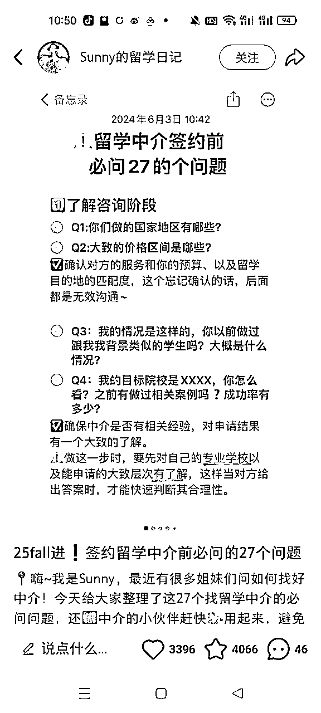
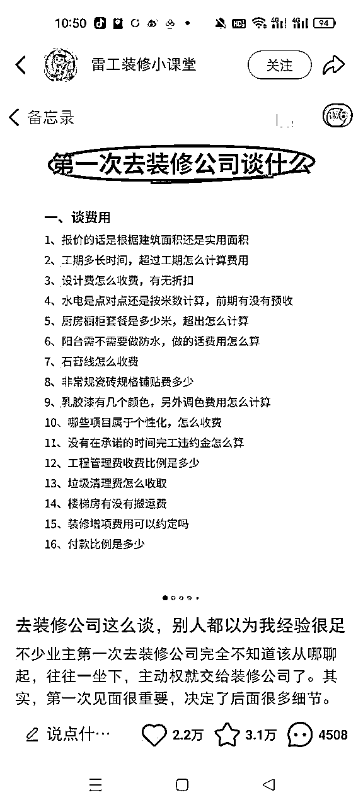
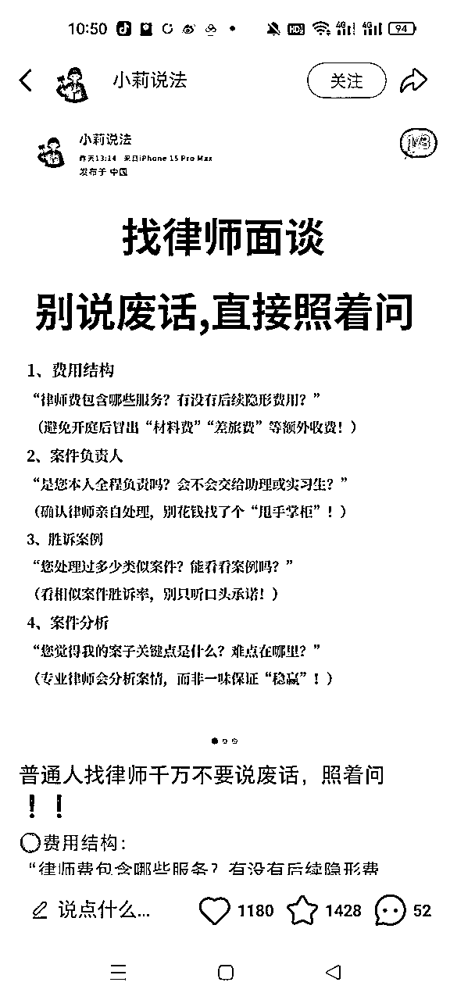
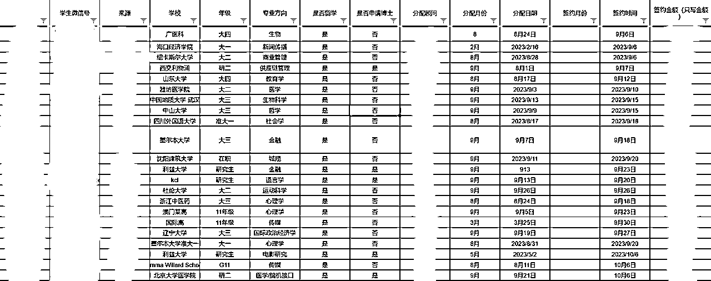
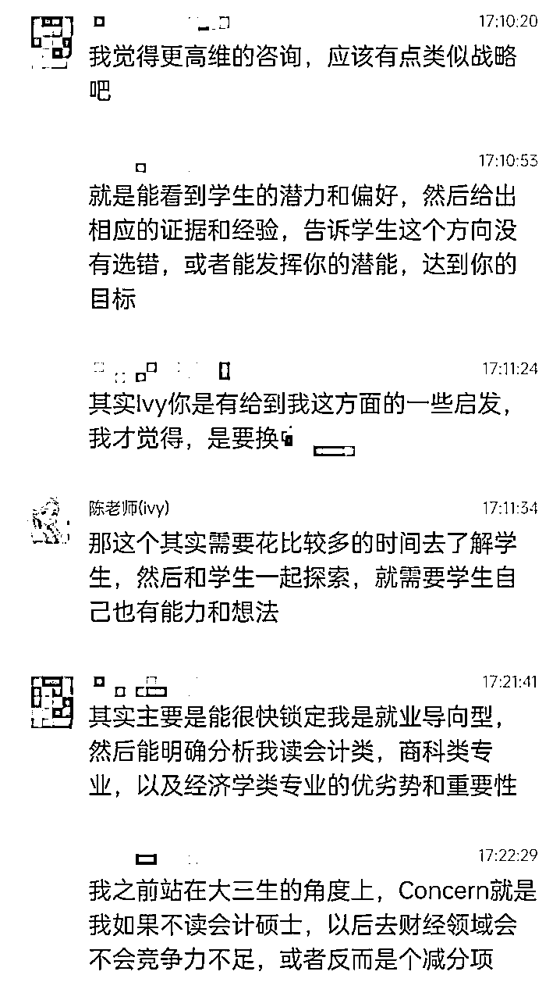
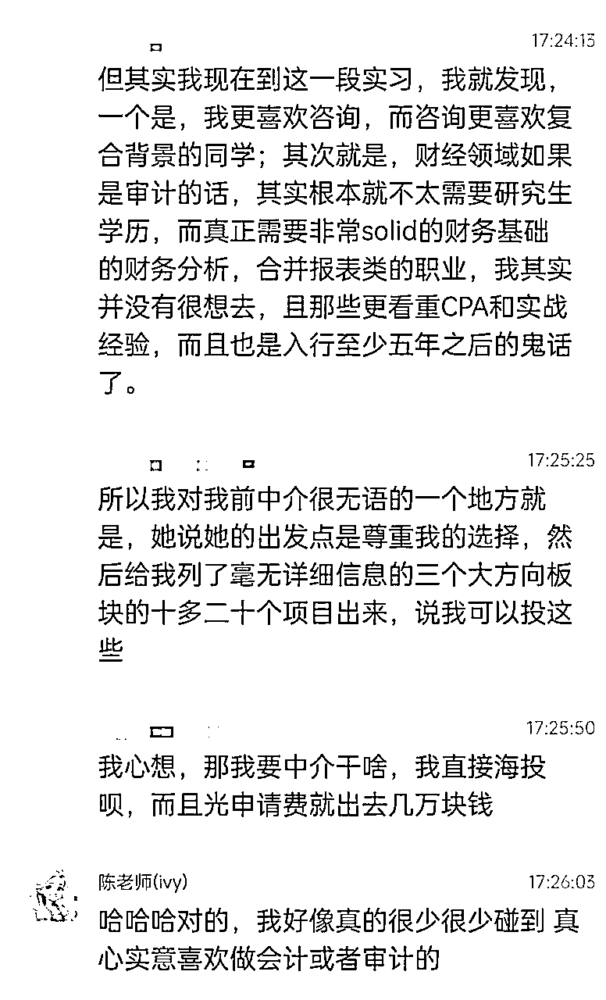
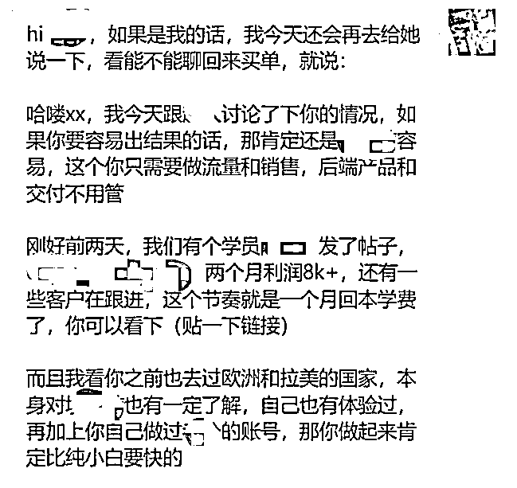
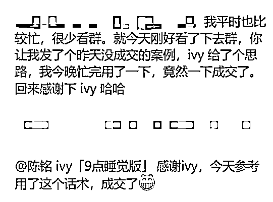

# 📕做高客单，我们是怎么把转化做到7-10%的

大家好，我是陈铭ivy。过去四年我几乎把全部精力都放在了📕的高客单生意上。

22、23两年，我和珍妮子合伙在留学赛道深耕，累计销售额做到2700万。进入24年后，我们把重心转向知识付费，战场依然是📕的高客单。

打通了📕的引流之后，新瓶颈出现了：进到私域的成交率只有1%-3%。而留学时期我们卖的3-5万客单产品，成交率稳定在7%-10%，旺季甚至能冲到10%以上。

为什么会有这么大差距？接下来我就把我们反复试错、和合作方不断磨合出来的销售路径拆给你看。

本文大致分四块：
1. 高客单销售SOP
2. 高客单销售心法
3. 销售团队的管理方式
4. 销售和运营如何配合，避免互相甩锅

# 先说背景

当时我们的模式是：自营的运营团队负责在📕做流量，合作的是留学赛道的一家独角兽公司，他们的销售团队负责成交，我作为桥梁，深度介入销售沟通，专门优化转化。

下面要讲的这些打法，都是基于无IP的实战场景。有些做个人IP的朋友可能会觉得这种聊法太累，确实，抛开IP光环后，销售必须把更多时间花在私信沟通上。

做生意就是要选苦。做IP要吃IP的苦，纯销售要吃聊天的苦。你想要转化高，就得选一头吃透。甚至最好的状态是，既有IP，又能按无IP的SOP和心法把客户聊明白，这样签单率会远超只吃一头苦的同行。

# 高客单销售SOP

在讲对的做法之前，先盘一盘我们踩过的坑。

## 1.1 最难聊的客户不是话多的，是话少的

很多新手会觉得，客户一上来就问价、问题一连串的最好聊，其实也好聊。真正难搞的是那种B型客户：你说一句他回一句，不主动探针。

A型客户爱问，C型客户要电话，都会主动暴露需求，你有机会把产品讲全。B型客户沉默，你问一句“还有什么问题吗”，他回一句“没有”，对话就卡死了。

因为他根本不了解产品，不知道能问什么。所以📕上【签约前必问X个问题】这类选题一直很火，就是在帮客户打开提问的入口。

这种不爱说话的客户怎么破，后面会给你方法。

## 1.2 不要一上来客户问价就报

行业卷，客户比价是常态。但问价不等于和你谈钱。很多客户问价格，只是他暂时不知道还能问什么。

你直接报了价，他就只能比价了，其他维度就没了。五位数以上的客单价，客户的决策从来不是单纯谁便宜。我们的任务是先把价值铺满，让他有东西可比，比完自然会觉得我们更合适。

一句话总结：价值没讲够，价格不报。

怎么回，也在后面拆解。

## 1.3 客户回得慢就别干等

这是我血亏的教训。以前在留学卖3万的产品，有个客户回复很慢，我想着他可能在忙，产品又贵，应该不会当天买，慢慢聊就行。结果第二天他说昨天已经在别家签了。我当时直接傻眼，原来6万的产品真的有人当天就能付。

现在📕同行和截流手这么多，客户回慢基本就是在和别家同时聊。你不动，他就被带走了。怎么把人拉回来，后面也有方案。

## 1.4 私聊前的准备工作

销售才开始打字，战斗其实早已打响。

### 减少客户操作步骤
我自己找律师时，加了一堆微信。有的客服让我再加一个企业微信销售，我手里同时在聊好几家，根本懒得再加。一次多一步操作，就流失一批人。

聪明的客服会直接拉群，把我和销售放一起。我愿意聊，他们就更容易成交。避免客户掉链子，最好的办法就是前置动作，少让他跳转。

### 用结果反向筛选客户，保护销售状态
跑一段时间后，我们会按背景给客户分级。

比如留学赛道：
1. 海外高中/国际高中在读：一年的学费20w+，后续本科研究生更是几百万，付费意愿最强，签约率能到10%+
2. 海外本科/硕士在读：付费能力不错，重点跟进
3. 大陆本科在读/申海外博士：看目的，留学导向的付费力更强
4. 申国内博士，或在职、无升学需求、大专等：基本不成交，不用消耗太多精力

流量小助手在客户进线前先筛一遍背景，给销售不同的话术和跟进频率。一级客户前三天必须每天跟进，四级客户就放缓节奏。把时间投在ROI高的身上，转化率和销售心态都会好很多。

## 1.5 高客单销售四步拆解

销售基本可以拆成：破冰挖需 - 传递价值 - 解决异议 - 关单签约

### 破冰+挖需
先搞清楚客户为什么想了解你？想用在哪个场景？夏令营是一个产品，但动机可以是：随便看看、冲申请加分、冲保研、体验海外教育、要推荐信或论文……

动机不同，后续追唤醒的素材就完全不一样。

挖需还要排雷：提前问那些可能导致流失的理由。父母不同意、时间冲突、家里有人脉能安排……把拒绝点在前期问出来，后面就不容易翻车。

问完要回应，别让客户的话掉地上。客户说“我想了解是因为明年申美”，你就要立刻接“那正好，我们去年有X个学生参加后录取到XX大学，我发你案例”。不要给他推荐12天的营，他只有10天。

### 传递产品价值
新手可以列一个清单，每聊到一个点就打钩。没聊到的可以作为明天唤醒的理由。

产品信息：包含什么、谁交付、用多久、功能、差异化
公司背景：title、背书、行业地位、办公室、成立时间、投资人
配套服务：谁提供、多久、效果
客户案例：尽量找和他高度匹配的
好评墙：源源不断的好评有很强的心理压迫感
高频问题：提前准备好，复制粘贴省时间

比如：现在xx了是不是先xx再买？别家便宜1000？你们带这么多客户怎么保证质量？朋友自学也成了我还要买吗？拉朋友团购能打折吗？我需要和父母商量……

### 解决异议
异议处理看经验，但有两个底层原则。

一是博弈要有来有回。客户要优惠，你可以要确定性：你今天能定吗？能定我去申请。不能优惠可以给其他条件：帮你推荐朋友有返佣，发朋友圈送资料。不能无条件让步，否则他会觉得亏了。

二是客户说要和家人商量，必须排雷+约定回访。不要只回“好的”。要先确认他对价值、价格、公司、成果有没有不确定点，最好拉群直接和决策人聊。不行就帮他整理一份给父母的话术，列清缺什么补什么、项目周期、费用。最后一定问清楚什么时候商量，约好下次时间。

### 关单签约
最后要查漏补缺，把还没讲的信息主动说出来。客户会有“我正想问这个，你就说了”的好感。

意向出现后，描绘付款后的服务体验，然后问“你要不要今天就安排？”能当天签就别过夜，夜长梦多。

如果客户暂时用不到：
有名额限制就用稀缺性：要半年后才开，只剩2个名额了，早订机票也便宜。
没有限制就先收小额定金做前置服务，后续补尾款，或低转高。

# 高客单销售心法

## 2.1 利他出发提需求
无IP销售想让客户打电话，就别说“我给你语音介绍下”。客户会觉得你在占用他时间。

先文字摸清诉求，再结合诉求提语音请求。比如卖申博产品，可以说“什么时候方便？我给你语音讲下产品怎么用到你的博士申请里，以及后面你怎么用论文写作技术”。卖澳洲游就说“X老师在澳洲做导游10年，可以语音分享一些当地人才知道的省钱攻略”。

告诉客户打语音对他有什么好处，同意率会高很多。

## 2.2 以问句收尾
在成交前，每次沟通尽量以问句结束。你抛一个问题，客户回一个回答，对话就活起来。陈述句结尾对话就死了。

好的销售会用提问建立节奏感和主导权。

## 2.3 给客户新观点，降维打击
📕内容逻辑和销售逻辑一样，你要让人付费，就得说出他没听过的东西。能提供新观点的销售，天生适合做高客单。

我做留学中介时有一个学生，已经签了别家，因为我给了他不一样的职业规划和专业选择建议，感觉更降维，他直接把钱退了重新签到我们这边。

## 2.4 爽文背后是持续的笨功夫
大家爱看一句话扭转乾坤的故事，但背后是日复一日的坚持。

比如一个体制内、学历好、有副业但变现不多的客户，在项目实战营和合伙人之间犹豫，问题很多时间也晚，主理人说先睡了，发篇👸号给她看。

我帮主理人写了第二天的跟进话术。

核心逻辑是：客户说二选一，其实心里已有偏好，说中她心里想的就会有“你真懂我”的感觉；客户担心出不出结果，就给她不如她条件好的成功案例，告诉她别人能成她更行。

1. 先把客户的完整画像吃透，给足情绪价值后再推进节奏

发出后，对方立刻完成付款。

话术只是表层因素，我更认同这次能成交的底层原因，是主理人手上在卖的产品本身足够硬。

偶尔会碰到一句话就扭转战局的戏剧时刻，可绝大部分时间里，销售是一件极度考验耐性的活。没有自带流量的销售，必须在长期的对话浸泡里慢慢培养信任，才有机会拿到订单，这正是去IP化销售的常态。

内部真实案例很能说明问题。某销售跟一个客户在电话里聊了整整六小时，晚上十点还在办公室改合同才把单签下；另有销售聊到尾声感觉快成了，结果被客户直接拉黑，他没有放弃，第二天重新加回去继续聊，最终还是拿下了。

所以对销售而言，先把心理预期压低，在高客单的拉锯战中稳住情绪，比任何技巧都更关键。

# 销售团队的搭建与管控

## 3.1 招聘侧重点

什么样的人更匹配销售岗位？

### 会讲故事的人
很多年前ivy面试销售时，现任销售总监就让她讲一段留学申请中最难忘的经历。

入职后总监才说，她逢人必问同样的问题，就是想测试讲故事的能力。概念和理论很难让人记住，故事和八卦却容易形成印记。对销售来说，讲好故事就是核心竞争力。就像多年后毕业，老师的知识点早忘了，可课堂上讲的段子却印象深刻。

### E人vs P人
一个有趣的现象是，运营部门几乎全是I人加J人；销售部门则绝大多数是E人，只有两人是I人。

由此可以推断，E人更适配销售，因为销售要频繁破冰、快速建立信任，和各式各样的人打交道，天生占优。并且销售的日程是被客户牵着走的，客户什么时候有空，销售就得什么时候沟通，P人那种不拘泥计划的特质反而更合适。而J人如果被反复打乱安排，很容易产生烦躁。

这并非绝对。团队里那两位I人都是销冠，说明I人只要发自内心喜欢销售，并找到适合自己的沟通偏好，比如更偏文字表达，一样能做到顶尖。

### 心力扎实，带着狼性
此前关于Dark force的讨论很火，我理解它就是心力，就是【别人拥有的我也要拥有】的那股劲。心力强的人特别适合销售，因为即便是顶尖销售也不可能做到百分百成交，绝大多数沟通最终都不会转化。心力足的人能在一次次拒绝后越挫越勇。

团队里有一位非常拼的同事，此前做房地产中介，对留学行业几乎零认知，试用期三个月后业绩未达标，公司原本打算劝退。他十分诚恳地请求再给一次机会，并表示有信心追上来。公司看在他态度诚恳，就留下了。一年后他成了月度销冠，单月业绩突破60w+。

他也是那个被客户拉黑后还能加回去持续跟进，最后谈成交易的人。

从他身上可以看出，技能和知识都是可以后天补足的，决定能否成事的关键，是是否有那股想学的心力。

## 3.2 过程管控
ivy当年面试走到COO面时，对方提了这样一个假设：

如果到了本月最后一天，你发现业绩还差一个产品的销售额，而此刻正好有一个非常信任你的学生，推什么他都可能买，但你清楚这个产品并不适合他，你会为了冲业绩卖给他吗？

我回答不会。因为业绩是否达成应该每周在监控，提前发现问题、提前做预案，而不是等到月末才惊慌。

事实上，当时的销售团队每周一和周四上午都会过一遍本周预计签约的客户。每个销售都要说明手上哪些客户预计本周能签、目前进展到哪、卡点是什么，其他人一起头脑风暴给出解法，确定后续跟进策略后再执行。

除了预计签约的客户，重点客户也会被单独拎出来梳理，看看如何把签约进度条拉高。

过程管理的好处是：

1. 团队负责人能实时掌握下属的客户跟进状况和签约进度，而不是等到月底才发现完不成一起扣底薪。

2. 有些订单如果销售自己把握不好就会聊死，聊死后即便负责人再强也很难复活；但如果负责人能及时介入，在聊死前让对方换一种表达，就可能保住一单。

## 3.3 团队氛围
你会发现，流量、销售、产品这三个岗位里，只有销售必须高频开早会晚会。流量和产品可以各自闷头做事，销售必须靠持续沟通来激励和碰撞。

我们的销售也是这样，每天都有早晚会。早会主要围绕三件事展开：

1. 预计签约客户和重点跟进客户的进展

2. 销售或产品的专业知识分享

3. 成交案例的细节复盘

...

晚会一般会把大家的聊天记录投到大屏上，集体复盘，学习优质话术，也指出需要优化的地方。

我们还会定期复盘销售数据，一旦发现个人或整体转化率下滑，就会马上分析原因，并持续做测试，把转化率拉回来。

即便是顶级的销售团队，也需要每周跟进、调整、激励、迭代。因为人不可能一直保持最佳状态，而负责人的作用就是维护团队积极向上的氛围，守护大家的心力，及时调整掉队的人。

## 3.4 奖惩机制
大部分销冠的胜负欲都很强，他们骨子里写着【我不能输】这四个字。

销冠的竞争非常直接，就是看转化率和签约金额。排名靠前的有奖金和礼物，排名靠后或不达标的会被扣底薪。

每月我们都会公布签约率，如果某位销售的签约率持续低于均值，比如低于7%，就会暂时收回他接新客资的权限，直到他把手中客户的转化拉到均值以上，才会重新开放。

# 销售与运营如何协同避免内耗
在任何一家公司里，销售和运营都是最容易产生摩擦的两个部门，因为利益天然存在冲突。

运营的想法是：筛选话术越简单越好，下发的人越多越容易完成KPI，下发的人多，签约也会越多。

销售的想法是：希望运营能引流精准客户，别什么奇奇怪怪的人都往这里推，浪费时间还拉低我的签约率。

所以总监层面开会时很容易为己方利益据理力争。销售希望运营用更复杂的筛选话术把不可能买单的人筛掉；运营希望销售什么客户都接，不要挑三拣四。

解决冲突的关键是，把沟通焦点拉回到共同目标上，也就是更高的签约率和签约金额，并且用数据和聊天记录来支撑。可以这样说：

我们统计了近两个月下发的【已工作】客户签约情况，共103条客资，目前零签约，而且这部分人非常能聊，占用了销售大量时间【附聊天记录打包】，反而影响销售去跟进更有希望成交的客户，比如国际高中生。建议运营在筛选环节再加一道过滤，把【已工作】人群尽量筛掉。这样我们能把精力集中在转化率高的群体，也有利于整体转化率提升。

以上就是我们两年累计卖了2700万的销售心得，感谢赚钱的小伙伴看到这里，有任何问题欢迎在星球评论区交流。好答案总是由好问题唤醒的~

我从22年加入赚钱，今年是第四年，毫不犹豫续费了。这里不仅有变现的打法，更有一群同路人。

创业很孤独，但当你知道有一群人都在往前走，逢山开路遇水搭桥，孤独感会少很多。尤其是看到很多大佬的帖子，发现他们也经历过我踩过的坑，就能更快获得方法和心力。

# 往期内容推荐

2022年的文章（精华×1）

1.  精华《粉丝3000月营收20万，📕低粉高变现的蓝海攻略分享》

https://t.zsxq.com/GK9Nq

2023年的文章（精华×2）

1.  精华《如何让你的钱花的有价值？📕聚光投放实战攻略》

https://t.zsxq.com/d0hv0

1.  精华《📕教育赛道GMV1600万/年，小团队创业心法》

https://t.zsxq.com/iIXtQ

2024年的文章（精华×4）

1.  精华《老板避雷手册|年1100w营收背后，如何识别不合适的运营人员、合作商、合伙人？》

https://t.zsxq.com/uldES

1.  《老板避雷手册2：运营端忽视这些细节，会让你血亏500万》

https://t.zsxq.com/FKyYB

1.  《如何和另一半&长辈相处，实现2700w营收的同时稳定家庭？》

https://t.zsxq.com/KAIlx

1.  精华《📕两年做了2700W营收后：我对「留学行业的趋势分析」》

https://t.zsxq.com/ZKsjN

1.  《「续集」老板避雷手册3：如何识别不合适的运营人员、合作商、合伙人？》

https://t.zsxq.com/YNLuh

1.  《老板避雷手册4：卖「合伙人产品」要避开的雷区，2个半月卖122.98万后，我的观察》

https://t.zsxq.com/LWDf9

1.  精华《留学从业者转行去「大蓝海」，2个月卖出1个小目标的产品❗（第一集）》

https://t.zsxq.com/1GLiq

1.  精华《2024，哪些赛道的人要「提桶跑路、去哪里找蓝海」❓留学赛道转行2个月卖出1个亿后的分析》

https://t.zsxq.com/RNh7V

1.  《「老板识人大法」：如何避免被人割韭菜？筛选运营、销售、与交付人员？》

https://t.zsxq.com/AMB7J

1.  《海外旅游赛道，天坑赛道中的清北，2024要怎么破局》

https://t.zsxq.com/gnrEe