# 2025.03.22【海南见面会】 小伞-《从职场宝妈到年入 25W+ 自由职业者，一个人活成一支队伍》

三年前，海南岛上一名在编的年轻妈妈，白天在单位写材料，晚上回家带娃。外人看来，她端着稳定饭碗，工资不算低，生活稳稳当当。只有她自己知道，那段时间有多灰暗。

产后回岗，她第一次体会到“生育女性”在职场里的隐形代价；单位里各种微妙人情和低效空转，也让她每天喘不过气。她说，早上睁眼想到要去上班，无助感直冲脑门，就像被迫赶赴一场不愿赴的约。

她不是没有尝试硬扛，只是越扛越觉得不对劲——如果继续耗下去，最先垮掉的可能是精神。于是，哪怕当时疫情还在起伏，她还是辞职了。

可裸辞之后并没有迎来解脱。离开“被安排好的轨道”，她反而更迷茫：接下来靠什么生活？自己能做什么？前方到底有没有路？

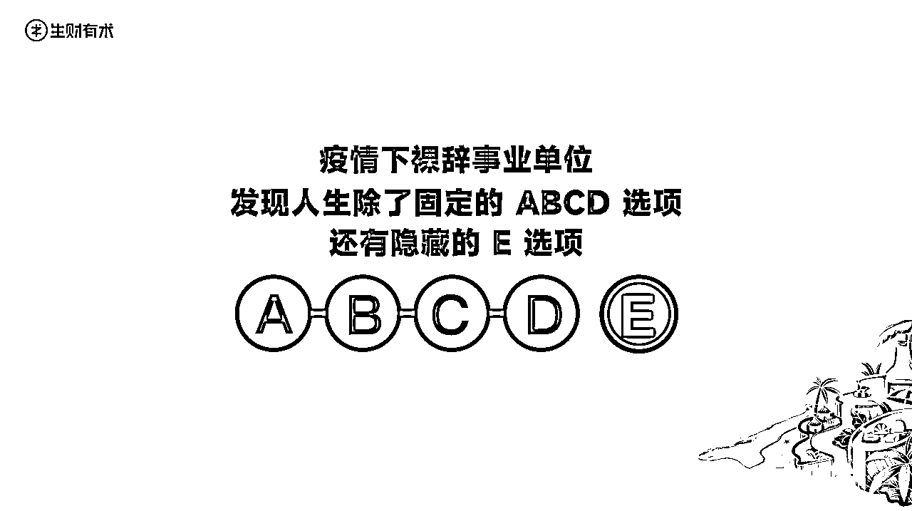
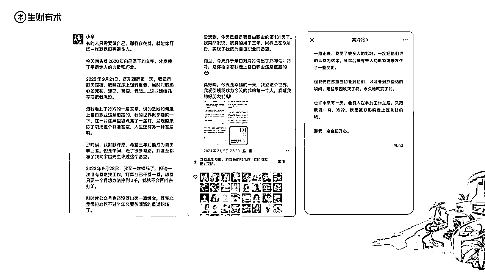

直到某个睡不着的深夜，她在手机里刷到一位很喜欢的博主写的文章。对方说，自己找到了能干一辈子的工作——独立内容创作。那一刻，小伞觉得自己被一道闪电劈中。虽然她当时连具体怎么赚钱都说不清，但内心有个声音不断放大：我就是要做这种不被圈住、靠自己活着的状态。

**02 第一次逃跑，输给了“留后路”**

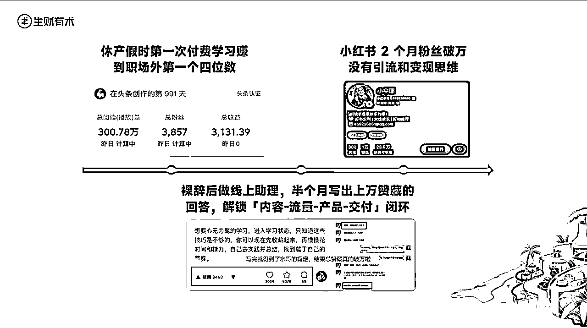

真正开跑后，她才发现自己低估了“没有进账”的恐慌。第一次辞职后，她试过在📕做内容，但能到手的收入遥遥无期。再加上心里压根没准备好——不知道前期赚得少是常态，也不敢彻底丢掉每月固定到账的工资。结果才两个月，她就灰溜溜地回去上班了。

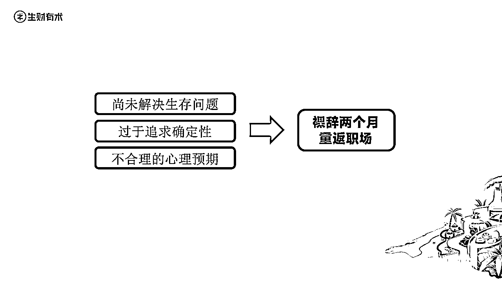

为了给自己留退路，她一边上班搞副业，一边备考公务员，想着先把稳定饭碗重新端稳，再谈折腾。后来她总结，当时卡住自己的有两样东西：一是总想有保险垫底才敢走；二是从小到大当惯了“乖孩子”，实在不忍心看到父母眼里的失望。

这种两头下注的状态，最后什么都没换来。副业没做出水花，考公也落榜。但这次失败，反而让她想明白一句特别重要的话——不要一开始就退而求其次，要径直走向自己最想要的那个东西。

**03 第二次上牌桌，她主动选了自己要的路**

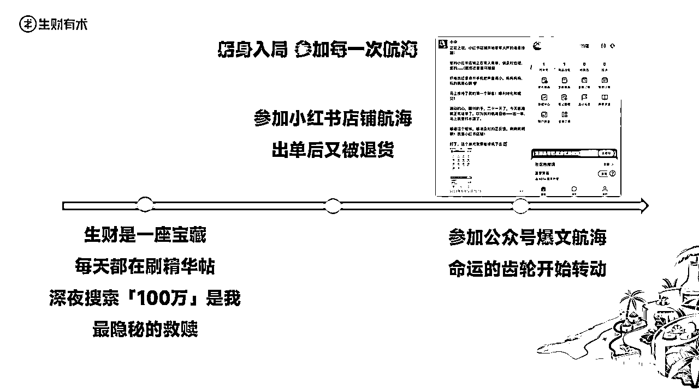

2022年12月，她再次辞职，这一次是主动做的决定。经过一年多副业探索，她已经在圈子里看了大量关于心态、认知的帖子，做过最坏打算，也给自己做好了迎接不确定性的准备。

她的主战场选在🛰️生态，做的是“IP+爆款”双轮驱动的图文号。说起来也不复杂：用爆款内容的算法逻辑去搞流量，再用个人IP的信任感去接住流量。这个组合，被她称为王炸。

**04 四步“抄作业”法，新手也能找到爆款**

第一步，在🛰️里搜领域关键词。例如想写极简方向，就拿“极简生活”去搜一搜，筛选出文章，按热度排，时间卡最近七天到半年。这一步能捞出一批做得不错的账号。

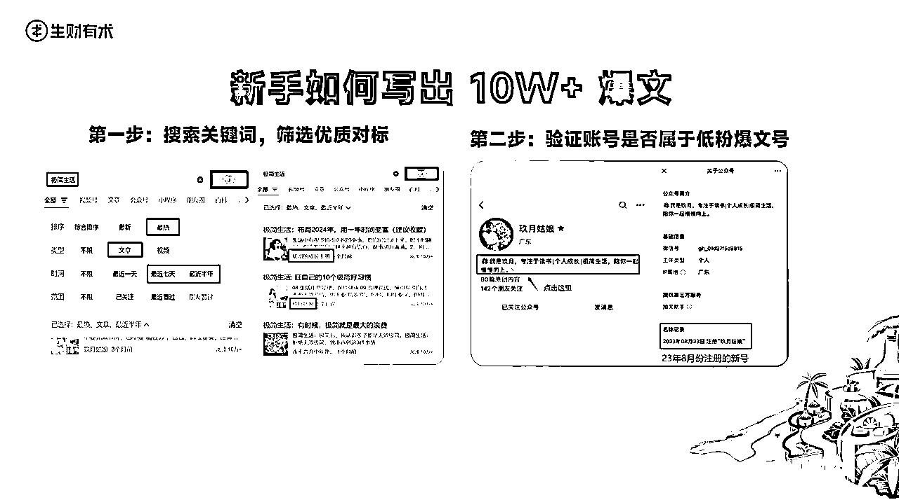

第二步，判断这些账号值不值得对标。点进去看注册时间，越新越好，最好半年内；再看发文总量和打造出爆款的概率，只有“低粉高爆款率”的账号才值得抄。

第三步，把爆款标题当搜索词再查一遍。用选中的标题去搜一搜，又能挖出同题写作的其他账号。

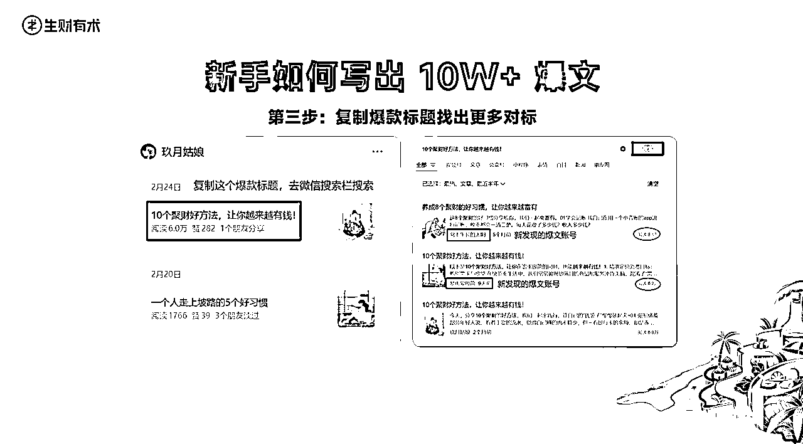

第四步，循环执行第二第三轮，无限套娃。最后你手里就有一堆高质量对标和爆款标题。爆款的核心是选题和标题，所以把标题改写98%，正文原创，命中爆款的概率就高了不少。

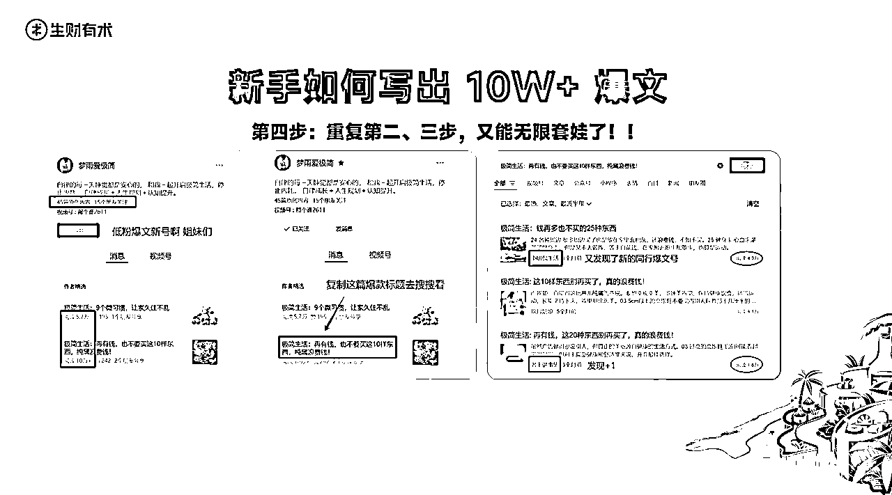

**05 用这套打法，她一年攒下上万私域**

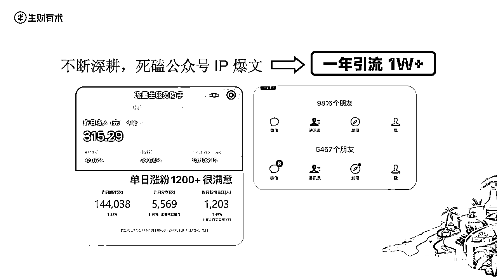

内容越做越顺手之后，小伞没有忘记上一次失败的教训。她在文章里埋好钩子，把读者往个人号上引。数据好的日子，账号一天能涨上千关注，🛰️好友申请多到“手软”，一天三四百人，她不敢一次性全点通过。

就这样，将近一年下来，她积累了上万私域好友。收入结构也从单一的流量分成，慢慢变成广告合作、知识产品等多管道。更重要的是，有了这个私域基本盘，哪怕后来流量下滑、账号被限流，她也能稳住心气，继续把手头的事做下去，直到等来下一个拐点。

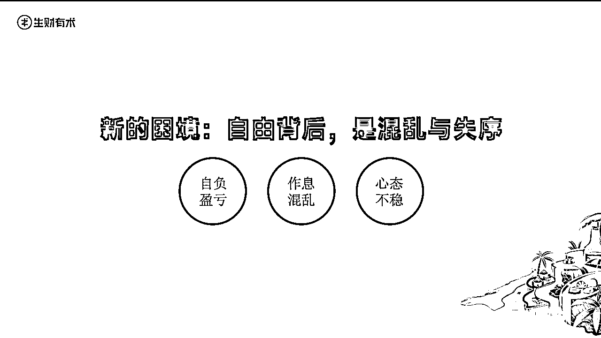

**06 自由职业的真实B面，别美化也别丑化**

很多人以为自由职业就是轻松躺赚，小伞却说：不要给它加滤镜，也不要刻意唱衰。刚开始那阵，她的压力甚至比以前上班更大。

收入全靠自己挣，做不出成绩就坐吃山空；没有人规定上下班时间，反而日夜颠倒、作息混乱；第二个月虽然已经月入过万，但她整夜失眠，总担心下个月会不会归零。朋友见她时吓了一跳，说她脸颊都凹进去了，整个人气色差到不行。

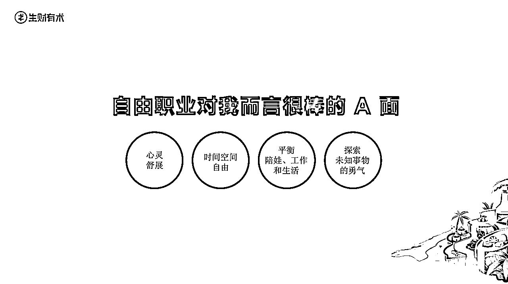

**07 让人上瘾的A面：终于能活开了**

但熬过适应期之后，自由职业的甜头也慢慢显现。

她说自己的心被彻底打开了。可以写真正想写的内容，虽然也要照顾平台规则，但那种“方向盘握在自己手里”的感觉，让她觉得通体舒畅。时间和地点也随意，睡够了再起，或早早开工，没人催你打卡，还能错峰去看电影、泡健身房、带娃出去玩。

作为妈妈，她终于能送娃上学、接娃回家、陪读绘本、去游乐场；公婆也给了很大的支持。空闲下来她还染了浅发色、剃过寸头，报各种体验课，甚至走进了以前不敢去的器械区，慢慢养成了运动习惯。这些以前想都不敢想的事，每一样都在反哺她的状态和内容。

她很清楚：承受一些不确定性，就是为这份自由付的代价，值了。

**08 和焦虑共处，唯一的方法是继续做事**

焦虑并没有消失。小伞观察到，真正压垮自己的，往往不是现实，而是心里那个苛刻的审判官。

以前她计划做五件事，只写完一篇稿子，就会立刻开始自我攻击：这样下去要完蛋了，我必须更拼。越逼自己，越动弹不得。

后来她想通了：只要写完一篇稿子，今天的工作就算完成，其他事都是额外赚到的。奇怪的是，放弃自我攻击之后，行动力反而更强。就算没做到，也不会再责怪自己，反而觉得自己很棒，更有信心继续走。

和焦虑共处的诀窍，说破也很简单：别过度自我批判，只要你还在做事，还在牌桌上，就是在前进。运动、读书、学新东西，也算。

**09 最后，两个关键词**

回顾这三年，小伞觉得自己能撑下来的关键有两样：相信，和敢选。

相信是一种近乎固执的自信。账号还是个位数阅读时，她坚信自己一定能写出十万加，结果一个礼拜就实现了；还没赚到钱时，她躺在床上幻想自己月入过万的标题，结果第二个月就成真。赚到人生第一个一百万的目标，到现在还没达成，但她觉得只是时间早晚。

敢选则是知道自己要什么。她很喜欢李笑来的一句话：判断一个人是否真正活着，要看有没有意愿、有没有能力去做主动的选择。随波逐流、逆来顺受，算不上活着。所以她主动丢掉虚假的安全感，跳进不确定性的海洋，也不再为了满足外界的期待而活。

如今她越来越坦然，只管听从内心，去探索、去体验。

采访最后，小伞说了一句特别好的话：希望我们不仅仅是职业自由，更是人生自由。

愿每个读到这里的人，都能带着信念做出选择，在不确定的世界里，走出自己的节奏。