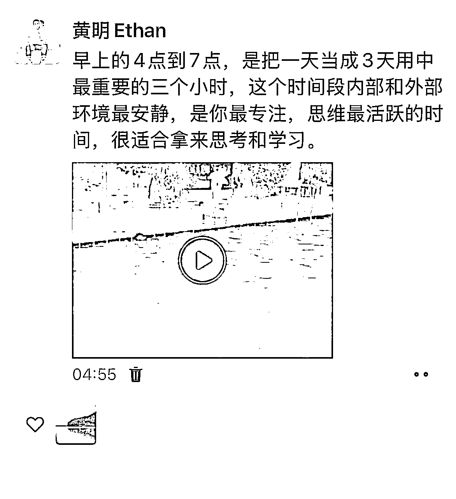
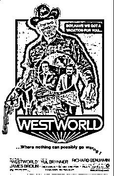

# 凌晨四点半，我把虚拟人五十多年的进化史重新捋了一遍

> 来源：[https://wppopmriov.feishu.cn/docx/IsLjdBkrcouEsFxxLadc4HQInUf](https://wppopmriov.feishu.cn/docx/IsLjdBkrcouEsFxxLadc4HQInUf)

凌晨四点半，窗外还黑着。我坐到书桌前，把虚拟人从1970年代到未来的发展脉络完整过了一遍。结合技术迭代、场景演化和市场走向，这次梳理让我收获巨大，光是案例就存了几十个。把思路写下来的过程，其实是最好的消化方式。当最后一个字敲完，我对虚拟人的理解已经和动笔之前完全不同了。

我把它压缩成五个关键节点，每个节点回答三个问题：技术靠什么驱动？场景落到哪里？代价和天花板又是什么？

## 节点一：像素时代的初啼（1970s—2010s）

这段时间的技术基底是电脑绘图（CGI）。形象怎么来的？设计师一帧一帧手动建模、手动调动画，跟捏泥人差不多，又慢又费劲，更别提智能互动了。

里程碑其实不少：1973年的《西部世界》悄悄试水CGI特技，让观众第一次在大银幕上看到数字生成的面孔；

2001年的《最终幻想：灵魂深处》更进一步，用纯3D角色挑战“真人表演”的边界。

商业上，这些技术主要流向电影特效、电子游戏和广告片。2007年，初音未来在日本诞生——一个永远年轻、永远不会塌房的虚拟偶像，从此开创了一种全新的偶像经济。

局限也很直白：全靠人工堆，投入高效率低，成品大多带着一股“动画片味儿”，离照片级真实还有十万八千里。

## 节点二：会动、会说的时代（2010s—2020s）

转折点出现在2010年代。动态捕捉、语音合成、神经网络三股力量汇合，屏幕里的人第一次“活”了过来。

2009年的《阿凡达》实际上赶了个早集，恰恰是它把动态捕捉推到了聚光灯下——潘多拉星球上那些蓝色面孔，每一寸表情都来自真人演员的表演。同一时期，微软小冰（2014年）在文本对话上迈出关键一步，让虚拟助手第一次能和人你来我往地聊上几句。

应用版图随之扩大：有虚拟偶像在网络直播间里唱歌唠嗑，有智能助手在手机里随叫随到，连游戏NPC都不再是一句台词背到底的木头人。商业市场的大门，悄悄开了一条缝。

按照商汤的分级框架，这段时期正好对应L1和L2：

**第一级，纯手工作坊。** 形象从设计、建模到逐帧动画，每个环节都依赖人的手和眼。成品适合放在电影特效、平面广告里当“静态展品”，但没有任何实时响应能力；内容一需要更新，就得全部重来，成本高得吓人。

**第二级，动态捕捉驱动。** 真人演员穿上布满传感器的紧身衣，脸上贴满信号点，表情、动作、口型被完整记录，再同步给屏幕里的那个人。这个流程让“录好再播”的AI主播和游戏动画质感都上了台阶。可问题也很清楚：设备不便宜，操作门槛高，数据还得人工后修；最要命的是，它撑不起实时对话，更谈不上流水线生产。

## 节点三：AI接管，行业大洗牌（2020—2023年）

这三年，是整个行业最关键的分水岭。

技术层面，GAN这一类网络架构把画面真实度拉高了一个量级，语言理解能力也上了新台阶——虚拟人终于“长了脑子”，能接住话茬、记住上下文。

行业由此进入L3/L4阶段：

- 在L3这个层级，算法自动驱动口型和表情——电商直播间里那些不知疲倦的带货主播，背后就是这套逻辑；
- 在L4这个层级，垂直行业的智能服务开始上岗——客服机器人、云端辅导老师等等纷纷落地。

商业应用随之加速：抖音电商的镜头前、学校的辅导课堂里、银行的智能投顾席位上，都出现了虚拟人的身影。

然后，2023年，ChatGPT点燃了整条赛道。最直观的结果是：做虚拟人的公司从60万家筛到只剩6000家，活下来的那一批，成本结构已经彻底变了。

为什么ChatGPT的威力这么大？拆开看是三件事。

**第一件：技术破壁。** 过去的虚拟人是出了名的“你问东、它答西”。基于GPT的对话能力，它终于能听懂复杂指令、给出得体回应。京东自研的LiveHuman系统把GPT能力接入跨模态框架，实现了语义层面的精准对接；言犀这个产品更夸张，丢给它一句话，或者给一段一秒钟的视频，就能生成4K画质的形象，嘴唇动作严丝合缝，从头捏脸的整套流程全都不需要了。AI写剧本的效率也在颠覆内容生产——影视行业原来几周才能磨出来的剧本，现在几分钟搞定。光线传媒透露，动画产出的效率因此提升了30%。

**第二件：生态普惠。** ChatGPT引爆市场之后，百度和阿里先后开放了自家的预训练接口，小团队和个人开发者终于能“站在巨人肩膀上”做应用。闪剪之类的App直接内嵌AI工具，用户敲一行文案，视频就自动出片，成本降到了千元档。GPU租金也在往下走，魔珐科技靠算法优化，把虚拟人的制作周期从三个月缩短到一周，人力投入少了七成。

**第三件：成本塌方。** 过去做一个虚拟人，找团队从零捏脸，再租一套昂贵的动作采集装备，报价几十万是家常便饭；现在AI语音合成成熟到可以凭空造声，真人提前录音和后期修音统统不再需要。数据最有说服力：AI主播的造价，2022年还要烧好几万美金，2023年就降到一千块人民币的水平。标准流水线进一步放大了规模优势，摊到每一个虚拟人身上的额外开销，已经接近于零。百度自己的经历最典型——2018年，造一个虚拟人要花掉500万人民币；2023年，这个数字已经缩水到千把块钱的价位。

## 节点四：逼近真人的虚实融合（2023—2025年）

这个阶段的主线只有两个字：以假乱真。

摄影棚里环绕一圈相机做三维重建，再融合语音、视觉和情绪识别，虚拟人的样貌无限逼近真人。更夸张的是，新时代的AI工具几分钟就能“变”出来一个足够逼真的角色——这个门槛，以前想都不敢想。MetaHuman这套高拟真角色方案，更是把角色制作的门槛一把拉到了地板价。

扎克伯格把Meta押在一个宏大叙事上：人们戴着头显，在VR世界里开会上课、社交娱乐；Meta还在研究一种不用开颅就能读取脑部信号的装置。文旅圈也在玩“穿越”，故宫博物院上线了虚拟讲解员，已故的历史名人被重新“请”了回来，在游客面前活灵活现地开口说话。

北京也适时应声出台行动方案，推动虚拟人产业加速，目标2025年整个盘子做到500亿元。

## 节点五：人人有分身的2026

再往后的故事，属于通用人工智能。

目标很清晰：冲到L5这个最高级别，让屏幕里的那个人在任何场景下都能跟人自如交流，成为每个人的专属私人助理——懂情绪、有温度，换一个环境就能自动调整状态。

推力来自两个方向：更聪明的GPT-5级别基础模型，以及量子算力带来的跃迁；画面即时渲染和AI自动生成，也会在这个阶段彻底交融。

这幅未来的图景相当浪漫：以后在办事大厅、朋友圈、诊室和课堂里，都能看到你的定制分身；虚拟人还会成为一种新的效率工具，深入工厂车间和隔空会诊的第一线。

规模数字也摆在那里：2026年，中国虚拟人市场的体量预计将达到102.4亿元；全球市场，则朝着万亿人民币的量级一路狂奔。