# 零基础做 TikTok Shop，从开店到选品拆解，一篇说透
作者：龙哥

这篇按“注册 → 配置 → 调研”的顺序写，内容偏实操，建议先收藏。

## 一、TikTok Shop 开店全流程

开店之前，先把主体材料准备好。个体户也能注册，但执照要满 6 个月，并且能提供第三方经营证明；如果不想等，也可以直接买现成店铺。有公司执照更稳妥。

注册入口有两个：
- 跨境业务：seller.tiktokglobalshop.com
- 本土业务：seller.tiktok.com

点进对应链接后，用手机号设置帐号密码并登录。
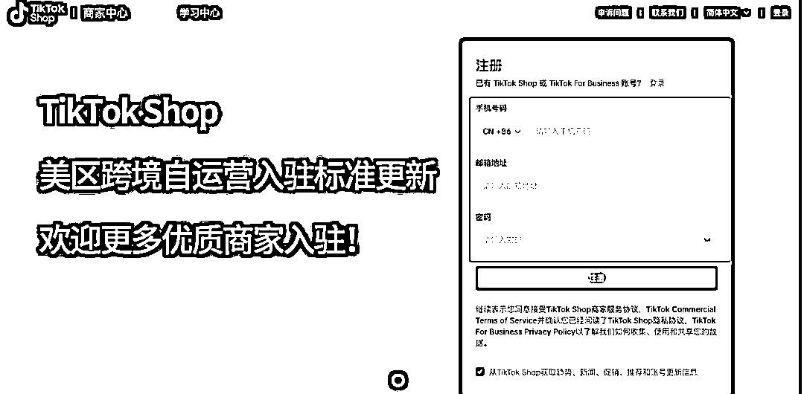

然后选择经营地区，入驻方式选“普通入驻”，公司主体选“中国大陆”。

按提示提交营业执照信息。
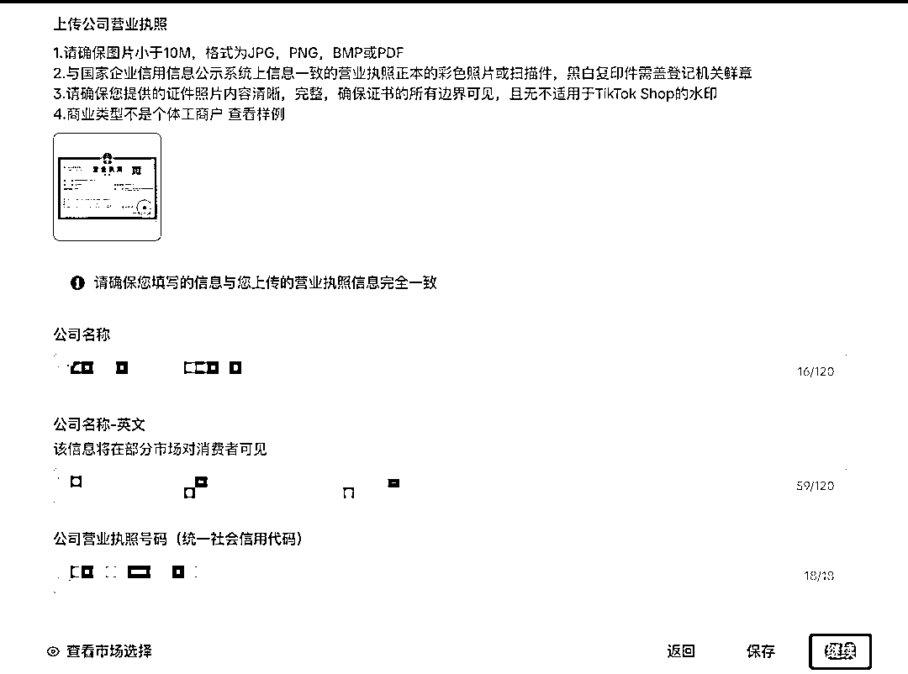

接着填写大陆身份信息，并把店铺基础档案补全。
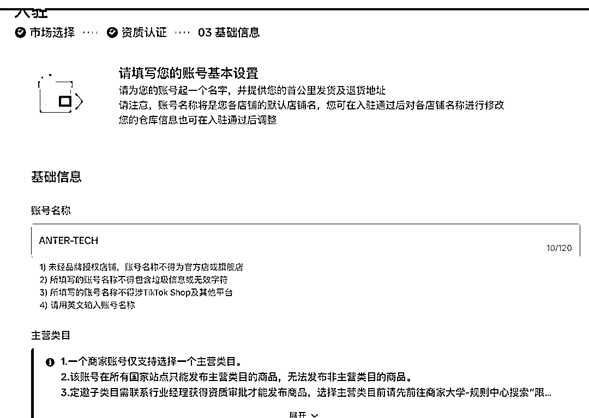

继续完善小店的基础资料。

提交后等待审核。同一张执照可以注册两家小店；开第二家时，重新打开链接登录一次即可。
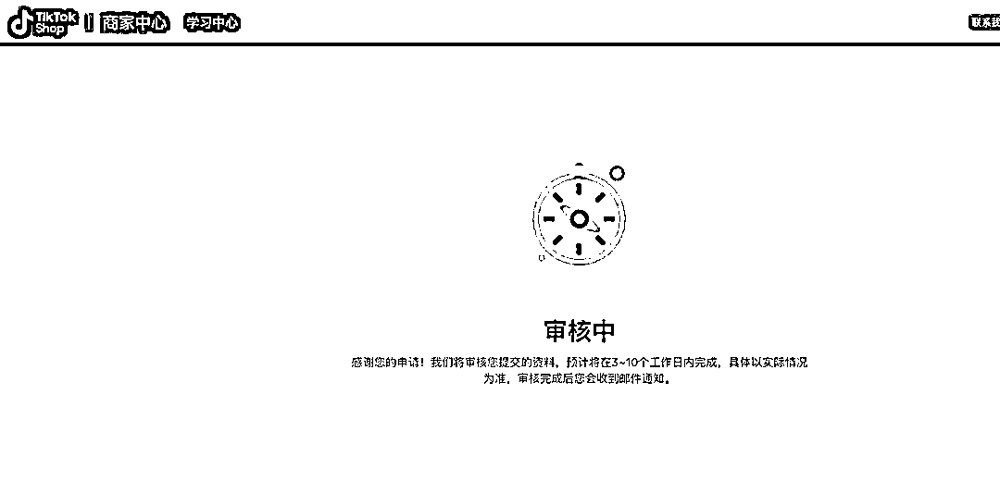

审核通过后，把押金、退货地址、官方帐号、商品上架等设置全部完成，再开始运营。
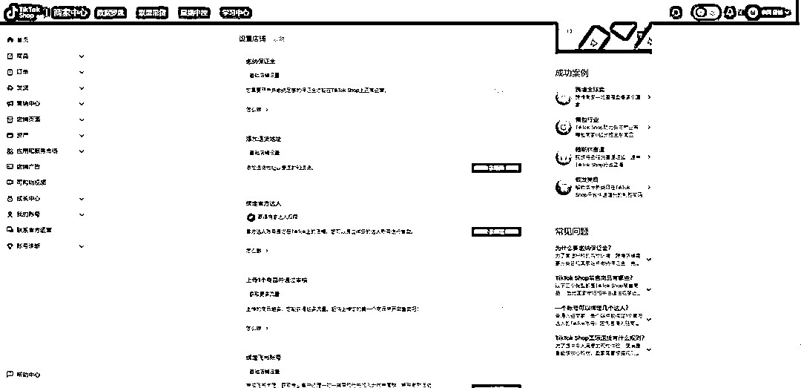

关店时，押金可退回 Payoneer 或对公账户；日常收款用 PingPong、Payoneer 这类第三方服务商都可以，差别不大。

## 二、新店开卖前，先补完这 10 个配置

### 1. 退货仓设置
退货仓千万别乱填。系统里如果勾了“我没有当地仓库，直接仅退款”，客户一申请售后就会自动全额退。有仓库就填真实地址，没有就挂官方仓，至少留出处理空间。

### 2. 缴纳店铺押金
押金不交，商品无法上架，也没法绑定创作者；交得不足，新品发不出去；收到催缴仍不补，在售商品会被强制移除。

缴纳入口：电脑端进入卖家后台，左侧菜单里找到“资产”，进入押金页面。
点“充值”，输入金额后，系统会跳到收银台，同时显示各支付渠道的汇率和手续费。
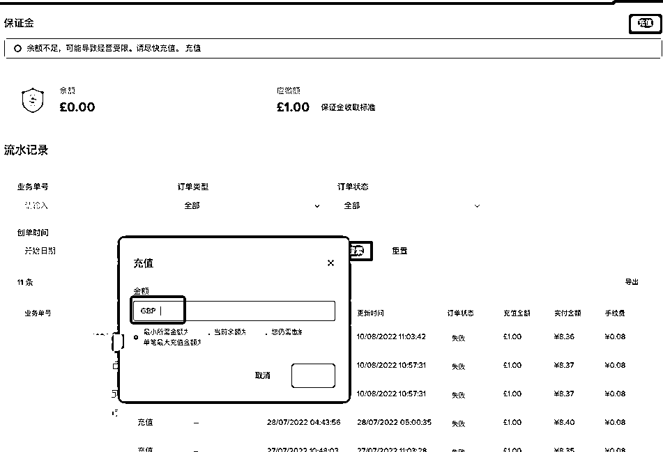

在收银台选择付款方式。国内跨境卖家可以直接用人民币支付，系统按实时汇率换算；具体可选渠道和公司所在地有关。

点击付款，跳转到对应支付方式页面，完成后提示充值成功。

几个关键点：
- 付款账户持有人必须与店铺主体（公司名或执照法人）一致。
- 执照是大陆的，但法人证件为护照或港澳居民身份证时，不要用个人网银，改用企业网银、个人支付宝或 Payoneer。
- 所有跨境卖家都要缴押金，缴完才能上架。
- 每个国家/市场都需单独缴一份；逾期不缴，可能被限制订单或移除商品。
- 东南亚市场目前为 90 美元/店。

### 3. 新订单提醒
右上角铃铛 → 自定义我的优先级 → 勾选“订单” → 确认，之后订单进来会及时提醒。

### 4. 客服消息自动翻译
进入对应国家的客服会话，点击对话框右上角“翻译设置”，选择“自动检测”即可。
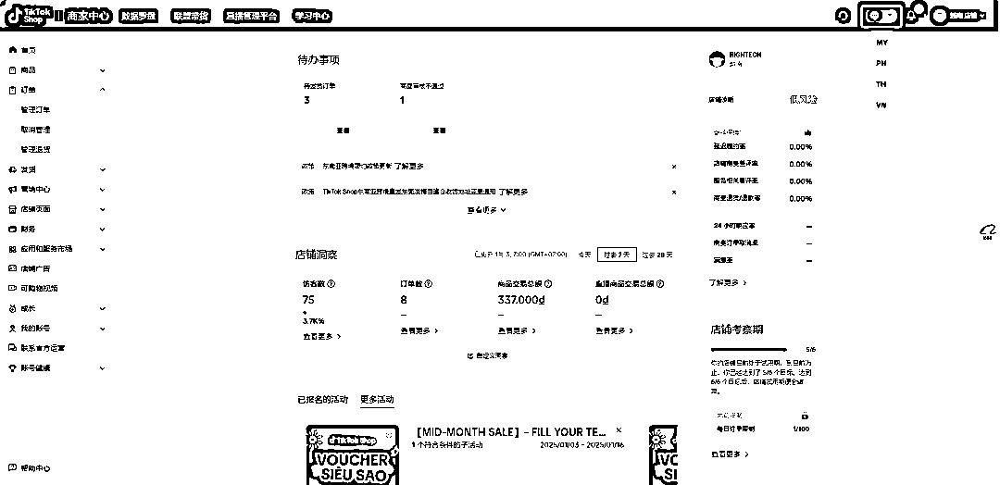
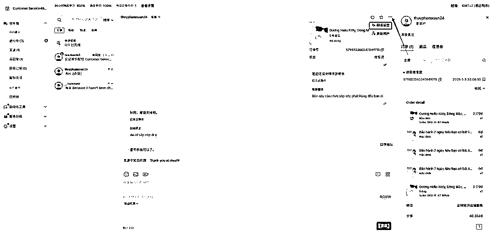

### 5. 聊天机器人
单量多或休息时，可以开启聊天机器人，减轻 24 小时回复率压力。先切换到对应地区，在左侧“自动化工具”里找到“聊天机器人”，按需选模式。

### 6. 提现帐号绑定
不绑提现帐号，钱取不出来。目前支持两类：
- 大陆对公银行卡，仅限马来西亚、泰国、越南、菲律宾四个市场；
- 第三方支付服务商，如 Payoneer、PingPong、连连支付、Airwallex、WorldFirst。

绑定路径：卖家后台 → 我的帐号 → 店铺资料 → 收款信息 → 绑定提现帐号。各家服务商的后台都有授权引导，跟着走即可。

### 7. 飞书团队绑定
绑定飞书，方便接收官方资讯和社群消息。路径：后台左侧“我的帐号”→“联系官方运营”→右侧“绑定飞书帐号”。输入手机号和验证码；没有飞书号会自动注册；没有团队可以先创建，之后再修改。
点击“完成创建，并绑定”后，可以申请加入官方对接群，或等官方拉群。

已经拥有飞书团队的，需要用团队超级管理员的手机号登录，再从列表里选择要绑定的团队。
注意事项：每个店铺只能绑定唯一飞书团队，但一个团队可以绑定多家店；只有超级管理员能操作；使用飞书时务必切到绑定的团队，否则看不到官方群。

### 8. 妙手授权绑定
妙手是常用的商品管理工具。路径：妙手 → 授权 → TikTok Shop → 添加授权店铺。
地区选 Asia seller 下的“中国大陆及香港特别行政区（跨境专用）”，勾选要授权的店铺，填邮箱，同意授权。

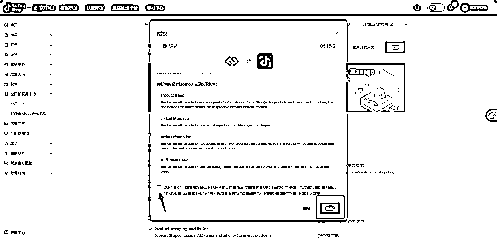

### 9. TikTok 帐号绑定
目前单个站点只能开一家店，每个店可绑 5 个本地 TikTok 帐号：1 个官方经营帐号 + 4 个渠道经营帐号。绑定后能增加商品曝光，还能减免 90 天手续费；后台也能查看和解绑。

官方帐号绑定路径：卖家后台 → 我的帐号 → 绑定 TikTok 帐号 → 绑定官方经营帐号；用 TikTok App 扫码，确认信息后授权。

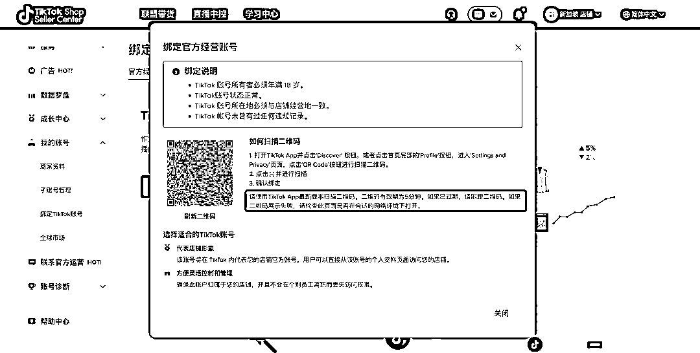

渠道帐号绑定：同样入口选“绑定渠道经营帐号”，先验证帐号，再接受邀请，即完成。
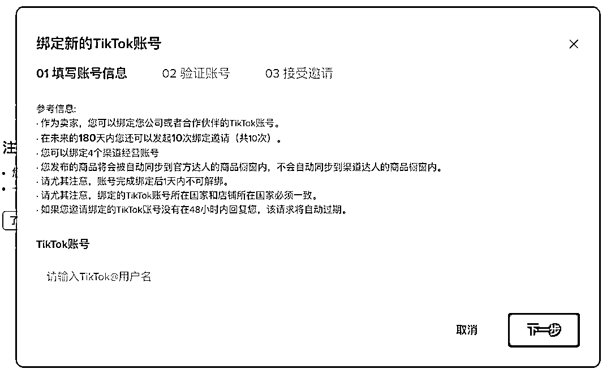

官方帐号规则：
- 商品以“店铺”形式展示，支持店铺装修；
- 最多绑 1 个；
- 用户名/昵称需和店铺名一致。

渠道帐号规则：
- 商品以“橱窗”形式展示，需手动加进橱窗；
- 最多绑 4 个；
- 命名不限制。

另外，单个创作者只能被一家商家绑定；绑定满 1 天后才能解绑。

## 三、调研与对标：先把认知补上

找对标时，把产品、模式、品牌这些维度中明显比我们有优势的对象都圈出来。优先级可以按“大类目 → 垂直品类 → 细分单品”来排。

操作上，先在小店榜单里锁定头部。
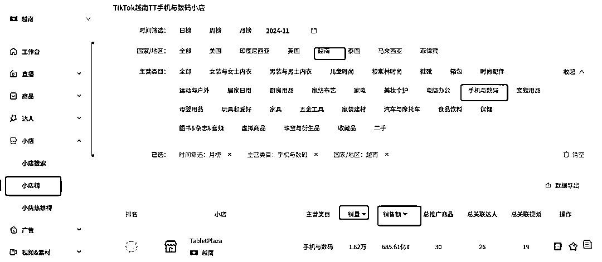

一个经验规律：GMV 高的品，往往客单高；销量高的品，往往客单低。
先看销售额 Top10：

再看销量 Top10：
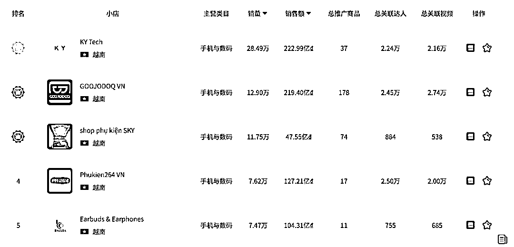
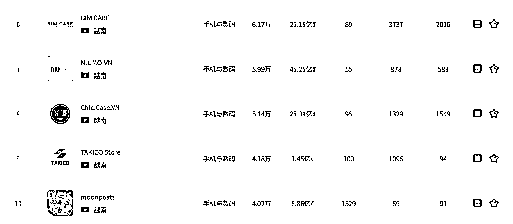

以小风扇为例，把销量和销售额两个维度的前十都拉出来。
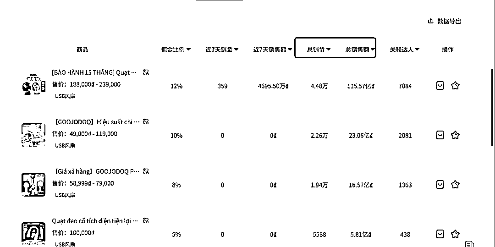

再按历史 GMV 降序排列，取前五作为核心竞品。筛选标准：近 7 天数据健康，历史 GMV 和销量占比都靠前。

### 对标店铺：GOOJODOQ VN
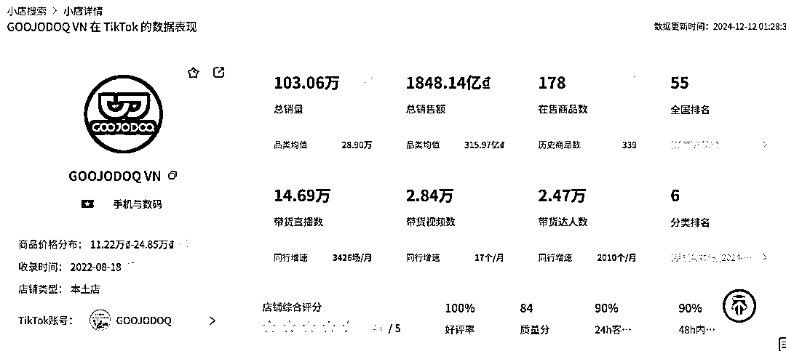

这是一家越南本土店。

#### 1）近 30 天销售表现
单店 30 天做了 185 亿越南盾，约合 550 万人民币，共 11.35 万单。

#### 2）品类平均成交价
按“GMV ÷ 总单量”计算，约为 48.45 元人民币，也就是 170 万越南盾。这个值用于估算利润空间和判断市场价位。

#### 3）Top5 热销品拆解
五款产品合计：33.86 + 17.88 + 8.89 + 8.72 + 8.19 = 77.54 亿越南盾，约 220 万人民币。
总销量：32699 件。
Top5 平均成交价：约 23.5 万越南盾/件，折合人民币约 67 元。
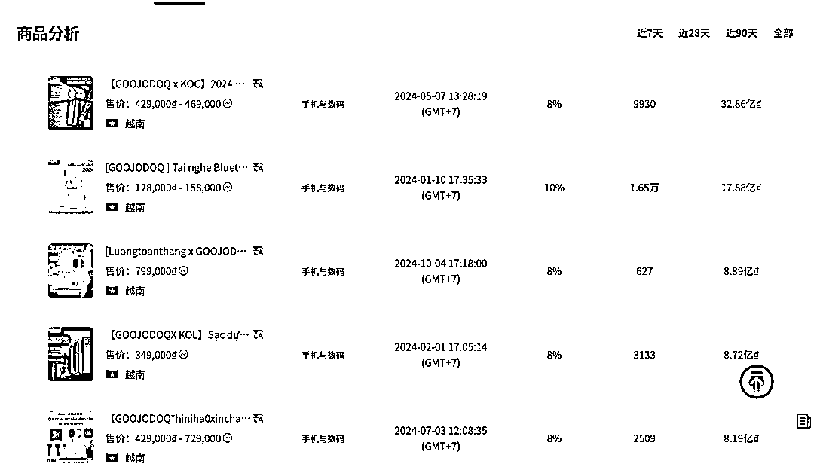

为什么重点拆 Top5？因为多数店铺真正赚钱的只有爆款，其他产品大多打平甚至亏损。通过 Top5 能看清选品思路，也能估算单品的利润贡献。这家店是品牌型店铺，数据维度比较全。

#### 4）在售商品数量
在售 178 款。

上新节奏上，女装需要高频上新，3C 类则更依赖竞价排名。

#### 5）成交结构

#### 6）创作者结构

#### 7）GOOJODOQ VN 的模式、打法和利润模型

模式：本土店 + 品牌路线。

打法：几乎不做付费投放，靠品牌带来的自然流量，约八成订单来自创作者分销。每个月新增合作创作者 2000+，也就是说团队里至少要有 5 到 10 个人专职维护创作者关系。

流量构成：
- 创作者：贡献 68% 销量、76% 销售额；
- 核心创作者：贡献 41% 销量，销售额约 240 万、占 43%；
- 商品卡片：贡献 20% 销量、10% 销售额；
- 自营帐号：贡献 12% 销量、13% 销售额；
- 付费投放：约 34%，其他渠道合计 66%。

加总后：投放 34% + 创作者 43% + 商品卡免费流量 10% + 自营号 13% ≈ 100%。

人力成本：按 15 人团队估算，包括 10 名创作者运营、1 名店铺日常负责人，以及打包/财务等岗位。创作者运营月薪约 6000，店铺日常负责人约 8000，其余按 2 万/月算，月人力成本约 10 万。整店月 GMV 550 万。

前五单品利润还原：
- 单品 1：风扇。售价 122–134 元，按 130 元计。30 天约 1 万单，GMV 约 130 万。单件成本约 50 元（含产品、包材、本土运费），利润约 80 万。
- 单品 2：耳机。售价 36–45 元，按 40 元计。月销 1.65 万单，GMV 约 66 万。单件综合成本约 30 元，利润约 16.5 万。
- 单品 3：耳机+音响+手表。创作者专属链接，成本波动大，暂不计算。
- 单品 4：充电宝。定价 99.9 元，月销 3300 单，GMV 33 万。单件综合成本约 50 元，利润 16.5 万。
- 单品 5：另一款风扇。售价 122–208 元，按 165 元计。2509 单，GMV 41.3 万。单件成本约 50 元，单件净赚约 115 元，总利润 28.8 万。

前五款 GMV 约 240 万，预估占全店六成左右。按 240 万计算，毛利约 100 万，毛利比例约 41.67%。套用到全店：550 万 × 41.67% ≈ 229 万。
接着扣掉 10% 创作者佣金、10 万人力和 181.5 万投放，只剩约 9 万利润。再算上房租水电和样品费，当月基本打平。

结论：这家店当月实际没有盈利，但在为明年 3 月做布局。现阶段的重点是种草和直播收割，目的是沉淀用户资产。团队优势很清晰：有品牌、有创作者团队、有投流团队；产品性价比高，店铺权重高，还积累了隐性的品牌用户资产。

对普通卖家来说，不必照搬品牌打法。做白牌单品更快，投入少、回款快，但生命周期一般只有 3 个月。

### 竞争策略：看清对手，再决定节奏

头部商家起步早、投入大，很难短期追平。对方已经在 2024 年做了大量布局，而我们的团队刚刚建立，所以要做好打长期仗的准备。

2024.12–2025.12 的三个阶段：
- 阶段一：对方强势进攻，我方侧重防御。以快速调动为主，以零散袭扰为辅。
- 阶段二：对方攻势趋缓，我方准备反攻。以零散袭扰为主，以快速调动为辅。
- 阶段三：我方全面反攻，对方收缩退却。以快速调动为主，阵地战和袭扰战为辅。

### 第二个对标案例

再看另一家越南本土店：
- 30 天销售 7.6 亿越南盾，约合 21.7 万人民币，出单 4938 笔。
- 品类平均成交价 = GMV ÷ 总单量，后续可用相同公式继续拆解。

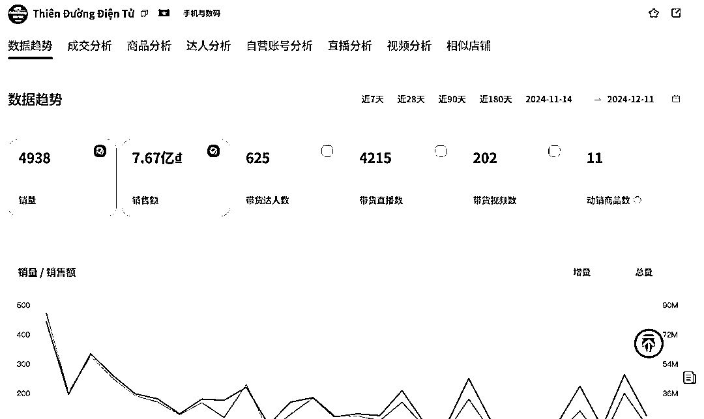

做跨境选品，不能只看表面热闹。拿到一个类目，先算清楚买家平均花多少钱，才能真正看懂利润模型，也才能判断这个市场还有没有空间。

最近在拆一个越南电扇赛道的案例，里面有个当地店铺的样本就很典型。

先说基础数据：这家店每单平均成交额约14万VND，折合人民币40.5元。把卖得最好的五个链接拉出来，用总成交额除以总售出件数，就能得到实际成交价。

- 五款合计成交额：4.32亿+1.51亿+4729万+1756.6万+507.5万=6.52亿VND，折合人民币约18.5万元
- 五款合计卖出4095件
- 五款平均每件15.8万VND，约45元

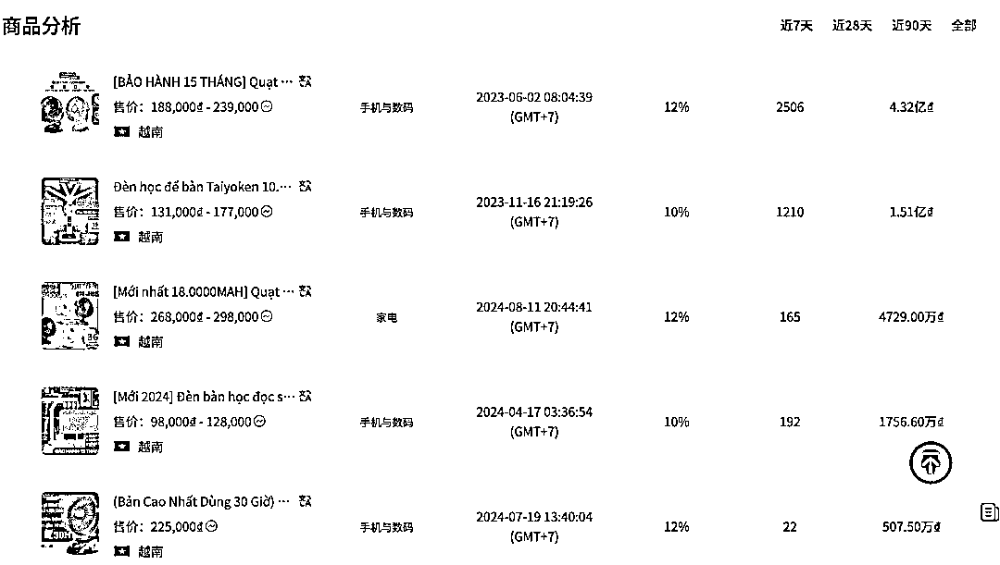

再看利润试算。

第一款，售价53-68元，按60元中值估算，卖出2506件，成交额约15万元；进货成本20元、本地配送5元，单件净赚35元，累计毛赚约8.77万元。

第二款，售价37-50元，按42元中值估算，卖出1210件，成交额约5.08万元；进货成本20元、本地配送7元，单件净赚15元，累计毛赚约1.82万元。

第三款，售价76-85元，按80元中值估算，卖出165件，成交额1.32万元；进货成本30元、本地配送5元，单件净赚40元，累计毛赚6600元。

第四款，定价28.07-36元，按32元中值估算，卖出192件，成交额6144元；进货成本20元、本地配送5元，单件净赚7元，累计毛赚1344元。

第五款，定价65元，卖出22件，成交额1430元；进货成本28元、本地配送5元，单件净赚32元，累计毛赚704元。

另外，当前货架上共陈列13个SKU。

再看成交和流量来源。

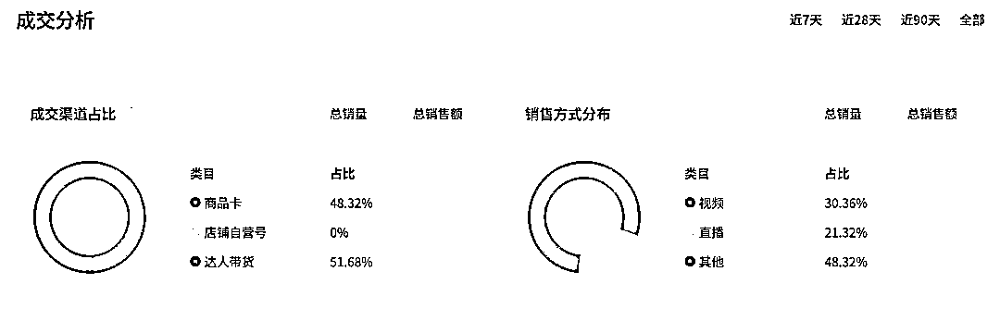

从后台数据看，这个店几乎不买流量。大约51.68%的订单来自外部内容创作者，每个月新增的合作红人超过600位。这意味着至少需要两三个人专门维护这些关系。

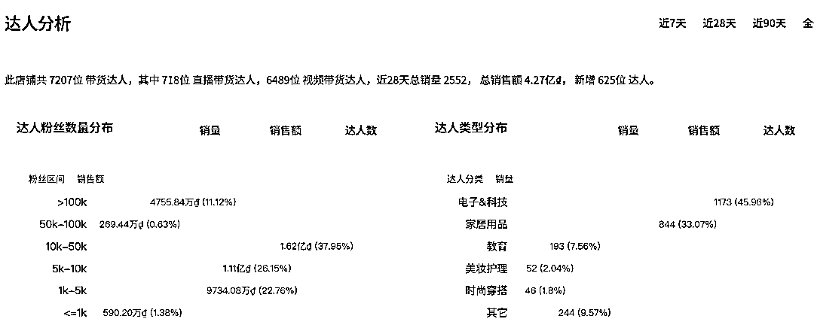

把流量结构重新摆一下：内容创作者带来的订单占51%，对应成交额21.9万元，约占总成交额55%；商品陈列位带来的订单占48%，成交额占比44%；官方账号没有出单，占0%；付费流量只占1%。

这家店的模式可以归纳为：前期用免费流量把店铺跑通，随后转成当地店铺，再靠大批红人分销把规模做大。两三个人做运营，成本不高，利润却不错。

前五个链接的成交额合计约22.2万元，毛赚约11.45万元；按2-3个红人运营加1个店铺运营、月薪6000元算，人力开支约2.4万元；扣除之后，净赚约9.05万元，净利率约40%。

这套打法能跑起来的关键，是先把品牌标识和基础视觉做扎实，然后拼命建联，免费流量和红人分销的雪球就会越滚越大。

再看整个越南电扇赛道的竞争格局。

标杆A是类目第一GOOJODOQ。目前账面不盈利，但棋局在明年3月。现阶段疯狂做内容种草，用广告和直播抢用户心智，等到旺季直接收割。他们的底牌是品牌沉淀、红人队伍、投放队伍、性价比货品、店铺权重，还有隐性品牌资产；唯一不确定的是A5人群蓄水多少。

打法为：当地备货+红人分销+红人内容投放。从2022年8月做到现在，两年在单一市场做到5200万元成交额，月均500万元，高客单位置无人能撼动，和第二名是断层差距。

标杆B是当地店铺TDDT，2023年6月入场，累计550万元成交额，月均21万元。不过它和第一名差了23倍。

我们自己的电扇队伍目前在第三层次，月成交不到10万元，之前被体验分拖累，和第二层次差3倍左右。上次我们采取错位竞争，把同行爆款价格压到最低，切走一批价格敏感用户，代价是利润变薄。下一步的目标就是冲进前三。

再从四个维度看竞争差距。

先看定价：GOOJODOQ全店平均每单23.5万VND，约67元。爆款1是两个SKU，一支装不带壳429000VND，一支装带防摔壳469000VND。

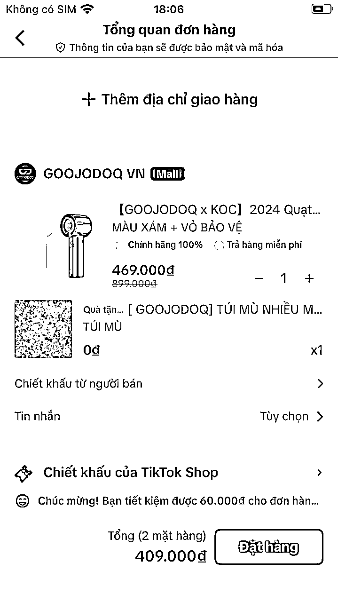

爆款2是一支价格带129000-469000VND的双支装商品。

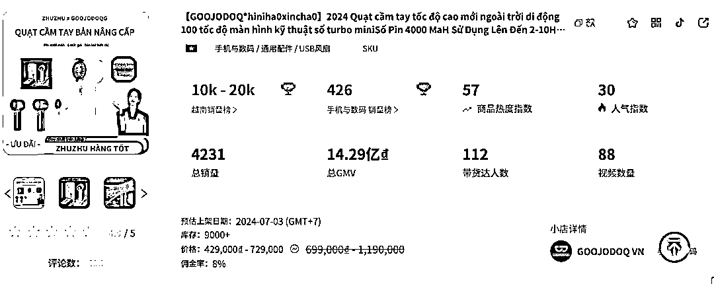

TDDT平均单笔成交额就是前面说的14万VND，约40.5元。

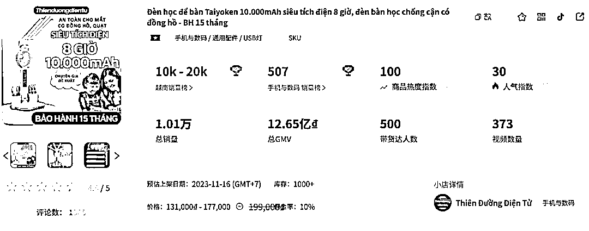

货品实力上，第二名并不占优，想翻身必须向第一名看齐。

包材要统一设计和Logo，配件如挂绳可以做防摔升级，核心是根据用户反馈，集中力量解决最痛的痛点。外观和商标也要提前布局，防止被抄。

价格力上，第一名的SKU分层很清楚：一支装不带壳429000，带壳469000；双支装则用129000-469000覆盖不同预算。

内容种草层面，同样价格下，谁的内容更能打动人谁就赢，红人队伍必须被放在最高优先级。

投放能力层面，双11到双12期间最大的问题就是费比太高，估计是直接在红人账号投流，或直接投红人素材，跟官方直播完全割裂。真正没想明白的是竞价在整盘棋里的作用——竞价是为了收割红人积累的A1到A3人群。从利润表现看，前十名ROAS应该很一般。

需要调整三件事：一，把原创素材、红人素材、买量素材的功能分清楚；二，红人素材的ROAS要精细控制，不要大面积投放，100块预算里50块测试、50块放大；三，短视频直投和引流直播是两回事，先调研再动手。这三个坑不要再踩。

再往内看，队伍过去两个月没打出大结果，主要被三个矛盾卡住。

第一，看不清对手也看不清自己。做竞品分析常常一头雾水，不知道自己位置，也不知道对方在做什么，更不知道赢的方法。犯错不要紧，怕的是找不到病根。

第二，缺少“有解思维”。队伍成立不到两个月，很多人怕错、怕花钱、怕担责，干脆躺平。正确的做法是目标导向，主动找方案。

第三，效率和方法不够。大家没意识到人群总量有限，也没意识到应季品的窗口有多短。因为没赢过，所以对节奏无感。解决办法是老老实实做调研、定计划，而不是因为公司账上有钱就随便烧。历史上以少胜多的仗很多，越是粮草充足越要谨慎。胜机不在自己，在于对手的破绽。

友与敌：如果一切顺利，明年6月我们有机会做到第一。真正要打败的只有GOOJODOQ。它前期投入大，我们没打赢也要调整自己。突破口放在货品和价格上。目前电扇单店每月能出1-2万单，年前完成品牌标识申请和价格重构，之后完成付费投放从0到1，3-4月全力建红人队伍。

我们手里有三张牌：队伍、现金、根据地。队伍还在20名以后，但从0到1已经跑通，成长快；现金足够打到第一，其他板块本地化已经落地；根据地是熟悉当地规则和流程，上个月已经全面进入当地市场，月售过万件打好了底子。

长期方针：还是打持久战。

第一阶段，敌攻我守，以机动作战为主、袭扰为辅；第二阶段，敌守我备，以袭扰为主、机动作战为辅；第三阶段，我攻敌退，以机动作战为主、阵地袭扰为辅。

具体战术：敌进我退，敌驻我扰，敌疲我打，敌退我追；机动作战要快速进退、抓大放小、集中兵力。

六个月战略安排：

12月15日到3月1日，完成底层的搭建：统一思想，完成品牌标识申请，打磨货品，突破定价、货品、投放三个能力，储备境外仓、货源工厂、快递合作方，做好分层和分流。

3月1日到6月1日，杀进前三：测款、广告、当地队伍用机动作战，红人队伍用袭扰战术，完成三类素材合并；保证四个维度都处在头部；落地直播和红人专项合作；把模式复制到泰国、越南、马来、菲律宾、印尼。

6月1日到9月1日，发起反攻：在四个维度上拉开与第二名的距离，依托根据地开辟第二曲线，布局3C配件等新品类，做品牌化部署；调整组织模型；完成东盟队伍的大规模0-1。

第一阶段执行细节：5个人做300万元成交额，单月突破100万元。跨境队伍背30万元，当地队伍加付费背70万元。同时推进品牌标识申请；价格上按包材成本做第一轮错位定价；货品上对卖得最好的五个款做review调研，提炼一个卖点打穿；素材上把原创、红人、买量三类分开测试，完成GMV Max广告投放，配合一货多仓的短视频，把预设的ROAS指标做到位；供应链上储备3座仓库和快递合作方，筛选月产能突破5万单的工厂3-5家，严抓质检和开品。

最后补充一点方法论。TikTok在东盟的跨境生意，现在仍是窗口期，也是门槛最低、政策稳定、最适合中国卖家上手的地方。无论是新手、跨境卖家、品牌操盘手，还是在当地经商多年的华人，都能找到自己的切入姿势。

但不同身份的玩法完全不同：有当地电商根基的老板，可以从当地店铺切入，用低价+补单起步，再补运营队伍；在当地经商多年的华人，要先盘点自己的独特资源，比如人脉或内容能力，再决定做直播还是做店铺；有资本的人不要随便投0-1队伍。

选品是所有动作的地基，赛道选错，后面全错。这份拆解希望帮大家少走弯路，从看懂数据开始，把策略落到实地。

做东南亚生意久了，会发现第一步永远是先盘清楚自己手里有什么。优势在哪、团队擅长什么、要做什么品类、用什么运营打法，这四件事理顺了，后面才好走。不同背景的人进场姿势完全不一样，下面是我根据实战归纳的几种典型画像和切入方法。

4. 有国内电商经验，第一次去东南亚操盘的人

这个群体我最有体会，因为我自己就是。

一年里三趟东南亚才勉强跑通，后来因为当地资源和人才跟不上，又撤回国内做资源整合。24年下半年会再去跟海外仓合作，今年要把东南亚的广告投放和直播团队落地，这算是第四次去。

第一次去最大的痛点是预期错位。

本地团队会告诉你那里啥都乱，但是前期的很多事你根本解决不了，比如小语种沟通、招人、本地资源搭建，这些都不在你的舒适区。你能做的无非就是把国内的打法搬过去，剩下的要么硬扛，要么就一直待在那边。

模式能否复制，很大程度上取决于你在国内打过什么盘子。广告盘、自然流盘、达人盘、店铺盘，玩法天差地别，尤其自然流。

我在菲律宾试着培养自然流主播，语言不通，只能照着模板走。复盘时反复强调，别把时间浪费在话术细节上。对操盘手而言，渠道靠谱比什么都重要。当时等一个月才招到一个主播，心态直接炸了。跨国办事动一次就要好几个月，没十足把握别轻举妄动。

第二点，心态别被短期波动带跑。

项目从0到1跑不起来太正常了，变量太多，只有不断试错踩坑才能成。第三点，跟本地团队怎么分钱。

人是否靠谱是核心，和国籍没关系。上限高的合伙人、老板、团队不会被当下束缚。团队的背景和成长潜力，直接决定你是否值得押注，只有天花板够高，你才能赚到对应的钱。

别觉得东南亚没高手，其实各区域都有，能让你发挥价值的团队也很多，找到合适的就行。

5. 在东南亚长期生活做电商或零售的本地操盘手

本地人的最大优势是不着急。你不会离开这个国家，这件事只是你未来事业的一部分。

TikTok在本地绝不只有电商，电商还能再卷2到4年就差不多饱和了。但TikTok+其他赛道，比如同城、商业IP、知识付费等，红利还在，而且东南亚这块还没放开。

这条线值得做5到10年，把经验沉淀下来，多去中国找渠道学模式。很简单，装个抖音，把你想学的版块看看就够了，抖音成熟度很高。

6. 零跨境经验，第一次尝试东南亚发货的小白

小白基本都在国内做，那还有机会吗？有。

先从无货源矩阵短视频带货起步，一边卖别人的货，一边练内容能力。第二阶段再做本土备货，真正变成东南亚卖家。

我经历过平台一轮轮周期，东南亚无货源最多活一年，不转型就得去看中东、日韩、欧洲。不过除了中东，其他市场对供应链要求更高，东南亚相对友好。

7. 有集团背景能调动战略资源的高管或CEO

这种人现在就能进场。第一批机构从亏钱到倒闭，第二批开始盈利并做全域扩张。东南亚头部机构和卖家现在基本都在赚钱，吃的就是传统资源红利抢市场。

以上就是不同角色怎么切入的总结，也是第一章的内容，后面还有16章。如果想少亏钱多赚钱，想搞懂TikTok底层赚钱逻辑，就耐心看下去，因为后面会讲到TikTok电商从0到1的实操打法。我应该是第一个把这个领域拆到这种颗粒度的人，希望能帮大家少走弯路。

## 二、赛道篇

### 1.你的TikTok选择的品类赛道是什么

品类决定了你需要什么样的TikTok团队。你的人有没有这个基因？你的供应链在当地有没有竞争力？

就这一个问题能问倒60%想做TikTok电商的人，哪怕是头部机构。假如你选服装大类，等于要和每天多如牛毛的S级带货主播抢流量。

选日百家居，要和无数代二代服务商的投手抢量。选美妆个护，要和有本地声量的品牌抢心智。你有把握吗？

很多团队中途暴毙，就是为了进场而进场，没做全盘市场分析，也没评估自身供应链和团队能力。

和抖音相比，TikTok东南亚还没那么卷。怎么判断赛道能不能做？看头部垂类号和品牌自播账号的日成交额。

这里有个坑。我当初想跟头部直播间和品类，没竞争优势直接被卷死。对手本土团队+本地直播+广告+达人，已经非常成熟。

别只看销量最大的，如果一个品类已经有稳定日GMV几百万的直播间，而且很多，那就是红海了。

反过来，如果头部直播间日GMV只有几万，那就是蓝海。先审视自己的团队和供应链要素，有没有信心再说。

2.印尼头部美妆个护品牌 Skintiffcid

赛道没想清楚，方法论学了也白学，等研究明白的时候赛道已经没了...

## 三、算法篇-短视频、直播、店铺底层算法逻辑

公域平台的本质就是把数据摊开让大家卷。TikTok是产品，背后是算法，想做好TikTok电商，必须吃透不同板块的推流逻辑。

1.TikTok短视频

TikTok和抖音的核心区别是流量有国家层级。

字节的抖音只有中国版，TikTok是全球版，不是每个国家一个版本。但每个地区用户只能看到本地小黄车。

所以流量冲到国家层级，对电商变现意义不大，尤其是后端一堆事。所以M级流量已经算很高了。

泰越马菲一个国家人口也就3000万到1亿，折半算，一条视频几个M已经很不错了。别盲目追曝光，交易指标才是核心。

做短视频要先问清楚目的：是承接代运营做品宣，还是跑二类电商做混剪广告，还是涨粉还是做人设。

2.TikTok 直播推流逻辑

流量、算法、指标、标签、权重，构成了直播间的底层。这一套框架是我还在做抖音小二时，听一位做白牌直播打单的专家讲的，尹晨老师。23年我带去东南亚实操一年，效果还不错，结合当地特点做了优化。

（一）流量
开播时平台会给短暂的极速流量，这是第一道考核。从供给端看，每天几十万人在播。

（二）算法
算法靠一套指标体系衡量每个直播间的数据表现，按优劣排序，给不同流量层级，分配不同量的流量。

（三）指标
很多人只看停留、点击、UV，却忽略了平台对直播内容的多维要求。指标不是线性排序，而是交叉排序。可以分三类：

互动指标：用户在直播间的所有互动行为，评论、点赞、关注、粉丝团等，反映人气。最核心是停留，停留带动其他行为。

交易指标：反映直播间价值和流量精准度。UV是单个人的商业属性，GMV是整体，人均GMV决定用户消费水平。

流量指标：有好互动和交易指标的直播间，算法会用流量体现出来，比如场观、峰值。流量指标是前两者的风向标。

标签是什么？权重又是什么？

（四）标签
直播标签相当于直播间的身份，身份越清晰，算法就越知道要推什么样的人进来。标签分三层：

基础标签：性别、年龄、地域等。开播一周后算法基本能摸清。

偏好标签：用户喜欢怎么互动。标签对了，用户会停留、点赞。

交易标签：买什么、买几次、每次花多少。交易标签准的直播间，转化率会明显高于行业平均。

（五）权重
数据指标越优化，标签越精准，综合起来就是权重。权重高的直播间，转化和流量推送都有优势。

新直播间没流量，是因为没权重；没权重是因为数据差。标签不准，是交易指标不行；高客单卖不动，是人均GMV没拉起来。几乎所有直播问题都能追溯到算法底层。

搞懂这层关系，再做直播思路会清晰很多。

3.店铺推流逻辑

店铺是我们班子最擅长的板块，单天破万单是常态，平均2000单左右。

店铺分本土和跨境，平台已经帮你分好。本土做本土，跨境做跨境。模式差异很大，运营时再细讲。

什么时候做跨境、什么时候做本土、店铺毛利多少，我还是有点发言权。在深圳做跨境店每天2000单，小爆发能过万，现在前端流量问题基本解决，后续还会去东南亚。

先说毛利，现在店铺平均毛利20%左右，看品类。没经验、没启动资金的小白，做跨境店一件代发是最友好的，能极大降低压力。

小白做到什么程度再转本土备货？不去本土，挣一年两年可以，时间长了必被淘汰。

最终还是要在东南亚落地团队。无货源只是浅层打法，没核心竞争力，最后必须转垂类卖家，深耕东南亚供应链，这才是跨境转本土的核心，不是运营技巧。

说回本土店，目前有两种打法：本地产本地销，和国内产本地销。

适合本地产本地销的是高频复购快消，比如纸巾、洗衣液、内裤、毛巾等，按斤卖的品基本不适合从国内进口，除非尾货。

国内产本地销适合高货值、多SKU、非标品，利润不错。前者吃量，后者吃快，因为这类货容易积压，所以很多从国内备货。

我们有一套出货毛利配比逻辑，一个货柜5000单，前2000单赚20%，后2000单赚10%，最后1000单赚5%，大概就是这样。

## 四、商家侧如何切入

TikTok短视频想起量，参考推流逻辑，大家都懂。难的是电商内容目的。

视频带货、账号涨粉、直播引流、广告投流，这四点就能衍生出四种团队模型和盈利模式。决定策略的还是品类和团队属地。

团队属地概念：到底国内做还是国外做，哪个团队效率高利润最大化。国内和本土团队怎么配合内容，拍、剪谁来做。很多白牌找本地机构跑，素材没量，核心问题就是没理顺。

拍视频不难，难的是规模化、SOP化，需要投入。不同团队怎么分工，关键要自负盈亏。

别走进误区，我今天做的事情能靠本土赚，或者让本土帮我在中国赚钱，都是扯淡。部门不是在赚钱就是在去赚钱的路上，别指望别人买单，1+1<2。

我踩过的坑很多，团队属地没理清就是一个。比如在本地做直播话术精细化运营，在本地培训本地人，用国内短视频账号带本地直播，无一例外都挂了。

国内短视频团队和本土短视频团队，我都经历过。团队属地怎么划分，看下面👇
如果正在纠结短视频团队怎么搭建，或者你是小白想了解短视频带货，一定要看完。

1.东南亚矩阵短视频带货团队

国内做短视频矩阵团队是可行的，但必须叠加培训才能盈利。培训毛利高，而且带更多学员利润更好。

做TikTok短视频带货团队有没有长期价值？我觉得有。

有人问，二创搬运有没有机会，会不会被风控？会，也不会。

大部分搬运是国外A号搬到国外B号，基本直接被扫。货不对版的量大也会被扫。相对稳定的是国内到国外搬运+抽帧模式，但为什么要加培训？任何团队都要自负盈亏。

如果你是个体或1-3人团队，每人操10-20个号，一个月赚5000到20000块，是有可能的。但公司化运转涉及考核、绩效、提成，完全不一样，所以必须靠培训回血。

长期价值呢？我和很多MCN聊过，平台对MCN做矩阵的风控很强，只是量小没人管。

长远模式是：矩阵账号+培训+团长+无货源卖家+自营卖家+本地备货+广告投放。最后可以交叉发展。现在广告投放和短视频带货混剪逻辑区别不大，要么就是达人。

能走到广告，就具备多曲线能力了。别看不起这个赛道，起步都不简单。

2.IP涨粉

IP变现无非站内和站外。

站内：电商达人、同城达人、星图达人。TT上星图还没完全开放，和国内有本质区别，目前还在delay。靠平台流量在平台内变现。

站外：靠流量+项目变现。这条路海外基本没人做，有基因的人太少，业务模型也不匹配。不同国家人群诉求不一样，我主要讲电商，我很多朋友在本地TikTok MCN。

把这块做盈利的核心是什么？溢出。

电商达人收益就三点：电商带货佣金、品牌接广告、工厂自营达人。最后一个是自有工厂人设卖货，能吃到后端工厂利润。

溢出是什么意思？头部达人对MCN基本不赚钱，因为品牌不会无限破价。超头达人是用来帮品牌破价的工具。破价后达人靠流量拿GMV打板，达人赚钱，品牌和机构微利甚至亏损。

拿到这个数据，再去开发达人、品牌、白牌卖家，后续的达人就吃不到那么多利润。这就是MCN的打法。需要三个能力：签约能力、直播能力、货品能力。

海外同时具备这三项的几乎没有，大部分卡在签约。让老外天天播，尤其美国，难度极高。也是美国MCN很少盈利的原因，动员成本高，政策也麻烦。相比之下东南亚好很多，民族身份有优势，平台也稳定。

3.直播引流

东南亚直播很稳定，品牌货品OK，开播基本就挣钱，没那么复杂。

但白牌不一样，尤其是水杯、莫桑钻、3C配件这些标品，必须靠大量内容导流到直播间，配合广告做冷启动。所以付费直播短期国内外都还行，长期一定是国内，毕竟让东南亚人长脑子比登天还难。

能把直播搞懂，基本就稳了。本地白牌高客单刚需标品，内容和产品才是变现抓手。

4.付费投流

23年、24年我都投过一段时间。东南亚广告目前实测可以，但没持续投，因为跑品团队是另一套思路。

东南亚现在有两个特点：流量便宜，人力便宜。找三个本地人一天轮班才多少钱，诱惑不大。

另外，高客单高毛利适合跑广告的品类样品还少，这块基本要跟着TT直客政策走。

所以除了品牌和纯引流卖家，纯去东南亚跑品的不多。不同地区跑品基建和需求差异大。

TT美国跑得快，原因三个：中国人做自然流不适合；美国人力试错成本高；市场高客单高毛利。

## 五、团队篇-从零到一组建直播间团队

组建团队第一步先理清团队结构，不同模式结构不一样。

1、直播的团队架构（本土）

关于直播初创的一些问题

聊到主播招募，很多人纠结过一个问题：是直接挖有经验的老手，还是从零培养新人？我的答案很简单——当你公司还一无所有的时候，就别挑三拣四了，有人肯来就先收着，把队伍撑起来再说别的。

东南亚这地方，专业主播本来就稀缺。直播在这边还算个新行当，从业者大多干不了多久就换东家，能沉淀下来的少之又少。更要命的是，东南亚员工的离职往往凭心情。我自己脾气也不算好，有时候连中国员工都忍不住要批评，但你要是去带东南亚团队，人家的文化习惯你必须尊重，硬来是行不通的。

说个真事。在菲律宾时，有个主播我前前后后带了五次，我讲一句他学一句，可五次下来还是那副心不在焉的样子。某天我在团队面前没压住火，具体说了啥记不清了，总之带了不少脏字。结果这主播直接甩脸走人，死活要辞职。

在菲律宾、泰国、马来，我遇到的情况几乎一个样：东南亚的主播，别指望招来就能用，耐心培养才是正道。这就要求团队的一把手自己得有真本事——你不持续学习、不吸收新东西，就永远没法向下输出，也带不出像样的团队。

一、主播面试怎么面？

有经验的主播，重点看三样：历史账号做得怎么样、过往数据表现如何、为什么离开上一家，以及他对产品熟不熟。新人主播则要聊求职动机、对直播这事儿怎么看，以及有没有当主播的潜质。但不管新老手，面试时一定要安排一个“实战环节”——1到3分钟的试镜。

具体做法：把人带进直播间，扔给他一个产品，给他一分钟熟悉，再给几句简单提示，然后直接开演。那一刻，他行不行，你心里基本就有数了。

二、运营面试怎么面？

运营的面试门槛其实更低。有直播经验最好，没有也没关系，只要公司有人带，三五天就能摸到门道。所以招运营，核心考察的是工作态度、勤快程度和做事细不细。运营是可以从零教出来的，主播不行。

助播这块，我们按团队模型来定方向，要么往运营培养，要么往主播培养。新人助播进来后，先不急着上播，安排在场控岗跟老主播搭两周。这两周里，新人能熟悉品类细节、摸清团队协作、融进直播间氛围，等到真正坐在主播位上，试错成本就小多了。

再说考核和激励，每个岗位背的指标不同，考核方式自然不一样，甚至有些活儿根本没法用数字衡量。

三、主播怎么考核？

第一层看基础态度：是否按时开播、开播状态如何、学习速度快不快。第二层看数据：互动数据、成交数据、流量数据，每场播完做复盘，再给下一场定目标。

数据好，激励自然跟上。但新主播前期很难产出成交数据，所以一边要适当施压，一边对非数据类指标的完成度要给点奖励。尤其在东南亚，招个主播本来就费劲。提成方面，走销售额提成就行，卖多少，乘个固定比例。

四、运营怎么考核？

运营不走提成，考核的是工作量有没有完成、有没有出现失误，干得好就给奖励。奖励机制和提成是两码事，它没有固定点位，更偏向公司对员工能力的认可。

每个岗位都有它的特殊之处。主播不能不懂底层算法，不然话术用不到位、节奏也控不住。还要让主播参与选品——他是离用户最近的人，直播间里用户要什么，他最清楚，这对选品帮助极大。

运营呢，找个有基础能力的不难，难的是大运营——那种懂TikTok底层逻辑、懂玩法、会投流、还会选品的全能操盘手。放在东南亚，这种人堪称“一比一”的稀缺资源。别看有些人背景光鲜，真正能踏实留下来的其实没几个。

一个刚起步的直播间，三个人就够了。但如果遇到以下情况，就得加人：一是订单突然爆了，加个专职客服，把运营那边的客服和发货压力分走；二是直播时长拉长，那各岗位都要补充人手。

说到底，一个健康的直播间，运营是大脑，主播是双腿。脑子再聪明，一步迈不出去也拿不到结果；腿脚再快，没脑子指挥也是瞎跑。班子这件事，真的要反复强调——很多初次创业的人，永远意识不到搭班子有多重要。

短视频带货和店铺这边就不展开了，个人单干也能玩。TikTok的核心盘子还是直播，主盘才决定了你的收割能力。

六、货品篇：用数据找爆款

TikTok电商说到底还是电商，电商的命脉是供应链。为什么99%的直播带货死在供应链上？核心就是没把供应链当回事，总想靠奇技淫巧掩盖选品能力的短板。而在这99%里，又有超过一半栽在盲目自信上——不少线下厂商转行直播，总觉得自己的产品天下第一，不尊重数据调研，结果发现自以为碾压级的爆款，连虾皮同款都打不过。

所以我的逻辑很简单：不瞎选品，要么测，要么抄，先把品类做到前三。等你对品类理解够深了，人群需求自然就浮出水面。

再说排品。引流款、福利款、爆款、利润款、旗舰款，这是一个科学选品结构的地基。在直播里赚过钱的人基本都有个共识：一款单品往往能扛起70%到90%的销售额，这就是爆款。

引流款，起号阶段用来拉互动指标，目的是撕开直播推荐的口子，把推荐流量拽进来。大多数时候引流款是亏钱的。挑引流款看三个特征：一是普适性，大多数人看了都喜欢；二是价格低敏度，就是东西在大家眼里值这个价，方便主播在直播间拔高它的价值感；三是采购成本低，很多货看着金贵，但利用信息差或供应链优势能压到很低的进货价。

福利款，用来拉互动和交易指标，和引流款一样带活动属性，但区别在于：第一，福利款通常是同行验证过的爆款，或者自己家性价比极高的商品；第二，它的价格本身不低，只是把利润全部让掉，不赚钱。

爆款，功能上跟福利款接近，一个管拉新、一个管成交，但爆款拉的是相对垂直的流量，利润上也比福利款更好看。爆款牛就牛在——你一拿出来，精准的垂直流量自己就来了。比如你主打22到28岁女性人群，标签打对了，款式一亮相，目标用户直接停下来看。

利润款，正价商品，用来拉交易指标。一般成本价基础上上浮10%以上去定价。利润款往往是从潜力爆款里选出来的，目的是抬高GMV和UV，同时带动爆品完成直播间的上升。

旗舰款，单价高、利润也高。这类款在整个排品里占比很小，但意义重大。主播不会花太多口舌介绍它，可一旦有人下单，一件旗舰款的收益抵得上四五件利润款，也是拉GPM的一把好手。

排品其实跟打游戏一样，你得清楚自己现在在哪一关、该干什么、怎么通关。常规品类的循环是什么？流量下滑时上什么品？品与品之间用什么来转场过渡？

选品的数据分析，不是机械操作，它需要严谨考证和层层筛选，才能找出真正有潜力的爆品。利用数据化选品，就是通过科学方式，在众多商品里挑出那些有爆发力的种子选手。按排品类别去选品、给每类配好数量、遵循科学的淘品原则，才能形成一套选品的活水机制。

线下选品最大的坑，就是“我觉得好”的自我感动。正确做法是向商家要一份详细的样品表格，先看信息拿样品详情，再跟TikTok、抖音上的同款做对比；第一轮筛完，把入选的样品表发回给商家寄样，收到样品、确认质量没问题再安排上架。

线下选品还有几个特殊情况要当心：一是部分厂家的货，因为包装或资质问题根本没法在小店上架，这个必须在寄样前就确认清楚，不然样品到了才发现白忙一场；二是偶尔会出现厂家的成本价，比精选联盟的销售价还贵，而且人家销售价还给提成。这说明什么？如果你自己的供应链不够强，线下未必比线上有优势。

总结一句话：货品的优势直接决定直播间的生死，每一个优质直播间的背后，都有一个把供应链拿捏得死死的团队。

七、场景篇：直播间怎么搭才靠谱？

很多企业转直播带货的通病，是满脑子罗永浩式思维——追求场地豪华、设备顶配，仿佛直播间够气派，直播就顺了。但实际上呢，不少直播间就一个货架、几张卖点贴纸，照样月销百万。我还发现一个规律：越是好公司出来的人，越迷信设备论。我自己刚创业时搭直播间，全是办公室有啥拼啥，反而就这么跑起来了。

直播间的优化是一次次小修小补，不是一上来就砸高逼格。当然，做品牌TSP确实得有派头，品牌就吃这套。只要场景逻辑合理，0到1阶段尽量化繁为简，跑通了再升级硬件也不迟。

场地方面，三个要素要考虑。面积：不同品类要求不一样，服装需要大空间，除了出镜还要摆货、试衣间、拍摄区；而3C这类坐播品类，办公室划一块出来就能用，能放下货架即可。墙高：越高空气越流通，主播不憋闷，灯光效果也更好；太矮的话，上部光源会过度集中在人身上。隔音：这是血泪教训——早年租办公室贪低楼层，结果开业不到半个月楼下马路翻修，怎么隔音都挡不住噪音，最后只能停播搬家。

手机硬件方面，基本iPhone 11以上就能满足90%以上的主播需求。绿幕直播、摄像头直播、单反直播看品类选：品牌直播间可以用单反提升质感；而手机+绿幕的组合我一直不推荐，效果远不如实景，除非空间实在紧张。

场景布置的雷区，是大多数直播间千篇一律——根本没结合人设去布局。想高效转化，首先要搞清楚几个问题。我在东南亚做服装时，特意给主播配了衣服，结果那些主播一上播，看着像“要饭的”——尤其你卖的还是高端女装，感觉完全不对。

八、店铺篇：店铺运营怎么做？

我们店铺团队跑过无货源模式，数据虽不算高，但对国内玩家来说，是个非常友好的切入点。

很多人说东南亚利润薄——“东南亚卖200万挣100万，抖音卖1000万搞不好还亏30万！”这话听起来有道理，但它只看到了头部大标品，就贸然给东南亚的利润水平下了定义。说这种话的，基本都是没在本地操盘过的人。

事实是，东南亚很多款式的毛利相当高，尤其印尼。两个原因：一是市场盘子大，二是大多数新手团队都扎堆泰越马菲，竞争烈度和供应链难度完全是两个档次。

九、团队运营篇

一个成熟的带货团队，应该会创作、拍摄、剪辑、运营、维护这些基本功。但随着抖音渗透进日常生活，很多所谓的运营技能早就是大众技能了，比如基础拍摄。

而且直播带货的核心是直播本身，短视频创作的门槛已经大幅降低。不是大规模团队的话，连独立的拍摄和剪辑人员都不用配，运营和场控顺手兼了就行。尤其在东南亚，主播和运营都得会点拍摄基本功。

（视频内容）这是我们运营拍的服装人设置顶素材，我觉得已经算水准之上了。

带货团队必备的运营技能，细分下来有几种，每个都配上学习建议，新手团队能快速上手：

1.脚本创作

电商素材的创作和短视频完全是两码事。平时刷到的短视频内容，遵循的是短视频运营逻辑，追求点赞评论这些互动。而带货脚本的导向是直播间——让人看完作品被吸引进直播间完成成交。目的不同，脚本写法自然不同。

合格的带货脚本，第一原则是商品当主角，所有支线都要围着主线也就是商品转。其次，写分脚本时不需要像娱乐短视频那样堆结构和悬念。好的分脚本逻辑，就是围绕商品卖点层层展开——用户只需要知道这东西好在哪里就够了。当然，纯陈列式拍摄会显得枯燥，适当加点和商品相关的剧情、槽点，能让作品丰富不少。再直接一点说：谁拍得好，就抄谁。

2.拍摄剪辑

前面说了，直播带货作品对拍摄和剪辑的要求，比纯娱乐短视频低得多。小团队的话，直播人员直接上阵拍和剪就行。需要更复杂的技巧，直接在抖音搜剪映教程，完全不需要Premiere那种高端工具。

3.运营维护

运营的基本功，一是熟悉账号各种功能，二是后台管理，比如TikTok Shop、live streamer；三是数据分析能力，比如对直播数据的复盘；四是付费投放能力，比如ads、promote的投放。这些细节在前面的章节都有展开。

老号直播还是新号直播？老号先看开播历史。没开播过的号，就看粉丝画像和你要做的品类是否匹配，匹配就能试。开播过的，看历史数据：整体表现不错可以继续用；直播数据一直不好的，建议直接弃号。为什么？因为账号权重是历史累积的，长期播不好的号，后面想再起来，难度比新号还大，不如换个号重新来。

养号是不是在给账号打标签？这个说法是错的。账号标签只会通过作品爆流被系统识别，用户爱看你的作品，才会给你打标签。但养号本身是必须的。抖音在发展过程中会遇到大量矩阵号批量发违规内容，为了打压这种操作，平台会对那些“没有人气”的账号限流。比如刚注册完，资料不改、作品不刷、上来就发内容，尤其是批量发布的那种号，很容易被判定为不适宜公开。

所谓真养号，就是按一个正常人的操作来：改资料、刷视频、点赞、评论、看直播，然后正常发作品——这才叫真养号。

十、人设篇：账号怎么精准定位？

东南亚这边还是卖家居多，做品牌的团队不多。但凡优质直播间，都有一个共同点：用户不只是来买东西，还会因为货品本身产生粉丝黏性——这就是账号定位的结果。

但账号定位不是笼统地给个印象。定位的最终目的，是锁住精准人群，为转化服务。新账号想系统打造定位，先看看市面上主流的人设：

1.厂家工厂定位。鞋、零食、服装用得最多。好处直观：用户眼里，直接对接工厂 = 性价比高；同时产品品质也能让消费者放心。

2.老板老板娘身份。服装、鞋类、百货家居高频使用。一是直接对话企业负责人，信任感极强；二是老板老板娘亲自推荐，买得踏实。

3.博主类型。服装领域是穿搭博主，美妆领域是种草博主。博主本身就是领域KOL，虽然不直接对接工厂，但用户普遍相信，博主推过的东西不会差。

4.行业专家。服装领域有，文化艺术领域更多，这种定位能有效吸引对品质有追求的用户。

但不管选哪种定位，如果不去系统化地构建和塑造，最终都会停在表面。我自己也在做抖音IP讲跨境电商内容，双月破百万，这里放一张电商IP 1.0的思维导图。

十一、玩法篇：主流的直播间带货玩法

这一篇展开讲三种玩法，后两种是我本人用得比较多的，会重点拆解。

1.七天螺旋起号法

市场上最常见的起号玩法，至今还有很多团队在用。

底层逻辑：为了拿互动指标触发流量推荐，新号开播阶段用低价引流款拉新，新用户被引流款吸引，产生停留、评论、点赞，反复操作3到7天，把流量峰值拉到千人甚至万人以上，流量冲高时切换利润款打单。

优点很明显：起号快，3到7天就能把流量拉起来。缺点也扎心：流量来得太猛，对主播承接能力要求极高，节奏稍没控住，一打单流量就暴跌。另外，大量引流款带来的泛流量，后期转正价时会非常吃力。这套玩法在东南亚，说实话不太容易复制。

2.付费起号promote

这套玩法，目前在中低客单价品类里，是我最推荐的一种。百货家居前十名里的团队就在用，我亲自验证过，文具、鞋靴、服装同样跑得通。

本质上它还是活动起号，但相比七天螺旋、卡福袋，它设计了更完整的流量拉取、承接、转化埋点，尤其是账号软着陆阶段做了大量结构设计。简单说：不是每个主播每场都能保持高能状态，这就是微付费模式的价值。

这模式相比第一种做了很大弥补：

其一，引流款不用低价秒杀，改用宝箱拉流，既避免了低价成单问题，又极大压低了秒杀成本。

其二，起号初期不靠算法推泛流量，而是用promote投放拉来基础属性更精准的初始用户，还能快速过滤假人。

其三，宝箱后的承接不用低价货，而是把产品利润让掉、以不赚钱的价格承接，拿到不错的成交数据和UV价值。当下不赚钱，但会带来持续的流量溢出。

其四，盯着实时流量数据，穿插利润款拉升GMV赚利润，随着账号流量变稳定，逐步调高利润款占比。

其五，不单靠直播推荐流量，从一开始就重视视频端和付费流量，构建健康的流量结构，这样不会因为系统推荐减少就流量紧缩。

其六，起号之初就持续强化IP人设，从账号描述到视频端、直播端都在做。

其七，最关键的一点：选品。现在能活下来的账号，基本都是某个品类里打出过几十万GMV的。

3.ads单品玩法

东南亚做跑品团队的不多。我跟小二聊下来，今年整体节奏已经启动了，美国和东南亚同时在推进。美国跑单品是刚需，而东南亚更像一个备选项——因为美国的多边成本太高了。

我们跑品，一个素材加ads拉满，深圳一套房首付就出来了。不管是feed阶段还是现在的ads，“垂直+单品”的付费模式永远是付费流的核心打法。只要有强势爆品供应链、超高利润控价、优质跑量素材，就能在极短时间内把单品打爆。这套玩法适合中高客单价商品。

而且跑品时，跟小二的沟通极其关键。我做商业化小二的时候，每天都要对比品类方向、素材、关键词、转化成本数据。越是资深的小二，对素材和产品的理解就越深。

很多人问这套玩法的底层逻辑到底是什么？总结下来就三条：

第一，足够直接。只要手里握有高利润的供应链单品，再配上还算过得去的广告投放，利润基本就能跑出来，不需要太复杂的操作。

第二，选品决定生死。利润没做到50%以上的品，基本可以直接放弃。但与此同时，视频端的流量也不能忽视，它往往是被低估的增量入口。

第三，投放重在“测”而不在“技”。投放能力本身不是壁垒，真正的壁垒是能不能快速测出跑量素材，并且把产品和素材的匹配深度挖出来。Ads这块儿，10分钟就能学会操作，难的是判断。

（一）流量结构必须健康

如果你的流量全部押注在系统推荐上，那是很危险的。一旦系统推荐出问题、大促节点被头部主播截流，或者账号不小心被限流，流量会断崖式下滑，账号很容易被废掉。一个健康的流量盘，应该是视频端流量和直播推荐流量各占半壁江山。尤其TikTok现在明显在倾斜视频端，这个时候再不重视短视频引流，就是在跟平台趋势对着干。

（二）爆品是阶段性的，不是一劳永逸

带货圈有个2/8定律：一个爆品就能扛起周期内80%的GMV。但爆品的诞生是低概率事件，连续稳定地产出爆品更是难上加难。如果一个账号只火过一波就沉寂下去，任何运营团队都接受不了。想让账号持续健康增长，唯一的路就是坚持数据化选品、精细化运营，然后一遍遍去测品，直到测出下一个爆款。

（三）付费流量是放大器

东南亚的广告投放才刚刚起势，但参考国内抖音的发展路径，广告到了中后期一定会成为所有白牌卖家的核心抓手。美国更不用说了，想规模化盈利，不开付费基本没戏。正确逻辑是：人货场打底，付费流量放大，然后不断把流量效应滚起来。操作本身很简单，有国内外广告经验的人上手极快，真正的功力在于怎么用小预算撬动大免费流量。

## 话术篇：新手主播怎么从0到1练话术

主播话术听着是一个整体，其实是好几块拼起来的。培养新主播的时候，一定要把话术拆成板块，目的有两个：一是让主播清楚自己哪块话术偏弱，二是如果整体话术已经不错了，那就只针对短板做强化训练。

1.话术的拆法

话术大致分六类：活动话术、互动话术、讲款话术、打单话术、逼单话术、气氛话术。活动话术是给直播间引流款、福利活动做引导的；互动话术是引导用户点赞、评论、关注的；讲款话术是把商品卖点讲透的；打单话术是卖点讲完后正式鼓动下单的；逼单话术是在用户犹豫时用限时限量、加赠福利来推一把的；气氛话术则是直播间人气高或低时用来调节节奏的。

2.向同行抄作业

具体怎么抄？用数据工具筛出值得学习的同行。新手账号别去看那些成熟大主播，参考价值不大。反而要盯那些刚开播不久、数据却异常亮眼的新账号，他们踩中的路径往往最适合你。

3.刻意练习

找到对标账号后，用电脑录屏工具把他的直播录下来，至少录3个小时。为什么？因为光用手机看，人的记忆和分析根本跟不上。录完之后，让新主播对着电脑，一边反复看视频，一边用备忘录或纸笔把主播的话一字一句抄下来。抄写本身就是不断地重复观看——画面和话术会一遍遍刻进脑子里。

坦白说，我写这套方法，给东南亚主播消化，起码要3到6个月。第一阶段：把整体框架、产品卖点和同行录屏丢给主播，让他自己学；第二阶段：反复复盘、调节心态，主播才能慢慢出来。而且你也不能苛求一字不差，意思到位就行，毕竟语言不通，只能后台看数据。主播是有天赋属性的，边培训边筛人吧。

## 数据篇：直播常见数据分析模型

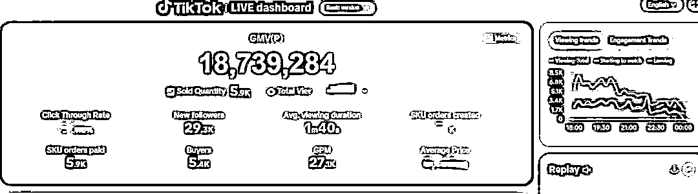

1.流量来源怎么看

打开数据大盘，进入流量详情，就能看到各渠道流量来源的占比。不同阶段看的东西不一样。新号要重点盯直播推荐占比，这个指标能看出推荐流量的撕裂程度。一般新号开播前三天，直播推荐占比会从10%拉到80%以上；相反，流量下滑时最先崩的也是直播推荐。一旦掉到50%以下，就要马上行动，想办法把推荐拉回来。

如果现阶段重心在短视频，就要盯着短视频流量占比，用周期性环比来判断最近短视频的引流效果。但要注意，短视频流量占比往往会因为直播推荐基量变大而被稀释，所以要结合小店内短视频导流工具一起算，别误判。

如果开了付费，就得把各个付费工具的占比拎出来，和直播推荐对比着看。尤其Ads天然能撬动免费流量，所以要定期分析投放成本、付费流量和撬动的免费流量之间的周期关系。

2.用户画像怎么调

这部分主要用于新号打标。在罗盘左上角打开画像罗盘，能看出当场直播间的人群模型。如果模型显示人群不精准，就从三个地方找问题：流量来源占比最大的是哪一类？引流品是不是选错了？付费定向框选对不对？然后手动调整，慢慢把模型纠正过来。

3.互动数据怎么看

核心指标是点赞率、评论率、停留时长、加粉率。这几个指标的交叉权重，基本能反映直播间的人气。很多培训博主爱说“停留达到多少才合格”，这种说法其实不严谨。任何指标都要横向对比——同时期、同类目、同量级，才有参考意义。比如一个开播不到半个月的新号，要对比就应该找同流量级别或略高一级的优质账号去比，这样才能找到优化空间。

4.交易数据怎么看

核心指标有GMV、人均GMV、UV、转化率、千次转化率。每个指标对应的优化方向都不同。GMV代表单场交易额，要和过去7天做环比，看整体走势。人均GMV不适合单场比，更适合以一周、两周为周期看变化，因为客单价的提升不是单场能拉起来的。其他数据也是同理——指标不同，优化打法也不同。

5.流量数据怎么看

核心是场观和峰值。场观直接反映流量规模，适合按周来观察。我们常发现，场观周期环比下滑时，直播推荐占比往往也在跌。峰值要分两种：开场峰值受上一场场观和推流波动影响，推荐峰值则受当场互动和交易指标影响。

6.直播间进出数据

TikTok后台已经能提供五分钟漏斗分析。通过这个模型可以随时算流量的留存，推流人数也反映出当下流量健不健康、互动和交易指标完成得怎么样。一场合格的直播，在进入下半场之前，五分钟数据应该是螺旋上升的。只有这样才能在当场拉升推荐峰值，数据一旦好看，系统瞬间就会推到广场流量。

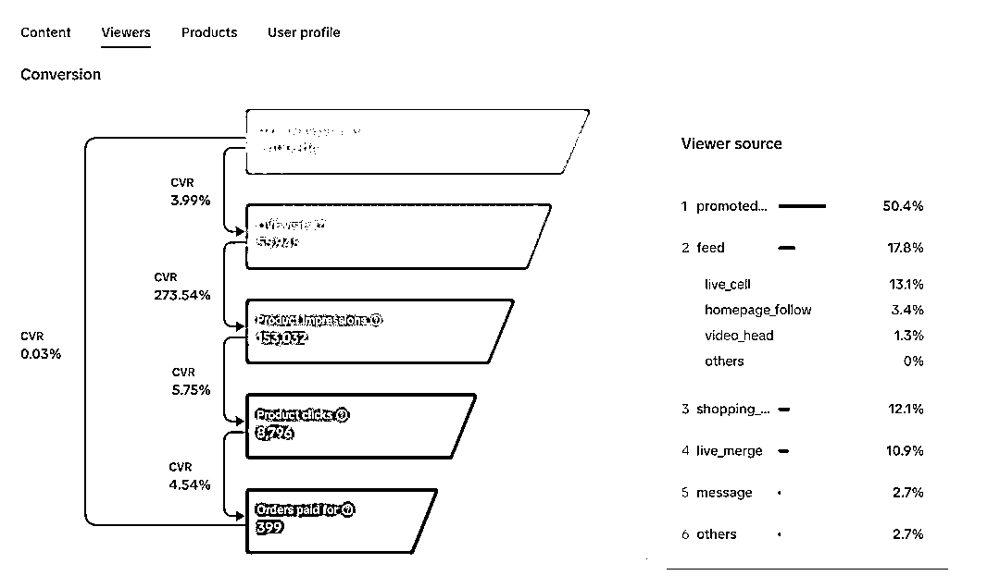

进入直播分析的流量分析页面，能看到整场直播的营销漏斗：曝光转化率、点击转化率、升单转化率、成交转化率。哪一环出问题，漏斗就卡在哪一环。

曝光点击率，直接反映投放素材的质量；点击转化率，受购物车商品排列、卖点设定、主播话术引导影响；升单转化率，更依赖主播引导、定价和详情页；最终转化率，则看主播逼单效果和商品实际吸引力。每一个环节拆开，都能对应一个具体问题。漏斗从上往下，任何一层收紧，都会严重打击最终成交。

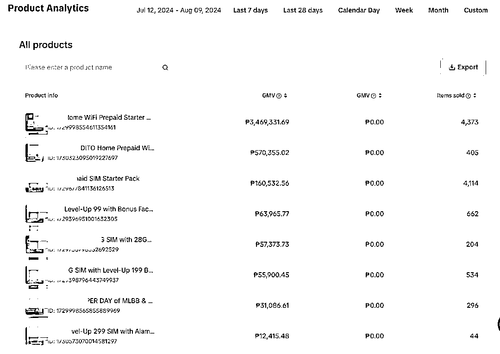

商品要分三类重点看：爆款品、滞销品、低质品。爆款品是单场或连续一段时间排名靠前的商品，这种品有潜力，适合主推培育并连续返场。滞销品是无论怎么上架，点击率和成交率都垫底的品，这种要果断淘汰，同时用新选品补位。低质品则是售后退货率偏高的品，这类品会让GMV虚高，但会拖累小店评分，对用户伤害也很大，必须及时清掉。

直播间的数据分析，光靠罗盘不够。开了付费就要结合付费工具里的数据来一起看。另外，TikTok自带的工具虽强，但也不会面面俱到，配合第三方数据工具做补充，是更聪明的做法。规模大一点的直播间，甚至会专门设一个数据分析岗来统筹这件事。实际直播中要用的数据项，比上面说的多得多，还有付费流量分析、账号横向对比等等，篇幅关系就不展开了。

## 工具篇：第三方工具怎么用

第三方数据工具在数据爬取和竞品分析上价值巨大。我最常用的两个平台是FASTMOSS和ECHOTIK。

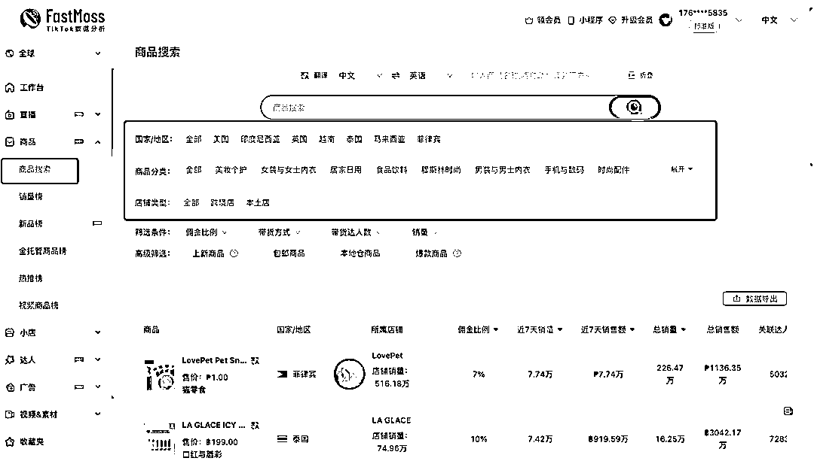

1.选品分析

主流第三方工具基本都有商品销量监测。比如抖查查，进主页点商品排行榜，选好类目和时间段，就能看到近期卖得好的商品。具体怎么选品，选品篇里已经详细讲过，这里不再重复。

2.玩法分析

别人不会把最新玩法告诉你，但数据会。通过第三方工具，可以挖到那些有潜力的厉害账号，然后模仿他们的打法。第一步先定筛选维度：粉丝少于10万、开播不足1个月、销量远超同类账号。符合这三个条件的，就用“实时直播间”榜单去对比查找。

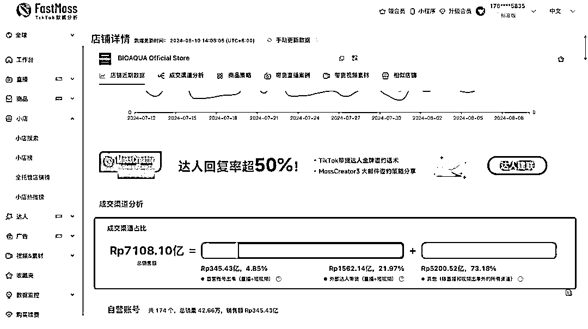

找潜力账号得有耐心。别只看表面数据，要进到详细数据页，至少蹲两场他的直播。要看什么？看他的活动策略、引流款是什么、互动词云长什么样、排品顺序怎么排、销售额多少、UV多少、话术和节奏怎么安排。这些信息拼起来，你就能判断这个直播间的玩法，然后拿来借鉴。

3.视频成交分析

目前TikTok这边的工具，echotik能做到视频带货的闭环数据检索，fastmoss暂时还不行。这个功能非常刚需，尤其是做标品的直播间——自然流跑爆的素材，对广告投放意味着什么，懂的都懂。

## 深化篇：用电商思维看TikTok带货

TikTok带货的本质是电商，电商的本质是供应链。这句话我在文中第二次提了。我自己早期也犯过一个错：嘴上知道供应链重要，但行动上从不落实，反而天天盯着流量。这种心态可以理解，但容易吃亏。新团队最急的是起号、搞流量，可只要把底层算法吃透，起号其实很简单。

真正难的是第二阶段——没有爆品的时候，账号处于“起了号却测不出爆品”的状态，不死不活：想放弃吧，还有点GMV；想爆发吧，又爆发不了。好不容易测出一个爆款，接着又要操心怎么持续产出爆品。所以说，做TikTok电商，本质上就是做供应链。脱离供应链只追流量，是本末倒置。

再从流量本身看，很多人也有误区：只盯着直播间流量，忽略视频端流量。你没发现吗？一到直播高峰期或节日大促，中小主播流量就会明显被瓜分？或者因为一次违规被限流？那些靠卡直播广场的账号做不长久，就是因为过度依赖直播推荐而反噬了自己。真想把直播做好，短视频流量必须抓起来。从今年以来的大盘数据看，不管是自己还是身边团队，短视频流量占比越来越高——TikTok明显在扶持视频端。而且，用带货视频引到直播间来的用户，转化率更高、更精准。

## 复盘篇：什么样的复盘才是有效的

我最常用的复盘框架分四块：流量复盘、数据复盘、互动复盘、直播现场复盘。

1.流量复盘

核心看两个：场观和峰值。复盘时怎么找问题？先找出最关键的那个点，看它到底呈现出什么数据；然后深挖是什么因素造成了这个数据；最后针对每个因素给出解决办法。比如今天的开场峰值只有100，昨天还是5000——是账号违规了？还是开场排品单价太高被压了？下一场怎么规避？

2.互动复盘

昨天增粉1000，今天同样的流量只增粉200。为什么？是停留变差了？用户不互动？还是主播没做好引导？

3.数据复盘

翻直播录屏，发现主播全场都没做关注引导。那下一场，就必须把引导关注这个动作做到位。

4.直播现场复盘

有些问题没法用数据体现，比如人员分工乱、配合失误，这些只能靠现场复盘发现。

真正有效的复盘，必须把这几块全部过一遍才有意义。复盘最怕什么？怕你一言我一语走形式，根本挖不到根因；也怕没有数据支撑，纯凭感觉。所以，一定要在数据指导下做复盘，这样才落地。

## 分享篇：从个人创业聊避坑指南

我2020年加入字节，22年离场做TikTok服务商。在平台掌握的能力和服务商需要的能力其实是两套东西，没有高下之分，只是解决不同的问题。从策略到执行，从框架到落地，从赋能到搭班子，两年时间，我从漕河泾的A级写字楼一路走到东南亚园区的大楼，开始搞海外直播带货。起号、选品、直播、运营、拍摄、剪辑、投放、团队管理，每一步都踩过坑，但也收获了很多。最后一篇，就聊聊个人的体会。

1.国内和海外完全是两个场域

在国内干和在海外干，真不是一码事。工作不是，创业更不是。国内很多优势根本搬不过来——货品、物流、仓储、团队，全都不一样。真想出海，没有个3-5年的心态沉淀就别惦记了。如果想着进场赚快钱，这个赛道真的不适合你。

2.空杯心态，别自以为是

我见过不少抖音卖家，一年做3-5个亿，觉得海外那点市场看不上。但今年我已经没听说有白牌团队能做到过亿且毛利在20%以上的了。反过来，跨境电商20%-50%的利润很常见，就像我们零几年做淘宝一样。在东南亚，一个不到10人的团队，一个月卖200万，挣30-50万的大有人在。很多人总觉得东南亚毛利低，送你一组我调研的印尼店铺数据，自己体会。

从看不上，到看不起，到看不懂，到追不上。我20年刚去字节的时候，电商刚起来，我去挖阿里的商家，人家根本不鸟我。但那些当时理我的，21年基本都做到5000万体量。现在也一样。我下场创业没选抖音，是因为没机会，所以才来做TikTok。我相信每个人都有类似经历。这一轮跨境电商以直播内容电商的形式在东南亚已经非常成熟，工厂卖家都能真正进场了。

3.丢掉幻想，准备战斗

东南亚电商想做到千万级别利润，团队必须本土化。直播电商也好，今年的跨境电商也好，都必须符合出海电商的条件。如果没这个打算，趁早放弃。从宏观上看，把国内模式搬到海外，已经是不可逆的浪潮，从衣食住行到零售业，哪哪都是。

## 总结

TikTok正在不断颠覆传统电商，就像国内当年发生过的一样，尤其是传统行业。互联网生态的浪潮是什么样？往前看十年：PC门户时代、移动互联网时代、新媒体时代、👸号时代、短视频时代。每个媒体时代都会长出属于那个时代的内容生态和商业生态，但无一例外，都会有起有落，TikTok也不会例外。

对创业者来说，就算TikTok现在还在红利期，我们也必须保留另一个视角——去观察下一个媒体时代的风向。只有这样，才能在当前风口结束时，不会在下一个风口里再沦为跟随者。互联网时代，先发优势就等于吃透红利。