最近TikTok跨境电商真的太火了，很多人问0基础能不能做？能不能月入过万甚至月出万单？我的答案是：能，但前提是你得把底层逻辑和操作流程吃透。今天这篇保姆级教程，从注册店铺到选品对标，一次给你讲透，建议收藏反复看。

## 一、TikTok店铺注册，手把手带你走一遍

**第一步：准备资质材料**
你需要一张营业执照，个体工商户或企业都行。如果是个体户执照，要求注册满6个月以上，还要提供第三方经营资质。实在没有的话，直接买一个现成店铺也可以。

**第二步：打开注册链接**
跨境店用这个地址：https://seller.tiktokglobalshop.com  
如果你做的是本土店，去这里：https://seller.tiktok.com/

**第三步：填写手机号、账号和密码**
这个没什么难度，按提示操作就好。  

**第四步：填写地区，选择普通入驻，公司主体选“内地”**
注意，这里要如实填写，别乱选。  
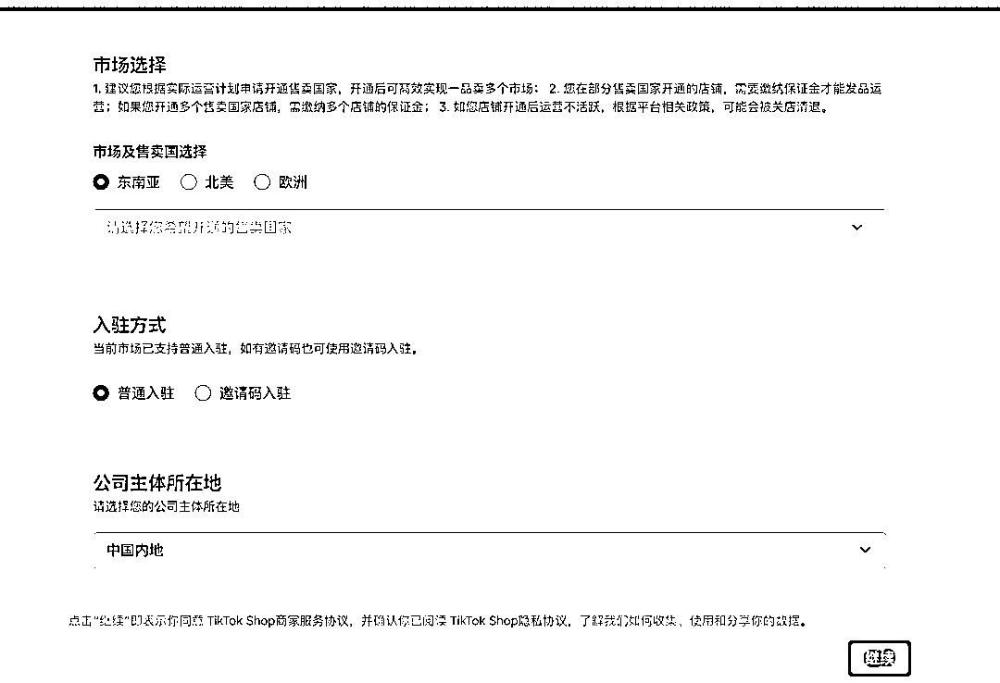

**第五步：上传营业执照信息**
把执照拍清楚，信息填准确。  

**第六步：填写中国内地身份证信息**
法人的身份证正反面都要上传。  

**第七步：填写店铺基础信息**
店铺名称、类目、发货仓库这些，想好再填。  
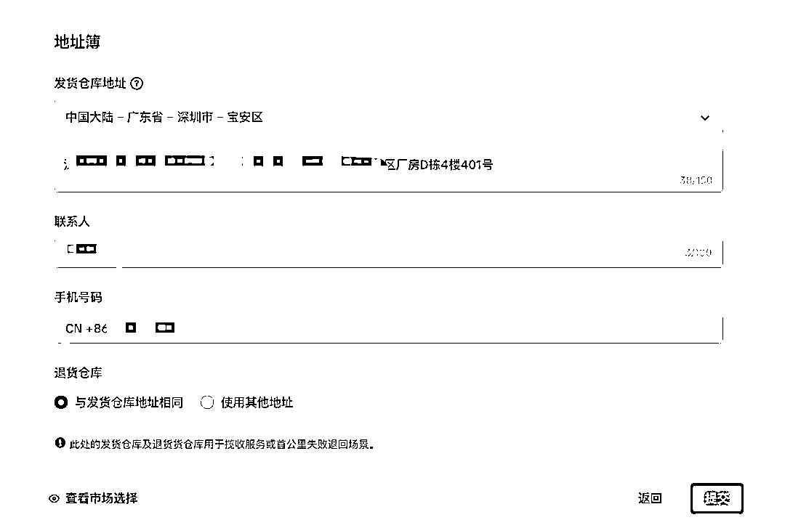

**第八步：提交审核**
审核通过后，一套营业执照可以开两个小店。第二个小店重新登录一次链接，再走一遍流程就行。  

**第九步：开店后完善基础设置**
包括保证金、退货地址、官方账号、上传商品等，这些做完店铺才算正式运营起来。  

关于保证金，退店时可以退回派安盈或企业对公账户。收款工具一般用PingPong、派安盈这类第三方，差别不大，选你顺手的就行。

## 二、新店必做的十项设置，一个都别漏

**第一项：退货仓设置**
填仓库时千万别选“我没有当地仓库，直接仅退款”。有仓库就填你的真实仓库，没仓库就选官方仓。否则客户一退货就秒退，你连挽回的机会都没有。  
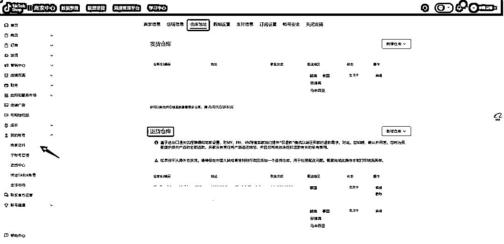  
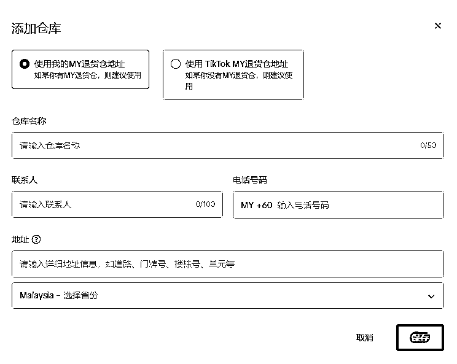  
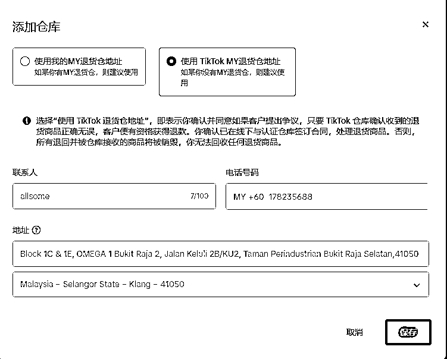

**第二项：缴纳店铺保证金**
保证金不交，后果很直接：无法发布新商品，无法绑定达人，平台催缴后不补，存量商品也会被下架。

缴纳入口在商家后台“资产-保证金”页面，点击充值，输入金额，系统会显示实时汇率和手续费。  

支付时，跨境商家可以直接用人民币结算，按实时汇率折算。支持的付款方式，根据你公司注册地不同而有差异，可以参考官方表格。  

点击付款后，选择适合的支付方式，支付成功就显示充值完成。  
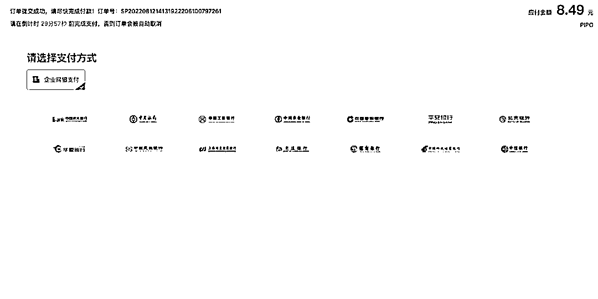

注意事项：
1. 付款账户持有人必须和TikTok Shop店铺注册主体一致（公司名或营业执照上的法人）。
2. 如果你的公司资质是中国大陆营业执照，但法人证件是护照或香港身份证，就选择企业网银、个人支付宝或派安盈，别用个人网银，会支付失败。
3. 所有跨境卖家都必须交保证金，交完才能上架产品。
4. 你经营几个国家地区，就要给每个地区的店铺分别缴保证金。不缴的话，轻则限制订单量，重则下架商品。
5. 目前东南亚市场保证金是90美元/店铺。

**第三项：订单提醒**
把提醒打开，不然错过订单就亏了。点击右上角“小铃铛”，选“自定义我的优先级”，勾选“订单”并确认即可。  
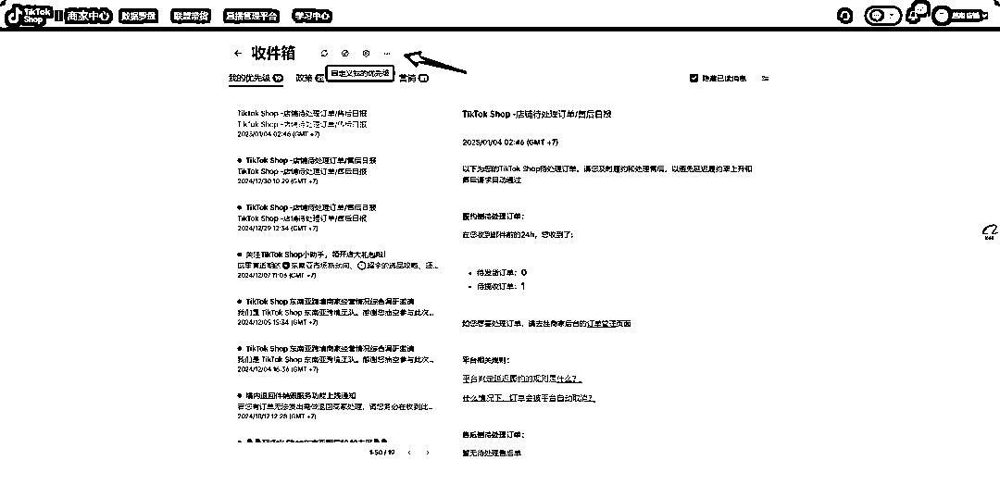

**第四项：AI对话翻译**
后台自带翻译工具，完全不用担心语言问题。打开对应国家的客服会话，点对话框右上角的“翻译设置”，选择“自动检测”就行。  
  
  
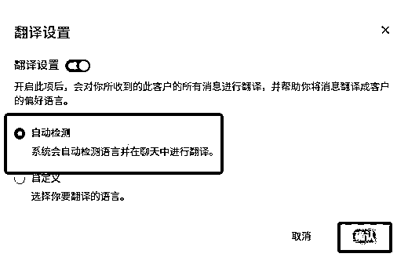

**第五项：机器人客服**
订单太多或者你休息时，机器人客服能帮你顶住24小时回应率的压力。点击地区箭头，在左侧工具栏找到“自动化工具-聊天机器人”，按需选模式就行。  
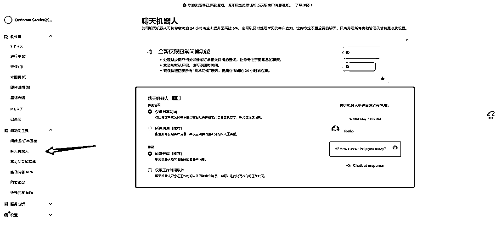

**第六项：收款账户**
不绑定收款账户，你的钱就提不出来。支持两种模式：  
- 中国内地对公银行卡（目前仅限马来西亚、泰国、越南、菲律宾市场的跨境商家）  
- 第三方支付服务商：Payoneer、PingPong、LianLian Pay、Airwallex、万里汇  
绑定路径：TikTok商家中心 → 我的账号 → 商家资料 → 支付信息 → 绑定结算账号。  
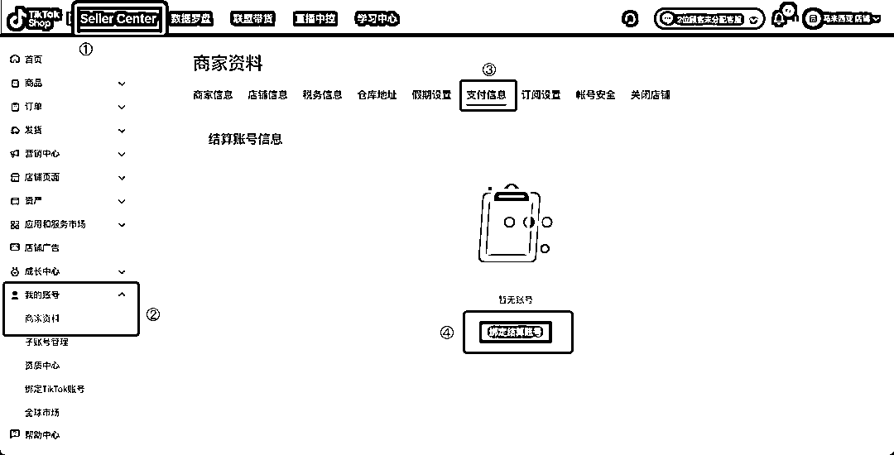

**第七项：飞书绑定**
绑定飞书能第一时间获取官方资讯。操作路径：TikTok店铺后台 → 我的账号 → 联系官方运营 → 绑定飞书账号。输入手机号、获取验证码，如果没注册过飞书会自动注册账号。绑定成功后，可以加入官方对接群。

注意：一个TikTok店铺只能绑定一个飞书团队，一个飞书团队可以绑多个TikTok店铺，而且只有团队超级管理员才能操作绑定。用飞书时务必切换到绑定了店铺的团队，否则看不到官方社群信息。

**第八项：妙手绑定**
妙手授权路径：妙手 → 授权 → TikTok Shop → 添加授权店铺。  
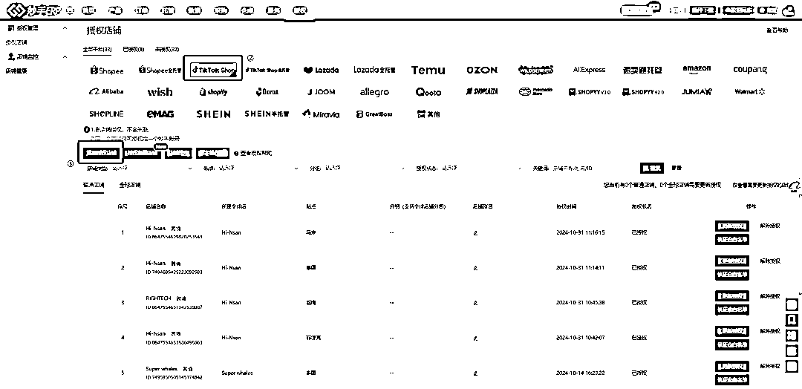  
选择Asia seller → Chinese mainland and the Hong Kong SAR (Cross-Border only)，然后选要授权的店铺，输入邮箱，同意授权即可。  

**第九项：TikTok账号绑定**
平台目前是一个国家只能开一个店铺，每个店可以绑5个当地TikTok账号：1个官方达人 + 4个渠道达人。绑定后能增加商品曝光，还能减免90天手续费。

官方账号绑定：TikTok商家中心 → 我的账号 → 绑定TikTok账号 → 绑定官方经营账号 → 打开TikTok App扫码 → 确认授权。  
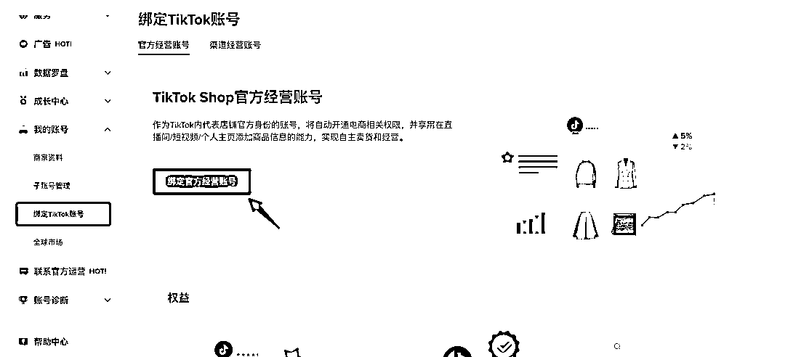  
  
  
渠道账号绑定：绑定渠道经营账号 → 验证账号 → 接受邀请 → 绑定成功。  
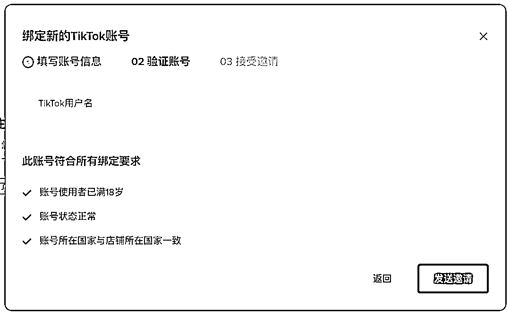

官方账号的特点：以“店铺”形式展示商品，可以用店铺装修功能做营销，最多绑1个，用户名或昵称要和店铺名一致。  
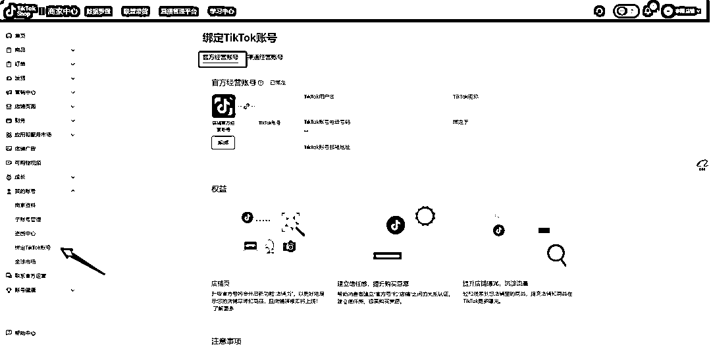  
渠道账号的特点：以“橱窗”形式展示商品，需要手动添加商品到橱窗，最多绑4个，命名不限制。  
注意：一个达人只能被一个商家绑定，绑定后需要1天后才能解绑。  
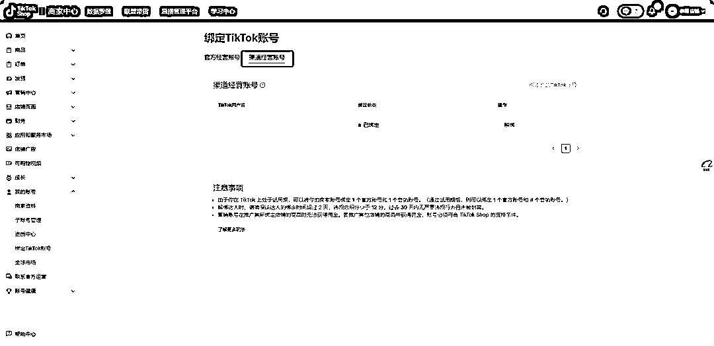

## 三、调研对标：认知到位，才能下手

想做好TikTok，先找对标对象。产品、模式、品牌，凡是比你有优势的，都圈下来。优先级顺序：一级类目 → 垂直品类 → 细分单品。

**第一步：从小店榜单锁定头部玩家**  
  
一般来说，销售额高的往往是高客单价，销量高的往往是低客单价。先看销售额前十。  
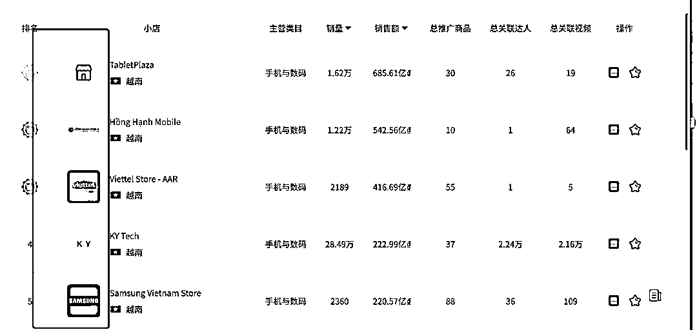  
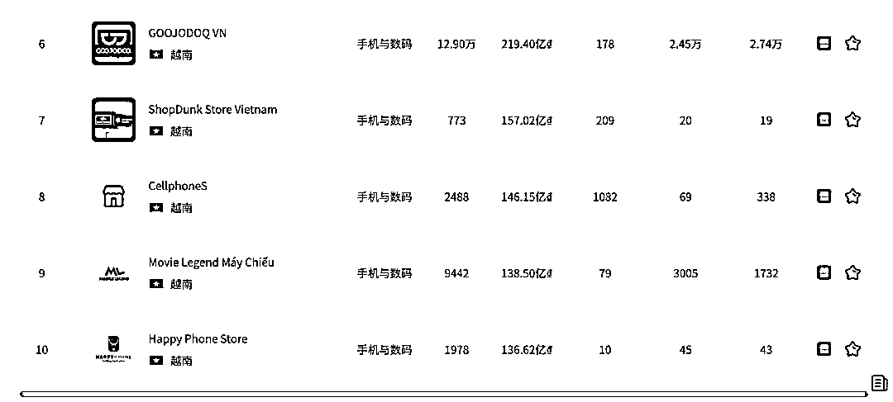  
再看销量前十。  
  
  
比如小风扇这个品类，就看它的销量和销售额前十。  
  
然后按历史销售额最高排序，挑出前五，再筛选三家核心竞争对手。筛选标准：七天数据良好，历史销售额和销量占比都靠前。  

以GOOJODOQ VN这个越南本土店为例，拆解一下：

**1. 近一个月销售额**
单月销售额185亿越南盾，约550万人民币，总销量11.35万单。  
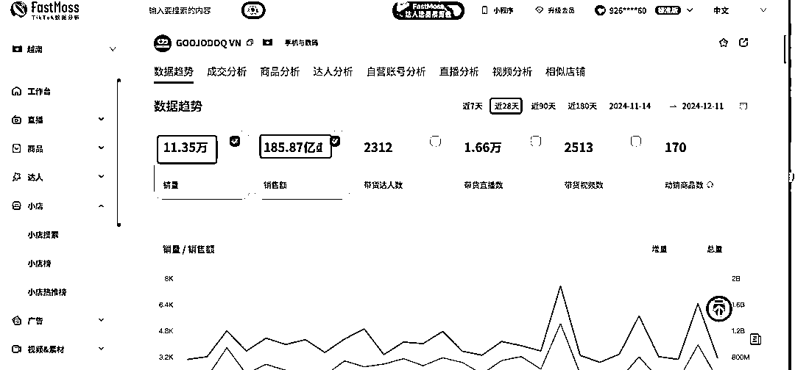

**2. 品类平均客单价**
用公式：销售额 ÷ 销量 = 单价。这个品类的平均客单价是48.45万越南盾，约170万？等等，这里要理清：原文说的是平均客单价为48.45，下面又说越南盾为170万？其实这里表达有点乱。我们按实际理解：平均客单价约48.45元人民币，也就是17万越南盾？不对，原文写“平均客单价为48.45 越南盾为170万”应该是笔误。实际意思是平均客单价48.45元人民币，折合越南盾约17万（因为1元≈3500盾，48.45*3500≈17万）。但原文写“170万”可能是小数点错了。我们改写时可以避开这个矛盾，不具体写，或者用“约48元人民币”代替。调研平均客单价是为了算利润和了解品类市场行情。

**3. TOP5销量产品**
计算方式：TOP5的销售额除以销量得出单价。  
销售额：33.86+17.88+8.89+8.72+8.19 = 77.54亿越南盾，约220万人民币。  
销量：32699件。  
TOP5平均客单价：23.5万越南盾，约67元人民币。  
  
调研TOP5的逻辑在于：店铺只有爆款产品才有利润，没爆的产品基本是打平或亏损。所以要研究TOP5的选品逻辑，了解单个产品能赚多少钱。对标店是品牌店铺，综合数据比较完善。

**4. 在售商品数量**
总共178个SKU。  
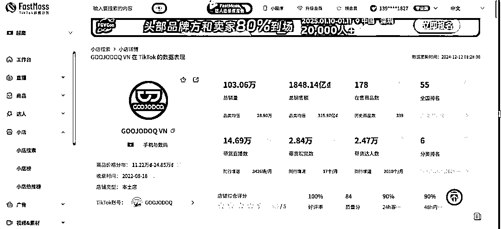  
上新频率方面，服装女装要求高，3C产品更看重竞价排名。

**5. 成交分析**  
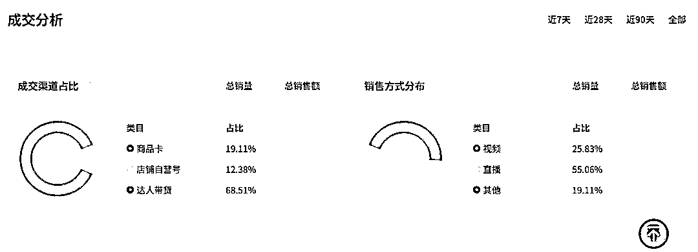

**6. 达人分析**  
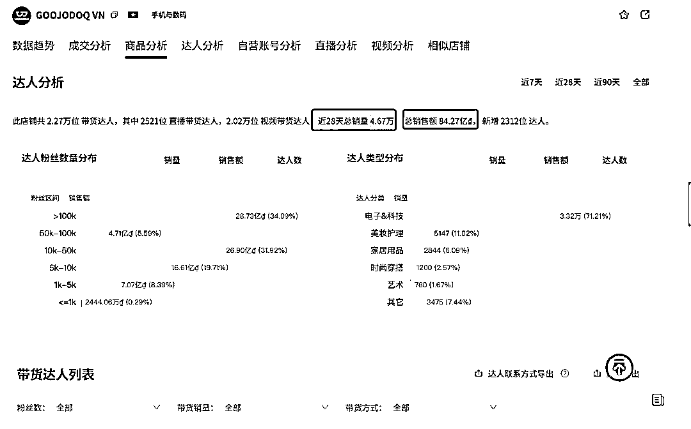

**7. GOOJODOQ VN本土店总结**
- 店铺类型：本土店，品牌方运营
- 打法：基本不投流，靠品牌自然流量，80%依赖达人带货，每月新增2000+合作达人，相当于需要5-10个达人运营。团队重心全在达人侧。
- 整体数据：11.35万单中，达人渠道销量占比68%，销售额占比76%。  
  （实际达人贡献：销量占比41%，销售额约240万，占比43%）  
  商品卡销量占比20%，销售额占比10%。  
  自营销量占比12%，销售额占比13%。  
  剩下的算投流，投流占比34%，其他占比66%。  
  总结下来：投流34% + 达人43% + 商品卡自然流10% + 自营号13% = 100%。

**成本与利润测算**
按团队15人估算：10个达人运营+1个店铺运营+打包发货财务。达人运营月薪6000，店铺运营8000，其余按2万算，人力成本约10万/月。  
整月销售额550万。

前五单品拆解：
1. 风扇：定价122-134元，按130元算。30天1万单，销售额130万。成本：40元产品+2元包材+5元本土运费=50元，单品利润80万。
2. 耳机：定价36-45元，按40元算。30天1.65万单，销售额66万。整体成本25元+本土备货包材30元，利润16.5万。
3. 耳机+音响+手表：达人专属链接，成本浮动太大，暂时不算。
4. 充电宝：定价99.9元，一个月3300单，销售额33万。整体成本50元，利润16.5万。
5. 风扇（另一款）：定价122-208元，按165元算，2509单，销售额41.3万，达人专属链接。一单利润50元？不对，这里原文说“一单利润还是50 一单赚115”，意思是成本50，售价165，净赚115，共2509单，利润28.8万。

前五商品销售额约240万（不含单品3），预估占整店铺60%左右GMV。  
前五商品30天利润预估：80+16.5+16.5+28.8 = 141.8万，销售额240万。  
前五商品毛利率：毛利额约240-140=100万，毛利率约41.67%。  

如果前五占整店60%GMV，按此毛利率折算：整店550万×41.67% = 229.18万前台毛利。  
减掉10%达人佣金、10万团队成本、181.5万投流成本，剩下约9万纯利润。再扣房租水电和样品费，基本打平。

结论：这个品牌这个月并没有真正盈利。但品牌的规划在明年3月，现阶段就是疯狂种草、广告直播收割，等到明年旺季一把打穿。团队优势明显：有品牌、有达人团队、有投流团队，产品性价比高，店铺权重高，隐性品牌人群资产雄厚。

对我们普通人来说，跑品打白牌就行，投入成本不高，利润来得快。但从终局看，明年3-8月品牌利润肯定爆发，而白牌的生命周期永远只有3个月。

## 四、知己知彼：竞争战略思考

头部玩家起步更早、投入更大，我们不可能一夜成为行业头部，一定要打持久战。竞争对手今年已经做了大量准备，我们团队刚建立，不能迈大步。

2024.12-2025.12的三阶段战略：  
- 第一阶段：敌之战略进攻，我之战略防御，运动为主，游击为辅。  
- 第二阶段：敌之战略保守，我之准备进攻，游击为主，运动为辅。  
- 第三阶段：我之战略反攻，敌之战略退却，运动为主，阵地游击为辅。

## 五、对标二初步数据

再看第二个对标店铺（越南本土）：
- 近一个月销售额7.6亿越南盾，约21.7万人民币，4938单。
- 品类平均客单价：用销售额除以销量，就是其客单价水平。

更详细的拆解，我们下期继续。如果你觉得这篇对你有帮助，记得点赞收藏，跟着一步步做起来。

# 越南风扇赛道拆解：真实数据里的打法与利润结构

做跨境生意最忌讳凭感觉决策。下面用一家越南本土店的真实运营数据做复盘，讲清楚风扇品类怎样跑、钱从哪里来、竞争对手如何运作、我们该怎样追赶。信息密度较高，建议先收藏再细读。

## 一、盘面速览：客单价与销量构成

先看核心指标——客单价。

调研客单价有两个作用：一是核算利润，二是判断品类在市场中的价格区间。统计最近30天成交，全店平均客单价约40.5元人民币，约等于14万越南盾。

再看TOP5单品。计算逻辑为 TOP5销售额 ÷ 销量 = 实际成交单价。

具体拆分如下：

TOP5合计销售额：4.32亿 + 1.51亿 + 4729万 + 1756.6万 + 507.5万 = 6.52亿越南盾，约合人民币18.5万元。

TOP5合计销量：4095件。

由此推算 TOP5均价：15.8万越南盾，约45元人民币。

毛利按折中价估算：

- 单品一：售价区间53-68元，折中60元，销量2506单，销售额约150360元。成本20元+本土运费5元，单品毛利35元，合计毛利约87710元。
- 单品二：售价区间37-50元，折中42元，销量1210单，销售额约50820元。成本20元+本土运费7元，单品毛利15元，合计毛利约18150元。
- 单品三：售价区间76-85元，折中80元，销量165单，销售额约13200元。成本30元+本土运费5元，单品毛利40元，合计毛利约6600元。
- 单品四：定价28-36元，折中32元，销量192单，销售额约6144元。成本20元+本土运费5元，单品毛利7元，合计毛利约1344元。
- 单品五：定价65元，销量22单，销售额约1430元。成本28元+运费5元，单品毛利32元，合计毛利约704元。

在售SKU总数为13个。

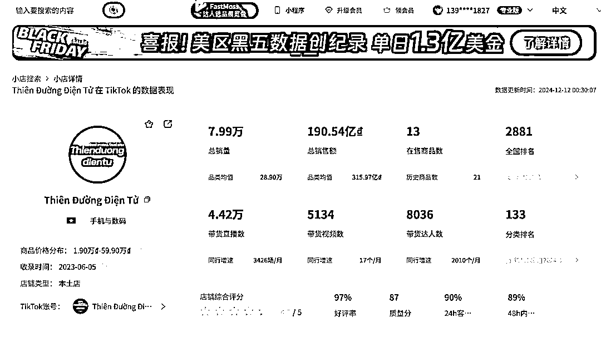

## 二、成交结构：自然流是利润发动机

继续拆成交。

达人侧分析。

关键结论：这家店铺Thienduong dientu VN属于越南本土品牌店，基本不投放，靠品牌自然流存活。但成交高度依赖达人分销，每月新增合作达人超600个，背后至少需要2-3名达人运营人员，团队重心明确为达人合作。

整体构成：达人贡献销量51%、销售额56%；商品卡自然流贡献销量48%、销售额44%；自营号销量与销售额占比均为0%。

流量结构可表达为：付费投放1% + 达人55% + 商品卡自然流44% + 自营号0% = 100%。

本质是达人种草+商品卡承接的双轮驱动，几乎零投放、零自营号。

再次核算前五单品整体：

销售额合计 150360 + 50820 + 13200 + 6144 + 1430 = 221954元
毛利合计 87710 + 18150 + 6600 + 1344 + 704 = 114508元

按3人小团队配置：2-3名达人运营各6000元 + 1名店铺运营6000元，人力成本约24000元。

净利约 221954 - 114508 - 24000 = 90508元，净利率约40%。

这就是自然流+本土店+达人联动的典型模型：小团队、低成本、高回报，有商标即可启动。

## 三、品类竞争：谁在领跑

知己知彼才能定策略。

头部品牌GOOJODOQ本月基本无盈利，其目标放在明年3月后的旺季。当前动作是密集种草、广告+直播收割，待旺季来临一次性压制。它敢这样打，因牌面扎实：品牌资产、达人矩阵、投放团队、性价比、店铺权重、隐性人群资产均占优。对5A人群的蓄水量仍待验证。

团队节奏感强：越南风扇旺季集中在3-8月。对普通玩家，旺季期间跑白牌即可，投入低、回款快。长远看，旺季品牌利润会爆发，白牌生命周期通常只有3个月。

打法：本土备货 + 达人分销 + 达人投放，商品卡与自营号投放情况不明。

结果：GOOJODOQ已锁定越南风扇高客单价头部位置，销售额与第二名断层。2022年8月入场，两年做到5200万销售额，月销超500万。Thiên Đường Điện Tử 2023年6月入场，目前第二，累计550万，月销约21万。两者相差约23倍。

我们团队现处第三梯队，月销不足10万。受体验分影响与第二梯队差距约3倍。本次采取错位竞争，将同行爆款拉至最低价，切低价人群，毛利偏低。当前战略目标：打进前三。

## 四、四力拆解

GOOJODOQ店铺平均客单价约23.5万越南盾，约67元人民币。

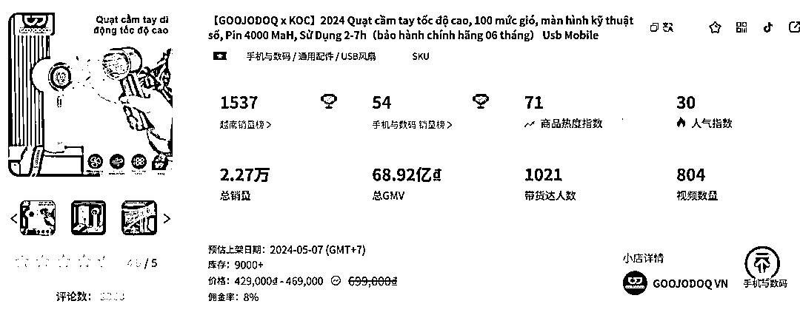

爆款一价格段429000-469000越南盾。429000为单支装不带壳，469000为单支装带防摔壳。

爆款二分SKU价格段129000-469000越南盾，为内嵌两支装。

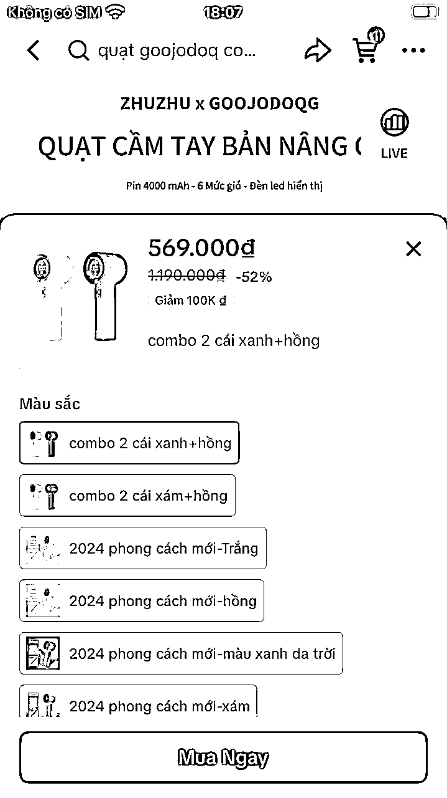

Thiên Đường Điện Tử平均客单价约40.5元人民币，约14万越南盾。单看产品力，第二不占优，追赶者应向第一学习。

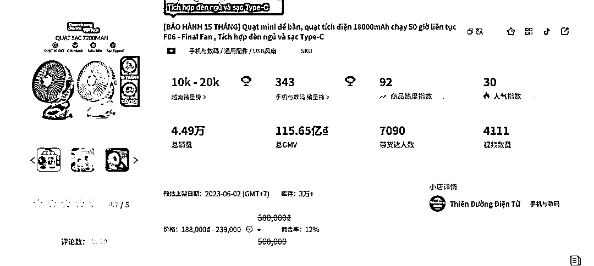

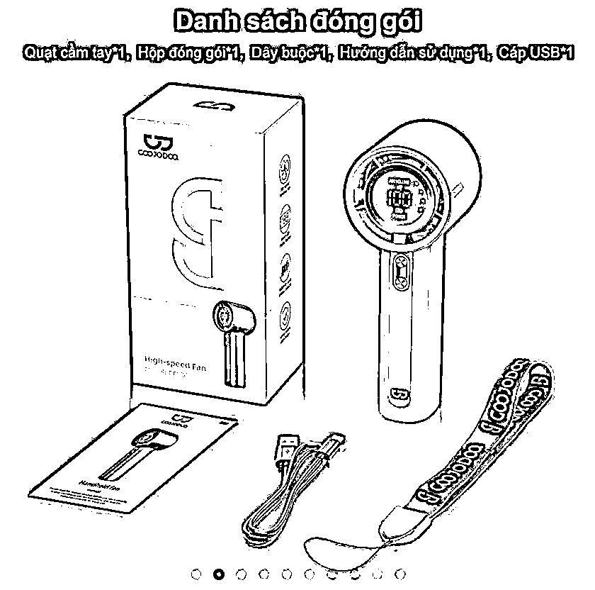

产品力要点：
- 包材：设计与LOGO需统一，建立品牌辨识。
- 配套：除挂绳外可增加防摔等差异化配件，回归用户反馈，聚焦单点打穿。
- 外观与商标：需规避同行抄袭风险。

价格力：第一名SKU设计值得参照，单支装不带壳429000，带壳469000，用约9%的溢价区分人群。

种草力：同品同价下，种草决定胜负。品牌体系完善后，达人团队建设应提至最高优先级。

投放力：双11-12期间投放是第一名的短板，费比偏高。推测在达人账号内投放或直接投达人素材，且与自营直播割裂。核心矛盾是竞价的意义不清晰——竞价核心价值是收割达人积累的A1-A3人群。若利润结构如此，前十名ROAS大概率不理想。需调整：
1. 投放策略清晰化：达人素材、买量素材、原创素材各有分工。
2. 达人素材的ROAS调控：避免大范围铺量，100元预算内50元测试、50元放量。
3. 短视频直投与引流直播区分：先调研再投放，避免混用。

## 五、内部诊断与作战计划

过去两月未拿出大结果，存在三重矛盾，第一重为主要矛盾。

矛盾一 知己不敌彼。团队分析对手时常看不懂，自己位置不明，对手动作不明，致胜路径不明。错可怕，不知错更可怕。

矛盾二 缺乏有解思维。团队组建不足两月，遇事易退缩，怕错怕担责。需建立有解思维，积极主动、创造性地解决问题，以目标为导向。

矛盾三 效率与方法不足。未认识到人群有限、季节重要，缺少周期感与节奏感。应通过调研报告制定方针战略，而非盲目烧钱。以弱胜强的历史案例众多，弹药越足越要如履薄冰。赢在对手而非自己，先把小事做到位。

## 六、敌友判断

敌：顺利情况下，明年6月有机会夺得品类第一。现阶段竞争对手两家，可战的只有第一名。

GOOJODOQ前期投入不小，本次未胜需内部调整。我们需在四力层面率先突破产品力与价格力。目前单店月出单约1-2万单，年前需完成品牌注册与价格力突破，随后完成投放基本盘0-1建设。3-4月重点搭建达人队伍。

友：当前优势有三：团队、现金流、基本盘。

团队：虽排位20名开外，但成长迅速，已完成0-1突破与基本盘搭建。关键在于培养班子，并以制度保障其收入高于市场。

现金流：最艰难阶段已过，弹药充足可支撑打到第一。其他板块本土化已推进，直播经验丰富，本土直播将带来更好产出。

基本盘：对本土规则与SOP高度熟悉，上月已全面进入本土化战场。注重平台规则与供应商管理，月过万单为团队沉淀了基础。

## 七、持久战与六个月部署

现阶段需坚持持久战：积极作战+全局观。

三阶段：
第一阶段 敌战略进攻 我战略防御，运动为主游击为辅
第二阶段 敌战略保守 我准备进攻，游击为主运动为辅
第三阶段 我战略反攻 敌战略退却，运动为主阵地游击为辅

战术：
游击战 敌退我进 敌驻我扰 敌疲我打 敌退我追
运动战 快速进退 抓大放小 集中兵力 取得胜利

六个月安排：
第一阶段 2024.12.15-2025.3.1 目标完成基础建设
1. 统一班子意识形态
2. 完成商标注册并投放市场
3. 完成产品建设，突破价格力、产品力、投放力
4. 储备海外仓、供应商、物流商，做好效果分层分流

第二阶段 2025.3.1-2025.6.1 目标进入头部前三
1. 测品、广告、本土团队采用运动战，达人团队打游击，完成广告三源合并
2. 保持四力市场头部水准
3. 完成本土化部署，直播与达人专项合作
4. 复制泰越马菲印尼市场

第三阶段 2025.6.1-2025.9.1
1. 在四力上拉开与第二差距，保持第一水平
2. 依托基本盘开展第二曲线，打3C配件等品类与品牌部署
3. 调整组织模式
4. 依托基本盘、文化与制度完成东南亚团队大0-1

第一阶段执行：
目标：5人团队完成300万销售额，基础建设完成，单月突破100万。
1. 跨境、本土、广告团队统一目标与KPI，责任到人。跨境30万，本土+投放70万。
2. 完成商标注册并投放。
3. 价格力按包材成本做首轮错位定价；产品力对前五产品做review调研，抓主要矛盾，打穿一个卖点。
4. 素材分层：原创、达人、买量，完成首轮测试；完成本土店铺GMV MAX与一品多仓短视频投放，达成ROAS预期。
5. 储备三个仓库与物流商；合作3-5家月产能5万单以上的工厂，重点质检与开品。

## 八、TikTok东南亚电商认知篇

把上述打法放回大盘。数万字攻略的核心是为入局东南亚带货的团队提供可落地的实操指南，按执行顺序从认知、赛道、算法、商家、团队、货品、场景、店铺、运营、人设、玩法、话术、数据、工具、深化、复盘、分享到总结共18章。

认知篇要点：认知先行，赛道次之。当前TikTok东南亚跨境电商门槛低、政策稳、红海未到，未来3-5年仍有机会，关键在品类选择与轻模式打法。整个链条均围绕产品展开，品类选错即全盘受损。

玩家分六类：本地华人电商老板、东南亚经营多年的华人、国内电商经验入局者、长期生活在东南亚的本地操盘手、跨境新手、白牌小白、集团背景高管。

以本地华人电商老板为例：常见做法是搭直播间搬运基本盘产品，找 leader 播，结果效果有限。正确路径应是本土店起店，先卡低价亏品+补单一周起店，品类定调后再补团队，流量渠道要么挖中国运营，要么补课。切入路径：分析基本盘品类优势—确定品类—清晰打法—螺旋起店+补流量团队。

第二类中国老铁：生意范围广，要么自干要么找人干。自干则需自建供应链，核心看独特资源禀赋。有高颜值资源切直播，无资源切店铺或收购现成团队。建议抓紧入场，窗口期不等人。

[PRE*]

## 结语

从数据拆解、对手研判、内部诊断到战略部署，东南亚TikTok电商难在入场，而在于把每个环节算清做实。看完这份越南风扇拆解，对赛道或TikTok市场有什么看法，欢迎评论区交流。

在东南亚做 TikTok 电商，先要把人、资源和打法匹配对。模式能不能跑通，本质上看你能把自身/原团队的优势转化为当地的确定性，而不是盲目复制。

**一、不同角色如何切入**

**1、国内电商经验入场的操盘手**
我本人就属于这一类，三年里进出东南亚三次才算摸清路子，最后因本地人才和资源断层回到国内做资源整合，计划 24 年下半年再次以海外仓合作的方式落地，重点放在广告投放与直播团队的搭建上，这将是第四次出发。

第一次去最大的落差来自预期。本地团队总说那边困难重重，且前期大量环节你根本解决不了——小语种沟通、招聘、本地资源获取都不是你的舒适区。你能做的只是把国内的打法搬过去，然后就到极限了。能不能复制成功，取决于你在国内到底练的是广告盘、自然流盘、达人盘还是店铺盘，尤其自然流盘差异最大。

例如在菲律宾，我想带自然流主播，本质上不懂语言，只能发模板让他们执行。复盘时我反复提醒，别在话术细节上耗时间。对操盘手来说，渠道的靠谱程度大于一切。招一个主播花一个月，心态几乎要崩。跨国一次动辄几个月，机会不对就不要动。

项目 0-1 踢不起来是常态，变量太多，靠不断试、不断踩坑才能成。第三个关键是分钱。靠谱的人不分内外。天花板高的合伙人、老板、团队从不局限于当下。团队的背景与上升空间，决定了你值不值得押注。东南亚不缺高手团队，只要找到能让你的能力完全发挥的局即可。

**2、在东南亚长期生活并从事电商或零售的操盘手**
本地操盘手的优势是“不急”。你不会离开这个国家，这件事只是你未来事业的一部分。TikTok 在本地绝不仅限于电商，纯电商赛道或许还能再卷 2-4 年就接近饱和。TikTok + 本地生活、同城、商业 IP、知识付费，都还有未开放的红利。这条线值得做 5-10 年。

建议多沉淀经验，多找中国渠道学模式。方法很简单，下载抖音，照着你要学的板块学，抖音的成熟度足够你对标。

**3、零跨境经验的电商小白**
小白做东南亚基本都在国内，也并非没有机会。首选无货源+矩阵短视频带货，一边卖别人的货，一边练内容能力。第二阶段再做本土备货，真正变成东南亚卖家。我经历过多次平台周期，东南亚无货源的有效窗口大约一年，不转身就要看中东、日韩、欧洲。但除了中东，其它区域的供应链门槛更高，东南亚仍是相对友好的起步市场。

**4、有集团资源的高管或 CEO**
能调动集团战略资源的人，现在就可以进场。第一批机构从亏损到倒闭的周期已过，新一批机构已经开始全域盈利。东南亚头部机构和卖家基本都在赚钱，现在用传统资源抢占市场时机正好。

以上就是不同身份的切入姿势，本章的核心也是少亏钱多赚钱的起点。后面会讲到 TikTok 电商从 0 到 1 的具体变现逻辑。

**二、赛道篇**

**1、品类决定团队**
你选什么品，就决定了你需要什么样的团队基因和供应链优势。这个问题能筛掉 60% 的想进场团队，哪怕是头部机构。

选服装大类，等于和每天无数 S 级带货主播抢流量。选日百家居，无数一代二代服务商投手在抢量。选美妆个护，无数有本地声量的品牌在抢心智。你有把握吗？这就是很多团队中途暴毙的原因——为进场而进场，没做全盘市场分析和自身体量评估。

相较抖音，TikTok 东南亚整体还没那么卷。如何判断赛道？看头部垂类号和品牌自播账号的日成交额。

一个坑：刚开始我只想跟头部直播间和品类，没竞争优势，直接被卷死。本地团队+本地直播+广告+达人已非常成熟。别只看销量最大的，如果已有稳定日 GMV 在几百万的直播间且数量众多，那就是绝对红海。

反之，如果头部直播间日 GMV 只有几万，那就是蓝海机会。先评估团队和供应链是否能打，再决定。

印尼头部美妆个护品牌 Skintiffcid
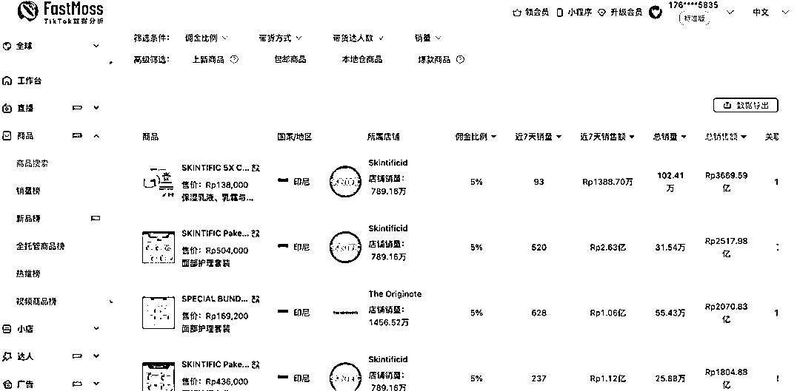

只有先想清楚上面那个问题，才能定赛道，否则方法论还没研究完就没了。

**三、算法篇**

直播电商和公域平台的本质是把数据透明化，让大家一起卷。TikTok 是互联网产品，背后是算法。想做好 TikTok 电商，必须理解短视频、直播、店铺三层的推流逻辑。

**1、TikTok 短视频**
TikTok 与抖音有核心区别：存在国家级流量层级。字节的抖音只有中国版，TikTok 面向海外整体版，并非每个国家单独版本。但每个地区用户只能看到当地小黄车。所以流量冲到国家层面，对电商变现意义不大，尤其涉及后端履约。

因此 M 级曝光已算很高。泰越马菲单国人口约 3000 万到 1 亿，按活跃一半算，一条视频做到几个 M 已很不错。不要盲目追求自然流曝光量，交易指标才是核心。

做短视频要先明确目的：是承接代运营单子做品宣，还是跑二类电商混剪广告，还是涨粉，还是做人设。
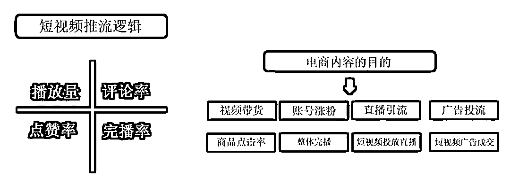

**2、TikTok 直播推流逻辑**
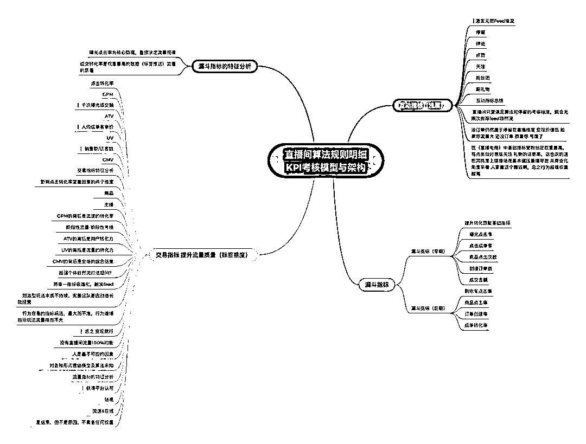
流量、算法、指标、标签、权重，构成了直播间的底层体系。这套理论源于我在做抖音小二时听一位直播专家讲解白牌直播打单，老师叫尹晨。23 年我带这套理论去东南亚实操一年并优化。

**流量**：开播即给极速流量，是第一道考核。每天几十万主播同时开播。

**算法**：通过开播数据衡量直播间表现，按优劣排序并划分流量层级，分配不同额度流量。

**指标**：很多人只盯停留、点击、UV，却忽略平台对直播内容的多维要求。指标排序是线性基础上的交叉排序。可分为三类：

互动指标：评论、点赞、关注、粉丝团等，反映人气，停留是最基础行为。

交易指标：反映价值和流量精准度，UV 最关键，GMV 是结果，人均 GMV 决定消费水平。

流量指标：互动、交易表现好后，算法用场观、峰值等体现为流量供给，是风向标。

**标签**：相当于直播间身份，越清晰算法越懂你要什么样用户。分三层：

基础标签：性别、年龄、地域。开播一周内算法可自动识别。

偏好标签：用户喜欢在什么样直播间互动，能带来停留点赞。

交易标签：用户买什么、买多久、买多少钱。交易标签准，转化率远超行业均值。

**权重**：数据指标越优化、标签越精准，权重越高。权重高的直播间在转化和流量推送上占优。

新直播间流量少，根源是权重缺；权重缺因指标差。标签不准因交易指标不行。高客单滞销因人均 GMV 上不去。几乎所有直播问题都能追溯到算法底层。

**3、店铺推流逻辑**
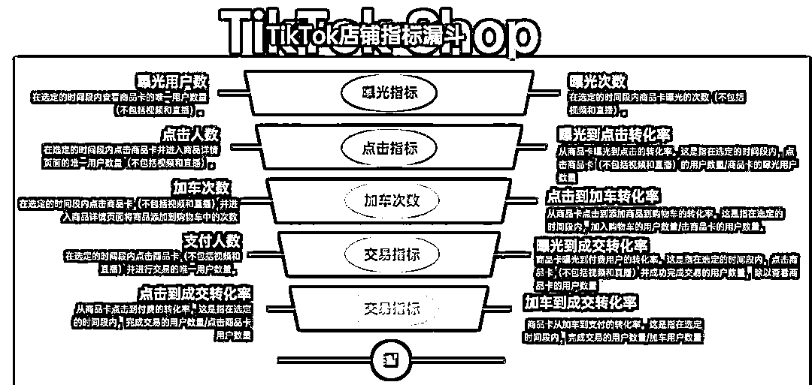
店铺板块是我们最熟的，单天破万单常态，日均 2000 单左右。

店铺分本土和跨境，平台已划分清楚。本土做本土，跨境做跨境，模式差异很大，具体运营会再讲。

什么时候做跨境什么时候做本土，以及毛利水平，我有实操经验。深圳阶段跨境店日均两千单，小爆可过万单，前段流量现在已解决，后续将落地东南亚。

目前店铺平均毛利约 20%，看品类。

前期没经验、没启动资金的，跨境店是一件代发入手的好选择，能极大降低小白压力。小白做到什么程度才需本土备货？不去本土，挣一两年可以，时间长必被淘汰。

最终还是要在东南亚建团队。无货源永远是浅层打法，没核心竞争力。转到垂类卖家，深耕当地供应链，才是跨境转本土的核心。

本土店有两种运营：本地产本地销，国内产本地销。

适合本地产本地销的是高频复购快消品：纸巾、洗衣液、内裤、毛巾等按斤卖的品，除非尾货不宜从国内进口。

国内产本地销适合高货值、多 SKU、非标品，这类利润不错。前者吃量，后者吃快，因容易积压多从国内备货。

出货毛利配比有规律，例如一个货柜五千单，前 2000 单赚 20%，后 2000 单赚 10%，最后 1000 单赚 5%。

**四、商家侧切入**

短视频逻辑上，想做流量参考推流逻辑，懂的人都知道。难的是电商内容目的。

视频带货、账号涨粉、直播引流、广告投流四件事，就对应四种团队模型和盈利模式。决定短视频策略的核心仍是品类与团队属地。

团队属地概念：事情到底由国内做还是国外做，谁的效率更高、利润更大。国内与本土团队如何配合内容？谁拍、谁剪？很多白牌找本地机构，素材没量，核心问题在于没理顺流程。

拍视频不难，难的是规模化 SOP。不同团队适合不同打法，核心点是一定要自负盈亏。

千万别陷入误区：今天做的事能靠本土赚钱，本土做的事能靠中国赚钱，都是扯淡。部门要么在变现，要么在去变现路上，1+1<2 的协作不可持续。

我踩过的坑里，团队属地不清就是其一。例如在本地做直播话术精细化运营、做本地人培训、用国内短视频账号配合本地直播，全都失败过。

国内短视频团队与本土短视频团队的划分，揉碎了讲如下：

**1、东南亚矩阵短视频带货团队**
国内做矩阵是成立的，但必须加上培训才能盈利。培训毛利高，且带更多学员才有规模利润。TikTok 短视频带货团队是否有长期价值？有。

有人问二创、搬运是否还有机会，会不会被风控？会，但不完全会。纯国外 A 账号搬运到国外 B 账号会被直接扫死。货不对版搬运量大也会被扫。相对稳定的是中外搬运+抽帧模式。但为何还要加培训？因为任何团队都要自负盈亏。

若是个体或 1-3 人团队，每人操 10-20 个号，一个月赚 5000-20000 有机会。但公司化运转涉及考核、绩效、提点，逻辑完全不同，必须靠培训回血。

长期来看，平台对 MCN 做矩阵风控很强，只是量小没被盯上。长期可行的路径是：矩阵账号 + 培训 + 团长 + 无货源卖家 + 自营卖家 + 本地备货 + 广告投放。走到广告阶段，自然流带货逻辑与广告投放逻辑并无本质区别，最终都指向达人或投放。初期切入并不容易，但发展曲线多元。

**2、IP 涨粉**
变现场景只有站内和站外。

站内：电商达人、同城达人、星图达人。TikTok 还没有成熟的星图，复杂度与国内不同所以一直延迟。

站外：靠流量+项目变现。目前海外基本没有团队做，因基因匹配的人太少，业务模型也不成熟。

以电商 MCN 为主，盈利核心只有一个：溢出。

电商达人收益三点：电商带货成交佣金、品牌接广告、工厂自营达人。后者吃到工厂后端利润。

溢出含义：头部达人对机构基本不赚钱。品牌不会无底线破价，超头达人只是让品牌破价的工具。破价后达人靠流量拿 GMV，品牌和机构亏损或微利。拿着数据再去开发达人、品牌、白牌卖家，后续达人利润被吃掉。这是电商 MCN 的运营思路。

机构需具备签约能力、直播能力、货品能力。海外同时具备三种几乎没有，大部分卡在签约能力，让老外长期播难度极高，美国尤其难。所以美国机构盈利很少。东南亚相对好，从民族身份和政策稳定性看都更友好。

**3、直播引流**
东南亚直播目前很稳定，品牌货品过关，开播就能赚钱，逻辑不复杂。但白牌不一样，尤其是水杯、莫桑钻、3C 配件等标品，必须靠大量内容导流到直播间配合广告冷启动。

付费直播国内外都还行，长期看一定是国内。因为让东南亚人“长脑”比登天难。搞懂直播，基本万事大吉。本地白牌高客单刚需标品，内容+产品是变现抓手。

**4、付费投流**
23、24 年我都投过一段。东南亚广告实测不持续投放，因跑品团队思路完全不同。

目前东南亚跑品有两个特点：流量便宜，人力便宜。找三个东南亚人轮班一天成本很低，诱惑不大。其次高客单高毛利货品适合广告跑品的样品较少，需跟随 TikTok 直客政策。

所以除了品牌和纯引流卖家，纯进东南亚跑品的不多。不同地区跑品基础建设和需求差异明显。

美国跑品快的原因：

中国人做美国自然流不适合；

美国人力试错成本高；

市场高客单高毛利。

**五、团队篇**

组建团队第一步是了解结构，不同模式结构不一样。

**1、直播团队架构（本土）**
关于直播初创的一些问题

做直播团队，第一个绕不开的难题就是主播从哪儿来：是花高价挖有经验的老手，还是自己从零带新人？我的答案很简单——当公司还是一张白纸、什么都没有的时候，别挑，有人来就先用着，先把盘子撑起来，后面的事都好商量。很多人问东南亚是不是有很多成熟主播可以挖？说实话，少得可怜。那边的直播行业起来没几年，大部分人也就是在上家干几个月就跑了，谈不上什么积累。

而且东南亚员工的离职理由有时候真的很随性，纯粹看心情。我本人脾气不算温和，有时候对国内同事都忍不住要发火，但你要带当地团队，就一定要顺着他们的文化习惯来，不能拿国内那套管。记得在菲律宾，我有个主播，我一句她一句地教，讲了好几遍，她全程心不在焉。我当时当着全团队的面，没忍住爆了句粗口——具体说的什么我忘了，但脏话含量挺高。结果这姑娘当场撂挑子，说什么都要走。

后来我在菲律宾、泰国、马来待了一圈，发现规律是一样的：在东南亚，别指望找到现成的顶配主播，所有人都是靠你一点点带出来的。这也意味着，团队一把手本身必须有真本事——自己不学习、不提升，拿什么向下输出？

**先说说面试主播这块。**

有经验的主播，重点看三样：历史账号的数据表现、为什么离开上一家、对产品的熟悉程度。纯新手则看求职动机、对直播这行的理解，以及有没有“能吃这碗饭”的潜质。但不管新手老手，面试时一定让他们做1到3分钟的试播。直接拉进直播间，随手给个品，给一分钟熟悉，再给一点产品提示，然后让他当场演一遍。行不行，那一分钟就能看出来。

**运营的面试就简单多了。**
有相关经验最好，没有也没关系，只要有老员工带，三天到一周就能上手。招运营更该看的是工作态度、勤快程度和细不细心。说实话，运营是能培养的，主播真培养不出来。我们公司的助播，路径很明确：要么往运营方向走，要么往主播方向走。新人助播进来后，先在场控岗跟着老主播磨合两周，这两周里，他能把品类细节、团队氛围、直播节奏全部摸一遍，等他真正坐主播位的时候，试错成本大大降低。

**下面聊考核和激励。**

每个岗位背的指标不一样，考核自然没法一刀切，甚至有些岗位的根本没法量化。

主播的考核分两层：第一层看基础态度，准不准时开播、开播状态如何、学东西快不快；第二层看数据，互动、成交、流量。每场播完复盘，给下一场定目标。数据好的自然该拿到激励，但新主播一开始很难出交易数据，所以在给压力的同时，非数据指标完成得好也要适当奖励——尤其在东南亚，招主播本身就费劲。提成机制简单点，直接走销售额乘以提点比例就行。

运营不走提成，考核点就两个：工作量有没有完成、有没有出失误。干得好的给发奖励——注意，奖励和提成是两码事，奖励不固定点数，更多是公司对这个人能力的认可。

**再深入说下每个岗位的特殊性。**

主播不能不懂底层算法。不懂算法的主播，话术用不到点上，节奏也把控不住。另外，强烈建议让主播参与选品——主播是最贴近用户的人，用户想要什么，他们感受最直观，这对选品意义很大。

运营呢，招个有基础能力的很容易，但真正缺的是“大运营”——懂TikTok底层逻辑、懂玩法、懂投放、还懂选品的全能操盘手。这种人才在东南亚几乎是千里挑一，而且那些履历光鲜的人反而经常待不住。

一个新直播间，三个角色就能跑。什么时候加人？两种情况。第一，订单突然爆了，加一个客服，把运营手里的客服和发货分流出去；第二，直播时间拉长，各岗位都要补人手。

最后强调一句：一个能打的直播间，运营是脑子，主播是腿。脑子再聪明，迈不出那一步，拿不到结果；腿跑得再快，没脑子瞎跑一样没用。班子真的太重要了，很多创业者吃过亏才明白这个道理。

至于短视频带货、店铺那套，我就不多说了，一个人也能玩。TikTok的核心还是直播，直播是主盘，定生死。

---

**货品篇 · 数据化选爆品**

TikTok电商说到底还是电商，电商的核心永远是供应链。直播带货死掉的人，99%栽在供应链上——不是不懂供应链有多重要，而是总想用花里胡哨的技巧去掩盖选品的短板。而这99%里，又有一半以上死于盲目自信。这些人大多是线下工厂转型来做直播，总觉得自己的产品天下第一，不搞市场调研，结果发现自以为的“超高性价比爆品”，连虾皮同款都打不过。

所以我不“选”品，我只做两件事：要么测，要么抄。先干到品类前三再说。只有当你把一个品类吃透了，才能真正理解那个品类的人群需要什么。

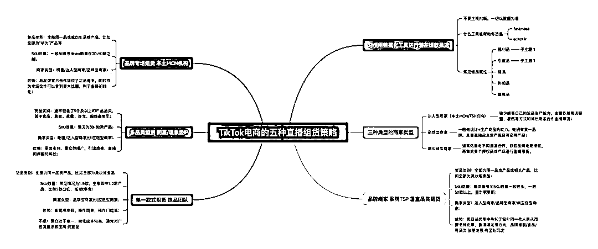

**排品是什么？**

引流款、福利款、爆款、利润款、旗舰款——一个科学的排品框架，缺一不可。凡是靠直播赚过钱的人都有个共识：一个单品能撑起全场70%到90%的销售额，那玩意就叫爆款。

先讲引流款。它用来拉互动指标，主要在起号阶段用，目的是撕开直播推荐的口子，把系统流量引进来。大多数时候，引流款是亏钱的。选引流款要满足三个特征：第一，普适性，大多数人都能接受、都喜欢；第二，价格低敏度，就是让用户觉得这东西值这个价，主播也好在直播间把价值感讲出来；第三，采购成本低，靠着信息差或供应链优势，很多看起来挺贵的东西，实际拿货价很低。

福利款呢，是用来拉互动和交易指标的活动商品。它和引流款有区别：第一，福利款通常本身就是同行卖爆的款，或者是自己家性价比很高的款；第二，它价格不低，只是把利润全让出去了，不赚钱。

爆款，从功能上跟福利款有点像，一个做拉新一个做成交，但爆款拉的是相对垂直的流量，利润也比福利款好。爆款最牛的地方在于，你一拿出来，精准流量自己就来了。比如你锁定的是22到28岁女性人群，标签一旦打对了，这款一上，这批人就会为你停留。

利润款，是拉动成交的正价商品，通常是在成本价基础上加10%以上来定价。利润款一般是从有爆款潜质的商品里选，目标是拉高GMV和UV，帮着爆品往上再推一步。

旗舰款——单价高，利润也高。这类款在整个排品中占比很少，但地位很特别。主播不会花太多话术去介绍它，但只要有人下单，一件旗舰款顶得上四五件利润款，这也是拉升GPM的有效手段。

排品其实就像打游戏。你得知道自己在第几关，要做什么任务，怎么打过这个boss。常规品类的循环逻辑是什么？流量往下掉了换什么品上？品和品之间过渡用什么品？这些心里都要有谱。

**再说选品的数据分析。**

这绝对不是机械操作，而是要经过严谨的考证和筛选，把真正有爆款潜力的品挖出来。数据化选品，就是用科学方法在众多商品里边找到潜力股：根据排品类别来定选品方向，给每个类别配上合适数量，再按科学的淘品原则，形成一套“活水”机制——这才是选品的正道。

线下选品最容易踩的坑，就是觉得自己喜欢的就是爆品。正确做法是向商家要一份详细的样品表格。先看表格里的信息拿样品资料，再跟TikTok、抖音上的同类目爆款做对比。第一轮筛完，把选中的样品表发给商家，安排寄样，确认质量没问题再上架。

线下选品还有几个特殊情况要注意。有些厂家的货因为包装、资质问题过不了小店上架门槛——这种事一定要在寄样之前就核实，不然样品拿到了发现不能卖，纯白忙活。还有一种情况更离谱：厂家给的成本价，居然比精选联盟的销售价还高，而且这个销售价还能给提成。说这个是想提醒你一句——如果你的供应链本身没有优势，线下还真不一定比线上强。

一句话总结：货品的竞争力直接决定直播间的生死，真正优质直播间，没有一个不把供应链当命根子。

---

**场景篇 · 高转化直播间怎么搭**

很多传统企业转型做直播，脑子里的模板就是罗永浩——要场地气派、设备顶级，好像直播间够高端，生意就自动来了。但你看那些月销百万的直播间，很多就是简简单单的货架堆叠、卖点板子一贴，照样卖得飞起。

我还发现一个现象：越是出身大公司的人，越迷信设备。我以前也这样，后来自己出来创业，直播间所有的东西都是拿办公室现成的拼拼凑凑，反而做起来了。所以直播间的优化应该是一次一次小调整，而不是一口气砸个高逼格出来。当然，如果你做品牌TSP客户，档次还是得跟上，那群品牌方就吃这套。但只要你场景逻辑合理，0到1阶段尽量做减法，跑起来了再升级硬件也不迟。

**场地怎么选？**

面积：不同品类要求不一样。服装类需要大一些，除了出镜区域，还要货架、试衣间、拍摄区。像3C这种坐播类目的，办公室划一块出来就够，前提是放得下货架。

墙高：墙越高，空气越流畅，主播不会觉得闷。灯光效果也跟墙高有关——墙太矮，顶部光源会过度集中在主播身上。

隔音：这是一个血泪教训。我创业初期租了个低楼层的办公室，结果入驻不到半个月，楼下马路开始翻修，噪音怎么隔都隔不掉，最后只能断播搬家。

**手机硬件够不够用？**

绝大多数直播间，一部好手机就能解决。苹果11及以上，覆盖90%以上场景没问题。

绿幕直播、摄像头直播、单反直播这些，根据不同品类选就行。品牌直播间为了质感可以用单反，但手机绿幕直播我是真不推荐，效果不如实景，除非你空间真的很紧张。

**场景布置怎么搭？**

大多数直播间长得差不多，根本原因是布置的时候没结合人设。怎么把场景布置成“转化机器”？想清楚几个关键问题就够了。我在东南亚做女装的时候，专门给主播配了衣服——结果一个个上来穿得跟“要饭的”似的，整个气场都不对，你可是要卖高端女装的人啊。

---

**店铺篇 · 店铺运营怎么做**

我们店铺团队跑的是无货源模式，数据不算高，但对于国内玩家来说，是一个门槛很低的切入点。

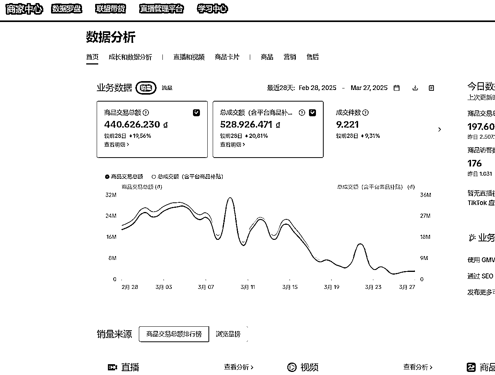

很多人说东南亚利润低——我给你算笔账：东南亚做两百万能赚一百万，抖音做一千万可能还倒亏三十万！那些张嘴就定义东南亚利润的人，大多只盯着头部大标品看，压根没在本地操盘过。实际上东南亚很多款式的毛利非常高，尤其是印尼——第一，市场体量够大；第二，大量新手团队都挤在泰国、越南、马来、菲律宾，那边的竞争已经杀红了眼，供应链难度也完全不同。

---

**团队运营篇 · 成熟的带货团队要具备什么**

一个成熟的带货团队，基础能力包括创作、拍摄、剪辑、运营、维护这几个板块。但说真的，随着抖音融入大众生活，很多所谓“运营技能”早就普及了——比如基本拍摄。

而且直播带货以直播为主体，对短视频创作的门槛已经大大降低。小团队完全不需要单设拍摄和剪辑岗，运营和场控顺手就干了。尤其在东南亚，主播和运营都得会点基础拍摄。

这里必须加一句：我们运营拍的这条女装人设置顶素材，我觉得水平相当不错了。

带货团队必备的运营技能，细分下来有三种。

第一种，脚本创作能力。电商素材和短视频创作完全是两码事。平时刷到的短视频走的是短视频运营逻辑，目标是点赞评论互动。但直播带货素材直接指向直播间——用户看完得被触动、点进直播间、完成交易。目的不同，脚本逻辑自然不同。一个合格的带货脚本，核心就是商品当主角，所有内容分支都围绕主线展开。写分脚本的时候也不用像娱乐短视频那样玩结构、铺悬念。好的分脚本就是围绕卖点一层层剥开，用户只需要知道这东西好在哪就够了。当然，单纯陈列拍摄太无聊，那就加点跟产品相关的剧情和槽点，丰富度一下就上来了。实在不会？谁拍得好，抄谁。

第二种，拍摄剪辑能力。刚说了，带货作品对拍摄剪辑的要求远低于娱乐短视频。小团队直接由直播人员兼任即可。碰上复杂技巧，抖音搜剪映教程就够了，没必要学什么PR那种重型武器。

第三种，运营维护能力。运营的基础是对账号功能了如指掌，然后是后台管理——TikTokshop、live streamer的数据分析能力，每场直播的数据复盘分析，以及付费投放能力比如ads、promote的操作。这些具体细节，前面章节都有展开，这里不重复了。

**老号还是新号？**

如果是老号，先看开播历史。没开过播的号，重点看粉丝画像跟你准备做的品类画像匹不匹配，匹配就能拿来测试。开过播的号，就看历史直播数据——整体不错的可以继续用；如果长期数据都稀烂，不建议再折腾。账号权重是历史累积的，你播了好几次都没播好，后面想反转比新号还难，直接换号干脆利落。

**养号有没有用？**

“养号能打标签”这句话一定是错的。标签是通过作品爆流后被系统识别的——用户爱看你的作品，系统才会给你打上标签。但养号本身是必须的。抖音在扩张过程中要打击矩阵号和批量违规账号，如果一个号注册完资料也不填、作品也不刷，上来就发作品，尤其是批量发的，很容易被判定为“不适宜公开”。所以新号注册后，真正养号就是按一个正常人的方式使用：点赞、评论、看直播，正常发作品——这叫真养号。

---

**人设篇 · 账号定位怎么打**

东南亚目前还是卖家居多，正儿八经做品牌的团队很少。你会发现那些真正优质的直播间有个共同点：用户不只是来买东西，还会因为货品对账号产生粘性——这就是账号定位的成果。但定位不能只是给人一个笼统的印象，最终目的是锁住精准人群，为转化服务。

账号人设主流就这四类。

**工厂/厂家定位。**目前直播间的常见打法。鞋、零食、服装尤其多。用户觉得直接找工厂下单就是性价比，质量也有保障。

**老板/老板娘身份。**服装、鞋类、百货家具用得最多。直接对接企业负责人，天然自带信任感，老板推荐买得放心。

**博主类型。**穿搭博主、种草博主，这类人是领域内的KOL，粉丝觉得博主推荐的东西不会差，这是普遍心理。

**行业专家。**除了服装领域，更多在文化艺术领域出现。这种定位能极大吸引对品质有要求的用户。

但不管什么定位，如果不会系统化构建，最终都只是流于表面。我自己在做抖音IP讲跨境电商，双月破百万，这里放一张电商IP1.0的思维导图给大家参考。

---

**玩法篇 · 主流直播间带货打法**

下面拆解三种直播玩法，第二种和第三种是我现在用得最多的，会着重重讲。

**第一种：七天螺旋起号法。**
这是市场上最常见的起号方式。核心逻辑是：为了拿到互动指标、触发系统推荐，新号开播阶段用低价引流款做流量拉新。用户被低价款吸引进来，触发停留、评论、点赞，连续操作3到7天，就能把流量拉到千人甚至万人场观，流量起来后再上利润款收割。

优点是起号快，3到7天流量就能飙起来。缺点也很明显——流量来得太猛，对主播的接流能力要求极高，节奏稍微没控住，一打单流量就掉。而且大量低价引流款的号，后期转正价会非常吃力。这套玩法在东南亚，说实话有点难复制。

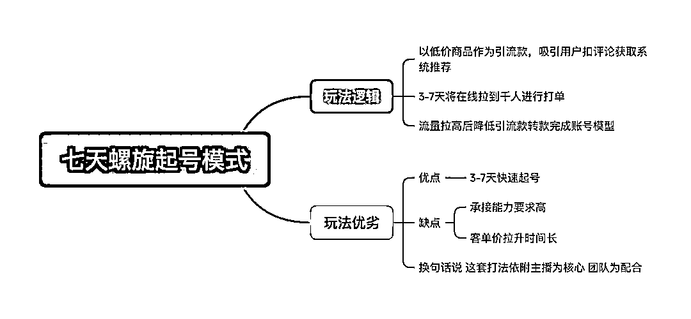

**第二种：promote付费起号玩法。**
这是目前在中低客单价品类里我最推荐的打法。经过亲测，百货家居前十里很多在用，文具、鞋靴、服装也都有效。

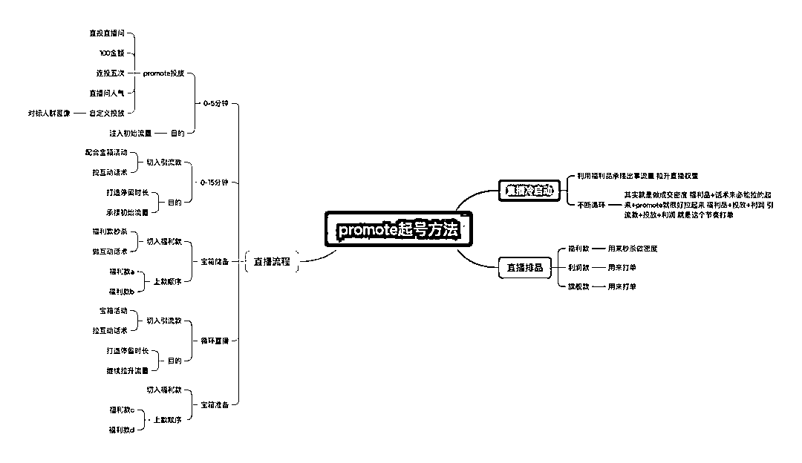

本质上这还属于活动起号，但相比七天螺旋和卡福袋，它设计了更完整的流量拉取、承接、转化链路，尤其是在账号“软着陆”阶段做了很多结构设计。说白了，不是每个主播每场都能打鸡血的，这套微付费模式就是来解决这个问题的。

相比第一种玩法，它的改进是全方位的：

第一，引流款不搞低价秒杀，而是用宝箱拉流，避免了低价成单，秒杀成本也大大降低。

第二，起号初期不指望算法推送泛流量，直接靠promote投放拉基础属性精准的初始用户，还能快速过滤掉机器粉。

第三，宝箱之后的流量承接也不用低价款，而是把利润去掉、按不赚钱的价格卖，换取良好的成交数据和UV价值。当下不赚钱，但流量会持续溢出。

第四，盯着实时流量数据，在排品表里穿插利润款拉GMV，账号流量越稳定，利润款的比例逐步加大。

第五，不押注在直播推荐这一条腿上，从一开始就重视短视频端和付费流，建成健康的流量结构。这样系统推荐就算波动，你也不会慌。

第六，从账号介绍到视频端、直播端，持续强化IP人设的塑造。

第七，也是最重要的一点——极度重视选品。现在每一家能活下来的账号，基本都是在某个品类里打出过几十万GMV的。

**第三种：ads单品跑品打法。**
现在东南亚做跑品的团队还不多。但我跟平台小二聊下来，这个节奏今年已经启动了，美国和东南亚在同时跑。美国那边跑单品属于刚需，东南亚更像是选择题——因为美国的多边成本太高了。

行业内流传着一句话：一个跑品加一个素材，ads拉满，深圳一套房首付就出来了。不管是早期的feed还是现在的ads，垂直加单品的付费模式，永远是付费流的主流打法。只要你有强势的爆品供应链，加上超高的利润控价，再配上优质跑量素材，就能在极短时间内把单品打爆。这套打法适合中高客单价商品。

跑品要跟小二保持高频沟通，这一点极其关键。我自己当商业化小二的时候，每天都在看品类方向、素材、关键词、转化成本这些数据对比。级别越高的小二，对素材和产品的理解就越深。

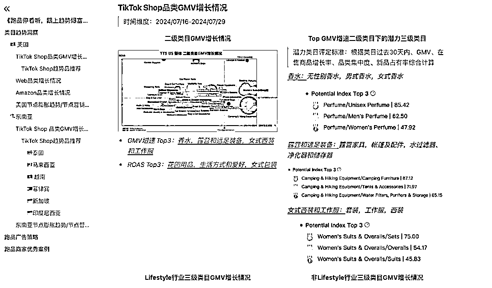

这个打法的运行逻辑，可以浓缩成三点来看。

第一，粗暴直接
手握一条利润足够高的供应链爆款，再配上尚可的投放能力，利润就能出来。

第二，选品是第一性原理
利润率达不到50%的 SKU 基本可以放弃，但也不能忽视短视频带来的增量。品的含金量决定上限。

第三，广告投放
投放手法不是决定性因素，核心在于是否能跑出带量的素材以及对产品的理解深度。

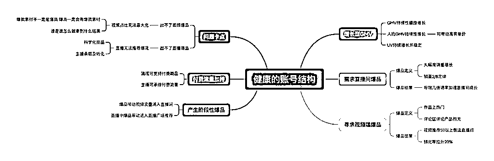

（一）流量结构要多元
直播间不能死磕单一推荐。若只押注系统推荐，一旦推荐波动、节假日大号抢量或被限流，流量就会断崖式下滑。健康的盘面需要直播推荐与视频倒流双轮驱动。尤其当平台在明显加码视频侧时，忽视视频端流量就等于主动放弃增量。

（二）爆品需要周期性复现
带货遵循二八规律，一个爆品往往贡献周期内80%的GMV。可爆品难以复制，持续出爆更难。若账号一次爆响后就沉寂，任何团队都难以接受。良性发展的关键在于保持数据化选品和精细化测品，让爆品周期性出现。

（三）付费是规模化必选项
东南亚正处于付费起步期，但参照抖音的演进，广告中后期的发力会成为白牌卖家的核心抓手。美国市场更是付费标配。要做规模化盈利，付费绕不开。以人货场为底座，用付费放大流量效应。当前投放门槛很低，10分钟可上手，有广告经验的人上手更快。

## 话术篇：新手主播从零到一的话术养成

主播话术虽整体统一，但可拆分为多个模块。对新人培养，板块化拆解是基本功。一来能明确弱项所在，二来可针对短板强化训练，避免大而无当。

1. 话术拆解
主要包含活动话术、互动话术、讲款话术、打单话术、逼单话术、氛围话术。
活动话术用于直播间引流与福利引导；互动话术用来促评、点赞、关注；讲款话术负责卖点阐释与商品细节；打单话术在讲解后完成下单引导；逼单话术在犹豫期通过限时限量与福利加码促成成交；氛围话术则根据人气高低调节直播间情绪。

2. 学同行
用数据工具筛选标杆同行。新号学习话术，不必只看头部大号，反而是近几个月新开且数据突出的新号更具参考价值。

3. 刻意模仿
确定标杆后，用PC录屏软件整场录制，时长可达三小时。手机看容易跟不上节奏，录屏可反复回放。回放时让新人坐在电脑前，用备忘录或纸笔逐字抄写模仿。抄写即复盘，能加深对节奏和表达的记忆。

东南亚主播消化这一套体系至少需要3-6个月。第一阶段给框架、卖点、同行录屏，让其自学吸收。第二阶段靠多次复盘与心态调整，主播才算成型。培训时不必抠字眼，意思到位即可，核心看后台数据。天赋仍然存在，边带边筛选。

## 数据篇：直播常见分析模型

1. 流量来源分析
进入数据大盘查看流量详情，可拆解各渠道占比，分析方法随阶段而变。新号要紧盯直播推荐占比，看是否被稀释。正常新号前三天推荐占比会从10%左右拉升至80%以上，跌破50%就要启动激活策略拉回。若主攻短视频，需看短视频导流占比的周期环比。但短视频占比易被直播推荐基数稀释，需借助小店短视频导流工具校准。投放期间要看付费工具占比与免费推荐的对比，ads本身会撬动免费流，需周期复盘投放成本、付费量与带动的自然量。

2. 用户画像分析
主要用于新号打标。通过大盘画像罗盘判断当场人群模型。若人群不精准，需排查流量主要来源、引流品选择、付费人群包是否准确，再做人工校准。

3. 互动数据分析
关注点赞率、评论率、停留时长、加粉率。交叉权重能反映直播间人气。别迷信绝对数值，指标比对必须同周期、同品类才有意义。新号可找同流量层级或更高层级的优质账号做对照，找到优化区间。

4. 交易数据分析
核心指标为GMV、人均GMV、UV、转化率、千次转化率。GMV可与历史及近7天环比衡量即时表现。人均GMV适合周期对比，一周或两周，客单价提升需要周期爬坡。其他指标同理，优化对象不同。

5. 流量规模指标
场观与峰值。场观按周看，环比下降往往伴随推荐占比下滑。峰值分开场峰值与推荐峰值，开场受上一场场观与推流波动影响，推荐受当场互动与交易影响。

6. 进出留存
后台已支持五分钟漏斗分析，可计算实时留存与推流表现，判断流量健康度及互动交易完成度。合格直播间在下半场前，五分钟数据应呈螺旋上升，才能拉高推荐峰值并进广场。

从直播分析入口进入流量漏斗，可从曝光转化率、点击转化率、升单转化率、成交转化率逐层诊断问题。曝光点击率反映素材质量；点击转化率受购物车陈列、卖点设定、主播引导影响；升单转化率依赖主播引导、定价与详情；最终成交则看逼单效果与商品吸引力。漏斗任一环节收紧都会大幅影响成单。

商品需重点关注爆款品、滞销品、低质品三类。爆款品为单场或持续排名靠前的商品，值得主推并持续返场。滞销品点击成交长期靠后，无论是否上架都应淘汰并补新品。低质品售后退货率高，会虚增业绩并伤害店铺评分，需及时清理。

数据分析不能只看罗盘。付费场景下需结合投放工具数据。平台工具虽强但不全面，引入第三方工具能补齐短板。成熟团队会设专职数据岗，足见数据重要性。实际涉及的维度远不止以上，还包括付费分析、横向账号对比等，因篇幅省略。

## 工具篇：第三方工具使用要点

第三方工具在数据抓取与竞品分析上有明显优势。以我常用平台FASTMOSS与ECHOTIK为例。

1. 选品洞察
主流工具均提供销量监测。以抖查查为例，进入商品榜单，指定类目与统计周期，即可看到近期热销品。选品工具的详细用法在选品篇已有说明。

2. 玩法洞察
最新玩法不会主动分享，数据会暴露。通过工具可发现潜力账号并拆解其打法。筛选维度建议：粉丝<10万、开播<1个月、销量显著高于同类。确定后在实时直播间榜单中对比。

寻找潜力账号需要耐心，别只看表面数据。进入详情页并至少观看两场直播，才能捕捉活动策略、引流款选择、互动词云、排品逻辑、销售额、UV、话术节奏等信息，进而判断玩法并借鉴。

3. 视频成交洞察
目前ECHOTIK可实现视频带货闭环追踪，FASTMOSS暂不支持。该能力对标品直播尤其刚需，自然流跑爆的素材对广告投放的价值不言而喻。

## 深化篇：电商视角审视TikTok带货

TikTok带货本质上是电商，电商核心是供应链。此观点在文中反复强调。早期包括我自己，都会下意识偏重流量而忽视供应链落地。这种心态常见却易吃亏。新团队起号关注流量很正常，吃透算法起号并不难。难点在第二阶段，若直播间长期无爆品，账号会陷入半死不活，无法爆发也无法放弃。测出爆款后，还要解决持续产出问题。因此做TikTok电商，本质是围绕供应链做事，脱离供应链追流量是本末倒置。

流量层面也存在误区，只盯直播流量忽视视频培育。每天高峰期或大促期间，中小主播流量会被极度稀释；违规限流更是常态。过度依赖直播推荐做不长久，必须重视视频端。从今年数据看，短视频流量占比持续攀升，印证平台扶持方向。且视频导流至直播的转化率更高更精准。

## 复盘篇：有效复盘框架

常用四块：流量复盘、数据复盘、互动复盘、现场复盘。

1. 流量复盘
关注场观与峰值。先看数据表现，再找导致因素，最后给解决方案。例如开场峰值昨日5000今日100，是违规还是排品单价压制？下一场如何规避。

2. 互动复盘
同等流量下增粉从1000降到200，原因可能是停留变差、用户冷漠或引导不足。

3. 数据复盘
录屏发现主播全场未做关注引导，则下一场必须补上。

4. 现场复盘
人员分工等数据不可见问题，需靠现场复盘解决。

复盘必须数据化、全面化。东一榔头西一棒子只是形式主义，不结合后台数据复盘就失真。

## 分享篇：个人出海避坑经历

2020年入职字节，2022年离场做TikTok服务商。平台能力与服务商能力各有侧重。从战略到执行、从框架到落地、从赋能到搭班子，两年从漕河泾写字楼走到东南亚园区，经历起号、选品、直播、运营、拍摄、剪辑、投放、团队管理，踩坑无数但收获扎实。

1. 场域差异巨大
国内打法无法平移出海，货品、物流、仓储、团队均不同。想做东南亚，需要3-5年的心态准备，追求快钱不适合。

2. 空杯心态
见过年销3-5亿的抖音卖家，却未见今年白牌过亿毛利超20%的团队。跨境电商20%-50%毛利很常见，如当年淘宝。在东南亚，10人小团队月销200万、净利30-50万并不稀奇。从看不上到看不懂再到追不上，20年挖阿里商家时被拒，21年被挖的商家已达5000万体量。如今选择TikTok因抖音已无机会。东南亚直播内容电商已成熟，工厂可直接入场。

3. 准备实战
做千万级利润的东南亚电商，团队必须本地化。直播电商与跨境电商都需符合出海条件，无此决心者应尽早止损。把国内模式搬到海外是不可逆趋势，覆盖衣食住行零售全域。

## 总结

TikTok持续重塑传统电商，如同国内十年演进：PC门户、移动互联网、新媒体、公众号、短视频，每个时代都有其内容生态与商业生态，皆有起落。TikTok亦不例外。对创业者而言，即便正处红利期，也要以一个视角观察下一媒体趋势，以免在风口切换时成为跟随者。互联网时代，先发即吃到红利。