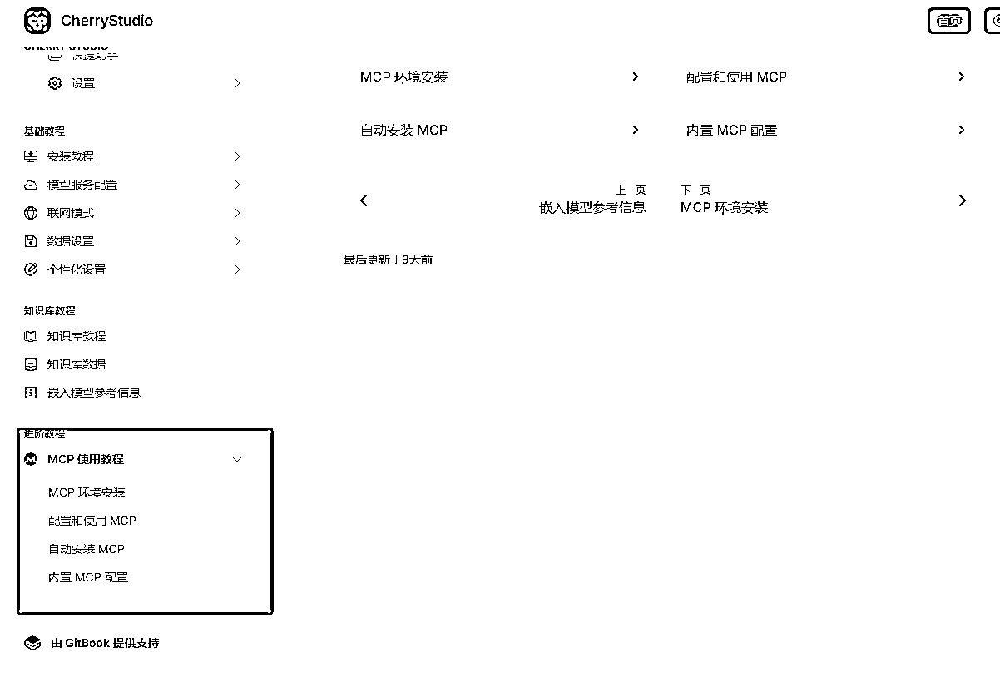
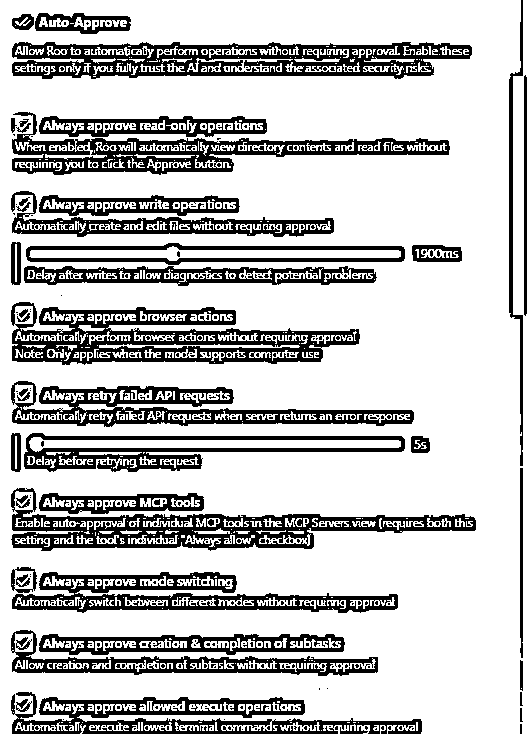
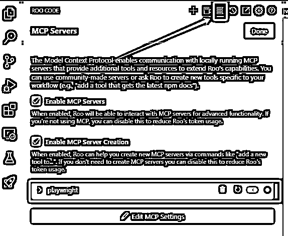
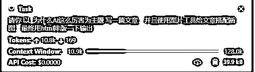
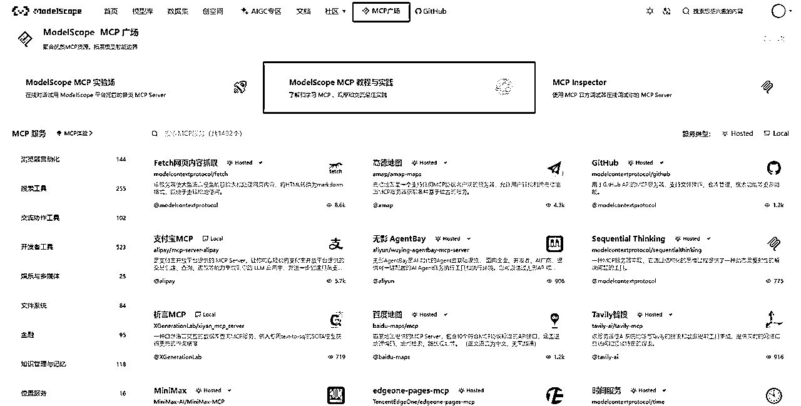

# 小白也能看懂：MCP到底是什么？怎么使用？附5个值得收藏的MCP资源网站

继OpenAI、Google相继宣布支持MCP之后，国内的阿里、腾讯也开始跟进，百度据悉也在筹备自己的MCP Store。

从这个趋势来看，MCP已经不只是一个小众技术，而正在逐渐成为智能体生态中的基础设施。把它类比成智能体时代的“HTTP”，并不夸张。

未来，很多智能体都可能借助MCP重新构建。

所以，如果你还完全不了解MCP，确实有必要尽快补补课。

# 一、MCP究竟是什么？

MCP，全称是 Model Context Protocol，也就是“模型上下文协议”。

它最早由 Anthropic 开源，用来解决一个问题：

> 如何让AI安全、统一地连接外部数据、工具和服务？

它采用的是客户端—服务器架构。简单来说，AI客户端可以通过MCP Server访问外部资源，例如：

- 文件和文档
- 数据库
- 搜索引擎
- 各类API
- 浏览器
- 图片生成服务
- 自动化操作工具

MCP Server就像一个中间层，把这些外部能力按照统一方式提供给AI使用。

它不仅可以提供数据，还可以提供工具和提示模板。比如：

- 把本地文件交给AI读取
- 让AI查询数据库
- 让AI调用搜索服务
- 让AI操作浏览器
- 让AI执行某些自动化任务

这些服务通常会与Claude Desktop、Cursor、Roo-Code等AI工具建立安全连接。每个MCP Server可以管理自己的资源和权限，避免AI毫无边界地访问所有内容。

如果把官方定义换成一句大白话：

> MCP就是一套统一的“AI工具接口标准”，让不同平台上的AI都能用相同方式接入各种外部能力。

# 二、没有MCP之前，智能体是怎么工作的？

为了方便理解，我们先从大模型和智能体说起。

## 1. 大模型是什么？

可以把ChatGPT、DeepSeek这类大模型想象成一个“聪明的人造人”。

我们暂且把它叫作张三。

张三拥有很强的理解和思考能力，可以和我们聊天、分析问题、写文章，但一开始它只能动脑，不能真正帮我们操作外部工具。

## 2. 智能体又是什么？

为了让张三真正做事，我们给它安装了一套“假肢”，这套假肢可以理解为 Function Call，也就是函数调用能力。

有了它，张三就可以调用一些工具。

比如，我们给它准备：

- 菜刀
- 画笔
- 计算器
- 搜索工具
- 文件读写工具

但光有工具还不够，张三还需要知道这些工具分别有什么作用、应该什么时候用、具体怎么使用。

于是，我们又为每个工具写了一份说明书，并把说明书放进它的系统提示词里。

当我们说：

> “请帮我切菜。”

张三会先查看自己的工具说明，判断当前有哪些工具可以完成任务，然后调用菜刀完成操作。

这种具备理解能力，同时又能调用工具完成任务的大模型，就可以称为智能体。

后来，大家又开发出了更多模型，比如李四，也就是DeepSeek。

为了方便管理这些模型，有人搭建了类似Coze、Dify的平台，把张三和李四都招进来，并为它们分别制定工具调用规则，再配上各种插件。

这样一来，这些平台就可以让AI完成写作、搜索、编程、数据处理等各种任务。

但是麻烦也随之出现了。

假设公司A开发了一套工具系统，张三和李四在公司A里工作得很好。后来公司B也想使用张三和李四，但公司A的工具规范和插件并不能直接带到公司B。

于是，公司B只能重新开发一套工具调用机制。

如果某个用户原本在公司A里定制了一套工具，后来想迁移到公司B，通常也不能直接搬过去，只能重新配置。

如果他决定自己部署模型、自己搭建智能体，那还需要再开发一套配套工具。

同样的工具，被不同平台重复开发，既浪费时间，也浪费资源。

# 三、MCP是如何解决这个问题的？

MCP的核心思路，就是制定一套大家都能遵守的统一标准。

Anthropic把工具的描述方式、调用方式、数据交互方式统一下来，要求开发者按照MCP规范制作工具。

之后，不同平台只要支持MCP，就可以直接接入这些工具。

可以把它理解成这样：

- 公司A支持MCP
- 公司B也支持MCP
- 某个开发者按照MCP标准制作了一个浏览器工具
- 这个工具就能被公司A、公司B以及其他支持MCP的平台使用

工具不再被锁定在某个平台里。

开发者只需要开发一次，其他环境就可以重复使用。

未来，很多工具甚至可以集中存放在各种MCP市场中。不同的AI客户端可以像安装插件一样，直接选择和配置需要的服务。

因此，MCP带来的最大变化就是：

> 工具与平台解耦，智能体的组装不再完全依赖某一个平台。

这会让智能体拥有更强的迁移能力、扩展能力和灵活性。

# 四、MCP可以在哪里使用？

目前，使用MCP大致有两种方式。

## 1. 直接在AI对话工具中使用

### ① Claude

下载地址：

https://claude.ai/download

Claude是Anthropic推出的产品，而MCP本身也是Anthropic提出的，所以它对MCP的支持自然比较完善。

不过，由于一些众所周知的原因，国内用户使用起来可能不太方便。

### ② Cherry Studio

官网文档：

https://docs.cherry-ai.com

如果无法使用Claude，可以尝试Cherry Studio。

它对国内用户更加友好，也支持配置MCP服务。官方还准备了比较详细的使用教程，即使是刚接触MCP的新手，也可以按照文档一步步操作。



## 2. 在编程工具中使用

### ① Cursor

官网：

https://www.cursor.com/cn

Cursor对MCP的支持比较完善，整体体验不错，比较推荐。

### ② Windsurf

官网：

https://windsurf.com/

Windsurf同样支持MCP，不过注册和使用时可能需要解决网络访问问题。

### ③ VSCode插件：Cline、Roo-Code

如果你希望在VSCode里搭建自己的AI编程环境，可以使用Cline或Roo-Code。

下面重点介绍如何通过VSCode部署和使用MCP。

# 五、如何在VSCode中配置MCP？

因为VSCode的扩展能力比较强，而且可以配合Roo-Code使用各种MCP工具，所以这里以VSCode为例进行说明。

## 1. 安装VSCode

VSCode是一款编程工具，后续安装Roo-Code、Copilot等扩展都需要用到它。

下载地址：

https://code.visualstudio.com/Download

下载安装完成后，如果默认界面是英文，可以先安装中文语言包。

打开左侧扩展面板，搜索：

```text
Chinese
```

然后安装中文语言扩展。


安装完成后，按下：

```text
Ctrl + Shift + P
```

在弹出的命令框中搜索：

```text
language
```

选择：

```text
Configure Display Language
```


接着选择“中文（简体）”，重启VSCode即可完成语言切换。


## 2. 安装Roo-Code

Roo-Code最初叫Roo-Cline，是Cline的一个分支。

它既可以辅助编程，也支持接入MCP工具。与普通AI编程插件相比，Roo-Code最大的优势之一，就是可以配置多个外部工具。

在VSCode扩展市场中搜索：

```text
Roo Code
```

找到图标类似火箭的那个扩展，进入后点击安装。


## 3. 安装GitHub Copilot

Copilot是GitHub推出的AI编程助手。

虽然它也可以独立用于代码编写，但这里主要利用它提供的模型能力，让Roo-Code调用GPT-4和Claude等模型。

Copilot免费版通常提供一定数量的代码补全额度，专业版价格约为每月10美元，对于经常写代码的人来说，性价比较高。

在扩展市场中搜索：

```text
Copilot
```

安装相关插件即可。


安装完成后，点击VSCode右下角的Copilot图标，选择允许，然后跳转到GitHub页面登录。

如果没有GitHub账号，需要先注册一个。


如果你使用的是新版VSCode，Copilot入口可能已经换了位置，可以在这个区域寻找：


在GitHub页面完成登录后，点击“打开”或“继续打开”，返回VSCode。


## 4. 把Roo-Code和Copilot连接起来

工具安装完成后，还需要让Roo-Code使用Copilot提供的模型。

打开Roo-Code设置页面。


找到模型提供商设置，将：

```text
API Provider
```

设置为：

```text
VS Code LM API
```

设置完成后，下方应该会出现Copilot支持的模型列表。

你可以根据需求进行选择。例如Claude 3.5在代码编写方面表现不错。


为了让Roo-Code能够更完整地执行任务，可以根据需要开启相关权限选项。



配置完成后点击Save，再点击Done退出设置。


接下来可以进行简单测试。

首先打开一个文件夹作为工作区，这样AI后续创建和查找文件会更加方便。


例如，可以给Roo-Code安排这样的任务：

> 请分析2024年的房价走势，并整理成一个HTML网页报表。


之后，Roo-Code会自动分析任务、编写代码、生成页面。


任务完成后，打开生成的网页，就可以查看最终效果。


# 六、进一步使用MCP：让AI获得更多能力

刚才生成的房价页面，数据主要来自模型自身的知识，并没有真正访问互联网。

这就意味着，数据的时效性和准确性可能不够高。

如果希望AI获取最新信息，就需要给它增加搜索或浏览器能力。

这时候，MCP就派上用场了。

你可以把MCP想象成USB接口：

> 只要工具按照统一的接口标准开发，AI就能像插入USB设备一样使用它。

目前Cursor、Windsurf、Roo-Code等工具都支持MCP，使用思路基本相同。

有人可能会担心：

> “难道我还要自己写代码开发MCP吗？”

其实不一定。

Roo-Code本身就可以协助创建和安装MCP工具。下面以两个实用案例为例：

1. 浏览器自动化工具  
2. 图片生成工具  

当这些工具都接入VSCode后，VSCode就不再只是一个代码编辑器，而会逐渐变成一个具备多种能力的智能体工作台。

# 七、案例一：给AI接入浏览器能力

## 1. 为什么需要浏览器工具？

如果只是进行普通搜索，通常需要接入搜索API。

但很多搜索API需要收费，免费服务的质量也不一定稳定。

因此，可以让AI模拟真实浏览器访问网站、搜索内容、分析页面，这也是一些自动化智能体常用的方式。

当然，如果你的需求只是“搜索几条信息”，直接接入搜索API通常更快速、更稳定。

之所以推荐浏览器自动化，是因为一旦浏览器能力跑通，后续还可以继续扩展到：

- 自动打开网页
- 自动填写表单
- 自动抓取资料
- 自动操作后台
- 自动生成网页
- 自动完成各种重复性流程

这会为AI自动化带来更多可能。

## 2. 安装浏览器MCP

可以在GitHub上找到mcp-playwright项目：

https://github.com/executeautomation/mcp-playwright

这是一个基于Playwright的浏览器自动化工具。

进入项目页面后，找到安装说明。


然后把安装指令复制给Roo-Code，让它协助完成安装。


这里提醒Windows用户注意：

直接使用npx安装时，可能会遇到各种路径、依赖或权限问题。我在Windows上就曾经折腾了很久。

后来找到了一份专门针对Windows的安装说明：

https://github.com/trevorwilkerson/Windows-MCP-Server-Installation-Verification-Guide


如果英文文档看起来比较吃力，也不用逐句研究。

可以把README的全部内容复制下来，交给Roo-Code，让它按照说明协助处理Windows环境下的安装问题。


后续如果Roo-Code询问是否执行命令，一般根据提示运行即可。

当界面出现对应的成功提示，就说明安装完成了。


接着打开MCP Server配置页面。



如果能看到刚才安装的服务，基本就代表浏览器MCP已经成功接入。

## 3. 实战：搜索热点并生成网页

可以让Roo-Code通过百度搜索热点新闻，然后把搜索结果整理成一个网页。

首次执行时，注意查看：

```text
Always allow
```

如果没有选中，建议勾选。这样之后执行同类操作时，就不需要反复确认。


Roo-Code会自动打开网页，分析页面结构，通过模拟点击和读取网页内容的方式找到需要的信息。

这种方式的缺点是流程比较复杂，单纯为了获取搜索结果，效率可能不如直接调用搜索API。

但它的价值在于：AI真正获得了浏览器操作能力。

任务执行完成后，可以运行生成的网页。


点击Run Command后，Roo-Code会自动打开页面，最终效果如下：


浏览器自动化跑通之后，还可以继续尝试各种网页采集、自动化操作和爬虫类任务。

## 4. 实战：根据网页内容改写并重新排版

在实际工作中，我们经常希望AI参考某个网页内容。

如果每次都要手动复制粘贴，效率会比较低，因此，直接让AI读取链接非常重要。

我也尝试过一些网页抓取MCP，比如fetch，但在读取头条、微信👸号文章时，可能会遇到Robot协议、登录限制等问题。

相比之下，使用浏览器模拟访问往往更容易成功。

例如，可以给Roo-Code一个网页链接，让它读取内容，再根据要求重新组织、改写并制作新的页面。


等待AI完成分析和制作。


浏览器工具配合AI编程软件之后，可以完成很多复杂工作，包括内容整理、网页仿写、自动化脚本、资料采集等。

# 八、案例二：接入图片生成能力

VSCode本身并不具备图片生成能力。

如果在制作网页时需要配图、示例图片或背景素材，就只能额外寻找图片资源，过程比较麻烦。

这时，可以通过MCP接入图片生成工具。

## 1. 准备图片生成接口

这里使用硅基流动提供的图片生成接口：

https://docs.siliconflow.cn/cn/api-reference/images/images-generations

打开页面后，找到CURL示例，将其中的请求内容复制下来。

注意：

```text
<token>需要替换成你自己的Token</token>
```


登录硅基流动后，可以在对应位置创建Token。


拿到Token并替换完成后，把完整的CURL请求交给Roo-Code，并告诉它：

> 请根据下面这段CURL请求，创建一个图片生成MCP工具。


Roo-Code会自动开始创建相关工具。

过程中如果出现安装确认，需要手动输入：

```text
Y
```

然后按回车继续。


后面如果出现其他配置选项，通常直接使用默认值，按回车即可。


完成之后，你就可以在Roo-Code中调用图片生成能力，让AI根据网页需求自动制作配图。

# 九、总结

MCP的核心价值，可以归纳为三点：

1. **统一标准**：不同平台可以用相同方式接入工具。
2. **一次开发，多处使用**：工具不再绑定某个特定平台。
3. **扩展智能体能力**：AI可以连接搜索、浏览器、数据库、图片生成等外部服务。

以前，智能体像是一个只会思考、不会行动的人。

Function Call让它拥有了操作工具的能力，而MCP则进一步统一了这些工具的连接方式。

从长远来看，MCP有可能成为AI应用生态中的基础协议。

无论你使用Claude、Cherry Studio、Cursor、Windsurf，还是VSCode里的Roo-Code，只要平台支持MCP，就可以不断为AI增加新的能力。

对于普通用户来说，不一定要马上学会开发MCP Server，但至少应该知道：

> MCP不是某一个软件，而是一套让AI连接外部工具和数据的通用标准。

一旦理解了这个概念，你就会发现，AI能做的事情，远不止聊天和写代码。

在实操过程中，我踩到的坑主要集中在 Windows 环境上，想一次跑通基本不太现实，路径配置反复折腾的情况很常见。实在调不顺的话，可以直接找我要我整理好的源码，环境相近基本就能直接跑通，就算用不上，也可以把它丢给 AI 当参考范本。

#### ②、案例1：让AI自动出图并直接成站

在 Roo-Code 里粘上下面这段指令就能开启建站流程：


工具会自动完成图片生成，并把素材写入网页，最终呈现为一个在线站点


打开预览后效果是这样，哈哈哈，用免费模型生成的图确实有点丑。

不过关键流程已经打通了，后续只要把 ComfyUI 的接口接进来，图片质量就能完全不一样。


#### ③、案例2：一键写稿+自动配图

再来试试让它帮我写文章并配图，用的提示词是：



等模型跑完来看结果，整体超出预期：


上面只是最基础的演示，真正的玩法还有很多，得靠大家自己去发散。

比如把 PPT API 接上，是不是就能自动出 PPT 了？
再比如接入视频生成接口，是不是就能实现一键出视频？
可能性真的很大，而且工具会越来越成熟。

这里以 VSCode 为例演示，其他的代码编辑器原理都差不多。

# 最后，给你整理了一些靠谱的 MCP 市场清单，找工具不用再盲搜

## 1、魔塔社区（推荐）

https://modelscope.cn/

做 AI 的人都知道魔塔，它是国内头部模型仓库之一，模型种类非常全。
现在它也上线了 MCP Server 市场



强烈建议去逛逛，除了有 MCP 商城，还配了详细教程和在线调试功能，用起来很顺手。

另外，支付宝的支付交易类 MCP 是首发在魔塔社区的，这个资源别家目前还没有。

## 2、阿里云百炼

https://bailian.console.aliyun.com/?tab=mcp#/mcp-market

## 3、腾讯云开发

https://tcb.cloud.tencent.com/

腾讯云开发最近也悄悄支持了 MCP，最大的亮点是自带 Agent 智能体开发能力，可以直接调用 MCP 并把智能体部署到👸号或小程序上。目前市面上能做到这一点的很少。

## 4、smithery

https://smithery.ai/

## 5、pulsemcp（推荐）

https://www.pulsemcp.com/

最后这两个是我 MCP 刚出来时就在用的国外站点，资源也很丰富。当时国内的平台还没起来。如果在国内市场找不到合适的工具，可以去这两个网站碰碰运气。