最近AI圈有个大新闻：OpenAI、谷歌表态支持MCP之后，国内阿里、腾讯也迅速跟上，据说百度也在筹备自家的MCP Store。这架势，MCP简直要变成智能体世界的“普通话”了，说它是AI时代的HTTP协议，真的一点都不夸张。

有人甚至放话：所有智能体都能用MCP重做一遍。如果你到现在还不清楚这玩意儿是啥，那就真的有点跟不上节奏了。

## 先说人话：MCP到底是个啥？

MCP Server 是 Anthropic 搞出来的一个开源协议，核心目的就是让AI系统能安全、标准地接上各种数据源。它走的是客户端-服务器架构，给AI助手提供了一套统一的方式去调取外部数据、工具和提示。

你可以把它理解成一个“万能插座”：文件、文档、数据库、API，只要能暴露出来，MCP Server 就能让AI助手安全地拿到实时信息。它跟主机应用（比如Claude Desktop）之间保持着一对一的加密连接，自己管好自己的资源，边界清晰，安全性也有保障。

说实话，我虽然是程序员，但看到那种一堆术语的官方定义也头大。为了让大家秒懂，我换种方式讲。

## 没有MCP之前，智能体是怎么活下来的？

先区分两个概念：大模型 vs 智能体。

大模型就好比一个叫“张三”的人造人，他脑子聪明，但只会聊天，手脚不灵活。为了让张三干活，大家给他装上了假肢（Function Call），还配了各种工具，比如“菜刀”“笔”，再把使用说明写成提示词，塞进假肢芯片里。张三干活前先看说明书，找合适的工具用。

这时候，像这样能调用工具的大模型，就叫智能体了。

后来，又出来个“李四”（DeepSeek），为了管好这些AI，有人成立了公司A（比如Coze、Dify），给张三李四定制了管理制度和专属工具。一切挺好，但问题来了——公司B也找来张三李四，却没法用公司A的制度工具，只能从头再搞一套。

于是悲剧发生了：同样的工具，A公司能用，B公司不能用；你在A公司花了心思做的工具，换到B公司全得重来；想自己单干（自己部署模型）？还得再配一遍工具。

大量重复劳动，资源就这么白白浪费了。

## MCP是怎么破局的？

后来有人（Anthropic）拍板定了个标准：所有工具都按统一格式（MCP协议）开发，然后集中放到一个“工具仓库H”里。

这样一来，公司A和公司B都能采用这套制度，想用什么工具，直接去仓库H“采购”就行。你开发的工具放进去，别人也能用；别人放进去的，你也能拿。不用重复造轮子，效率一下就上来了。

技术细节我可能讲得不是百分百精准，但大方向就是这个意思。

说白了，现在只要你按MCP协议开发一次工具，甭管在哪个平台，都能直接复用。强大的智能体组装，也不再被某个平台绑死，灵活度飙升。

## MCP到底怎么用？

好消息是，每个人都能借助MCP打造自己的超强智能体。下面按场景分类来说。

### 1、通过大模型对话工具使用

- **Claude**（https://claude.ai/download）：Anthropic亲儿子，MCP就是它发明的，当然首选。但可惜，某些原因国内用不了。
- **Cherry Studio**（https://docs.cherry-ai.com）：推荐！国内用户友好的平替，官方还给准备了保姆级教程，完全不用担心不会用。

### 2、通过编程工具使用

- **cursor**（https://www.cursor.com/cn）：推荐，对MCP支持得相当好。
- **windsurf**（https://windsurf.com/）：也不错，就是注册时得拿出点“科学”本领。
- **VSCode插件：Cline、Roo-code**（cline分支）：重点讲讲Roo-code的部署，下面有详细教程。

## 手把手：如何在VSCode里部署MCP？

因为我自己实践过，所以拿VSCode举例。

### 第一步：装好VSCode

它是这套方案的地基，所有插件都装它上面。下载地址：https://code.visualstudio.com/Download，装完默认是英文，可以装个中文扩展，按快捷键 `Ctrl+Shift+P`，输入“language”，选择“Configure Display Language”，挑中文简体，重启就完事。

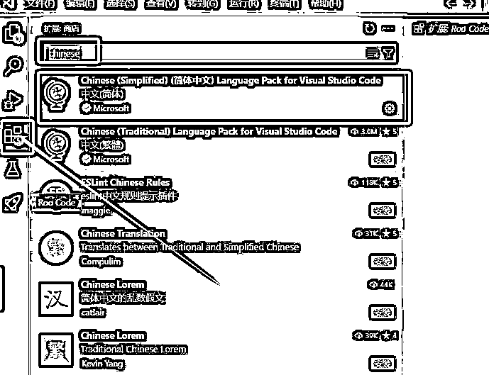
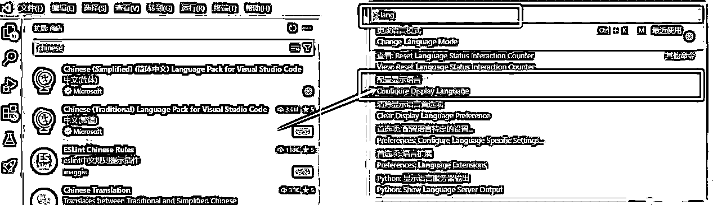
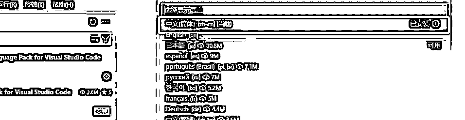

### 第二步：安装Roo-Code

Roo-Code原名Roo-Cline，是Cline的分支，现在做得相当不错，可以AI编程，用不上cursor的话可以考虑它。选它的关键就是支持MCP，能挂载各种辅助工具。进扩展，搜“Roo Code”，认准那个火箭图标，点安装。

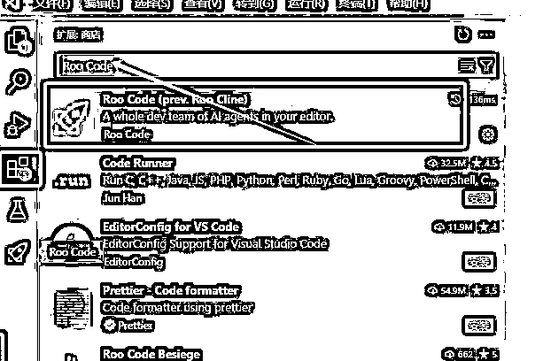

### 第三步：安装Copilot

GitHub出品的编程工具，虽然编程能力我觉得不如Roo-Code，但胜在支持GPT-4.0和Claude3.5的调用。免费版有2000次代码补全额度，专业版也才10美元一个月，比Cursor和Windsurf都便宜，对我来说是个高性价比选择。安装也简单，扩展里搜“copilot”即可。

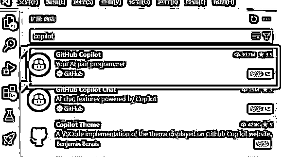

装完后，点右下角那个标志，点“允许”，跳到GitHub登录。没有账号就注册一个。

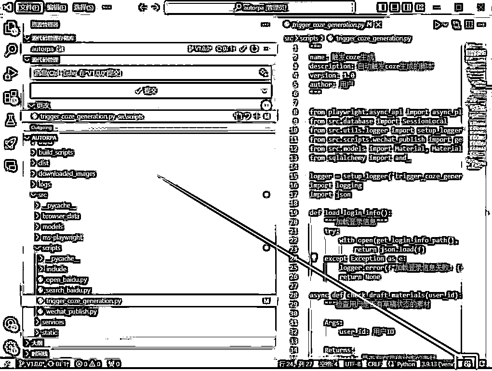

提示：最新版VSCode按钮位置可能不一样，大家灵活找一下。

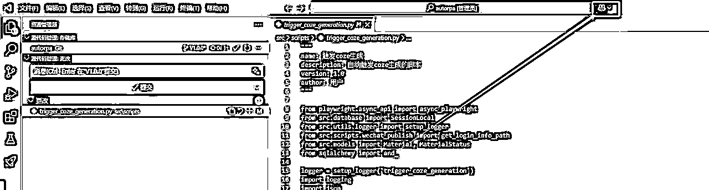

登录成功后，点“打开”跳回VSCode就OK了。

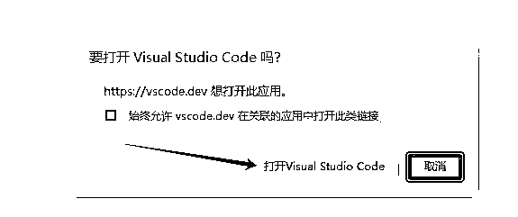

### 第四步：配置Roo-Code

工具都装齐了，现在把Roo-Code和Copilot的大模型打通。

找到Roo-Code，点设置：

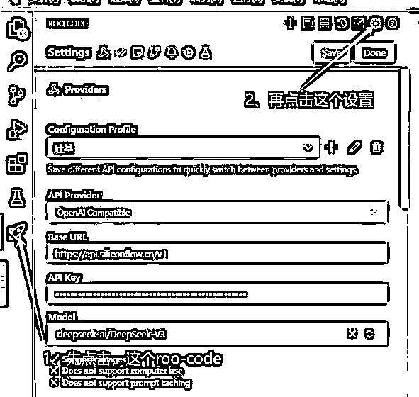

API Provider 选“VS Code LM API”，下面就能看到Copilot提供的模型了。我选的Claude3.5，代码能力强。

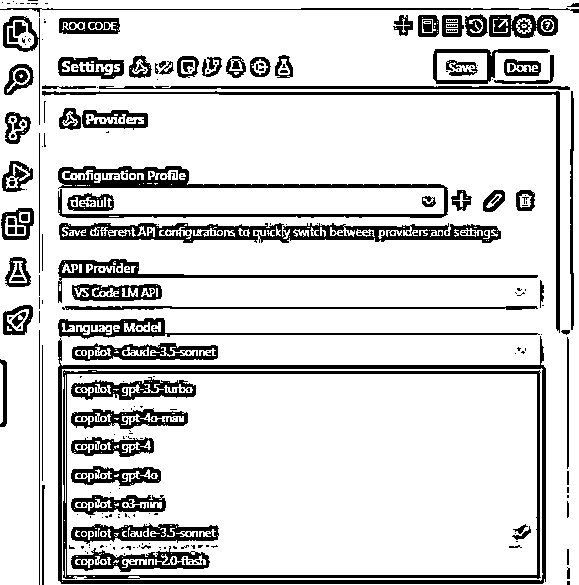

为了让AI放手干活，下面权限选项全勾上。

点保存，再关掉设置页。

来测试一下：先打开一个文件夹当工作区，方便待会找文件。

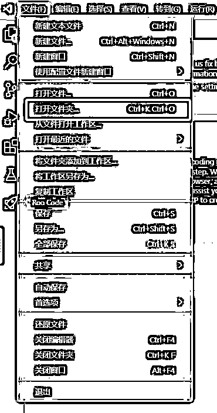

我给它派了个任务：分析2024年房价走势，做成报表并在HTML页面上展示。

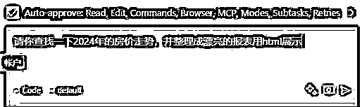

然后AI就自己吭哧吭哧写代码做网页了，过了一会儿就交卷了。

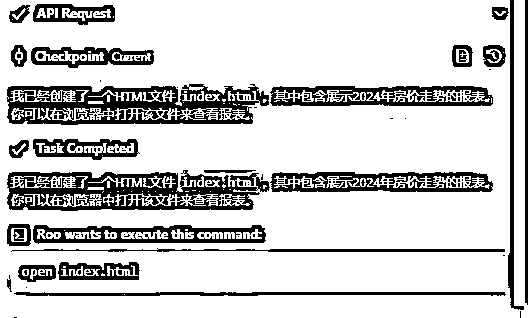

打开网页一看，效果还真不赖！

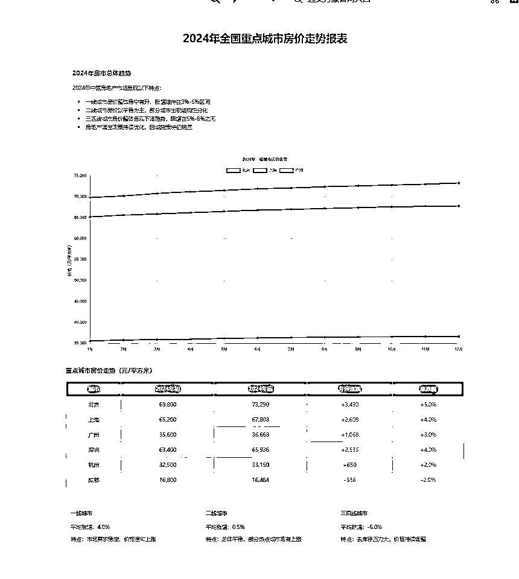

### 第五步：进阶！真正玩转MCP

细心的你肯定发现了，刚才那个网页压根没用搜索工具，数据全靠模型“脑补”，准确性存疑。想要靠谱的数据，得让Roo-Code能上网搜。怎么搞？用MCP。

再解释一次：MCP（Model Context Protocol，模型上下文协议），就是给LLM和外部数据/工具做无缝集成的开放标准。通俗点，你就当它是USB接口——任何工具，只要按这个标准开发，插上就能用。

现在Cursor和Windsurf也都支持MCP了，道理都一样。

那小白是不是还得自己写代码？放心，Roo-Code内置了MCP创建功能，AI能帮你完成。一步步来，今天先搞定两个超实用的MCP服务：

1. 浏览器工具
2. 图片生成工具

搞明白没？把各种工具一集成，你的VSCode瞬间就变成了一个强大的智能体。

### （1）浏览器工具

#### ① 先分析一下搜索服务

自己接搜索API吧，好用的基本都收费，免费的又不太行。所以我想了个招：让AI模拟浏览器去访问网站搜索，这可是Manus常用的套路哦。单纯搜索的话，API确实更稳定，但模拟浏览器这套一旦打通，以后写各种自动化脚本就手到擒来，为AI和自动化打开无限可能。

#### ② 添加浏览器MCP

GitHub上有个工具叫mcp-playwright，地址：https://github.com/executeautomation/mcp-playwright，是个浏览器自动化神器。找到安装说明，直接丢给Roo-Code帮我们装。

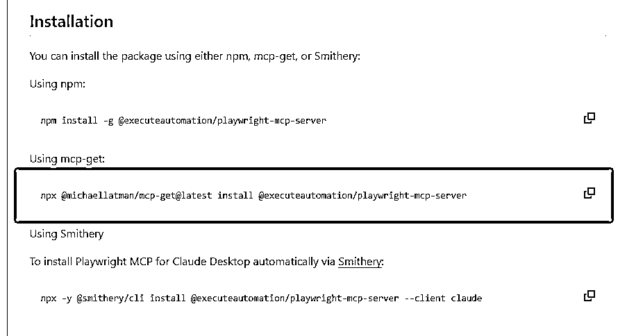
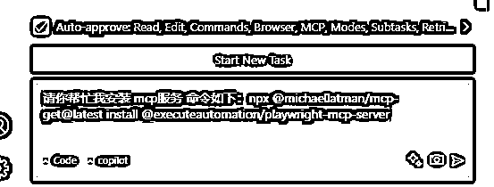

注意！Windows用户有坑要避！Windows下用npx安装经常出问题，我折腾了四五个小时都没搞定。后来搜到一套Windows专用方案：https://github.com/trevorwilkerson/Windows-MCP-Server-Installation-Verification-Guide，大致就是说Windows装MCP需要特殊处理路径啥的。别怕英文，把README内容全复制，丢给Roo-Cline就行。

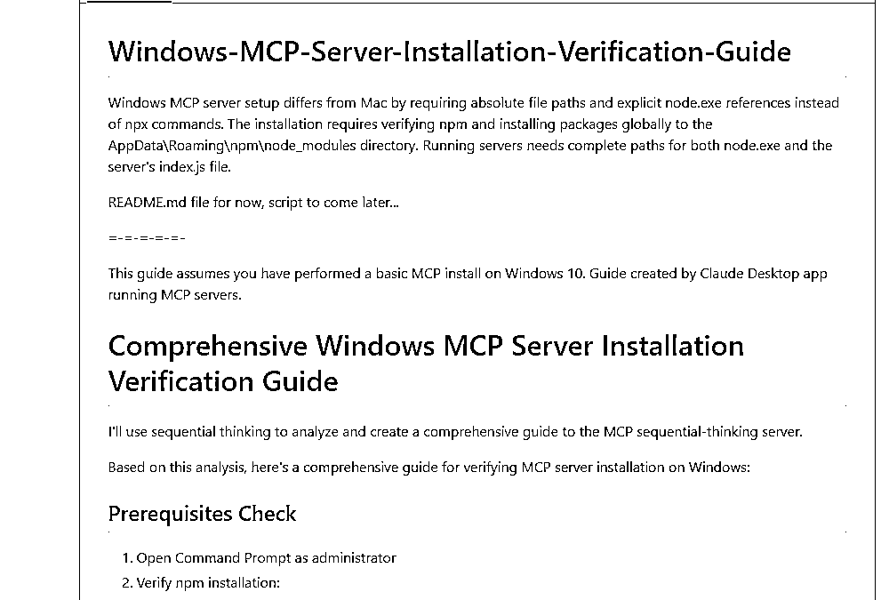
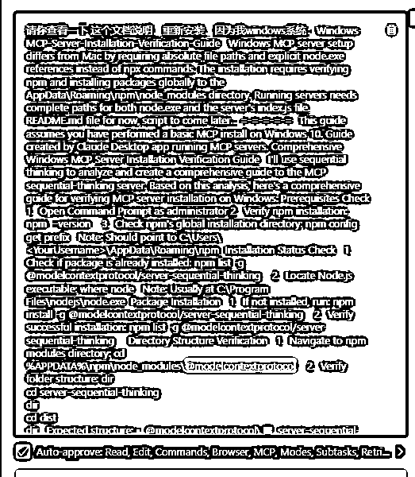

之后基本就是它提示执行命令，你一路点`runCommand`，最后看到成功信息就说明装好了。

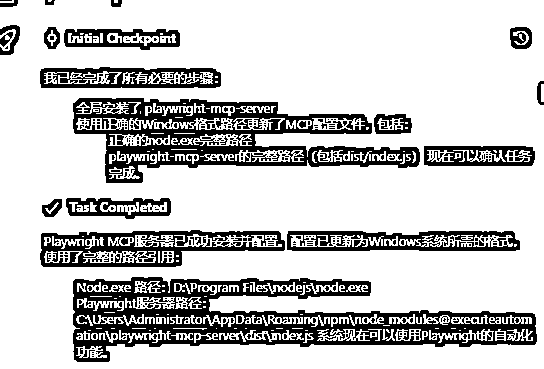

去MCP_Server配置里看一眼，确认安装成功。

#### ③ 小试牛刀：搜索热点并生成个性分享

我让AI用百度搜热点新闻，再整理成一个网页。第一次跑的时候，记得把“Always allow”勾上，之后它就能自动执行不用再问你了。

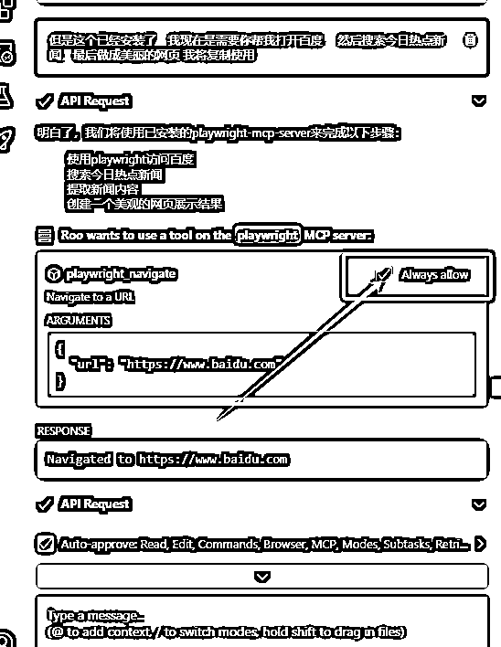

接下来就等着Roo-Code表演：打开网站、分析源码、模拟点击、抓取内容。说实话，单看搜索功能，这套流程有点繁琐，真不如API一步到位。如果你只是要搜索内容，用必应搜索API之类的会清爽很多。

好了，跑完之后：

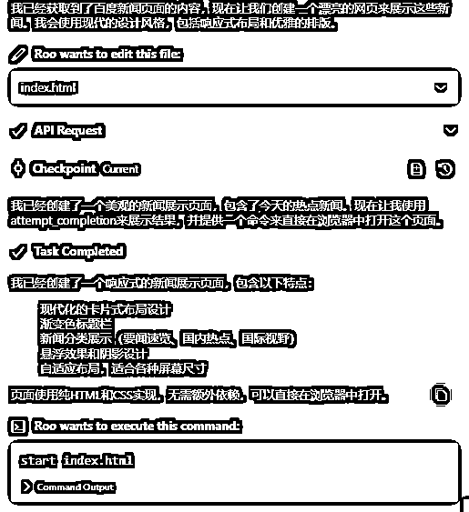

直接执行`Run Command`，Roo-Code会自动帮你打开做好的网页，效果如下：

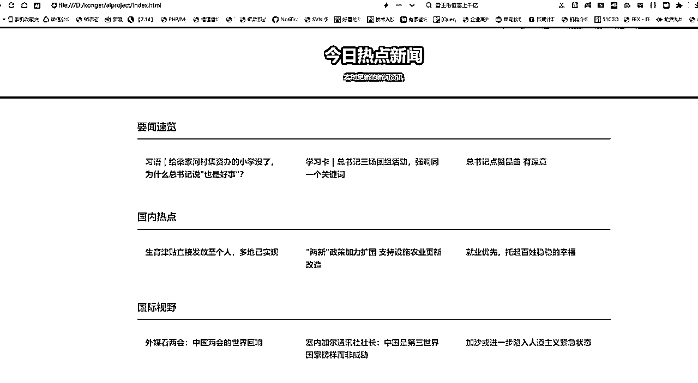

浏览器自动化一旦跑通，可玩的东西就多了。再来个例子：

#### ④ 根据链接仿写内容并重新排版

做内容经常需要AI参考某个链接的文章，如果靠复制粘贴效率太低，所以“链接读取”应该是AI的必备技能。我之前试过其他读取网页的MCP工具（比如fetch），读头条和微信公众号文章时，不是被robots协议挡，就是被登录拦，根本抓不到。测来测去，还是模拟浏览器自动化最好使。

来看个实例：

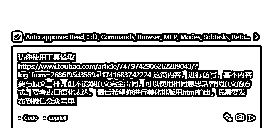

AI帮我们制作完成后：

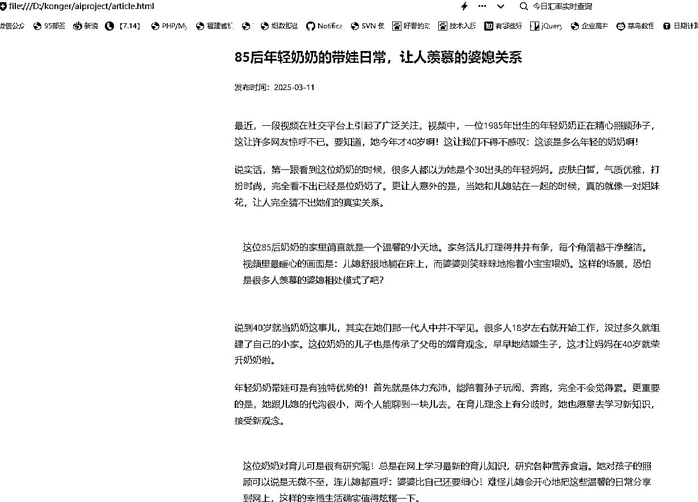

浏览器工具+编程软件的组合，能搞定的事情实在太多了。爬虫、自动化，通通不在话下。

### （2）图片生成工具

编程软件本身不支持生图，但做网页设计时经常需要示例图，每次去网上找太麻烦，干脆接一个生图工具。

#### ① 安装图片生成工具

这次换个玩法，展示MCP的另一种安装方式：让Roo-Code自己创建工具，而不是装现成的。

打开网站：https://docs.siliconflow.cn/cn/api-reference/images/images-generations，这是硅基流动的免费图片生成模型。把CURL里的内容复制出来，记得把`<token>`换成你自己的token（登录硅基流动后，在个人中心能找到）。

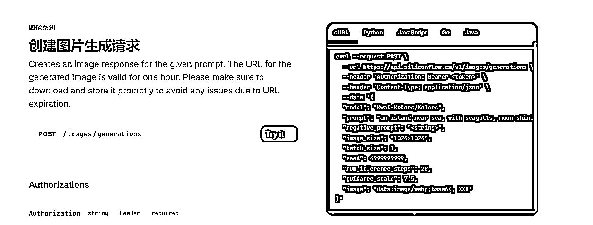
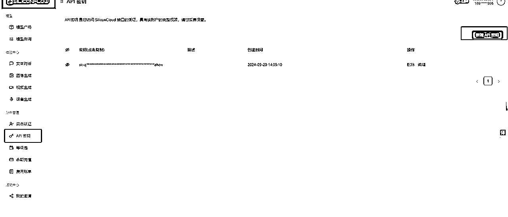

把替换后的完整内容丢给Roo-Code，提示它：“请你根据以下curl请求，创建一个图片生成MCP工具。”

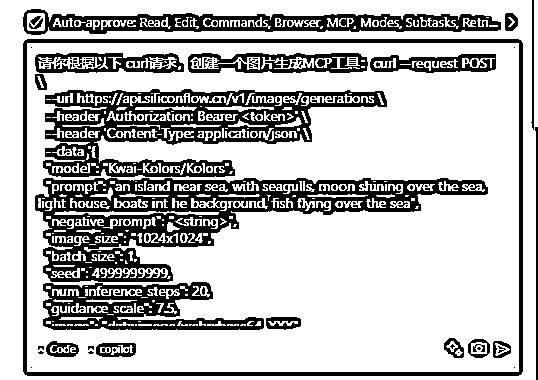

创建过程中，有一步需要手动输入`Y`确认，其他选项默认回车即可。

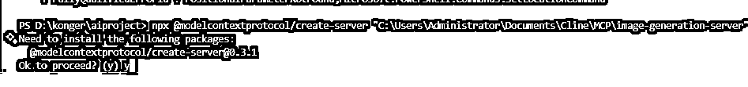

通过这一串操作，你就会发现：VSCode已经从一个纯编辑器，进化成了会查资料、能上网、能做图的全能型智能体。MCP这个“USB接口”的妙处，你get到了吗？

先说几个容易踩雷的地方：在 Windows 环境下，整个流程并不一定能顺利一次跑通，尤其是路径配置，经常需要反复排查和调整，调试起来可能会花不少时间。

如果你确实遇到了环境问题，始终无法配置成功，也可以找我获取一份现成源码。只要本地环境与源码要求相近，基本可以直接运行；即使仍有小问题，也能把源码交给 AI，辅助分析和修改。

#### ②、案例1：让AI自动生成图片，并将图片制作成网站

打开 Roo-Code，在其中输入下面这段提示词，开始创建网站：

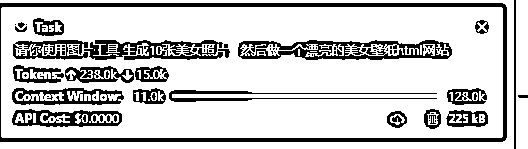

提交之后，工具会按照要求自动生成图片，并进一步把生成的内容嵌入网页，最终整理成一个完整的网站。

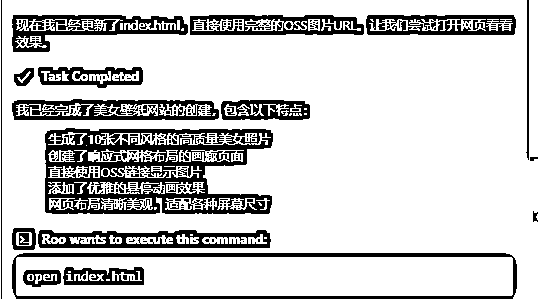

我们打开最终效果看一下。不得不说，免费模型生成出来的图片，审美确实还有提升空间，哈哈。

不过，整个流程一旦跑通，后面就有了更多可能。比如接入 ComfyUI 接口后，就可以调用更强的工作流和模型，图片质量、风格以及生成效果都会有很大的提升。

#### ③、案例2：自动创作文章，并同步完成配图

接下来再试试让它同时负责文章撰写和图片生成，看看实际表现如何。输入以下提示词：

等 AI 执行结束后，再检查一下结果，整体效果还是相当不错的：

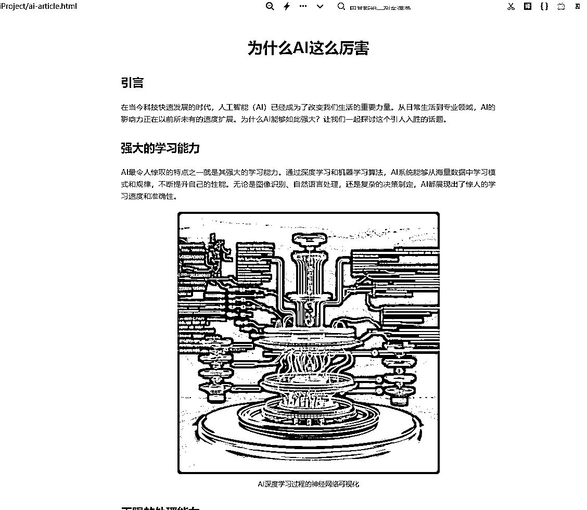

上面只是两个基础演示，真正值得探索的，是后续不断扩展的应用场景。

例如，接入 PPT API 后，是否就能让 AI 自动制作演示文稿？

再比如，对接视频生成 API，是不是就可以实现一键生成完整视频？

这正是这类工具最有意思的地方：能力边界还在不断拓展，未来的玩法几乎没有上限，而且相关功能也会越来越成熟。

本文主要以 VS Code 为例进行介绍，换成其他编程工具，整体思路基本一致，操作方式也不会有太大差别。

# 最后，给大家整理几个值得关注的 MCP 市场，找工具、接服务都更方便

## 1、魔塔社区（推荐）

https://modelscope.cn/

如果你长期关注 AI 领域，相信对魔塔社区不会陌生。作为国内规模较大的模型平台，这里汇集了大量不同类型的 AI 模型和相关资源。

顺应 MCP 的发展趋势，魔塔社区近期也上线了 MCP Server 相关内容：

比较推荐大家去体验一下。除了提供 MCP 市场，它还准备了配套教程，并支持在线调试 MCP，对新手来说非常友好。

另外还有一个值得关注的地方：支付宝开发的支付交易相关 MCP，首次就是在魔塔社区发布的，这项资源目前在其他市场上并不常见。

## 2、阿里云百炼

https://bailian.console.aliyun.com/?tab=mcp#/mcp-market

## 3、腾讯云开发

https://tcb.cloud.tencent.com/

腾讯云开发也在近期加入了 MCP 能力。它比较特别的一点是，平台自带 Agent 智能体开发功能，可以直接调用 MCP。

更进一步的是，创建好的 Agent 还能部署到公众号，甚至小程序中。就目前来看，能够把智能体开发、MCP 调用以及公众号/小程序部署结合起来的平台并不多，这也是它比较突出的优势。

## 4、Smithery

https://smithery.ai/

## 5、PulseMCP（推荐）

https://www.pulsemcp.com/

最后介绍的这两个平台，是 MCP 刚开始流行时我经常使用的海外网站。当时国内相关平台还没有现在这么丰富，它们已经积累了不少工具和服务。

整体来看，这两个网站的资源类型也比较全面。如果在国内几个市场里没有找到合适的 MCP，不妨再到这两个平台搜索一番，说不定会有意外收获。