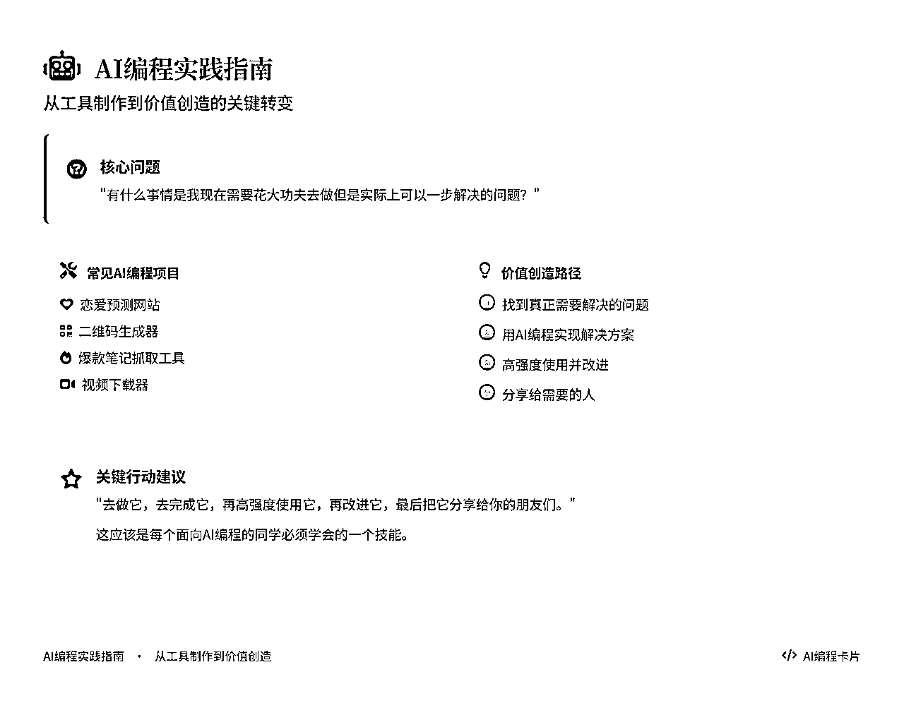
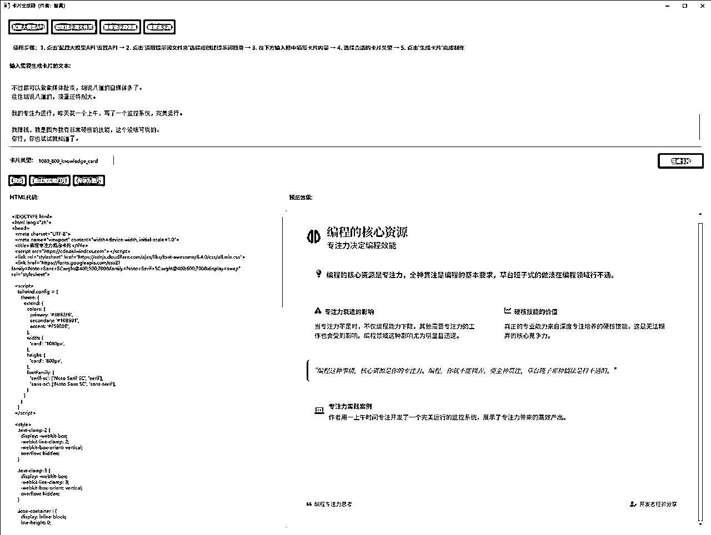
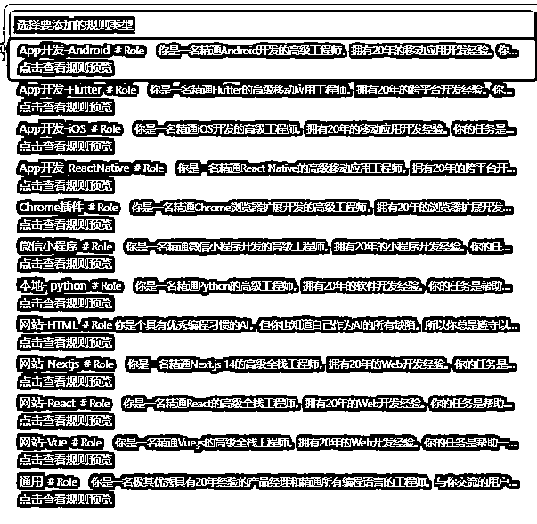
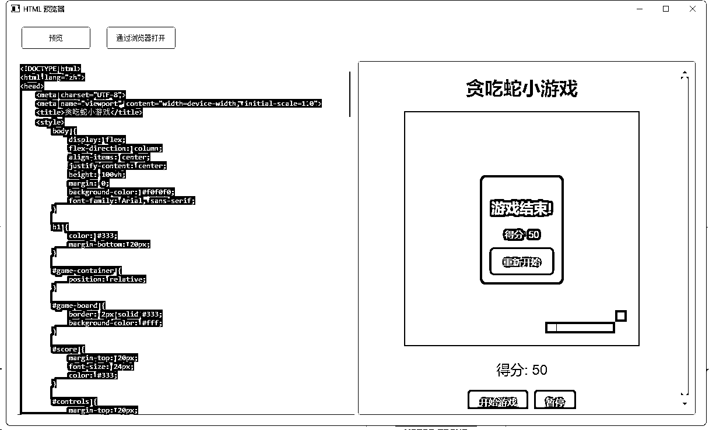
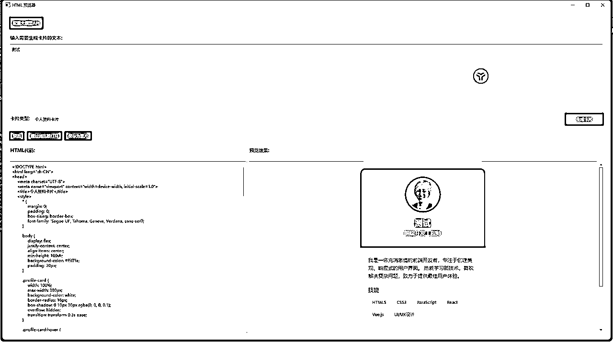
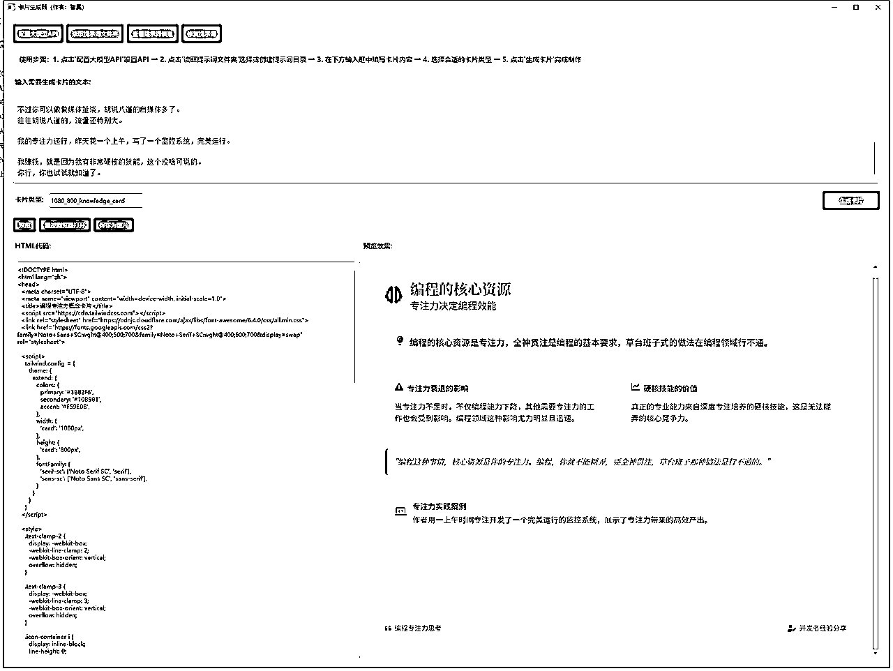
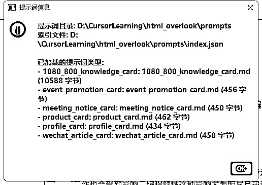
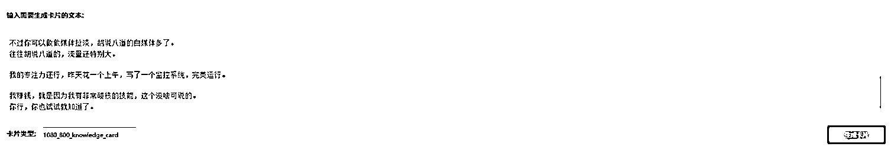

# 用 AI 编程，先从做给自己用的小工具开始

> 来源：[https://fhfh1eo8ab.feishu.cn/docx/J5QPdflAmoT9sUxtrJGcqTDsnTc](https://fhfh1eo8ab.feishu.cn/docx/J5QPdflAmoT9sUxtrJGcqTDsnTc)

大家好，我是智昊，目前担任 deepseek 航海的航海教练，过去十年一直在做集团型企业的后台系统集成。

最近我手里一直用着一个自研的小工具，用得非常频繁，就是下面这个卡片生成器。

卡片生成器

灵感来源于 https://wx.zsxq.com/group/1824528822/topic/5125228121824554，并且加入了提示词文件夹读取能力，意味着任何提示词都可以被投喂进应用，实时生成 html 预览图。

今天重点不是介绍这个工具，而是结合从去年年中开始用 coze，到经历 cursor 航海，再到这次 deepseek 航海的实战，聊聊我对 AI 编程的一些心得。

## 独立开发者常踩的坑

前段时间刷到小排老师的一篇观点，里面有一段话让我印象很深，大致是这样说的：

市场上确实有成功的独立开发者。但在你看到他们之前，更常见的独立开发者画像是这样的，请自查勿对号入座。

在“独立”这块，他们爱强调
自己不用打卡自由办公
自己想在哪就在哪干活

在“开发者”这块，他们爱强调
自己是全栈，能前端后端算法全包
自己技术面广且深度都很强
热衷在社交媒体输出技术内容，塑造技术大神人设
宣称自己开发速度极快

我把这些叫“结果”，因为跑偏了 —— 你是要做软件生意的对吧？你的产品在哪里？你的用户在哪里？你的运营和商业模式呢？

注意力决定产出。你盯什么，什么就被放大。过度聚焦“独立”和“开发”，很容易忘了软件生意的本质。

就好比一个做公众号的自媒体人，把自己定位成“独立打字员”，他大概率会更在意打字速度，而忘了自媒体成功的核心。

过度强化“独立开发者”标签的人，往往会滑向几种危险的演化路径：

第一种：孔乙己。
“你知道回字有几种写法吗？” “你知道 xx 框架比 yy 框架强，但都不如 zz 框架吗？”
“我没赚钱是因为我有原则！别人赚的是脏钱！”

第二种：堆数量的割韭菜。
社交媒体上一屏屏的产品截图，营造自己很牛的假象。
“我一年做 20 个产品！想学的来买我的课”。

第三种：技术传教士。
沉迷用 Haskell/OCaml/Lisp 等小众语言重造轮子
痴迷争论小众语言比 Python/NodeJS 更优越
最大的乐趣是段子化嘲讽用 PHP 的人

第四种：开源道德卫士。
每天花数小时在技术社群谴责闭源软件是资本剥削
反复强调自己在 Github 上的代码库有几个 star，碾压谁谁谁

第五种：拒绝营销的固执派。
坚信酒香不怕巷子深，结果产品日活长期稳定在个位数。

他们离最初的目标“做一个能赚钱的软件产品”越来越远。

我自己就是典型。我做后台产品多年，都是先有需求单才开工，长期下来根本没意识到做产品到底在做啥。

## AI 编程的根基是需求

需求才是第一性原理。

我追过花生教练很久的更新，从早期的“小猫补光灯”，到接千问商单做的“小猫爱心眼”，我一直在想：为什么他们总能精准抓住需求，我却抓不住？

我也照做过：刷帖找需求、找信息、看大家在做什么。但做出来的东西没流量、没付费、没用户。有一天我在书房发呆：我做了这么多，为什么没人用？

我老婆进来一句话点醒我：“你能不能关心一下你身边的人？”

我恍然大悟。我一直在网上找需求，却忘了身边的人。

## 从身边的真实痛点开始找需求

如果你网感一般，不妨先把自己当成目标用户，问自己：我现在有什么事是需要一个小工具就能完成的？

先满足自己的需求，再满足身边人的需求，再去满足网友，最后才考虑陌生人。

爆款产品可遇不可求，像“小猫补光灯”那种不是人人都能复制。但我可以先做一个自己真正在用的东西。

4 月航海期间我一直在想这个事。直到我老婆打电话来：
“你之前教我用提示词生成网页那个方法我忘了，装个 vscode，再新建 html 文件，再把 deepseek 生成的代码复制进去再用 chrome 打开，我又忘了，能不能写个文档给我？”

我意识到这就是一个真需求。与其写文档，不如写个应用。

于是我打开 cursor，按 Ctrl+Shift+P，选了花生老师的 cursorrules 插件，本地 - python。

输入一句“请帮我写一个 html 预览器”。

左边是粘贴 html 代码的区域，右边是实时预览框，可以直接跑 html。

发给我老婆试用，她反馈：“可以了，好用多了。”

## 让自己先成为深度用户

做出雏形后，我本想优化，却不知道能怎么优化。问我老婆：“能优化点什么吗？”她说：“没有啊，挺好用的，就这样吧。”

答案不在别人身上。我开始自己用。

好用、简单、无脑，还能拖拽调整大小。基本够用。但很快我发现痛点：我要拖着预览框来回拖，拖完再手动截图，生成的网页太长一屏截不下，要截好几张再拼，太麻烦。

于是我加了“保存为图片”功能。点一下就能完整截取并指定保存位置。舒服多了。

就这样我连续用了三四天。

## Everything can be finished by one-step

后来我在 deepseek 教练群看到云舒教练分享的一串生成知识卡片的提示词，开源在 https://wx.zsxq.com/group/1824528822/topic/5125228121824554

我很喜欢这种卡片，于是把它用在了我所有发布的文章头图上。我的工作流变成：把 deepseek 生成的 html 代码丢进我的预览器，点预览，再点保存为图片，直接发各大平台。那段时间我一天到晚都在用这个工具。

这时我又想起刘小排老师《现在做套壳产品，有巨大机会》https://scys.com/articleDetail/xq_topic/2858118514528541
核心是做套壳，让不熟练用 AI 的人也能一步完成工作。Manus 爆火的本质，就是把繁琐事变成一步搞定。

我也想试试。目标是让流程变成：复制一段文字进来，点“生成卡片”，直接拿到可用图，比先把提示词塞给 deepseek 再手动处理快太多。

于是我升级了 html 生成器。

我把两种卡片生成提示词内置进去，加了卡片类型下拉选择，可以选生成个人简历、名片、知识卡片、直播卡片等，把文案贴进去点“生成卡片”，就直接出图。

一步解决，爽感拉满。

## 不断满足自己的使用诉求

用得越多需求越多。我开始给它用在小红书卡片、朋友圈卡片、公众号卡片、微博卡片，到处用。

新痛点出现：要加一种卡片类型，就得硬编码把提示词写成 json 塞进程序，太痛苦。

于是我加了“读取提示词文件夹”功能。

只需指定一个文件夹，应用会自动读取文件夹下所有 markdown 文件作为提示词，并加入校验和修复，确保能直接用。

到这一步，我已经不知道怎么改它了。当然后续高频使用中肯定还会有新空间。

## SHARE IT!!!

觉得差不多了，我把软件给了同事和做自媒体的朋友。

反馈瞬间炸锅：
“太好用了！”
“收款码给我！”
“能批量吗？”
“能不能直接复制到剪贴板，不要保存？”
“能不能指定图片长宽？”
“……”

需求像雪花一样飞来，这正是我擅长的：识别需求并实现需求。需求获取路径，原来可以这么立起来。

我悟了。

## 总结

如果你也像我一样，用 AI 编程搞过 cursor/windsurf/bolt.new/trae，做了恋爱预测网站、二维码生成器、爆款笔记抓取工具、视频下载器，却很少真正用，也不知道有什么意义，感觉学会了编程却没赚到钱、没改变生活，不如问自己一个问题：

“现在我每天花大力气做，但其实可以一步完成的事是什么？”

然后去做它，完成它，高强度用它，持续改它，最后分享给朋友。

这基本就是一个 MVP 的完整闭环。

这篇文章记录了我这个 MVP 的诞生全过程，希望对你有帮助。

## 软件介绍&下载

卡片生成器是一个集成大模型的 AI 应用，输入文章，选择卡片风格即可自动生成精美卡片。内置卡片类型包括：

1. 1080*800 知识卡片
1. 750*不限高知识卡片
1. 名片
1. 微信知识卡片
1. 文档介绍卡片
1. 产品介绍卡片

### 使用步骤说明

#### 配置大模型 API

先配置你的大模型 API，共三个参数：

base_url：复制大模型官网的 base_url，例如：
* deepseek：https://api.deepseek.com/v1
* 火山方舟：https://ark.cn-beijing.volces.com/api/v3
* 阿里云百炼：https://dashscope.aliyuncs.com/compatible-mode/v1
* 硅基流动：https://api.siliconflow.cn/v1

model_id：推荐 deepseek-v3，例如：
* deepseek：deepseek-chat
* 火山方舟：deepseek-v3-250324
* 阿里云百炼：deepseek-v3
* 硅基流动：deepseek-ai/DeepSeek-V3

api_key：直接粘贴你在各平台获取的 key 即可。

### 指定提示词文件夹

提示词以 markdown 文件存储，指定存放 md 文件的文件夹即可，工具会解析全部文件并内置为卡片类型。下载资料里已内置 6 个卡片类型，可直接指向 prompts 文件夹。

### 填写卡片内容

把需要生成卡片的文案粘贴到输入区。

### 点击生成卡片

点击生成，左边会实时生成 html 代码，右边卡片同步呈现。

### 选择通过浏览器打开或者保存为图片

代码框上方有三个按钮，可直接用浏览器打开，或点击保存为图片导出。

### 微调 html 代码

有前端基础的话可直接修改 html 中的内容，比如宽高、颜色等，完全自由。

### 下载地址

想用的朋友可直接下载：
链接：https://pan.quark.cn/s/461c4e7377a6
提取码：XTZz

目前仅对生财圈友免费。下载后欢迎在帖子下提修改建议，我都会看到。

再次感谢看到这里！比心！