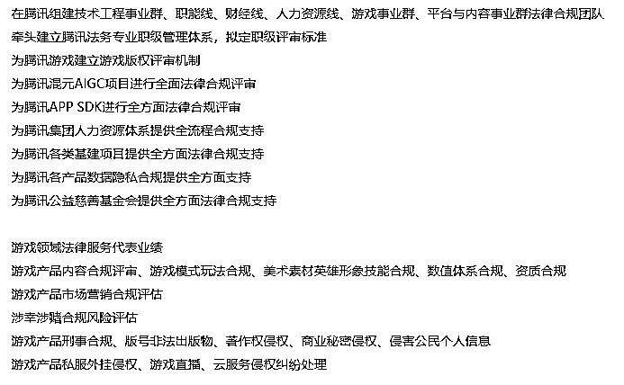
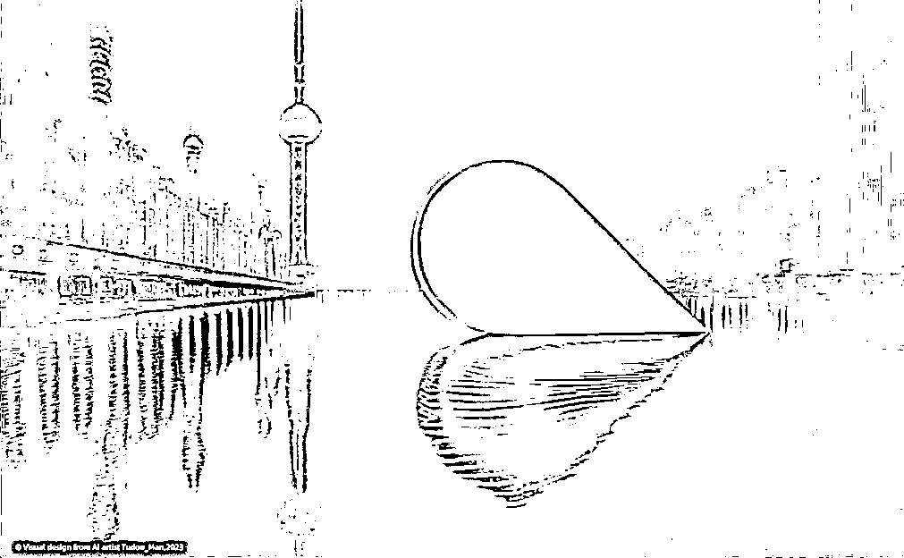
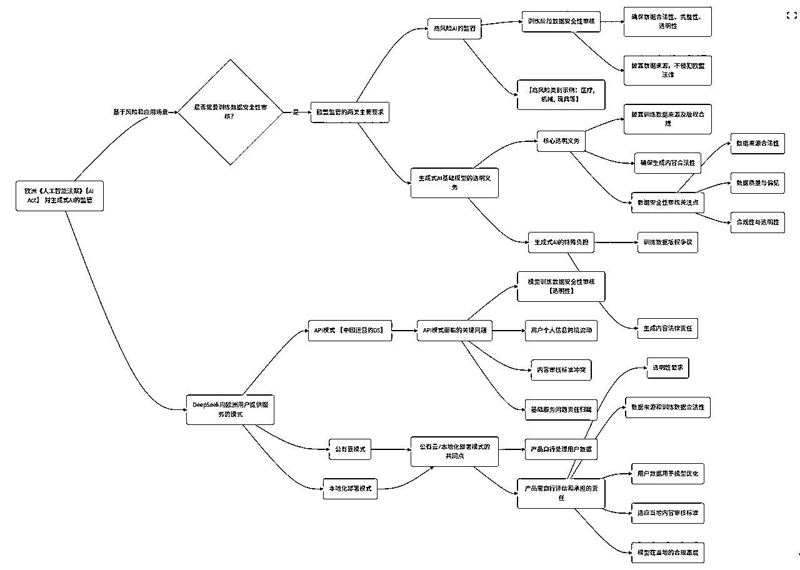
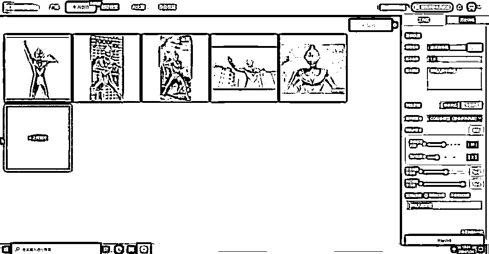

# AI 变现之前，你必须先看懂这些合规雷区

AI 已经进入到日常生产和商业化链路：辅助写作、图像生成、应用开发、流程自动化，甚至直接作为盈利点。

但要提醒的是：**效率提升不等同于风险消失**。很多人只关心模型能不能用、能不能赚钱，却忽略了更底层的判断——投喂进去的材料是否干净，模型吐出来的结果能不能用在商业场景，出了事责任算谁的。

下面内容基于公开课程、对话整理与司法案例汇总。目的不是制造焦虑，而是给做个人提效或商业化的人一个提前自检清单。

## 一、主流平台的条款怎么说权利归属

当前主流服务基本都区分“用户输入”与“模型输出”。

大体规律是：用户原本拥有的输入权益不会因上传而自动消灭；模型生成的输出在符合法律与平台规则的前提下，权益多会留给使用者。但这不等于输出天然安全、可直接商用。

### DeepSeek
平台对软件、技术、模型权重、界面、网页等享有知识产权。用户保留对提交内容的既有权利，输出内容在合法合规条件下，其权益归属使用者。协议同时允许将输入输出用于个人学习、科研、衍生开发乃至模型蒸馏等用途。

### 元宝
腾讯元宝表述简洁：用户上传的材料及基于服务生成的成果，权利归属使用者或原始权利人，平台使用本身不改变归属，前提是使用者需遵守法律。

### 文心一言
若用户依法对输入或输出享有知识产权、肖像权等，使用平台不会导致权利转移或减损，除非另有约定。百度可在法律允许范围内为服务目的对用户内容进行存储、复制、分发、传输、展示、编辑等处理。

### 通义千问
用户提供的文本、图像、音视频等为“输入”，模型结果为“输出”。平台要求输入须为原创或已获合法授权，不得侵害他人知识产权、肖像、名誉、隐私、个人信息权益及商业秘密。输入的权利归用户或原始权利人；输出在法律允许范围内，用户享有相关权益。通义保留在加密、去标识化且不可重新识别个人前提下使用内容改进服务的权利。

### Claude
输入、输出统称为 Materials。用户需对输入负责并保证具备必要的权利许可，保留输入权益；在遵守条款前提下，Anthropic 将其对输出的权利转让给用户。Claude 特别提示 AI 输出不一定准确，可能重复，且不可直接作为事实依据。

### ChatGPT
用户保留输入权利，法律允许范围内拥有输出权利，OpenAI 将自身在输出上的权益转让给用户。但输出可能不具唯一性，其他用户或得到相似结果。平台可将内容用于服务提供、维护、改进、合规与安全等。

### Monica
Monica 强调用户责任：输入不得侵犯他人知识产权、肖像、名誉、姓名、隐私、个人信息权益，不得涉及国家秘密、商业秘密、重要数据或危害公共安全内容。因用户行为导致侵权或违法，责任由用户承担，平台受损时用户需赔偿。

### 共识与误区
平台把输出权利交给你，并不等于使用即无侵权。商业化场景要额外核查：
1. 输入素材来源是否合法；
2. 输出是否实质复制或高度仿造他人作品；
3. 是否触及肖像、声音、商标、隐私、商业秘密；
4. 内容是否违反法规；
5. 条款对商用、数据训练、传播是否有额外限制。

个人使用风险相对可控，一旦进入广告、销售、课程、咨询、媒体传播等商业用途，风险显著上升。

## 二、AI 幻觉：错误本身可控，被当真才致命

所谓幻觉是指模型编造事实、虚构来源、篡改信息或偏离真实。

模型出错不一定致命，致命的是使用者未核验就把结果用于关键场景。

例如 AI 生成虚假法律材料被用于诉讼，后被认定为不实证据。

法律层面相关风险包括：
- 民事诉讼法第114条，对伪造证据的处罚与拘留；
- 刑法第307条之一，虚假诉讼罪构成；
- 司法机关对虚假证据采取技术审查与关联印证，态度严厉。

法律意见、医疗建议、财务数据、新闻事实、政策解读等输出，必须独立验证。AI 可起草，不能证明事实。

## 三、以 AI 生成色情内容牟利也会获刑

湖北大冶法院审理过一起利用 AI 撰写色情小说牟利的案件。

被告柯某于2022年11月至2023年3月期间，用 AI 工具生成色情小说，通过境外网站发布并在境内平台售卖。数月内发布数十篇，每篇1-3万字，单价15-30元，共售卖760余次，非法获利超2万元。鉴定确认多篇属淫秽物品。

法院认定其构成制作、贩卖、传播淫秽物品牟利罪，判处有期徒刑十个月，罚金5000元，并追缴违法所得。

此案确立：使用 AI 生成违法内容，不会让行为合法化。即使发布在境外，中国公民在境外实施的犯罪仍受属人管辖。

对创业者而言，色情、诈骗、赌博等高风险领域应坚决规避。技术中立不等于法律免责，虚拟边界不是刑事责任的屏障。

案例要点被归纳为：以 AI 生成淫秽或虚假新闻规避人工审核，可能构成制作传播淫秽物品牟利罪或编造传播虚假信息罪。

## 四、AI 创作同样受版权保护，侵权边界复杂

创作者土豆人tudou_man 用 AI 加 PS 创作图片后，发现两家公司在公共场所搭建了近似的水面爱心装置并发布图片，于是提起诉讼。法院支持其诉求，两家公司被判赔偿经济损失及维权费用共计1万元。

判决关键点：法院认为图片整体具有独创性，受著作权法保护；公司传播的图片与原图近似且处理水印构成侵权；水面装置本身属创意概念，不单独构成侵权。

由此可见，AI 作品并非无版权。若创作者在提示词设计、素材挑选、构图调整、后期处理等环节体现个人智力投入，作品仍可获保护。

反之使用时需警惕：是否过度模仿特定艺术家风格、是否使用未授权肖像、是否包含品牌标识或影视角色、是否复制他人构图或宣传图、是否在商业场景使用来源不明素材。

## 五、换脸、仿声与身份诈骗风险更高

已出现利用 AI 伪造明星、企业高管、熟人身份实施诈骗的案例。

常见手法：采集声音合成语音、利用面部信息制作虚假视频、冒充负责人指令员工转账、假冒公众人物直播带货或诱导投资。

例如有公司员工被 AI 仿制的董事长指令转账895万元。

此类行为可能构成诈骗罪，数额巨大可处无期徒刑；同时可能叠加侵犯肖像权、名誉权等民事责任。

涉及转账、合同、付款、账号变更等事项，必须通过回拨、线下确认、多级审批等手段核验，单一视频或语音不可作为依据。

## 六、开发 AI 产品，合规要前置

偶尔使用工具关注内容来源即可；开发应用、聚合平台、智能客服、内容生成工具等，合规必须在上线前完成。

法务评审通常覆盖：

1. 产品基础信息
名称、发布时间、主体、功能与场景、收费模式、运营地与上线国家、版权登记主体、核心截图。

2. 内容与平台责任
著作权风险、不正当竞争、平台责任边界、实名制需求、内容审核机制、广告发布、应用分发、侵权投诉渠道。

3. 第三方依赖
模型、支付、云服务、数据接口的提供方、数据流转、责任划分、中断处理、授权情况。

4. 收费与虚拟资产
订阅、虚拟货币、道具交易、用户间流转、诱导消费、退款与注销机制。

5. 隐私与个人信息
隐私政策完整性、显著提示、明示同意、收集范围与目的、敏感信息告知、权限申请与必要性、收集清单、共享清单。

特定行业如电商、教育、医疗、金融还需遵守行业专项法规。

## 七、聚合运营不等于免责

仅接入他人模型并不免除责任。平台仍需对用户体验、内容安全、数据处理、收费与运营方式负责。

比如向欧盟用户提供服务，可能触及《人工智能法案》。监管并非一刀切，而是根据风险等级、用户类型、应用场景、是否处理个人信息、是否跨境等综合判断是否需要训练数据安全审核、透明度披露等措施。

## 结语：可持续的 AI 创业，先守住边界

AI 带来效率与商业机会，但机会越大责任越重。

关键自检：
1. 输入素材必须合法可溯；
2. 输出不等于事实，需人工核验；
3. 商用前评估版权、肖像、商标、隐私风险；
4. 远离色情、诈骗、赌博等红线业务；
5. AI 生成不代表免责；
6. 上线前完成合规评审；
7. 个人信息与跨境服务需额外数据合规；
8. 重要决策保留人工复核环节。

真正的长期价值，是把法律边界、用户权益与风险控制嵌入产品底层，而不是事后补救。

**技术可以加速变现，合规才能让收益长久。**

# AI创业者的合规盲区：看懂欧盟AI Act和奥特曼案，比埋头写代码更重要

AI赛道这几年有多热，合规的坑就有多深。很多人以为“先上线、后补票”是互联网打法，但这套逻辑放到AIGC行业，大概率会变成“上线即传票”。这篇文章不摆理论架子，咱们直接看几个最关键的问题。

## 欧盟《人工智能法》到底卡住谁？

先说欧盟的AI Act。它把需要审查的对象分成两大类，别搞混。

第一类，是高风险AI系统。什么叫高风险？简单说，只要AI系统可能对人类健康、安全或基本权利造成重大威胁，就算。它后面还挂了一个特别复杂的附录，像医疗器械、机械设备、航空器、车辆、船舶、铁路、儿童玩具这些领域，基本都在列。这类系统在训练阶段就要过数据安全审核，开发者必须说清楚数据从哪来，还得保证这些数据不碰欧盟的法律红线，比如著作权，也不能给用户埋雷。

第二类，是生成式AI基础模型的透明义务。像大语言模型这种底层模型，必须做到两条：一是公开训练数据的来源，明确里面有没有版权内容，以及用什么方式保证合规；二是确保生成的东西不违反欧盟法律，比如不能输出歧视性言论或虚假信息。

数据安全审核具体看什么？有三块。第一，数据来源得干净，不能侵犯版权，也不能用非法抓取或未经用户同意搞来的数据。第二，数据质量要经得起推敲，有没有偏见、有没有歧视性内容，样本够不够多元，否则模型输出迟早出问题。第三，合规和透明要跟上，得给出一份清晰文档，交代训练数据怎么收集、怎么处理，同时让用户知道这个AI的原理和风险。

生成式AI还有额外负担。比如训练数据里的版权问题，尤其大规模爬网络数据时，一不小心就踩侵权雷。再比如生成内容的责任，模型不能输出仇恨言论、虚假信息等违反欧盟法律的东西，所以开发者必须提前在模型里埋内容过滤机制。

## 如果要把DeepSeek卖给欧洲用户，风险由谁扛？

这里必须聊聊服务模式。不同模式，风险分布完全不同，暂分成API模式、公有云模式和本地化部署模式。

如果是公有云或本地化部署，产品和数据基本都攥在自己手里。那你得自己回答一系列问题：能不能满足透明性要求？训练数据来源和合法性说得清吗？用户交上来的数据能不能反哺模型优化？内容审核标准跟当地匹配吗？当地政府对这款模型是什么态度？这些问题都得自行评估。

如果是API模式，也就是接国内运营的DeepSeek给欧洲用户提供AIGC服务，那麻烦更多。第一，训练数据得过欧盟的透明性审查。第二，用户个人信息要跨境流动，数据会不会流向DS服务器？中间经过哪些节点？各方什么权利义务？出事了谁负责？账得先算清楚。第三，国内训练的模型，天然带着中国的训练数据和审核标准，可欧洲的内容尺度和价值观体系不一样，两边标准一旦冲突，面向用户的产品很可能在当地输出不合规内容。第四，如果DS底层服务出了数据泄露这类事故，背锅的还是面向用户的产品。

看到这里你应该能感受到，这件事远比想象中复杂。欧盟AI Act号称史上最严AI监管，它管的人不只是模型开发商。只要你的业务跟欧盟市场有连接，AI系统的提供方、使用方、进口商、分销商、产品制造商，全被罩在里面。它的监管工具也很特别：既搞了风险分级管理，又设计了“监管沙盒”给中小企业喘口气。当然最吓人的还是罚款——违反条款最高能罚3500万欧元，约合2.7亿人民币，或者上一财年全球营业总额的7%，哪个高按哪个来。

别忘了，我们聊的还只是产品功能里的一个小点。真做全球化，跨法域的问题会一层接一层冒出来。所以做产品设计的时候，千万别自嗨，专业律师该找就得找，先让律师把风险面儿给你划清楚。

## 一个绕不开的判例：奥特曼AI生成案

聊法律条文太干，看个真实案子就直观了。这个案子一审已经判决并生效，被告是一家AI平台，原告拥有奥特曼系列形象的知识产权。被告平台提供Checkpoint基础模型和LoRA模型，支持图生图、在线训练等一堆功能。在平台首页和“推荐”“IP作品”这些栏目下，能直接看到奥特曼相关的AI生成图片和LoRA模型，可以下载、分享、发布链接。那这些奥特曼LoRA模型怎么来的？用户上传奥特曼图片，选平台的基础模型，调参训练后生成。之后其他用户输入提示词，再叠加这个LoRA模型，就能稳定输出和奥特曼形象实质性相似的图片。

这里顺便科普下LoRA。它的全称是Low-Rank Adaptation of Large Language Models，本质是一种给大模型做微调的低秩适应技术，在NLP领域很出名，在Stable Diffusion这类绘画模型里表现尤其亮眼。它的原理是引入低秩矩阵，不修改预训练模型也能快速调优，特别适合生成特定风格的图像，所以AI绘画圈用得非常多。

回到案子。原告的起诉逻辑一句话概括：平台通过训练和生成，把侵权图片和侵权模型放进信息网络，侵犯了信息网络传播权，还构成不正当竞争，索赔30万。被告则喊着冤枉：“我接的是第三方开源模型，只是做了技术整合，图片是用户投喂的，模型是用户训练的，我作为平台应该受‘避风港’保护，不构成侵权。”

法院没有和稀泥，而是把争议焦点落在三个问题上：平台到底侵不侵犯信息网络传播权？构不构成不正当竞争？民事责任怎么定？

判决的核心思路是：不同类型、不同场景，要分层看责任。如果平台直接干了著作权人专有的事，那就是直接侵权。但本案里，没有证据证明平台和用户共同提供侵权作品，所以直接侵权不成立。可这不代表平台没责任。法院说，平台对用户输入的训练图片和生成物的传播，不必然有事先审查义务；但只要平台对具体侵权行为有过错，就可以构成帮助侵权。

过错的认定，法院给了四个观察维度。

第一，看服务性质和营利模式。开源模型确实是AI生态的重要底座，但被告不是单纯的开源贡献者，它在开源模型上做了针对性的优化，直接面向终端用户提供服务，还靠会员充值、积分、奖励用户发布模型来赚钱。既然从创作服务里直接获利，防范侵权风险的成本也该自己承担，注意义务自然更高。

第二，看权利作品的知名度和侵权事实的明显程度。奥特曼的知名度不用多说，平台首页和分类页都能看到侵权图片，LoRA模型的封面图和示例图更是直接泄露了答案，这种侵权信息一眼就能认出来。

第三，看AI可能引发的侵权后果。一般生成式AI的结果有随机性，平台很难预测用户会生成什么。但这个案子不一样，叠加奥特曼LoRA模型后，角色特征能稳定输出，平台的识别和干预能力大大增强。加上生成的东西可以被其他用户反复使用，扩散速度惊人，平台完全应该预见到侵权风险。

第四，看平台有没有主动采取预防措施。被告在用户协议里声明不对上传内容审核，但收到诉讼通知后，它立刻就把相关内容和模型屏蔽了，还在后台加了知识产权审核。这说明什么？说明它完全有能力提前做，却故意不做，那对不起，过错成立。

这里有个小插曲很有意思。庭上被告说侵权内容已经删了，原告律师当场说：“来，搜一下迪迦。”搜索结果又出来了。这个画面比任何法条都生动。

民事责任怎么定？停止侵权是必须的。法院要求被告删掉已经生成发布的侵权图片，删掉那些保留了奥特曼独创性特征的LoRA模型，再采取必要措施防止侵权再发生。至于赔偿，法院最终判了3万元，包括合理开支。

杭州互联网法院最后明确：无论用户是上传奥特曼素材做微调，还是用提示词生成奥特曼图片，行为主体都是用户，平台没有直接做受信息网络传播权控制的事，所以不构成直接侵权。但平台没尽到合理注意义务，主观有过错，构成帮助侵权。

判断注意义务的强弱，法院给了一套标准：看生成式AI服务的应用场景和类型、侵权信息是否明显可感知、平台对侵权行为的控制程度、营利模式、有没有及时采取合理措施。

这个案子在学界也引起了讨论。AIGC服务提供者通常只提供技术工具，不直接创作内容，传统直接侵权和间接侵权的分析框架用起来很别扭。而且技术黑箱加上AI生成过程不公开，外部人很难证明提供服务的人“知道过错”。有学者主张，别死磕过错理论，干脆构建一个以“注意义务”为中心的归责模式，把责任主体明确下来。这样既能给服务商稳定的合规预期，又能在权利保护和技术发展之间找平衡。

这个判例对我们做产品的启示非常大。你的商业模式、功能设计、推广方式，在上线前必须做一次全面的合规体检。不然某些功能设计，在法院眼里就是“没尽到注意义务”，随时可能构成帮助侵权。

另外提醒一句，这类示范性案例出来后，通常会有三年左右的沉淀期，之后大批权利人就会集中起诉。到那时，相关服务商很可能被海量诉讼淹没。AI确实改变了作品的创作方式，但法院的审判逻辑还在沿用老一套。这种环境下，产品功能设计如果不想给商业化埋雷，合规审查就是刚需。

也许有一天，当所有作品都不再由纯粹的自然人创作，著作权保护思路会彻底改变。那天到来之前，我们只能边走边看。

## 用户权益，同样不能忽视

前面聊的都是监管和版权，用户权益也一样容易翻车。之前就有人买了Monica的无限制套餐，结果实际使用发现还要消耗高级积分，想退款找不到门路，只能发邮件苦苦申请。这类体验问题，放到监管语境下就是用户权益保护不到位，未来很可能是合规审查的重点对象。

## 监管应对：中国和欧盟各自出招

先把中国的框架理一理。2023年7月10日，国家网信办等七部委发布了《生成式人工智能服务管理暂行办法》，这是中国率先拿出的治理方案。在此之前，还有《互联网信息服务深度合成管理规定》和《互联网信息服务算法推荐管理规定》等多部部门规章。虽然中国还没有一部名叫《人工智能法》的综合性法律，但这些法规拼在一起，已经给大模型发展画出了框架。整体风格偏向用行政手段做软法规制，而全面立法也已纳入议程。

欧盟那边则是三件套：《人工智能法》《人工智能责任指令》《产品责任指令》。其中AI Act是2021年4月由欧盟委员会提出的，被认为是全球第一个有约束力的人工智能综合法规。它和后续几部数字领域立法一起，构成了欧盟AI治理的法律网络。

穿透这些法条，国内AI应用监管的内在逻辑其实是一条线：保护国家安全，保护网络安全，保障社会公共秩序，尊重知识产权，保护权利人合法权利。层层往下，就变成了对每个产品的细节要求。

## 总结AI应用的四个合规认知

认知一：红线绝不能碰。国家安全、网络安全，这是底线中的底线，没有讨价还价的空间。

认知二：社会公共秩序是一道高压线。新出台的《人工智能生成合成内容标识办法》要求，AI生成内容必须加标识。显式标识就是在内容或交互界面里加能直接看到的东西，比如图片右下角的“AI生成”水印、视频开头的语音声明；隐式标识则是通过元数据、数字指纹等看不见的方式嵌入。发布生成合成内容的用户，要主动声明并使用平台提供的标识功能。这不就是防止AI合成工具变成破坏公共秩序帮凶的手段吗？最近还有公安部通报，有人用大模型造谣某男明星赌博输掉十几亿，假新闻闹得沸沸扬扬，正好撞在枪口上。

认知三：要习惯长期缠斗。AI和著作权侵权的拉扯，大概率要持续很多年，直到创作和AI密不可分，社会才可能形成公认的判定标准以及适合内容产业未来的管理方式。

认知四：做好服务者。重视和用户的关系，把用户教育引导做到位，把自己的服务边界讲清楚，把可能发生的风险提前告知，把AI工具可能引发的问题前置预警。很多误解和纠纷，都是因为用户根本不知道功能是怎么实现的。

## 写在最后：创业维艰，AIGC时代更要如履薄冰

整体就一句话：如果你只是自己娱乐，不传播、不牟利，大概率没人搭理你。可一旦内容要商业化，就必须盯住三点：当地的法律法规政策，输入内容的合法性和合规性，输出内容的合法性和合规性。

有人说，我真的看不懂这些怎么办？回去看上面四个认知。又有人说，我只是搞点小私域，应该没事吧？幸存者偏差了解一下：小范围大概率无事，大范围大概率有事。想想那个舟（某典型案例）是怎么翻的。

实在搞不懂？那就花钱找专业律师。记住，花钱有时候就是最有效的提效手段。不知道怎么选律师？那就先把做出来的内容注册版权，注册下来多一层保护，有人侵权就删。创业这条路本来就难，进了AIGC这个局，更是每一步都要踩稳。