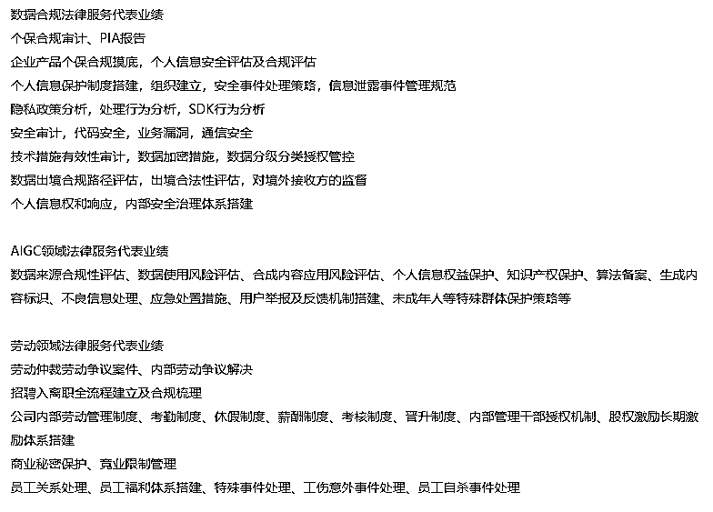
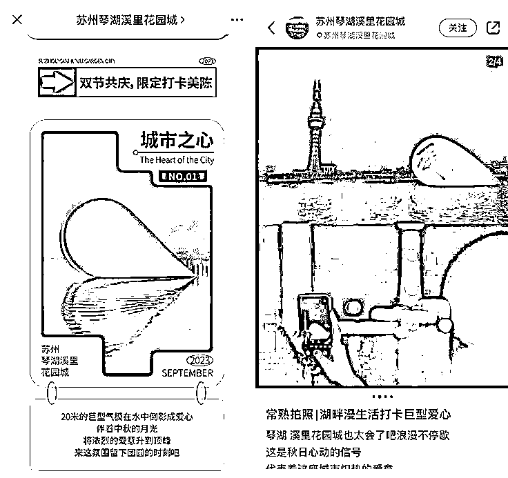
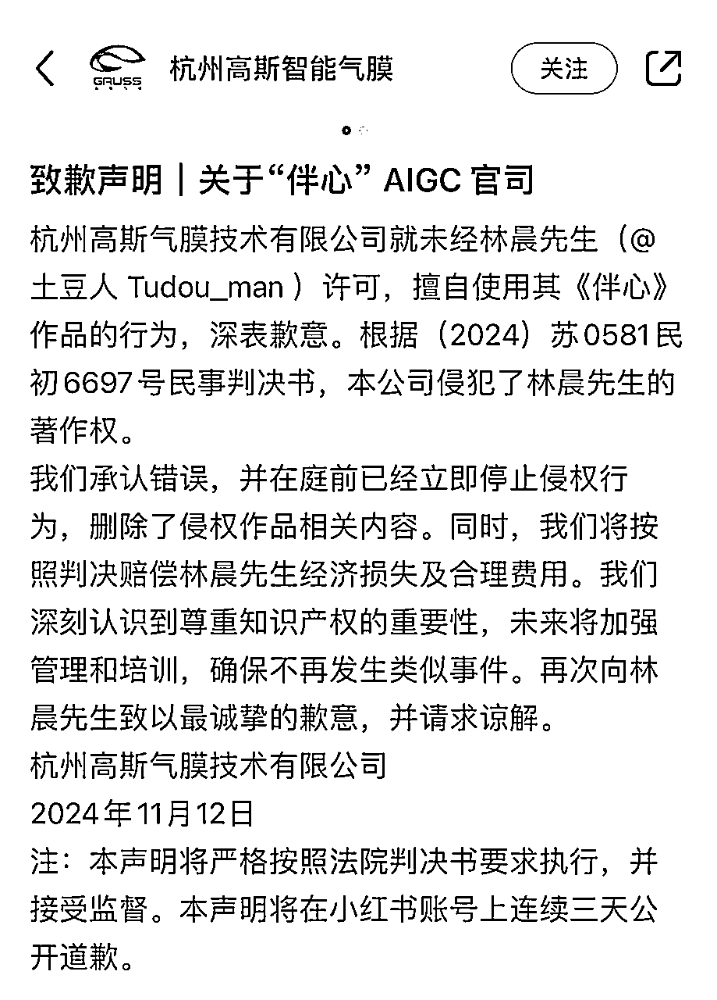
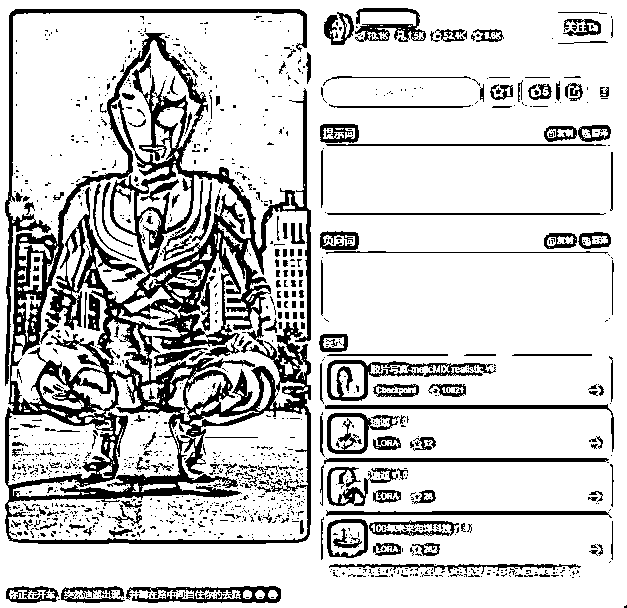

# 想靠大模型赚钱？先把这几个法律“坑”看清楚

最近聊大模型变现的人越来越多。有人拿它写文案，有人用它做设计，有人直接基于模型接口开发产品，还有人跑到海外做聚合服务。

但有一个问题被普遍忽略：**模型吐出来的东西，版权到底算谁的？拿去商用，出了事谁负责？**

这篇文章是我把几款主流大模型的服务条款、若干公开判例和一些律师分享的法律要点综合在一起做的梳理。不构成正式法律意见，但希望能帮你避开几个明显的坑。

## 一、各家大模型的条款，藏着哪些“版权密室”？

先看一个好消息：绝大多数主流模型服务商，在条款里都明确承认了用户对自己提供素材的既有权利，同时也愿意把生成结果的权益让渡给使用者。

但这背后有个前提：一切都得在法律允许的范围、以及平台规则允许的框架之内。

**DeepSeek：成果归你，但别踩线。**  
他家条款写得很细。平台对自身产品、技术、模型权重、界面设计等拥有合法权利；但对你提交的素材，你保留原有的一切权利；模型产出的成果，相关权益在有且法律允许的范围内也归你。

更关键的是：这些成果允许被用在个人生活、学术论文、衍生品开发，甚至用来蒸馏新模型。换句话说，它给你留了相当大的创作和二次开发空间。

但注意——所有授权的前提都是：不违反法律法规，不违反平台约束。

**腾讯元宝：争议最小，措辞相当讲究。**  
腾讯的规则里写得很明白：您上传的东西、您生成的东西，权利归属不受服务影响。你原来有的，还是你的；你生成出来的，也归你。

唯一附加的条件是：使用这些内容时要遵守法规。整体来看，腾讯的条款在“权利归属”这个问题上几乎没有给用户挖坑。

**百度文心一言：用户在、版权在。**  
百度的表达稍微绕一点，但核心逻辑是：如果用户对提交内容或生成内容享有合法权利（包括版权、肖像权益等），那使用百度服务不会造成权利转移或减损。

作为交换，百度可以在法律允许的范围内，对用户上传和发布的内容做存储、复制、展示、编辑等操作——这是为了提供和改善服务所必需的。

**通义千问：输入要干净，输出归你，数据可能被匿名化使用。**  
通义千问对输入内容把关更严：你提交的文字、图片、视频等，必须是你自己原创，或者已经拿到合法授权（包括转授权）。

输出方面，在法律允许的范围内，通义明确将权利让渡给用户。不过它也留了一手：在完成安全加密、严格去标识化处理后，平台可以利用这些内容来改进、维护和保障服务安全。

**Claude：输出权益转让给你，但也提醒你别全信。**  
Claude把输入、输出统称为“Materials”。你对自己提交的内容负责，也保留其中的权利；与此同时，在合规的前提下，Anthropic会把自己对输出内容的权益转让给你。

值得注意的是，Claude在条款中特别提示：生成式模型的输出不一定准确，可能包含严重错误、过期信息，甚至与平台自身观点不一致。**任何输出都必须独立核验后才能采用。**

**ChatGPT：输出归你，但不保证独一无二。**  
OpenAI的条款更直接：你保留输入权利，法律允许范围内你拥有输出，平台也会把与输出相关的权益让渡给你。

但有个容易忽略的点：由于模型运作机制，**不同用户可能拿到相似甚至几乎相同的输出**。平台只把权益让渡给你，但不会阻止别人也生成类似的内容。所以你不能说“这是我独有的，别人不能碰”。

**Monica：责任明确压给用户。**  
Monica强调：用户输入不得侵犯他人合法权益，不得涉及国家秘密、商业秘密、重要数据。如果因你的行为导致侵权或违法，后果由你自行承担；给平台造成损失的话，你还要赔偿包括律师费在内的相关费用。

**一句话总结：** 平台愿意给权利，但不会替你做法律审查。

---

## 二、真正该怕的不是技术，是几个真实判决

### 1. 模型“一本正经地编造”，有人差点被追责

模型幻觉是什么？就是生成结果里出现了凭空捏造的事实、不存在的出处、被错误篡改的信息。模型本身没有恶意，但**只要有人把它当成事实来用，就可能出大事**。

有一起真实情况是：当事人把大模型生成的虚构判例和虚假法条，当成真实证据提交到了法庭。模型输出错误本身或许只是技术瑕疵，但一旦被用来作证据，法律性质就变了——这属于提交不真实材料，可能触发罚款、拘留，严重时甚至构成虚假诉讼。

所以，专业领域里别把生成结果当结论用。看着越专业、越细致的答案，越要人工核对一遍真相。

### 2. 用模型写“网文”卖钱，换来十个月刑期

这个案子发生在湖北大冶。被告柯某原本是网文作者，2022年底到2023年初，他用一套智能文本生成工具批量炮制带有露骨描写的虚构小说。

随后他借助境外网络渠道，把这些内容发布到海外某网站上，同时还在另一个平台对外出售。篇幅从一万字到三万字不等，定价十五到三十元一篇。短短五个月，卖出七百六十多次，非法所得超过两万元。经鉴定，送检的小说全部属于违禁色情读物。

最终法院认定他构成制作、贩卖、传播淫秽物品牟利罪，判处有期徒刑十个月，并处五千元罚金，违法所得全部退缴。

这个案子的标杆意义在于：**大模型只是生产工具，工具本身不会让违法变得合法。** 哪怕内容生成自AI，哪怕服务器在境外，只要行为主体是本国公民，我国司法机关依然有权管辖。

做出海业务的朋友尤其要有数：业务出海不等于规避责任，色情、赌博、诈骗相关的内容生成生意，坚决不能碰。

### 3. 用AI画的图被“套壳”盗用，原作者赢了官司

一位署名“土豆人tudou_man”的创作者，用大模型和修图软件完成了一幅图片作品。后来他发现，有两家公司未经他许可，在线下搭了一组与之十分相似的“水面爱心”艺术装置，还把现场照片发到多个公开平台。

他以侵权为由提起诉讼。根据公开判决信息，法院最终判两家公司赔偿经济损失和维权开支共计一万元。

这个案子的关键不在于赔偿金额，而在于法院的态度：**用AI辅助完成的图片，只要整体上体现了创作者独特的智力选择和安排，就可以受到版权保护。**

但判决也做了精细区分：被告把原图去掉水印后传播，构成侵权；而线下搭建的“爱心装置”本身是创意层面的表达，不属于对图片的直接抄袭。可以这样理解：**AI不会抹掉人的创作贡献，但也不意味着通过一句提示词生成的画面就天然享有完全排他性的版权。**

实践中，想要主张自己的权利，最好保留完整的创作过程记录：提示词、初稿、修改版本、后期处理文件、操作截图——这些都是证明“独创性投入”的痕迹。

### 4. 仿冒领导声音和面孔，有人被骗走数百万元

再来看一个更常见的坑：通过采集目标人物的语音和面部数据，用深度学习生成伪造的音频或视频，冒充公司高管向下属下达转账批示。已经有多起真实案件造成巨额损失。

这类行为在法律上可能触犯诈骗罪。数额达到特别巨大标准时，最高刑罚可以是无期徒刑。如果同时冒用了特定自然人的姓名、形象、名誉，还会叠加侵犯人格权益方面的民事责任。

做数字人、AI通话、AI换脸相关产品的人，在产品设计阶段就要想清楚：你有没有权利使用这个人的声音和影像？用户怎么确认对面身份真实？万一被用来骗人，平台有没有预警和拦截机制？

---

## 三、想开发模型产品？先过一遍法务这种“灵魂拷问”

如果你正在琢磨自己做一款大模型应用，建议在写代码的同时，把合规问题纳入开发计划。法务人员在评审时通常会围绕这些维度提问：

- **产品基本信息：** 叫什么、什么时候上线、谁负责运营、在哪办公、面向哪些国家、怎么收费、有哪些核心功能和页面截图。
- **资质和内容安全：** 产品是否涉及版权风险？有没有实名机制？内容审核怎么做？广告是否合规？应用上架路径是否合法？用户投诉渠道有没有建立？
- **第三方依赖：** 接入了哪些外部模型或API？对方的商业授权是否覆盖你的场景？数据能否跨境？出了问题由谁承担？合同条款里有没有追偿空间？
- **收费与虚拟商品：** 如果有会员、积分、虚拟货币，用户之间能不能互相转让？是否涉及支付结算监管？退款规则是否写清？未成年人能否购买？
- **隐私与个人数据：** 隐私条款的展示位置和用户勾选流程是否完善？到底收集什么信息？有没有触及敏感信息？系统权限与实际功能是否匹配？是否准备了个人信息清单、权限清单和共享清单？
- **特殊行业监管：** 电商、医疗、教育、金融、直播、出版等业务各有专门规定，通用合规清单不能替代行业准入要求。

还有一点容易被忽视：聚合型产品。如果你把多款模型集中在一个平台里提供服务，或者把某个模型带到海外新市场，问题会比单点服务更复杂。

举个具体场景：Monica这类聚合服务如果向欧洲用户提供来自DeepSeek的能力，就要同时面对欧盟《人工智能法案》的约束。该法规对不同风险等级的基础模型提出了差异化要求，包括模型透明度、数据治理、训练数据安全审查、技术文档、内容标识等。

**简单说：模型不是“拿来就用”的黑盒子，出海也不是“上架就完”。** 产品的上线范围越广、聚合的模型越多，要厘清的责任边界就越宽。

---

## 四、最后说几句

大模型给了普通人更低的创作门槛和更快的验证速度，但它没有提供“免责套餐”。平台把生成物的权益交到你手上，不等于交给你一张安全通行证。

真正能在这一轮浪潮里留下来的，不是跑得最快的人，而是从一开始就把版权归属、内容安全、数据隐私和法律责任纳入产品底层逻辑的人。

**工具可以帮你造出东西，但只有法律意识能帮你守住东西。**

---

*本文综合整理自课程资料、元宝模型问答、AGI资料摘录及公开判例信息。主要参考：feishu.cn/docx/GESYdOF1Iorsm4xqP9BcScDhnRX；案例详情可参考 whaleip.com/seo/infoDetail/4579。如有具体业务场景，建议咨询专业律师。*

---

*免责声明：文中提到的平台条款均来自各产品公开服务协议，具体权利义务以最新版本为准。*

这背后的逻辑绕来绕去，咱们还是直奔主题吧。

先说哪些对象必须接受监管审查。其实只有两大类：一类是高风险AI系统，另一类是生成式AI基础模型。

所谓高风险，是指可能对人类健康、安全或基本权利构成重大风险的系统。欧盟在附录里列了一份很长的清单，医疗器械、机械设备、航空器、车辆、船舶、铁路、儿童玩具等都在里面。

对于高风险AI，开发者必须在模型训练阶段完成数据安全审查，确保训练数据合法、完整、透明。具体来说，要公开数据来源，还要证明这些数据不会侵犯欧盟法律，尤其是著作权法，也不会把用户置于风险当中。

而生成式AI基础模型的透明度义务，则包含两个重点。第一，公开训练数据中是否包含版权内容，并说明如何保证数据合规。第二，确保生成内容不越过欧盟法律的红线，比如不能出现歧视性内容或虚假信息。

在数据安全审查时，审查重点又集中在三个维度。其一，数据来源合法：训练数据不能侵犯版权或其他知识产权，不能用非法获取或未经用户同意的数据。其二，数据质量与偏见：语料里如果有歧视、偏颇的内容，模型输出就会带着偏差，所以必须保证数据多样、有代表性。其三，合规与透明：文档要写清楚数据来源和处理方式，用户也要能看懂模型的工作原理和潜在风险。

生成式AI模型还有额外要求。开发者必须确认训练数据是否包含受版权保护的内容，并采取措施避免侵权，尤其是大规模网络爬取时，版权风险几乎防不胜防。另外，生成内容不能碰仇恨言论、虚假信息等违法项，这要求开发者在模型设计时内置内容过滤机制。

这里需要补充一句，欧盟把AI产业链上的所有主体都纳入了监管，包括提供商、使用商、进口商、分销商和产品制造商，只要跟欧盟市场有连接点就跑不掉。AI Act还引入了风险分级管理和监管沙盒，想以更灵活的方式减少中小企业和初创企业的合规负担。但罚款一点不含糊：违规最高可罚3500万欧元，约合2.7亿元人民币；或者按上一财年全球年营业总额的7%罚款，哪个高按哪个来。

接下来看具体场景。如果要把DeepSeek服务推向欧洲用户，不同模式的风险承担不一样。可以粗略分成API模式、公有云模式和本地化部署。

公有云模式和本地化部署，产品是自己处理个人数据和信息的。这时候要自行评估：透明度要求是否达标？训练数据来源是否合法？用户提供的数据能不能再拿去优化模型？当地的内容审核标准是否适应？以及目标国家对这个模型持什么态度？

如果走API模式，接入中国运营的DeepSeek给欧洲用户提供AIGC服务，问题会更具体。第一，模型训练数据的安全审核过不了欧盟的透明性要求。第二，用户个人信息跨境流动，数据会不会实际流入DeepSeek？各个服务器节点谁负责？各方权利义务和责任边界怎么划分？第三，中国运营的AIGC模型，天然带着中国的训练数据和内容审核标准；不同国家和地区的内容审核标准不一样，背后还有价值观差异，一旦标准冲突，产品在当地就可能给出不合规内容。第四，如果DeepSeek底层服务出了问题，比如数据泄露，对外承担责任的还是你自己这个产品。

大家现在应该能感受到这件事有多复杂。还得提醒一句：这仅仅是产品功能中的一个环节，更多跨法域的复杂问题可能还在后面。所以，开发者在做产品设计时一定要认真想清楚，最靠谱的办法是先请专业律师把产品的风险面摸一遍。

再看一个很有代表性的判例：奥特曼案。

先交代背景。原告是奥特曼系列形象的权利人。被告是一个AI绘画平台，提供Checkpoint基础模型和LoRA模型，支持图生图、在线训练等功能。平台首页以及“推荐”“IP作品”这些分类下面，有不少奥特曼的生成图和LoRA模型，用户可以随便应用、下载、发布，也可以分享链接。这些奥特曼LoRA模型，是用户上传奥特曼图片、选择平台基础模型、调好参数后训练出来的，其他用户再用提示词加这个LoRA，就能生成和奥特曼形象高度相似的图片。

给不熟悉LoRA的朋友解释一下。LoRA全称是Low-Rank Adaptation of Large Language Models，一种微调大模型的低秩适应技术，最初用于NLP，在Stable Diffusion里表现得格外突出。它的原理是引入低秩矩阵，不用改动预训练模型就能快速适应任务，提升生成效果。应用上，LoRA能生成指定风格图像，对原有生成结果微调，现在AI绘画领域已经非常普及。

说到这，其实可以延伸一句：如果你手里捏着IP，别人照这个套路来告你，大概率是能告成的。

来看原被告的立场。原告说：你把侵权图片和侵权模型放上网，侵害了信息网络传播权；还用AI技术定向训练奥特曼LoRA模型和生成图片，构成不正当竞争。所以要求停手，赔30万。被告说：我们只是调用第三方开源模型，再结合平台场景做了改造和部署，平台并不提供训练数据，图片都是用户自己投喂给模型生成的，应该适用“避风港”，不构成侵权。

法院要解决的核心问题有三个：平台有没有侵犯信息网络传播权？有没有构成不正当竞争？以及责任该怎么定。判决思路很明确：不能一刀切，要看具体应用场景和被诉行为，分类分层来做侵权认定。

这就是我们常说的“红旗原则”——平台不能揣着明白装糊涂。一方面，如果平台亲自做了著作权专有权控制的行为，那就是直接侵权；但本案里没有证据表明平台和用户一起提供侵权作品，所以平台不构成直接侵权。另一方面，用户把侵权图片灌进模型训练、再决定是否生成发布时，平台对这些内容并没有当然的预先审查义务；只有当平台对具体侵权行为存在过错时，才可能构成帮助侵权。

法院最终认定平台有过错，依据主要在四个方面。注意，这四个方面其实都是在解剖产品的商业模式。

第一，服务性质和营利模式。开源生态是AI产业的重要底座，开源模型只是通用算法。但被告不一样，它是应用层，直接面向终端用户，在开源模型基础上做了场景化改造，给用户提供现成的方案和结果。它还通过会员、积分直接赚钱，又设置奖励措施鼓励用户发布训练模型，可以说它从创作服务中直接获得了经济利益，当然要对具体场景里的内容保持足够了解、承担相应注意义务。

第二，权利作品的知名度和侵权事实的明显程度。奥特曼的知名度太高了。平台首页和特定分类里一眼就能看到侵权图片，LoRA模型的封面图和示例图也直接放着侵权内容，这类侵权信息属于明显可感知。

第三，生成式AI可能引发的侵权后果。一般文生图是随机的，模型对用户操作的结果没有可识别性和可干预性；但叠加了奥特曼LoRA以后，角色形象特征可以稳定输出，平台对用户操作的结果就增强了可识别性、可干预性。再加上操作方便，用户生成的图片和LoRA模型可以被其他人反复下载使用，侵权扩散的后果已经相当明显，平台应当预见到侵权发生的可能性。

第四，有没有积极采取预防措施。平台在用户协议里声明，不对用户上传和发布的内容审核；直到收到诉讼通知，才去屏蔽相关内容、做后台知识产权审核。这恰好说明它有能力采取必要措施，却怠于采取。所以法院认定，平台应当知道用户利用其服务侵权，却没有及时行动，主观上有过错，构成帮助侵权。

顺便讲个庭审小插曲：被告当庭表示已经停止侵权了，原告现场打开平台搜“迪迦”，结果又跳出来一堆。

在民事责任上，停止侵权要分情形处理。平台在输出端必须防范生成内容侵犯著作权，要立即删除已发布的侵权图片，删除那些包含了奥特曼独创性设计特征的LoRA模型，并采取必要措施制止侵权继续发生。责任性质方面，杭州互联网法院认为：无论是用户上传奥特曼素材做微调，还是用户在生成端输入提示词生成奥特曼图片，行为主体都是用户，所以平台不构成直接侵权；但因为没尽合理注意义务、有过错，构成帮助侵权。关于注意义务的强弱，法院列了判断标准：看生成式AI服务提供的场景和类型、能否明显感知侵权信息、平台对内容的控制程度、营利模式，以及有没有及时采取合理措施。

这个案子的启示不小。AIGC服务提供者通常只提供技术，不直接生成内容，所以很难认定它们是直接侵权主体。但技术黑箱和生成过程的非公开性，让外部观察者很难判断服务提供者到底有没有过错。有学者提出，传统的直接侵权与间接侵权框架已经不足以解释AIGC服务提供者的责任，过错理论也说不彻底，应该构建以注意义务为中心的归责模式，明确责任主体。这样既能给从业者稳定的合规预期，也能在权利保护和技术发展之间求得平衡。

把判决要点和被告的行为模式拆开看，会发现：产品提供服务的路径、产品设计、功能推广，这些环节在上市前就要做全面合规评估。只要有一项功能被法院认为没有尽到注意义务，就可能构成帮助侵权。尤其这类示范案例出来后，熟悉法律的朋友都知道，通常会有三年左右的沉淀期，然后大量权利人就会集中起诉，到那时相关服务方会被卷入海量诉讼。AI确实改变了创作方式，但目前的司法判决仍延续着旧的审判逻辑。在这种环境下，产品功能设计必须做全面合规审查，否则商业化路上随时可能卡壳。

未来会不会有变化？如果有一天，作品不再由纯粹的自然人产生，著作权保护的思路和逻辑也许会出现根本性调整。这一块，值得继续观望。

前面提醒过大家，作为用户要留意用户协议；反过来，我们对外提供产品时，用户权益问题同样扎心。有个例子：有人买了Monica的无限量套餐，结果想要真正用起来还得再掏高级积分，想退款却无门，最后只能一封一封写邮件干等。

监管应对@by 张鑫律师

先看中国大陆的法律架构。2023年7月10日，网信办等七部委发布《生成式人工智能服务管理暂行办法》，率先拿出了治理生成式AI大模型的中国方案。在此之前，网信办还联合多部门发布过《互联网信息服务深度合成管理规定》和《互联网信息服务算法推荐管理规定》。虽然目前还没有一部叫《人工智能法》的全面法律，但这些规章和原则已经为生成式AI的发展与管理搭建了基本框架。整体来看，中国倾向于用行政手段做软法规制，全面立法已经列入议程。

欧盟那边，AI Act是2021年4月由欧盟委员会提出的，它是全球第一个具有约束力的AI综合性法规，为AI使用提供了共同框架；再加上《人工智能责任指令》和《产品责任指令》，这三项立法共同构成了欧盟AI治理的法律基础。

如果穿透法条看国内的监管逻辑，层次其实很清晰：保护国家安全，保护网络安全，保障社会公共秩序，尊重知识产权，保护权利人的合法权利。这些层层保护，最终都会落地到对每个产品的细节要求上。

总结AI应用的合规准备 @by张鑫律师

认知一，红线不能碰。国家安全、网络安全，这是底线中的底线。

认知二，社会公共秩序。刚刚颁布的《人工智能生成合成内容标识办法》明确了两类标识：显式标识要能直接看到，比如在生成内容或交互界面上添加文字、声音、图像、视频、数字水印，像图片右下角的“AI生成”水印、视频开头的语音声明；隐式标识则通过元数据、数字指纹等不可直接识别的技术手段嵌入信息。用户使用网络信息内容传播服务发布合成内容时，要主动声明，并使用服务提供者提供的标识功能。这么做，就是为了防止AI合成工具变成破坏社会公共秩序的帮凶。最近公安部门还通报过一起案件：有人用大模型编造某男明星赌博输掉十几亿的假新闻，制造热点。

认知三，长期发展。AI与著作权侵权的纠缠，预计还要持续很多年。只有等到表达行为与AI应用密不可分，我们才可能形成被社会公认的判定标准，也才有适合内容产业未来的管理方式。

认知四，做好服务者。要非常重视与用户之间的关系。做好用户教育和引导，把服务边界完整地告知用户，把可能发生的风险提前告诉用户，把AI工具可能引发的问题做足预警提示。很多误会，都源于用户不理解功能到底是怎么实现的。

AGI之路上的版权和法规，值得每一位创业者认真对待。

写在最后

其实整体情况没那么复杂。如果只是自己娱乐，不传播、不牟利，大概率没人在意你。但内容一旦商业化，就必须注意几件事：当地的法律法规政策，输入内容的合法性和合规性，输出内容的合法性和合规性。

看完还是懵？那就回看上面那四条“合规准备”。

“我就在小圈子里搞搞，应该没事吧？”幸存者偏差了解一下：小范围大概率无事，范围一大就容易出事，参考某舟的结局。

实在不知道怎么搞？花钱找专业律师，有时候花钱本身就是一种提效。

律师不会选？把生成内容先注册版权试试，有了版权就安全，被指侵权就删。创业维艰，尤其在AIGC时代，更要如履薄冰。