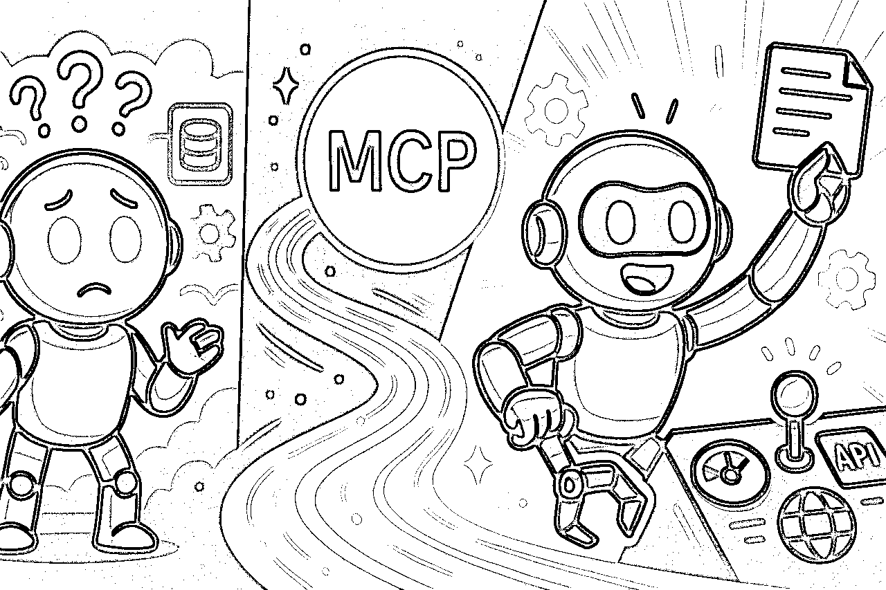
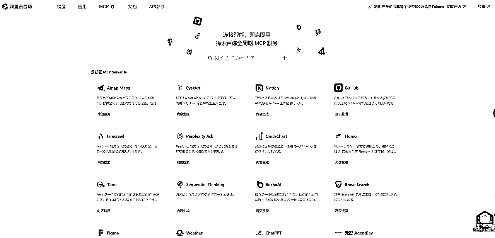
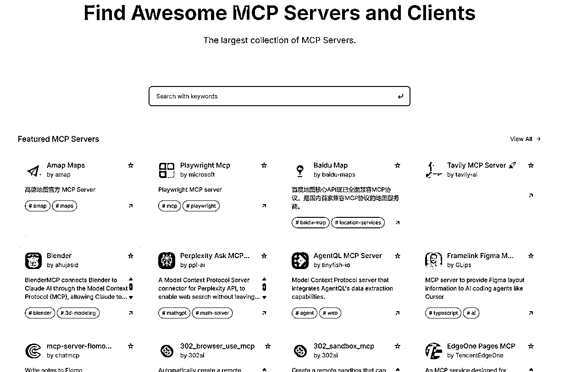
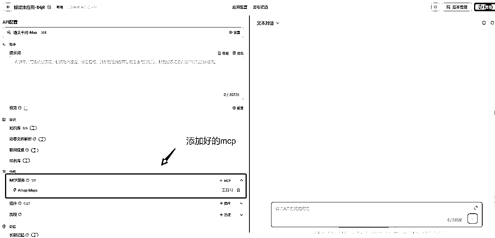
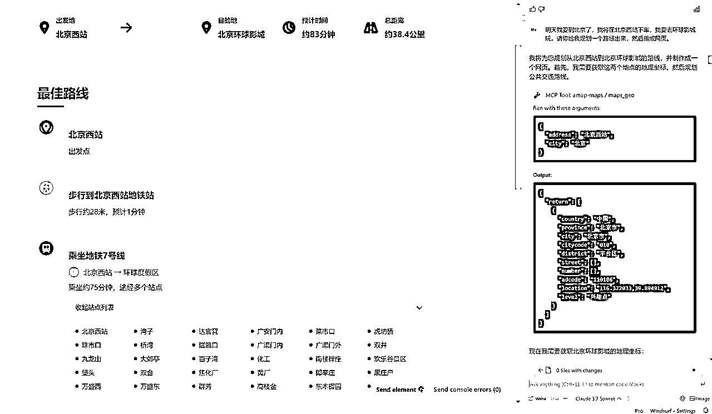
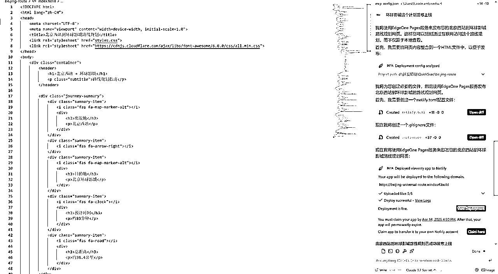
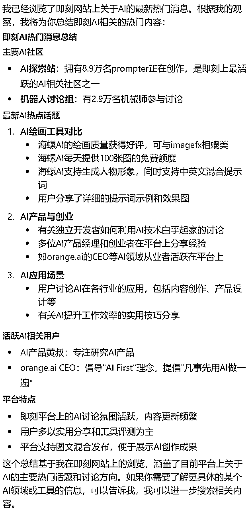
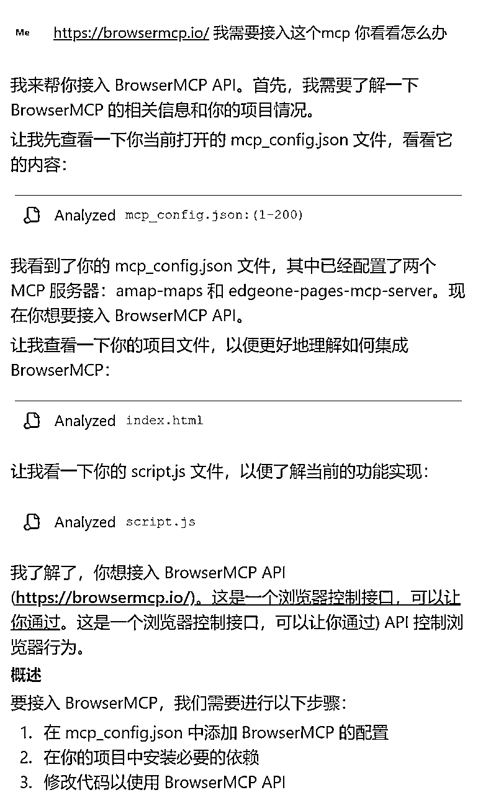
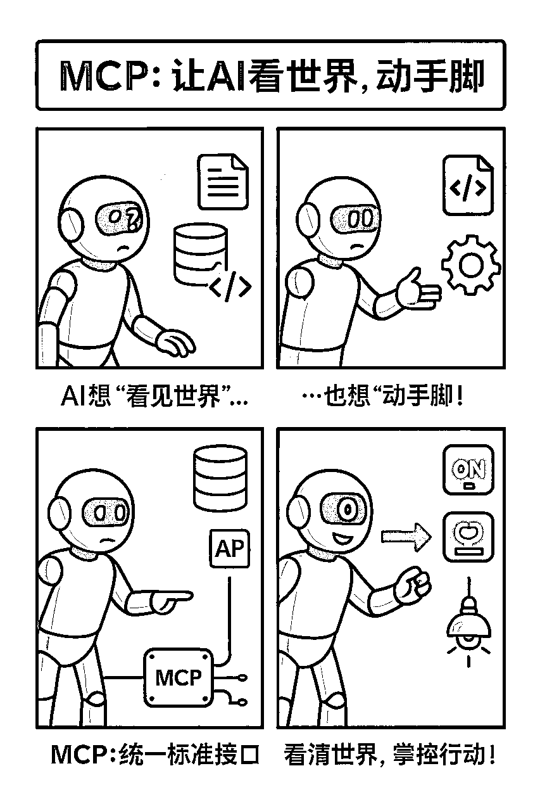

# ('看完这篇，你也能跟小学生讲明白什么是MCP丨大白话技术科普', (2, 31))

MCP究竟是什么？用一次你就会明白：它让AI从“只会聊天”变成了“既能看，也能干”。

上个月假期，我用MCP张罗了一次朋友聚会，从定餐厅到查路线，一路顺畅。跟几个朋友聊起这事，他们听完第一句都是：MCP是啥？没它我也照样能用AI啊。后来又有朋友自己动手试过，同样一脸困惑：这些玩法不用MCP好像也能实现吧？于是就有了这篇文章，想跟大家一起捋捋MCP从哪来、现在有啥好玩的、将来会变成什么样。



把时间线拉回2022年底，ChatGPT刚走进大众视野。当时它还只是个纯聊天机器人：不能联网、不能画图、不能操作任何软件。更要命的是，它的知识来自训练数据，训练结束后发生的事情一概不知道。你逼问它，它只会一本正经地给你编。

当时很多人做了浏览器插件来帮忙：你提问之前，插件先替你搜一遍网页，把搜到的内容塞给AI，再让AI照着这些资料回答。这种“暴力投喂”的办法虽然笨，但确实让AI知道了更多原本不知道的信息——说到底，就是让AI看到更大的世界。

不过，光看到还远远不够。你让AI把一份文档整理成Excel表格，它照样做不了，因为它只能输出文字，没法调用任何外部工具。于是插件们又给AI加技能：查天气、看网页、画图、做数据分析。这回的方向是让AI真正“动手”。

2023年6月，OpenAI发布了Function Call，第一次为“模型调用工具”立下了一个基础标杆。你可以把它看作AI和API之间的一座桥：AI按固定语法发出请求，说明自己需要什么能力。例如搜索场景，AI会唤起一个搜索函数，告诉API想查什么关键词，然后接收结果。

```
{
  "name": "search_web",
  "arguments": {
    "query": "MCP 是什么"
  }
}
```

Function Call虽好，但推广起来问题不少。

首先，各厂商标准没统一。虽然大家都声称支持Function Call，可字段名、参数结构、返回格式各有各的写法。想兼容多个模型？你得挨家挨户做适配，成本一下子高出一大截。

其次，工具方也没有统一基准。每家API都是独立定制的，风格千奇百怪，基本谈不上复用。每个工具和每个模型几乎都要单独开发一次。

更头疼的是Token统计。有的模型把数据完整给你，有的要你二次开发，有的压根不提供，有的还得处理虚拟缓存……想算清楚一次调用的消耗，累死人。

到2024年，情况有了新变化。Claude 3.5 Sonnet把AI写代码的能力推上了一个新台阶，Cursor让普通人也能驾驭编程这项复杂技能。也正是在这时，行业对“模型更顺畅地与外部世界互动”的需求到了临界点——大家都在等一个统一基准出现。

2024年11月，Anthropic的团队带来了MCP。

如果把世界比作一座大商场，在只有Function Call的时期，商场中每家店都自行其是：装修风格不同、货架摆放随意、标签命名全看心情。AI走进来，想找一瓶可乐都要先研究明白这家店的布局，效率极低。

MCP做的事情，就是为整座商场统一标准：所有店铺用同样的货架、同样的标签、同样的动线。AI只要学会一套规则，就能在任何一个店铺里快速拿到想要的商品。

注意了，MCP并没有取代Function Call。它只是把事情安排得更清楚，让Function Call本身更好用。


接入MCP的“店铺”越多，AI能触及的世界也就越大。从Claude发布MCP以来，各路公司和开发者都在跟进，到今年4月，MCP生态已经呈现出百花齐放的局面，阿里云百炼、mcp.so等都是值得关注的平台。




不过，现阶段想在模型内部直接调用MCP还做不到，通常需借助Windsurf或Cursor这类能写代码的AI工具。我更偏爱Windsurf：填个JSON就能使用，几乎不用调试，对新手很友好。


阿里云百炼智能体也接入了MCP，可调试时看不到MCP模块，适合尝鲜，整体体验不如Windsurf。



那现在的MCP能玩出什么花样？分享几个我亲测过的例子。

案例一：把北京未来几天的天气情况做成一张网页。我只跟Claude说要一份北京未来7天的天气页面，它立刻调起高德接口拿到了4天的数据（接口只返回了4天），然后将数据渲染成一张网页。整个过程我只交代了一句需求，剩下的都是AI自由发挥。


案例二：从北京西站去环球影城的出行安排。我对Claude说，明天要坐车到北京西站，再去环球影城，请它帮忙做一份完整规划。模型先调起地理坐标查询的MCP，把“北京西站”转换成经纬度，随后再激活另一项MCP来完成路程设计，最后生成一张带方案的页面。



案例三：把做好的页面发布到线上。路线页搞定后，我让它直接部署上线，用的是腾讯Pages MCP。



没过多久，它返回一个访问地址，我用电脑和手机分别打开，都访问正常。


顺便说一句，Pages MCP现阶段主要支持把HTML转成快速访问链接，复杂项目还扛不住。

案例四：让AI控制浏览器自己搜索。借助browserMCP，AI可以操作浏览器去访问网页、理解内容，再整理成页面。我让AI去即刻上搜一下近期AI圈的热门讨论，把重点内容整理成一张网页。


它真的自己逛了一圈，还读懂了页面里的信息。




有一点需要提醒：如果你希望AI通过browserMCP给出高质量的结果，往往要进行多轮调优。毕竟browserMCP的核心能力是“浏览”，而怎么浏览才能收获更优答案，最终还是取决于你和AI的沟通。

这些玩法不用MCP我能做吗？能做。但每一个都要单独写接口逻辑、用脚本调用，做完一次大概要开发一两个小时；想分享给其他人，还得让人家安装环境、同步代码，光是想想就头疼。有了MCP之后，大家能一键接入，不再需要反复造轮子。

MCP并没有实现以前做不了的事，它只是把实现效果所花费的时间压缩到了极致。

那小白要怎么快速上手？最省事的路子是：让AI自己帮你装。打开目标MCP的官网，把链接复制给Windsurf，告诉它“我要接入这个MCP，你帮我处理”，然后等着它干活。需要Key的话，它会告诉你路径，你照着取就行。




装好之后，如果MCP旁边出现绿色圆点，就说明添加成功，可以开用了。


讲完起源和实操，再聊聊未来。先把MCP放到一边，说说我自己和Cursor打交道的过程。

去年8月接触Cursor时，它分成了两个形态：ChatAI与Composer。前者是跟AI聊着要代码，人在主导；后者是AI直接跳到文件里修改程序，全自动。我当时两个都深度体验过，Composer给我留了一堆bug，我一度崩溃，最后退回ChatAI，老老实实问一句改一句。

但Cursor的进化没有停过：模型用不了终端，就在对话里补上终端环境；记忆容量不够，就升级codebase；模型只会闷头干，就推出智能体方案，让AI具备更强的规划与执行能力。

最后，Agent形态调和了之前的两种工作流。我坚持使用ChatAI一段时间后，也不得不感叹：Agent是真香。只要把需求讲清楚，它就能专心投入到代码里，还能随时纠错。

这一切只用6个月就完成了。我现在有点不敢想象6个月后的AI开发世界会有多强，但肯定远超今天。

那么MCP的未来呢？我也没有答案。可有一点我深信不疑：此刻它好不好用并不重要，重要的是它已经嵌入了模型进化的关键环节，未来必然越变越好。

最好的态度，是先把它用起来，再在应用中解决一个个问题。实践永远是最好的老师。

最后，用一句我自己的话收尾：让AI看得见真实世界，又能够亲手参与其中，这就是MCP正在做的事。

新的时代已经启程，咱们一起去看看。

