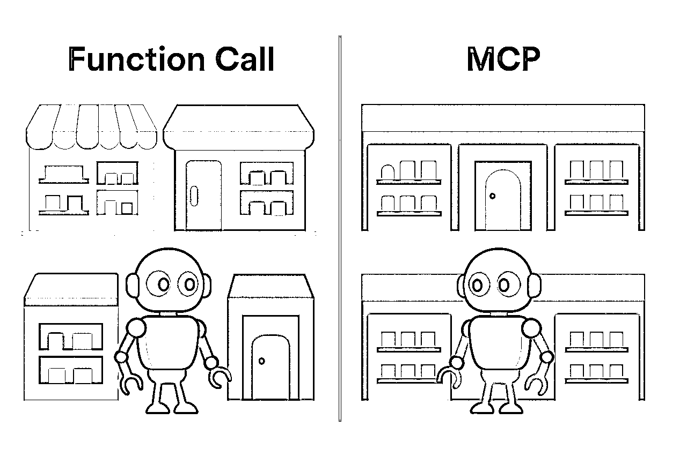
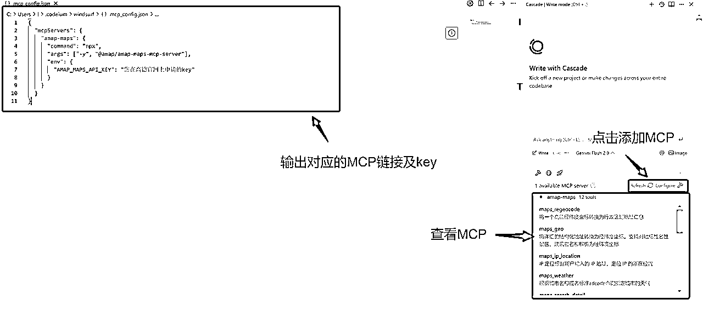
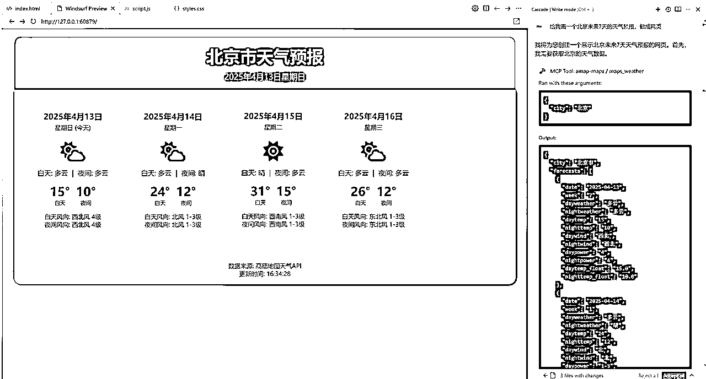
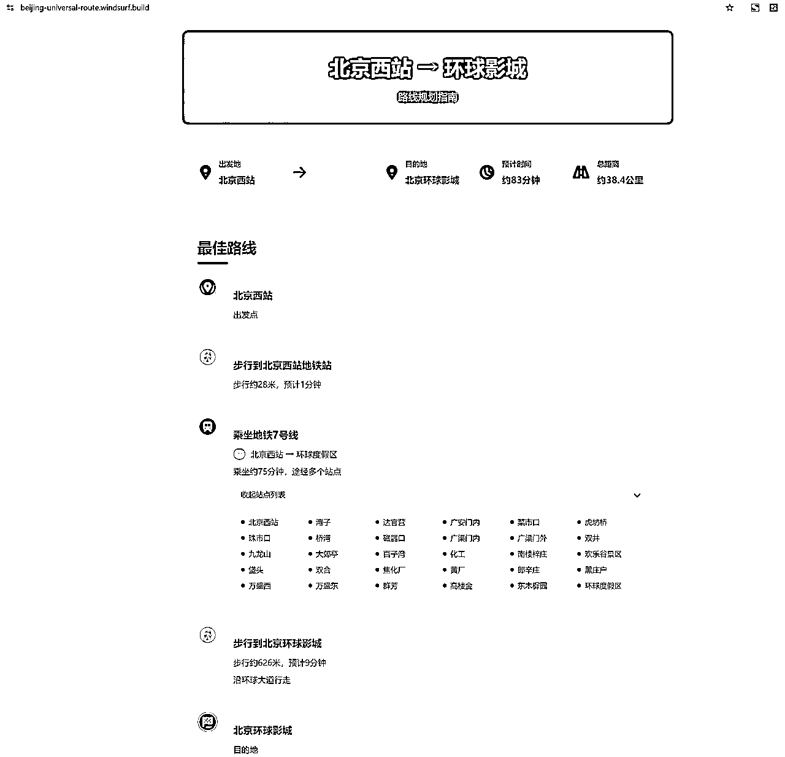
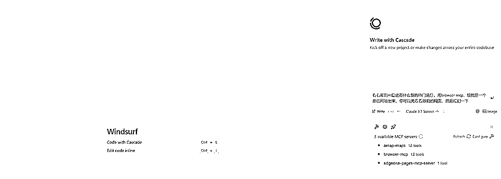
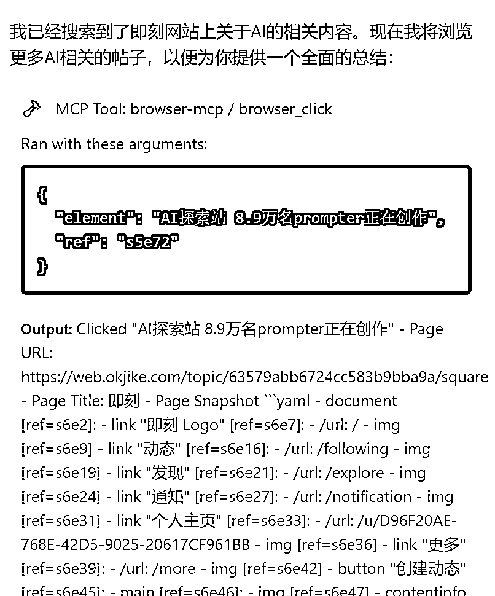
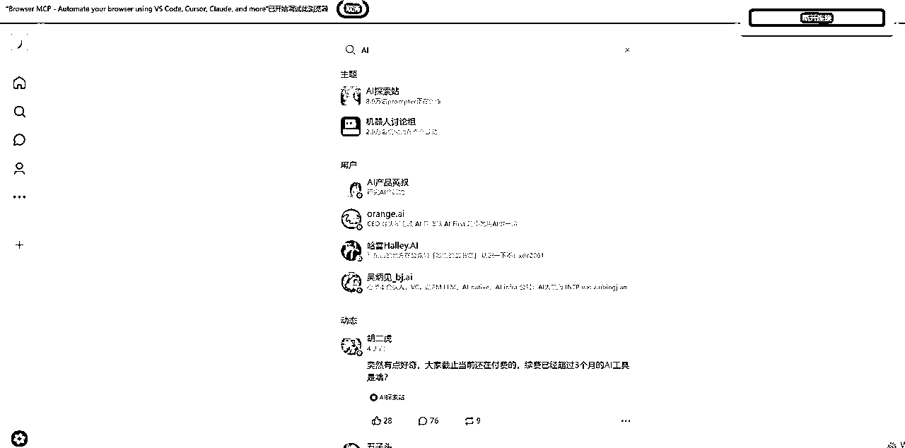
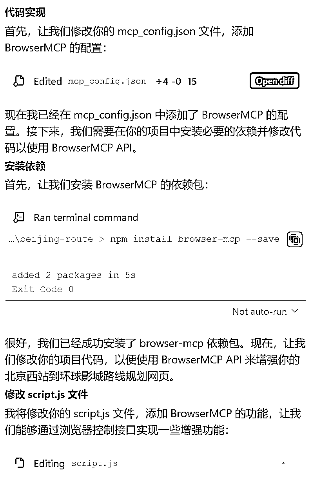
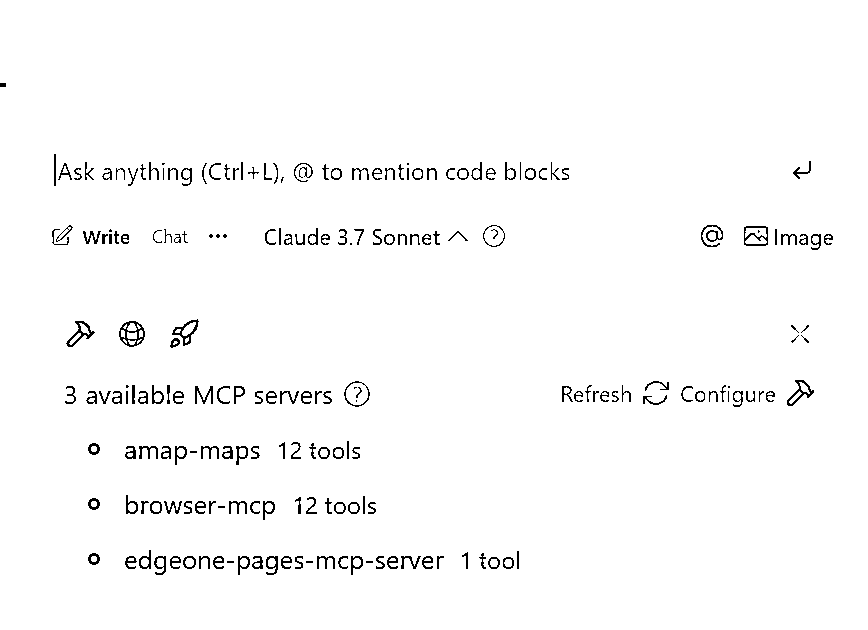
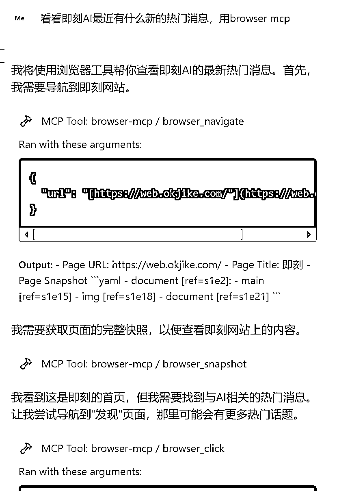

# 用大白话讲明白：MCP 到底是什么，为什么要关心它

> 来源：[https://t16jzwqrzjx.feishu.cn/docx/KunhdNGojoVBbmx5L88ckyWCnpg](https://t16jzwqrzjx.feishu.cn/docx/KunhdNGojoVBbmx5L88ckyWCnpg)

MCP 说白了就一件事：让大模型能“看得到外面世界，也能亲自动手”。

前段时间放假我用 MCP 搭了个聚会安排的小工具，用着还挺顺手的。后来我和大魔、相柳聊起这事，聊着聊着大魔就问我了：MCP 究竟是个啥？能干点啥？能不能用正常人能听懂的话说说。

之后也有不少朋友来问同样的问题。有人自己试了用，又觉得怪迷糊的：MCP 有什么特别的？这些功能不接 MCP 不也能实现吗？

所以这篇就想从头捋一下：MCP 是怎么冒出来的，现在有哪些让人眼前一亮的用法，未来又可能往哪走。


要讲 MCP 的来历，得先回到 2022 年 ChatGPT 横空出世的那会儿。

最早的 ChatGPT 就是个只能聊天的大号智能客服。没有联网，没有绘图，没有画布，更别提什么实操。

可模型的知识是有截止期的。用起来就会发现，刚发生的事它一无所知，只能照着训练数据回答，要么就开始胡编乱造了。

大家就开始想办法给它补眼睛。于是出现了一堆浏览器插件，先把你的问题拿去搜一遍，把搜来的资料塞给模型，再让模型整合回答。

本质就是暴力喂数据，用插件把外部信息硬塞进去。

后来又有了训练时做 RAG 限制幻觉、调用搜索补信息，这些做法看起来不一样，内核都是一个：让模型看见世界，知道更多事。

可光知道还不够。光是让它把内容整理成 Excel，它也生成不了，因为它根本没有调用工具的能力，只会输出一段文字。

于是插件时代来了。人们开始给模型装各种工具，让它能查天气、爬网页、处理表格、画图。

给模型工具使用权，让它能动手。

2023 年 6 月，ChatGPT 正式推出了 Function Call，这是模型调用工具的第一个通用协议。

Function Call 的意思就是：用一套结构化的协议，让模型去调用你的 API。

比如搜索这个功能，模型会自己决定要不要唤起搜索函数，然后把“搜什么”告诉 API。

```
{
  "name": "search_web",
  "arguments": {
    "query": "MCP 是什么"
  }
}
```

虽然各家模型都支持 Function Call 了，但落地时问题不少：

1. 各家厂商机制不统一，接入成本高：大家都叫 Function Call，但字段名、参数格式、返回结构各不相同，兼容多家模型就得反复适配，费时费力。

2. 工具侧也没有统一标准：API 接口五花八门，基本都是为自家模型定制的，没什么复用性。一个工具要配多个模型，得重复开发。

更头疼的是 Token 统计也不统一。有的全自动给你统计，有的要自己算，有的干脆没有，还得自己考虑缓存，算个使用成本能把人算吐血。

2024 年，随着 Claude 3.5 Sonnet 的出现，AI 编程开始进入快车道。Cursor 这类 AI 编程工具被大家熟知，普通人也能用自然语言写代码了。整个行业对模型与外界交互的需求一下子到了临界点。

谁先推出统一标准，就能占先机。

于是 2024 年 11 月，Claude 团队发布了第二个关键协议：MCP，即 Model Context Protocol。

如果把世界比作一个商场，Function Call 时代的商场是这样的：每家店铺自己装修、标签自己写、货架自己摆。模型走进去，每家都长得不一样，想买瓶可乐得先研究店内布局，效率极低。

MCP 则是在商场里统一了装修规范。所有店铺的货架结构、标签写法、陈列方式都一样。模型只要学一套规则，就能在这整个商场里自由取货。

MCP 并没有取代 Function Call，它只是让调用更顺滑，让 Function Call 有一个统一的“商场标准”。



商家越多，模型能触达的世界就越大。

Claude 发布 MCP 之后，行业迅速跟进。到 2025 年 4 月，MCP 生态已经百花齐放。阿里云百炼、idoubi 的 mcp.so 等平台都成了不错的入口。


不过目前在模型内部直接用 MCP 还不普遍，更多是通过 AI 编程工具比如 Windsurf 或 Cursor 来调用。

个人体验下来 Windsurf 更友好，填一段 JSON 就能连上，不用折腾调试，对新手特别省心。



阿里云百炼的智能体也支持接入 MCP 服务，但在调试界面里看不到具体的 MCP 模块，体验上还是不如 Windsurf 直观。


那 MCP 到底能用来干嘛？举几个我自己玩过的例子感受一下。

1.  查北京未来几天的天气并生成网站。高德地图 MCP 服务。

我只是说“把北京未来 7 天天气做成网页”，模型就自动唤起了高德 MCP，拿到了 4 天的数据，然后直接生成了 HTML。虽然只有 4 天，但全程我只说了需求一句。



从画面能看出，Claude 收到指令后自己调用了高德 MCP 获取数据，再把结果渲染成网页。

2.  规划北京西站到环球影城的行程。高德地图 MCP 服务。

继续前面，我说“明天要从北京西站去环球，给我规划一条路线”。模型自己先查了两地坐标，再调用路线规划 MCP，最后输出成一个可视化网页。


整个过程也是我一句指令，模型自己拆解任务、调用服务、生成结果。

3.  把网页发布上线。腾讯云 Pages MCP 服务。

做完规划后，我让它把网页发布出去看看效果。


MCP 直接返回了一个访问地址：https://beijing-universal-route.windsurf.build/，电脑和手机都能正常打开。



目前 Pages MCP 主要解决的是把 HTML 快速生成可访问链接，对复杂项目还不支持。

4.  让 AI 控制浏览器搜索并总结。browserMCP 提供服务。

用 browserMCP 可以让 AI 亲自逛网站。我试过让它去即刻搜近期 AI 热门内容并整理成网站。



它会自己打开页面、理解内容：






值得注意的是，browserMCP 的核心是提供“浏览能力”，想得到高质量结果，需要反复和 AI 调优指令，告诉它怎么看、看哪、怎么总结。

这些事没有 MCP 就做不了吗？能做。每个功能单独写接口逻辑，写脚本调用，前后至少要 1-2 小时开发，还得装环境、部署脚本，想分享给别人更麻烦。

有了 MCP，接入就是一键的事，不用重复造轮子。MCP 不是创造了以前做不到的功能，而是把原来的开发时间从几小时压缩到了几秒钟。

说完用法，我们来看怎么快速上手。

对于小白，最省事的方式就是让 AI 自己来装。

打开你想用的 MCP 服务官网，把网址复制到 Windsurf 对话框里，告诉它我想要接入这个 MCP，让它自己处理。需要 API Key 的时候按提示找一下填上就行。




点添加成功后，图标会变成绿色圆点，就可以用了。





了解了来历和用法，我们再聊聊未来。

我先把 MCP 忘掉，讲个我用 Cursor 的故事。

我大概是去年 8 月开始用 Cursor 编程的。那时候有 Chat 模式和 Composer 模式。Chat 模式是人问 AI 要代码，人自己动手；Composer 是 AI 直接在文件里写代码全自动。

Composer 写了无数 bug，我一度崩溃，最后退回 Chat 模式，人为主导。

可 Cursor 一直在进化。加了终端环境、升级了代码库上下文、引入了 Agent 模式让模型具备规划和执行能力。最终 Agent 模式完全碾压了之前的两种模式，只要描述清楚需求，AI 就能自己闭环，还能自我纠错。

这一切只用了半年。

我不敢想象半年后的 AI 编程会变成什么样，但肯定比现在强太多。

MCP 的未来我也说不准。但有一点我很确定：今天的好不好用不重要，它是模型进化的必经之路，它迟早会变得好用到离不開。

最好的姿态就是先用起来，在使用中解决它的问题。

实践永远是最好的老师。

最后用一句话收尾：

看得见世界，动得了手脚——MCP 让模型更懂现实，也更聪明。

