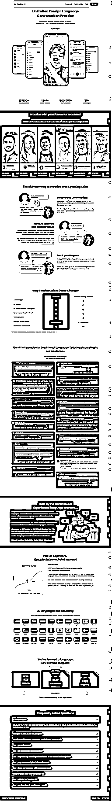
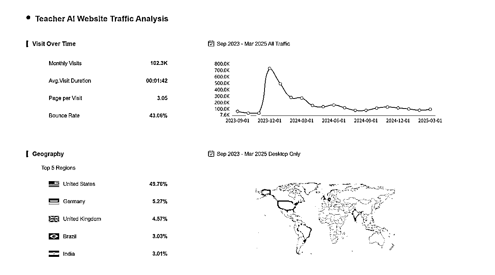
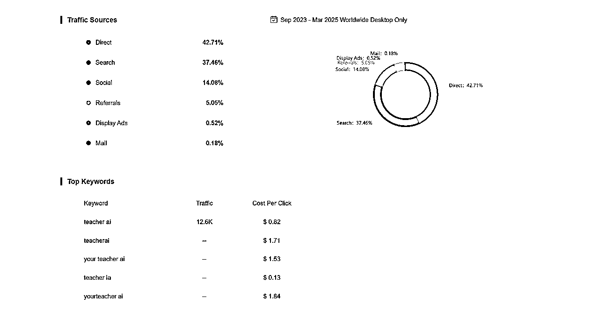
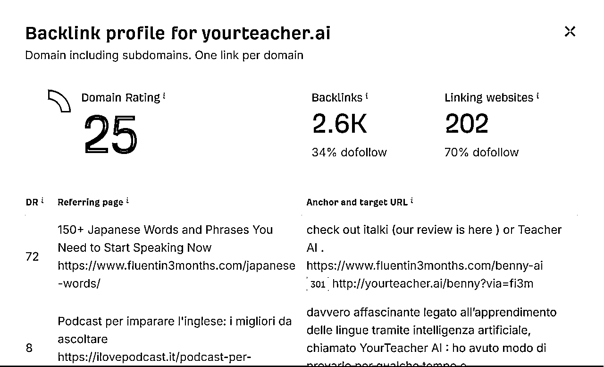
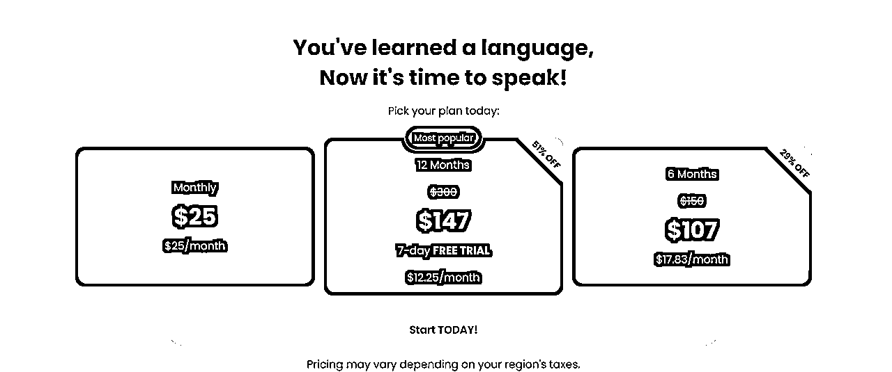
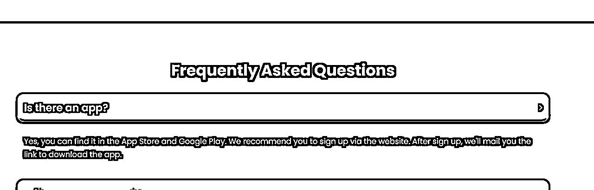

# 502 Teacher AI

> 来源：[https://vz1gcav68m.feishu.cn/docx/Gk6NdKbMIo8PJgxZGfMchbQkn5b](https://vz1gcav68m.feishu.cn/docx/Gk6NdKbMIo8PJgxZGfMchbQkn5b)

# 更新日志

## 2025-04-12

*   当前排名停在 502 位

*   该产品在 2023 年 12 月迎来流量顶峰，之后持续下滑；

*   上线初期首屏加载页做得相当粗糙，体验感不足；

*   域名注册于 6 月末，12 月实现流量陡增，推测背后有付费投放助推；

*   视频内容是其在市场上被快速扩散的核心载体；

# 基本信息

## 产品链接

https://yourteacher.ai/

## Home Page

这些落地页都经过市场检验，学习价值很高；

由此可见，团队在社媒引流方面具备很强能力

## 流量

### 基本信息

### 外链

# 问题清单

## 这个产品解决的是什么问题？

传统外语学习很大程度上依赖真人外教，而真人外教受时间与费用双重制约，很难做到随时随地的口语实战。YourTeacher AI 正是为此而生，它以 7×24 小时在线、低价的模式提供替代方案，让学习者可以无限次进行个性化会话训练。面对真实人物开口时的紧张心理，该产品提供了一个零压力的练习空间，有效缓解开口焦虑。

## 用户是谁？

*   语言学习者

核心目标用户是有一定语言基础、却苦于缺乏口语实战机会以提升水平的中级学习者。平台定位高度聚焦在口语提升，因而缺乏系统课程框架，对纯新手并不友好。对于交流时容易感到尴尬或焦虑的人群，这里提供了一个更放松的练习环境。

## 用户为什么需要它？

中级学习者最核心的诉求是提升流利度与开口自信，而传统方式难以满足个性化口语练习需求。

YourTeacher AI 通过无限次对话、接近真人的 AI 发音以及高度定制化的学习体验来回应这些需求。平台还配套提供错词纠正、语法解析、词汇追踪等功能，进一步支撑学习效果。

## 用户是如何评价它的？包括好评和差评？

### 好评

不少用户认为该产品从根本上改变了他们的学习路径。对内向型学习者而言，无压力的环境让他们更愿意开口练习。有用户反馈使用后语言水平短期内明显提升，如一周内从 A2 进阶至 B1。自然的语音质感、精准的语言识别以及随时随地的可用性广受好评。词汇追踪与单词点击查询功能也被频繁点赞。在 YouTube 等视频平台上，也出现大量正面测评，称赞语音质量、功能丰富度和体验持续在优化。与真人外教相比，性价比高是其被认可的重要优势。

### 差评

尽管口碑整体向好，仍存在一些痛点需要改进。

*   网页端和移动端均出现过不稳定的技术状况；AI 回复的加载时长波动较大，偶发长时间无响应。
*   部分潜在用户希望在付费前能有免费体验窗口。
*   识别环节偶有失误，AI 会听不清或误解语境。
*   语音虽有改善，仍有用户觉得略显机械。
*   平台不自动保存上次会话进度。
*   有用户认为现阶段的 ChatGPT 免费版或低价版已能提供相近甚至更好的价值。部分用户对最少 6 个月起订的订阅周期和价格表示不满。
*   多数用户认为产品更适合有基础的学习者，不适合零基础入门。另有用户反映网页与 App 间数据不同步。

## 它是如何找到用户的？SEO吗？口碑吗？投放吗？达人营销吗？

### 营销渠道与策略

*   与多位拥有大量粉丝的语言教学类 KOL 达成合作，例如 Xiaoma Arieh Smith，这一举措被视作关键增长点。
*   官网大量展示真实用户评价，用社会证明降低决策门槛。
*   在 Toolify 等内容平台发布产品迭代与新功能介绍，可推断其在做内容营销。
*   App Store 与 Google Play 同时上架，体现移动优先的布局。
*   流量结构显示，搜索占比 44.01%，直达占比 37.22%，说明 SEO 与品牌心智在获客中发挥重要作用。
*   社交渠道占比 11.36%，很可能受益于 KOL 合作带来的导流。

### 不同获客方式的效果分析

高达 37.22% 的直达流量证明品牌认知度已具备一定基础。44.01% 的搜索流量说明目标用户有强烈的明确需求，且产品在相关关键词上具备曝光。11.36% 的社交流量印证了网红合作在触达精准用户方面的效率。Reddit 与应用商店里的讨论也显示出自然口碑的累积效应。资料中并未明确提到付费广告，可能意味着其更依赖自然流量与 KOL 驱动的增长。

## 它赚钱吗？多少？

商业模式采用订阅制，提供月付、6 个月、12 个月三档。月付 25 美元，6 个月 107 美元，折合每月 17.83 美元，12 个月 147 美元，折合每月 12.25 美元。所有方案均含免费试用，月付 3 天，半年及一年档为 7 天。价格会因地区税费而异。

### 定价

### MRR 估算

网站月访问量约 102.3k，按 3.05 页/UV 计算，月度独立访客约 33.5k。

以下测算基于网站访问量推演，移动端转化通常更高。

在缺乏各档订阅分布与真实转化率数据的前提下，难以精确估算 MRR。假设保守转化率为 1%，且按 SaaS 行业惯例：年度型订阅占比约 42%，月度约 58%。在此将 6 个月与 12 个月归为长期订阅，并假设两者各占一半。

*   付费用户总计估算：102.3k * 1% = 1023 人
*   月度用户：1023 * 0.58 = 593 人
*   年度用户：1023 * 0.42 = 430 人
*   6 个月用户：215 人
*   12 个月用户：215 人

*   月度收入：593 * 25 = 14,825
*   6 个月摊销收入：215 * 107 = 23,005
*   12 个月摊销收入：215 * 147 = 31,605
*   网站 MRR 估算：约 69,435

第三方数据显示 iOS 约 5k，Android 约 8k。官网倾向引导用户在站内订阅。

MRR = 网站 MRR + 应用 MRR ≈ 69,435 + 13,000 = 82,435

## 我从这个产品身上学到了什么我以前不知道的东西？

*   深耕细分人群：聚焦中级学习者，能更精准地定制功能与投放策略。
*   订阅制是此类服务获取稳定现金流的有效方式。
*   多端覆盖：Web 与 App 并行，可拓宽流量入口。

## 它的什么做法,我并不容易？为什么？

### YourTeacher AI 难以被模仿的方面

与头部语言 KOL 建立的深度合作，若无资源与人脉积累很难复制。逼真语音与精准识别背后的模型微调技术属于专业壁垒。长期积累的用户数据与反馈构成个性化能力的护城河。先发优势与网红背书带来的品牌信任感形成壁垒。

所需的基础技术与专业知识

产品基于 ChatGPT 构建，依赖大语言模型。多语言高质量 TTS 与 ASR 的研发维护需要专业团队。需要可支撑高并发对话的服务器与算力基础设施。NLP、ML 能力是持续迭代的核心。iOS/Android 应用的开发维护需要工程能力。

## 如果我是产品的作者,我如何只用一句话,把产品推销给用户？

YourTeacher AI，您的专属 AI 语言老师，随时随地提供无限次个性化口语练习，助您开口更自信、表达更流利。

## 如果我做一个产品解决同样场景的同样问题,我可能采用哪些和它不同的方法? 我的方法比它能更好地解决用户的问题吗？

在品类上可考虑更垂直的切口或区域聚焦，例如日语、韩语、印地语、非洲语言等细分赛道。当前产品在体验上仍存瑕疵，但未被充分解决，或许是成本与优先级权衡的结果。关键在于能否找到真实强需求，即使产品不完美，用户也愿意为核心价值买单。

## 我能做出来吗?需要什么资源？需要的资源我能承受吗？

需要投入 AI 模型接入与训练资源，即便基于现有模型如 ChatGPT 也需成本。需要构建多语言高质量语音合成与识别能力。

其他次要但必要资源：

*   Web 与移动端开发能力
*   UX/UI 设计能力以打造流畅体验
*   用户获取与增长，包括合作与投放
*   持续的算力、服务器、迭代维护成本
*   可扩展的技术基础设施与数据体系

## 我如何找到用户?

*   围绕语言学习关键词做 SEO，产出高价值内容做内容营销。
*   与语言学习社群、教育机构合作拓展渠道。
*   评估在目标用户活跃平台投放付费广告的可行性。
*   与中小体量但精准的语言类创作者合作，性价比更高。
*   提供强吸引力的免费试用或 Freemium 模式降低尝试门槛。
*   聚焦 ASO 提升应用商店搜索可见度。

## 为什么是我?我有什么独特之处和这个产品需要的能力特别契合吗？

## 我喜欢这个产品吗?或者说,如果半年我都没有正反馈,我能够在半年内持续不断地和用户沟通、迭代这个产品

# 总结

YourTeacher AI 以便捷、亲民、个性化的 AI 口语练习切中了中级语言学习者的核心痛点。网红合作与对用户反馈的快速响应是其成长的关键驱动力。技术稳定性、定价弹性以及对初学者的覆盖度仍有优化空间。对后来者而言，技术门槛、资源壁垒与品牌信任度构成多重复制难度。创新机会在于在保留其优势的前提下补齐短板，例如构建更完整的课程体系、提供更灵活的付费方案并结合新技术。最终的可行性与成功概率取决于资源评估的充分性与持续投入的决心。