# 412 山东见面会 · 梁靠谱：千万级 IP 的私域成交，人人可复制的赚钱道法术器

# 嘉宾介绍

分享嘉宾：梁靠谱，赚钱第五期圈友，第七、八期 418 拉新冠军，销冠孵化基地主理人，自媒体营销顾问。

# 人生最难的那道题

老乡们的聚会，总要聊点实在的。我是梁靠谱，学员喜欢开玩笑，说我从打榜干成了副标题。也有人问我，销冠到底怎么拿？我笑了：“等我回家生孩子那阵，你们上线帮我刷一个看看。”

我的主业一直在医院，没辞职。我多爱医学呢？连梦里都在救人。梦里有个人倒下，我喊旁人打 120，检查呼吸心跳瞳孔，甚至当场判断出脑出血的位置和功能区，醒过来还在验证，刚才的判断是不是真的。

2021 年我进入赚钱，发过一篇帖子，题目叫《不疯魔不成活》。少一天、少一月，这辈子都不完整。到现在，我的 C 端学员累计过万，企业客户上百家，新东方、爱尔建、正大天晴都是我的甲方。自己也琢磨出一套打法：靠谱成交五步法、点线面体、痛点痒点爽点这些体系。今天在场的朋友先别走，晚上夜话，我每人发一份课程大礼包。

有学员跟我讨论过一个人生命题：人生最难的事是什么？我当时被问住了。我说手里拿着铁锤的人，看什么都是钉子，好像也没啥难的。转头我试了试 deepseek，它给的是让自己平静、原谅别人、面对死亡。我一看，这不就是搞钱吗？钱到位了，生活有平衡，也有余力爱人和学习。搞钱的前提是什么？现金流，加上产品，再加上一个买方，一个卖方。

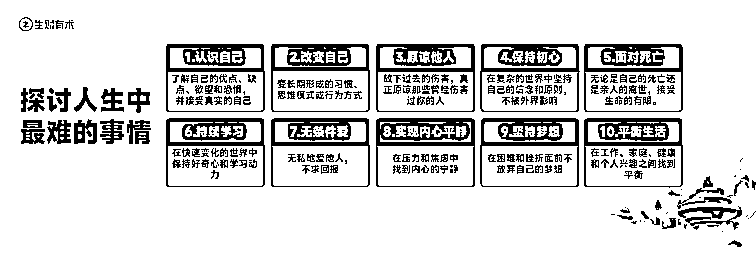

刚入行时，我师父丢给我两个难题：把你想的塞进别人脑袋；再把别人兜里的钱掏给你。哪件事能同时做到这两点？我觉得是销售。今天有 40 分钟，跟各位聊透私域成交和高客单成交的道法术器。这套体系我第一次公开讲，专为咱们圈友准备。

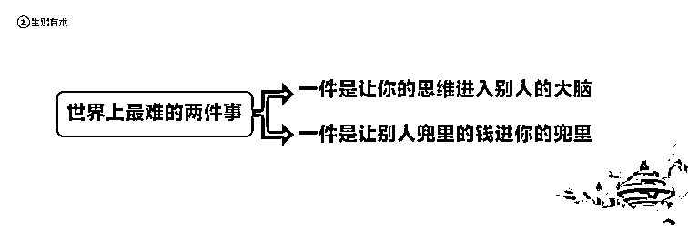

# 私域成交的“道”

先说道。我很喜欢金庸，网上有人投票选金庸笔下最有魅力的女性角色，胜出的是赵敏和黄蓉。为什么不是小昭、阿珠？那两位也深情，甚至能接受老公纳妾，命都不要了，但还是没进前列。原因是赵敏和黄蓉身上带着现在的流行特质：引导型恋人，有智慧。

拿 IP 带动营销，有一个关键词：专家型销售 + 知音型销售。什么意思？我建议你熟读《致橡树》。不是攀附的凌霄花，而是一棵与你站在一起的树。

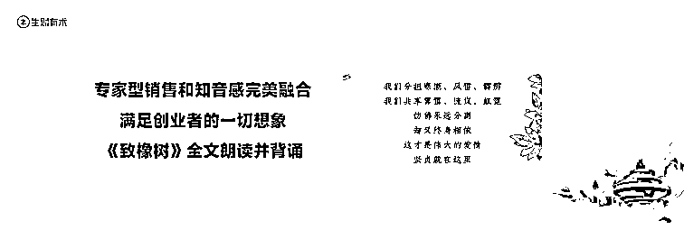

举两个真实案例。有位学员在广州做办公室装修，另一位做海南企业财税、代记账。早前他们团队的话术都是：老板，想好了吗？第二天再追：老板，云挺好看，要不把单签了？这哪是谈单，分明是期待爱情像入室抢劫一样突然砸中自己，而他们就是那个劫匪。

我支了个招：给老板看装修，别只放图，去拆那些头部企业的办公室，去研究《商道》《鸡毛飞上天》里的商业布局，讲清楚浙商的格局为什么讲究风水，为什么这样摆让客户觉得有品位、卸下防备，签单更容易。再请一位国学老师，按每个老板的八字喜神布置工位，顺便建议他和什么属性的员工搭配，价格每平米直接翻倍。财税端同理，别追着问“一年六千八千”，而是拆解某娅、某曲踩过的财税坑，分析金税五期后不同规模企业该怎么布局。这就是专家型销售——我不是卖家，我是在更高维度给你参考。

可如果全程端着专家范儿，老板的 ego 该膨胀了。这时候需要百炼钢化绕指柔，用知音角色来平衡。我常教客户给甲方送情绪价值：“你这么有本事的老板，就该做成；你做好了，市场就是良币驱逐劣币。这个社会该感谢敢创业的人，你们在改变世界。”这叫“我懂你，我来帮你”。那些最有魅力的角色，哪个不是拿捏了老板这份期待？

## 2.1 人设，比卖什么更重要

先记住《致橡树》。再说第二句：货谁卖，天差地别。每年赚钱推广，有人能打出好几把，有人一把都卖不动，七大姑八大姨都不捧场。为什么？孟子老早就说：易子而教。

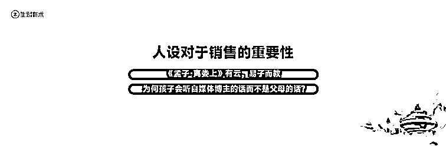

这代人为什么叛逆？父母的话当耳旁风，博主说一句就奉为圭臬。郭德纲和于谦为何互换儿子教？因为关键不在内容，在谁开口。比如两个职场博主：一个标题是“如何提高情商”，另一个是“我在体制内干 20 年的真实案例”，后者点赞能高出几百倍。减肥也一样：普通博主喊“少吃多动”没人看，换成“中科院专家/某明星的减肥法”，流量立刻起飞。

“谁说的”分量极重。出来混，人设都是自己给的。当年卖茶的小姐姐火遍全网，我身边有个人盒饭都舍不得加肉，却给人家刷了几万块茶叶。谁能想到屏幕那头，多半是彪形大汉。

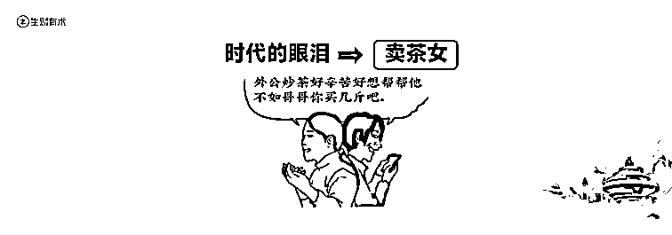

现在不少娱乐主播下播后，也是运营接着陪榜一大哥聊。为什么？因为剧情里那个人设让男人产生了“我要保护她”的冲动，男人就愿意为这份冲动掏钱。所以 IP 最核心的问题是：谁在卖？我凭什么？拿我自己说，我为什么敢做销售培训？因为我早年做微商，每个季度、每年都是全国前列，我拿销冠的成绩去带销冠。至于“为什么卖”，很多助农直播间卖得火，阿拉泰苹果一斤还能贵一块钱，秘诀就是占住了“道”。古代王朝倾覆都要讲个得道多助失道寡助，今天卖东西也要一个正当理由：什么拯救过我，我就想拯救世界。

我的学员里有不少人靠抑郁自救走过来，把方法写成一篇文章，一篇个人品牌出道文，就能带出大量订单。所以人设一定要经营好，战绩可查，故事动人。

### 2.1.2 人设一换，价值千万

赚钱里讲方法论的帖子，你看了就过了；如果这个人既有方法论又有故事，点赞能从 500 冲到 1000。让我记到现在的，是几年前木易那篇《绑着炸弹做淘宝》：他跟圈友借钱，押上龙珠，圈友没收，反而给他打了几千块红包。道理让人信服，故事让人记住。人设一换，价值千万。

做个人品牌分三步：第一步，商业定位——我做什么，替谁解决什么问题，卖什么产品，收多少价。但定位同质化的时候，凭什么被记住？就像大家都在卖车，你却记住了雷布斯——武大毕业、初恋结婚、减肥、樱花树下站着。你记得的不是他的产品，是他的身份、他的经历、他的长相。

换成儿科医生这个职业感受更直接：一个中年二胎女医生，妈妈们天然觉得“她懂我”；一个白发老爷爷，患者天然觉得“他看了一辈子病，错不了”。这就是人设的力量。

有个做高端护肤品的 B 端老板，以前爱晒汽车改造、飞机模型。我直说：你客户是小姐姐，谁看这个？改晒女儿奴、怕老婆、在家给老婆做美甲、家庭地位排老四、天天研究变美小技巧。流量立刻成千倍涨。为什么？小姐姐看了会转发：“他老婆也在用，肯定好。”还会转给老公：“看看人家。”这个时代，能给女性提供情绪价值，钱就来了。人前是霸道总裁，人后给孩子当马骑，反差感一出，讨论度自然爆。

我们做过一个洗发水活动：买洗发水，拍照打卡老公给你洗头，就送护发素。一个私域活动，单品干出 800 万。核心是什么？给了一个晒的理由、一个模板。只要有人晒，就有源源不断的生意。所以别再说自己没特点，哪怕你只是单位里最会牵线搭桥的人，那也是本事。时间花在哪，回报就在哪。

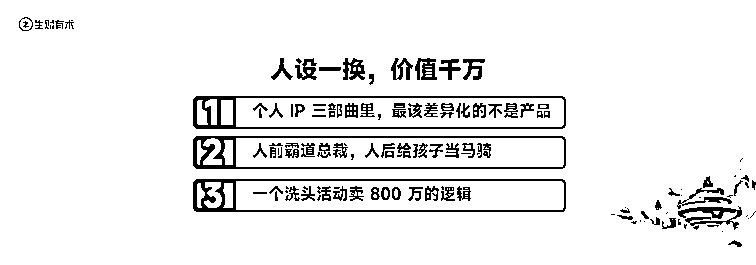

## 2.2 私域成单的方法

### 2.2.1 卖故事

很多人卡在“不知道怎么卖”。拿恒温杯举例，普通卖法：外观好看、材料跟火箭同款、18 项专利、专家推荐，一问价格 300 多，顾客嫌贵走人。那换成卖故事呢？

先问：在座多少人有孩子？然后讲，创业初期夫妻俩忙得脚不沾地，孩子交给老人带。有天孩子不小心打翻水杯烫了手，哭得撕心裂肺，老人又愧疚又害怕：会不会留疤？影响当飞行员吗？长大了怪我们吗？植皮要多少钱？于是他们想，如果有一款杯子能让水恒温，孩子是不是就不会再受伤？研发了很久，终于做出来——无论多少度的水倒进去，马上变成 45 度，适合爱的温度，冲奶粉也刚好。听完这个故事，谁还在乎材质专利？直接下单。这是我自创的课程，晚上夜话发给大家。

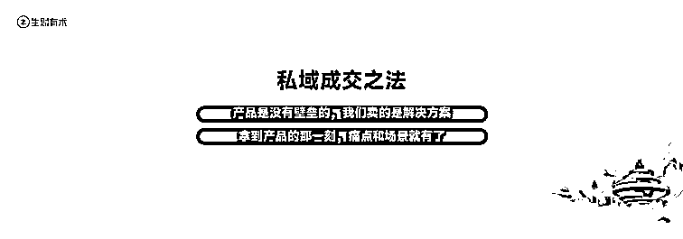

还有个做酒水的客户。别人卖酒讲工艺、讲销量。大家看过《风吹半夏》吧？赵丽颖演的女主为什么叫半夏？因为生她时妈妈难产去世，做中医的爸爸说“生半夏有毒”。

我们设计的故事是：一个男孩谈对象，女孩爸爸一直不松口。终于同意上门，男孩带了两瓶酒。酒过三巡，老父亲哭了：她妈妈生她时难产，我一直怕她结婚生子，怕她也会离开我。我不是不满意你，我是不满意自己。男孩说：现在的医学很发达，我娶的是老婆，不是子宫。哪怕不要孩子，我也只想要她。几年后母子平安，全家团聚，喝的还是这种酒。

这酒卖疯了。痛点是娶不到媳妇，痒点是想要媳妇，爽点是终于娶到，卖点只是一瓶酒。这酒不只是卖给喝酒的人，它装的是感情、故事，甚至是一段人生。马斯洛需求金字塔里，情感是顶层的。能把情感讲出来，产品就有了灵魂。

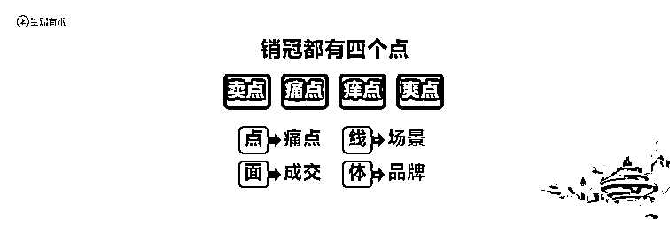

### 2.2.2 卖保险不如卖伦理

我是东北人，在天津上的学，说话自带口音梗。下一个故事叫“卖保险不如卖伦理”。很多人推年金险，只会讲通胀、讲利率：2.3、2.5，高不了。我却觉得，保险要卖的是伦理。

比如一个伦理抉择：我爱的人有家族遗传病史，我该不该和 ta 结婚？帖子一出，评论区立刻两极分化，有人骂：你要是敢分手，我喷死你；有人问：后来呢？点进来才看到：遗传病不是宿命，30% 基因，70% 生活方式。两个人情比金坚，一起过自律的生活，发病率会很低。万一发病，我们有百万医疗、有重疾，若真走到后面，还能给孩子留一笔教育金。所有保险单摆出来，讲的是爱和责任。流量来了，精准询单也来了。

再比如：相亲对象样样都好，但他父母没有养老保险，还谈不谈？立刻有人劝：姑娘，正因为没有助力，才轮得到你，条件再好的早被女明星抢走了。接下来怎么给父母配养老组合？你看，当产品本身没亮点，故事的冲突就是最好的选题。

### 2.2.3 需求背后，还有一层动机

我追辩论赛，是想练脑子。B 站十大名场面有个辩题：如果你有超能力，你能让爱你的人爱上你，你用不用？这类题一个比一个出圈，一篇内容就能签单，长险能做到六位数。几个六位数单子，当年的 IDA 和 MDRT 都完成了。

记住一个词：动机。拿需求来说，你想减肥——但减肥背后的动机可能是：相亲被对方嫌胖，那句“有缸粗没缸高，除了屁股都是腰”把人伤透了，老娘必须瘦下来，狠狠打他的脸。这才是动机。想进赚钱的人表面是赚钱、补信息差，背后的伤口或许是老板 PUA、或许是凑不齐彩礼、或许是家里催婚。你挖到他内心的动机，让那口气自己冲破身体，他才会做决定。产品本身反而不用多谈。

我甚至去看犯罪心理学，琢磨人在关键抉择时的内心。当你拥有了上帝视角，就不会觉得人性难以捉摸。

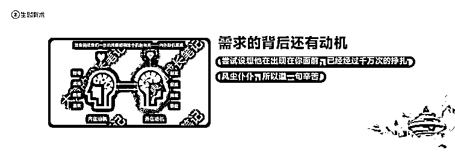

# 私域成交的“术”

再说术。很多销售一听到“能不能便宜点”“我回去想想”就懵了。第一，要做到来一个搞定一个。第二，嫌货才是买货人；真不买的，连异议都懒得提。所以遇上有意见的，反而要打起精神，这才是机会。

## 3.1 销售的三个误区

多数销售对客户充满误解：以为客户懂行、以为客户清楚自己要什么、以为主动问就是打算买。真相是，很多客户比想象中更摇摆。

做业务的人最容易犯的毛病，就是一上来急着倒产品，忘了先帮对方把“想要”这件事说清楚。

我陪跑过好几个轻医美店，主要做眼部整形之类的项目。来找他们的顾客中，有不少是网红和艺人，一年到头在脸上花的钱能到七位数。有一个姑娘进门时明显拿不定主意，我就提醒身边的咨询师：别急着讲术式，先摸清楚她真正在纠结什么。于是那位咨询师开口问她：以你的底子，做出来效果肯定惊艳，你现在犹豫的点是什么？怕留疤？怕不自然？还是身边有什么声音在拦你？不妨讲讲。姑娘这才说，妈妈和男朋友都不赞同，说是动了脸会影响面相。我们就换个角度聊：你想想，多少女明星微调完以后，资源反而更好了，感情也顺了？状态一好，面相不就跟着好了？到底是风水养人，还是你自信的样子养风水？小姑娘听完，当场就把定金给付了。

核心逻辑很简单：先把“非买不可”的念头种进她心里，再让她看到那些顾虑如果不处理，后果会越来越大。

还有个妈妈来问孩子有点厌学怎么办。我问她：姑娘今年初三？那就算你扛过中考，高中呢？大学呢？孩子越长大越不听你的，你们母女俩是不是要斗上一辈子？与其以后受苦，不如趁现在把学习动力和思维底层打牢，往后你省力，她也轻松，母女关系也不会僵。她一想，确实，立刻订了课。

再讲一个卖益生菌的事。顾客问孩子挑食要不要补充。普通店员一听就说“要的”，然后报价。我不这么来，我先问她：娃现在个子排在班里的第几排？她脸色马上变了，说不高，做操站在第二排。我说你知不知道，长高这事跟肠道环境关系很大，挑食会直接影响吸收和激素的合成。现在只是第二排，再拖两年，可能就再也没有往前挪的机会了。她连价钱都没问，直接要最大号套装。

很多卖货的人搞不清客户为什么不下单：做内容的怪曝光太少，做转化的怪话术不硬，搞发售的怪节奏不对，做设计的怪视觉太糙。但真正的高手会掌握“解释权”——你来定义他最该担心的那个问题，然后用你的产品去接住它。

## 3.2 嫌贵怎么接

顾客但凡说出“太贵了”三个字，新手就容易卡住，要么嘴硬说一点都不贵，要么讲一分钱一分货。其实“贵”这个字背后有一百种拆法，我讲几种。

先说放参照物。有个小伙子带女朋友回家，他妈死活看不上。小伙子想了很久，有天跟他妈坦白：妈，我喜欢的是男人。老太太当场觉得天塌了，哭了一个星期，觉得自己这辈子抱不上孙子了。一个星期后小伙子说：骗您的，我还是喜欢那个姑娘。您算算，是希望儿子找个男人回来，还是接受他现在这个女朋友？他妈赶紧说：女的就行，带回来吧。你看，参照物一换，原来的反对瞬间就失效了。

再比如想让先生分担家务。你一上来就布置三件事：给狗洗澡、遛狗、拖地。他当然要皱眉。换个说法：老公我今天实在太累了，你帮我拖个地好不好？狗我来弄，但是得现在。他一看任务砍掉三分之二，马上就行动了。干完你还得送一句人情：重的活儿我都包了，你只拖个地，看我多疼你。这比骂他十句都管用。别问我怎么知道，我先生今天就在现场。

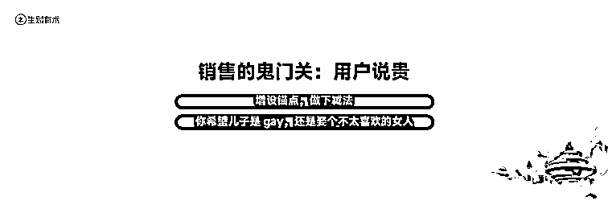

接着说“贵”的解法。

如果客户嫌贵，你可以给他做减法：把长周期的服务拿掉，把好材料换掉，把一对一盯进度改成大班，我也能把报价做到市面上最低。偷工减料这件事，我比任何人都清楚门道。可你要的到底是省那点钱，还是最后能解决事？大多数顾客听到这话，反而觉得你坦诚、专业，自己就下手了。

还有一招是拉极端后果。两年前有人来问产品，当时没买，今年又来。我跟他说：如果你当年就出手，现在早就像谁谁谁一样把成本收回来了。今天再拖，未来两年你还得搭进去八十万。他二话不说就刷了卡。有一个做“第三者劝退”的团队，收费不低——谈次话十二万，完整服务上百万。一个太太资产不少，但觉得贵。顾问直接给她算：你先生那边现在正是热乎的时候，按新规定，非婚生子女同样有继承财产的权利。真等到孩子生下来，要分走的可就不止这几十万了。太太听完立刻说：老师，您等我回去卖套房子。

## 3.3 把后果演出来

人只有觉得痛，才会掏钱；只有觉得急，才会立刻掏钱。如果话说到这份上他还不疼，就带他看一场“未来的电影”：你现在花一万，躲过的是将来五十万甚至一百万的大坑；现在省钱不处理，问题只会滚成更大的雪球。人都是这样，你越说别有粉红色大象，他脑子里越全是粉红色大象。你把极端后果绘声绘色地摆在他眼前，他自己就会被吓住，想马上解决。

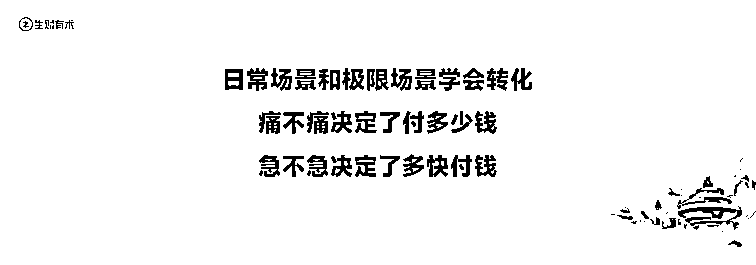

## 3.4 低价引流的误区

经常有人问我，课程能不能先卖低价，之后再逐步升级赚大钱？谨慎。低价体验课作为入口，本身是可以成立的——很多教育机构直播间挂出九块九的小课，用五天训练营拉高客单，这一整套在线上发售里是成熟玩法。但你不能一开始就把自己标成路边摊。价格锚定一旦建立，以后想翻身上探就难了，顾客会觉得你原本不值这个价，转头骂你割韭菜。所以我做主推产品，从来都是高价位起步。价位形象立住了，哪天推个低客单的东西，大家反而觉得像捡漏，顺手就买了。

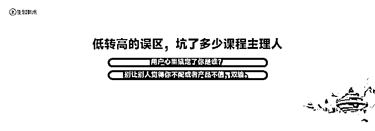

## 3.5 隔空对话

还有一种情况：你聊了半天，对方却不是能拍板的那个人。他要回去问合伙人、问对象、问上级。这是正常的，但你如果只说“行，您回去商量”，就等于把机会交给运气。高手的做法是给他一整套话术，让他替你传话。

我喜欢看古装长剧，有一部里男主想娶女主，担心女方家里不同意，就提前教女方的一位亲戚怎么说：先夸他们是清流门第，从来不趋炎附势，再慢慢引入江湖传闻。长辈听着听着，心里那杆秤就偏了。做业务是同一个道理。顾客说回去问老板，我教他：老板，这个方案我已经谈到位了，您只要点个头，这次您就在我和另一个候选之间做了最漂亮的选择。顾客说回去问先生，我教她：他一向最疼你，凡是能让你变好的事，他肯定不会舍不得；你活得更有光，他也跟着有面子，家里还省心。这些话带回去，潜台词就是——不让你买，就是不支持你变好；不支持你变好，就是不爱你。这样就等于隔着一层人，把背后的决策圈一起说服了。别把话匣子关掉，也别让人空手而归。

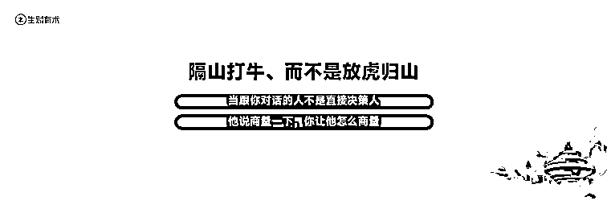

## 3.6 成交推进

靠谱总结过一套推进理论：第一次接触是0，付款那一刻是100。这中间你做的每件事都是增量——发状态是加分，私聊是加分，直播是加分，文章被对方看到也是加分。甚至连他看到另一个人摔了跟头，都能成为你的加分项。但这个进度也会往回缩。你回应不及时，内容更新断断续续，好不容易攒起来的好感就会掉。

回访的时候一定不要说：“您考虑得怎么样了？”这等于把主动权交出去，对方一句“再想想”你就没有后手。要带着案例去：我一直惦记着您的事呢，前几天一个客户情况和您几乎一样，条件还不如您，现在都已经跑出结果了。我觉得您不会输给他，要不咱们现在就把事定下来，早点开始？他要是硬扛着说“我就不”，等于承认自己认输，这样的人你也没必要再花时间。

# 4. 把成交变成可复制的流程

我带学员和带公司，第一件事永远是搭流程。公域拿什么钩子抓人，内容怎么做，加上好友之后第一句说什么、见面礼给什么，需求怎么问，产品怎么推，朋友圈第一条放什么，日常内容怎么安排——全都列成清单。一对多的事做得越足，一对一要费的力气就越小。

我父亲那代人做生意，很多事要在酒桌上解决。我见过他喝到身体出问题，去过医院。相比之下，现在做业务的人太幸福了：一个人对着几万人输出，这是过去不敢想的红利。正因为如此，更要懂得感恩，把所有动作变得可复制、可沉淀。

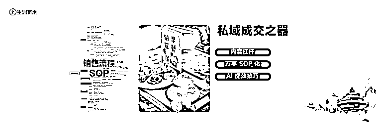

## 4.1 提前备好答案

你埋头做一个行业两三年，客户想问的问题就那么些。我会把高频问题全部写成内容沉淀下来，谁来问，我直接扔一条链接过去。省下的时间是一方面，更重要的是对方会觉得：你居然早就想到了。这种“你预判了我的预判”的感觉，会让他更愿意把自己交给你。

## 4.2 最有力的说服素材

最有说服力的素材永远是真实的人：买过的、问过的、甚至没买的，都可以写。我给自己贴的标签是“线上亲戚中转站”，🛰️里有一个分组，几千人都是老顾客介绍来的。我常夸夫妻一起做事的人：你们等于多赚了一倍的钱，还拥有了别人羡慕不来的互相懂得。人这一生遇到爱不稀奇，遇到性也不稀奇，稀奇的是遇到一个明白你的人。这段话发出来，好多人自动代入自己老公、自己闺蜜，然后就想着：我也要变成那样。故事和情感到位了，转化是自然发生的。

## 4.3 让AI帮你铺量

deepseek是我电脑上打开率最高的AI。它对中文语境的理解很细腻，让它分析新生代的消费习惯，或者直接生成面向中小企业主的📕文案，要求有情绪、有转化点、标题够抓人，它出来的东西和我自己写的差距越来越小。现在很多合作方都在这么干：五个账号、每周日更，一个下午批量备好35天的内容，剩下的时间就用来过好友、做回访、谈单。周五统一生产，周四集中复盘没成交的名单，谁开了单，老板就请客，但请客的名义挂在开单者头上。几百块钱的奖金转头就忘，但一张印着名字的销冠早餐卡挂在那儿，所有人都想在下周把它拿走。用AI把重复劳动吃掉，人才能把温度留给真正需要的对话。

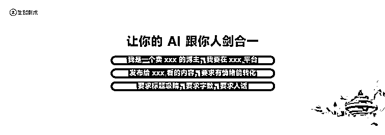

也有人问我平时读什么书。早期我啃的是工具书，讲方法论、讲品牌战略、讲心智定位。到了第三四年，我开始读历史和人性，因为你会发现太阳底下没有新鲜事。历史看多了，经济学和数学的框架也会进来，人反而变得特别平静。

# 心态建设和精力管理

一个状态稳定的人往那儿一站，客人就会愿意把事交给他。谁不想靠近一颗稳稳的星星呢？每年418前散会有圈友发愁：想把好东西推荐给朋友，却推不动，心里很受伤。但你要接受——没有人能做到百分百成交。我常算一笔账：假定十个人里成一个，一单两万，那么每一次被拒绝，你都离那两万更近了一步。拒绝一次，攒两千；拒绝十次，两万到手。如果一天赚两千七，一年就是一百万，如果一天两万七，一年就是一千万。这样想，拒绝根本不值得难过。

再讲怎么扛住小挫折。你看大学里，大一很多人还土土的，到了大三实习忽然变得很光鲜。差别在哪？她开始愿意试。试穿衣服又不花钱，为什么大多数人不敢试？因为怕在镜子里看到一个不好看的自己，怕导购投来嫌弃的眼神。但那些尴尬的瞬间，恰恰是长大的台阶。我前两年脾气比较燥，现在哪怕没谈成也不会结仇，我常说：这个项目我确实交付不了，你盘子很大，值得找更好的团队。这话听着是不是有点像分手时的台词？“你很好，是我配不上你。”可很多人偏偏就吃这套，觉得意难平。其实把姿态放软，不把话说绝，人脉就在。我经常研究剧里的高情商话术，一部接一部地看，看着看着就做成课了。时间花出去，开心，有用，还能赚钱，值。

最后聊聊精力。常有人问我，一个人怎么干完那么多事？我的体会是，时间管理的底层是情绪管理，情绪管理的底层是意志管理。人心齐，泰山移。你很想做好一件事，每一个环节自然就会做好。我专门去爬过泰山，想看看身体到极限时，意志还剩多少。心肺能力上去了，意志力才撑得住。所以睡眠和身体不是小事，它们兜底的是你的心力。

另外，要敢于放弃那些不属于你的客户，别让杂音吸走你的能量。还有，亮相的时机也很关键。我状态不好的时候，会主动从人群里消失，因为怕脱口而出的话收不回来。等我缓过来了，再亮出那个活力满满的样子。大家以为我一直很稳，其实背后也乱糟糟过。不用把别人想得太完美，找到自己的节奏，慢慢走就是。

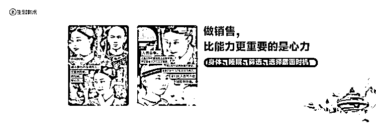

有人打趣说学医好就业，其实每个专业背后都有自己的门道。我始终认为，会卖东西这件事，反而是所有行业里最值得练的底层能力。它不是混不下去时的退路，它训练的是你如何与另一个人达成共识。能把这件事做好，做什么都不会差。最后说一句我喜欢的话：一个人了不起与否，和年龄关系不大，跟他持续产出的量有关系。希望今天在座的每一位，最终都能走到自己想要的远方。

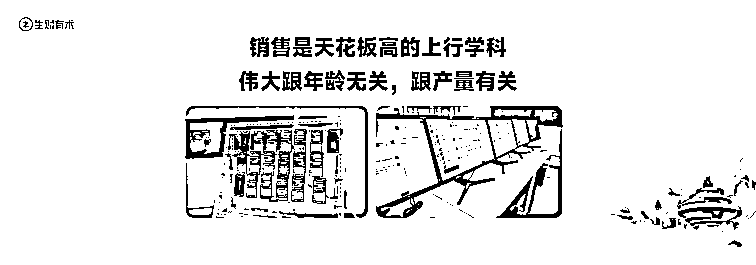
