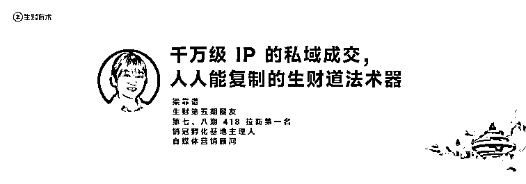
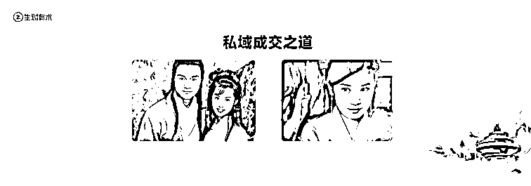
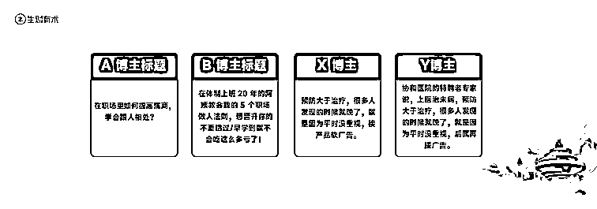
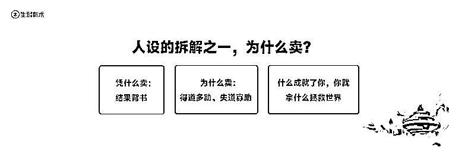
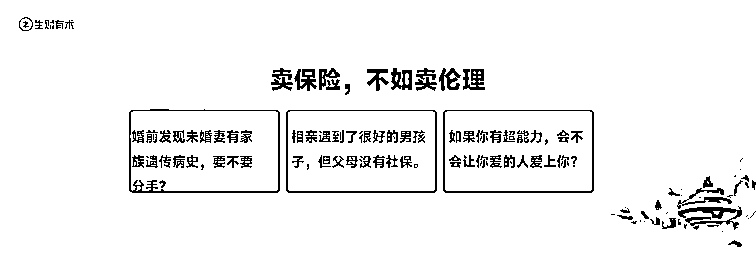
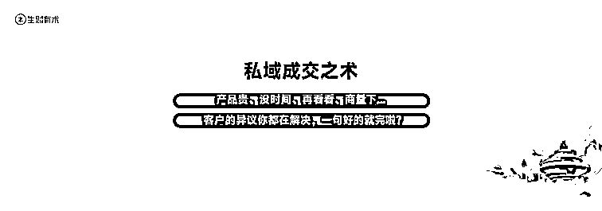
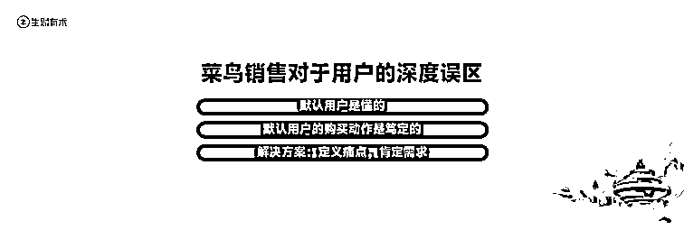
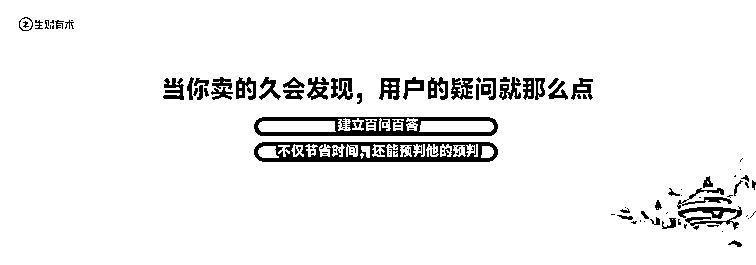
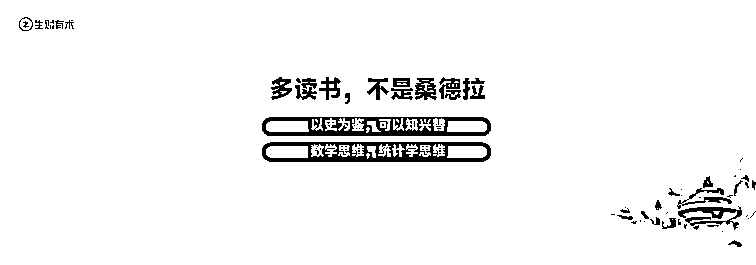
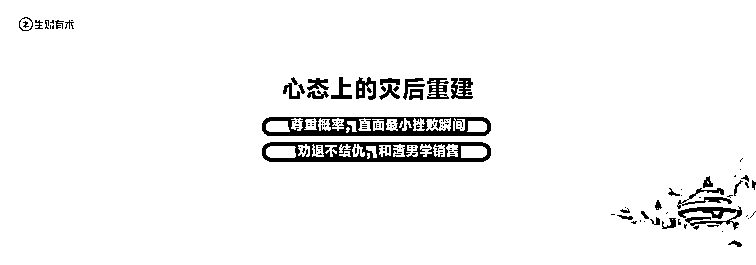

今天想跟大家聊一个我特别着迷的话题：销售。

先做个自我介绍吧。我是梁靠谱，主业在医院，到现在也没辞职。我对医学的热爱到什么程度呢？做梦都在救人——梦里有人倒下，我立刻让人打120，查呼吸、看瞳孔，甚至能判断出脑出血的具体功能区。醒来还反复想：这是真的吗？会不会真的有人需要抢救？

我2021年加入生财，当时发过一篇帖子，叫“不疯魔不成活”。从那时到现在，我带过上万名C端学员，服务过新东方、爱尔建、正大天晴这些企业客户，自己也打磨了一套营销体系，包括靠谱成交五步法、点线面体、痛点痒点爽点这些。今天现场的朋友别急着走，晚上夜话一人发一套课。

有学员问过我一个挺深的问题：靠谱，你觉得人生最难的到底是什么？我当时一愣，想说手里拿着锤子的人，看什么都像钉子，好像没什么难得倒我。后来我去问deepseek，它给了几个答案：获得内心的平静、原谅别人、面对死亡。我一看，这不就是“挣钱”吗？钱挣到了，生活平衡了，爱人了，学习也有底气了，这些事自然就解开了。

那挣钱的前提是什么？得有现金流，得有产品，得有买卖双方。

我师父当年跟我说过，世上最难的两件事：一是把自己的想法装进别人的脑袋，二是让别人心甘情愿地把钱从口袋里掏出来给你。能把这两件事一起做到的，就是销售。今天我用40分钟，专门聊聊私域成交和高客单价成交的“道法术器”。这套体系我第一次对外讲，是专门为咱们圈友准备的。

# 私域成交的道

我特别爱读金庸。网上有个投票，金庸笔下最有魅力的女性角色，票选第一第二是赵敏和黄蓉。为什么不是小昭、不是阿朱？她们当然也很好，奉献到连命都可以不要，连老公娶小老婆都不介意，但她们没有当选。因为赵敏和黄蓉身上有一个特别流行的特质，叫“引导型恋人”——她们有智慧，有主见，能带着关系往前走。

拿IP做营销，核心就是“专家型销售”加“知音型销售”。什么叫专家加知音？我特别希望大家都去背一背《致橡树》——不是做攀附的凌霄花，而是做一棵与你并肩站在一起的树。

我举两个例子。一个学员在广州做办公室装修，另一个在海南做企业财税代记账。他们原来的销售话术是：“老板，你想好了吗？”“老板，今天云不错，要不把单子签了？”这不叫销售，这叫入室抢劫——期待着业绩像一场不请自来的爱情。

我跟他们说，营销得换个打法。做办公室装修，你去拆解那些知名企业家的办公室怎么布置的，去研究《商道》《鸡毛飞上天》这些剧里的浙商怎么布局。某种布局风水上有什么讲究？什么样的陈设能让来访的老板觉得你很有品味？什么样的空间设计会让人放下防备、更容易成交？你甚至可以请一位国学老师，给每个老板看八字，按他的喜用神去布置办公室，建议他和什么属相的员工合作——你一平米的价格马上就不一样了。

做财税也别天天追着问“老板你这年六千八千要不要续”，你得去拆解为什么某娅某曲会有财税风险、金税五期之后各种规模的老板该用什么策略。这就是专家型销售：我不是来卖服务的，我是站在一个高度上，给你提供建议的人。

但全走专家路线，有一个问题：老板的ego会被抬得很高。这时候就需要百炼钢化为绕指柔——用知音型销售去中和。我经常教客户给他们的甲方提供情绪价值。比如跟老板说：“您这么有能力的人，一定要把事业做好，市场就应该良币驱逐劣币。这个世界要感谢敢创业的人，你们是在改变世界。”这叫什么？叫我懂你，我能帮你。想想那些有魅力的角色，是不是都精准满足了老板们的期待？

## 人和产品，谁更重要？

所以第一点是背《致橡树》。第二点，同样一件东西，谁来卖，差别是天壤之别。为什么每年推广生财，有的人能靠一个人撬动很多单，有的人连亲戚都不买单？问题往往就出在“谁在卖”。

孟子讲“易子而教”，就是这个道理。为什么现在年轻人听博主的，不听父母的？为什么郭德纲于谦要互相教对方儿子？因为“谁说的”太重要了。职场博主，一个只说“提高情商”，另一个说“我体制内工作20年，给你看真实案例”——后者点赞能压前者几百倍。健康博主，你说“管住嘴迈开腿”没人理，你说“中科院专家建议这样做”，帖子马上爆。

出混，人设都是自己给的。还记得当年那些卖茶的小姐姐吗？我身边有个人，自己盒饭都不舍得加肉，却给卖茶女刷了好几万茶叶钱——屏幕那头说不定是个彪形大汉。

### 为什么卖，比怎么卖更要紧

现在很多娱乐主播下播以后，都是运营去陪榜一大哥聊天。那时候有个角色让男人产生保护欲，他们就把钱花在自己的保护欲上。卖东西，IP最核心的问题就是：谁在卖？凭什么？我现在做销售培训，是因为早几年做微商，每个季度每年都是全国前几，所以我以销冠的身份去培养销冠。

为什么卖也很讲究。你看助农直播间，就是比其他直播间好卖，阿拉泰苹果一斤贵出一块钱照样有人抢，因为掌握了“道”。古代王朝更替还讲究得道多助、失道寡助呢，我们现在卖东西，也要给自己一个正当理由——什么拯救了你，你就能用它去拯救世界。

我很多学员，有人抑郁自救成功，愿意把方法公开分享，一篇个人品牌出道文就能带来大量订单。所以人设一定要做好：你的战绩、你的故事、你的经历，都要有迹可循。

### 人设一换，价值千万

生财里有些帖子只有方法论，你看完就划走了，不会去转发。但如果有方法论又有故事，点赞往往能到500、1000以上。我对生财印象最深的，是木易发的那条《绑着炸弹做淘宝》：跟圈友借钱、抵押龙珠，结果圈友没收，还给他发了几千块钱红包。这件事我记了很多年——道理让人信服，故事让人铭记。

人设一换，价值千万。个人品牌三部曲：第一是商业定位——我是做什么的？给谁解决问题？卖什么产品？收多少钱？但如果大家定位都一样，你怎么被记住？大家都卖车，你偏偏记住了雷布斯：他是武大的，跟初恋结了婚，他减肥，在樱花树下站过。你记得的全是这些“非商业”的东西。

所以你们的差异，不会差在商业定位上。很多人为了差异化，把定位搞得很散、很融合，最后谁也记不住。我们记住的，是身份、故事、长相。两个儿科医生，一个是中年二胎妈妈——你会觉得她懂当妈的苦；一个是满头白发的老爷爷——你会觉得他看了一辈子的病，肯定能把你治好。这就是人设的差别。

我之前有个B端老板，做高端护肤品的。他天天晒什么？改造汽车、飞机模型。我说老板你脑子是不是有泡？你客户是谁？是小姐姐！谁爱看这个？改成晒女儿奴，晒怕老婆，晒在家给老婆做美甲，晒你家那条狗地位都比你高，晒你天天研究怎么让老婆变美——流量立刻成千倍地涨。为什么？小姐姐会互相转：“你看他老婆也在用，肯定好。”还会转给老公：“你看看人家。”这个时代，能给女性提供情绪价值，你就来财。人前霸道总裁，人后给孩子当马骑，这种反差感拉满，才有人讨论，对不对？

我们之前策划过一款洗发水活动：你买了这款洗发水，让你老公给你洗头，拍照打卡，我们送你一瓶护发素。就一个私域活动，单品打爆了800万营业额。你给了人一个晒的理由，晒完就是你的业绩。所以人设太重要了。我不信有人没有独特之处——哪怕你只会给人介绍对象，那也是本事，时间花在哪，结果就在哪。

## 私域成单的方法

### 卖产品，不如卖故事

很多人谈单的时候不知道说什么。我举个例子：一款恒温杯。普通人怎么介绍？外观好看、材料跟火箭一样、18项专利、多少专家推荐。一问价格，三百多，人家扭头就走——这么贵，脑子有病才买。

但换一种卖法，卖的是故事。

先问：“在座有孩子的举个手。”然后讲：我们家孩子小时候，我跟老婆创业特别忙，孩子交给老人带。有一天孩子碰倒了水杯，烫伤了手，哭得撕心裂肺，老人也内疚得不行——留疤怎么办？以后还能不能当飞行员？长大会不会怨我们？植皮要多少钱？那一刻我们就在想，有没有一种杯子，倒进去什么温度的水，出来都是45度，刚好适合爱的温度，冲奶粉也行？让孩子再也不受伤，让老人再也不担惊受怕，让我们创业的时候更安心。于是就有了这款杯子。

只要不是贵得离谱，谁还会管它什么材料什么专利？直接就买了。

我有个做酒的供应商客户。别人卖酒都是讲工艺、讲销量。但《风吹半夏》看过吧？赵丽颖演的。为什么她叫“半夏”？因为妈妈生她的时候难产走了，爸爸是中医，说生半夏有毒，把妈妈克死了。

我们公司当时也策划了一个故事：有个男孩谈了个对象，女孩爸爸一直不同意。终于有一天松口了，让他来家里一趟。男孩拎了两瓶酒，爷俩喝着喝着，爸爸说：“她妈妈当年生她的时候难产，我一直怕她结婚生子，怕她也会……其实我不是不满意你，我是不满意自己。”说完老泪纵横。男孩说：“叔，您放心，现在医学很发达。我娶的是老婆，不是子宫，我们可以不要孩子，但我只要她。”后来他们有了孩子，母子平安，团圆宴上喝的还是这瓶酒。

这酒卖得极其好。大家品品：痛点，是没媳妇；痒点，是娶到媳妇；爽点，是娶到了；卖点，就是这瓶酒。酒不光是给酒鬼喝的，它承载的是人的情感、故事，甚至人生。

我前几天爬泰山，想起一句诗：古来圣贤皆寂寞。很多产品承载的，其实是人本身的感情和诉求。你能把这种情感描述出来，东西一定好卖——因为马斯洛需求理论里说，情感是人的顶级需求。

### 卖保险，不如卖伦理

接下来这个故事叫“卖保险不如卖伦理”。

很多人卖年金险，天天讲通胀率，讲央行利息，讲我们给你做到2.3、2.5，别人给不了3.0以上。我觉得这样不行。换个思路：我有个未婚妻，她家里有遗传病，我不知道她哪天会不会发病，我要不要跟她结婚？

这个标题一发出去，流量马上就来。无数人冲进来准备开骂：你要是敢分手，我今天喷死你！结果点进来发现人家说什么？说疾病是30%的基因加70%的生活习惯，两个人情比金坚就未必发病；就算发病，我们提前买好了针对这个病的百万医疗和重疾险；如果真早走了，给孩子留了点什么。

保险承载的是爱，是责任。精准询单一大把，流量还大。

再来一个：相亲相到一个各方面都满意的男孩，但他父母没有养老保险，怎么办？姐妹们，这时候就要有人劝你：这么好的男孩，要是他父母还能给助力，早就去找女明星了，轮得到你吗？然后顺势告诉你：父母该配什么样的养老险、什么样的组合。当产品本身没有太多吸引力时，这种故事的冲突感，就是最好的标题和选题。

### 需求背后，还有更深层的动机

我特别喜欢看辩论赛，为了保持思维敏捷。B站有“十大辩论赛名场面”，其中一道题：如果你有超能力，能不能让爱一个人的人爱上你？这种题就特别适合做选题，一选一个爆，一选一个卖，单篇推文就能签单。长险保费六位数，大家算算，几单下来，今年的IDA和MDRT就达标了。

这里要特别强调“动机理论”。很多时候，我们只看到需求，没看到需求背后的动机。

比如一个客户说要减肥，你的注意力全在减肥方案上。但他为什么想减肥？可能是去相亲被人嫌弃了——那人说他“有缸粗没缸高，除了屁股都是腰”，还嫌他胖，他气得要命，发誓要瘦下来打对方的脸。这才是动机。

想进生财的人，表面上是想赚钱、想搞信息差，但他背后吃了什么亏？有的人在单位被老板PUA惨了，有的人是为了攒彩礼进来的——这背后的动机是什么？是娶媳妇、繁衍。你挖到了动机，让他内在的动力冲破外壳冲出来，他才会下决心买你的产品，而不是听你讲产品本身。

动机是我觉得最重要的东西。为了懂营销，我甚至去看了犯罪心理学——我想知道一个人面临抉择时到底在想什么，内在动机是什么。当你有了这种上帝视角，你会发现人性没有那么难琢磨。

# 私域成交的术

接下来聊“术”。很多销售最怕什么？客户说“能不能便宜点”“我回去再商量一下”，一下就卡住了。

这里给大家两个心法。第一，要百发百中，来一个秒一个；第二，嫌货才是买货人——客户要是真不想买，根本不会提这些疑问，早就走了。他还会跟你讨价还价，说明他是想买的，你要做的，是把他拿下。

## 销售最常见的误区

很多销售对客户有个很深的误解：觉得客户是懂的，是明白自己想要什么的，甚至觉得来问的人就一定要买。但真相是——大多数客户自己都没想清楚，他们摇摆不定，犹豫不决。你的任务，不是等着客户下单，而是帮他做出决定。

篇幅有限，今天就先聊到这里。听说点赞转发的人，下个月都能开大单，咱们晚上夜话见。

很多时候成交的关键，不是把方案说得更清楚，而是先把“一定要解决”的认知给用户钉死。

比如做医美的那几个客户，大双眼皮、人中整形这些项目。明星一年往脸上投百万的例子太多了。有个客户来咨询双眼皮，销售明显感觉她在犹豫，我就让销售别急着报方案，先说一句话：你做好了一定美，下颌线和下三庭其实已经很好了，你现在纠结的是什么？是担心疤痕体质还是别的什么，说来听听。客户说，妈妈和男朋友都反对，说怕破坏面相风水。于是我就说，你看现在那些女明星微调后是不是正缘来了、资源更好了？变漂亮、变自信之后，所谓的运气自然就跟着变了。什么风水能比得上你自己的样子和底气重要。这一句话下去，当场就签了。

先把需求夯实到“必须买”，再去放大痛点。有人问我孩子厌学要不要解决，我会说女孩子现在才九年级，你就算勉强上完初高中，大学研究生怎么办？你这一辈子都要跟这个孩子过不去。学习力、代码思维这块现在不打底，以后越拖母子关系越差、你越省心。现在不做，未来只会更累。妈妈一听就觉得对，钱直接定了。

说个益生菌的例子。客户问孩子挑食要不要吃益生菌，普通销售直接说一定要吃，我们的多少多少钱。客户多半回一句再想想、有点贵。真正的高手先问：孩子最近身高怎么样？在班里排第几？妈妈一听就紧张了，说个头好像不高，排队都在第二排。我说我为什么问这个？因为长高的激素、生长素的合成和肠道菌群息息相关。挑食导致菌群失衡，长不高就是信号，现在还能抢救，过两年骨龄闭合就晚了。妈妈当场不问价格，直接要最大套装。

这就是痛点定义的本质。流量不行的人说流量不足，发售不行的人说一次发售就好，海报不行的人说图片丑。你要做的是把用户能被你解决的那一点痛点，定义得清清楚楚、刺痛到必须现在买。

## 3.2 销售的鬼门关

用户说贵，销售就卡住了，要么硬刚说不贵，要么说一分钱一分货。其实“贵”有很多种解法，核心是锚点。

锚点是什么？比如一个男生想娶女朋友，他妈死活不同意。有一天他跟妈说，其实我喜欢的是男生。妈妈当场崩溃，天塌了以后没孙子了。等她伤心一周左右，他再说妈我骗你的，我还是喜欢她。妈妈一听，女的就行，赶紧领回家。先给一个更坏的参照，再把真实选项显得可爱，这就是锚点。

打个比方你想让老公帮忙洗狗。你说老公我好累，能不能帮我洗狗、遛狗、再拖地。他肯定犹豫。你马上说那好吧，拖地你来，洗狗遛狗我自己弄，能现在就做吗？任务砍掉三分之一，他立刻行动了。事后你还能说，你看我爱你，都帮你做了大头。这就是减法带来的心理轻松。

客户说贵，你也可以用减法拆解：如果不是交付周期长、不是材料成本高、不是一对多服务，我也能做得比同行便宜。我知道怎么偷工减料，但你想要的是便宜、还是想要效果？想要便宜还是想要结果？你一顿实在话下来，对方会觉得你是真行家，当场就下单。

还有极限场景法。不解决现在的小问题，未来会变成多大问题。有人两年前问我产品，今年再来，我说你要是当年就买，现在早就多赚了多少钱。这次再犹豫，两年又丢80万。瞬间就不犹豫了。

极限场景的经典案例是劝退师。1+2团队，单次咨询12万。有个太太舍不得花钱，我说你老公现在跟小三还藕断丝连，新民法典私生子也能继承。你现在不处理，两年后孩子出来分财产，不止这点钱了。她立刻说，你找老师，我去卖套房子给你。

## 3.3 场景转化

当下不够痛，就把它拉到未来极致。收你1万，能帮你避开100万的坑。你现在省1万，以后可能亏500万。和奇异博士一样，让用户看见过去的遗憾和未来的灾难。

人一旦被拉进场景，就自己吓自己。你让他别想粉红色大象，他反而只想粉红色大象。痛感决定付多少钱，紧迫感决定多快付钱。

## 3.4 低转高的误区

很多人问能不能先低价再涨价。直播间卖9.9、卖几十引流到五天课再转高客单，这是可以的，叫私域发售。但你一开始就把价格打得很低，后面想涨就很难，客户会觉得你不值、你在割韭菜。

先把价格锚定在高位。锚点一旦设好，偶尔放个低客单，客户只会觉得是捡漏。我日常的产品基本是1万、4万、10万的价位。每年生财活动卖2000多，大家觉得也不贵，就买了。因为高价锚点已经存在。

## 3.5 隔山打牛

很多时候跟你聊的人不是决策人，他要回去商量。你不能说好、你也不能说没事。一定要给他一套能带回去的话术。

看《知否》，顾二想娶明兰，就先教长柏怎么跟父母说：夸他们家名门不慕利，夸他们家有格局。客户如果要回家跟老公或老板请示，我会直接教话术：老板会觉得你这次决策英明，在同事里更突出；老公会觉得你变美变好是为他争面子，他会更愿意投资你。

你给的话术背后意思就是：不让你买=不爱你、不支持你成长。隔山打牛，把所有决策者一起拿下，不要放虎归山。

## 3.6 成交进度条

我有个原创概念叫成交进度条。初次见面是0%，付费那一刻是100%。中间每一次朋友圈、一次私信、一次直播、一次文章阅读，都是在往前推。看到身边人翻车，也是推进。

进度条会倒退。三天打渔两天晒网、回复慢，进度就往回掉。所以要持续管理预期。回访别问“考虑好了没”，客户说没好你就没话说了。要带案例刺激不甘心和竞争：我一直记着你，你的情况比他还好点，他都做出成绩了，你肯定也能。今天把钱定了立刻开工，好吗？

# 4.私域成交的器

做私域一定要把SOP理清楚。公域钩子是什么？内容怎么排？私域进群打招呼、见面礼、需求挖掘、推品节奏、朋友圈置顶、日常内容。做一对多动作越多，一对一的消耗越少。

上一代人谈生意喝到胃出血，这一 Exams我们有自媒体，一对一万、一对十万。把流程SOP化，效率和从容自然就上来了。

## 4.1 建立百问百答

做一个行业超过两三年，问题就那些。我把所有高频问题做成公众号和朋友圈。客户问，我直接截图转发。既省时间，又让客户觉得你早就预判到了问题，托付感立刻上升。

## 4.2 最好的转化素材

最好的素材不是你说，而是用户说。用户证言、用户图鉴、用户故事。我有一个微信分组叫大型互联网亲戚集散地，几千人都是客户推荐来的。我会夸夫妻创业不容易，一起扛能赚双倍，还能互相理解。大家一听就代入，我老公、我闺蜜就是这样，于是也想成为那样的人。

## 4.3 和AI人剑合一

我现在用得最多的是deepseek。它懂中国人语感。我会让它输出Z0人群画像、购买逻辑、标题情绪化转化。小红书一篇给老板看的内容，只要给指令，标题吸睛、情绪转化、字数把控，审美契合度极高。

现在服务甲方就是批量生产：每周半天生成35套内容，其他时间只做发布和谈单。团队每周五批量生成内容，周四集中回访未成交单。销冠请客吃肯德基，名头刻在销冠上，大家自然卷起来。200块变四次早餐卡，比直接发钱更有面子。

## 销售的成长路径

前两年读工具书，《定位》《华与华》《小马宋》。第三年开始读历史、人性书。以史为鉴，可以知兴替。经济学、数学思维会让你更平静。

高能量的销售，情绪稳定，站在面前就让人想托付。每被拒绝一次，假如成交率10%，2万单价，你每被拒一次就赚2000，拒2000就赚4万。十单成交2万到手，一年就是1000万。最小挫败瞬间一定要扛过去。别人大三大四穿搭精致，是因为她敢在商场试丑衣服。现在销售被白眼，就是以后成功的铺垫。

我现在不结仇。有时候说，我交付不了你，你盘子大，值得更好的，你再多看几家。就像渣男分手说你值得更好的，被念念不忘。看《甄嬛传》学销售，看《知否》学销售，看什么都能变成课。工作和生活才能同时心流。

## 4.4 销冠的精力管理

时间管理是情绪管理，是心力管理，是意志管理。人心齐泰山移。你想把事做好，每个环节自然会做好。我爬泰山是为了看看意志在极限时的状态。心肺好，意志才稳。

筛选掉非客户，保护自己的能量场。选择露面的时机也很重要。心情不好就别露面，缓好了再出来。别人看到的永远是动力满满的你，背后的凌乱只有自己知道。

销售不是兜底行业，是上层学科。做好销售，你就能做好任何事，因为它本质是达成一致的能力。量堆起来，伟大跟年龄无关，跟产量有关。

希望今天来的每一位小伙伴都能找到自己的伟大。

谢谢大家！

