# 零基础玩 TikTok 跨境 电商，月出单上万的实战摸查框架全拆解

> 来源：[https://xikbp3he4xj.feishu.cn/docx/OhJkddWSAoa6WlxaVmYcruQlnQd](https://xikbp3he4xj.feishu.cn/docx/OhJkddWSAoa6WlxaVmYcruQlnQd)

摸查全链路思维导图

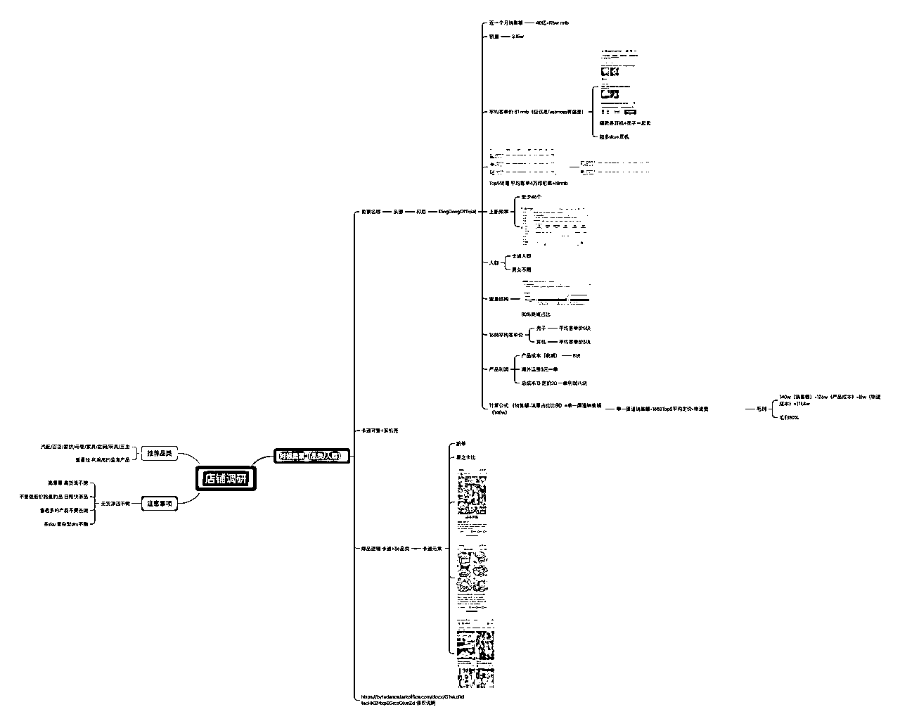

先看本地商家调研的目的：研究本土账号的运营模式、打法套路、Top5品类的属性特征，以及可否实现盈利。

## 1. 近30天营收

第一步 先在平台锁定商品关键词、目标区域、品类标签，筛出本土账号。

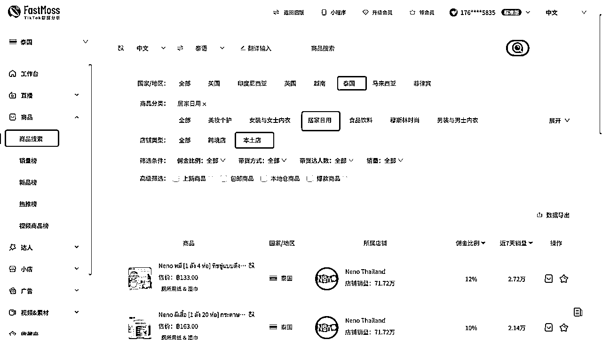

第二步 筛出对标对手，盘点月GMV 与 月销量。
选月度而非半年度，是因为半年前的爆品早已更迭，各品类受季节与潮流影响极大。此环节的核心在于测算盈利空间。

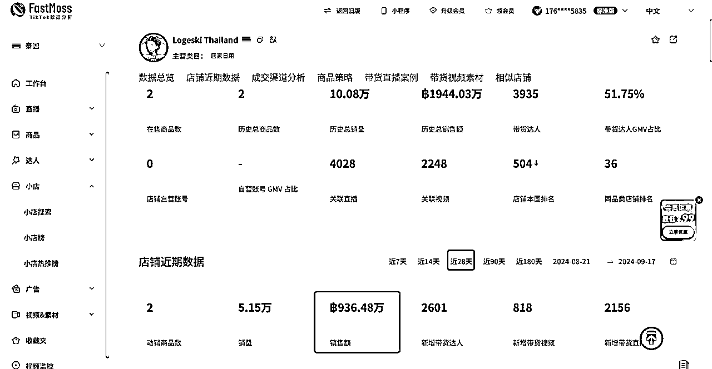

## 2. 品类均价
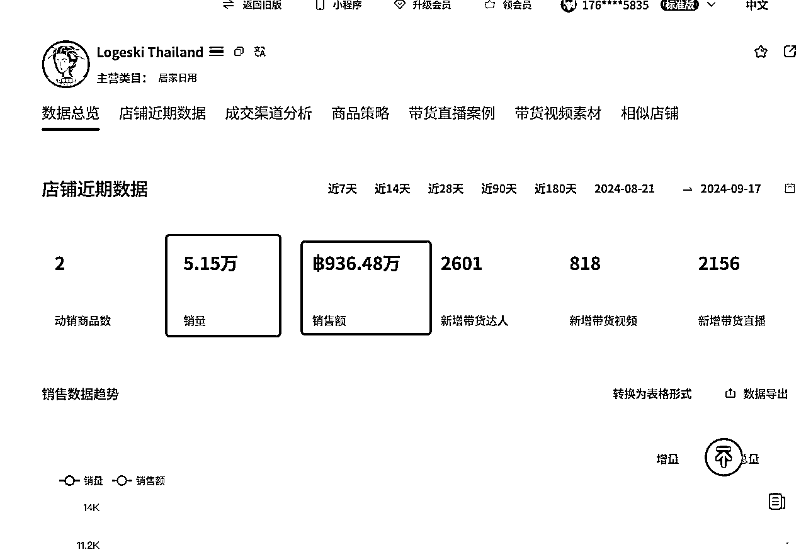

算均价的意义在于推导利润，同时掌握该品类在本地市场的价格带。

## 3.TOP5热销单品 （公式：Top5销售额/Top5销量=单价）示例：（1740.48w/91659=189）该卖家均价 189泰铢 ≈37.8人民币，3瓶装品牌马桶清洁剂

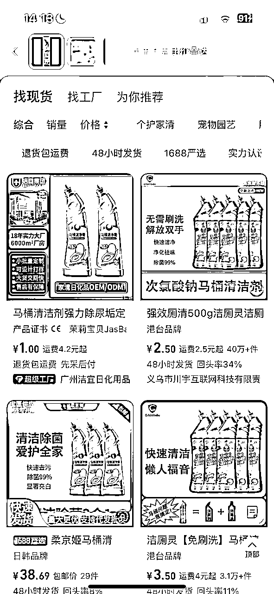

聚焦Top5的逻辑是：店铺只有爆品在赚钱，其它非爆品基本持平或亏损。于是我们要复盘Top5的选品思路，以及单个爆品的盈利贡献。

## 4. 上新节奏

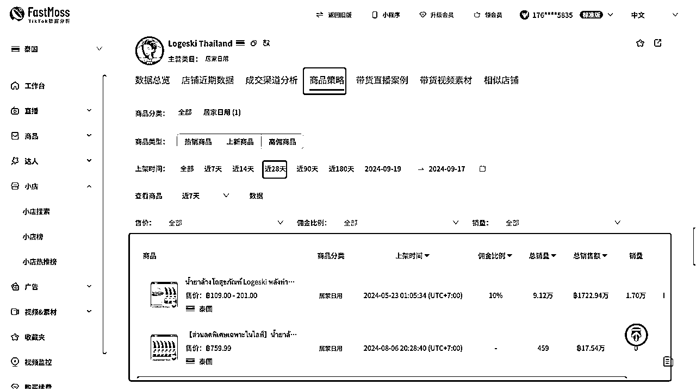

上新频率在跨境与本土之间差异明显，二者模式亦不相同。

## 5. 流量构成

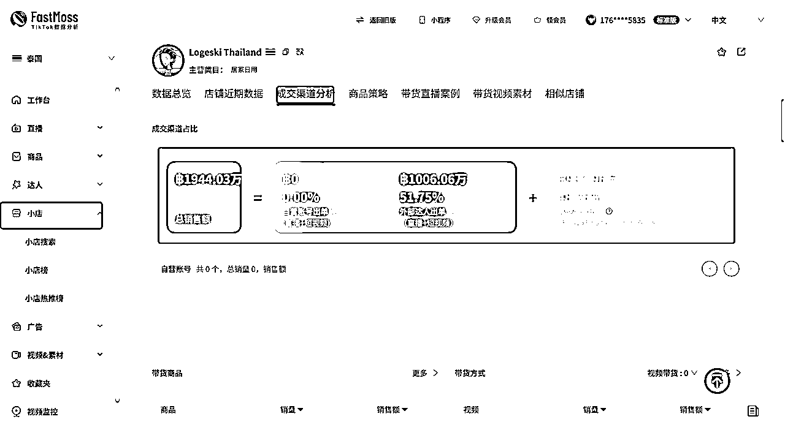

通过此项可清晰判断卖家的品类玩法与整体策略。

## 6. 单品成交路径

首步 锁定目标单品。

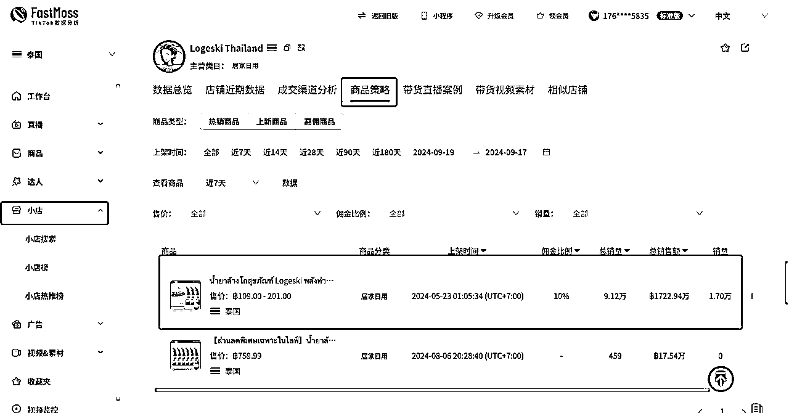

次步 观察该单品的销售节奏与推导路径。

第三步 解析路径各环节的成交占比。

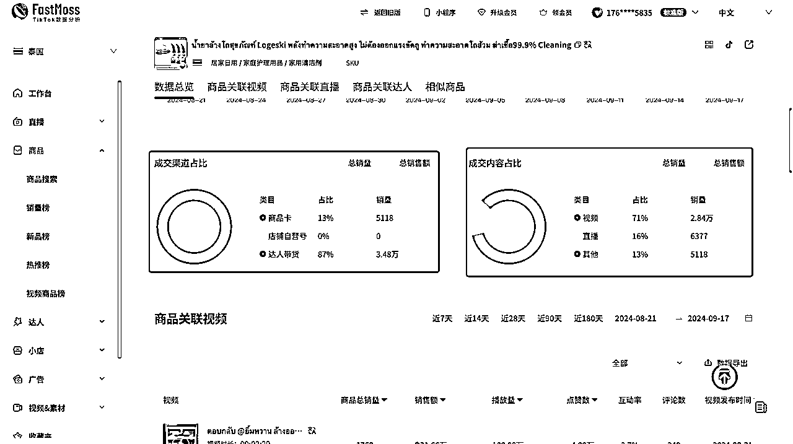

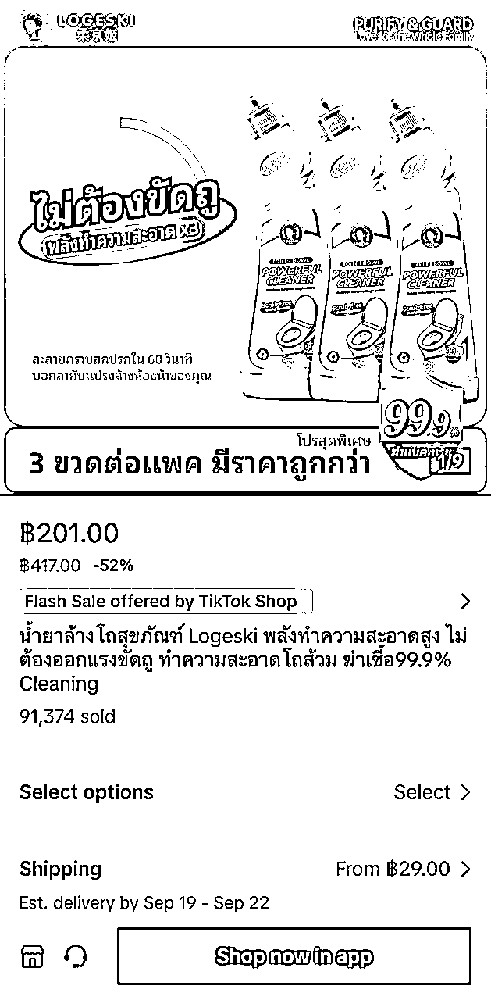

## 7. 本土账号复盘

模式复盘：该账号为本土商家，品牌名柔京姬。可能是品牌自营，也可能是授权贴牌；备货方式可能是跨境海运备货，也可能是本地生产。本地备货海运成本偏高，所以更可能是本地代工贴牌，或品牌自有海运备货。

打法复盘：商品卡成交占比13%，达人带货占比87%。此结构基本可判断为品牌自营，因经销商不会为品牌投入此类资源。整体动线为 GMV MAX+短视频投放+达人种草。视频占比71%，说明卖家核心动作有三点：1.投放做基础动销与GMV MAX；2.达人产出内容再投放；3.引入直播团队做直播带货。

利润复盘，因品牌整体ROI难以精算，此处仅测算商城部分：

* （30天总销售额×最大流量渠道占比）=30天单渠道销售额 936.48w×48.25%=451.8w泰铢 即商品卡销售额
* （30天总销量×最大流量渠道占比）=30天单渠道销量 51500×48.25%=24848单 即商品卡销量
* （单渠道GMV/单渠道单量=单渠道均价）451.8w/24848=181.82泰铢≈36rmb

按1688同款成本1-3元/瓶估算，本地代工更低，暂取成本3元+本地履约3元=6元≈30泰铢。
毛利=销售额-货品成本-投放成本 =451.8w-74.5w-x=377.3w泰铢-x
毛利率约83%未扣投放。净利需更多数据验证。
目前本地市场的毛利普遍在50%以上，除非属于高频复购刚需。本地玩法繁杂，必须结合实际情况核算。通过该账号我们已梳理出模式、打法与利润。下一步要看看无货源模式。

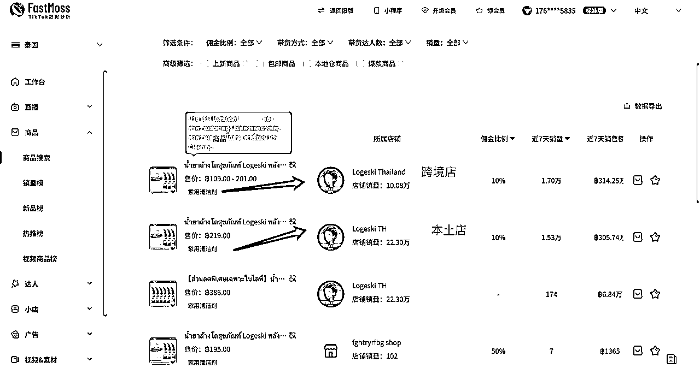

二, 跨境账号摸查路径

## 1. 单品店铺销售额

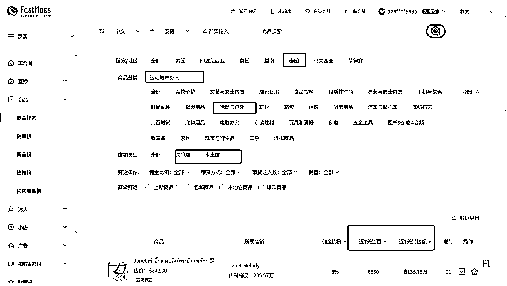

跨境账号的逻辑是：不靠店铺整体，靠单品爆发。因此检索后直看销量即可，重点看新品的盈利能力。

## 2. 找到可跟投的潜力品

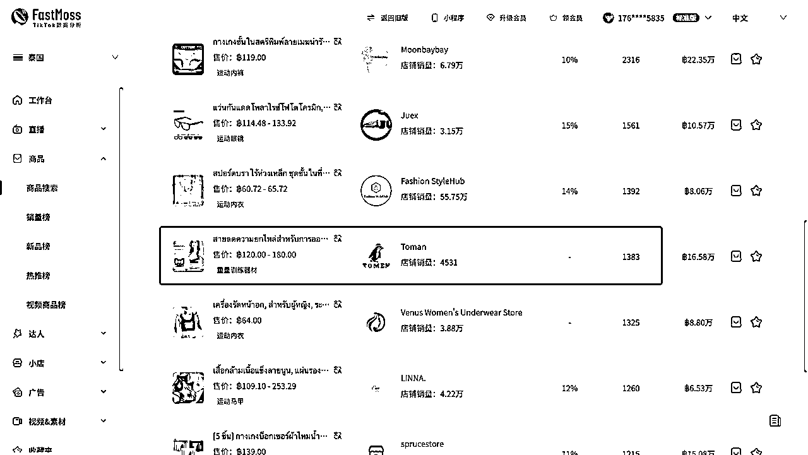

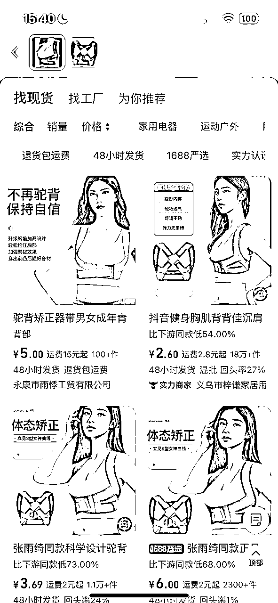

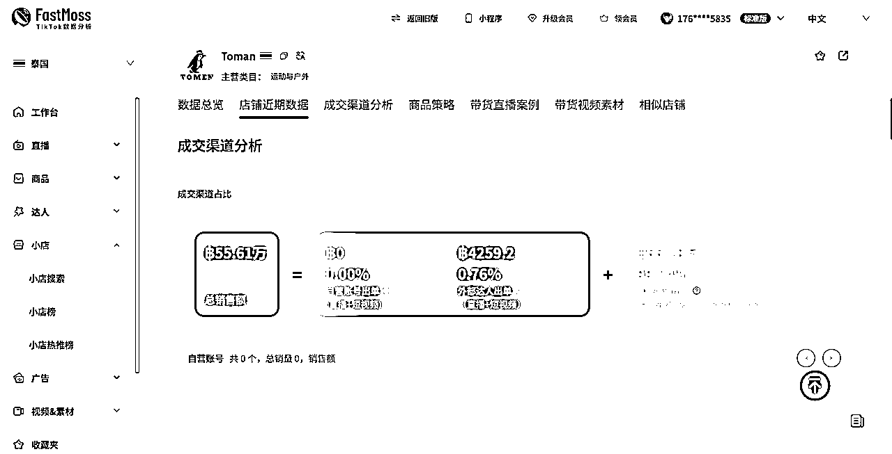

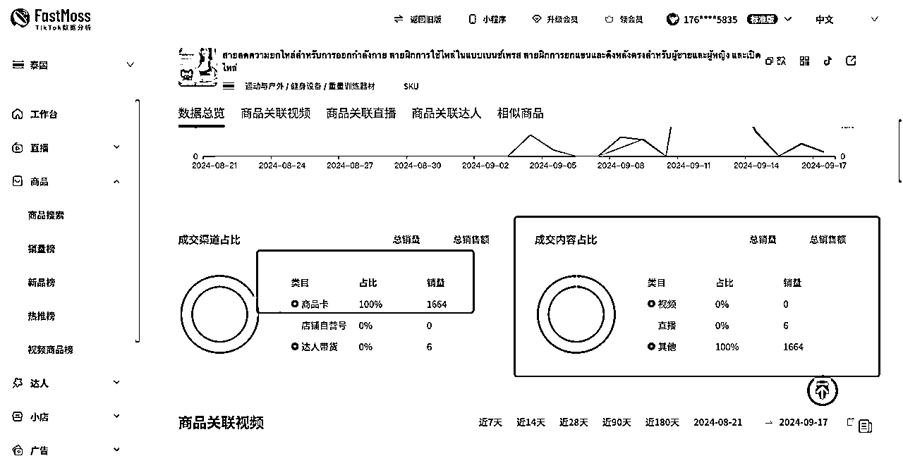

1688货品成本6元，运费6元，售价24-36元，单笔毛利约10-20元。7天成交1383单，单品利润已超一万，且全靠商品卡自然流量，无投放无达人。这正是跨境无货源的核心逻辑：前期大量找品，能挣钱就铺，规模化上架后用运营把链接做起来。

以上即为TikTok全流程摸查方法论。在我看来，没有比调研更关键的环节。做TikTok时，请先把底层逻辑找准。