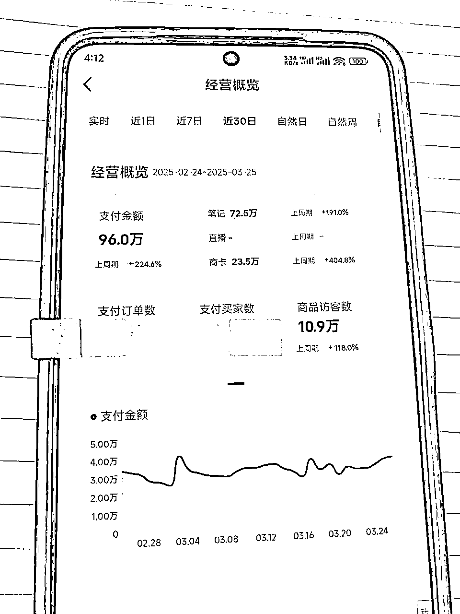
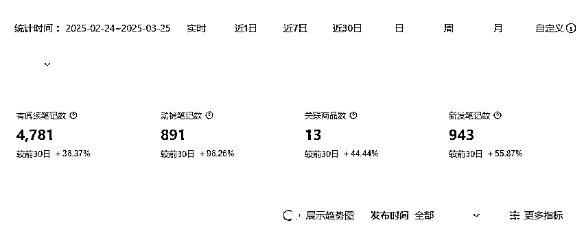
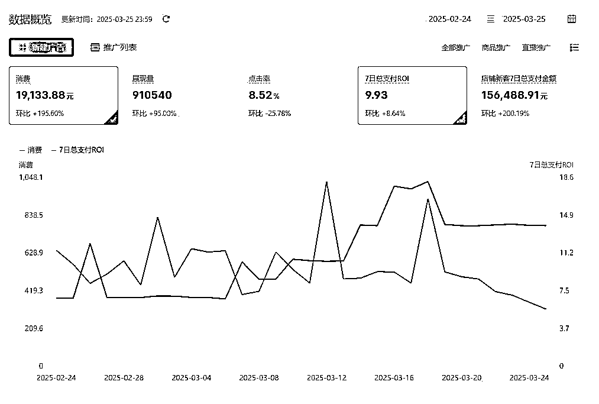
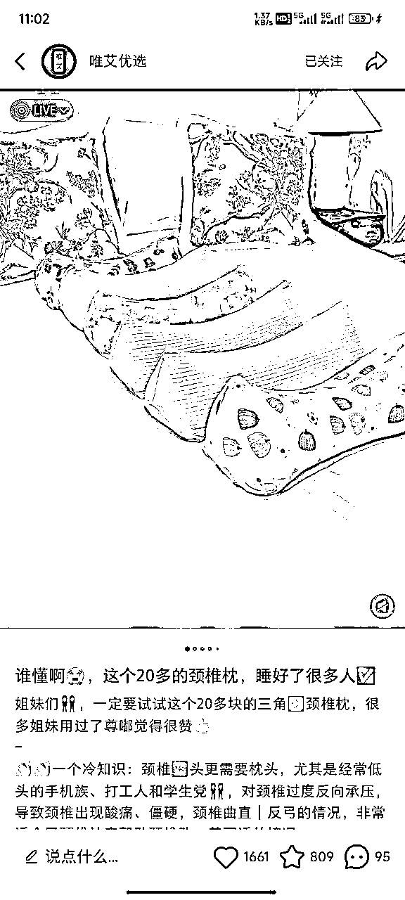
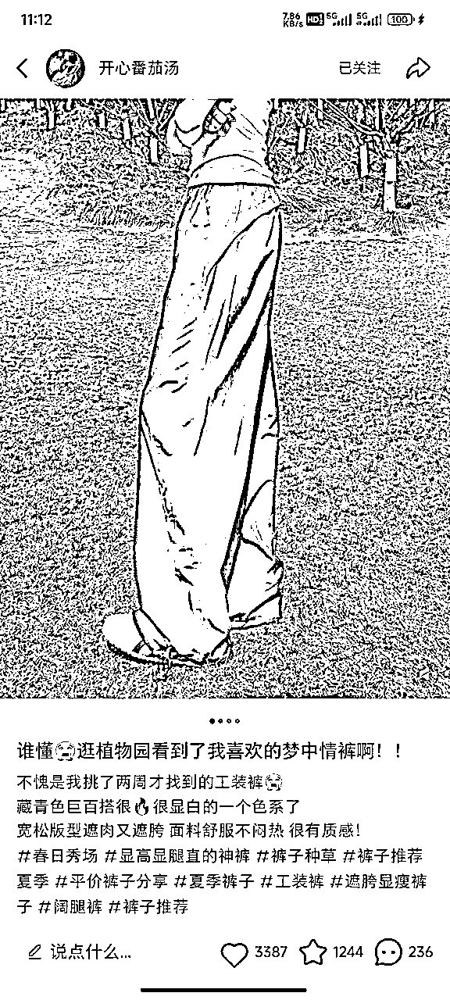
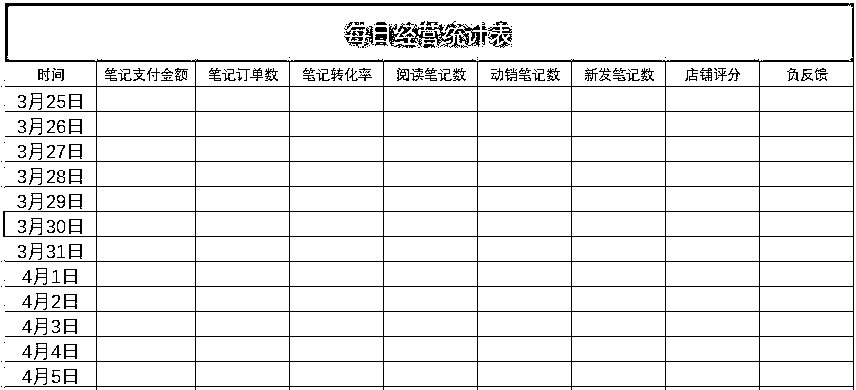

# 我用纯笔记把小红书单店做到月销90万+，全程原创实拍不直播

先谢坤哥和seven老师。

是坤哥让我坚定走小红书笔记带货这条路，是seven老师的选品打法让我下定决心做原创实拍。PS：seven老师那套价值百万的选品思路我真用上了，按着方法做的微原创款，卖了200万，现在仍稳定日销大几千。

做合规能沉淀的品，做有复利的事。小红书的长尾太长了，真的是长坡厚雪。

【我的现状】

单店月销90万出头，玩法是纯笔记+原创实拍，不开直播，投流用乘风每天也就6-800块。

账号配置是1个蓝V主号带3个关联子号，每天稳定产出30多篇带车笔记，图文占6成，视频占4成。

下面把我带货从0到跑通的实操顺序讲清楚。

第一步：先定赛道

别一上来就冲，问自己三件事：这次做小红书想达成什么目标？现在手里有什么资源和能力？

想要快一点出反馈，就盯7天内的低粉爆款；想要长期做副业，就选全年都能卖的品类；本身有教学背景可以先试虚拟课，有二次元属性可以先从动漫周边切入。

我当时定的目标是店铺日销过2万，那只能选大盘热度高的类目，剩下可选范围就剩：美妆护肤、服饰配饰、家居百货、母婴、食品保健、数码、运动户外、宠物、保健品。

考虑到要长期做，就不能碰黑五类、功效类，也不能做搬运混剪；我没有宠物、没有育儿经验也不想做食品，最后锁定：美妆护肤、服饰配饰、家居饰品、数码电器、运动户外。

第二步：筛品

我常用的筛选门槛：

首选标准：商品24小时加购>500；达人粉<200；该达人历史笔记<200
次选标准：商品24小时加购>200；达人粉<500；历史笔记<500

加购高说明现阶段有热度，能分一杯羹；账号体量小说明权重离我们近，更容易超车。

找品渠道我长期在用：

1. 千帆后台账号榜单，数据中心-市场-笔记排行-优秀账号-商品笔记-成交高
2. 爬虫工具抓取的当日爆款榜
3. 按二级类目词手动搜小红书，按销量排序，参考百度小红书类目表
4. 千瓜、蝉小红等平台的低粉爆文
5. 跨平台验证，抖音、快手、视频号的同款爆款

第三步：锁定最终款

①看自己能不能复刻拍摄质感
笔记画面=背景+主商品+陪衬+光线+留白。先判断自己能不能拍出对标同水平的视觉。

比如图3卖颈椎枕的账号，灰白床品+多色枕头堆叠+台灯靠枕+室温光，基本能做到。

图4卖工装裤的账号，公园草地+藏青工装裤+高个细腰模特+白T亮鞋+日光，也是正常难度可达标的。

②算对手的真实利润，看是否值得跟
目标日利润1000元，对标账号日利润至少>3000；目标日利润3000元，对标至少>9000。

小红书笔记带货，60-80%的销售额集中在1-2篇爆款，其余20-40%来自没什么赞的基础笔记。所以想接近对手成绩，爆款必须先打过对手。

销量记录法：每天手动算链接当日销量=今天销量-昨天销量
利润估算：当日销量*（售价-同款进货成本）

③下单同款+多比多家货源
最佳是找到同源货，次优是同质相似品。

这一步能摸清对手的起号节奏、账号数量、日更量，给自己一个合理预期。最后明确打法：走低价、做产品差异化、做素材差异化、笔记量翻倍。

第四步：建素材库

素材库=封面+内页图+标题+正文+话题

①先找产品近15天内的爆款挂车笔记，百赞以上优先，千赞不挂车的也可以参考
②先模仿再优化，封面1:1复刻拍摄/制作，标题话题先对齐，正文仿写50%左右

起步数量：封面10张+标题20条+正文20篇

第五步：养号测权

①养号：新号放3-5天，别乱动；老号只要没大违规就继续用
②测号：发3-5篇测试笔记，用最近3天同类目/同人群的爆款做模仿
第1篇发产品相关，第2篇发人群相关

只要有1篇>10赞，就实名绑定店铺，开挂车
如果前2篇都不行，第3-5篇换近期热点
5篇全没过10赞且小眼睛<1000，就用薯条加热测一下，或用小号搜关键词看是否收录。没问题则号权重一般，自行保留或注销；有问题直接注销，半月后换机重来。

第六步：起号跑数据

一个品测试7天，链接加购持续涨且有成交就继续，没有就换品重来

前2天每天发2-3篇挂车笔记
小眼睛均值>100可加量，第3-4天提到每天5-6篇；均值50-100就保持

第5天挑前4天里最好的一篇投100块乘风，操作路径：新建计划-商品推广-笔记加热-通投-托管
投流优先级：已出单>点赞最高>小眼睛最高

第5-7天保持每天8-10篇或5-6篇
一周后判定：出单就持续优化；没出单但加购天天涨，继续优化再测7天；没出单且加购不涨，直接放弃

第七步：爆款裂变

爆了以后别只发原片，要拆。

点击素材=首图+标题，决定进来看不看
转化素材=最后两张图+正文，决定买不买

一条爆款一定在点击或转化上有一个爆点。拆出来交叉组：

同款点击+同款转化
同款点击+另类转化
另类点击+同款转化

三组轮转测试，找到你的固定爆款组合后批量复用拍摄。

第八步：日常经营

小红书笔记的长尾很恐怖，今天发的每一篇都是未来大浪里的一滴水。每天的新增量=你的内容基数，笔记阅读量=点击素材质量，动销笔记数=转化素材质量。哪环掉就补哪环。

再一个习惯，每周持续上新7天内的低分爆文。同一爆款单号每天发2-3篇即可，不要超过当日新发量的50%。不断找新爆款，不断复刻，不断裂变。

以上就是我跑通小红书笔记带货的完整路径，希望能帮到你。