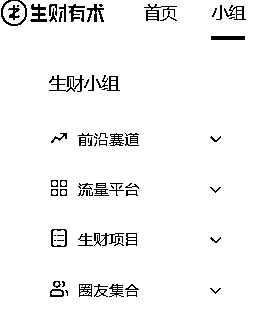
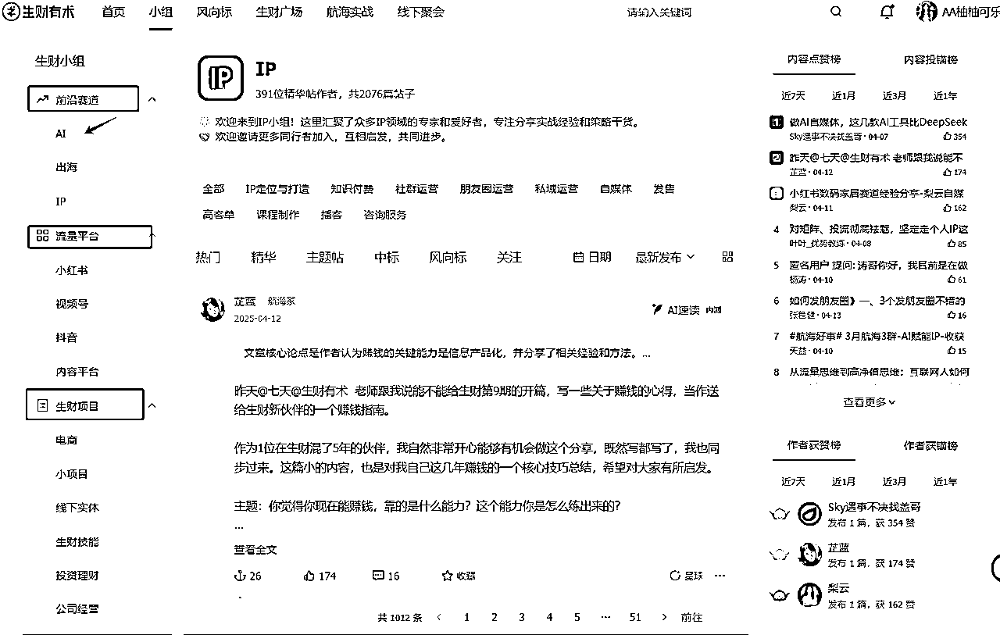
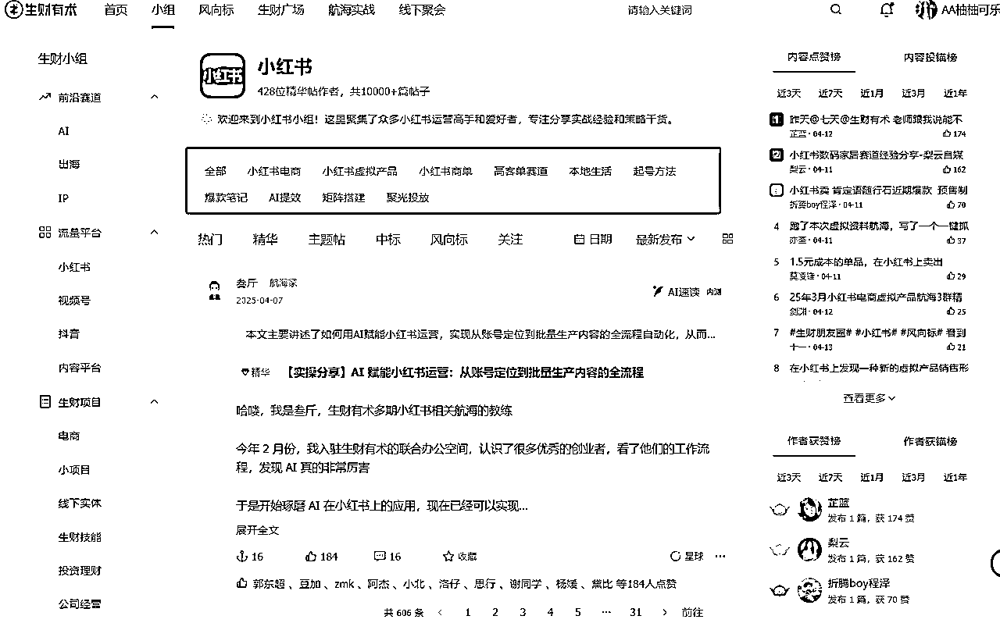
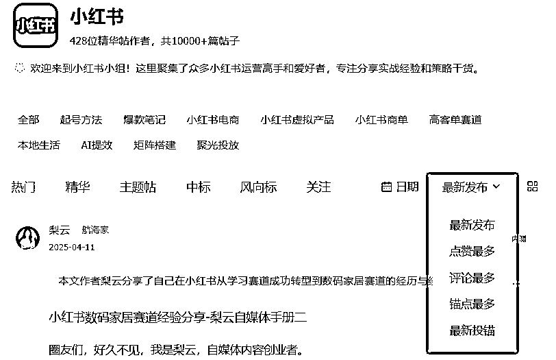
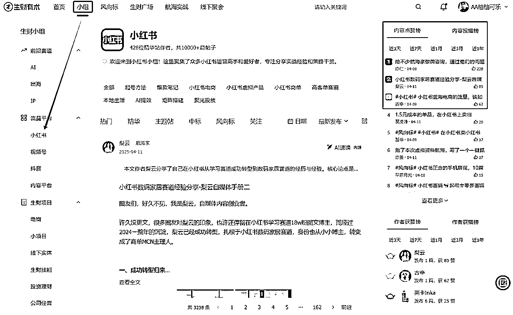
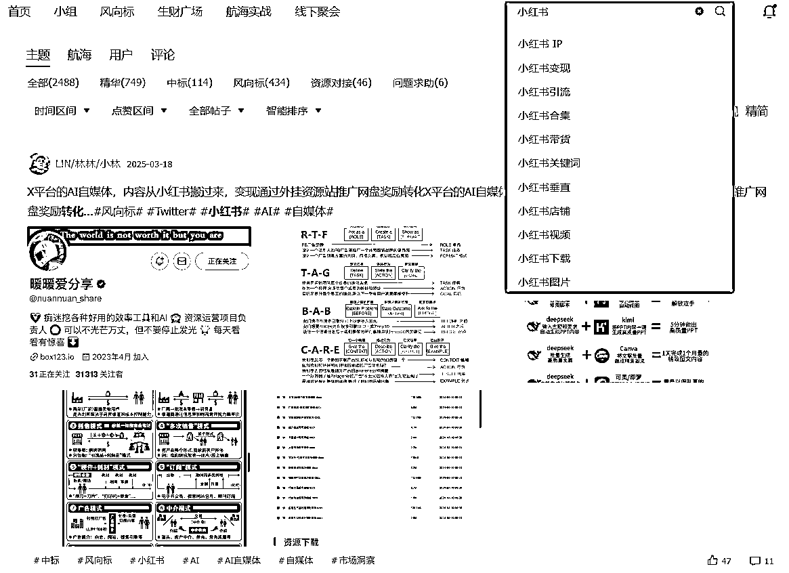
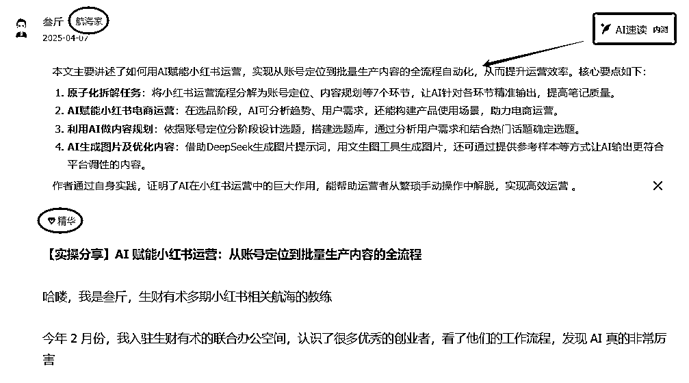
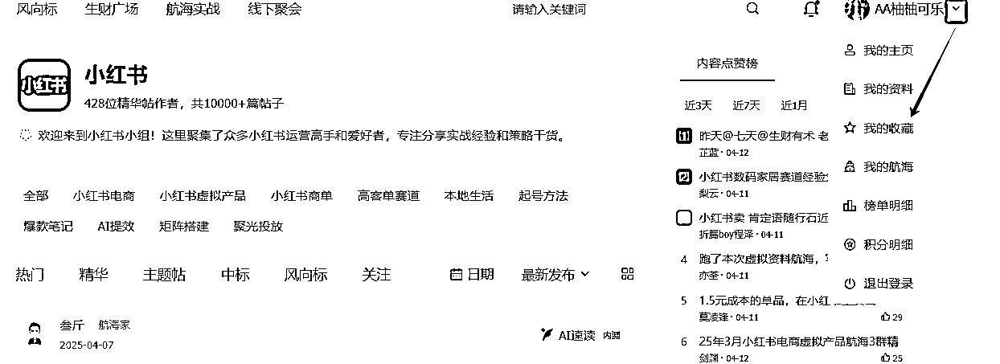
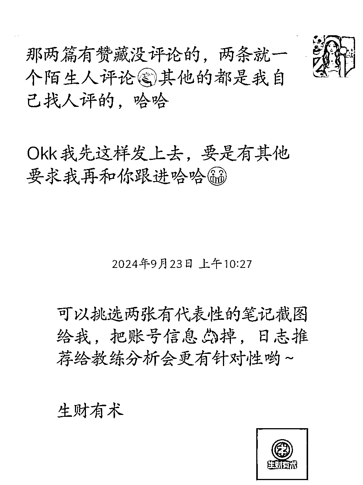
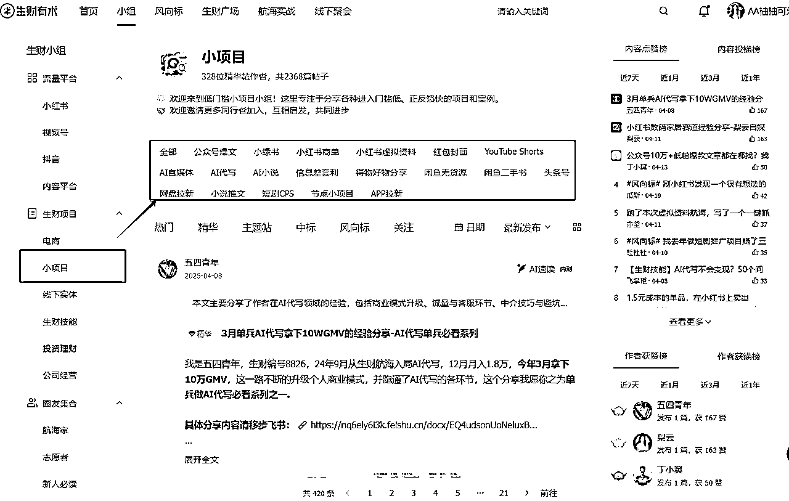

# 一年不到从赚钱小白到能带人，我是怎么走过来的

# 一、我是谁

大家好，我是龙哥。

入驻赚钱还不到七个月，2024年9月第一次报了航海，居然把0到1跑通了。那之后整个节奏就变了。

一个标准的互联网新手，先当志愿者，后来成了教练。

“赚钱里高手扎堆，我是不是太差了。”

刚进来的时候几乎所有人都这么想过。信息量大到爆炸，兴奋又自卑，我也是从那种迷茫里过来的。

来之前我是刚毕业的幼儿园老师，家里条件普通，从没在网上做过生意。上学时成绩平平，大学也不是名校，人也不爱说话，特别怕社交。

可这短短不到一年的时间，我破了很多个第一次。

对互联网的理解从零开始，个人能力被狠狠拉满。以前一句话都组织不好的我，写下了将近5000字的长帖，还被评为精华。

以前根本不碰书的人，因为航海认识了一批同频的人，开始自律阅读。

以前不敢开口的人，被身边的正能量带起来了。

以前连怎么变现都不知道的人，第一次在航海里尝到了日入千元的实感。

用我刚来时的模样记录此刻：踏实做自己，每天比昨天的自己多进步一点点。

# 二、刚来的新人怎么高效用赚钱

这个方法适合刷帖迷茫、不知道选哪个赛道的人。

1. 用兴趣做锚点去用平台
2. 用关键词去搜
3. 用AI摘要快速过帖
4. 用飞书把精华沉淀成自己的知识库

### 用兴趣做锚点：用小组去挖垂直赛道

#### 1. 先用筛选工具把信息降噪

* 按分类/标签：

* 第一步：打开网页版龙哥盟，找到“小组”板块，这里是四大主分类：前沿赛道、流量平台、赚钱航海项目、圈友身份分类。先锁定自己感兴趣的大类，进入后直接看该组的帖子和最新动态。
* 第二步：往下钻，打开细分的垂直领域。举例我是做📕，就点 流量平台 → 📕。
* 第三步：再细分到具体玩法，📕电商、📕虚拟产品、📕商单、📕起号方法、爆款笔记、AI提效矩阵搭建等等。

按时间/热度：

选「最新」：能第一时间看到📕相关的最新动态和刚上精华的帖子。

选「最热」：直接抄已被市场验证的爆款方法，比如高赞《素人3天起号SOP》。

按作者身份：

优先看「传术师」「精华帖作者」的内容，背书更强，质量更稳。

比如我关注📕，就在「流量平台-📕」小组里找这个小组的专属精华帖和同频伙伴。页面右上方还有热门内容榜单，快速锁定优质帖。

#### 2. 核心关键词直接搜

场景化搜索很省事，直接在顶部搜索框输入「领域+需求」。

搜“📕”会自动联想出📕变现、📕引流、📕IP等关键词，直接点进去就对了。

#### 3. AI智能摘要来提效

赚钱的精华帖都很厚，一篇几千上万字，全部看完很费时间。现在有了“AI速读”功能，一键生成摘要，能快速抓到核心结论，先判断这篇帖子是否值得精读，效率直接提升。

#### 4. 用收藏+飞书建立自己的知识库

前期先用“收藏”功能把有用的帖子归拢好。

后期按类型在飞书里建库：
1. 按项目实操领域分类
2. 工具箱类精华
3. 技能提升类精华

以后查起来一秒定位。

# 三、新人如何真正融入赚钱

成长路径我走下来是这样：风向标投稿 → 航海实战 → 复盘加精 → 志愿者

#### 1. 先写风向标

标题格式：【机会名称+核心价值】，例如：某平台0元入驻。

内容里写清项目逻辑+真实验证数据，最好配截图，中选概率会高很多。中选还能有奖励，还能进风向标研究群，和大家一起聊信息差。

#### 2. 航海实战里动手

赚钱的航海就是带着一群人做同一件事，目标一致，容易形成深度链接。

我是I人，也会主动加群里活跃的伙伴，私聊聊进度和卡点。一个人的思考有限，凑在一起碰撞才有火花。

航海期间有问题直接在群里举手，教练会答疑，热心的圈友也会互助。要是害羞不敢发言，也可以把日志和卡点发给志愿者，他们会给出更细致的点评。

我第一次航海就卡在“有曝光没转化”，多亏志愿者反馈加教练点评日志，才把问题打开。

#### 3. 写复盘帖

表达就是红利。把收获写出来，既帮到别人，也让自己被看见。航海复盘、志愿者复盘都是很好的起点。

帖子被加精就能进传术师群，链接到更多优质伙伴。强烈建议新人多复盘多输出。输出倒逼输入，形成复盘习惯，写作能力也跟着起来。

#### 4. 去当志愿者

没有亮眼项目、技能也不算突出的时候，志愿者是最好的身份加持。

志愿者要带30-35个人的航海成长，既能帮别人，也等于链接了30个同频人。通过老志愿者的经验和领队手把手教学，我学会了高效链接人的方法。看别人一点点成长，自己也特别有成就感。

# 四、我踩过的坑和做的项目

### 第一个项目坚持了三个月才起来

赛道：📕教育类虚拟资料
走法：第一个月收入个位数，被封号一次，心态差点崩了。调整后换号重启，15天涨粉1000+，第三个月直接月入五位数。

### 踩过的坑总结

1. 盲目堆量不复盘
跟着航海手册做日更爆款，自己却不爆。照抄没思考，笔记有流量转化是零。
2. 不尊重原创
资料里用了原创素材被同行举报，直接封号。
3. 心态崩了又高估又低估
封号后摆烂怀疑项目能不能赚钱，觉得客单低天花板低，浪费时间自我否定。

# 五、新手选项目怎么选

0基础的普通人，先降低预期，练能力为主。建议从0成本、见效快的项目入手，比如网盘拉新、闲鱼虚拟、📕虚拟、AI代写等。

赚钱里这类小项目都有专门的小组可以沉淀经验。

结合兴趣和优势挑小而美的赛道：
喜欢看书写东西，可以做👸号爆文、AI代写、AI小说；
是老师出身，虚拟资料很顺手；
学生党时间碎片，可以做网盘拉新、闲鱼二手书。

也可以根据自己能投入的时间和精力来匹配项目。

# 最后跟新人说一句

做一件事不一定成功，不做一定不会成功。别纠结红海蓝海，新手先跟着航海手册把0到1跑通就行。

相信自己，坚持复盘，100%投入一个项目。成功是积累出来的，每一次0到1都是未来更大的支点。