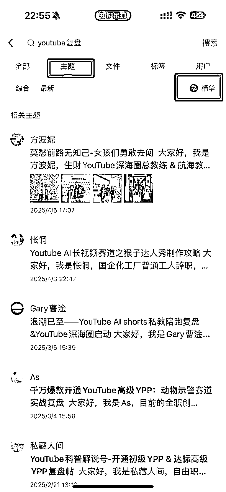
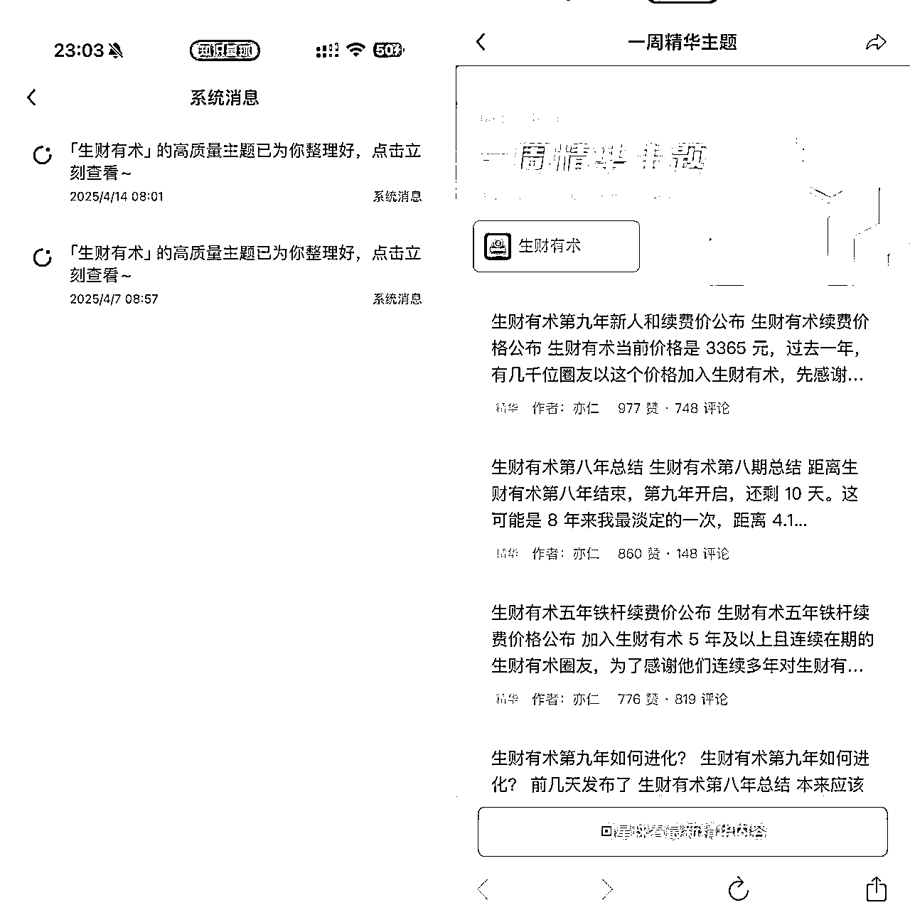

# 把生财有术当成赚钱外挂：职场人把信息变成现金流的操作手册

> 来源：[https://e5nmp70vrx.feishu.cn/docx/N0wwdgqb8oaJ0DxpvrTcxHLsn7b](https://e5nmp70vrx.feishu.cn/docx/N0wwdgqb8oaJ0DxpvrTcxHLsn7b)

我叫绿子，在生财有术混了快一年半。

第一年主攻快团团，月销售额冲破了10万。今年转到AI赛道，三个月副业到手利润就到了10万。

刚进圈的时候，项目也是别人带飞的。生财里最值钱的不是帖子，是身边那群愿意掏心掏肺聊天的同行。这种氛围，让我一直待了下来。

如果你也是想做副业的上班族，这篇就是写给你的。

我们的时间都被切碎了，精力有限，杂事缠身，却又总想着变现、转型、升级。最大的痛点不是缺机会，而是看过太多，最后一个也没动手。

我刚来时也踩过坑：疯狂刷帖、大量收藏，结果再也没打开过；精华项目看起来都很香，真到自己上手时完全无从下手。

下面这套做法，就是我用来把看帖效率和变现效率拉满的方法。

# 圈友你好，这是我在用的生财实操指南

适合想靠副业起步的职场人。

目录
一、高手都在深耕自己的舒适圈，而不是硬闯
二、别零散刷帖，先建一套个人输入闭环
三、从信息洪流里捞金：我的搜索打法
四、时间碎片化时，如何高效读帖
五、案例：从一个小尝试开始，先赚第一笔5千
六、结语

* * *

## 一、高手都在深耕自己的舒适圈，而不是硬闯

很多打工人都有同感：白天工作已耗尽体力，下班想赚钱又提不起劲，最后只能拖延。

这几年“跳出舒适圈”被说烂了，仿佛不去挑战新领域就赚不到钱。但微信的发展给了我另外一个视角：腾讯一直都在自己的舒适区里赚钱。

微信靠QQ的老用户起势，元宝借助微信生态扩量，IMA直接复用公众号的玩法，都是熟悉的人群、熟悉的路径、熟悉的资源。根本不用大刀阔斧，只需要不断复制、叠加、优化，把已有经验打磨成可复制的赚钱模型。

你做了三年社群，就别急着去学剪辑、做视频号。与其东一榔头西一棒子，不如把社群的变现路径拆清楚、固化成产品，卖服务、做陪跑、打包模板，让别人为你的熟练度买单。

把一件事做深做透，才是普通人最稳的变现逻辑。

我这几年边上班边做副业的体会是：方法选对了，累不死，还能持续进账。

想启动，可以从你不讨厌、门槛低、有反馈的事情开始。

不用刻意逃离舒适圈，把擅长的那件事做到极致，这才是普通人该走的路。

## 二、别零散刷帖，先建一套个人输入闭环

怎么把看到的东西变成钱？我用的是一个从输入到变现的完整链路：收集→筛选→执行→复盘。

### 2.1 筛选期：用碎片时间做结构化阅读
没必要通读所有内容，只存对你有用的。每天按顺序看也行，关键词检索也行。

通勤20分钟，午饭后20分钟，睡前20分钟……把时间切割开来用。

### 2.2 建一个只有自己的生财精华群
我单独建了个自用群，只转三种东西：
第一种，思维类干货；
第二种，和自己业务相关的复盘帖；
第三种，能迁移的工具类帖子。
只挑当下阶段能用的内容，快速扫结构，有价值就转进去，晚上睡前统一看。先攒着，不评判，不焦虑。

### 2.3 整理期：用飞书表格做个人搞钱数据库
表格字段我这样设：
| 内容一级分类 | 内容二级分类 | 作者昵称 | 重要等级 | 可复用点 | 可迁移点 | 下一步行动 | 复盘笔记 |
| 创业思维帖/ | 一、思维帖 | 作者是谁 | 解决当前问题的程度（1-5分） | 模型 / | 我自己的业务能不能直接套 | 执行 / | 实际尝试结果和新认知 |

### 2.4 复盘期：每周回看一次表格
标记掉用过的、没用的，把剩下的提炼成小模型或SOP。这里最容易挖出信息套利点。
我每周会清一次表，删无效、留精华，整理成小资料包或者直接去试小项目。

## 三、从信息噪音中捞出赚钱机会：我的高效搜索法

### 3.1 关键词搜索四步法

第一步：拆词再组合
直接搜“副业”“搞钱”太宽泛。要把大词拆成具体方向，再组合。比如：
副业 可拆成：小红书选品、闲鱼实操、AI视频、AI出海、AI绘画、社群成交
引流 可拆成：视频号引流、私域引流、社群引流、小红书截流、知乎截流

第二步：优先看精华帖
精华帖多是项目复盘、避坑清单、操作SOP，含金量高。

第三步：用“最新”排序追热点
信息在变，项目也有生命周期。最新帖能看到大家正在做什么、踩了什么坑、怎么迭代的。
像AI工具、选品、算法这类变化快的领域，一定要按最新看。

第四步：用高命中词精准定位实操
在关键词后加这些词，命中率会大幅提升：SOP、复盘、经验、踩坑。
例如想了解“副业社群”：
副业 社群 SOP
社群 成交 话术
副业 陪跑 模板
社群 收益 复盘
社群 起盘 流程
搜出来的就不是鸡汤，而是能直接抄作业的干货。

### 3.2 盯住优质作者
生财内容太多，我只追认定的几位作者，定期看他们更新。
另外，生财的贵人计划很值钱。第一次获得龙珠就能参与，感谢帮过你的人，这些贵人大多乐于分享，很容易建立链接。

### 3.3 别错过每周一的星球精选
每周一固定会整理一周优质内容，集中筛选感兴趣的再看即可。

## 四、职场人怎么看帖才不白看

时间碎、精力少、事杂，我们最怕的不是没资源，而是看了无数篇最后啥也没做。

我用的是节奏+目标的看帖策略。

### 4.1 什么时间看什么内容

通勤地铁/打车时：看灵感型内容，比如别人的赚钱故事、复盘，给自己打鸡血。
午休碎片：看技巧型内容，话术、框架、清单，看完就能存表。
下午犯困时：扫可转化的项目案例，看看能不能搬到工作或副业里。
周末1小时深度阅读：翻表格里标重的部分，系统复盘并输出行动。

### 4.2 一篇帖子值不值得看，用这六个问题筛
1. 我能把它用到工作/副业/表达上吗？
2. 这个项目有没有我能上手的小切口，门槛低吗？
3. 作者的打法能给我新思路吗？我愿意抄一遍吗？
4. 作者是不是长期在做这件事？有没有讲自己踩过的坑？
5. 有没有具体的流程、工具、话术？
6. 有没有可复用的点，而不是只晒结果？

六个问题全否就直接pass。有节奏的阅读，才能避免焦虑和内耗。

## 五、案例：从轻试错的小项目开始，先赚五千块

别一上来就想做大项目。用小时间试错、小金额试水，最稳。

去年我看到猫meme短剧在小红书爆了，如图：

我照着做了3条上传，当天播放就破万。确认赛道有效后批量做，做了七八个号，一个月内有一个号粉丝4.3万，其他号也有一百到一千粉，加起来账号价值能卖五六千。

启发：
1. 起步阶段照着做就能有收益。
2. 项目再小，第一笔成交也能建立信心。

## 六、结语

在“看得多做得少”的焦虑时代，拉开差距的不是信息量，而是把信息变成行动并持续复盘的能力。

不用天赋，不靠人脉，只靠清晰的结构、可控的节奏和真实的执行，你就能把副业变成主业，把信息变成现金，把焦虑变成自由。

打败拖延、战胜情绪，才是普通人逆袭的第一步。别只盯着别人，先把自己的每一步走扎实。2025，一起稳稳搞钱！