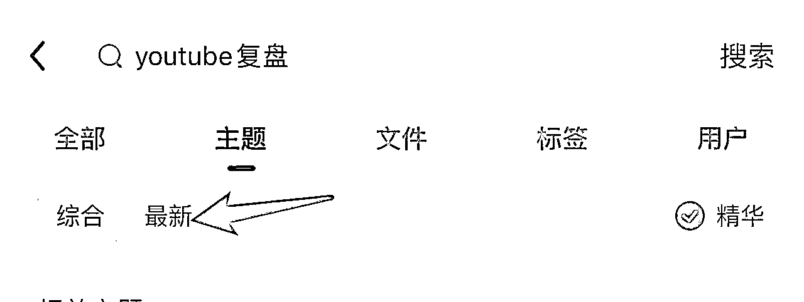
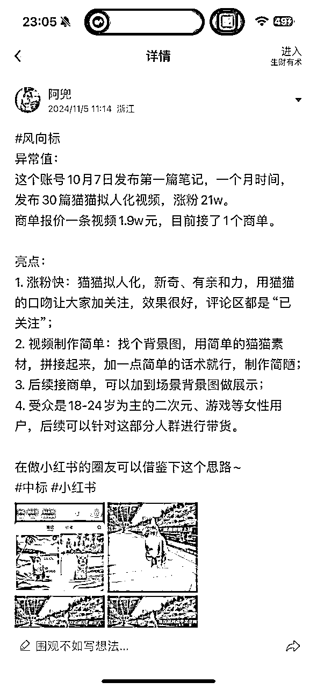

# 职场人如何把龙哥盟变成赚钱外挂：一个职场人的赚钱高效使用指南（含方法、表格与案例）

把“看过”变成“赚过”：我的社群淘金实操手册

一年多以前，我交了学费，进了这个圈子。

先亮个底：头一年做社区团购，月流水冲上10万；今年转向人工智能应用方向，只花三个月，额外收入就攒出了六位数。很多人问我为什么对这个圈子评价这么高，我的回答是：这里能找到一起往前跑的人。刚起步那阵子，真的有人愿意停下来给你讲心得，耐心又诚恳。这种氛围，外面很少见。所以说，要是你想给下班后的自己找一条新路子，这篇文章我建议你读完。

上班族的状态，大家心知肚明：时间被剁成碎渣，精力余额常年不足，家里的杂事还一件接一件。偏偏心里又惦记着升职加薪、搞个第二收入、攒一些底气。我们最怕的从来不是“手上没料”，而是翻了一整晚帖子，第二天生活毫无变化。最初入圈时，我就干过这种傻事：帖子刷了几百条，收藏键按得飞快，然后，就没有然后了。每一个被顶起来的项目贴，看起来都金光闪闪，等到自己想动手，又完全摸不着门道。这篇文章就是来解决这个问题的：怎样读帖子更有效，怎么筛出真正适配自己的东西，怎么把看到的变成赚到的。

不必逼自己离开熟悉的地盘，真正的聪明人都在反复深耕

不少人跟我抱怨过：白天上班已经耗尽了力气，晚上回到家还想搞钱，可身体完全不想动，索性躺平混日子。这几年风向一直在吹：人要走出去，去陌生的地方闯一闯。说得好像不折腾、不碰自己不熟的事，就永远没法翻身一样。可有一件事彻底点醒了我：腾讯把元宝这个助手塞进了微信里。你看看腾讯的打法，哪一步是闯进了陌生领域？微信最初靠QQ那波用户站稳脚跟，元宝直接依赖微信的生态做增长，IMA玩法和👸号如出一辙。人家从头到尾都在熟络的赛道上做加法：复制经验、左右叠加、微调优化，把现成的经验打包成了一套能复制的赚钱流水线。

这个道理放在普通人身上一模一样。搞社群已经搞了三年，就别急着冲进短视频赛道或者开剪辑课。真正该做的是把你这三年的社群玩法拆开看，标准化、流程化，然后做成产品：提供咨询服务、带人陪跑、做几个现成模子。让别人愿意为你的“驾轻就熟”付费。把最顺手的事做到别人追不上，这才是普通人最可靠、最能持续出结果的赚钱之道。我自己一边上班一边搞钱的经历也能证明：选对了路，并不会累到崩溃，钱也会按部就班地来。要是你想起步，就找那种自己做着不讨厌、学起来不费劲、还能带来正反馈的事。

别再随手刷帖了，先给自己装一套“内容加工流水线”

想真正吸收这个圈子的养料，光靠“有空就点开看看”远远不够。我建议你走一条四步路：先集中囤货，再做减法，然后动手试，最后回头检查。

把零碎的时间拼成有节奏的阅读。不需要一口气把帖子啃完，只要把跟你现阶段相关的信息捡出来。可以顺着时间线每天读几条，也可以拿检索词去捞想看的话题。早上通勤的二十分钟，中午吃完饭的二十分钟，临睡前再挤出二十分钟，足够了。

我拉了个不拉外人的小群，专门用来囤帖子，只扔三类东西：第一类，讲创业底层方法论的好文；第二类，跟当前业务对口的复盘总结；第三类，别人用着有效、我也能借上力的工具型帖子。门槛就一条：只收对现阶段管用的。大致翻一遍框架，觉得有启发就甩进群里，晚上临睡前挑管用的段落看，不必逐字逐句。先别下结论，也别心慌，囤起来不亏。

整理环节，用在线表格搭一座专属的“搞钱资料库”。我的表格栏目大致是这么设计的：内容的大分类、小分类、作者是谁、这份内容解决当前困惑的效果打几分（1到5分）、可以借鉴的方法套路、能不能平移到我的业务上、接下来怎么验证、实际操作后的感受和新领悟。

复盘环节，每周翻一次表格。用过的、没用过的都做上标记，顺手提炼出几套可复用的操作路子。这一步最容易让你发现别人没看到的信息红利。我每周都会清理掉没用的记录，把上乘的收藏整理成小卡，或者直接演化成一个小试验田。

在茫茫帖子中捞到值钱机会，其实有条捷径

别一上来就输入“副业”“赚钱”这种大词，太宽泛，捞上来的全是水。正确的姿势是先把大话题拆成更细的分支，再组检索词。比如“副业”能拆成📕的选品门道、闲鱼上的二手买卖、用人工智能工具剪辑视频、把国内跑通的玩法复制到海外市场、用人工智能生成图片、把一群人运营成付费客源这些具体分支；“引流”则能拆成靠短视频吸引关注、用内容换人进私域、在社群里拉新、在📕截住同行流量、在知乎把答案变成入口等方向。

拆好之后，先打开搜索结果里被加精的内容。这类帖子大多是完整复盘、避坑记录、操作SOP，实打实的东西最多。

接着把筛选条件切到“最近发布”，看看其他人眼下在搞什么。规则和工具一直在变，每个项目都有自己的生命周期。最新的分享能告诉你最近什么能跑通、哪里有坑、有什么新玩法。尤其是人工智能类的小工具、选品风向、📕推荐机制这类三天一小变的方向，务必去翻最新内容，才能拿到此刻仍有效的打法。

再往下，在基本检索词后面接几个一抓一个准的辅助词，精准定位实战贴。比如“SOP”能带出完整流程，“复盘”能带出真实心得，“踩坑”能带出教训，再配上“经验”“模板”等词效果更好。举个例子：你想研究怎么运营一个能收钱的社群，基础词组是“创收 社群”，接着可以试试“创收 社群 流程”“群聊 谈单 话术”“业余项目 模板”“群运营 数据 反思”“建群 起步 顺序”这一串组合。这样筛出来的内容，就不再是那种“求带飞”的灌水帖，而是别人真刀真枪跑过、有成绩、有拆解、有操作路径的硬货。

内容太多看不过来的时候，我的办法是盯住几个我信得过的作者，定期翻他们的动态。另外，这里有一个“知恩图报”的小机制：当你头一回得到龙珠，可以参加一个感恩计划，向拉过你一把的人道谢。这样的人通常特别愿意帮人，找机会加上好友，彼此成全，是很划算的事。

每礼拜一早晨，我不会错过官方整理的“本周精选”。那个叫“七天”的家伙会把一周内更新的好帖子收拢到一处，你只需要从头到尾读一遍，再挑顺眼的细细研究就行了。

跟着目标走，踩着节拍读

同样是上班族，我给自己定了几个阅读时段，原则是：精力比较在线、手上又不忙。清晨通勤那段路（不管坐地铁还是赶公交），不做深度阅读，只看能点燃灵感的文章，比如别人的搞钱经历、月度复盘，给自己喂一点“想赚钱”的情绪。午休和零碎时间，适合啃“技术流”内容，像话术、结构、行动清单，看完直接扔进表格里。下午脑子发胀的时候，去扫一眼那些可能跟自己工作或者额外收入相关的帖子，找找能搬到手里的点子。周末抽出完整一小时，翻资料表里标记过的重要文章，做一次整体的梳理，顺便圈出接下去的动作。

每翻到一篇文章，先用六条标准过一遍：

1. 这个东西能不能照进我的上班、下班和写作场景？
2. 这个活儿有没有一处适合我切进去的小角落？有没有不用太多积累就能上手的缝隙？
3. 这个人的打法能不能让我眼前一亮？我想不想照着他走一遭？
4. 作者是不是长期干这一行的？会诚恳地说自己摔过的跟头的人，才值得信任。
5. 里边有没有给出明确的步骤、趁手的工具、直接能抄的话术？真能落地的内容从来不缺细节。
6. 给人感觉是“你看我多厉害”还是“你可以这样干”？我要的是后者。

要是六个答案全是“不行”，果断关掉。按自己的节拍来阅读，你才不会越看越慌、越看越自我消耗。

从小事开始试水，先拿下第一个五千块

别盼着一上来就做出惊天动地的摊子。拿小段时间试错，拿小数目验证，是最不容易翻车的路径。

我自己的一个真实案例：去年偶然看到有人在一个风向栏里提“猫咪梗短视频”，当时觉得好玩，就随手做了三条丢到那个红色App上，结果一夜之间观看次数冲破一万。验证了这条路能走通之后，我开始批量操作，一口气开了好几个号。到第30天，其中一个号攒到了4.3万粉丝，剩下的号也大多有几百上千粉。把这些账号打包卖出去，够换个五千多块。

这件事给我的感触是：第一，别把前戏拉太长，一边模仿一边收钱；第二，摊子虽然小，可一个人最宝贵的信心，是在收到第一笔钱之后长出来的。

写在后面

在这个“看得多动得少”的时代，真正把人拉开差距的，不是谁收藏了更多干货，也不是谁报了更多课，而是能不能把翻过的帖子变成迈出去的腿，并且养成回头看、再调整的习惯。你可以没有天赋，也可以没人帮衬，但只要架构清楚、节拍稳定、手脚跟得上脑子，慢慢就能把业余收入做成主业，把一屏一屏的信息变成银行卡里的数字，把焦虑换成自由。打败情绪，按住拖延，普通人翻盘靠的就是这两件事。不用盯着别人跑了多远，先把自己脚下的路走踏实。2025年，咱们不慌不忙，一起把钱包喂饱。