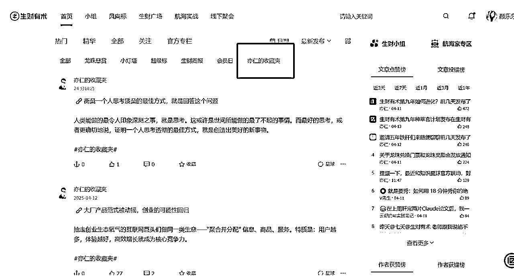
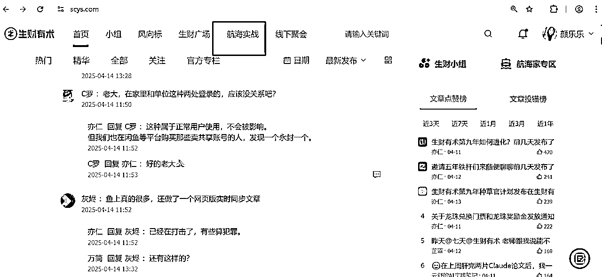
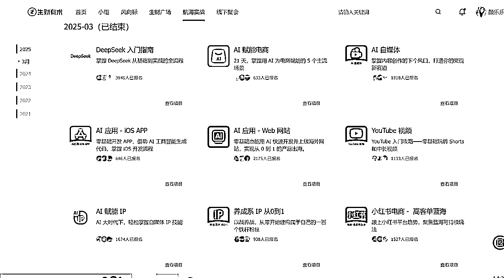
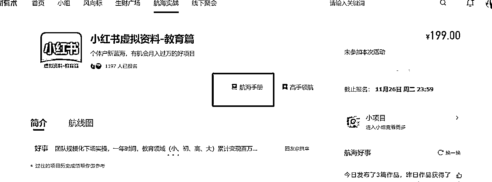
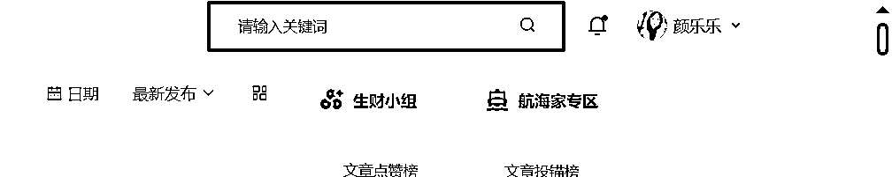
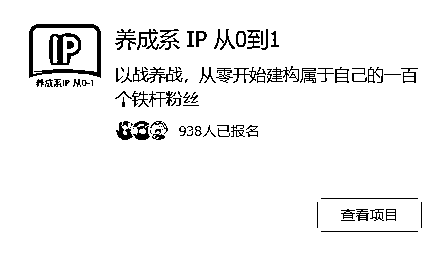
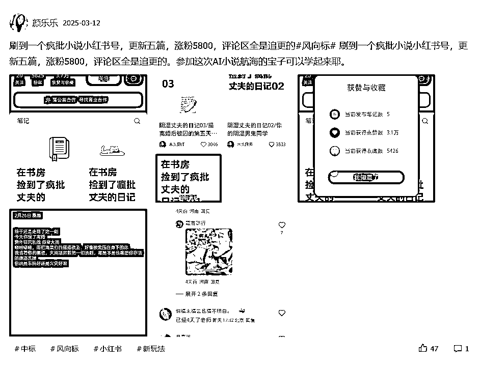
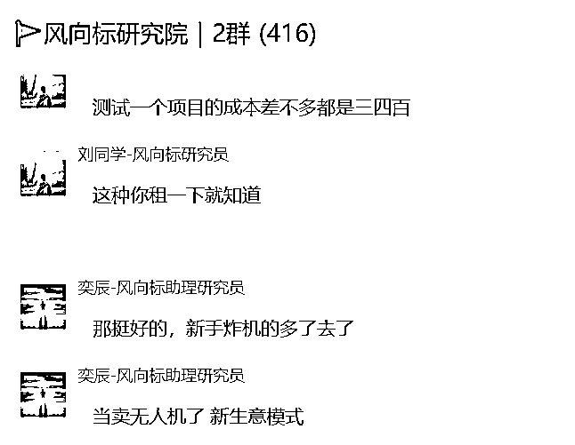
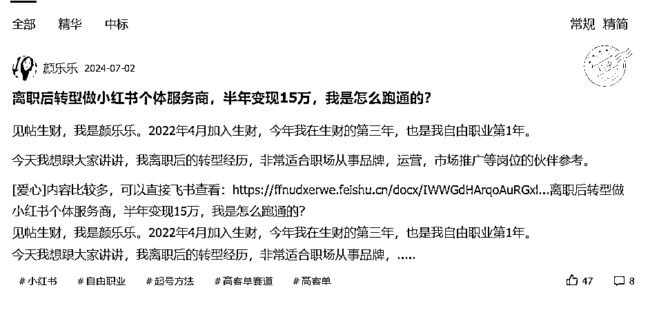
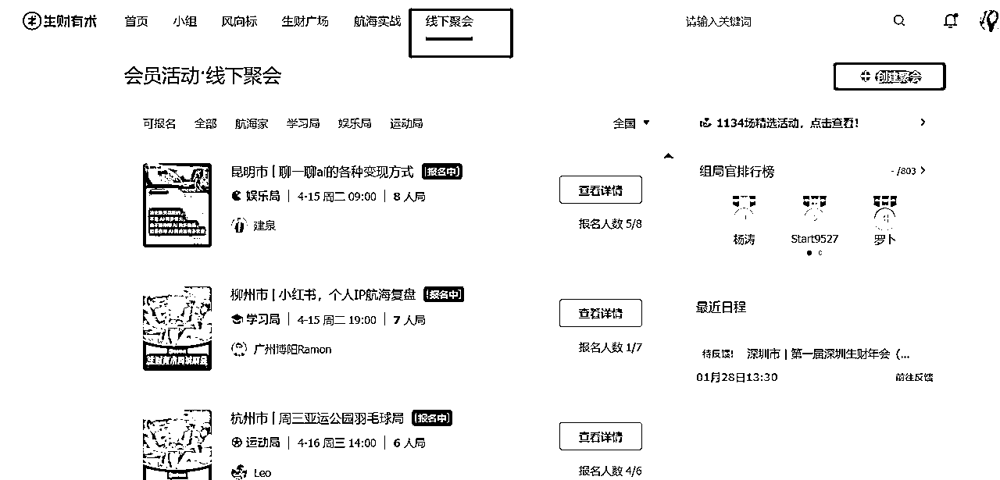

# 从职场妈妈到自由职业者：我用三年时间把赚钱玩明白了

# 先来个自我介绍

嗨，刚加入赚钱的新朋友们好！

我叫颜乐乐，育有一个5岁的男孩，2022年入圈赚钱，至今3年，现在是赚钱传术师。之前在互联网公司做运营，主攻品牌自媒体。

这三年我报了10多期航海，把自己的变现闭环跑通了，如今已全职自由职业。工作内容主要是帮助实体门店和企业做📕获客陪跑。最近线下去见客户，老板们都惊讶我对流量的理解很全，其实就是常年泡在赚钱里刷出来的，哈哈。

如果你也是带着职场身份进来赚钱，那我的路径应该对你很有参考价值。职场里能活下来，必然是有看家本领的。财务、HR、运营、秘书、剪辑、设计……这些都是可以变现的技能点。

只是很多人还没准备好，所以才来了赚钱。恭喜你，迈出这一步就已经赢了身边那99%只会摸鱼的同事。

# 新圈友专属：我的赚钱实操指南

# 第一步：先打牢商业认知，别一上来就焦虑

这是我当初最忽略的一环。刚进来就去翻精华帖，很容易陷入心慌手不动的状态。我当年甚至有一段时期，焦虑到不敢打开App。

## 1、先把思维课刷完

先去看赚钱思维课，建立基础的商业思维，比如最小MVP、如何先赚第一笔钱。思维立起来之后，再看项目就不会嫌它小、嫌赚得少了。每个人都是从第一笔钱开始做起，再慢慢放大的。

另一方面，久在职场会容易想着一定要做大事业才算变现。但副业创业，最好的启动资源就是你自己。投项目总要花钱花精力，如果先从“卖自己”开始，最大的成本也就是时间，试错代价更低。

赚钱思维课：https://appamvpb5mq9834.xet.citv.cn/p/course/ecourse/course_2eXapUKTQZ1V9nFBMoy2LZOTLMm?entry=2&entry_type=2002&scene=%E5%88%86%E4%BA%AB&share_type=5&share_user_id=u_6194f85fe8d5f_Y9HUHYbZaE

## 2、读这两本书

上下班通勤时我反复读的就是这两本，《龙哥益语》收录了龙哥过往的很多分享，很扎实。

## 3、关注龙哥收藏夹

龙哥收藏夹会把他看到的好文章整理出来，等于帮我们做了信息筛选。我从里边学到很多东西，感觉长文比短视频更长脑子。

# 第二步：找到变现方向，拿下第一桶金

思维课看完后，会对商业有个大致轮廓，但具体做什么还是模糊。

那就先盘点自己更想做的方向，立刻试。别等到航海才开始，随时都可以启动。做副业，创业，自己就是第一责任人，得先主动起来。

航海报名开启时就积极报名，在航海里拿到结果的关键是深度参与。我自己跑了10多期航海，踩坑很正常，多试几轮就知道什么不适合了。比如打卡，我会把规定的12天延长到15天、21天，投入是看得见的成长。短剧航海和📕航海，我都成功变现了，至少赚回了门票钱。

如果已经有大致想法，通常有两条路：

## 1、个人IP路线

想靠技能卖自己，就绕不开个人IP。鱼丸整理过一套专门的个人IP合集，建议先系统看完。

鱼丸整理个人IP合集
https://scys.com/content/collection?id=IfRPIqBQ&from=1

个人IP离不开朋友圈，不发圈就很难成交，用户需要先认识你。

（1）朋友圈怎么发

发朋友圈是立人设、告诉用户你正在做什么的关键。想卖东西，自己不宣传别人怎么知道？

不会发可以看这些干货：
朋友圈运营
梁靠谱老师《四年发了八千条朋友圈，销冠的成交心法》
https://scys.com/articleDetail/xq_topic/588555582285524
芷蓝老师 《100 个朋友圈营销技巧》
https://scys.com/articleDetail/xq_topic/588555582285524
杨涛老师 《微信生态中细致运营的一百条小技巧》
https://scys.com/articleDetail/xq_topic/51558582585224
我的贴子《6个月发了1000条朋友圈变现15W，总结一下我的经验。》
https://scys.com/articleDetail/xq_topic/2855451514151441
我的贴子《如何做一条 我的十年视频》
https://scys.com/articleDetail/xq_topic/2855288542822141

（2）公域引流怎么做

微信好友不够用，就必须做公域。现在最简单的是📕+👸号，就算不会拍视频、不敢露脸，图文也能获客。具体打法可以看赚钱航海手册。

📕引流：https://scys.com/activity/landing/3041?tabIndex=0
👸号爆文写作(ip)：https://scys.com/activity/landing/4664?tabIndex=0
AI+自媒体：https://scys.com/activity/landing/5119?tabIndex=0

## 2、项目路线

不想先打造IP，想更快变现就直接做项目。项目的筛选建议从赚钱近期的航海里挑，近几期基本都能跑通闭环。

打开赚钱网页版 https://scys.com/

例如：
2025年3月 📕高客单航海，📕虚拟商品，AI小说，视频号直播，
2024年12月 闲鱼虚拟资料，小绿书带货，📕虚拟资料-教育篇

进项目后找到【航海手册】

照着手册执行，遇到问题就去网页搜索，答案基本都有。

（3）素人IP养成

觉得自己还不够厉害又想做IP，可以看看2025年3月航海的【养成系IP】

https://scys.com/activity/landing/5124?tabIndex=0

# 第三步：保持觉察，薅赚钱的羊毛

作为学姐，教大家几招在赚钱里赚点术值的小技巧。

## 1、发风向标

职场人想多赚点钱，可以去发风向标。风向标中标能送术值，比如今年续费，100术值可换2个碎片，兑换一张门票。更值钱的是，写风向标的过程会让你从内容消费者变成内容观察者。

用第一步学的思维去拆解案例：流量怎么来的？怎么赚钱的？能不能操作？把分析整理成风向标，就能体会中标、术值+1的快乐，还能加入风向标研究院链接更多圈友。

## 2、写总结精华贴

做完项目记得复盘分享，真诚的干货会被赚钱奖励。我就靠一篇精华贴拿到过龙珠碎片。

发贴要点：
（1）可复制
（2）真诚无广
（3）真正帮到人

## 3、申请做航海志愿者

从被服务者变成服务者，能让更多人看到你，还能学到大型社群的SOP运营方法，比外面几百块的课程值多了。实战中学，未来做课程做社群也能直接复制。建议先参与几期，再报一期志愿者体验。做得好，术值奖励不亚于发精华贴。

## 4、参加线下组局

做副业就是孤独的，赚钱的线下同城活动能帮你找到同频伙伴。线上的商业活动动辄几百，赚钱线下局基本只要付押金参与，就很划算了。

以上就是我用赚钱的经验分享。

祝你赚钱之路走得开心。最后想说，你已经很优秀了，报名那一刻就已经和身边人拉开差距，但关键要落地行动。行动才是赚钱的核心。

赚钱信息量爆炸，焦虑是正常的。焦虑其实是在提醒你该升级了。建议每天固定时间刷风向标，平时别乱刷，用搜索的方式定向解决自己的业务问题，这样既不焦虑，也能把赚钱用好。