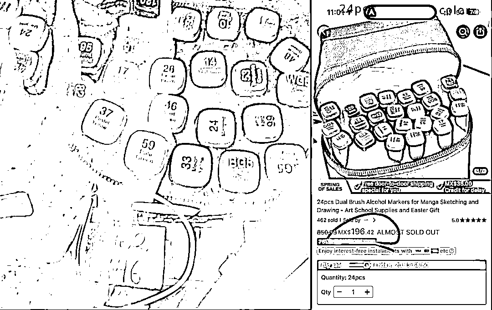
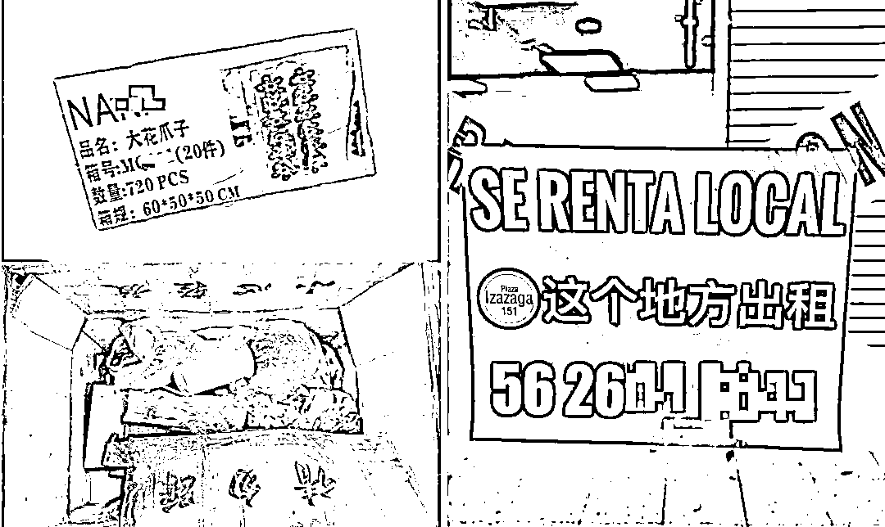
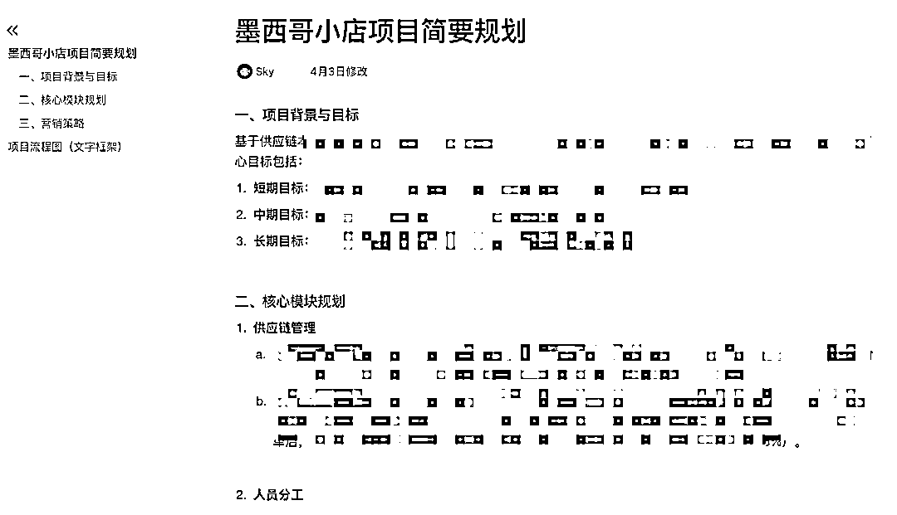

# 实地走访墨西哥：被市场低估的出海新坐标

大家好，我是 Sky老思，目前聚焦 TikTok 这一赛道。最近美国关税波动让在美团队的经营承压，而年初 TikTok 正式放开墨西哥站点，这个动作让我产生现场验证的冲动。

四月上旬我飞抵墨西哥城做了线下踩点。回来后再看资料，才真正理解实地体验的价值。出发前收到的普遍说法是当地治安堪忧、抢劫风险高。亲身到访后会发现，集中做生意的商业区秩序清晰，并非外界渲染的那般失控。

四天紧凑的行程覆盖了市集、仓配、本地同行访谈，得到了不少第一手观察。整体感受可以用一句话概括：商机处处可见，陷阱同样密布，这是一片面向行动派的试金地。

下面按现场情况、机会点、风险点、落地思路四个层面展开。

### 一、地面商业环境与基础设施现状

#### 实体渠道仍占主导，现金结算比例高

想在当地做线上生意，首先要接受一个现实：实体零售占据绝对份额。绝大多数居民习惯去实体门店选购商品，而在这些实体客群中，超过半数仍偏好现金付款。

这种习惯并非偶然。大量商家为降低税务成本，会主动引导客户现金交易并给予折扣，与二十年前国内市场做法相近。

(Peña y peña市场)

#### 支付与物流两大基础设施仍在补短板

跨境电商运转离不开支付和物流两大支柱，在墨西哥这两项都处在成长期。本地缺乏支付宝、PayPal 等高渗透工具，MercadoPago 虽然是当地相对成熟的电子支付，但普及面有限。

物流方面，受 Shein、Temu 等平台进入的推动，效率在明显提升，但成熟度仍不足。末端配送成本经常占商品价值的 15% 左右，偏远区域的覆盖率不足五成。支付与物流的短板，短期内会制约线上交易规模的爆发。

### 二、可操作的价值洼地

挑战之下红利并存，当下最清晰的两类机会是价差和竞争稀释。

#### 线下批价与线上售价的错位

本地批发集市的到手价与线上平台的挂牌价存在显著落差。许多一手货源在档口拿货价格极低，搬到电商渠道后被大幅抬高，中间的可赚空间明显。

(左图线下价格/右图Temu价格)

上图显示线下标价 46 比索，议价后还能再降约两成，而 Temu 上同款 196 比索，价差达到四到五倍。扣除半托管上架、线下补货、包装运输成本后，净利润仍能保持三倍以上。

当然不是所有品类都存在这种套利空间，部分商品线下与线上价格趋同甚至线下更高，需要长期扫货筛选才能锁定真正的价差品。

#### 成长期市场的结构性红利

对比美国、东南亚等成熟市场，墨西哥具备三个差异点。

其一，竞争浓度低。墨西哥亚马逊上的中国卖家占比不到 15%，美国约为 60%，同等打法下的增长空间更大。

其二，对中国供给的认可度高。墨西哥制造业高度依赖中国原材料进口，在墨西哥城即可见到义乌城、广州城、数码城等华商聚集区，这些商圈的实际操盘者七成以上为华人。

(随处可见贴有中文的货箱)

其三，TikTok Shop 今年二月初开放入驻，两个月时间墨西哥站增速明显快于同期开放的欧洲站点，本地用户对内容种草模式的接受度更高。

(TikTok墨西哥办公室)

综合来看，即便基础设施不完美，触达人群受限，但窗口期内的可捡果实依然丰富，现在是卡位期。

### 三、落地执行中的风险与应对方式

机会清晰后，如何规避踩坑更关键。

#### 核心风险集中在供应链与资金占用

入局第一步就是解决货源与周转。经由国内直发的海运周期通常为 45-60 天，海关抽检率约 20%，存在较大不确定性。对新进入者而言，一批货物在海上就压两个月的资金，资金周转效率极差；一旦选品失手，滞销库存会直接拖垮现金流。

若不备货，货源怎么来？若贸然备货，销售渠道如何铺开、成功率几何、失败后本地能否快速处置库存，这些问题都绕不开货物决策。

#### 轻风险切入的思路

早期不建议直接做一手进口商从国内备货。两个月船期叠加销量不确定，投入产出比不佳。

更务实的路径是做二拨拿货：从本地一手档口进货，成本仅小幅上升，风险却大幅下降，更适合试水期。

该模式最关键的要素，是能在墨西哥跑场的本地人。

线下市集与线上平台存在巨大信息不对称，没有在地团队或可靠的扫货伙伴，选品效率会很低，价格优势也难以建立。

(墨西哥线下市场的各种货)

正如开头所说，这个市场遍地生机也布满荆棘，属于敢于下场的人。我在当地见到了不少来自温州、江门、广州的创业者，甚至有夫妻带孩子举家迁入。许多人到场半年到一年业务已趋稳定，远比在美国、东南亚需要数年沉淀的节奏更快，这正是新兴市场的魅力。

以上就是此次墨西哥实地考察的核心体会。文字很难完全还原现场的体感。

多看不如多走。想进入这个赛道的伙伴，建议亲自去感受当地的温度。

PS：我们团队已在墨西哥开展初步尝试，欢迎同在布局的朋友交流合作。

祝各位出海之路开花结果，事事顺遂。