# 《漫展活动运营手册》| 一本覆盖漫展全流程的实操指南

# 一、内容前言📣

大家好，我是鲈鱼 👋

还记得 2023 年那篇在星球发布的《如何从零到一办一场漫展》精华帖吗？🔗跳转链接：https://t.zsxq.com/sG4jo。虽然漫展话题谈不上主流，但那篇文章发出后得到不少正向反馈，大家都对【漫展活动运营举办】的完整逻辑感到好奇和新鲜。

转眼两年过去了。尽管我已不再在一线深耕这个赛道，但对漫展这件事的思考从未停止。这些年我也亲眼看着平台规则、内容传播、活动打法都在加速迭代，涌现出许多新模式。

期间我运营过一个垂直账号「哔叔聊漫展」，累计解答了大量从业者的提问，并沉淀成了 4 万字以上的《漫展百问百答手册 4.0》，帮助传媒、动漫、策展相关从业者建立更系统的行业认知，也促成了不少资源连接。

现在，这两年的核心积累终于成型，就是这本《漫展活动运营手册》。全书篇幅在 25～30 W+，从策划、组织、宣传、执行到收尾，完整覆盖一场漫展从0到1的运转链路。

这份手册不只是指南，更可以作为行业 SOP 直接上手。它能帮你搭建活动框架，让对行业感兴趣的人真正看懂并参与进来，也能为你的既有项目提供更系统的思考路径和落地方案。

不多说了，Enjoy it ✨

阅读中如有疑问，随时交流。—— 鲈鱼

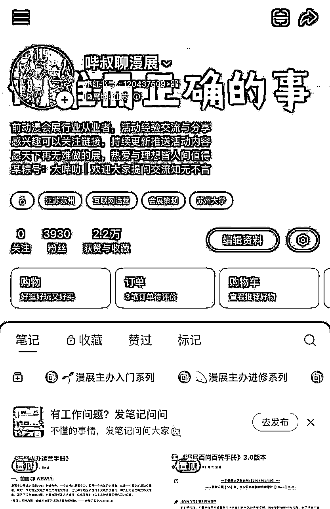

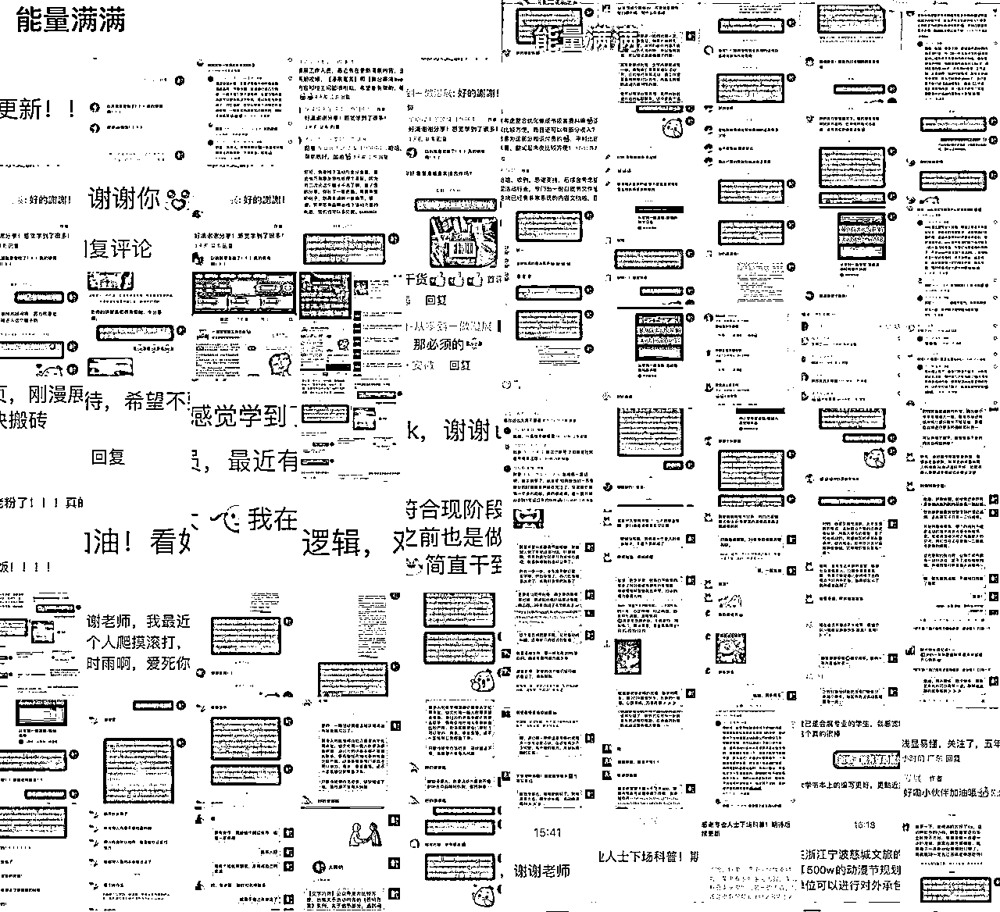

补充百问百答手册： 4.2w字，收纳了活动举办相关的 100+ 高频问题

🚩「手册目录」概览↓↓↓

# 手册地图

### 关于手册「内容权限」的补充说明

手册中包含部分权限内容，并非刻意阉割。权限区主要作为进阶补充，不属于办展刚需，而是想把活动做得更精进的小伙伴后续可学习的增值部分。若对权限内容感兴趣，可私信获取开通方式。

日常使用时，公开文档已足够支撑一场中型及以下规模漫展的启动。学习材料过多反而容易信息过载、难以落地，这也是权限内容设置的核心考量。

# 模块01 漫展活动的基础内容【科普篇】

## 1.1 什么是漫展

1. 漫展活动的基础概念速览

内容文档链接：

2. 漫展行业当前的市场态势

内容文档链接：

## 1.2 漫展活动的营收构成

主要来自门票、摊位、产品售卖、广告赞助四大部分。

1. 门票收入

* 普通票 现场/预售
* VIP票 现场/预售
* 特种票 内场签售等

内容文档链接：

2. 摊位收入

* 商业摊位
* 同人摊位
* 餐饮摊位
* 游艺合作

内容文档链接:

内容文档链接：

内容文档链接：

3. 产品收入

* 官方周边
* 官方代理商品

4. 广告赞助

我们为合作品牌提供展位策划提案、展区规划等全案服务，帮助品牌触达核心粉丝。合作模式会随活动体量变化。

1. 中小型活动招商赞助

体量较小、区域属性强，赞助多以物料置换、线下渠道曝光为主，整体赞助体量有限。

* 二次元属性相关小品牌
* 本地年轻客群商家
* 被活动吸引的各类品牌资源

内容文档链接：

内容文档链接：

2. 大型活动招商赞助

以【品牌冠名】、【活动冠名】、【活动协办】、【展商IP入驻】四大形式为主。

## 1.3 漫展活动适合/不适合的人群

启动一场漫展看似容易，做到专业稳定却极难。活动涉及面极广，综合要求很高。至今我也不敢说能从零做到一场零失误的完美活动。

我甚至觉得“劝退”是一种责任。办展不是好差事，在动漫产业链里它可能是最苦最累的一环。教人入坑可能等于把人推向火堆。

*你要明白，光鲜背后是长时间的负重前行。

1. 比较适合切入的人群

* 愿意深耕动漫领域的人
* 已具备同类型业务背景的人
* 人群重合度高的行业从业者

内容文档链接：

2. 不太适合的人群

评判依据主要是项目经验、活动成本承受力、行业认知。

不建议零经验、年龄偏小、纯粹想圈钱跑路或想赚快钱的人进入。

* 无相关领域经验的人群
* 18岁以下年轻群体
* 办一场就想收割离场的人

内容文档链接：

## 1.4 区域市场需求验证

想在本地从零落地漫展，先要验证当地市场是否能承接。

从市场层面看，几乎所有城市都能办展，只是规模上限不同。核心变量是主办方的运营能力、落地组织能力、执行能力；长期深耕则比拼运营效率与成本优势。

启动前要先摸清当地市场的真实水位，多对标优秀案例。好的需求验证能提升稳定性，降低试错成本。

*做事前多花时间思考，比盲目开干更重要。

1. 线上验证方法

* B站平台
* 📕平台

内容文档链接：

2. 线下验证方法

* 参与本地线下活动 3-5 场
* 访谈本地漫圈核心人群

内容文档链接：

## 1.5 补充：活动学习思路，拆解学习法

活动运营的核心能力之一是商业拆解。天底下没有新鲜玩法，你想的别人早已尝试过。

与其盲人摸象，不如向已经市场验证、拥有成熟打法的活动方学习。通过深度拆解，让自己比原主办更懂他。看得够多，问题自然变少；活动本身并没有那么难。

起步期没有万能方法论，多看多做是唯一路径。

1. 拆解活动类型

* 全国范围内体量相近的最新活动公司
* 各城市的老牌漫展
* 现象级黑马活动
* 头部品牌活动

内容文档链接：

2. 拆解品牌搜集途径

* B站主页推荐
* 平台话题热度
* 圈内嘉宾行程

内容文档链接：

3. 拆解活动内容

1. 展会学习拆解思路，七大拆解法分享
2. 搭建个人方法论，提升运营稳定性
3. 行业报告、头部访谈、市场热度分析、互联网检索能力

内容文档链接：

# 模块02 漫展活动的启动准备【启动篇】

## 2.1 漫展活动的策划

策划是启动的抓手。传统策划偏重形式全面，实际执行易缺细节。我们更强调执行型策划案，结合进度与反馈动态调整。

1. 传统策划案要素

* 活动背景
* 区域市场分析
* 内容策划
* 招展招商计划
* 宣传推广策略
* 组织架构与分工
* 预算评估
* 风险管理
* 筹备执行计划
* 收尾评估与复盘

内容文档链接：

2. 执行策划案核心

多数人过度关注资金和内容分配。漫展策划的核心在项目流程执行，结合预算和预期，围绕主题做落地性成本把控，按时间节点对各环节具象化管理。

内容文档链接：

## 2.2 漫展举办时间选择

1. 常见时间参考

1. 元旦&跨年 【12月31日-1月1日；推荐指数：5星】
2. 寒假 【避开年前，寒假结束前1-2周周末，可考虑周边城市酒店展巡回】
3. 春日开学 【开学后周末，约3月底，同步预热五一】
4. 五一 【3天假期，人流加成；推荐指数：6星】
5. 暑期 【7月初或8月上中旬；推荐指数：5星】
6. 暑期结束开学 【与暑期间隔决定是否可连开】
7. 国庆 【全年流量高峰；推荐指数：6星】

2. 时间制定的综合考量

* 与本地及外地大活动撞期问题
* 节日卖点
* 季节出行影响
* 其他干扰因素

内容文档链接：

## 2.3 漫展场地选择

优先考虑交通便利性，市中心、地铁沿线为佳。场地自带流量可放大宣传效果。

1. 场地基础

1. 场地基础讲解

* 人流与面积测算公式
* 场地选择要点

内容文档链接：

2. 场地实战经验

* 过往合作案例参考
* 拿场前预想布置逻辑
* 与场地方沟通要点

内容文档链接：

2. 场地类型建议

1. 小型活动 人流＜1000

* 酒店宴会厅/婚庆酒店
* 酒吧 特定类型活动
* 商场

内容文档链接：

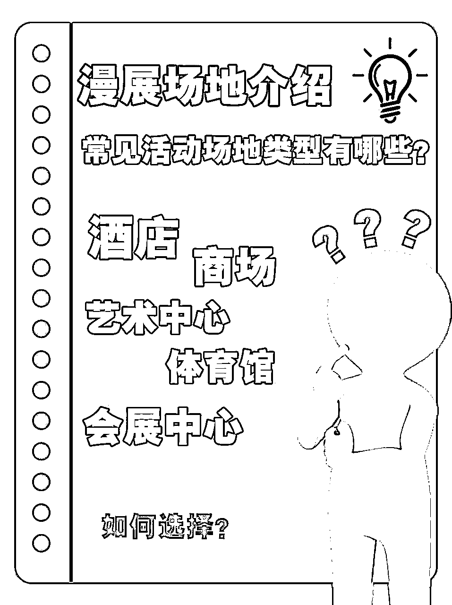

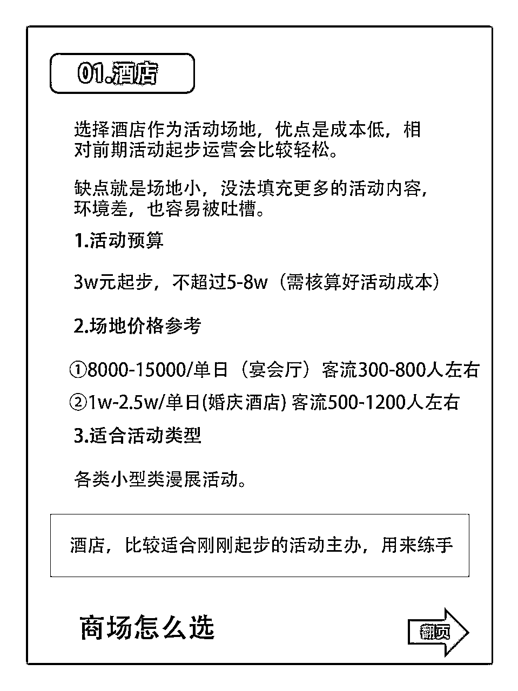

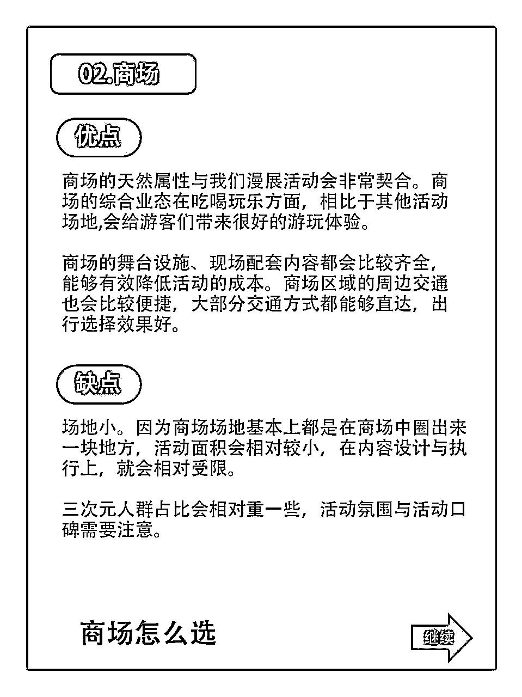

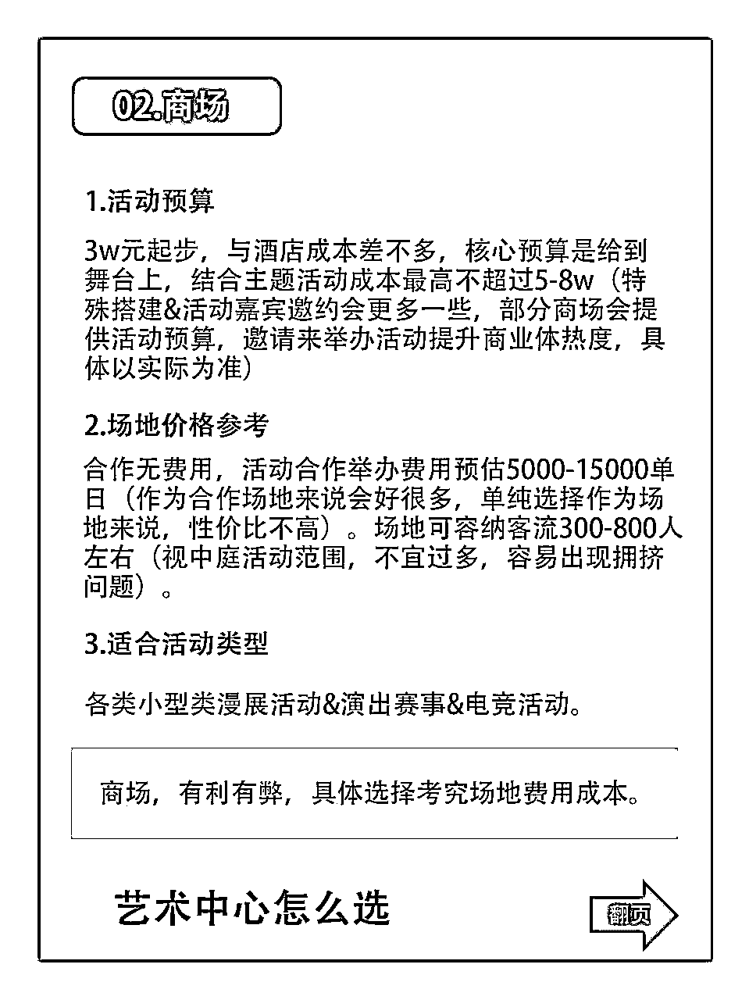

2. 中型活动 2500＜人流＜6000

* 艺术中心
* 体育馆
* 创业艺术园区&文化产业园

内容文档链接：

*补充场地：创业艺术园区场地，合作形式较特殊

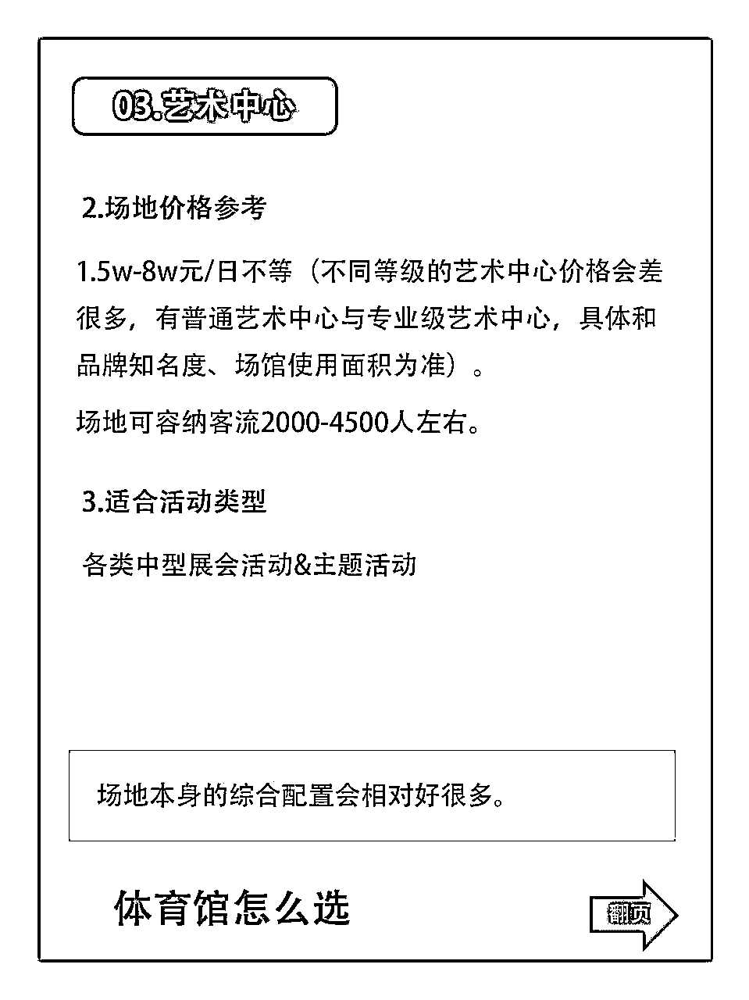

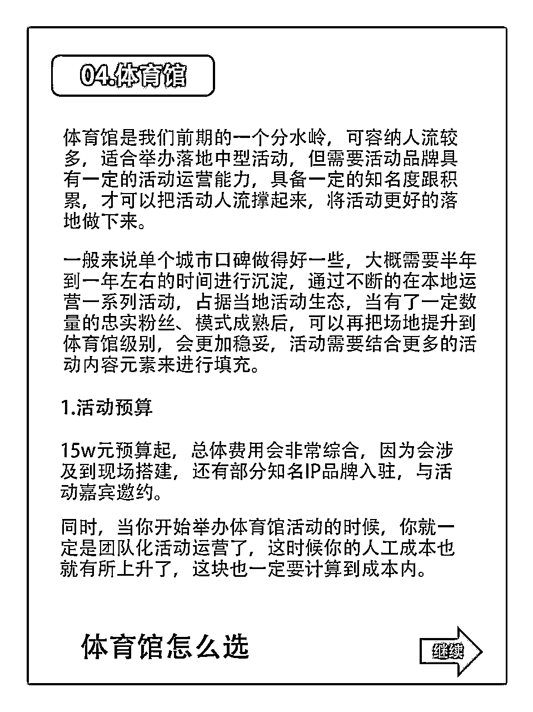

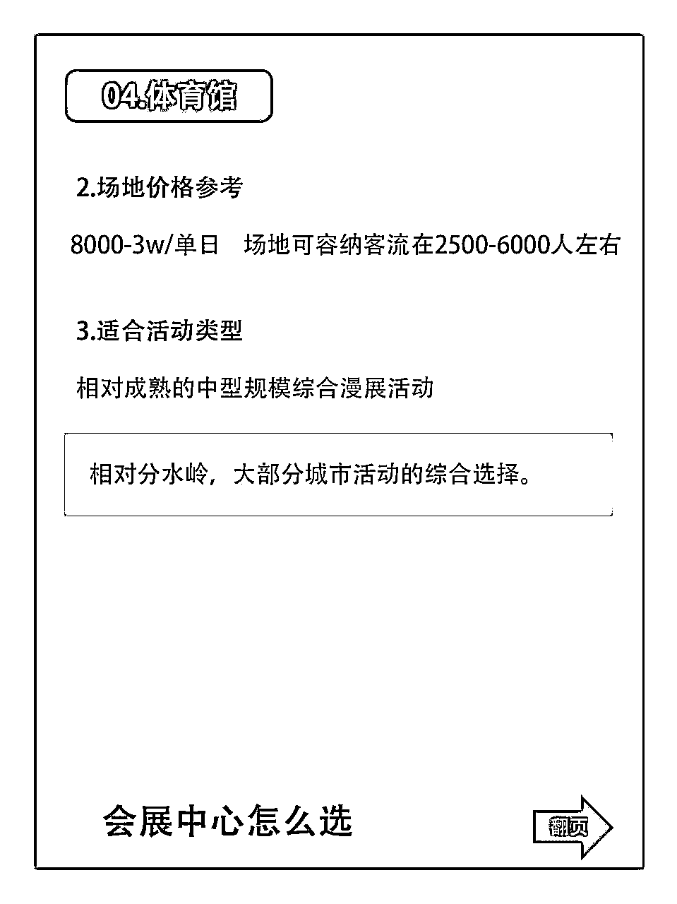

3. 大型活动

* 会展中心

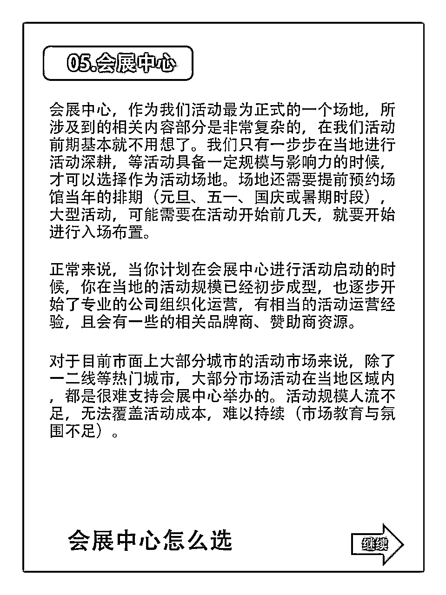

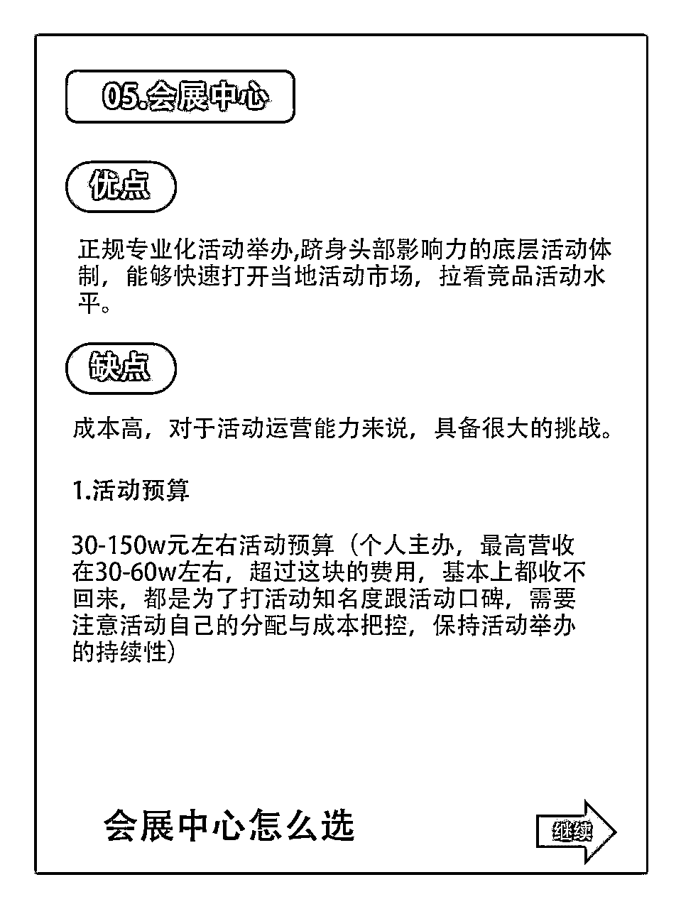

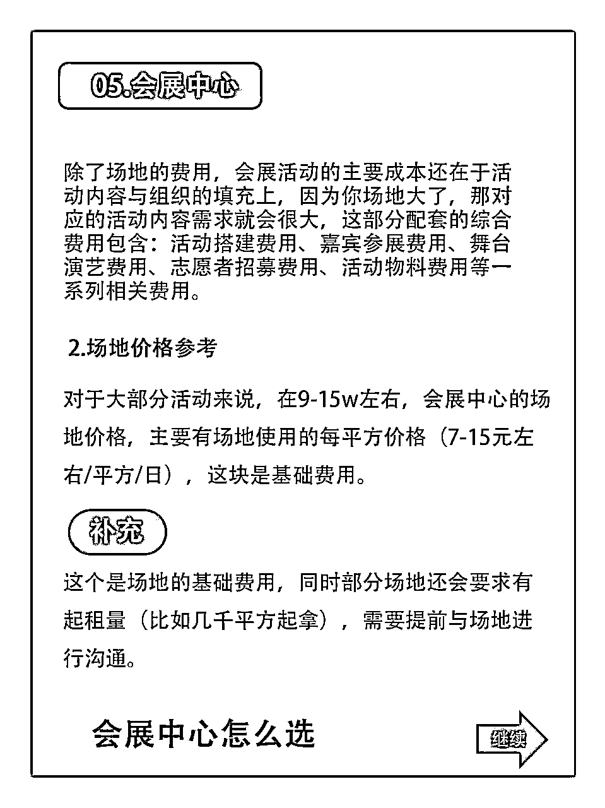

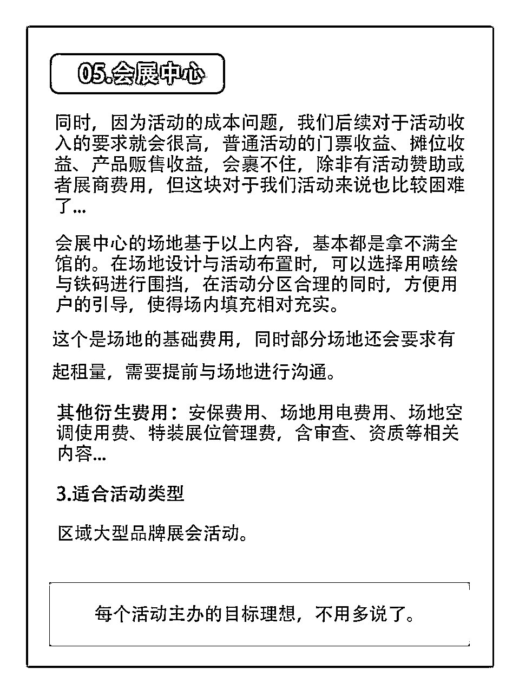

## 2.4 举办主体与活动品牌

长期深耕需要组织化。

* 个人
* 公司

内容文档链接：

1. 漫展公司主体

1. 执照注册要点 公司后缀、注册资本、经营范围

内容文档链接：

2. 举办资质参考&索引

内容文档链接：

3. 公司设立流程与费用说明

内容文档链接：

2. 活动品牌建设

1. 命名与注意事项

内容文档链接：

2. 商标讲解

内容文档链接：

3. 商标注册实操 代办、个人申请、第三方申请

内容文档链接：

## 2.5 报备与审批

200人以上、有舞台演出、门票、产品交易，均需报备。

1. 报备审批

1. 公安局辖区备案及材料清单

内容文档链接：

*补充内容1：《活动备案申请书模板》
*补充内容2：
*补充内容3：

2. 文旅部门审批

内容文档链接：

3. 市场监督管理局报备

内容文档链接：

2. 相关法规条例

* 中华人民共和国治安管理处罚法
* 大型群众性活动安全管理条例
* 动漫游戏会展交易活动报批规定
* 营业性演出管理条例实施细则
* 中华人民共和国民法典

## 2.6 客服号与活动群聊冷启动

宣发前必须完成客服号与群聊搭建，否则转化与触达效率会大幅下降。

1. 客服号创建

内容文档链接：

2. 交流群创建与冷启动经验

内容文档链接：

## XXX2.7 漫展活动物料

物料是线上线下的连接点。作用是锦上添花，不可喧宾夺主。核心仍是落地执行、成本控制、现场体验。

要从用户痛点出发持续优化，而非主观臆断。

* 宣传美术物料
* 官方产品物料
* 游戏活动物料
* 展位搭建物料
* 门票赠品物料

内容文档链接：

# 模块03 漫展活动的内容设计【内容篇】

## 3.1 内容设计基本逻辑

活动不是内容堆砌。每个设计都要问是否游客真正喜欢。所有运营手段与现场内容都应围绕这一核心。

形式不能主导，要核算成本，做好内容分配，确保可落地。活动后需持续关注反馈并迭代。

内容文档链接：

## 3.2 游戏内容设计

现场核心是提升参与感与氛围感。由【官方主题活动】与【现场游戏】构成。

官方主题：赛事入驻、作者作品展示、声优见面会、漫画家签售、人气coser

季节性活动：开学季、福利季、二次元灯会灯谜

区域设计：电玩区、模玩区、摄影区、休闲区、游戏区、桌游区、周边售卖区

古风：投壶、射箭、猜谜

日式：捞金鱼、水风船、套圈、戳纸盒、钓仓鼠、射击、日本相扑、面具

内容文档链接：

## 3.3 舞台活动设计

常规时长：上午9-9:30入场，下午4:30-6结束，共7-9小时。

舞台分上下午两场，上午10-12，中午休息1.5小时，下午13:30-16，共4.5-5小时需填充内容。

一场二次元展的成败，主舞台几乎说了大半话。没有精彩的舞台，活动就很难撑起热度与停留时长，更别提商摊转化和话题传播。专业的主持人配合清晰的流程安排，是让舞台发挥效用的基本盘。

好的舞台体验能把人留住，让现场看起来热闹有感，带动商摊生意，也让参与者更有归属感和认同感。反过来，舞台缺位或做砸，口碑基本直接掉链子。所以内容设计必须谨慎。

*活动的好坏，观众用脚投票。不是办得有多周全，而是观众觉得值不值。觉得好才是真的好，觉得不好再完美也白搭。

更关键的是必须站在用户视角去想：他们想要什么？怎么让他们真正参与进来、感受到参与？这才是所有主办方该反复自问的核心。

舞台内容的填充方式，主要有下面几类做法：

1）舞台Live报名招募
提前通过官方社媒账号发布招募信息，明确时间、地点、可报形式、流程规则。感兴趣的表演者按要求填写申请表并提交音频或过往视频供审核，通过后即可获得官方舞台出演资格。

*表演时长与内容范围
*报名方式与流程说明
内容文档链接：

2）宅舞宅曲赛
通过办赛的方式给舞台补量，几乎所有规模的活动都能用，但对氛围的要求极高。

小型活动成本可控，搭建和赛制都相对简单。问题在于选手质量参差或报名不足，经常出现宣传了奖项现场却空缺、甚至内定的尴尬，必须规避。

中大型赛事投入更高，前期宣传就受区域限制，一二线选手多质量高，三四线多为兴趣爱好者，很多人连初选视频都达不到标准，导致招募困难、现场尴尬。赛制设计前一定要做足预估，确保招募与流程可落地。

一场正规的中大型比赛，舞台特装、评委邀约、奖金、宣传物料的成本都不低。许多地区品牌会申请成为中国国际动漫节、Chinajoy等国内专业赛事的地方赛区协办，借势提升活动品牌度。

内容文档链接：

3）舞台商演人员合作招募
可通过本地演艺群或机构邀约商演团队来填补舞台内容。漫展若请不到咖位嘉宾造势，不如把预算集中到商演上，既填满节目，又能提升本地圈层影响力和线上声量。

舞台商演Live是舞台的核心环节。宅舞宅曲为主，一首约4-6分钟，一场活动通常安排20-40个Live，约3小时，总舞台时长控制在4.5小时左右。节目密度越高，容错率越高，基本不会冷场。

这部分对主持人个人发挥依赖不大，按台本报时推进即可。

*舞台商演的优势
*商演合作价格区间
*商演人员的后续维护
内容文档链接：

4）活动嘉宾参展
常邀三类：专业coser现场助阵、配音工作室嘉宾现场签售、舞见唱见现场互动表演。目的在于提升行业口碑与专业度，积累品牌势能，同时作为宣传噱头拉动曝光与出票。

嘉宾自带流量是事实，但在本地办展，实际到场粉丝基数有限，受人群面和交通限制影响较大。若把嘉宾当成门票营收核心，基本不现实，卡琳娜级别的顶流除外。

嘉宾展更适合中大型活动配合造势，目前市场同质化严重。小规模活动前期不建议以嘉宾展起步，成本难以控住，会吃掉大半预算，启动压力重。

不要为了嘉宾而嘉宾，预算更优先投向能直接影响体验的板块。可以先邀请小体量嘉宾配合商演跑通流程，后续再择机升级。选人以行业影响力和市场热度为主，领域尽量多元，覆盖不同偏好人群。

对接渠道可通过平台私信、嘉宾经纪人、工作室联系。

1.嘉宾活动邀约
内容文档链接：
1.嘉宾参展费用参考
内容文档链接：
1.嘉宾签售内容设计（内场&VIP）
签售设计分两种主流做法。

一种是票务权益叠加，不单独售卖签售票，而是按门票等级区分优先权。现场设置不同票种通道，普通票、VIP票轮流签售，并在票务权益中搭配嘉宾限定物料赠送。

另一种是单独开设内场签售区，门票仅为入场，签售需额外购票入内。内场票限量，活动前摇号，现场检票换实体票并领取海报/周边，按号牌入座依次签售互动。

签售节奏要按人数和时长把控，单人互动约控制在1.5分钟内。提前明确：是否可TO签、字数限制、是否接受礼物、合影是否由工作人员拍摄、是否允许录视频、单人签售时长、是否需移动电源与补光、嘉宾是否自带摄影师、礼物放置区、休息室位置与动线是否会穿越人群、签售区与各进出口方位是否在风口等。活动当天需提前确认cos角色与着装，如偏清凉需准备取暖设备。

签售结束后可安排嘉宾与普通票观众的随机互动区，进一步增加黏性。

设计参考要点：
1.嘉宾物料是否限购，限购类型及数量；
2.是否每份物料都签名；
3.To签数量及字数限制；
4.合影为自拍还是工作人员拍；
5.合影姿势与站位；
6.是否可要求拍摄嘉宾单人照；
7.是否允许拉着嘉宾录视频或打视频通话；
8.单人签售时长；
9.移动电源与打光准备；
10.嘉宾是否自带摄影师，如无需安排；
11.礼物摆放位置；
12.休息室是否在围栏内、与签售区距离、是否需穿越人群；
13.签售区与馆内各门口距离及风向；
14.提前确认当天cos角色及着装需求。

内容链接文档：

5）主持人撑场
当舞台节目不足，比如只剩8-15个，或临时掉链子时，主持人就是救场神器。靠大时长现场互动加穿插节目维持人气：接梗游戏、二次元知识问答、上台小游戏等。核心逻辑是福利不断、气氛不断，让观众感知不到冷场。

优秀的主持人能在尴尬中化险为夷，把控人流停留和整体节奏。但也要把握度，舞台过热会把人吸走导致商摊冷清，反之过冷则氛围崩盘。全天内容要均衡分配，既守住当下环节，也持续预热下一环节，保持期待感。

尽量避免被动应对，出现风险前与主持人沟通好预案并设计备选方案。

6）舞台随舞
官方提前公布舞蹈歌单和流程，观众无需报名，现场直接上台跟跳。播放的是热门歌曲串烧片段而非整首，曲目切换快，会的继续跳，不会的在旁等熟悉的歌再上。

歌单设计需调研当地接受度，常见类型为宅舞、整活曲目、韩团K-pop曲目*需提前调研活动当地当地，对于整活曲目和KPOP曲目的包容度，部分地区抵制kpop乃至kpop二次元嘉宾—感谢戈尔曼补充*。可参考同城活动案例或发问卷收集。

随舞区建议设在舞台前方空地，用地贴+围栏划分，互动时长40-60分钟，安排在主舞台结束后，作为收尾氛围升温。大型活动可另设自由舞台区专项承载随舞及其他表演，需综合考虑成本、场地、氛围和报名人数，否则集中在主舞台更稳妥。

*随舞的价值在于给观众一个现实中难得的展示舞台，让他们释放才艺。宣传和组织上要足够开放，才能保证参与度和热度。

内容文档链接：

7）电竞游戏比赛
不推荐放在舞台上。活动受众对纯游戏内容关注有限，非玩家难以产生共鸣和参与感。放在地面以桌椅喷绘做专区尚可，但上台后观看人数少、占用舞台比重高、产出价值低，得不偿失。

3.4漫展活动的官方IP填充
官方IP入驻与舞台共同构成专业度。用户来展的核心诉求之一就是“看到平常见不到的东西”。官方IP自带知名度和精准人群势能，常见为游戏展商、动画&动漫展商、官方展商。

但现实很残酷，大多数展商不会为小活动投放，体量是硬伤，即便出钱也请不来。体量够了，地区因素也影响转化与出行成本，对比一线城市效果，线下投入往往不划算。因此多数官方展商集中在一线大展，如CP、CJ、BW、萤火虫、国际动漫节等。

获取IP背书仍有替代路径：

1）官方经销代理
成为官方IP展商产品的区域代理，或直接从官方渠道采购，将产品作为活动内容填充。
内容文档链接：

2）官方产品贩售入驻
自建摊位贩售官方产品作为参展品牌，既增收又提升展会调性。
内容文档链接：

3）官方平台商务合作
通过商务邀约或新媒体官方账号私信展商，发送活动资料做流量置换。
内容文档链接：

4）官方自营IP品牌
用自身会展品牌及相关业务填充内容，如开设活动官方周边店铺，或引入本地动漫店、电竞俱乐部、摄影工作室等同圈层业务。*注意自有产品无流量，设计与宣传必须专业，避免廉价感。

5）区域品牌合作
与本地年轻快消品牌合作，增加综合性与官方合作需求。

1.年轻餐饮消费品牌，如阿萨姆奶茶、小茗同学、美年达、可口可乐、茄皇统一方便面、辣条品牌等，需联系当地经销商做物料支持与展位搭建。
1.现场制作贩售品宣，如COCO、世界茶饮现场互动套餐；面包蛋糕甜品品牌打卡领周边。
1.动漫相关品牌，如樱花日语等教育机构、绘王等绘画设备品牌。
1.本地同属性品牌，如书店、谷子店铺、摄影工作室、影城等。

6）网站合作
将活动信息上架至各动漫网站做媒体合作，主要目的不是即时引流，而是获取合作logo用于海报展示，借势提升专业感。物料制作前需核对logo使用规范，避免作废。

3.5漫展活动的摊位招募
摊位是内容填充与成本分摊的重要手段，摊位营收可占20%-50%，有效降低运营压力，提升稳定性。

常见四类：普通商摊、同人手工摊、食品饮料摊、游艺玩具合作。

1）普通商摊
核心板块，前期中小型活动可占现场50-80%面积。主要售卖手办、福袋、挂画及各类动漫周边，严禁盗版伪劣与砸金蛋类活动。

价格受品牌知名度、人流预期与位置影响。招募需在策划前就与摊主沟通意向，确认时间再定摊位，避免活动当天空位。

内容文档链接：

2）同人手工摊位
贩售同人产品、原创小物、手工产品。同人产品为对ACGN的二次创作，原创小物为设计师文创，手工产品如发簪、面具等。

现场提供100*60桌、一把椅子，严禁自带桌椅占地。大型活动可分区设置。

*售卖范围
*禁止售卖范围
*违规处理方式
*展位配置
*摊位租金
*摊位优惠
内容文档链接：

3）食品饮料摊

很多人以为办漫展就是租个场地、请几个嘉宾、卖卖票，其实真正能长久做下去的漫展，背后是一套非常系统化的商业与组织逻辑。今天我们就来拆解一下，从现场摊位、团队搭建、NPC管理、社团联动到票务上线，一场漫展到底该怎么运转。

先说现场体验。游客逛展最怕什么？又渴又饿却没地方买吃的。尤其是中大型活动，场馆内部几乎找不到“吃喝”板块，这个缺口非常明显。你可能会说，商场类活动可以用综合业态来补位，但酒店、体育馆、展览中心这些场地，很多时候连周边门店都找不到。所以，招募食品饮料摊位就成了一种高效解法：既能提升游客满意度，又能给展会带来额外营收。这类合作主要适用于中大型活动，通过合理引入摊位，现场体验和收入双丰收。

游艺类内容也一样。想填充展区氛围，可以直接和本地游戏城、动漫店谈设备合作，比如扭蛋机、抓娃娃机、动漫主题自动售卖机、抽卡机等等。合作逻辑和摊位类似，要么收固定合作费，要么按销售额分成。这样既丰富了现场玩法，又不用自己承担采购成本。

说完现场，再聊团队。漫展行业绕不开两个老大难：第一，人员流动性太大，活动经验很难沉淀下来；第二，非展期基本没有收入，养全职团队的成本压力极大。所以你会发现，很多城市的主办方团队常年只有三五个人，这已经算大团队了，而且足够支撑一二线城市的会展业务。但也正因为如此，这个行业普遍存在一个“瓶颈”——很多有规模、有影响力的活动，看起来总是不够专业，原因就在于团队受限，没法投入更多精力做精细设计，也没能力承接更大体量的项目，更别提处理那些随之而来的复杂问题了。

还有一个现象：不少主办方靠先发优势吃到了品牌红利，但因为缺乏对市场的敬畏，长期原地踏步。漫展的地域性很强，二三线城市很难长出大型活动，头部效应依然集中在一线城市。而且多数主办并非科班出身，是从动漫爱好者转型过来的，行业内部缺乏信息流动，大家全靠自己踩坑摸索，能保证活动跑起来，但对整体规划往往缺乏系统认知，很难持续创造增量价值。

要解决这些问题，有两套团队思路可以参考。第一套是传统漫展公司或展会工作室模式，参考市面上大量活动公司的人员构成，把岗位职能拆解清楚，形成一套基础框架，适合大多数主办方直接套用。第二套是更适合成长型团队的模式，核心逻辑是“一专多能 + 高效流程 + 外部合作”，人数按业务规模阶梯配置，比如1-3人、3-5人、5-8人、8-12人。一句话：有多少工作量，就配多少人。原则也很明确——人不在多，但薪资要对得起能力和工作量；能用兼职、外包解决的，绝不养专职；不盲目扩张规模，每个人都要能扛多块业务。

成长型团队还需要两套系统做支撑。一是培训系统，把大量工作SOP沉淀下来，这样哪怕招来的人毫无经验，培训完也能快速上手，业务不再依赖个别能人，稳定性自然更高。二是工作管理系统，也就是流程化管理，避免人员流失导致工作断档，消息随时同步，新人进来也能快速掌握全局。因为人不多，没必要上复杂工具，形式主义反而会破坏交流氛围。进度确认最好还是靠开会，面对面聊策划、对进度、碰撞问题。团队可以准备一块小白板，把核心指标、时间节点、各岗位招募数量公开标出来——这非常关键。一来大家能看到整体进度，有掌控感；二来压力直观可见，会让人产生“被推着走”的动力。

接下来是NPC管理。活动现场的核心区域，最好优先用自己人。小活动人手可能刚好够，但规模一大，人手立刻紧张。这时候就需要招募NPC来协助。招募文案不要只是“招兼职”，而是强调“共创”，让参与者感到价值。活动品牌影响力越大，招募就越顺利，质量也越高。报名者通过审核后进入NPC群，在展前统一安排一个周末下午集中培训，明确岗位职责，维护展会形象。

什么样的NPC最靠谱？通常是那些参加过活动、认同活动理念的老游客，愿意放弃周末休息来帮忙，想让更多人有更好的体验。不过要注意，如果是二次元圈内人，“玩心”可能很重，容易影响现场秩序，这点最好提前筛选，或者现场做好预案。NPC没有薪资，但有补贴，比如官方伴手礼、展后聚餐、后续活动的优先参与权等等。

这里要特别提醒：对外宣传千万不要用“志愿者”这三个字，统一用“NPC”或“STAFF”。两者定义完全不同，一定要注意区分。

招募渠道上，中小型活动比较简单，通过客服号、网站链接、小程序表单收集报名，填写表格后提交审核就行。大型活动如果官方渠道招不满，或者招到了但管不过来，那就需要另想办法。可以考虑联系本地兼职群、校园表白墙，搭建长期招聘通道，甚至依托线下场景在当地做一个动漫社团，把人员沉淀成自己的展务合作力量。也可以找专门的兼职外包公司，他们手里有平台和渠道资源，能快速拉到人，有的还能代为培训。外包费用一般按人头抽成，比如活动给NPC单人150元，外包公司抽50元，对方到手100元。这里一定要把控好，不然容易引发舆论。

社招兼职有利有弊。好处是现场人手有保障，还可能遇到责任心、执行力远超学生的优质兼职；坏处是有些人完全不懂二次元，跟游客交流会很尴尬，也可能出现临时缺岗、联系不上的情况。这些风险主要靠招募筛选、培训赋能和现场管理三道关去规避，通常不会出大问题。

NPC培训一般安排在下午1点半到4点之间，总时长2.5到3小时就够。别指望一次培训把所有东西教完，现场还要靠集合时的反复强调和管理来补位。培训内容分三块：第一，通用知识，包括服务精神、服务理念、基本礼仪、沟通技巧等；第二，岗位职责，把任务流程、时间安排、现场注意事项、各板块规则逐一交代清楚；第三，服务技能，针对不同区域做专项培训，弥补专业能力不足。

现场安排按活动规模分三档。小型活动（1000人以下）相对简单，因为人少，管理起来很直接。中型活动（2500-8000人）必须有专人负责整体执行，否则现场一定会乱。人员配置原则很清晰：自己人优先，其次是信得过的老NPC（可当小组长），最后才是普通NPC。千万别让普通NPC单独负责一块区域，他们既没经验，出了问题也没法及时处理，最好让他们跟着自己人或老NPC打辅助。大型活动（1万人以上）场地大，需要划分多个区域，通常分为外场组、检票组、内场组、舞台组、后勤组、展商摊位组、机动巡场组，每组各司其职，协同作战。

再来看社团合作。每个城市都有高校动漫社团，这是天然的资源和传播节点。合作的好处非常直接：可以打通学校内的宣传点位，实现高校人群联动；可以更了解当地社团的真实需求，提升活动专业度；几十人的社团相当于一个大票代，能增加票务营收；还能填充舞台内容，比如社团live、舞台剧、节目自由行等等。

挖掘社团的方法很简单：按城市搜学校，再用“学校名+动漫社”关键词逐个匹配，通过🐧、官方平台账号找到关键人物，表明活动方身份，对接合作。合作时社团要做的包括：在社团群发布漫展信息、协助校内宣传；转发B站、🧣、👸号、🐧空间等平台的活动内容；代理票务，展前结算；有空的成员可以申请做现场NPC；有才艺的可以报名舞台live，免票上台。

社团福利也要给足：特供门票，每人优惠5元或打7.5折，优先入场，还有专属无料伴手礼；社团到场人数满18人，组织负责人最高免3张票，并提供免费宣传位，但只能做招新和人员招募，不能卖东西，物料自备且需官方审核；社团名称或logo会在展宣中露出，并借官方新媒体矩阵及现场X展架获得曝光；报名live的成员免票入场；长期合作的优质社团还能获得更大的平台、资源，甚至少量扶持资金，后续可延伸出商演和专业指导等深度合作。

最后说票务。B站是漫展预售和品牌曝光的重要阵地。通过平台客服对接商务合作，提交活动材料，拿到后台后就能上线。上架后的流量波动很大，主要看本地品牌知名度、宣发内容、地区氛围、是否撞期、活动时间等因素。一般来说，酒店展大概卖50-200张票，体育馆和商场展在300-800张，会展级别的活动可以尝试与官方深度合作，争取流量推荐和banner位。

什么情况下值得做深度合作？第一，你的活动所在城市氛围很好，主办很多，但你的品牌在当地有足够深度，能做到行业和用户公认；第二，你在平台积累了不少案例，数据稳定且好看，官方有理由信任你。平台流量给谁都是给，为什么不给你？因为你能最大化利用流量，不容易翻车，这对平台、展会、游客是三赢。另一种情况是，你在本地占了近80%的市场份额，没有能构成直接威胁的竞品，这时候也可以主动提合作。漫展地域性很强，平台流量是全国化的，平台要完成转化，就必须把这些流量分发给各个区域里能承接的活动方。数据仅供参考：没有深度合作时单场票务大概300-1500张，深度合作后视区域能到2000-8000张。还要注意，B站票务后期会占很大比例，但前期别抱太大期望——品牌知名度有限，交付能力也不稳定，盲目承接容易出问题。

具体操作上，先联系平台客服获取负责票务上架的商务名片。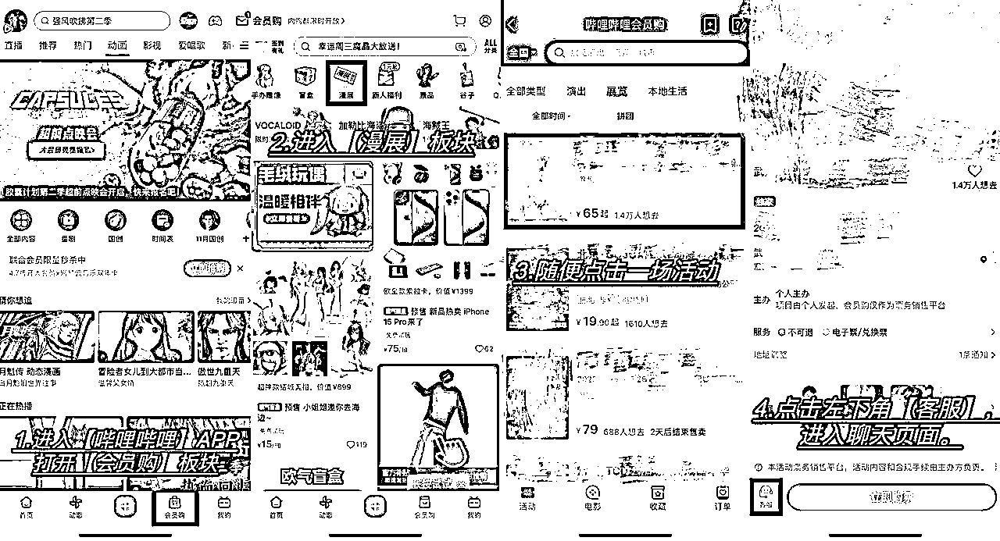
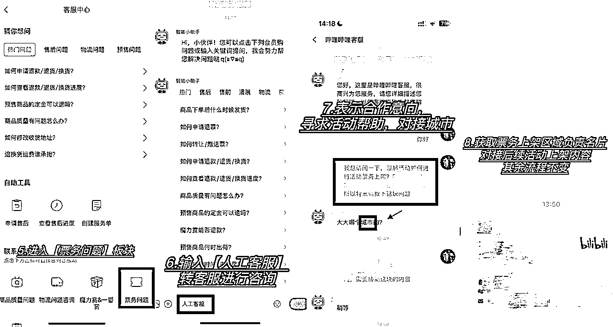
然后添加好友，提交活动材料。几个常见问题也整理一下：上架时间建议提前15天左右，具体要看票务负责人的通过速度和沟通效率；核销会用B站专门的票务APP，现场扫码即可；上架免费，售出后平台抽成，预售票10个点，现场票6个点；活动结束后7-14个工作日，后台显示余额后可提现；以前是打包资料给客服审核上架，现在审核通过后会给你一个后台系统，自己维护活动信息。

抖音团购是进阶玩法。抖音同城业务发展起来后，漫展团购从22年底开始兴起，23年2月寒假档到9月暑期档是高速发展期，出了不少现象级案例。操作逻辑是这样的：先把活动上架到抖音团购后台，然后找MCN机构合作带货，给机构提供活动卖点和过往素材，由机构策划内容、联系达人或素人拍视频分发，最终引流卖票。团购效果主要取决于活动内容本身、视频剪辑素材质量以及带货视频的数量。很多做法就是批量上传混剪视频，用概率砸出爆款，把活动热度推起来，从而实现门票转化。

漫展这门生意，表面是热爱，底层是运营。把这些环节一一理顺，活动才能既有人气，又有口碑，还有利润。

做过漫展活动的朋友应该都有感触：抖音团购这东西，不是谁都能碰的。它真正适合的，其实是那些中大型漫展。为什么？因为这类活动手里有过往的内容沉淀，宣传造势容易得多；更重要的是，大活动才接得住团购带来的大批流量，现场服务跟得上，游客玩得开心，口碑才不会崩。

还要记住一个关键点：在抖音买漫展团购票的人，大多是18到28岁、对二次元感兴趣的泛三次元群体。这部分人的比例必须拿捏好，不然现场气氛容易跑偏，控场会很难受。

至于单场团购出多少票？没有固定答案。一般看投放视频的数量和活动方的运营能力，大概分成三档：200到800张、1200到2500张、3000到5000张。说白了，就看你有没有爆款视频，有几个爆款，决定了你能吃下多大的量。

现在市面上的情况是，大家都看到抖音团购能带货，于是扎堆上活动，结果内容全是硬营销，用户早就免疫了，整体流量自然大不如前。再加上之前一些粗制滥造的活动消耗了用户的信任，现在大部分活动都卡在第一档，很难冲上去。

所以，活动方如果做团购，一定要记住：别只盯着抖音，其他平台也要同步上架。这不只是为了多卖票，更是为了提前锁定用户，防止被同区域的对手截胡。你不上架，对手上架了，那批游客就被人家先抢走了。如果对方活动做得还不赖，后面你再想把用户拉回来，可就难了。

再说到合作机构，水真的很深。市面上很多团购活动的宣传视频，都是机构拿别人的素材随便混剪的，他们压根没办过展，也不懂行业运营。他们脑子里只有带货和抽成，根本不考虑活动能不能交付，结果票卖出去，现场一团糟，最后全是主办方背锅。

记住一句话：超出我们能力范围的事，永远做不好。没有业务沉淀，缺乏处理问题的经验，那些额外的增量不但接不住，反而会把活动拖垮。所以选合作机构一定要擦亮眼，分辨清楚对方是真心做活动，还是靠运营费赚钱的皮包公司。

更恶劣的是，现在市场上冒出一堆纯圈钱活动，完全是冲着团购红利来的，根本不考虑游客体验，也不管行业死活。他们不知道，这种操作正在毁掉整个平台用户对漫展的认知，影响极坏。活动方在合作上架时，必须认清自己的体量，别过度宣传，不然游客预期太高，落地跟不上，消耗的是你区域内的口碑。合作过程中，把细节写进合同，随时盯数据，保持沟通，问题才能少一点。

这套内容主要就是给中大型活动方看的，找到靠谱的合作方，比什么都重要。

下面再聊几个具体的票务上架渠道。

先说微店。这是一个比较新的票务工具，如果想自己做线上票种，可以下载微店APP，注册商家版后上架活动，再通过其他平台导流卖票。好处很明显：能大幅降低各平台售票的抽点费用。费用是一年6800元的店铺费，加上千分之六的票务抽成。现场核销有专门的扫码板块，具体可以问客服。这个不是必选项，按需选择就行。

跟微店类似的是自营小程序。如果选第三方平台比如有赞，年费差不多。但自己开发小程序，我个人不太推荐，一是费钱，二是功能上有很多替代方案，不一定非要用新工具，反而增加了用户的下单路径，还得花时间学习操作。除非你本身就是有规模的活动公司，那做一个小程序当品牌私域工具是合适的，毕竟平台电子票有扣点，会吃掉利润；而且品牌到一定阶段也需要一个载体来提升形象，还可以延伸周边、打通🛰️生态。关键还是看你的活动规模和实际使用场景。

再说CPP，就是COMICUP漫展的票务和交流软件，适合同人主题活动。独家合作抽成3%，非独家7%。上架流程要注意：直接上活动，后台大概率审核不过；会有客服主动联系你，再和客服对接。

宣传方面，得先看清用户画像。

第一类是本地兴趣学生，年龄大概13到18岁。这是同城运营的核心人群。因为前期活动没名气，不可能有外地人专程赶来，主力就是本地人。这帮孩子玩的就是“新奇特”，很多人之前没见过漫展，来就是图个新鲜。对活动方来说，他们要求不高，容错率高，只要现场氛围热闹、内容够满，他们就会很开心，活动就能成。

第二类是动漫属性人群，19到26岁左右，二次元浓度更高。随着你活动越做越专业，这部分比例会越来越大，要求也更高。如果自己水平不够，很容易被吐槽，口碑一夜崩塌。想在本地长久做，前期得尽量避免踩这个雷。

还要认清一个事实：会展是服务行业，每个游客预期不一样，你永远不可能让所有人满意。很多事以当下的能力就是做不到。我们要做的，是分清什么才是当前游客真正需要的，能提升的提升，改变不了的接纳。谁不是从泥巴里滚过来的呢？

所以前期建议，尽量控制宣传内容，少放专业性内容，降低预期，让这部分高要求人群自然过滤，也别做过度承诺。这样被吸引来的人，基本都了解你的水平，不会落差太大。

那为什么专业游客容易给差评？换位思考一下就懂了：他们的出行成本太高。可能是专门冲着噱头来的，结果现场稀烂；可能是coser准备了很久的妆造，结果活动组织一团乱；也可能是上班族周末组队出来放松，结果花时间花钱找罪受。服务上，我们不能让用户委屈，否则后面要花更多成本去补。

说实话，这些问题前期很难完全避免，只能尽量降低比例。别为了流量硬加一些落不了地的内容，定了什么就做什么，别现场临时变卦。

归根结底，问题还是出在组织能力上。前期我们就是没能力伺候好深度用户。承认这一点，不丢人。与其硬撑，不如减少对他们的打扰，劝退他们，保留一个好印象。别在根基不稳的时候消耗用户的信任，不然你永远失去一个粉丝。后期想要做大，再把活动做专业，产出更多价值，这是必然的路。

另外，宣发周期一定要留足。推荐3到5个月，活动越大时间越长，最少不能少于2个月（还得提前预热）。最好先做活动验证，完成活动群的冷启动和整体搭建，同时留意平台票务审核的时间。不打无准备的仗。

在私域裂变上，🐧空间转发是重点。通过展务账号不断输出内容，持续触达用户，从一宣、二宣、三宣一直到终宣，把热度推到最高。技巧也有：主动和游客聊熟聊透，请求转发，“极限一换一”。

自由行和体验官也是常用的置换手段。自由行有七种：cosplay、摄影、三坑（汉服/Lolita/JK/DK）、furry、特摄等。游客按要求发布内容申请，通过后免门票。体验官就更深入，要求更严，权益也不同。核心区别是：自由行只是票务换曝光，体验官是深度绑定，形象会被公开。体验官通常面向coser、汉服、Lolita、舞见、二次元主播、博主等。

新媒体平台方面，主阵地是抖音、📕、B站。抖音用来让更多人知道活动，做同城精准获客。账号运营分官方品牌、活动预热、视频直播带货。带货特别重要，因为展会非展期没有收入，带货不仅能清库存，还能养团队，增加抗风险能力。📕种草属性强，一般搭一个官方认证号＋一个人员IP号就够了。官方号负责权威发布，IP号更有亲和力和信任感，可以发花絮、行业吐槽、活动感悟，追热点仿写爆款，不断积累影响力。B站则更适合做深度内容，用户属性跟漫展天然契合，但传统营销号那套在B站玩不转，要深耕就得投入高内容成本，通过工作室日常、行业吐槽、玩梗互动，真正建立品牌。

线下宣传方面，票代招募是个传统玩法。漫展说到底要靠卖票赚钱，提前锁定游客数量，活动才能顺利。除了线上预售和门店曝光，还需要打通学生渠道。招募票代，主要面向学生群体，因为他们愿意做，也有圈内影响力和私域资源。票代卖得越多，结算价越高，还能免门票、拿周边、赚零花钱。更重要的是，票代能帮你打通学校宣传，触达普通渠道到不了的人群。

再往深了说，这套票代“售票系统”其实是个很古老的秘籍，从零几年国内展会兴起时就有了，现在快失传了。拥有这套系统的公司，本质上是卖票公司，全员都是票务人员，所有岗位都背着票务指标，连狗来了都得卖几张票再走。

核心逻辑就是：把一切跟活动有关系的人都发展成票代。他成为票代，至少自己会买票；卖到一定数量还免票。而且他还能影响身边的同好，为下一场活动持续铺垫，这是长期复利。

人员结构由大到小，大概是：票务板块负责人、官方票务组长、外部合作的票代头子、官方直招的票代、底层票代组员。运营维护上，要把忠实粉丝慢慢发展为票代，持续扩大队伍。

总之，做漫展活动这行，没有捷径。选对平台、找对合作方、认清自己的体量、别贪流量、别乱承诺，老老实实把服务落地，才是活下去的根本。希望这些经验，能帮你少踩几个坑。

票务体系的运转，本质上是一场持续的人才筛选与迭代游戏。

票务团队本身也需要借助活动来不断做筛选，筛选出来的人再由官方做针对性的培养，这样才能把活动的传播效率拉起来。一般来说，外向型的女性成员出票效率更高，市场上偶尔也会冒出几位“黑马选手”单量惊人，这类人要及时锁定，通过阶梯式培养转成票务组长。

需要明确的是，所有的票代都遵循【活动周期】规律。大部分票代的平均存活周期在3场活动左右，也就是半年时间，之后基本就会自然流失。团队必须保持持续的招募节奏，用新人补充空缺，才能保证每次活动的宣传配额。

票代人员的标准操作流程大致分为：线上意向确认与信息采集、线下邀约面谈、合作合同签订、话术培训与交付。

在后续维护层面，可以通过活动福利、定期聚会等方式强化参与感与归属感，同时让成员感受到活动顺利举办带来的成就价值。对于出票稳定且体量靠前的票代，还可额外增加激励、周边回馈等专项奖励进行长期绑定，并逐步孵化为票务组长，提升整体运营能力。

异地活动的合作也不受限制。即便无法线下签约，也能通过远程线上签约完成。联系到有意向的票务人员后，收集姓名、电话、地址信息，按张拆分寄送门票即可。

票务投放与结算是核心环节。

投放原则上以份为单位进行，通常是10-30张，具体数量根据活动体量调整，但不建议一次性投放过多造成浪费，最佳实践是先投放10张售罄后再补票。

结算节奏要分层管理：
小型活动一般在展前一周或展会前一天晚上集中结票，干预较少；
中型活动若销售平稳，可在活动开展前择期统一结票，若热度较高则每周结一次；
大型活动则需在开展前按周进行定期结票，并于活动前完成全部结算。

多轮展前结票的好处有三点：活动方能实时掌握各票代出票进度，结合线上数据做好整体跟进；避免票代手头积压过多款项，降低跑票、资金挪用等风险；也能让活动方提前回笼部分成本，用于后续执行。

结算流程以《结款单》形式分批进行，最终在活动前完成《结款、退款单》的填写，按实际售卖数量结算提成，未售门票予以退回并保留票号作为凭证。所有结票时间点必须严格控制在活动开始前，以防现场出现黄牛、票款纠纷等问题。

关于票代售票系统的本质，需要有清醒认知。票代主力是学生群体，核心出票量分布为【职业学校＞大学＞初中＞小学＞高中】。对学生而言，能参与与组委会挂钩的活动本身就是一种有面子的经历。

售票系统自有其运转逻辑，某种程度上，这套以卖票为核心的模式，本质更接近打着漫展名号的传销体系，并非理想化的公益事业。

票代的完整生命线包括：构成、痛点、体系、挣扎、迭代、淘汰与总结。

线下同城门店合作属于商务BD范畴，目前多数主办方在此块投入不足。线上流量竞争占据了大部分注意力，本地线下渠道反而被忽视。而实际上线下渠道的空白，意味着谁先做谁就能占据。纯线上模式受制于平台与竞品博弈，稳定性和存活并非自己可控。拥有线下抓手，才是真正把主动权握在手里。

商务BD的搭建方式有两种：由主办方本人兼任，单场活动累积资源；或并入票务、摊位招募等现有岗位，以月度门店合作数、出票量等作为绩效指标。

门店合作可划分为四大类型：【学校周边门店】、【区域品牌连锁门店】、【网红门店】、【年轻人群同属性&二次元属性门店】。

信息搜集渠道各不相同：
学校周边门店，可通过地图或网页检索当地各阶段学校，绘制学校清单，挖掘周边各类店面；
区域品牌门店，可参考其他活动合作案例，联系当地负责人或总部进行预约洽谈；
网红门店，可通过抖音、美团、大众点评、📕等生活服务平台榜单挖掘；
年轻人同属性门店，常见有文创、饰品、簇绒、奶油胶流沙DIY、电玩城、舞房、潮玩、猫咖宠物、剧本杀桌游等；
二次元属性门店，则集中在动漫店、模玩店、IP主题店、品牌快闪店、LO裙店、汉服店、流沙DIY等。

线下商务实战的核心在于信息搜集与区域划分，先明确需要多少家合作商家及覆盖效果，再设定目标，如店铺数量、区域覆盖量，并拆解为每日拜访量、意向转化率、签约量等可执行指标。

门店结算一般在活动结束后一周内完成，可采用线上销卡+实拍凭证的方式，商家需裁切未售门票并拍摄票面编码和失效痕迹作为凭证后结款。

维护商家不能仅靠业务往来，更需要像经营关系一样增加互动。多数门店并不在意流量置换或票务分成，真正能持续合作的，都是建立在相互了解和信任基础上的情感连接。

商务心态上，要接受被拒绝是常态。即使是顶级商务也只能降低拒绝概率，无法避免。抗压和挫折承受力是合格销售的基本素质。

活动预案方面，人流问题需提前应对。人流过量导致现场拥挤失控，人流不足则氛围冷清，均需有预案。

舆论公关的核心是第一时间响应并公开说明，避免发酵。哪怕第一时间未处理，后续也必须正式回应。舆论中“自己觉得好”与“别人觉得好”往往不一致，保持问心无愧的心态，及时发布声明、同步解决当事人，并准备高级别公关方案。

面对竞争，原则是不主动、不过度参与。但若遭遇恶意挑衅和恶性竞争，忍让只会助长对方气焰，需要理性分析后采取合适措施维护权益。竞争的核心永远是解决问题，而非争吵。始终专注做出更卓越的产品，为用户提供更好的体验，必要时出手即为关键一击。