# 用 ComfyUI 生成原创无缝贴图，核心思路其实很简单
作者：龙哥

最近在 AI 赋能电商航海的 20 号直播前工作流问题接龙里，来来教练提了一个很实用的话题：怎么批量做出无缝图案？我之前刚好搭过类似的工作流，所以今天就把思路和成品文件一起整理出来分享给大家。

所谓无缝图案，说白了就是同一张图无论怎么上下左右复制拼贴，接缝处都能自然衔接、看不出断裂。做法上，先把原始图片切成四块，再打乱顺序重新排布，最后通过采样做局部重绘，把中间产生的接缝“补”掉。

完整操作步骤可以去看飞书文档，工作流文件也随文附上了，想直接用的圈友自取。

## 1. 底模怎么选

为了在出图质量与速度之间找平衡，这次工作流以 SDXL 为底模，具体用的是 juggernautXL_v9-Lightning_4S。为了方便后续连线，我直接使用了全局输入节点，省去了很多重复接线的麻烦。

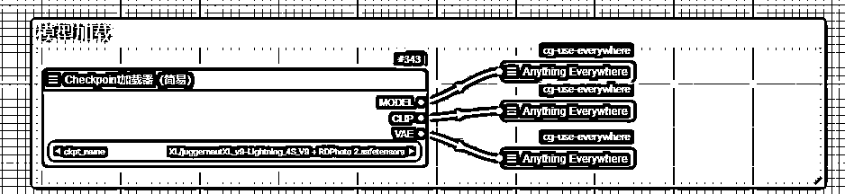

## 2. 文生图：从提示词到无缝图案

生成无缝贴图有两条路：文生图和图生图。文生图是输入文字生成图片，图生图是拿已有图片生成新图片。先来看文生图的流程。

### 2.1 先用提示词生成一张原图

第一步，用 CLIP 文本编码节点输入提示词。正面提示词可以写：texture, dogs, patterns, vector；负面提示词我这边偷懒，直接挂了一个 embedding 文件。你也可以自己填常用的负面词，比如 low quality。

由于整个流程里会有两次采样生图，所以提示词条件也需要连接两遍。这里我用了一个变量节点来做输入输出，减少重复操作。

顺便留一个小问题：为什么这里不能像加载模型时那样直接用全局输入方式？欢迎评论区聊聊。

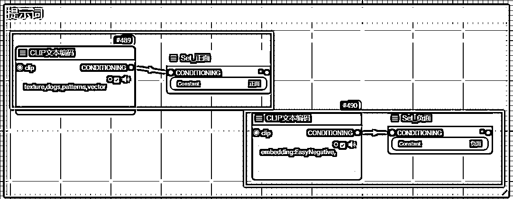

跑完第一步，就会得到一张由模型和提示词控制的原始图片。

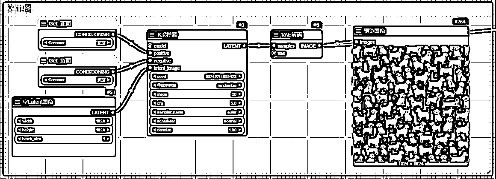

不过这时候它还不是四方连续图案，只是一张普通图。接下来要靠第二步，把它真正变成可无缝拼接的贴图。

### 2.2 核心操作：制作四方连续

这一步需要用到 ComfyUI 里的 Image Tile Offset 节点。

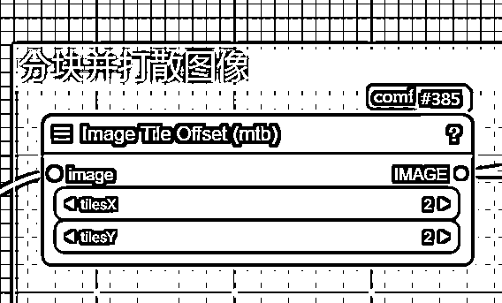

这个节点的逻辑很简单：把原图切成 4 块，再打散位置重新排列。这样处理之后，图片的外侧边缘与相邻图拼接时就能自然对上，形成无缝效果。

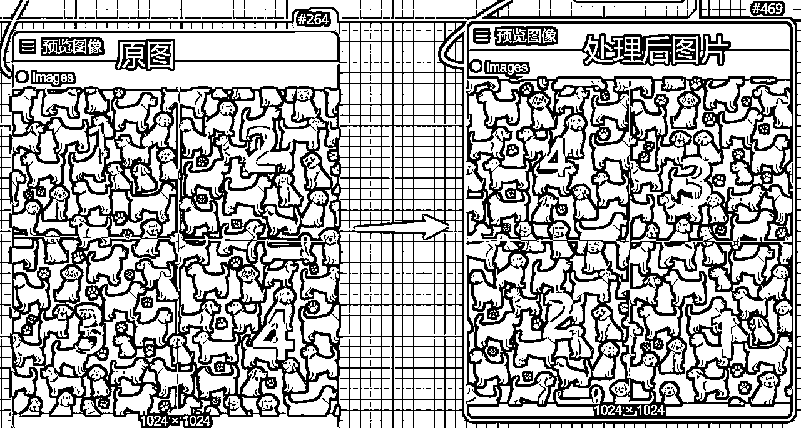

但图片中间靠近十字线的位置，会留下明显接缝。所以还需要第二次采样，对中间区域做局部重绘。

制作重绘蒙版时，先通过外补画板把画布向外扩展，然后再用一次 Image Tile Offset 把扩展后的图片分块排布。接下来对蒙版做模糊和增长处理，这一步是为了让模型在重绘时能够参考到原图内容，避免生成结果和原图差异太大，导致图案没法使用。

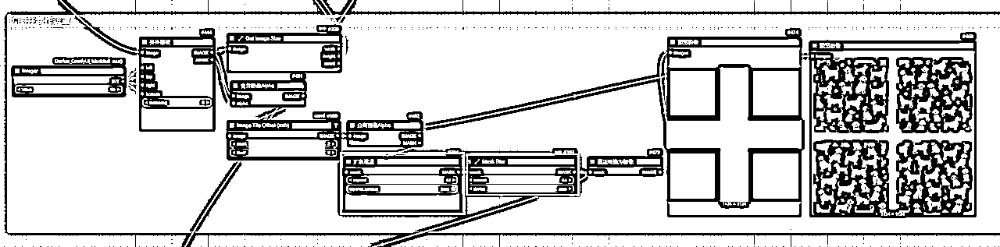

重绘消除接缝时，我换成了 fooocus 模型。相比直接用 SDXL 重绘，fooocus 在重绘和扩图方面的表现会更好一些。

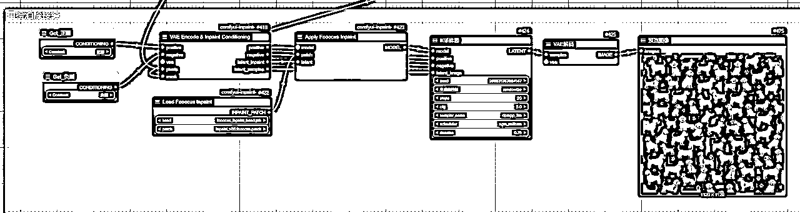

最终生成的结果里，原本横竖交叉的接缝已经被成功修掉了。

为了确认效果，还可以用多图拼接功能，把生成结果复制 4 张拼在一起看看。从拼好的图来看，接缝处是连贯的，没有断口。到这里，一张四方连续无缝图案就完成了。

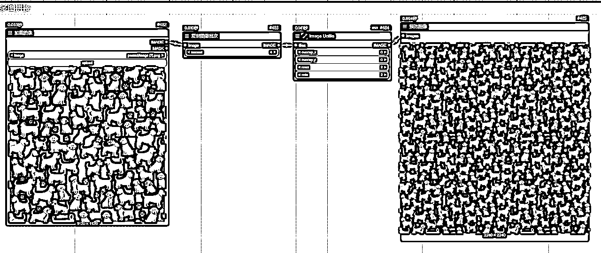

## 3. 图生图：已有图案也能直接改

再回头看整个流程，最关键的是第二部分：把任意一张图变成四方连续图案。文生图和图生图的差别，其实只在于“输入的那张原图”是从文字生成的，还是本来就有。

如果想把手边的图片变成无缝贴图，也很简单：上传已有图片，用反推模型把图片内容转成文本，再把反推出来的文本接到正面提示词里。另外别忘了，必须把上传的图片连接到第二部分的图片输入节点，其他流程保持不变。

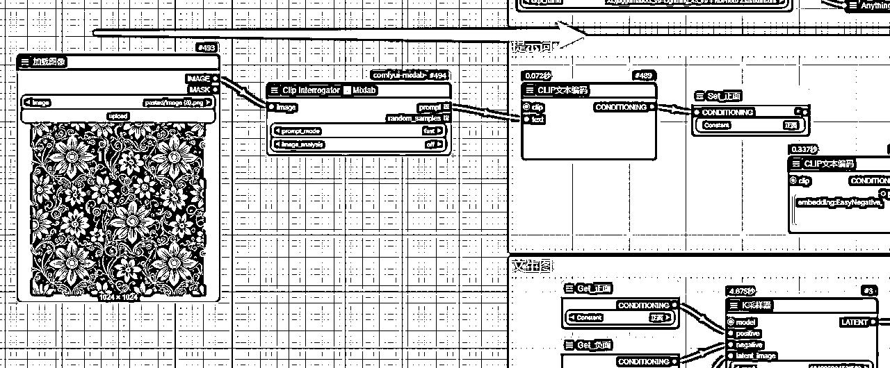

## 4. 工作流分享

文生图和图生图两套工作流，我都已经直接做好了，分享给需要的朋友。如果使用过程中有疑问，欢迎随时交流。

## 5. 一键套产品图

无缝贴图做完之后，大多数情况下还需要把它套到产品上。以前这个操作基本要开 PS，但既然已经在用 ComfyUI，更舒服的做法就是把“生成贴图”和“套产品图”放进同一个流程里完成。

这个功能我也已经做好了，直接放几张效果图给大家看看，有兴趣的朋友欢迎联系。

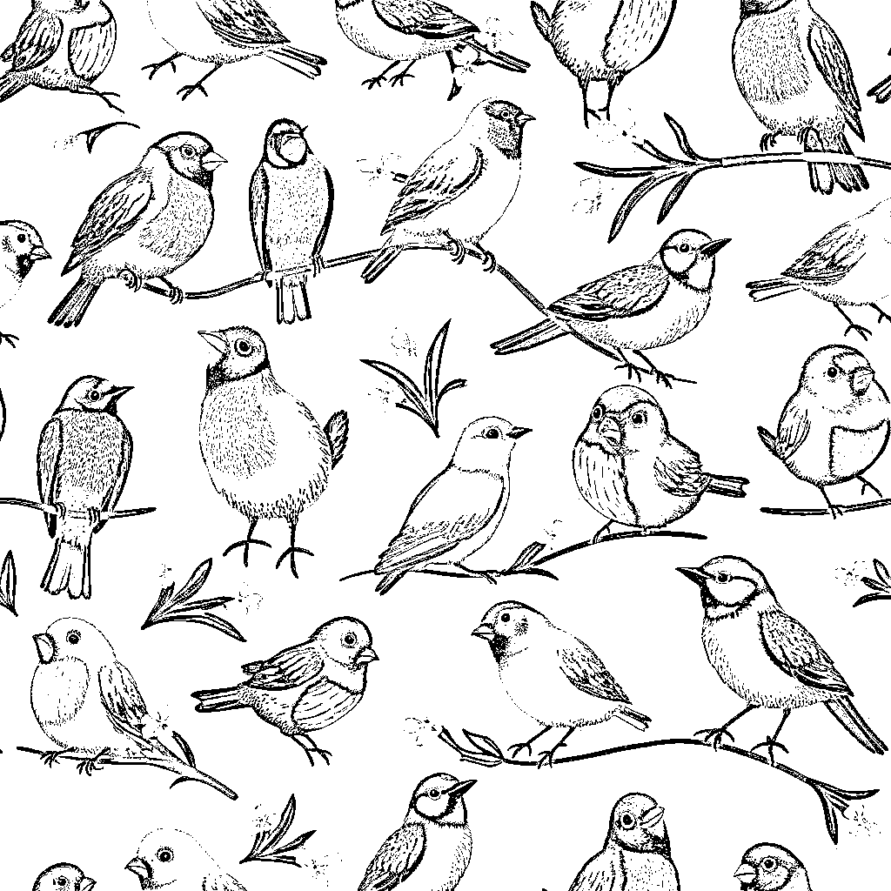

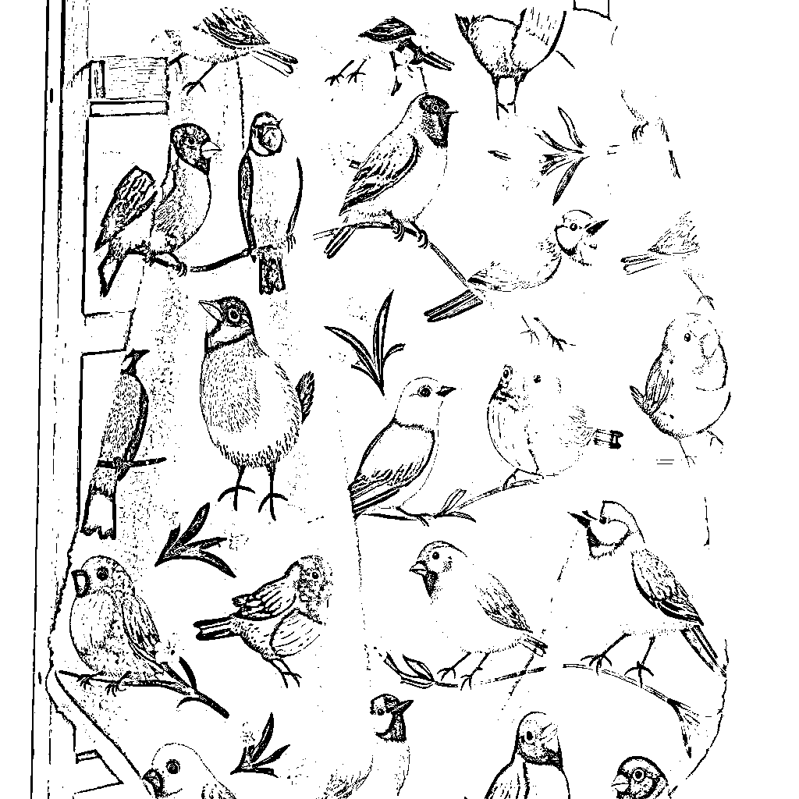
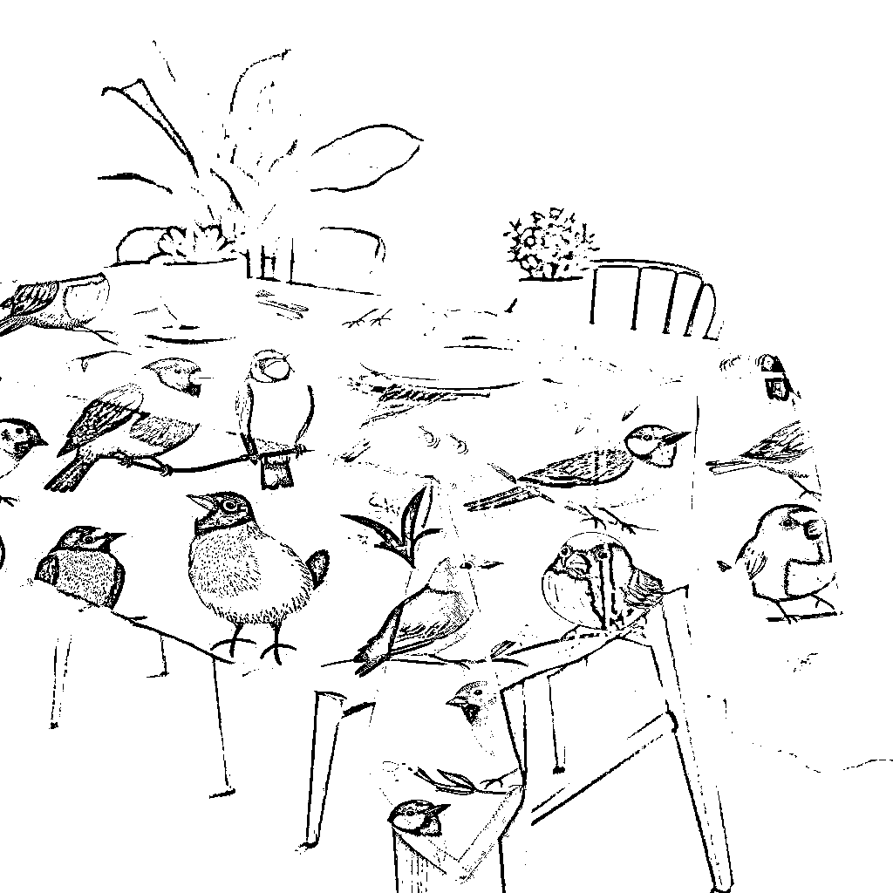
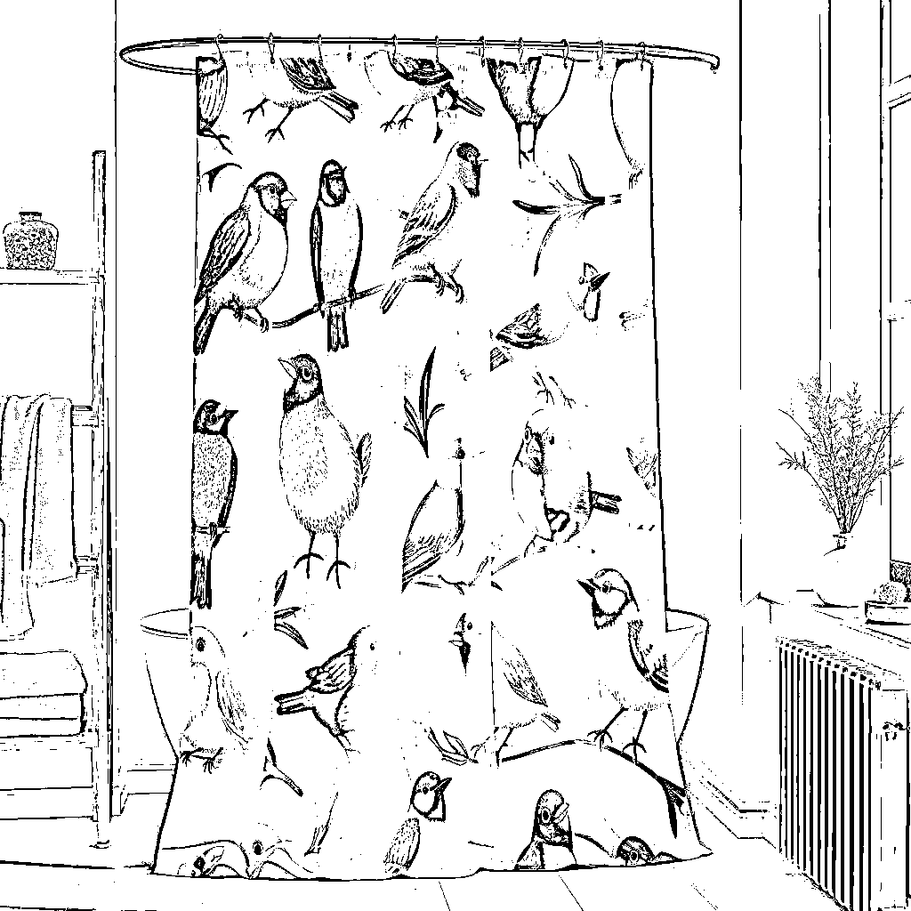