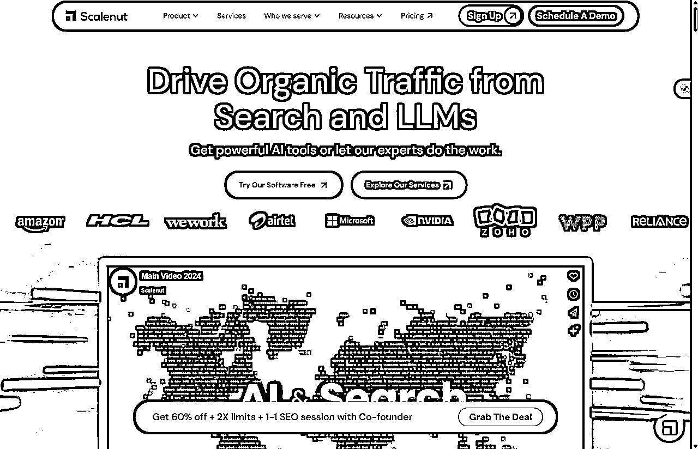
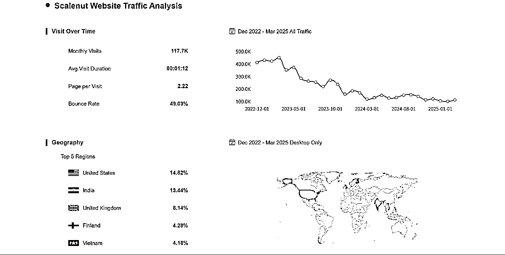
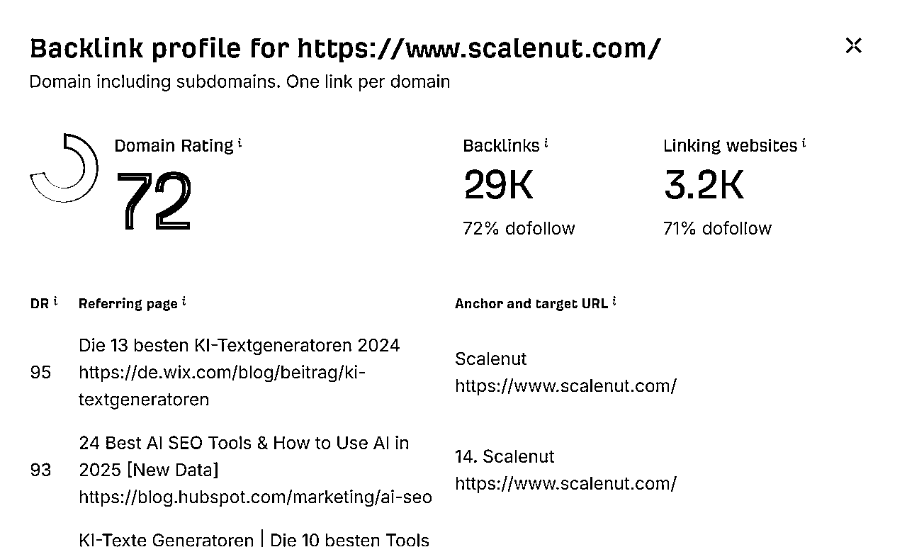
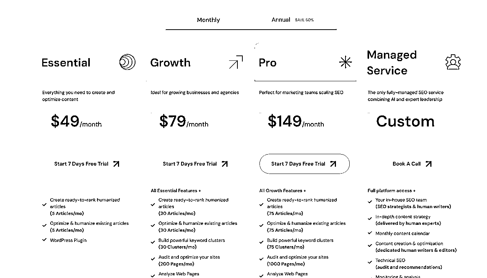
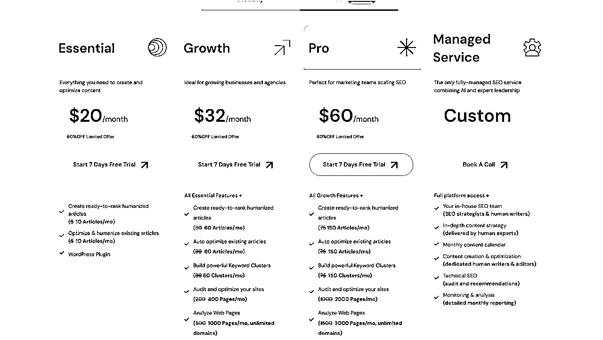

最近在翻工具榜单时发现一个现象：Toolify 的产品收录其实并不全，想要看清全貌，还得和其他榜单交叉着看。更重要的是，那些真正做得出色的产品，往往不能直接模仿，只能拆开看方法论。

比如今天要聊的 Scalenut。

它最让我觉得有意思的地方在于：这个产品功能复杂得像一个“内容生产中央厨房”，但按公开数据估算，MRR 并没有高到上天；而且它自己就是做 AI 营销的，研究的又是 AI SEO 同行，多少有点“自己拆自己台”的既视感。再加上这些产品普遍面向 B 端，真实收入就更难从外部估准了。

可正是这种“复杂度与收入不成正比”的样本，特别值得拆。

---

## 它到底解决了什么？

内容创作者应该都懂这种痛苦：想写一篇能排上名的长文，至少要在关键词工具、AI 写作工具、SEO 检查器、查重工具之间来回横跳。数据不互通，流程断成渣。Scalenut 干的事情，就是把关键词研究、NLP 语义分析、SERP 竞争对手拆解、AI 生成、内容优化评分、查重等功能，全部装进一个平台。

它核心的价值主张可以浓缩成四句话：

1. 省时间：从“想一个题目”到“能发布的初稿”，流程被明显压缩；
2. 提质量：用数据给你的文章补全盲点，让内容更全面、更有机会进入搜索结果前列；
3. 简化流程：不用再订阅五个工具；
4. 支持规模化：团队能批量产出合格内容，而不是靠人肉堆。

细分赛道上，它介于 Jasper/Copy.ai 这类 AI 写作工具和 Surfer SEO/Frase.io/Clearscope 这类 SEO 优化工具之间，算是在两个赛道交叉处做深度融合。

---

## 谁在用它？

它服务的是所有需要“持续生产 SEO 内容”的人。典型画像是：内容营销专员、SEO 经理、服务客户的代理机构、靠内容吃饭的博主/自媒体人、自由撰稿人，以及没有大型内容团队的中小企业主。

这群人内部又分成三种需求层次：

- 初级个人用户：图的是简单、能写、有基础 SEO 引导；
- 专业 SEO/营销人：要的是深度竞品分析、NLP 关键词准则、内容评分够不够准；
- 代理公司或大团队：会额外关注协作、席位、API、批处理和客户管理能力。

---

## 官网和流量

官网落地页给出的是直白的价值信号：

从流量来看，这类工具型 SaaS 的访问数据是评估体感的重要指标。基本信息如下：

外链方面：

竞对名单上，它把 Surfer SEO、Clearscope、Jarvis AI（即 Jasper）、Frase 都摆在了自己的对比页上。理由也不难懂：它既要跟 AI 写作工具抢用户，也要跟 SEO 优化工具抢地盘。

---

## 用户为什么离不开它？

没有它之前，用户的痛点是教科书级的：工具太碎；定架构全靠手扒 SERP；AI 写出来的东西和 SEO 要求经常“鸡同鸭讲”；内容深度和排名的关系只能靠感觉；想要规模化又怕质量崩盘。

Scalenut 给的解法也很有针对性：

- 一个平台打通“找词—分析—写—优化”；
- 用类似 Cruise Mode 的引导式流程，让系统自动分析搜索结果页、抽取关键术语、给出大纲建议；
- AI 直接参考 SEO 结果来写作，边写边喂实时优化评分；
- 通过扒排名靠前的对手内容，反哺内容完整度；
- 最终把原本按天算的生产周期压缩到小时级。

---

## 口碑：好评和吐槽都很真实

在 G2 和 Capterra 上，它大致维持在 4.7 分左右，评价量都在 300+。大家喜欢它的点很集中：集成度高，省掉了“多工具组合”的学习和账单；NLP 术语提取、对手内容分析和优化评分确实能打；Cruise Mode 被很多用户视为“一键出稿”的爽点；AI 生成内容至少是个不错的草稿；另外性价比和客服也常被提到。

差评同样真实：AI 输出依然需要大量人工改写和事实核查；平台功能多，高级玩法有学习成本；界面偶尔对新手不友好；运行速度和 bug 偶有抱怨；单点能力打不过头部工具——比如关键词库远不如 Ahrefs/Semrush，写作灵活性也比不上 Jasper；还有不少用户对信用点数消耗规则感到困惑。

---

## 它是怎么获客的？

导流策略相当标准，但执行得很稳：

- 内容营销/SEO 是绝对主力。它的官网博客持续产出 AI、内容创作、SEO 营销的长文，而且这些文章本身就用来做自家产品能力的“活广告”；
- 联盟营销铺得很广，你在各种测评站、YouTube、博客上看到的带链接推荐，很多都来自它的联盟计划；
- 付费广告投在 Google 和 LinkedIn、Facebook 这类渠道，截住有明确需求的搜索流量；
- 社媒上保持产品更新和干货输出；
- 在 G2、Capterra、TrustRadius 上运营品牌信任；
- 早期大概率去过 AppSumo 这类 LTD 平台换早期用户和现金流（这点还需进一步核实）；
- 用户基数起来后，口碑就变成了自然增长引擎。

---

## 商业模式和收入推测

它是典型的订阅制 SaaS：提供试用或免费版，然后用分级套餐收钱。套餐从个人版的低价档，到 Growth 中坚档，再到 Pro 和 Enterprise 定制，价格带大概从每月 20 美元起步，Pro 能到 150 美元以上，企业版再往上走。

月付方面：
年付方面：

收入怎么估？无非是“流量 × 转化 × ARPU”：

假设网站月访问量约 5.5 万，付费转化率取 1%，再按“30% 用户买低价、30% 买中档、30% 买高配、10% 走定制”的价格模型，算出的月付 ARPU 约 183 美元，年付约 134 美元；两者折中取 158 美元左右。于是 MRR 大概是 5.5万 × 1% × 158 ≈ 8.7 万美元，ARR 约 104 万美元。

不过这个数字充满不确定性。尤其它还主要面向 B 端客户，真实收入更难从公开渠道推断。结合 2022 年媒体报道——当时公司说未来要做到 ARR 1000 万美元，而按当时的流量推算过 400 万—500 万美元——纵览下来，上面这个 104 万左右的估算还算在合理区间的旁边，只是不能当真实的财务数据来用。

另外它 2022 年初官宣完成过一轮 400 万美元种子轮，由 Titan Capital 和 Saama Capital 领投。盈利状况未知，SaaS 早期通常先抢增长不急着赚钱。

---

## 值得抄作业的地方

1. 把“工作流”当产品，而不是做单点工具：它最聪明的地方是让 AI 写作和 SEO 分析在同一个闭环里互相配合，直接切中内容人的最大痛点。
2. 用引导式设计降低复杂产品的上手门槛：Cruise Mode 本质上是一个“傻瓜式”工作流，用户不需要懂 SEO 算法也能从零到一跑完流程，这对复杂 SaaS 的体验设计非常有启发。
3. 用自己的产品赚自己的客户：Scalenut 用内容营销和 SEO 获客，本身就证明了自家工具的可行性，翻译过来就是——吃自己的狗粮，而且吃得理直气壮。同时，它的定位也非常明确：只讲“更快做出能排名的内容”，直击目标用户的 KPI。

另外，它在“功能深度”和“容易上手”之间做平衡的努力，也是所有工具产品该有的自觉。

---

## 哪些东西很难复制？

这套打法看着门道多，但真想复刻，会发现处处是壁垒：

- 技术门槛：把最新 AI 模型和 SEO 算法同时吃透，还要懂 Google 每一次更新，然后无缝整合成产品，需要顶尖的 AI 和 SEO 工程师；
- 实时数据处理：SERP 爬取、NLP 分析、竞争对手内容拆解，全是靠钱和架构堆出来的；
- 数据资产：SEO 判断力靠历史数据喂，后来者没有积累，给不出同样精准的建议；大量用户使用行为还会沉淀出隐形的数据网络效应；
- 品牌信任和先发优势：它已经混了个脸熟，也攒下了一批用户；新品牌要抢，得花更高成本；
- 生态位里挤满了巨头：Jasper、Surfer、Frase 谁都不弱，新玩家没有极致的差异化很难突围。

---

所以你看，Scalenut 不是一个“捡钱”的故事，而是一个“把复杂流程老老实实打磨成产品”的样本。它的 MRR 或许不算夸张，但这不妨碍它告诉所有做内容、做 SaaS 的人一句话：优秀的产品，从来都不是拿来抄的，而是拿来“悟”的。真正的好产品，往往是那个能帮你把工作流理顺的工具。

## 🤗 电梯演讲：一句话讲清产品卖点

“我是 Scalenut 的创始人，我会这样介绍：Scalenut 是一款 AI 内容营销助手，几分钟之内就能把关键词研究到可发布的SEO友好型文章全部搞定，让你的内容产出效率直接提升五倍，同时搜索排名也上去。”

（这句话直指用户两大痛点——创作太慢、排名难做，核心卖点在于 AI 驱动、SEO 一体化、效率跃升，最终落到排名提升的业务结果上。）

## 🚀 差异化打法：同类产品可以怎么做出不一样

1. 极致垂直/行业深耕
* 打法：别做大而全，只盯住一个细分赛道，比如金融科技、医疗健康、律所服务或本地生活，提供该行业的专业术语库、合规规范、内容模板和 SEO 规则定制。
* 好处：解决得更准，建立专业护城河。比如为医疗类内容增加事实核查辅助和 E-E-A-T 优化建议，通用工具做不到。

2. 工作流单点极致
* 打法：聚焦内容营销链路里最痛的一个环节做透，比如只做“旧内容更新与再优化”，或只做“程序化 SEO 内容批量生产”。
* 好处：问题解决更深，定位更清晰，用户感知更强。

3. 提升 AI 的思考力和独特性
* 打法：从单纯写字升级到写“有思想”的内容。结合企业知识库，辅助生成独特观点、数据洞察、故事化表达和品牌语调一致性。
* 好处：对抗 AI 内容同质化，提升差异化竞争力。

4. 更强的团队协作与项目管理
* 打法：围绕内容团队协作设计，集成审阅、审批、版本管理、任务分配、内容日历等功能，成为团队的内容中枢。
* 好处：满足中大型团队对流程和管理的刚需。

5. 数据效果闭环追踪
* 打法：深度对接 Google Analytics、Google Search Console 等数据源，发布后持续追踪排名、流量、转化表现，并给出再优化建议，形成完整的 PDCA 闭环。
* 好处：让用户看得见投入产出，提升产品粘性。

6. 定价模式创新
* 打法：尝试效果付费等更灵活的计费方式，或按功能、用量做更精细化拆分。
* 好处：吸引对传统订阅制不买账的用户。

这些差异化思路能否比原产品更好解决用户问题？
* 有可能。 例如极致垂直化，能提供通用工具无法达到的专业深度与效率，因为它真正懂行业的“黑话”和规则。数据闭环也能回答用户“发出去之后怎么办”的焦虑，把价值链补全。关键在于差异化是否真的击中了现有产品覆盖不足、服务不够好的强需求。

## 🎉 可行性判断：我方团队能否做出同类或更好的产品

* 资源需求
* 人才：顶尖 AI/NLP 工程师、懂 SEO 的全栈开发、后端架构师、资深 UX/UI 设计师都是刚需。
* 资金：前期研发、算力与模型推理成本、数据处理、市场推广和人力成本，都需要可观启动资金，通常需种子轮/天使轮。
* 渠道：需要内容营销、SEO 专业影响力、企业销售能力或合作伙伴网络来获客。
* 数据：高质量 SEO 数据、网页抓取数据、行业专业知识库等都需要合法获取或采购。

* 资源匹配度
* 自我盘点：团队能否招到或拥有上述人才？是否有融资能力或自有资金？是否具备获客与销售执行力？能否获取核心数据？
* 成本承受力：即便资源到位，成本是否可控？涉及 AI 与大数据的 SaaS，研发与运营成本极高，必须精细测算财务模型。

结论：从零复刻 Scalenut 功能难度极大，资源门槛很高。若选择差异化切入，从细分领域或单点功能起步，可行性会显著提升，但仍需核心技术能力和一定资金支撑。

## 🧭 冷启动获客：如何找到第一批种子用户

围绕差异化策略，用低成本精准打法：

1. 深耕利基社群：垂直化的话，就泡在行业论坛、LinkedIn 群、专业协会网站、Reddit 社区里，持续输出价值，建立专家形象再自然引流。
2. 精准内容营销：产出极度垂直的内容，直击目标用户的核心痛点。如做法律行业工具，就写《律所博客如何写出符合 E-E-A-T 的文章》，软性植入产品。
3. 手工外联：挑选 50-100 个理想用户画像的个人或公司，个性化触达，提供内测名额，换取深度反馈。
4. 等待名单与内测：上线前用落地页清晰阐述差异化价值，收集意向用户，给予早鸟优惠换取支持。
5. 借力个人网络：向现有朋友、同事、前同事中符合画像的人推荐，争取首批试用与转介绍。
6. 参与小而美的活动：参加目标用户聚集的行业小会、线上研讨会或本地聚会，面对面交流。

核心原则是早期获客要精准且重互动，而非广撒网。找到对差异化价值最敏感的种子用户，与其共建产品。

## ✨ 我的优势：凭什么是我来做

需要结合自身情况做诚实盘点，可能的优势方向包括：

* 行业背景：在 Scalenut 尚未深耕的某个特定行业有多年实战经验，深刻理解用户痛点与话语体系。
* 技术壁垒：在关键 AI 算法、大规模数据处理、垂直领域 NLP 等方面有独特积累。
* 现成资源：已有相关博客、社群或客户群，或在目标客户中有广泛人脉。
* 市场洞察：发现了竞品忽略的重要需求或趋势。
* 成本优势：能以更低成本获得人才或数据。
* 执行力：具备快速学习、快速迭代的能力。

没有清晰的独特优势，在红海竞争中突围会非常艰难。

## ❤️ 热情与坚持：是否真心想做这件事

这是最主观也最关键的问题：

* 你是否真心想帮用户解决“高效创作高质量 SEO 内容”的问题，哪怕过程充满挫折？
* 你对 AI、内容营销、SEO 是否有持续的学习热情？
* 你是否愿意花大量时间倾听早期用户的抱怨和建议，并据此迭代？
* 你是否准备好在半年甚至更久都看不到明显增长和收入的情况下仍保持投入？
* 面对技术瓶颈、竞争、用户流失、融资难题时，你有足够的韧性吗？

如果以上大多能点头，你才具备创业所需的心理基础。没有真正的热情，难以走完漫长艰难的路。