# 孙策：一次视频号直播发售，实体店如何实现一场200万收款

## 嘉宾介绍

孙策，同城实体操盘手，实体直播专家，团队已为5000家线下门店提供进店交付服务。

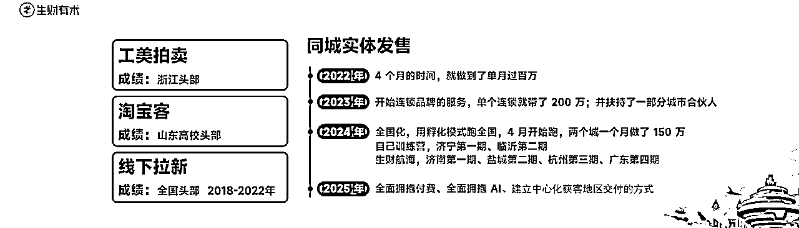

# 1.创业经历

大家好，我是孙策。今天分享的主题是，视频号直播发售这套打法，如何帮助一家实体老板实现单场收款200万。

先简单自我介绍一下，我从16年开始创业，到现在整整十年，期间操盘过四个方向。

第一个方向是工美拍卖业务。第二个方向是淘宝客，当时15到16年淘宝客正处上升期，我们在高校这个细分赛道冲到了头部。第三个方向是加入赚钱后做的线下拉新业务，为淘宝、支付宝、京东、美团等平台做获客，对标的也是头部体量。这前三段都不算差，节奏比较顺。

真正转折在22年，我们开始深耕同城赛道。先在山东泰安小范围起盘验证，随后复刻到济宁、淄博、聊城，再到江西的几个城市。验证下来发现模式是可以城市间迁移的，区域化是成立的。

到了第三年，也就是去年，我们开始加速全国化。自己操盘两期，和赚钱联合做了四期，累计六期。从山东全域，到河北全域、江苏全域、安徽、江西、再到广东，每一个城市都签约了大量实体老板，并把业务跑出结果。

到25年，我们给团队定下三条主线。

第一，全面拥抱付费。建根据地。在每个区域扎下根来。因为付费获客单价极低，一个有效客户获取成本在200到300元，对我们来说非常轻。

第二，全面拥抱AI。我们是面对面服务商家做流量和成交，和大量实体老板深度沟通，深知他们的真实痛点，AI提效的空间很大。

第三，建立中心化获客、属地化交付的模式。中心负责投放和商家签约，订单分发到各地圈友，由他们落地执行。

接下来聊聊我们为什么会做出这样的选择。

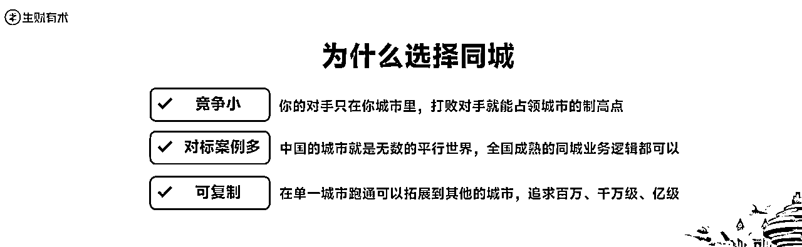

# 2.业务选择逻辑

很多同行在选赛道时，最大的问题是靠感觉决策，花很少时间做调研。事实上做同城这件事，我们前期调研就花了整整半年，才敢笃定下手。因为只有把逻辑想透，后面执行才够坚决。

很多人选项目是情绪化的，看两三天觉得可以就冲进去。任何一个新业务起盘都伴随大量问题，必须不断解决才能看到结果。如果起步前没有做过充分验证，一旦遇到阻力就会怀疑项目本身，进而不断换赛道，策略极不稳定。

本质上是没想清楚业务的底层逻辑：值不值得投、能投入多久、投入后如何持续。

我们当时看重同城的三个原因。

第一，竞争小。创业门槛越来越高，只有拿下头部才能分到蛋糕。想做二三十名是赚不到钱的。我们要找的是一座小池塘里能做第一名的赛道。同城的最大好处是，在一个城市内做到第一并不难，打败本地对手就能垄断当地资源，拿下高利润。

第二，对标案例多。做业务时最怕无路可走。可执行的路径最好的来源就是对标。我们发现全国各地的同城业务都已成熟，只要找到当地做得不错的老板，付费学习基本都能拿到。远距离不是竞争关系，对方愿意分享。我们能快速复制，这就是同城的优势。

第三，可复制。单城跑通后就能横向复制。一个城市能做到100万，十个城市就是1000万，二十个城市就是2000万。规模化路径清晰，算账很简单。

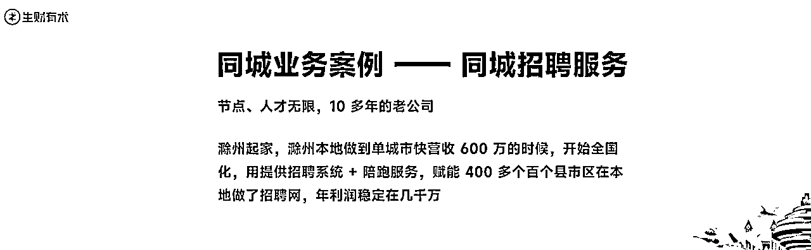

分享两个典型的参考案例。

案例1：

一家安徽的同城招聘网站公司，在山东做了多个城市的单点，比如滨州、菏泽，年量级都在几百万。他们从滁州起步，单城做到600万营收后，判断模式可复制，于是做了两条增长线：SaaS工具和陪跑服务。随后赋能全国400多个区县做本地招聘网，目前年利润稳定在千万级。

案例2：

国科优选、亿绘驿站，这也是同城的一种玩法。模型分为三方：

平台方负责中心化的直播和供应链，找货源、找主播，在社群里直播带货。
门店方负责拉新和本地服务，把周边的中老年群体引进来，并提供使用指导。
用户方主要是中老年人，多为空巢老人，孤独感强，购买意愿依赖信任和陪伴。店长教会他们怎么买、怎么用，粘性会越来越深。

跑通一个社区门店的逻辑就是中心化公司能支撑起1家、10家、100家、1000家店。做到区、到市，本质是数字的裂变问题。

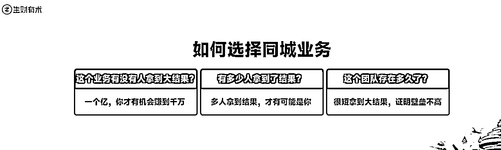

面对众多的同城业务，如何判断该不该做？我们定了三条筛选标准。

第一，这个赛道有没有人拿到大结果。头部做到一个亿，你才有机会拿到一千万。头部只有几百万，你进去天花板也低。早期无人直播就很典型，头部月入近百万，大量跟风者涌入后，最后只能赚个十万。

第二，拿到结果的人多不多。五六十个人能做出来，这个赛道才有普适性。只三四个人成功，普通人很难复制。

第三，头部存在了多久。半年冲出来的成绩和三年沉淀下来的成绩不可同日而语。用半年就能做大的赛道，壁垒低，容易被资本、资源、团队快速收割。普通人更适合那种需要时间积累优势、对手短期打不垮的赛道。

回到我们自己的选择。我们做的是同城实体服务。因为看下来这个赛道里已有团队做到亿级甚至几亿级营收，意味着普通人也有千万级的机会。第二，实体营销的历史很长，从九几年到现在一直存在，中国人创业第一反应就是开店，实体老板是稳定存量。

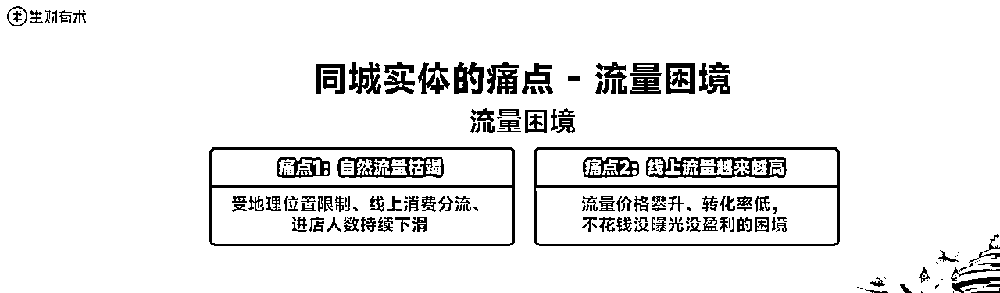

# 3.同城实体的痛点

选定赛道后，我们要看清楚实体老板的真实困境。

## 3.1流量困境

*   痛点1：自然流量枯竭
门店受限于地理位置，线上消费分流，进店人数持续下滑，本身没有来客。

*   痛点2：线上获客成本飙升
线上是竞价逻辑，价格越抬越高，转化率却越来越低。不付费就没曝光，这是绝大多数实体老板正在面对的困局。

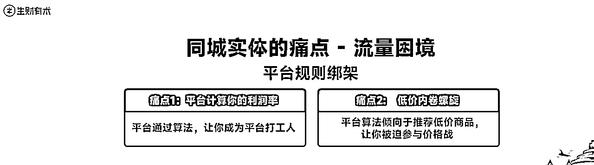

## 3.2 平台规则绑架

*   痛点1：平台算计利润
平台不会让你舒服地活着，只会让你卑微地生存，变成平台打工。据说电商从业者体会最深。

*   痛点2：内卷螺旋
平台算法偏向低价和对比。比如A火锅店、B火锅店同时曝光，平台刻意制造价格对比。抖音和美团互相压价，本质是让商家内卷，这就是规则绑架。

还有一个更致命的问题，转化困境。

很多服务商只做流量端，这是错的。实体老板最缺的不是流量，而是交易闭环，三个缺口：

*   痛点1：转化体系缺失
很多老板开业就猛买量，89、69、79的低价团购把人引进来。团队服务能力跟不上，服务和菜品经不起检验，一波流量进来就把店砸了。

*   痛点2：升单体系缺失
把团购品当利润品卖。100到200块的券，算完成本也就赚十块二十块，还要承担退费风险，离关门不远。

*   痛点3：复购体系缺失
广告费付出去，如果团购客没有变成复购或新单，店基本就结束了。

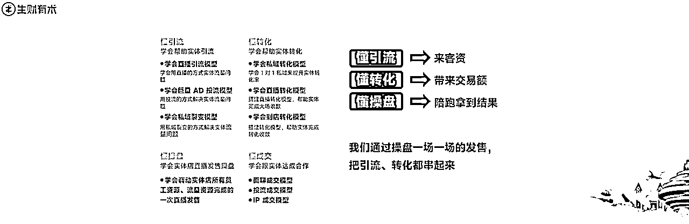

# 4.同城实体的机会

基于以上痛点，服务机会就很清晰。

第一，懂引流，能带来客资。
第二，懂转化，能带来成交额。
第三，懂操盘，能陪跑到结果。

这三层我们已经沉淀成体系。先用同城服务IP去获取B端合作，通过付费、分享、沙龙等方式触达老板，再用结果型服务产品变现。

你会看到大量博主卖课的退费率越来越高。因为老板上课上麻了，小红书课、抖音课、AI课轮着上。其次老板太忙，学了没时间做。我们主打结果服务：我帮你拿多少业绩，你付多少钱。这样合作更直接。

投放端获客成本也极低。别人卖直播陪跑或城市抖音陪跑，获客成本要几千。我们做结果服务，抖音付费获客做到200左右，是别人的十分之一。这也印证了结果服务未来会是主流。

另外AI产品赋能。AI可以切入实体老板的流量端、转化端各个环节。如果能帮老板解决十万级的问题，收一两万服务费并不难。

结果服务的核心打法是进店，用私域裂变+直播发售帮商家拿结果，具体怎么做？

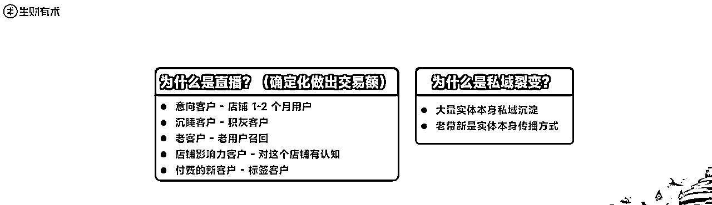

## 4.1 为什么是直播？

实体老板本身手里就握着大量意向客户。比如婚纱礼服店，4月份月销20到30万，5、6月份大概率还是这个量级。直播可以提前把未来几个月的客户一次性收割。

第二个是沉睡客户。员工很难挖掘，但直播一开就能唤醒大批积灰客户，观看时长越长，成交机会越多。

第三个是老客户。把老用户拉入直播间，通过机制设计让他们老带新，形成二次传播。

第四个是店铺影响力。本地实体本身就有口碑，直播能快速放大。

第五个是付费投放的精准度。现在平台标签打得很细，可以按年龄、购物偏好、地理位置定向投放。比如锁定20到35岁、爱买精致护肤品、长期居住在本市的人群。标签越懂，用户越准。

## 4.2 为什么是私域裂变？

实体老板手里其实有私域，只是没被激活。很多门店沉淀了几千个老客户。老带新本就是实体获客的核心方式，我们用私域裂变+直播发售的组合，大概率能覆盖80%的实体老板。

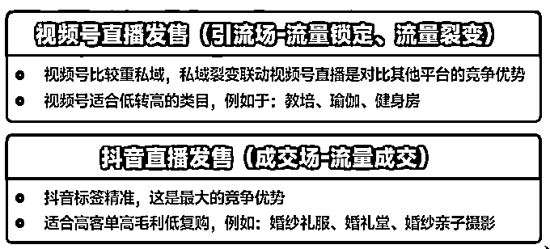

我们目前有两个产品线。

视频号直播发售，适合低客单高频次、重私域的类目。视频号的分享和点赞机制极易破圈，适合流量锁定和裂变。典型场景是瑜伽、教培、健身房。

抖音直播发售，适合高付费类目。抖音标签最准，成交效率高。典型是婚嫁礼服、产康月子中心这类高客单、高毛利、低复购的行业，这类商家本身付费投放意愿就强。

很多人问我们：视频号直播和抖音直播的发售，到底该怎么做？我们当时的策略很简单——把这两个发售动作精准对准那一类用户群体，并为此搭了两套产品。结果就是：几乎覆盖了这座城市80%的客户。

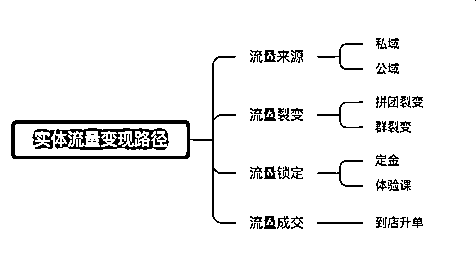

## 4.3 实体流量变现路径

实体流量的变现，拆开来看，一条路径里有三个点、四个流程。

第一个点，是流量来源。流量可以从私域来，也可以从公域来。但流量进来之后，千万别急着成交。很多人犯的错就是“流量一到手就开卖”，这本质上是在浪费流量。

接着是流量裂变。假设你花100元采购了100个客户，如果通过群裂变、拼团裂变，让这100个支付用户再帮你裂变出100个新客户，你的广告成本是不是瞬间降低了一半？原来花100元买一个客户，裂变一轮之后，成本就变成了50元。

然后是流量锁定。为什么要锁定？因为大多数实体老板的承载能力实在有限。你一次给他100个客户，他可能就“做死”了，你得让他细水长流。所以当流量进来、开始转化的时候，要先把他手中那批精准客户转化掉。也就是说，当你帮他搞来100个甚至1000个客户时，最重要的事是帮他筛选——把意向最高的客户筛出来，先进店转化。剩下的，再慢慢养、慢慢转。由于他的交付能力有限，我们要通过“定金”或者“体验课”这种方式，把那些高意向客户筛出来。

最后是流量成交。流量成交说白了就是到店升单——把一个只花了100多、200多的客户，升到3000、5000，甚至1万。这样，整个变现路径就闭环了。

## 4.4 如何做一场直播发售？

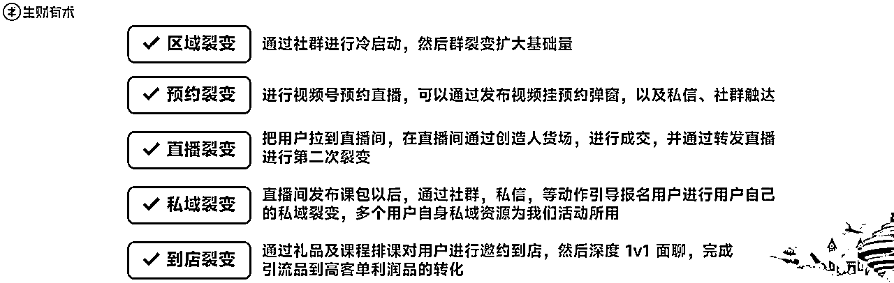

我们做视频号直播发售，一共分五大步：区域裂变、预约裂变、直播裂变、私域裂变、到店裂变。下面简单串一下我们的完整流程。

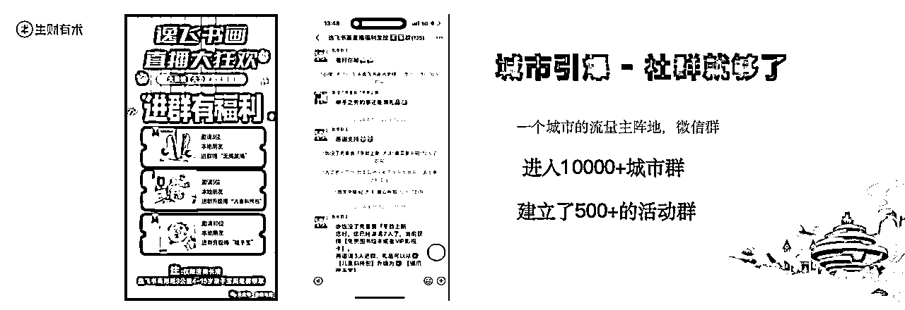

先讲一个反常识的结论：想引爆一个城市的流量，根本不需要做什么短视频，你只需要把一个社群玩明白就够了。你想，目前大家日常刷的两大主流平台，无非是微信和抖音。可如果你要从抖音拿到全城的流量曝光，那个场景成本太高了；但在你自己的微信体系里做这件事，成本一点都不高。

那具体怎么做？先想一个问题：在微信里，什么样的内容你的打开率最高？

第一，当然是私信——别人发你私信，你大概率会看一眼。第二，就是微信群，比如红包群、工作群、物业群。所以什么叫做“同城流量矩阵”？说白了，就是你找到那些用户每天必看的群就行了。比如家校群、小区物业群、商家的福利群，这些群的打开率都非常高。工作群当然也可以，但你要是在工作群里天天发活动，大概率会被踢出来。所以，对一家店来说，想在本地做一次全城引爆，不用搞抖音，也不用在视频号上做直播，老老实实把一个微信群运营好，就足够了。

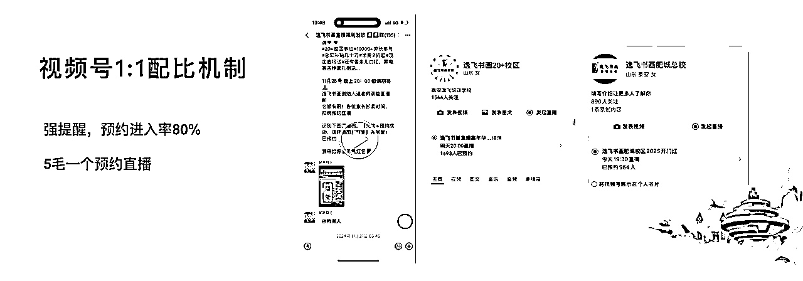

社群搞定之后，下一步就是拥抱当下最高效的方式——直播。直播其实很简单，有预约就行。为什么我们特别强调视频号的预约？因为视频号直播的预约进入率真的很高。你预约了1000人，开播那一刻可能瞬间就进来800到900人。另外，视频号有强提醒功能，用户只要预约了，开播时系统就会提醒他。再有，预约路径也极其简单——扫个码就能进去，不用跳转各种App。

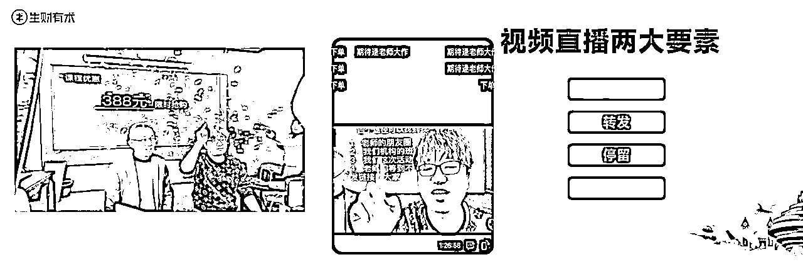

预约做完，就要正式开播。视频号直播的要素只有两个：转发和停留。

为什么要做转发？因为视频号是生长在私域体系里的。你只要持续地让直播间里的人去做某个动作，他们真的会照做。所以你要做的就是不停引导用户转发。

第二，要留住进入直播间的人。第一拨人转发了、进来了，把直播间的氛围托起来，然后再用内容留住后面进来的人。这样一来，流量就会螺旋式地往上涨。

直播过程中怎么操作？疯狂引导转发、疯狂留人，每隔10分钟就送一波礼品。只要这个节奏跑起来，视频号直播间的流量就会变成正向流水。这套逻辑其实适用于40%到50%的店——凡是做“低转高”模式的店，都可以直接用。而且很容易跑出稳定的直播间，在线人数维持在100到200人之间。那这一波，我们当时大概带了多少量？

我们当时累计卖出了3000多单定金，覆盖好几个大校区。每单定金大约是300元，同时还沉淀了1万个客资。你看，3000多单定金很值钱，但更值钱的是这1万个客资。我们在直播间并没有直接挂车卖货，而是把成交引导到我们自己的小程序里完成。为什么这么做？因为在小程序里，还能再做一波裂变——用户买完后，让他再拉一个人进来。所以当时我们卖掉3000多单之后，又在线下课后做了一次二次裂变。

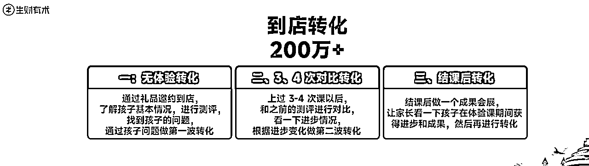

现在把这条路径再串一遍：从公域、私域建群，做群裂变，拉预约；预约做完开播，在直播间卖定金、卖体验课；最后把人导到店里，完成成交和升单。

当时我们的真实数据是：3万流量进来，在直播间听了6分钟讲解，我们卖出了3000单，转化率大约10%。而这3000单，最终带来了200多万的成交额。

这就是我们的第一套产品线——视频号直播，核心抓手就是“低转高”这套逻辑。如果你本身就是老板，真的可以试试这套打法。这套逻辑我们验证过很多次，确实好用，而且已经带过大量的人去跑这条产品线，完全没问题。

最后还有一条：抖音。抖音就简单了——纯付费投放就好。

最后的最后，祝大家龙哥盟！

内容总结：

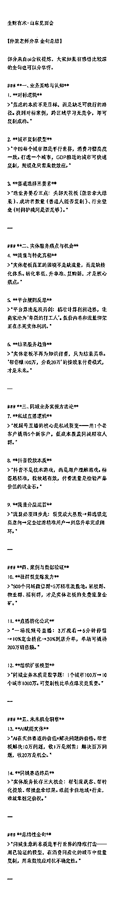