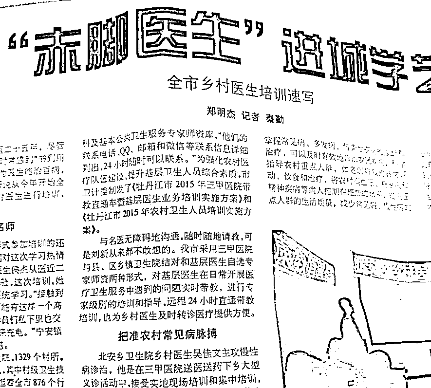
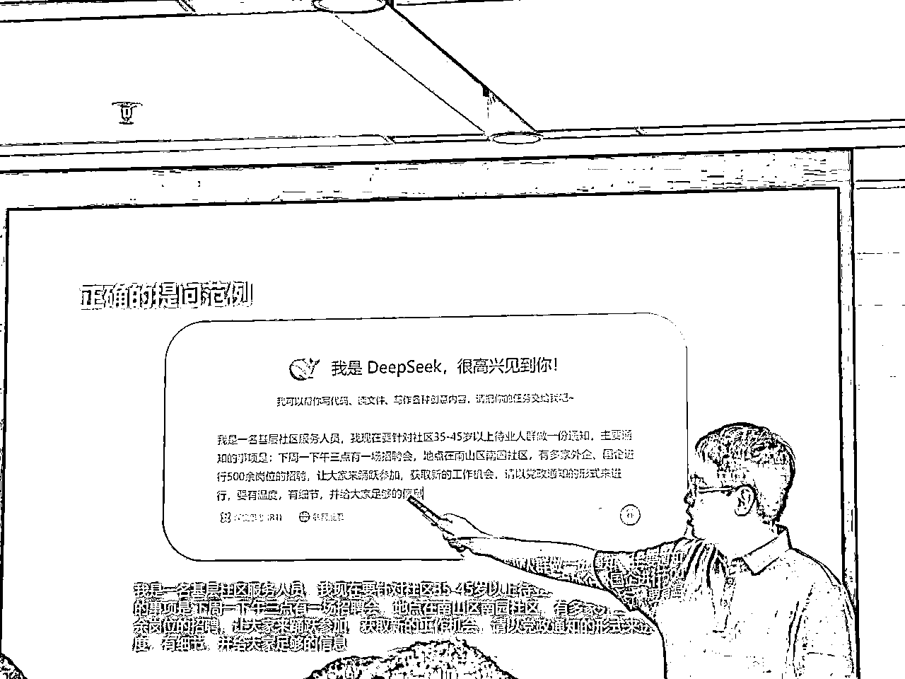
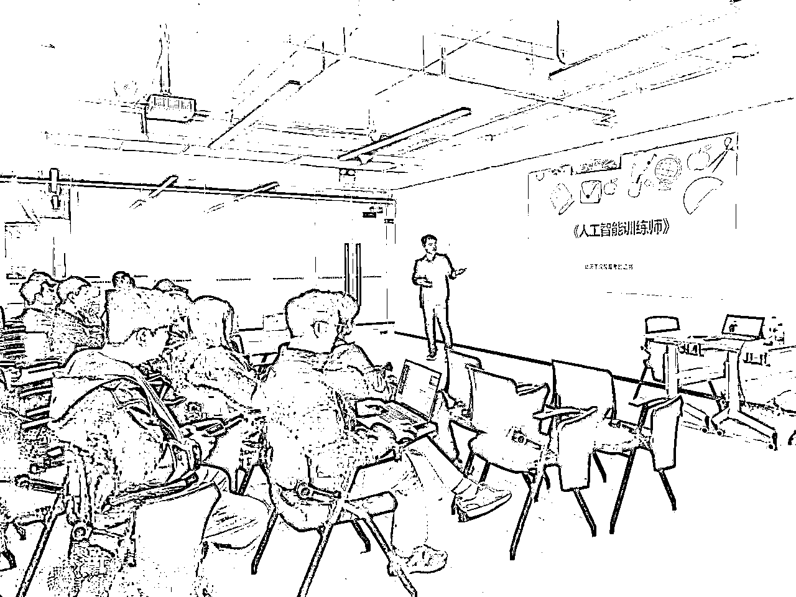
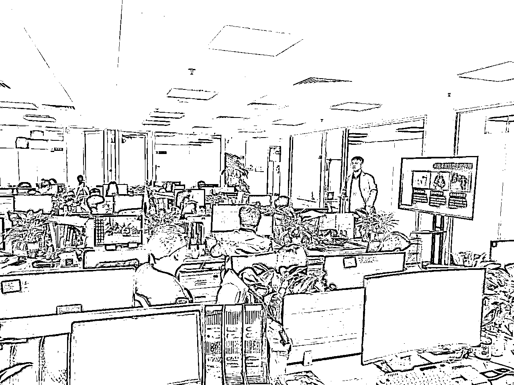
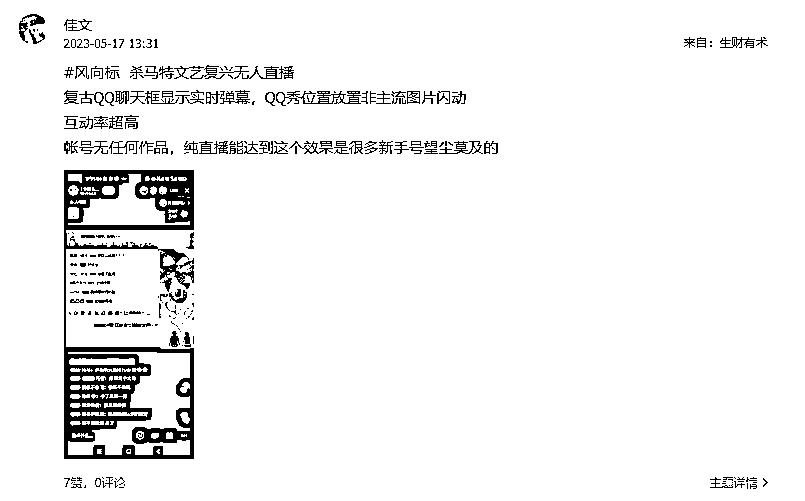
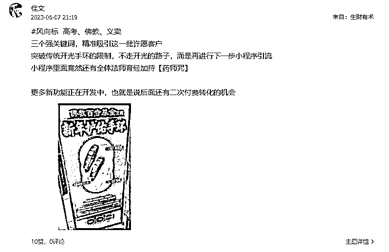
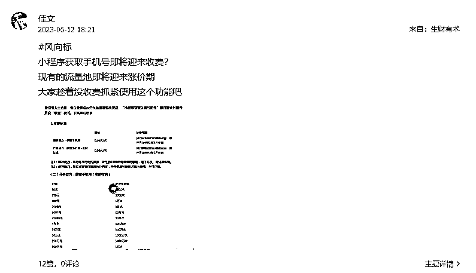
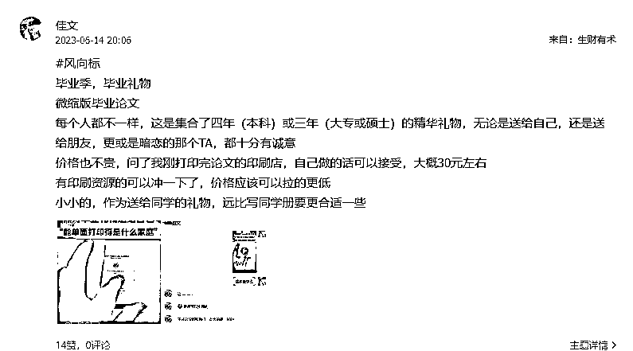
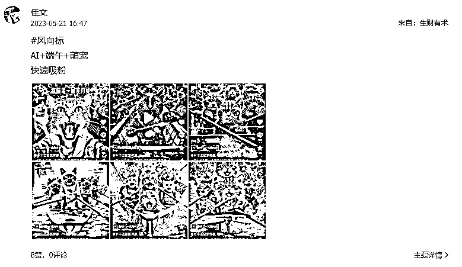
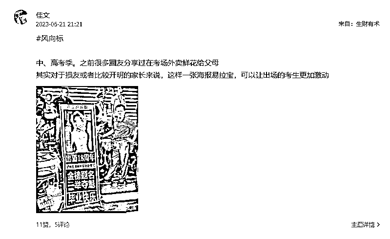

# 踏上赚钱之船以后：一名AI布道者的三段航程与回归

# 自我介绍

我是龙哥，目前是龙哥盟社区里若干训练营的带队教练，带过的课题包括GPT效率提升、Coze私人助理、ComfyUI、AI电商赋能、DeepSeek零基础入门等。

我经营的公司，主要客户是政府和各类企业。我们做的事情，是通过人工智能来帮助他们减少成本、提升效率，推动业务创新。同时也为那些想搭建AI生产力工具的人，提供一套可复制的打法与实战陪伴。

另外我还兼任广东省人工智能训练师考评员，以及福建省海峡人才毕业生就业指导中心特聘讲师。

我的履历可能跟你想的科技创业者不太一样，要说起来甚至是有点偏的。

- 2014到2018年，我在乡镇卫生院当医生，每天打交道的是几千名慢性病患者，给他们做随访、做诊疗；
- 2018到2020年，我跳到互联网行业，从客服干起，一路做到运营，用户增长、内容运营、社群这些基本功都是那时候打下的；
- 2020到2022年，我在企业里做中层管理，开始跨部门协调，从业务、营销到产品项目，整条链路都要盯；
- 2023年到现在，我正式创业，把AI跟企业管理系统揉在一起，服务了超过100家中小企业和团队，搭起了自己的一套企业AI解决方案体系。

我知道很多人跟我一样，并不是一开始就站在一条光鲜亮丽的主干道上，而是在不断试错、一路打怪的过程中，才慢慢找到自己的方向。所以我想把自己的路程摊开来给你看。也希望你在赚钱这艘大船上，不只是兴奋一阵子，而是真的能靠岸。

# 给新朋友的赚钱使用说明书

这篇文章适合刚加入赚钱的朋友，也适合对AI、副业、一人公司感兴趣的人。

如果你正遇到这些问题，那它也许能帮到你：

- 内容太多，不知道从哪里开始看
- 想做点事，但方向不清晰
- 学了一堆，却落不了地

## 花4步，把赚钱用起来👇

### 第1步：先想清楚你要什么

问自己一句话：
“我现在最想搞懂的/最想做成的是什么？”

举个例子：

- 想通过GPT来提升工作效率
- 想运营一个自己的知识星球
- 想让AI在自己的工作或副业里真正用起来

有了目标，才不会走弯路。

### 第2步：挑一个项目，完整体验一次

不要想着把所有内容都看完，先选一个航海项目（21天课程），完整跟下来：

- 想提效的 → GPT提效 / Coze / 自动化工具
- 想创作的 → AI写作 / 👸号写作 / 可视化
- 想变现的 → 星球搭建 / 训练营 / 电商模块

跟完21天，比你翻三个月帖子都有用。

### 第3步：搭一个自己的学习工作台

用Notion或飞书建一个简单的文档，记录三件事：

- 你学了什么
- 你做了什么
- 你下一步要做什么

不用搞得多复杂，能清楚看到自己的进度就够了。

### 第4步：有意识地开始输出

可以试试：

- 写一篇航海复盘
- 分享一个你常用的AI技巧
- 晒一个你做的副业或服务小成果

输出的过程，就是成长的过程。你不需要等自己很厉害了才开始，但你开始了，就会越来越厉害。

别被信息量吓到。从你最关心的一件事开始，一步步来，你也一定能在这里走出一条属于自己的路。

## 🚢【启航篇】看山是山，看水是水｜我被信息差轰炸了

我接触AI其实比进赚钱要早。2020年的时候，我就开始研究怎么把AI用到企业的营销、合规、财务、客服这些场景里。那时候ChatGPT还没出来，更别说什么“全民AI”了——严格来说，我研究的那些东西，都算不上真正意义上的AI。

真正让我视野打开的，是2023年底GPT-4的发布。

那一刻我意识到，AI的身份变了：它不再只是一个工具，而是一个“接口”；它不再只是辅助，而是一个“伙伴”。我开始琢磨怎么把它变成企业级的系统解决方案。也是在这条路上，我遇到了龙哥盟。

刚进星球那阵子，我的心情就是：

“原来副业也可以玩得这么系统！原来知识能变现，社群能盈利，👸号能年入百万，自动化能提效到极致……”

那种感觉，就像一个刚上船的新水手，突然看到一整片内容海洋，兴奋得有点不知所措。我每天都在刷别人做什么项目，每一篇帖子都觉得“太值了”。

我看别人的👸号赚钱案例、星球搭建笔记、课程运营SOP、销售话术拆解、AI训练营设计……

于是我开始：

- 同时研究Coze、👸号、知识星球、📕、Notion、各种自动化工具；
- 同时在想：我要不要也开个星球？我是不是也能开课？我的副业能不能比主业还牛？

每天像是在挖宝藏，又像是没头苍蝇一样在海上乱飘。

那段时间，我特别沉迷刷【风向标】，想得到“认可”，想融入这个圈子，想把每条赛道都试一遍。

结果就是，我完全脱离了自己的主业。后来回头看，那些探索有一点用，但真的没有太大用。

没有正反馈的日子是很难熬的。有一阵子我甚至强迫自己“戒赚钱”，尽量不打开那个网页。因为只要一打开，8个小时就跟被偷走了一样。

## 🌪【迷航篇】看山不是山，看水不是水｜焦虑与拉扯

兴奋劲儿过了之后，涌上来的是莫名其妙的焦虑。你也许正在经历这种感觉：

- 为什么别人随便写个星球就能月入5万？
- 为什么别人做一个AI工具分享就能涨粉几千？
- 为什么别人做自媒体、开课、写推文，好像都不费劲？

我开始怀疑自己：是不是我太笨？是不是我选错了方向？是不是我也该把企业服务扔一边，去做个轻资产的B端产品？

我天天泡在星球内容里，但越来越焦虑。

- 什么都想弄，结果什么都没弄透；
- 什么都在学，但是核心服务反而没时间去打磨；
- 脑子转得飞快，脚步却乱七八糟。

我相信这是很多新手都会经历的“迷航阶段”：你看别人什么都行，回头看自己什么都不行。

后来让我一下子想通的，是这样一件事：

你看到的是别人分享出来的成果，但你看不到他们在沉默中的打磨；你光顾着追别人的轨道，却忘了自己本来要去哪里。

于是，我停了追风的脚步，开始“回望航线”。

开始参加航海
开始写一些长文
开始分享自己的AI使用心得观点
开始正面去面对焦虑、接受它、对抗它，最后拆掉它

那一阵子我做了几件让自己有成就感的事：

小白也能靠AI写文章/论文，日赚2000元（那是2023年，应该算很早的一批AI写作玩法教程）
AI写作的春天到了——知网AI智能写作平台上线（算是我那篇教程的续篇，现在看依然有用）
来赚钱一年，航海基本被我打通关了（这算是一个阶段的总结，也是我回归主业的一个信号）

## ⛵️【返航篇】看山还是山，看水还是水｜回到主线，反向赋能

我开始认真问自己几个问题：

- 我最擅长的事是什么？
- 哪件事是我干得久、干得深、干得稳的？
- 我的客户是谁？我最能帮他们解决什么问题？

答案其实一直都在我身上：我就是一个做企业服务的人。我能把企业的问题跟AI的能力对接起来，我有从战略到落地的实战经验，我懂组织、懂产品、懂场景。

“我不是来换航线的，我是来给船装补给的。”

当我带着这个视角重新看龙哥盟，一切都变了。

我开始主动从里面提取对自己有用的模块：

- 从副业项目里，我学的是信息包装和产品定义的方法；
- 从写作航海里，我学的是结构化表达，怎么用AI写方案、写课程、写SOP；
- 从📕精华贴里，我拿来的是视觉呈现技巧，用来帮我的B端产品做可视化；
- 从AI小组里，我学到的是怎么用工具降低运营成本、提高客户满意度。

我不再被内容推着走，而是带着目的去“取用”。

慢慢地，我搭起了一套自己的体系：

📦 「企业级AI赋能服务工具包」

- 一套GPT场景引导系统
- 多种AI办公/运营工作流
- 自主研发的智能体模块库（以Coze为主）
- 知识库+SOP标准库（用来做知识交付）

🎯 「客户落地服务标准流程」

- 战略对话 → 痛点诊断 → 场景设计 → 工具配置 → 团队培训

我开始专注打造一个自己的品牌角色：

用AI帮企业降本增效，让每一家企业都拥有属于自己的AI教练。

重新回到老本行以后，我也开始持续围绕企业场景输出一些内容：

创业、副业找伙伴，找投资？一篇文章讲清楚怎么让别人听懂你的项目（商业计划书心得）
为什么老年教育是近二十年最值得关注的赛道（综合赛道拆解）
WPS+DeepSeek办公提效（企业级工具应用）
DeepSeek+多维表格使用（企业级工具应用）
多维表格+知识库搭建/调用（企业级工具应用）

## 🧭 赚钱航海，是我的补给站，不是我的方向盘

赚钱的航海项目几乎每个季度都会更新，紧跟互联网的前沿风向，覆盖AI、内容创业、电商、自媒体、自动化、虚拟IP这些模块。从第一次参加航海到现在，我最大的感受就是：它几乎总能抢在别人前面覆盖“热门机会”。

但这里也有个问题：航海项目大多是21天一个周期，很多伙伴常常是浅尝辄止。刚开始几天信心满满，走到一半被别的项目吸引走了，最后什么都没做成。课程结业了，文件还躺在硬盘里，行动却停在原地。

我自己也经历过这个阶段，直到我想明白一句话：

“你不是来集卡的，你是来航行的。”

如果你只是想把航海项目的资料都集齐，那你收获的只是一堆知识碎片。

但如果你把航海项目用来反哺自己的主业路线，那你收获的就是系统的成长。

我现在对航海项目的用法是这样的：

- 有些模块我会认真深度学习，比如《AI办公提效》《智能体开发》《Cursor应用》，这些跟我的企业内训业务关系很紧密；
- 有些模块我会“借来给客户赋能”，比如《视频号带货》《电商智能化》《内容SOP》，这些在帮客户做营销系统的时候就能直接用上；
- 有些模块我纯粹看看，了解个大概，不准备亲自下场，比如《📕》《闲鱼带货》《IP打造》。知道就好，不至于掉队。

📌 现在我不再焦虑“别人在做什么”，而是很清楚地知道“哪些知识是我服务企业时能用上的零件”。

对了，还有一件事要预告一下。我有一本书，预计7月份左右出版，主题是AI+企业服务。如果你觉得我写的东西对你有帮助，书出版以后，凭这篇文章的截图来找我，我送你一本签名版。哈哈～

## 🎯 给AI从业者和副业探索者的航海选课方案

如果你跟我一样，是做GPT或者AI相关服务的，我建议重点关注这几类航海项目：

- 工具类：Cursor、Coze、ComfyUI、智能体提效、AI写作、GPT提效——这些是用来提升你的效率和交付质量的
- 表达类：👸号写作、AI写作、知识可视化课——这些是用来提升你给客户讲清价值的能力的
- 商业类：IP孵化、数字人、AI变现路径、ChatGPT+自媒体——这些是帮你搭建入口和影响力的
- 运营类：SOP设计、📕、👸号、小绿书等等

如果你是内容创业者、社群运营者、自由职业者，或者正在做一人公司：

- 先挑一个最小项目来试跑21天，比如一个栏目、一个训练营、一个知识星球；
- 从航海项目里拆出能直接用的模块，比如成交页怎么写、训练营怎么编排、自动化SOP怎么搭，让它“为你所用”；
- 不要老想着走捷径。任何高质量的项目，起步都是100个小时的笨功夫。

## 🧭【回望与指引】给每一个刚刚遇见赚钱的你

每一个刚进入赚钱的新人，都会经历阶段性的变化。

不管你是在做AI、做社群、做自媒体，还是想开一个“一人公司”，这些路径你都能在赚钱里找到灵感。但是重点不在你“看了多少”，而在于你“沉下去了多少”。

📌 如果你正处在“看山是山”的阶段：

- 放轻松。把星球当成一个“探索期孵化器”，多看看、多记记，先不用急着行动；
- 去找3个背景跟你差不多的优秀星友，看看人家是怎么结合主业走出自己的路的；
- 给自己定一个21天学习计划，而不是21天变现计划；
- 如果你还没找到方向，就试试“边做边学”：去日更一个👸号、去做一次带货直播、去跑一次自动化流程。就算失败了，那也是一次经验积累。

📌 如果你正处在“看山不是山”的阶段：

- 多去“风向标”和“赚钱朋友圈”参与分享，多提问、多展示、多复盘；
- 用写作来记录你的混乱，用输出来逼自己思考。比如写写“我的航海日志”、“我的项目进展”；
- 允许自己试错，但要设个探索上限。比如：这一个月只调研2个项目，不再加码；
- 记住：副业和主业没有高低之分。适合你、能持续、能稳定变现的，就是好路径。

📌 如果你正处在“看山还是山”的阶段：

- 聚焦主业。把赚钱的内容当成你主业的“AI增程器”，或者“内容引擎”；
- 把“做项目”升级成“打造作品”。不只是做项目赚钱，更要通过做项目积累你自己的IP资产；
- 适当地承担一些社区角色。比如做航海志愿者、领队、教练，或者像我一样发经验贴成为传术师，用输出来倒逼自己深耕；
- 如果你是独立创业者，记住：你不需要什么都会，你只需要把一件事打磨成一张“能被别人记住的名片”。

✅ 最后，给你几个建议：

- 用Notion、飞书或ima这类工具，建一个“个人赚钱工作台”，把每次航海、每个模块的学习精华都整理进去；
- 每次航海结束以后，做一次复盘，问自己三件事：我做了什么？我留下了什么？我还缺什么？
- 多关注“任务型”的模块，少沉迷“概念型”的模块。后者容易让你上头，前者才能真的产出东西；
- 给自己一年的时间，去打磨一个闭环的小系统。它可以是一个副业流程、一个培训产品、一个可复用的模型——这就是你“一人公司”的雏形。

你不需要成为最懂AI的人。
你也不需要去复制别人的商业模式。

你只需要找到那个最适合你的服务场景，然后用AI，做出一套带着你个人风格的解决方案。

龙哥盟是一艘船，方向盘一直在你自己手里。

愿你早日驶入自己的主航道，也祝你成为别人眼里的那座灯塔。

——吴佳文
企业AI服务教练｜龙哥盟传术师