先讲一个真实的样本：一个00年出生的姑娘，普通二本国贸专业毕业，第一份工作是在外贸公司做执行，每天重复劳动，一眼能看到头。辞职之后，她凭“大模型+定制幻灯片”这门手艺，把每月的净利润做到了1.7万元。

她叫Livia。从最开始5块钱一页的“白菜单”接起，一路做到电商平台转手就要向客户收400元一页的委托；自己的月进账，也从四千爬到了五位数。这条路不需要技术背景，也没什么资金门槛，核心就是踩中了一个常被忽略的细分市场：代做高溢价的商务演示文档。

下面是她的完整复盘：去哪里找单、怎么躲开坑、如何用大模型把效率顶上去，以及怎么把定价权握回自己手里。

---

### 一、普通人的翻身路径，其实有迹可循

Livia毕业后在外贸行业干了一年，做的都是流水线式执行工作，职业前景一眼望到头。兼职探索期间，她偶然领到一张体验期为三天的付费社群试用卡，发现里面的项目拆解全是能直接落地的操作方案，而不是空谈趋势。评估了一圈之后，她决定押注AI内容生产。

后面几个月的成长曲线，她自己都没想到：

- 头一个月：照着社群里的实操手册走，从电商平台接文字外包，挣了四千；
- 第二个月：还在电商接单，但手艺熟练后单价自动就上来了，挣到八千；
- 第三个月：经人介绍和一个叫海盐的团队搭上线，帮她把获客和标准作业流程拧成一个闭环，月进账直接冲到1.7万；
- 现在：她的产出已经同步洒向好几个渠道，数字还在往上涨。

她有个习惯：每一单的报价和用时都会记成台账，隔一阵子就翻出来看看，哪道环节还有提速余地。

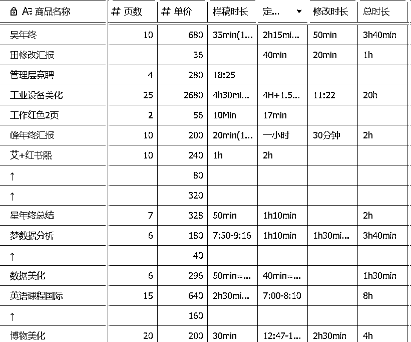

---

### 二、高溢价的单子，到底从哪来？

聊到找单，Livia抛出一个观点：做定制幻灯片最怕的不是手艺不行，而是你明明能交付值五位数的成品，手里接的却永远是几块钱一页的磨洋工单。

问题不在能力，是你站错了战场。高价委托就像藏在深山里的矿脉，不会自己跑出来找你，得主动去挖。

#### 1. 在外包店里筛出“没那么压榨”的那一批

第一步：把样品备足。

她把作品按方向分了几类：发言稿、心得文、融资方案书、教案、幻灯片，每个方向都收拾出几份代表作。倘若你以前从未碰过这些文体，完全可以直接去种草社区、文库类网站和知识问答平台翻素材，做二次创作变成自己的作品。

这么做不只是为了“装老手”，更是快速吃透各种文体格式的捷径。把改好的作品按类目收进在线文档，生成一个汇总入口，发给对方就能看。要是客服担心链接不安全，直接甩成品截图也一样。Livia当初投出去的，就是这样一份云端样例目录。

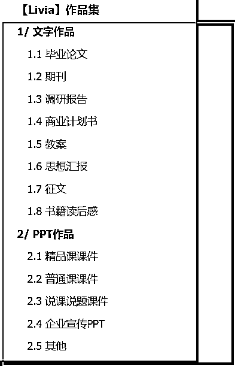

放心，多数外包店的客服不会仔细审你的样稿，他们只需要确认“这个人接得了活”。你要做的只是争一个机会，等单子真到手了再好好表现。

第二步：同时撩动一百家店。

前期多流汗，后面少流泪。Livia的做法是：先到电商平台填一份假的收货信息，姓名电话随意编，设成默认地址。然后分别搜索“代写”“文章写作”“融资方案书”“幻灯片”等关键词，把每个词下的店铺列表从头翻到尾，凡是看着能点进去的都发同一句话：“老板，还招人吗？”

发完后先不要急着回消息，等所有店都打过招呼，再统一处理。

为什么非得这么麻烦？因为这是一次一劳永逸的筛选。同样是接单，一家只分你0.1、另一家分你0.4，拉长到一年差别极大。所以前期宁可多花点时间，也要把网撒到最大。

强烈推荐做一张登记表，把每家的对接人和关联公司都记下来，方便回头查证。她统计过，一百条私信发出去，大约五十家会回“招人”；刨掉同一机构开的马甲店，最后能真正合作的约四十家。

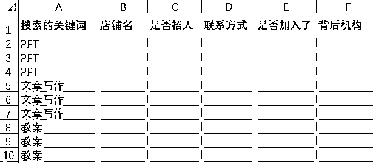

补充一句：私信发太多，平台偶尔会弹出滑块验证，这个很正常，滑一下接着发就行。

第三步：拍单秒退，把联系方式一次性收齐。

四十家有效店铺里，约有一半会要求你先拍下一件商品再申请退款。

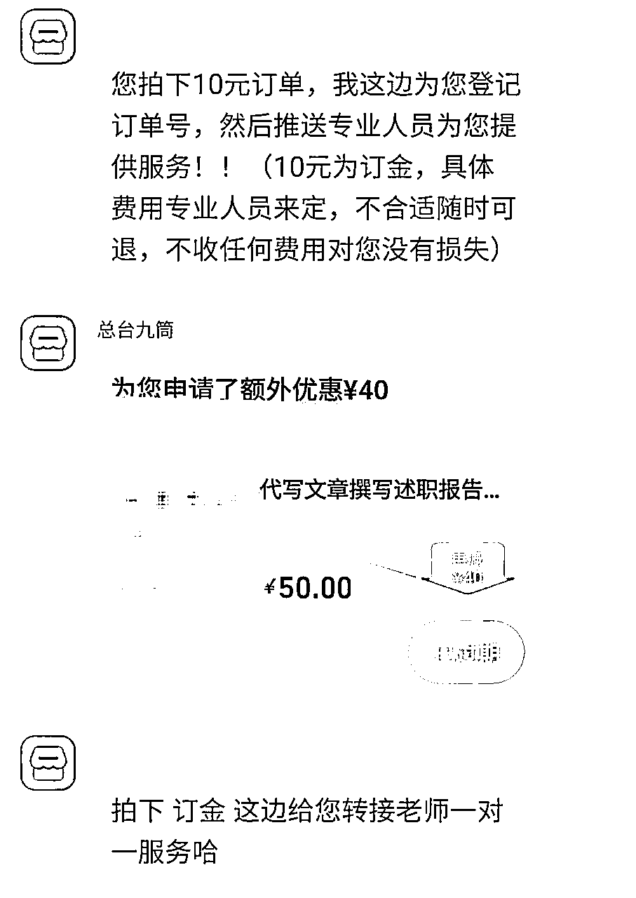

这是他们给自己店铺冲流量的小动作，对你没有任何损失——地址本来就是假的。对方通常也会在下单后十秒内主动发起退款。

操作节奏很简单：按店员要求拍下一个10元链接，立刻点退款。客服那边通常会直接弹出退款确认窗，点确认即可。

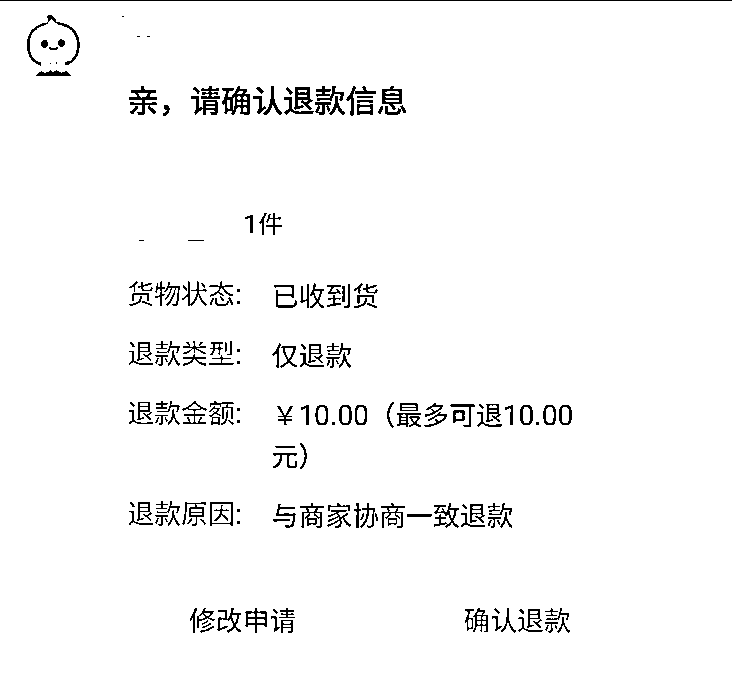

退完后，店家就会把V号或企业通讯号发给你。剩下二十家没这步骤，会直接把联系方式甩过来。

第四步：加上联系方式后，统一发样稿。

所有联系方式收到手，先别急着逐一聊天。等全部加完之后，再统一把作品样例发出去。就算对方秒通过你的好友申请，当下也不必回复，等所有店都处理完再一次性回消息。

第一次操作难免心慌，怕晚回几句就错失合作。实际上，平台客服早就习惯异步沟通，最终有回复就行，时效真的没那么重要。这个阶段的核心心法，就是“多点开花，统一管理”。

开场白可以直接用这套话术：您好，我是来应聘写手的，211/985研究生，有X年行业经验，下面是我的作品样例请您过目。后头附上截图或文档链接。

面试通过之后，接单模式大概三种：

- 商家把你拉进他们内部的企业通讯录系统。这是最常见的一种，客户联系信息会被平台隔离，你接触不到客户本人，相当于一个自动派单池。一般会发一个申请链接，提交后等着就行，有的店要两三天才放你进去。
- 客服直接加你个人V，有活私聊派给你，不碰客户。
- 客服把你和客户拉进同一个群，所有沟通都在群里完成。

第五步：盘一下时间投入。

完成上面整套动作大致需要：备样品1天；群发私信2到3小时；下单后退款这步要花两三小时，大约三分之一的店要走这一步；发样稿加沟通2到3小时；后面加入接单系统是被动等待，不花额外精力。

总投入大概两天。听着费事，实际操作起来并不复杂，而且这笔“筛选投入”能把后续接单的性价比抬高一截，很划算。

第六步：过了心态这一关。

做完这些动作，你大概率会觉得自己像个到处撒网的人。换个角度琢磨：店家正愁没有优质写手，你的问询等于给他们添了流量和曝光；你又借此换到了稳定的单源。两边都有好处，双赢。

第七步：问清抽成比例。

这里分几种情况：进了企业通讯录接单系统的话，私下问最初对接你的客服抽成点数；客服直接加V的，贸然问可能没人搭理，等派单时自己观察实际到账比例；被拉群聊单的，同样在进群后私聊最初的对接人。

行情参考：0.4到0.5已经是相当不错的抽成，市场主流在0.1到0.3之间。你的目标就是往高处够。

第八步：排掉有隐患的店，回款越短越安心。

最容易出问题的是那种个人V直接对接、又没有成文结算规则的店。相比之下，人多、在群内公开结算细则的店铺更靠谱。

回款周期也是越短越好。Livia接的第一单，特意选了“完工立结”的店，任务一交付，200元马上打到账上，她到现在还记得那种稳稳落袋的感觉。

走到这一步，零基础的新人也能把接单通路搭得明明白白。祝各位都能找到那家“没那么压榨”的外包店。

#### 2. 到二手交易平台上自产自销，把整单利润攥在自己手里

Livia后来复盘时发现，社群里不少高手在短时间内跑得比她快得多，根子就在于他们不犯“死守平台单”的毛病——愿意跨出舒适区，自己去找客户。

这笔账一笔就能算清：

- 在二手交易平台自己接一单1000元的活，全部进账归你；
- 挂在电商平台被动等单，收入要乘上抽成比例，顶天也就400元（0.4已经是很好的条件了）。

所以，接单两周后，千万别学她当初的满足感，觉得“不用靠体力换钱”就够了。趁着势头赶紧去做自有客源，一千块和一千块的四成，哪个划算一目了然。

想学怎么发引流内容，她直接点名一位叫布懂的博主写的完整实操总结，链接贴在下方。那套打法能帮你摆脱被平台抽成绑住的被动局面，实现收入层级的跃迁。据说这位博主光靠前端获客，一个月就能做出17万的成交额，值得反复研读。

https://scys.com/articleDetail/xq_topic/4848282444142428

---

### 三、接到单之后，怎么又快又稳地交付？

先聊工具。她对工具选择的个人补充如下：

国内的大模型产品基本免费，但实话实说，直接用来交付商业委托，质量往往差一口气——不过DeepSeek是比较能打的。想用国外更成熟的模型，比如正版克劳德（Claude）与GPT系列，新手光注册外国账号就有一道坎。她的办法是上电商平台买一个日租体验号，大约3元一天，对方会给一个专门的网址入口，输入激活码就能开用。

想感受不同模型之间的差距，可以拿具体任务来试。比如要做一份医疗美容类商业计划书，先从网上找一千字左右的基础材料，把同样的材料分别丢给不同模型，看谁的框架更像样。

调用指令的参考格式：

你是在这个行当里摸爬滚打了半辈子的幻灯片顾问。请把下面这段文字扩展成10页幻灯片的版式大纲，从封皮、目录到章节过渡页、正文和收尾页都要覆盖。

#### 接高价单前，先补齐这几项底子

接高价单不需要把幻灯片软件的所有功能都学一遍，但下面这些基础操作建议提前摸熟，能省下大量反复修改的时间。

为什么要学？当市场被机器批量产出的同质化演示文档塞满时，真正稀缺的竞争力是“人的审美+机器的效率”。大多数人还停在“让工具直接吐一版”的阶段，而专业的接单人能看出机器产物差在哪——版式逻辑通不通、视觉重心准不准、信息节奏抓不抓人，这些都需要人为判断去校正。

基础项一两天就能速成：

先改默认设置。图片处理别选自动压缩；导出选项里把便携文档、讲义和视频都勾上备用；提前设好字体主题和高亮配色；编辑好母版；需要批量塞图时，用相册功能一次导入；制作时把辅助线打开，保证元素对齐；自动保存间隔调成5秒，撤销上限拉到150步。最后别忘了做一次跨设备预览，确保任何屏幕上都不变形。

再讲键盘上的招法，都是她平时用得最勤的：

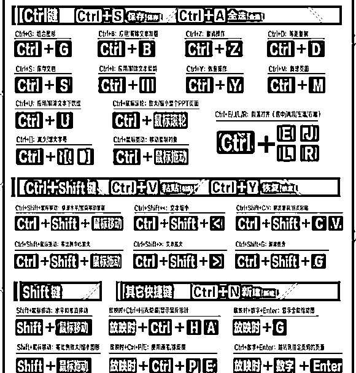

按住Shift拖动鼠标，元素只能横向或竖向移动，也能原地等比缩放，每转一下固定15度。按住Ctrl滚动鼠标滚轮，页面能快速放大缩小。Ctrl加D，立刻复制一份。Ctrl加S，随时存档。Ctrl加Z和Ctrl加Y，分别对应撤销、重做。若是Ctrl和Shift一起按住再拖拽，就能横向或竖向复制。再加一个Alt键，滚轮缩放时会以物件中心为锚点。文字对齐上，Ctrl加E居中，Ctrl加R右对齐，Ctrl加L左对齐；Ctrl加右括号放大字号，Ctrl加左括号缩小字号；Ctrl加B加粗。

---

### 四、高溢价的终极底牌：克劳德

为什么独独把克劳德拎出来？高溢价的幻灯片委托，版式往往比较复杂，普通的自动生成式幻灯片工具遇到复杂数据的整合经常使不上劲——比如不同区域的销量对比、动态走势、分维度的人群描摹这类需求。

所以这里重点提一个需求旺、但竞争相对没那么拥挤的品类：数据型的演示定制。

行情研究、数据汇报类的委托常年都有，尤其到年底复盘季会更热。业内数据显示，某个素材平台在2024年最后一个季度，数据型幻灯片模版被下载的次数环比增加了240%。零售、金融和酒店行业做年度复盘时，普遍病在数据堆了一堆、呈现方式却极其粗糙。不少打工人对着电子表格一头雾水，这正是下手的窗口。

克劳德对数字的敏感度相当高。你扔给它密密麻麻的多维数据，它不但能标出哪些是核心指标，还会主动建议哪个数字应该放大展示，并为不同类型的数据推荐最合适的表达：趋势类走折线，占比类走饼图。

看一个真实交付案例。有位做供应链采购的负责人要做年底汇报，一次性发来二十多张东一张西一张的表格。这里有个操作细节：克劳德读不了电子表格，先把表格内容复制到文档里再喂给它。

页面版式的指令可以这样写：

你是在这个行当里摸爬滚打了半辈子的幻灯片顾问。请阅读附件文档中的17张表，按文档内的提纲组织页面，每页都要配核心文字解读和图形化呈现。要突出数据对比，重点展示2024年相对2023年的进展，至少放两张图形；图形旁边附上精炼点评，只挑最核心的说。整体走蓝白色调，干净清爽。

克劳德的输出过程很有意思：右侧会同步生成一段可运行的页面代码，等它跑完，版式效果会直接呈现给你。

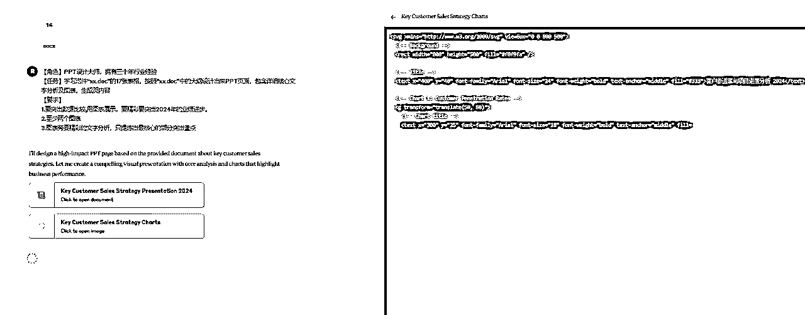

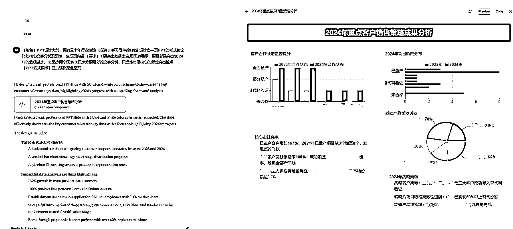

版式拿到手，下一步是把它变成你交付的成品。

先让它交底：“以上所有图形背后的原始数据，以清单形式给我一份。”它会吐出一组清单式数据。

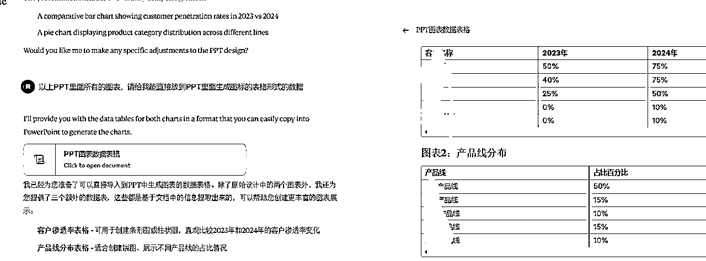

不过从克劳德那边直接复制，格式容易错乱，数据经常会全部挤在一个格子内，这时候需要请KIMI出手整理。

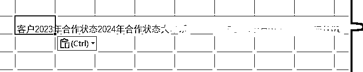

为什么绕一道给KIMI？因为克劳德可能还要继续生成后面的页面，频繁切换会打断它的状态一致性；这类纯格式整理的琐活，交给小弟KIMI刚好。指令只需一句：“把以下数据整理成规范表格。”

拿到规整的源数据后，回到幻灯片里插入相应的图形类型，就能得到和版式一致的成品。

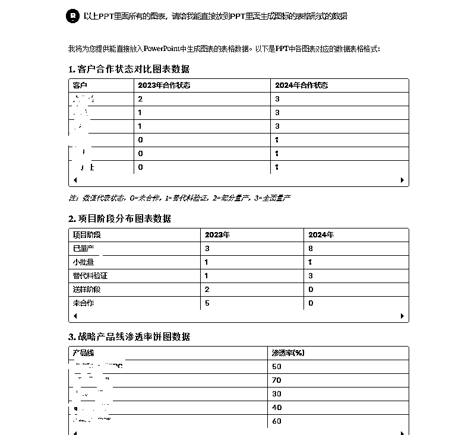

至此，一条高溢价的商务演示委托，从文案到图形，全流程都能自己顺下来。

---

### 写在最后

用大模型定制演示文档这个系列，暂时先写到这里。后续Livia还会继续分享更多把模型变成收益的经验。

她说，是人工智能让她这种普通文科生，在极短时间里过上了自由职业的状态。她感谢当初那个社群在迷茫中给了方向，也感谢海盐的团队陪着她把一个个卡点拆掉。在她看来，大模型浪潮最动人的地方，是让“翻盘”不再只属于少数人。

如果你现在也困在一份并不喜欢的工作里，希望这篇复盘能给你一点启发。一个毫无背景的普通人，尚能借新工具挣脱枷锁，你也一定能找到属于自己的破局口。