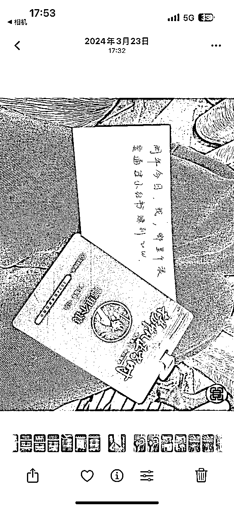
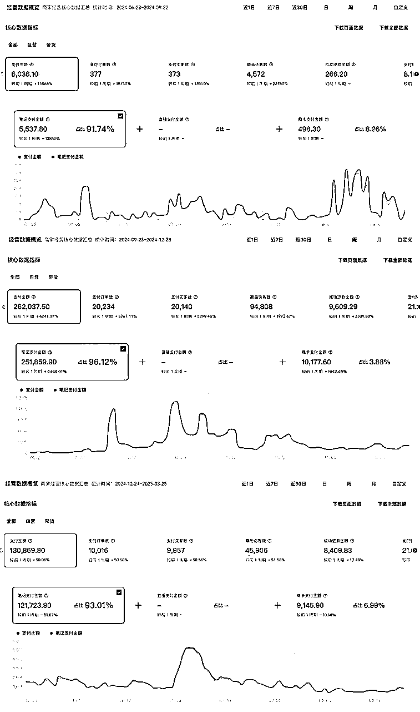
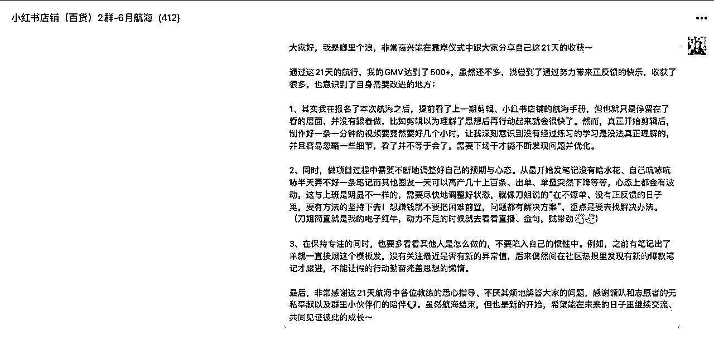
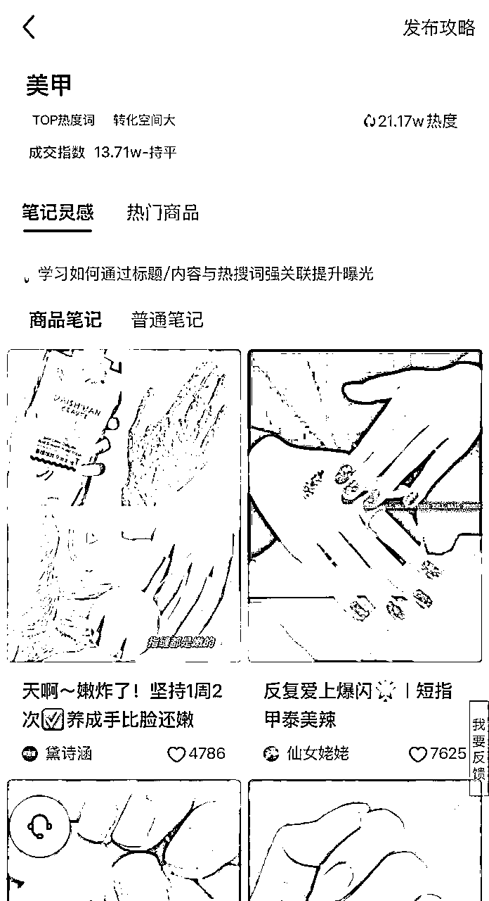
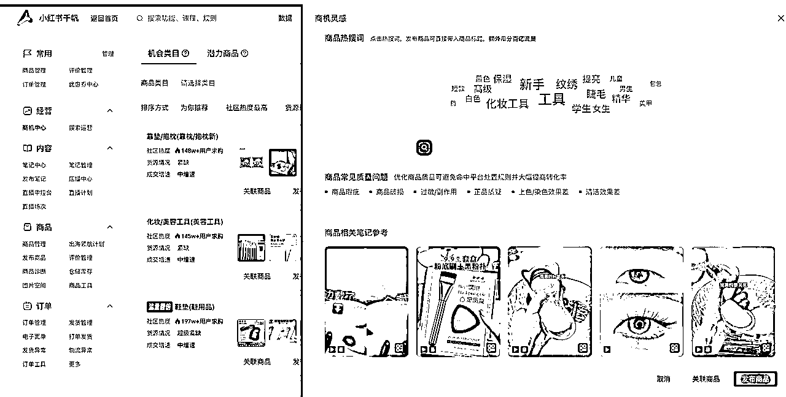
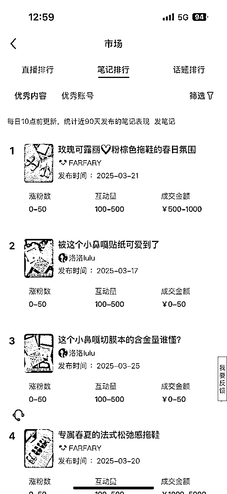

# 从程序员到📕电商小爆发：我用两年时间踩完的坑

大家好，我是龙哥，朋友们都叫我汐汐、汐然。以前网名叫啷里个浪，这个名字给不少朋友带来困扰，不知道该怎么称呼我，所以改了。

本职是程序员，后来内部竞聘转岗去帮研发总监管团队，副业一直在做📕电商，最近刚递交离职，把📕正式扶正，搬进赚钱联合办公开始轻创业。

去年3月我去参加了线下航海家见面会，一年过去，当时写下的目标全部兑现，今天来复盘交作业。

（利润率50%+）

加入赚钱两年，我从完全的小白开始，连续试了三个项目都扑街，从赚到人生第一笔外快，到📕电商实现爆单，一路走来积累了很多东西。

这篇想把我的成长轨迹、📕电商的实操经验和现在能看到的机会都分享出来，希望能帮到还在寻找方向的你。

大致分为四部分：

1⃣️ 赚钱历程——从零到月入20w

2⃣️ 📕爆单的路径与复盘

3⃣️ 新手做📕电商的8个实战技巧

4⃣️ 两年赚钱沉淀下来的感悟

# 一、赚钱历程——从0开始到赚到 20w

从看个帖子都要先去查名词，到拿到第一块钱，再到电商爆单累计20w，我走了几个明显阶段，没有结果的小伙伴可以对照看看。

## 起点

之前加了一些圈里的朋友，发现大家都在推赚钱，当时正好赶上拉新季，很好奇就想进去瞧瞧。418拉新前，只要涛哥有直播我不加班就都去蹲，涛哥每次内容都不重复，真的被他的分享力吸引住，觉得赚钱应该靠谱，再加上有年费优惠就直接付费加入了。

## 初入的感受

感觉像刘姥姥进了大观园，打开了认知大门。时不时感叹：哇，原来还能这样赚钱！原来除了打工，还有这么多变现路径！

慢慢的也开始焦虑，看着别人个个都很厉害，就自己像个小白，陷入迷茫，到底我能做什么？

## 三次试错

我前后折腾了三个项目，都失败了，正好踩中新手常见坑：

#### 第一个坑：只看流量不看变现

听说📕对素人很友好，第一次报名了📕运营航海。当时没有明确的商业方向，是要边做边找定位。

一方面我手上没有产品也没有服务，从擅长和兴趣出发，发现自己也称不上专业，好像没什么值得分享的；另一方面刷的样本太少，思维很局限。

最后在没调研同行情况下，盲目做了个看起来数据还行、制作也不难的文案号。发出来确实有流量，一度觉得成功了。直到有PR发邮件约稿，我激动加过去，对方说一篇10块钱，当场冷静下来。后来才去看头部账号基本都停更了，中小号接的商单基本都是硬广，报价很低。

#### 第二个坑：没有对标意识

夏天将近，受需求和兴趣影响选了减肥赛道，切到小基数梨形减脂塑形，分享运动饮食。13篇笔记就涨了几百粉，但没吸取第一次教训，变现没想清楚，只想着快速赚钱又不骗人，最后账号就弃更了。

回头看，如果先研究下同行怎么变现再决定要不要继续，会不一样。

#### 第三个坑：不迭代

前两个项目后，我觉得自己对📕运营有点感觉了，恰好航海开了📕旅游方向，我又报名了。结合自己常搜攻略的习惯，写了几篇爆款。

但这个项目需要导流到🛰️再成交，遇到新问题：

1、引流方式要不断换，避免被平台限流，今天能用明天就失效；
2、从吸粉到谈单全靠我一个人，白天上班回复不及时，客户就跑了。

前端到成交流失严重，当时想法比较短视，试了几个办法就停了，没深入研究。

平台要留住用户赚钱，规则一直在变，不能靠一个套路吃一辈子，必须持续迭代。

## 转折点

24年3月，航海家线下见面会官宣，嘉宾阵容号称七年最豪华，立马定了闹钟抢票。我当时还没成为航海家，请了两天假从成都飞杭州，就为了现场感受下。

现场信息量巨大，最触动我的是大家白天听分享，晚上夜话，很多朋友基本通宵讨论业务。能真切感受到一群爱折腾、爱搞钱又很拼的人。聊下来发现大家多数都试过很多项目，靠踏实做才有今天的成绩，我才放下了小白想一夜暴富的幻想。

涛哥让大家写下“明年今日，我 xxx，要通过 xxx 赚到 xxx”，还没赚到第一笔钱的我，面对空卡片很慌，最后主持人催交卡片时，我才写下“明年今日，我啷里个浪，要通过📕赚到20w”。

也是这份仪式感，让我对自己产生了信任，后续的变现之路才真正启动。

## 赚到第一笔钱

回成都后，赚钱里一条风向标一出，我立马去闲鱼验证。把之前学到的对标思维用上去，仿着头部做图文写文案，很快就出单了。后来有天流量炸了，消息一直响，几块钱一单甚至几毛钱一单，我都乐疯了，半夜三点手机响都立刻睁眼回复。

后来发现很多同行直接拿我的图去发，甚至连水印都不删，心里一点不气，反而开心我也能成为别人的对标了。

靠着这个风向标把门票钱赚回来，第一次尝到非工资收入的快感，建立了“原来我也能赚钱”的信心。

## 转向📕电商，航海跑通闭环

之前在📕一直没变现，这次我想做点离钱近的。报了24年6月的📕百货电商航海，航海前先啃了上一期的店铺和剪辑手册。

反馈很快，笔记发出去就出单了。21天航海期间共卖了500+GMV，客单价基本9.9。虽然不多，但再次给我强正反馈：我可以靠副业赚钱。航海结束后我就一直做下去，后面爆单的经验会在下文展开。

## 下定决心辞职

正式从职场人转成自由职业者。

## 申请加入航海家

想跳出信息茧房，开眼看世界。

和赚钱的故事，还在继续……

# 二、📕电商爆单历程与复盘

我从参加航海发的第一篇笔记开始测品，到第18个品才真正爆单。爆单前基本每天都没刷完📕10单解密额度。从零星出单到爆发，我做了这些事：

1、选品，多维度验证潜力
我是在抖音创意中心看到它突然冒头，属于刚需功能类品，抖音刚起量，星球里刀姐也提过这个品。于是去📕验证：

（1）看销量：
（a）按销量排序，有多家店销量1w+，最高3w+，说明是大盘品，市场存在；
（b）销量高的店铺近期没再测这个品，最新评价集中在几个月前，往下翻也没看到近期加购，判断是上一波周期爆过的。

（2）看内容表现：
（a）不同时间段都有笔记爆过，证明是可重复的爆品；
（b）近期几乎没新笔记，偶尔发的也是老脚本，竞争很小；
（c）近几个月没有该品笔记爆，但按需求关键词搜索仍有笔记爆，封面我都保存下来准备测试。

（3）看评价：
📕和抖音上负评不少，我看到有组合装售卖，销量虽没单品高，但评价好很多。于是确定策略：单品低价引流+主推组合套餐，降低负反馈、提高客单价。

2、立刻执行，抢占先发
当天晚上就把抖音的新脚本扒下来混剪，第二天一早发了。
测了大概10条，小眼睛不高也没出单，我就停了。事后复盘，品本身没问题，是我内容能力不够坚定就换品，错过了深挖机会。大家记住：前期判断没问题就坚持测到位再换。

3、看到苗头及时加码，重视人工干预
过了几天连出了6单，我觉得机会来了，继续发笔记，同时补人工干预：评论区维护、引导好评、晒单笔记。

4、爆款可复用，老品需要新素材
把抖音最新脚本、该品过往爆款封面标题、同功能不同品但同需求的爆款封面，都组合测试。

最后爆的是：近几个月同功能不同品的爆款封面+抖音新脚本的组合。

5、降低负反馈
除了组合套餐外，还做了：
1、根据差评和咨询问题优化商品细节和回复话术；
2、做使用方法视频和图文教程；
3、售后保障及时：联系买家处理差评退款问题。

# 三、新手做📕电商的8个技巧

### 1、先完成再完美
新手容易虚假努力，反复选品想一击即中，压力很大，越拖越懒。看起来在选品，其实一直下不去手。记住这句话：没有选到完美的品，只有测出来的可用品。能做的就是在当下时间和内容能力内把它测出来。

实在纠结就一个号同测2-3个品，数据说话优胜劣汰。

### 2、选品
选品决定生死，我常用两种方法：

（1）抖音选品
📕是兴趣电商，抖音是领头羊，站在巨人肩膀上选。注意：
* 用户人群不同，不能凭主观喜好看待。抖音火的不一定📕爆，先去📕看真实表现。
* 多刷多看，培养品感，占据先发。我爆的品第一次出现在榜单，后来消失了一段时间，榜单只显示近期排名靠前的，有潜力的品会被挤掉。

（2）📕站内选品
* 三方平台如灰豚有滞后性，我基本不刷，全靠手刷。
* 养小号：对同领域低粉爆款笔记点赞收藏评论关注，久了系统会持续推同类内容。
* 千帆：3月1日商家榜单下架，现可参考社区热搜词、商机中心、数据中心-市场等。

（3）抱大腿
* 抖音：看达人带火A品后，翻他近期是否还有其他品表现好。
* 📕：监测对标最近是否上新。

### 3、重视人工干预
多看同行玩法，蹲反馈、高赞评论如惊喜盒子、搞笑、争议、分享妙招等。干预不是每条都有效，但做了能显著提高概率。赚钱是概率游戏，提高概率是唯一能做的事。我一次蹲反馈评论从10+回复到30+，直接把笔记推到更大流量池。

### 4、善用关键词
我号被关小黑屋限制过两次，几个月没发笔记，但搜索流量一直持续，转化率20%+。功能性品很吃搜索，可以多铺关键词。

关键词来源：对标笔记写法、搜索下拉和关联词、千帆热搜蓝海飙升词、千帆数据看笔记的实际搜索入口。

### 5、细节到位
航海期第一个品就出单，给了我巨大信心。当时剪辑慢，只想着多发笔记，人工干预、数据分析、晒单全没做，出单靠蛮力。90篇笔记只卖97单。细节做到位才能在正确方法上加速。

### 6、供应商要靠谱，感觉不对立刻换
流量来了，产品质量、物流和售后决定能走多远。我爆的品初期1688实力商家少，找了个配合度高的供应商，单量下来后响应变慢，发货、揽收、破损补发全靠我催。抱着损失厌恶心理硬撑，最后爆雷，丢百八十单，被平台扣2分。

### 7、算好账，把时间留给最重要的事
爆单后客服消息爆炸。可以找家人朋友帮忙，或花钱临时请人处理，把精力放在选品测品上。📕现在有免费智能客服，能自定义自动回复，降低响应时长。

### 8、促转化、降负面
1. 商品优化：根据评价和咨询优化细节，在sku名、详情图、笔记置顶体现，减少售后。sku多时用🔥、90%选择等引导决策。
2. 晒单有礼：晒单笔记小眼睛多，是真实购买决策依据。我见过带货笔记不爆，晒单笔记爆了带动销量。
3. 好评引导：文字评价会被随机展示到评论区，可信度高。聊天刚结束时主动邀请，成功率虽低但值得试。注意措辞避免违规。
4. 做好售后：换位思考，买家想要什么回应。花小钱了事，别纠缠。无理取闹的买家拿证据投诉，平台不会偏袒买家。

【小tips】
* 匿名差评可在电脑端千帆筛选差评找到订单号，再到客服工作台搜索。
* 话术整理到客服工作台或手机输入法，减少重复输入。

# 四、加入赚钱2年的感悟

1、多参加线下，线下体感完全不同。线上聊千遍，不如线下见一面。
2、用战术勤奋掩盖战略懒惰是最大陷阱。先想清变现方式再行动，别单纯为爱发电。
3、万丈高楼平地起，别眼高手低。事情大于自己时就是问题，遇到问题不是能力不行，是需要时间解决。别浅尝辄止。
4、心态是最好的风水，相信相信的力量。

# 写在最后

这两年走来的每一步，都得感谢一群关键的人推着我往前走。

要先说一声谢谢涛哥 @杨涛 ，正是因为他的那句点拨，我才咬牙踏进了赚钱，也才有了后面这两年真正踩在实处的变化。也是运气太好，让我在赚钱遇到了刀姐 @v小刀 。她的真诚劲儿、做事的笃定、那股子不撞南墙不回头的狠劲儿，再加上那种让人一靠近就被点燃的能量，简直就是行走的电子红牛。每当心里想偷懒的时候，一想起刀姐这么拼，我就立刻清醒了。

还要感谢许老师 @许老师～赚钱投资孵化 的认可，通过了我的联合办公申请。这份通过像是一把钥匙，帮我把职场打工人的身份无缝切换成了创业者的状态，每天被那种浓烈的创业气息包围着。同样感谢一路以来给过我点子、给过我帮助的每一位圈友。

说点自己琐碎的心得吧。我现在越来越信一句话：先把事做出来，再去琢磨完美。所有真本事，都是在实操里一点点攒出来的。只要你保持在路上走，就必然会碰到新坑，踩过坑、填过坑，这个解决问题的过程本身就是成长。尽人事听天命吧，与其每天焦虑明天会怎样，不如把心稳住，把性子沉下来，把眼前该做的事做好。未来会怎样？兵来将挡水来土掩就好。

写下这些，也没什么高深的道理，只希望能给还在路上的人一点共鸣。我绕了不少弯路，也只拿到了阶段性的小成绩，但我相信，只要持续发力，每个人都能一个山头一个山头地翻过去。

聊到这里，抛个小互动给所有人一起做个承诺。

让我们一起写下这句话：

“明年今日，我，xxx，要通过xxx赚到xxx钱”

一起加油！期待大家最后都能把钱袋子搞起来！！！