# Raindrop.io：全平台所有终端都能使用标签管理工具
作者：龙哥

你是否受够了“只能在某个浏览器里用的收藏夹”？今天给你安利一个神器——Raindrop.io，一套标签管理工具，真正实现全平台、所有终端都能用！不管你是换到火狐，还是拿起手机用Safari，都能轻松打开它。

直接在Chrome里搜Raindrop.io，第一个就是官网啦。

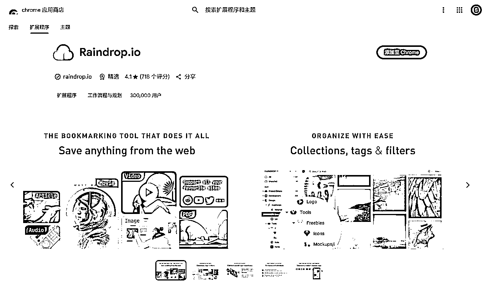

注册时强烈建议用谷歌邮箱（如果你有的话）。国内Apple Store也能直接关联账号，不过如果你是第一次在苹果手机上注册，最好别选Apple ID登录，咱们统一用谷歌邮箱，方便后续电脑端搭配使用。

进入官网帮助页面，重点看这三块内容：

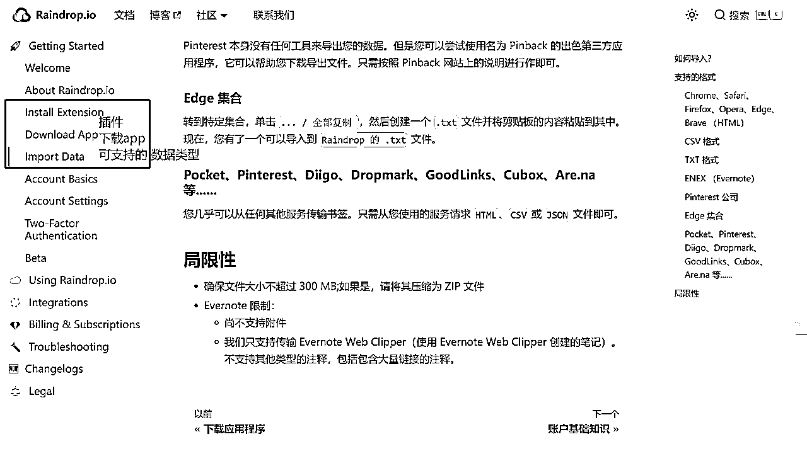

（这里需要用到沉浸式翻译插件，没装的话去官网装一个网页翻译插件就好。）

## 一、插件篇

### 安装

跟着官方指引一步步来，超简单。

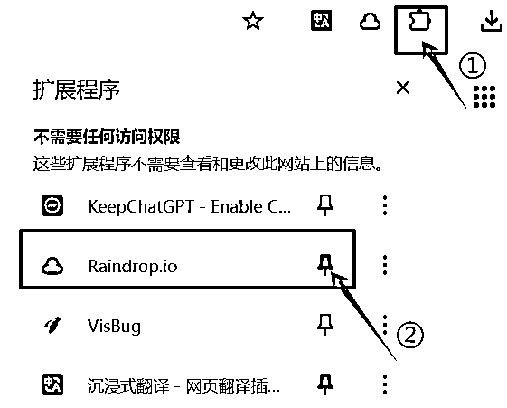

装好后把插件固定在工具栏，等右上角出现云朵形状的小图标，以后看到想收藏的网页，点一下这个云朵，网页就直接保存了。

### 使用

#### 三种建立书签的方式

方式1：在Raindrop.io的用户页面手动添加网址，把它放进指定收藏夹，之后再点进去编辑备注和标签。

方式2：在网页上右键单击空白处，直接就能创建书签。

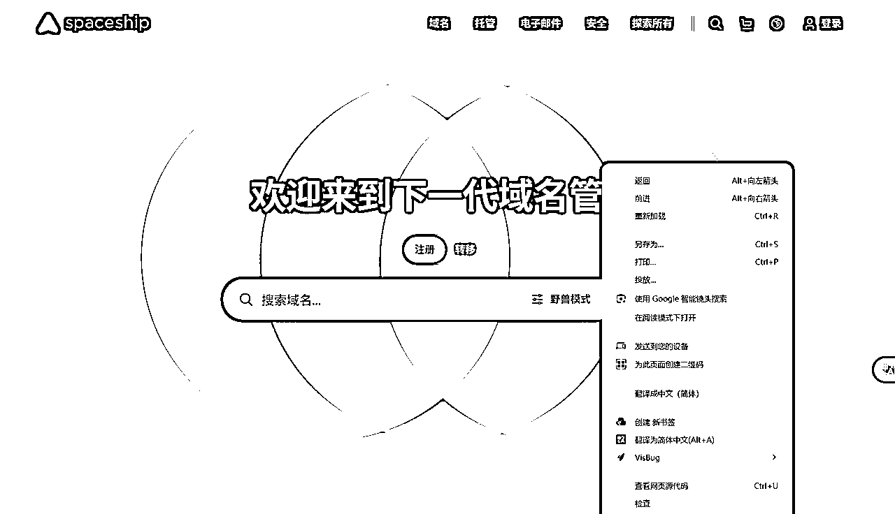

方式3：点击右上角的云朵标记，可以添加＋编辑新建的书签——这也是官方指南推荐的方法。

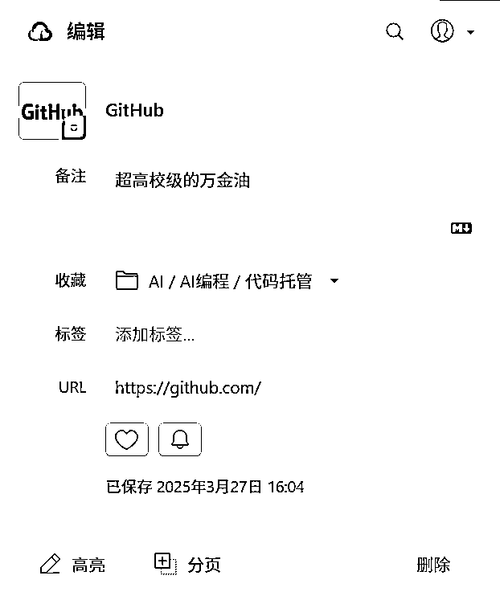

点一下云朵，直接弹出编辑卡片，改完后点击卡片空白处就保存好了。

#### 在收藏夹下创建子夹

在某个固定类别的文件夹上右键，选择“创建嵌套的集合”，输入名字就能建子收藏夹。支持无限层级，随便你套娃。

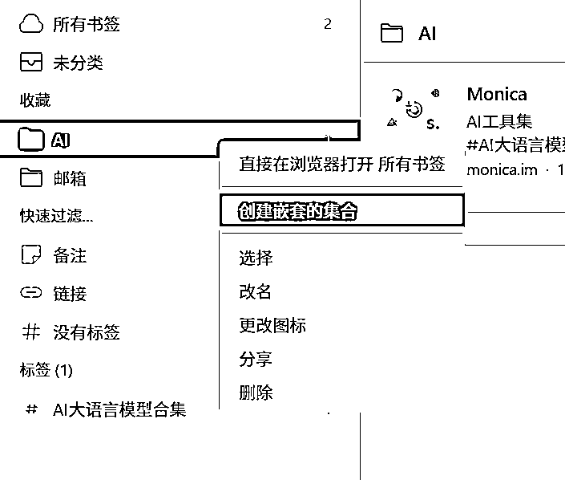

#### 用❤置顶标签

右键点击，把它添加到“最喜爱”，这样做就能解决一个网址没法同时占用两个标签的问题。而且快捷过滤栏会多出一个【最喜爱的】选项（不主动设置是不会出现的），这样常用网站一眼就找到了。

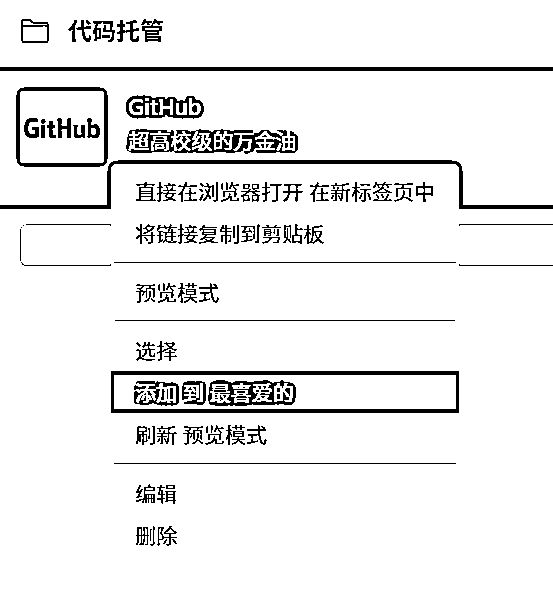

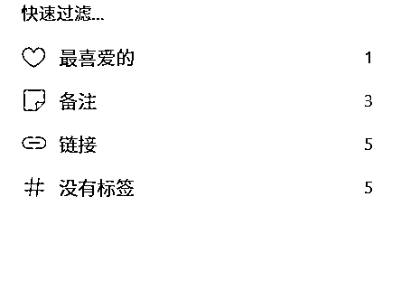

## 二、下载篇

国区手机都能直接下载App，安卓和苹果都有，或者用苹果自带的Safari浏览器也能打开登录，真的超方便。

## 三、支持的数据类型

几乎什么都支持，给你列出来看看：

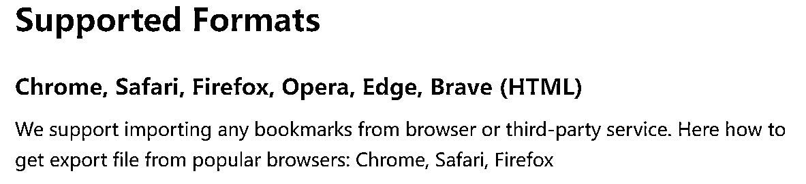

# 导入书签

先从原来的浏览器里导出书签：找到“导出书签”选项，把文件下载到桌面。

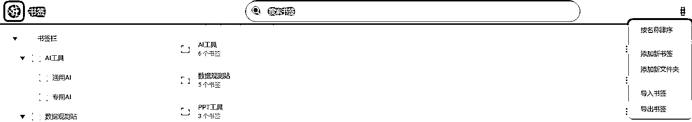

然后回到Raindrop.io，点击左上角账户→导入→上传文件。

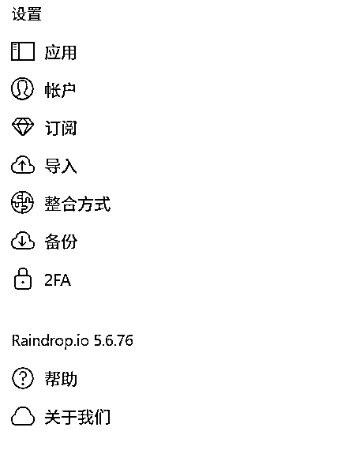

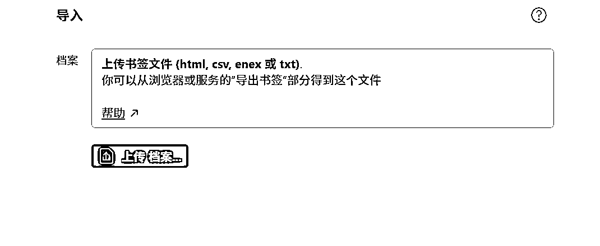

也可以直接把从其他浏览器复制的书签文件夹粘贴过来。

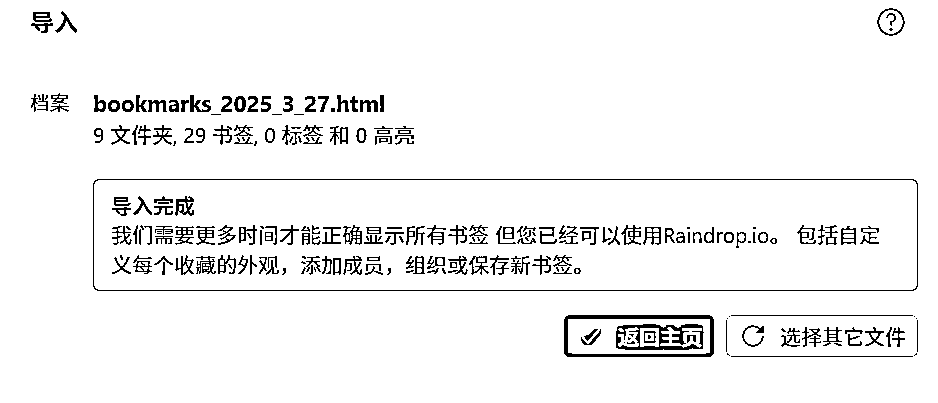

搞定！最后再整理一下收藏夹，看起来清清楚楚、干干净净。

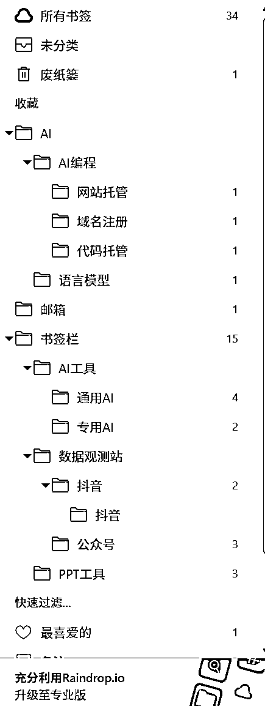

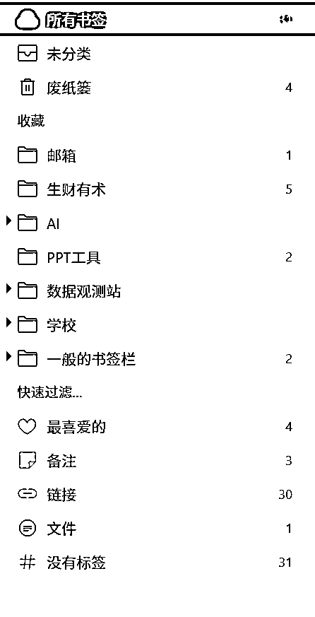