# 条形马：从数字博弈的创业，到自我生长的有机状态

嘉宾：条形马，连续创业者、写作者。

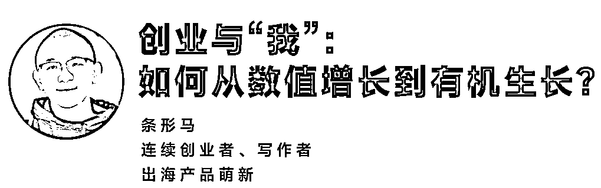

各位好，我是条形马，自2016年起持续在创业路上。今天想聊的并非操作清单，而是一次关于创业认知的迁移：从追逐指标到转向一种更自洽、更持久的生长形态。经历多个项目后，出现的高频共性值得提炼。

# 商业篇

先谈商业逻辑。多数人起步动机相近：获利、副业、探路创业，先学会赚到第一笔钱的路径。时间一长，零到一的经验被沉淀下来。

初期注意点多集中在如何拿下首单。但商业的本质，是让一次真实可执行的交换成立。你可以拥有声量、积累粉丝、具备影响力、踩中赛道，若这些无法转化为实际支付，模式就不成立。

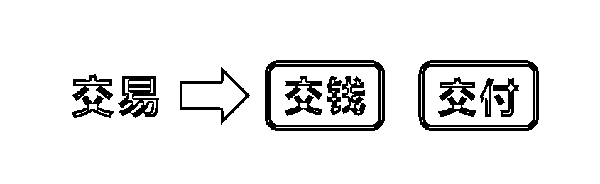

交换的一端是付款，一端是交付，通常是商品或服务。初做自由职业时，很容易陷入“先把东西做到极致再卖”的执念，于是进入反复打磨产品的死循环，越磨越窄。

读过一些方法、参加过实战后，会逐渐抽离。会发现成事需要的并非单一专长，而是复合能力。大致可归为三类：

你是否懂得制造可见？

你是否懂得促成成交？

你是否懂得维系复购？

制造可见、促成成交、维系回头，它们的打法完全不同，也与单纯做产品、做服务的能力并不重合。所以把项目做成，并非靠行业专家身份就能保证。

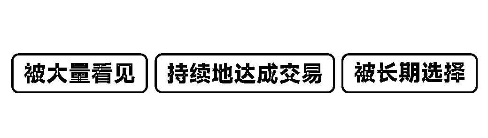

当“曝光从哪来”“页面表现如何”“投入产出怎样”“效果如何”“有没有回头”这类问题变成日常，大家才开始回头审视另外三件更本质的事。这三件事不玄，靠商业逻辑即可判断：

用户能否大规模触达到你

你能否与用户持续发生交易

用户是否愿意长期把你作为首选

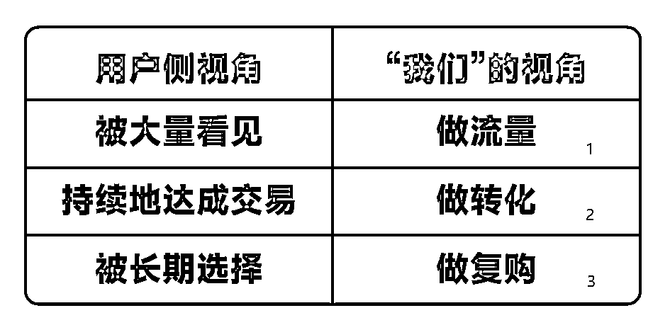

这三点和前面的三项能力，本质是同一件事的两面。前面是经营者的视角：我去造势、去成交、去留客。后者是使用者的视角：我先要能看到你，然后愿意反复与你交易，最后把你变成长期偏好。换位后会发现很多从自身视角看不到的盲区。我对第三点的体悟来得更晚，对前两点则更熟稔，今天重点放在回头与长期选择上，但先带过前两点。

从经营者视角出发，很容易把一切落在数字上。

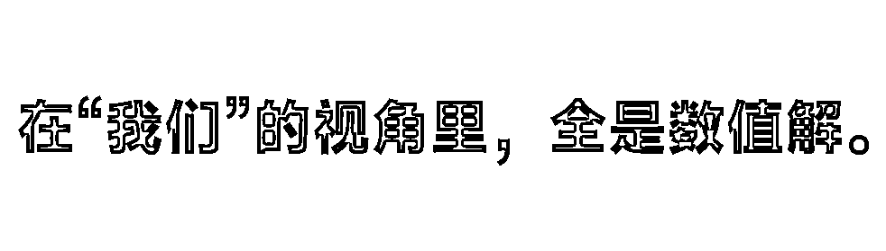

何谓数值解？可见度可以用数字描述：粉丝数、当日新增、本月新增、内容的播放触达。成交也可以用数字描述：当日成交笔数、昨日笔数、月度销售额、月度订单。做成一张表，从左向右画趋势线，一旦曲线向下就会焦虑。

跳出自身视角后，视野会打开。因为一旦跳出数值解，也就跳出了KPI的束缚，反而能更具创新性、更松弛、更有想象力。

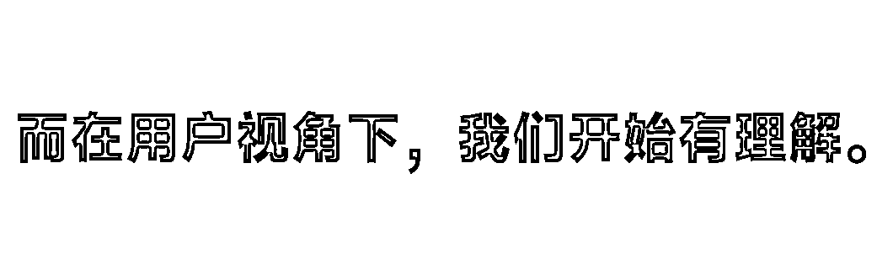

因此，在数值面前是KPI，在用户视角下则是理解。

### 1.被看见

这种理解如何体现？看“被大量看见”与“做曝光”的差别。如果你放下“我要做曝光”的执念，转而问：我的产品和服务怎样才能被目标人群更频繁、更大范围地触达？你会发现思路被打开，甚至有些场景根本没有浏览量、播放量这类指标。

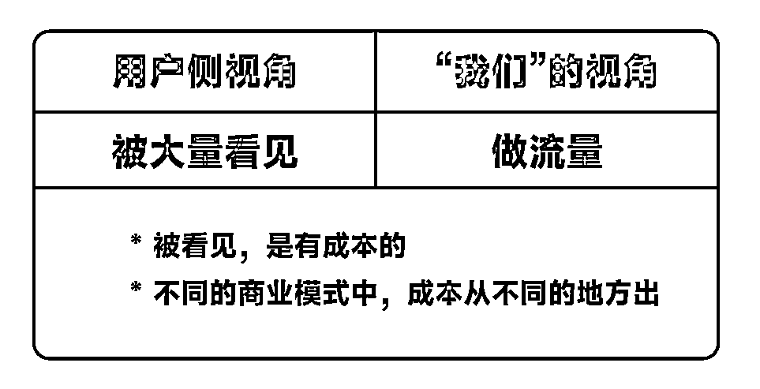

同时会意识到，被看见是有成本的。这个成本的支付方式并不唯一。如今做自媒体、短视频、📕，大致分两类：靠自然分发与靠付费投放。两种都能走到规模，说明被看见的成本可以来自不同渠道。

### 2.成交

自然流的做法，是用自身的劳动与内容生产能力来承担被看见的成本。你为平台贡献了它需要的内容，平台借此把你推送给用户，从而给你机会。

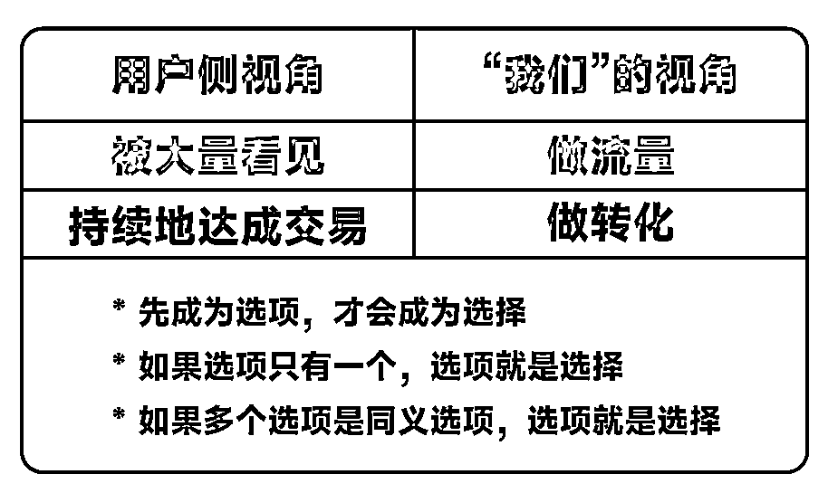

一旦用户看见了你，同时也看见了更多选项。用户内部有一个购买角色需要被满足。你被看见，就有机会进入他的备选集合；若未被看见，连进入选项池的资格都没有，更谈不上被挑选。

### 3.回头

从看见到成交的链路上，每一步都有成本，其中最难忽略的是用户的决策成本。

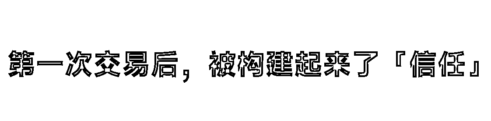

首次选择你，用户可能需要花一小时甚至两小时做功课。体验不错后再次下单，决策成本可能降到数秒甚至零犹豫。

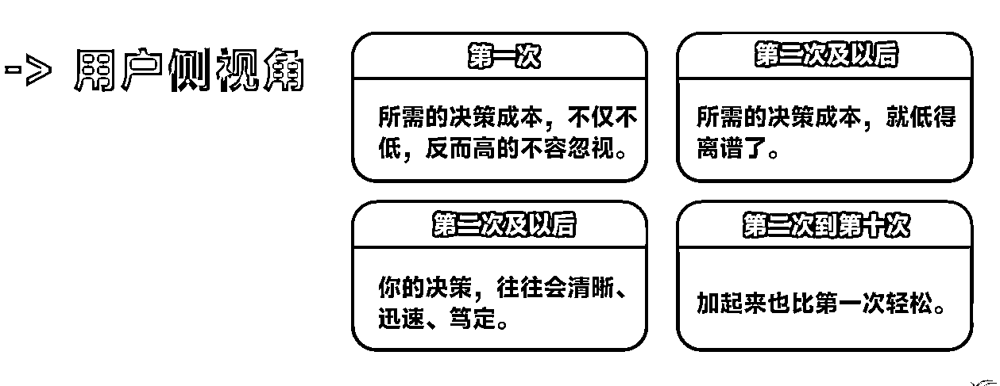

第一次交易建立后，后续交易会显著变轻。我把它理解为：首单搭建的是信任。一次不佳的交易会筑起高昂的交易壁垒，阻断后续所有可能。

长期来看，回头才是用户与你建立商业连接的真正形态。

一个健康的商业模式，要让用户容易找到你、容易再次下单。若订单多来自回头，模式就更稳健，因为你不必持续高价获取新用户。

商业模式的长寿，取决于几个要害：业务是否满足一个长期客观需求，而非一次性尝鲜；交易发起权是否在你手中，平台一变政策就抖动的模式不够稳；你能扛多久？收入波动时能坚持多久？若一个业务的学习成本超过半年，竞争者就很难轻易进入。

# 心力篇

创业不仅是业务挑战，更是心力挑战。它不在报表上，却真实存在。我想分享一些应对创业心理压力的体会。

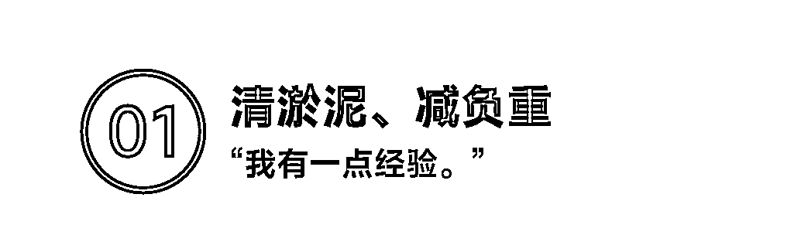

## 1.清淤泥，减负重

这里没有理论，只有我从自身经历里萃取的经验。

#### 跳出惯性，别无意识行动。

睡前是意志力最薄弱的时段，人会不自觉做那些省力的事，结果睡眠变差。周末宅在家时在做什么？建议盘一下时间账，尤其是手机屏幕时间。按周梳理，哪些活动占用大量时间，却没有带来恢复与滋养？把它们视作惯性，下次出现时告诉自己停一下。跳出惯性，时间会被解放，休息质量也会回升。

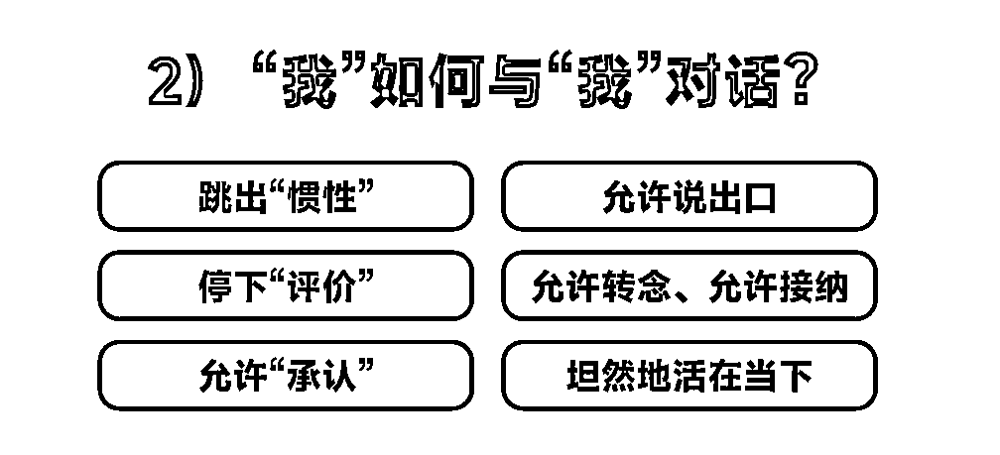

#### 停止评价。

别在脑中对自己进行网暴。你常把思考、感受、想法和评价混在一起，以为在规划业务或人生，实际上是在审判自己。典型表现就是拿自己和刚见过的人比较。评价无声发生，却总是放大不足、美化他人。每次评价完，状态都会掉分。刻意多夸自己，或者更彻底的做法：从此不再评价自己的行为。这很难，可把它当成一生的修行。

#### 允许承认。

创业者习惯给自己打气，很少承认做不到、做不好。但当你愿意承认某些事你确实做不到时，那股浑浊的压力就像一口闷气被吐出来，不再压在胸口。

你能承认自己需要睡眠吗？有人羡慕创业后不用睡觉的人。如果你能承认这一点，你自然会找到更平衡的方式。

#### 允许说出口。

承认是心理动作，说出来是释放。心理学家做过实验，无论找谁说，只要把压力说出口，强度就会减半。

#### 允许转念，允许接纳。

我们习惯给自己讲故事，定义自己是谁、要做什么、为什么成败。在这些节点，关键是允许自己换个念头，允许自己成为新的自己，允许新的可能性到来。

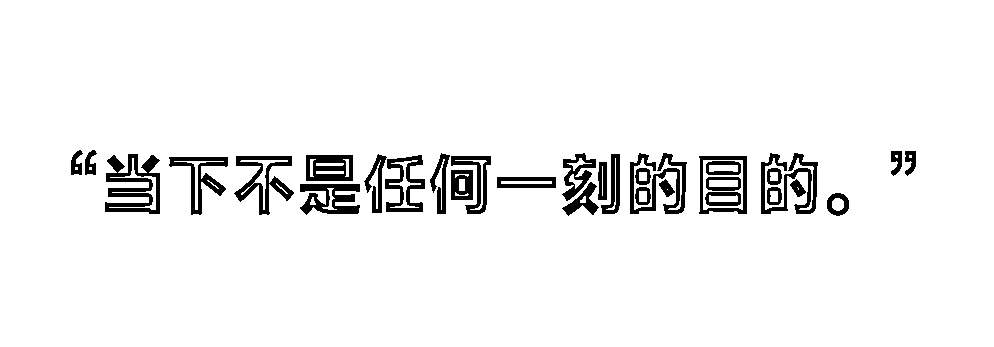

#### 坦然活在当下。

当下既不是过去的成本，也不是未来的目的。花时间在当下却不接受自己在当下，就是浪费。当你全然接受自己，洗碗时就在洗碗，做饭时就在做饭，散步时就在散步，那种松弛感会带来大量恢复。过去与未来都在脑中，只有当下不在。若你不断想过去想未来，就会失去当下给你力量。

答案是走出头脑，进入当下。

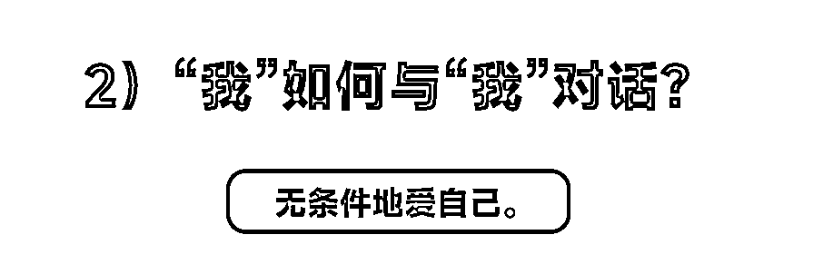

无条件地爱自己。

如何跟自己对话、如何变好，不靠更强的计划能力。如果你不再评价自己，能完整接受每分每秒的自己，接受每一个已做出的决定，那就是无条件的自我接纳。

很多人爱自己是有条件的：赚到第一笔钱才爱自己，赚到百万才允许玩。周末不思考业务就会自责。这种有条件的爱，等于不爱。

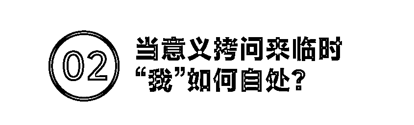

## 2.当意义拷问来临时，“我”如何自处？

做过一些有意义的事后，你的信任感会更踏实，也更容易在至暗时刻坚定前行。因为你用心对待身边的每一个人，每一件事，所以计划之外的惊喜会不断发生。意义拷问来时，我的信念是：

#### 1.世界无法预测。

相信事实不可预测，也就该相信人生的意义无法被设计。用静态剧本去演动态舞台，只能不断适应变化。

#### 2.不要设计人生意义。

生活没有普遍真理。

#### 3.人生没有真理。

别把任何念头、方法、理念当成唯一真理。一元论会让人虚无到无法生活。

#### 4.让计划外的可能性持续发生。

少设计少规划，多去体验计划外的事。别扮演那个没拿到牌就知道是什么牌的人。踏实把牌接到手里，接纳它超出计划，也愿意把注意力交给它。你才会知道要不要它，并凑成好牌。

#### 5.从脑海走出，在真实中行动。

面对复杂的未来，你的策略可以简单：一直接牌、一直出牌。关键是你能否走出脑海，在真实世界里做一件事。想了半年九个月还停留在脑中，就该停止为自己开脱，从惯性里出来立刻实干。若一件事情开始前你就能看懂，你就相当于拥有了未来。

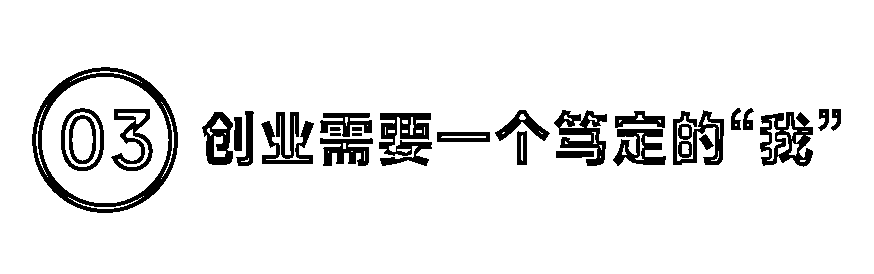

## 3.创业需要一个笃定的“我”

前面聊心力这么多，是因为我觉得创业最需要一个笃定的自我。那才是最强的战略定力。相信自己，愿意把六个月的承诺不打折扣地兑现，这就是自我建立，也是定力。

外界的声音、朋友的声音都会给你退路，真正的自我坚定才能保住主动权。你意识到自己的诉求，尊重自己的判断，在现实中去做，这就是主动。

如果别人用节奏打你，最好的回应是：你打你的，我打我的。别掉进别人的BGM里，只有在自己的节拍里才能打得过。

自我的坚定也体现在低谷。没有它，每次低谷都会变成死亡。拥有它，你才有真正的耐心。耐心来自于相信自己，在困难里为自己找力量，也给自己力量。最终，有自我的那个人会生机勃勃，而生机勃勃的人是幸福的。

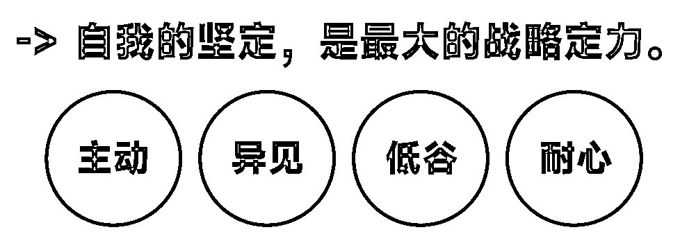

最后，送出2024年我最喜欢的一首诗，希望大家都能找到自己、爱自己，成为自己最坚定的战略定力。
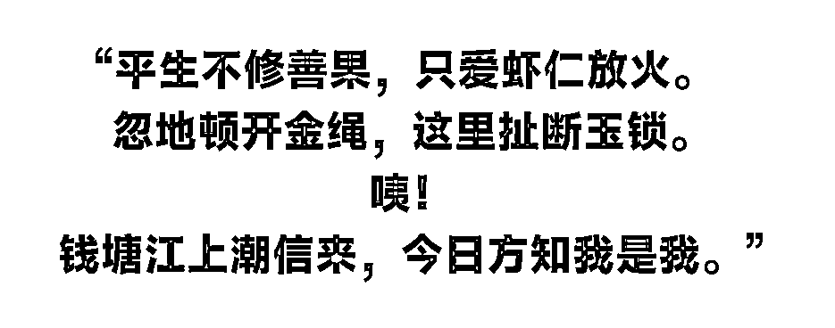