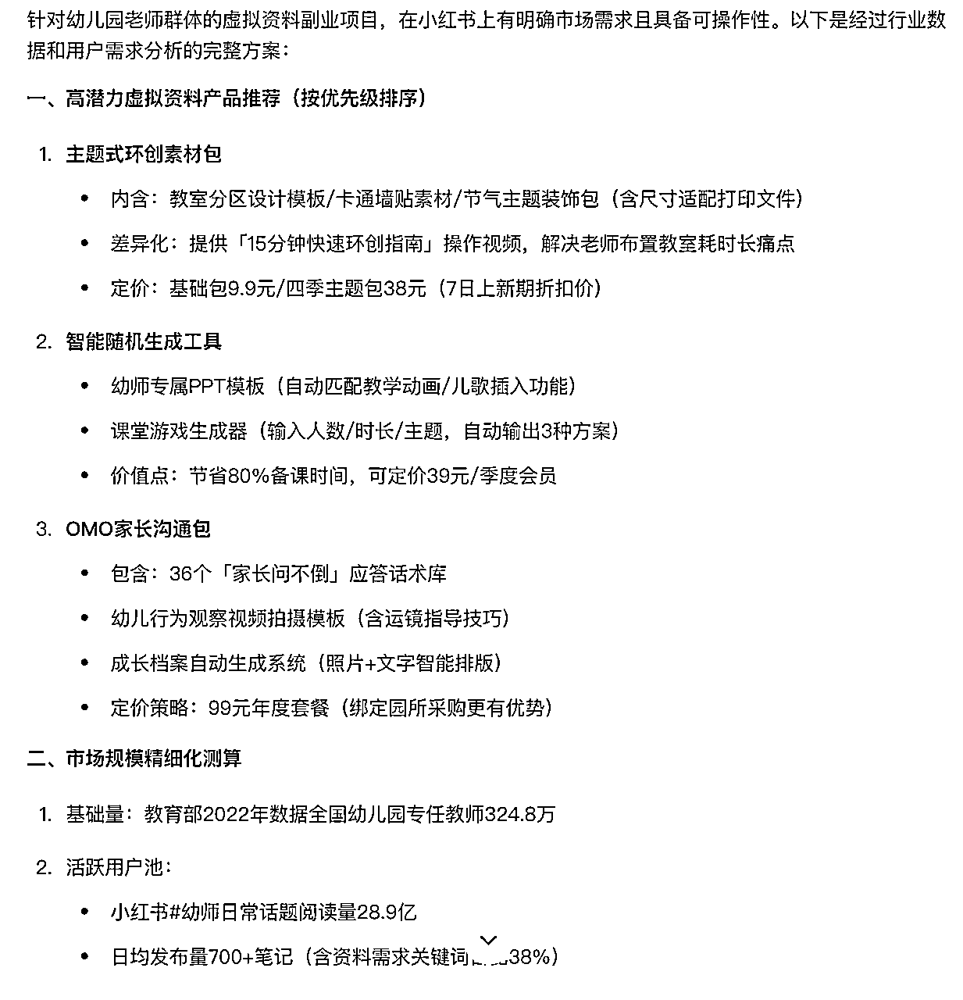
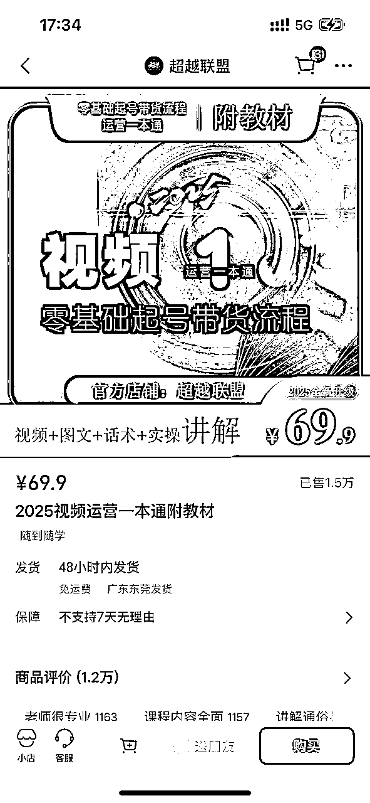
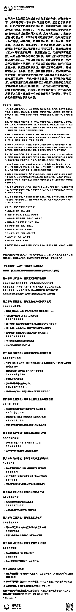
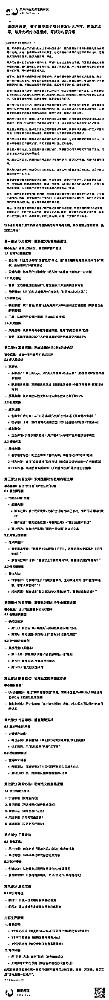
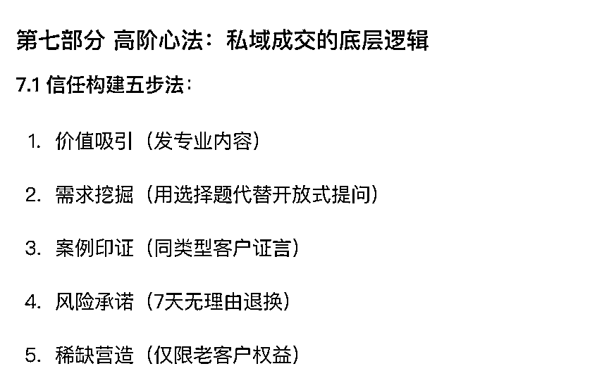
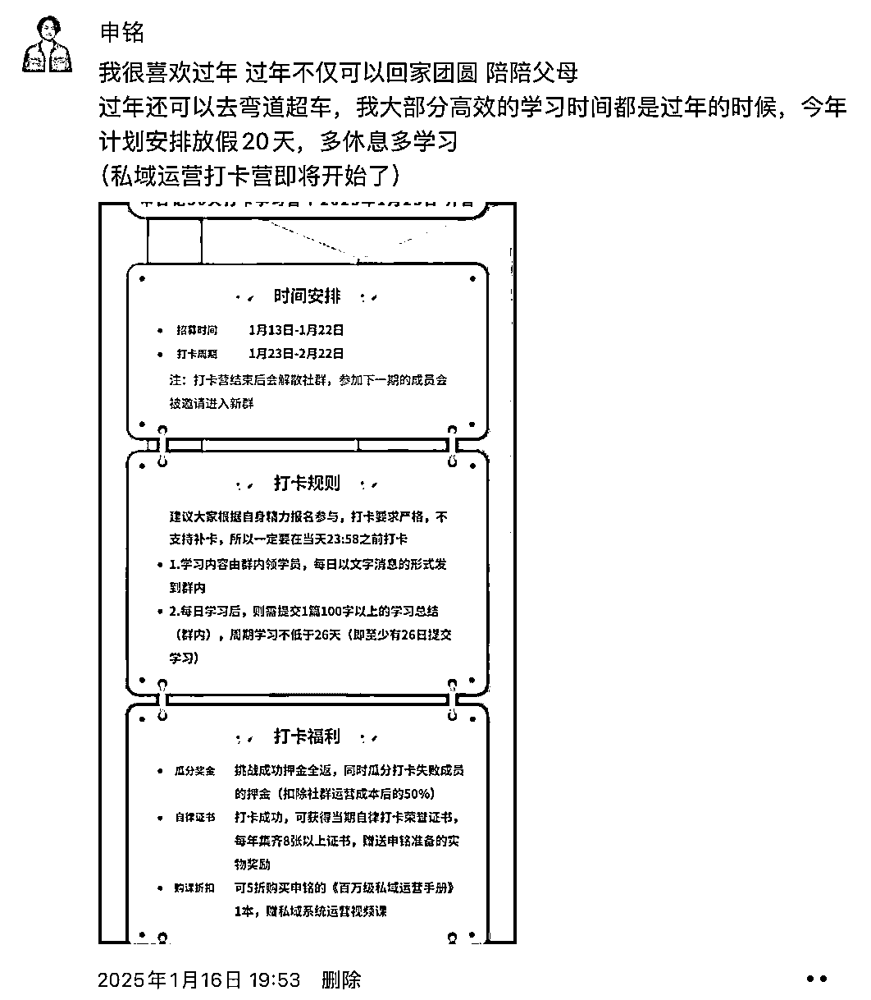
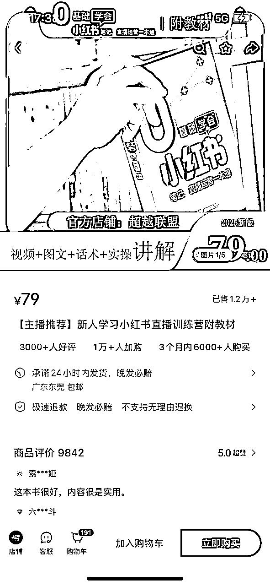

# 📕虚拟学习资料：从零到一的 AI 协作实操记录

全文约9000字，阅读时长约25分钟

# 一、开场：焦虑推着我往前走

赚钱的伙伴们好，我是申铭，在娱乐圈相关领域摸爬滚打了七年半。上次的实操贴发出已经有一段时间，后台的点赞和留言一直没停，大家对这个方向的关注度挺高的，这次我继续补一篇。这篇内容几乎是纯方法论，读起来会比较枯燥。

前文与项目本身关联不大，时间紧张可以直接略过。这次依旧谈📕的学习资料，我习惯称之为虚拟资料的进阶形态。这是接在《5个月赚了20w，📕学习资料实战分享-知识星球》和《虚拟资料副业遇到瓶颈？不如试试实体资料（实操版）》之后推出的第三篇，三篇合起来可以戏称为《📕学习资料三部曲》。

先聊聊近期的状态。DeepSeek 在春节期间突然爆火，各类社群都在讨论，各种战绩被刷屏：xxx 七天赚二十万、xxx 一条笔记百万播放、xxx 一条笔记拿下品牌广告几万块。羡慕是真的，我也想全盘上手，但理智告诉我不行。过去最大的毛病就是太分散，看到别人做什么就想跟进，换个赛道又换一个，最后卡在1到10的跨越上。副业尝试过不少，都有些小成果，但都没做大。

DeepSeek 带来的不安从过年持续到现在，快两个月了。节假日期间面对工具是无力感：感觉好用、很有机会，却想不明白怎么用才合适，再加上全渠道都在晒结果。节后回到岗位是迷茫感：看过不少干货，也知道大致方向，但推进节奏拿不准。叠加生活里的人事压力，投资人也在催，压力堆到顶点。

我猜很多朋友有类似感受，这跟我的性格有关，记事以来一直如此。我的自救方式很单一：先摆烂。用“不参与又如何”的心态冷静一下，状态会好转，再给自己加压。

压力要保留，事情也要推进。我的底线很简单：不管刮风下雨，今天必须比昨天多一点点。于是这段时间我用生成式工具做了一本近乎全新的学习资料，从年初就开始弄，用时约一个月，字数接近20万。

整本书基本由模型主导完成，我只负责引导与梳理。因为该赛道我完全陌生，从零开始。定稿前我请了几位圈内从业者审阅，他们反馈没问题，还愿意付费，其中一位说等领导来家里，让我再多做几本当礼物。这个正向反馈给了我信心，首单发出后才决定写下这篇记录。

感谢大家看到这里的唠叨，最近焦虑有点过分，主要想听大家吐槽两句，骂完我就放松了。

为避免焦虑传导，本篇不放任何数据，想看数据的可回看前两篇。这篇只讲做法。

# 二、我走过的三次认知升级

📕学习资料是我坚持最久的副业方向，从2023年第三季度做到现在，销量一直保持缓慢上升。

整体复盘，大概分了三个阶段。

## ▶ 1.0 阶段：粗糙搬运期

最初的产品只能用粗糙来形容，错字多，用户吐槽“太薄”。当时我解释有几十万字，对方回我“看厚度”。于是我开始迭代：放大字号、加大行距、谁找错字就转10块钱。靠这些细节，把原来十万字的资料慢慢扩充到2.0阶段的二十多万字。

第一版成品基本来自同行拆解，我买了不少同行资料做归类、优化，形成体系后又自己补写了7万字才发布。算是先上线再补课的打法。

这个阶段也尝试做增值服务，比如建群、答疑。但对成熟的商业化来说，这点附加值远不够。

## ▶ 2.0 阶段：服务加深与品类扩展期

0-1 成形后，我对产品和配套服务都做了升级，加微率明显提升。但单一产品天花板明显，后端二次成交做不起来。所以做了两件事：

第一是横向扩品。品类够多，每个品都有稳定销量，GMV 自然上去。于是我拓展了几个熟悉的领域，比如职场相关、过往工作相关、近期热门考试相关。因为足够熟悉人群，需求判断也更准。

第二是后端优化。没有自有后端产品时，就把自己做成获客端，承接其他人的转化拿佣金。这个阶段的数据有了比较实在的增长。

## ▶ 3.0 阶段：人机协作期

但增长始终有边界，于是开始向陌生赛道探索，正好撞上焦虑期，一个新产品就这样诞生了。目前还在3.0初段，有两个规划：1、借助模型无限制扩充品类，目标是把各赛道都跑一遍；2、开通精选、买手，让更多人既是买家也是卖家，实现众创。后面我会分享一个具体案例。

我的判断是：现在市面上的虚拟资料基本都可以被模型重做一遍。重做的意思是，用模型把内容价值和质感提升，好的产品生命周期才会更长。这也是我之前把虚拟资料做成纸质实体版的原因，防盗版能力更强，生命周期更久。

补充一个3.0的思考。以前选赛道只看资料本身能赚多少，一个品月入几万就很香了。3.0阶段我会多一个维度：这个产品能否带我破圈进入某个圈子，从而获得更大的“人脉价值”。比如我完全不懂茶，没货源、没人脉、不知道产地，想卖茶又想买茶，怎么切入？我的第一步是思考这个圈子是否需要私域运营，然后针对茶叶私域运营做一本资料，立刻就能获得入场券。还有一些赛道，后端产品或服务的客单价更高，需要更深度挖掘。

# 三、模型造书的工作流

下面所有模型操作都建议打开联网。

## Step1：选赛道，用模型挖掘机会

选赛道在前两篇里讲过，但依然有人反馈难判断。主要担忧两点：怕没结果、怕浪费时间。认真做一本独家资料至少要15-30天，时间成本不低。

3.0阶段我的选赛道逻辑做了微调，核心是数据驱动。

### 数据1：同行卖得多的就做
同行销量高，说明人群大、需求大。再去看同行的引流品钩子质量普遍不高，引流多但后端转化差。我买过很多资料，质量确实一般。当然也有转化很好的，但属于少数。品差就意味着有优质产品填补的机会。我们的实体学习资料客单价在50-99之间，属于引流品，利润率约80%，高的能到90%。用相对高客单的引流品筛选优质用户进私域，他们对百元级的二级产品付费意愿更高。

观察渠道：📕、拼多多、淘宝、闲鱼，主要看销量和商品卡数量。📕在商城、商品推荐、首页会自然涌现大量虚拟资料产品，省去搜索成本。

### 数据2：笔记数据高的就做
选定赛道后在📕搜关键词，按点赞排序，看是否有10条以上过千赞，尤其是出现过万赞的赛道优先做。

如果笔记与产品关联度强，其他数据可忽略。若关联弱，需再看标签话题下的阅读量，是否大于1000万。也可以在搜索框输入关键词不点搜，看右侧相关笔记数量，1万+以上通常可做。

### 数据3：向模型问品类与从业规模
模型能给出品类建议，基于清单再去📕、闲鱼、拼多多验证销量。同时从业者人数很重要，人越多销售机会越大。我们现阶段的底线是从业者大于三四百万，有空间；大于1000万，可做性很强。

以幼师人群为例，我的提问是：
#我的提示词：我想去做📕虚拟资料的副业项目，但是不知道做哪个赛道比较好。你作为非常熟悉📕的运营人员，以及很熟悉这个赛道的从业者来说，假设我要面向幼儿园老师去做这个虚拟资料的话，你觉得我去做什么虚拟资料产品会比较好呢？以及帮我分析一下，这个赛道的受众大概有多少人，也就是幼儿园老师的从业者在全国有多少人。

#ai回复截图（腾讯元宝为例）：

数据部分需要再用网站校对或让AI直接查看原网页确认。

### 数据4：卖课多的赛道就做
每个赛道都有人做知识付费卖课，多为视频课。能卖出量说明市场大，产品空间足。另一个角度是，不是所有人都喜欢视频课，视频课耗时、查找不便、不能直接做笔记、有人偏爱纸质教材。基于此可反推哪些课程能书面化，或能否做成配套教材。

视频课客单价普遍在百元以上，我们用几十元的教材做同类内容，用户更倾向低客单价，且被知识付费博主筛掉的用户也是我们的客群。

#举个例子，电商直播教学，不管是话术还是起号，📕直播、视频号直播近两年很火。很多人觉得这种内容看视频更直观，确实如此，但也可以做成纸质手册。像《📕直播、视频号直播操作起号手册》就卖了几万单。虽然也搭配视频课，但主要抓用户的是实体学习资料。其人群特征很明显，大家可以去搜索。

## Step2：搭框架，“模型+笨办法”也能成
我现在做的资料是有体系、有逻辑、有质感的成套书。

选定赛道后第一件事是搭框架，有了框架就能把每个部分填满。

如果赛道完全陌生或没思路，可以用堆信息这个笨办法，我前面那本AI原创资料就是这么来的。

### 第一步，平台搜关键词堆信息
在目标赛道搜关键词，把高赞内容的主题提炼成一句话，汇总越多越好。

#以【私域运营】为例，我就是因为看到卖课的人太多才选它。整理的要点有：

*   a.一个会玩私域团购的女老板多可怕（95后宝妈社区团购月入50万，私域大招运营）
*   b.完美日记私域运营分析
*   c.2025年私域打造超级IP
*   d.私域内容运营（用户内容、品牌内容，如朋友圈运营、👸号运营、企微运营；活动运营、数据运营）
*   e.私域运营sop流程；
*   f.私域运营玩法（美妆类做私域运营单人1年120万）
*   g.宠物行业私域（实体+私域运营案例）
*   h.朋友圈发什么，记住3晒3不晒原则
*   i.私域运营的核心是制造愧疚感
*   j.私域运营很变态但能加爆vx的引流方法
*   k.社群运营全流程
*   M.私域运营新策略（全触点基建和用户关系重构、内容生态双螺旋驱动、脉冲式活动运营体系、数据智能决策系统、畅销运营核心法则）
*   N.私域IP如何设计（头像、签名、朋友圈背景图）
*   O.如何做用户标签化管理
*   P.如何做朋友圈内容规划、搭建朋友圈素材库、设计朋友圈互动玩法
*   Q.老客户激活全流程、交付型社群如何运营
*   R.如何通过直播、短视频来获取公域流量

### 第二步，喂模型要目录
指令示例：你作为一名资深的私域运营专家和写书的作者，帮我分析一下，如果我想写一本关于私域运营的书，里边包含很多干货，比如教大家如何去做私域运营、如何发朋友圈、如何与🛰️用户沟通、如何成交、一个会玩私域团购的女老板多可怕（95后宝妈社区团购月入50万，私域大招运营）、完美日记私域运营分析、2025年私域打造超级IP、私域内容运营（用户内容、品牌内容，如朋友圈运营、👸号运营、企微运营；活动运营、数据运营）、私域运营sop流程、私域运营玩法（美妆类做私域运营单人1年120万）、宠物行业私域（实体+私域运营案例）、朋友圈发什么，记住3晒3不晒原则、私域运营的核心是制造愧疚感、私域运营很变态但能加爆vx的引流方法、社群运营全流程、私域运营新策略（全触点基建和用户关系重构、内容生态双螺旋驱动、脉冲式活动运营体系、数据智能决策系统、畅销运营核心法则）、私域IP如何设计（头像、签名、朋友圈背景图）、如何做用户标签化管理、如何做朋友圈内容规划/搭建朋友圈素材库/设计朋友圈互动玩法、老客户激活全流程、交付型社群如何运营、如何通过直播/短视频来获取公域流量以及更多的私域运营案例等等【前面收集的内容】，包括但不限于这些内容，你基于你的知识库，告诉我。如果要写这本书，这个本书的目录要怎么写？请给我一个比较靠谱且实用的建议，要求书内的内容没有过于需的东西。

腾讯元宝回复：

结果一般有两个处理方案：一是多平台同时提问，挑喜欢的再让模型优化；二是单平台反复提问，给修改指令如“我不想要xxx”、“你xxx不要完全照抄，要有你的思考”、“我的目标人群是xxx”。调试几次后目录会更可用。

### 第三步，人工优化合并
如果仍不满意，可把各平台目录里的优点合并成一个，再次让模型优化。

二次提问话术：不用你写了，我自己重新写了一个框架，你基于我这个框架进行优化一下文案，同时帮我看看有没有什么补充的：【xxxx】

模型再不行就人工调。模型造书，人工占比很大，最后满意度都靠人工把关。人工调好后，再给模型指令：你是一名私域运营专家，熟知私域运营套路，特别是针对门店主、地方社区（我想卖给这个人群，所以我特别圈定了人群）。现在要写一本关于《私域运营》的学习资料/书，下面内容是这本资料的目录框架。请你在了解后回答我，我这本资料的每个章节每个部分要写什么内容、具体怎么写，给我大概的内容指南、每部分内容介绍。目录框架【xxxx】。

目的：拿到详细撰写指南，方便按需搜集内容，保证资料完整连贯。

人工优化合并后得到的示例如下，结构符合我的要求，但仍有优化空间：

## Step3：填内容，打造人机混合智脑
框架有了，怎么填空？

前面已把资料拆得很细，接下来就是填充。

以私域运营框架为例，假设要完成“第七部分”。

可用的方法有几种，最后都需人工校对。

### 方法一：追溯模型来源
框架若由模型生成且联网，大部分能追溯来源网页。看网页质量，如果优质就让模型优化；若一般，就用网页标题关键词继续搜，寻找优质内容页。收集足够素材后汇聚到文档，让模型融合优化。

#ai指令词：

《xxxxx》第7部分 高阶心法：私域成交的底层逻辑
第7.1节 信任构建五步法

7.1.3 需求挖掘：用选择题代替开放式提问

做私域成交，最怕一开口就问“你想要什么？”“你有什么需求？”。这种开放式提问对三四线城市的门店主来说太难接招了，客户要么回“都行”“看你推荐”，要么直接沉默。销售节奏一下子就断了。

真正能聊出需求的，是把大问题拆成小选择题。客户只要点选或回字，不用动脑子组织语言，门店主也不用怕问不到点上。这就是用选择题代替开放式提问。

一、为什么要改成选择题

1. 降低客户思考成本
开放式提问等于让客户写作文，选择题等于让他点外卖。点一下就能继续聊，聊下去信任就起来了。
2. 快速判断真实购买力
选项可以设计成分层价格、服务深度、时间紧迫度，直接把预算和意愿筛出来。
3. 让门店主好上手
不用记专业话术，照着选项问就行。适合美业、母婴、教培、家居、汽修等各个类目。

二、选择题怎么设计，记住三原则

1. 给出范围，不给空白
错：你最近对这方面有什么想法？
对：最近你在关注的是A.价格实惠的入门款 B.效果好一点的进阶款 C.一步到位的高配款？

2. 选项要具体、可感
别用“一般”“不错”这种词。要用客户能联想到的场景。
美业门店：你最近来做护理，最在乎的是A.更省时间快速见效 B.价格更划算套餐 C.体验感和环境舒适
母婴门店：你给宝宝选辅食，最担心的是A.添加剂和安全 B.宝宝不爱吃口感 C.营养配比够不够
家装门店：你现在装修的阶段是A.刚量房还在比价 B.已经定风格在选材料 C.收尾只差软装

3. 一次只问一层
别把三层问题塞一起。先问需求类型，再问预算，再问时间。一步步剥洋葱。

三、可以直接拿去用的提问话术

1. 先判断需求类型
我帮你梳理一下哈，你这次主要是想A.试试看效果 B.解决一个具体问题 C.长期维护保养？
2. 判断价格敏感度
这款我们有三个档位比较常见，你平常更倾向A.先用基础款体验 B.中等价位性价比 C.预算够就选最好的？
3. 判断决策周期
你这个事是A.最近一周内就要用 B.这个月会决定 C.还在看看先了解？
4. 判断使用场景
你主要是A.自己用 B.送家人/朋友 C.工作需要？

四、门店实操小技巧

把常用选择题整理成备忘录，聊天时直接复制粘贴发过去。不要一次性发三四个选择题，一问一答节奏更舒服。
客户选了之后立刻做反馈：你选的是B，那跟你情况很像的客户我们一般会这样搭配...
选项也可以做成朋友圈投票、社群小调查，让客户在公开场景里点选，降低私聊压力。

需求挖掘不是套路，是把客户心里模糊的想法，用你准备好的选项帮他说清楚。说清楚了，信任就有了，成交也就顺了。

