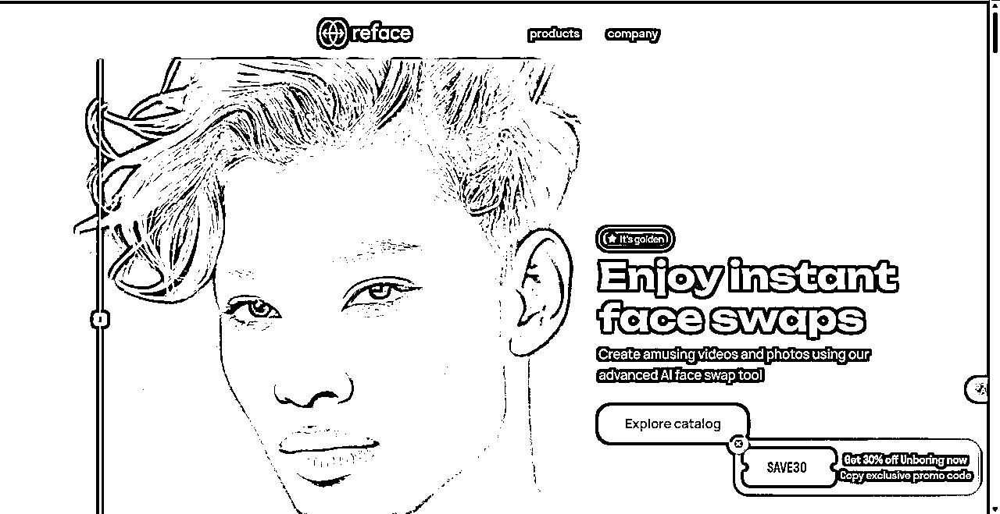
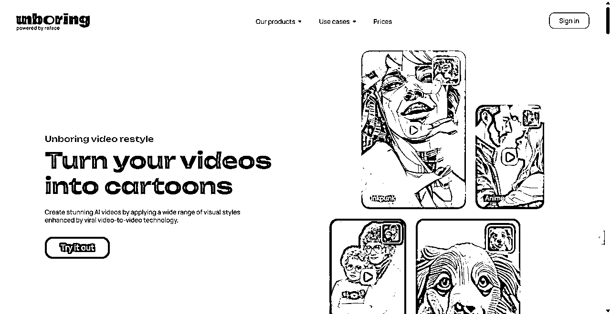
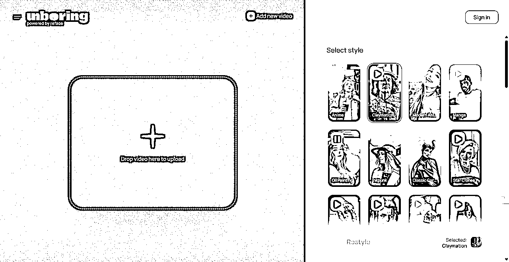
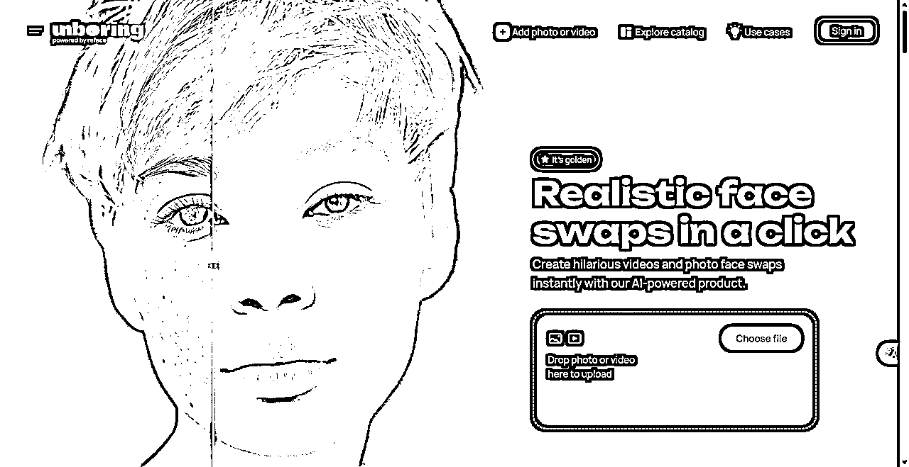
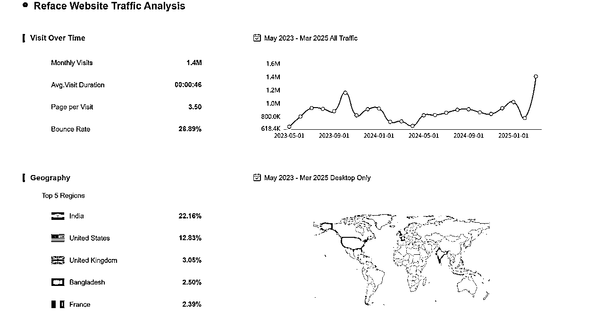
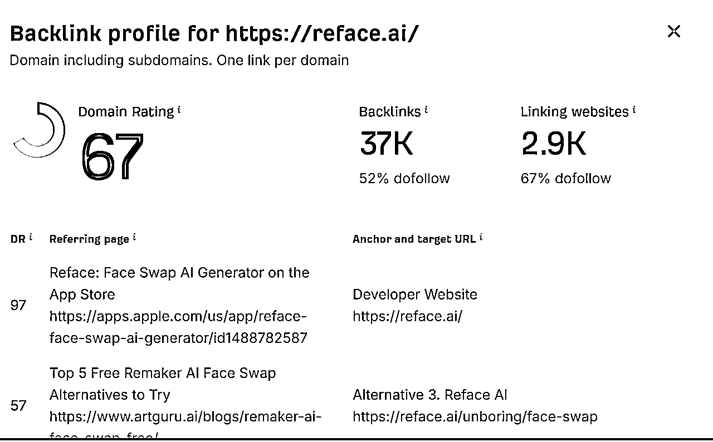
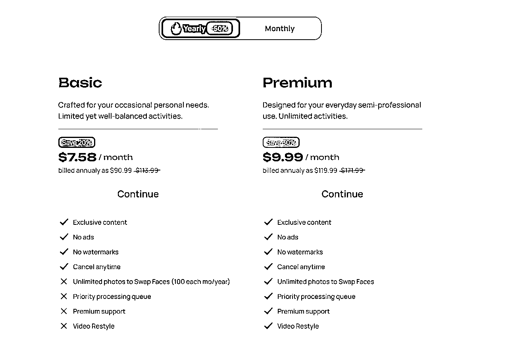
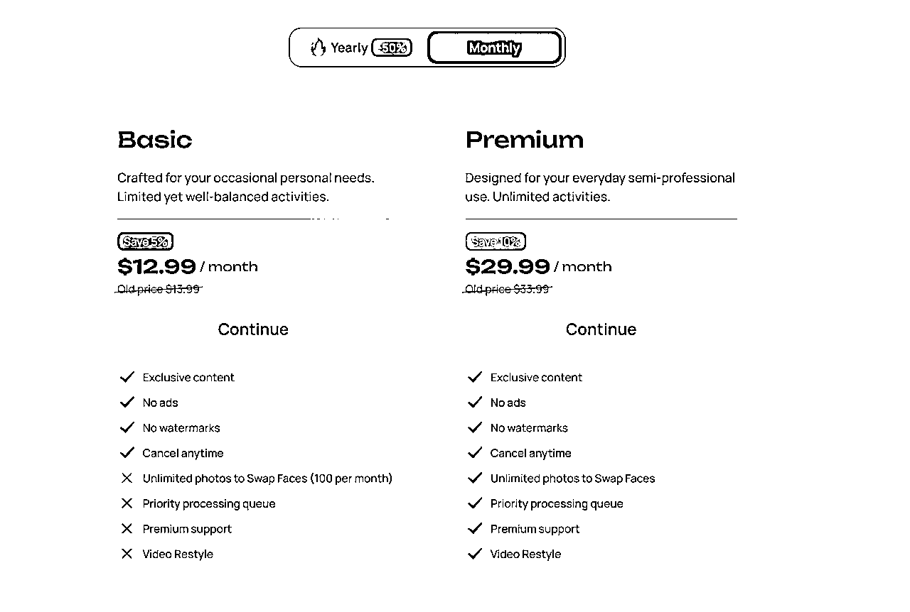

# 133 Reface
作者：龙哥

# 更新日志

## 2025-04-16

*   3月份有一波不小的自然流量被 “ghibli” 关键词带起，单月估计冲到约 50 万左右；
*   要找到官方入口并不容易，翻了几次才定位到，整体藏得比较深；
*   站点结构显得很凌乱，不同关键词对应不同风格的加载页，缺少一个统一的门面；
*   移动端目前能追踪到 4 个 App，其中一款的 MRR 能到 40 万美金，其余体量明显偏小；
*   Meme 化的玩法给了产品极强的裂变可能，传播性是最大亮点

# 基本信息

4 个移动端产品

## 产品链接

https://reface.ai/

https://apps.apple.com/us/app/revive-ai-photo-animation/id1616862692?mt=8

https://apps.apple.com/us/app/restyle-ai-headshot-generator/id1667311093

## Loading Page

## 流量

### 基本信息

### 外链

# 产品拆解

## 💡 产品价值：解决了什么核心问题？

*   核心价值与功能：Reface 是一款以生成式 AI 为驱动的移动娱乐应用，核心是把用户自拍或上传的面部替换到预设的视频、GIF 或静态图模板里。它让零基础的用户也能快速产出带个人标签的搞笑或吸睛视觉内容，无需剪辑技能即可实现“以我之面，代他人之形”。满足了社交媒体时代对个性表达、娱乐互动和内容分享的需求。
*   细分赛道：属于 AI 驱动的 C 端内容创作工具，聚焦移动端娱乐型图像/视频编辑，核心卖点是换脸这一特定效果，可视为传统编辑工具在 AI 时代的趣味分支。

## 👤 目标用户：谁会用？

*   典型画像：以年轻用户为主，包括学生、在校生、年轻白领等社交媒体的重度使用者，如 TikTok、Instagram、Snapchat 等。追求新鲜感、个性表达，动手能力弱，更看重一键上手。面向个人，B2C。
*   用户分层：
*   社交重度发布者：想用新形式提高互动和关注度
*   Meme/GIF 迷：痴迷制作和传播搞笑动图
*   纯娱乐用户：图好玩、发给朋友或自娱自乐
*   技术尝鲜者：对 AI 应用好奇，愿意尝试新 App

## 🤔 用户需求与痛点

*   痛点：
1.  传统编辑门槛高：PS、AE 等工具学习成本高，普通人难产出
2.  表达方式同质化：滤镜贴纸已审美疲劳，需要更抓眼的素材
3.  制作耗时：即使简化工具，做内容依然耗时
4.  娱乐与社交动机强：需要轻松幽默的方式与朋友互动
*   满足方式：AI 换脸把流程压缩到“上传照片+选模板”几秒出片，提供新鲜视觉，操作极简，契合快节奏社交，天然适合分享。

## 🗣️ 用户口碑

信息来自 App Store、Google Play 评论、社媒讨论及媒体评测

*   优点：
*   效果出人意料：换脸逼真或夸张搞笑，都很吸睛
*   上手极快：流程简单，无学习负担
*   模板池大：视频/GIF 资源持续更新，覆盖影视、名人、搞笑场景
*   娱乐传播力强：好玩易分享，自带病毒属性
*   生成速度快：比手动编辑高效
*   缺点：
*   订阅与定价：免费版有水印、广告、次数限制；付费订阅价格被部分用户认为偏高
*   隐私顾虑：需上传面部数据，担心滥用
*   效果不稳定：偶发扭曲、模糊、匹配偏差；偶有闪退 Bug
*   新鲜感衰减：模板更新慢时易产生审美疲劳
*   广告干扰：免费版广告体验差
*   伦理风险：Deepfake 潜在滥用引发社会担忧

## 🔍 获客方式

高度依赖裂变传播：

1.  病毒式口碑：用户把成品发到社交平台，引发好奇模仿，是主要增长来源
2.  ASO：优化 App Store 和 Google Play 关键词排名，提升搜索曝光
3.  社媒投放：TikTok/Instagram 等投放效果演示广告，触达年轻人
4.  达人合作：与网红创作者合作推广，借影响力引流
5.  媒体 PR：靠技术新颖和增长故事获得 TechCrunch 等报道

## 💰 商业模式与收入

*   商业模式：典型的 Freemium。
*   免费版：基础功能可用，但带水印、有广告、模板受限、速度慢、次数受限
*   付费订阅 Pro：去水印、无广告、解锁高级模板、提速、无限生成，订阅周期为周/月/年
*   收入测算：
*   用户规模预估：基于站流预估 MAU 约 40 万
*   付费转化：消费级 Freemium 约 1%-5%，取保守 1.5%
*   ARPU：月均约 15 美元
*   移动端两款 App 实测 MRR 分别约 40 万和 2 万
*   粗略 MRR ≈ 0.4m × 1.5% × 15 + 42 万 ≈ 51 万
*   ARR ≈ 612 万
*   声明：基于假设的粗估，实际偏差可能很大
*   融资：2020 年公司曾获 a16z 领投 550 万美元种子轮，验证市场潜力。盈利状况未公开，可能仍在投入期

## 🧠 可借鉴点

1.  用 AI 打造“魔法”体验：把复杂技术包装成一键惊喜，引爆传播
2.  功能聚焦：只做换脸，体验清晰易懂
3.  内建传播：产出物自带分享属性，增长引擎在产品内
4.  Freemium 闭环：免费引流，付费提质，平衡体验与转化
5.  内容持续更新：娱乐类产品靠模板新鲜度留存
6.  顺势而为：在 AI 成熟与短视频爆发期上线，踩中趋势

## 🚧 难以复制的壁垒

1.  AI 技术壁垒：高逼真度换脸需顶尖 CV 人才、海量数据和持续算力投入
2.  先发与品牌：早期爆红带来全球认知度，后来者获关注成本高
3.  用户规模效应：大量用户形成社交可见度优势
4.  数据飞轮：运营数据反哺模型优化和推荐
5.  隐私合规经验：面部数据涉及 GDPR/CCPA 等法规，需专业法务能力
6.  内容授权：部分影视模板需版权许可，已形成合作壁垒

## 🤗 电梯提案

“想把自己塞进电影片段或爆款 Meme 里？一张自拍，Reface 的 AI 就能让你几秒变身，惊艳或逗笑整个朋友圈。”

## 🚀 差异化机会

1.  自定义创作自由
*   支持用户上传自有视频/GIF 做换脸，不限官方库
*   提供二次编辑：融合度调节、文字特效、剪辑等
2.  垂直深耕
*   聚焦动漫、游戏、特定 IP 粉丝圈，做定制化模板
*   谨慎探索 B2B 娱乐化场景，如个性化营销短片
3.  技术差异
*   提升微表情同步与细节真实度
*   融合语音克隆做音画同步，风险高需严格合规
*   从面部延伸到全身替换
4.  隐私优先
*   设备端处理或更透明的数据策略
*   提供匿名化选项
5.  商业模式创新
*   按次付费、模板包售卖
*   面向创作者的专业套件及分成机制

## 🎉 可行性判断

*   资源需求：顶级 AI/视觉算法、移动端与后端工程、高算力成本、合规法务、产品设计、大量版权模板
*   匹配度：对大多数团队直接复制几乎不可行。若在特定 AI 子技术、垂直社区资源或合规隐私策略上有独特优势，走差异化路线才有机会。算力与人才成本是最大门槛。

## 🧭 第一批用户获取思路

以细分社区切入为例：

1.  深度融入目标社区，了解黑话与热点
2.  用工具产出高相关种子内容，自然投喂
3.  邀请核心玩家内测，积累口碑
4.  与小体量 KOL 合作扩散
5.  在 TikTok/Twitter 用相关标签投放
6.  通过 Product Hunt/BetaList 获取早期用户
核心是精准定位 + 价值内容驱动，而非泛投放。

## ✨ 我的独特优势

取决于个人背景，典型方向：

*   技术：面部重建、表情迁移等细分领域的突破
*   社区：对特定游戏或亚文化的深度人脉与影响力
*   数据：合规获取高质量面部/行为数据的渠道

开始之前，先想清楚两件事。否则，别碰那个方向。

见过太多人一拍脑袋就冲进某个赛道，理由无非是“风口到了”或者“别人做我也能做”。但真相是，你进场之前得先掂量清楚，自己手里到底有没有那张能上牌桌的底牌。

第一张牌，是你的护城河。不是“我努力”“我学习能力强”这种自我感动式的标签，而是实打实的、别人短时间抢不走的稀缺能力。举个例子，同样是做AI产品，有人靠的是审美直觉，能把交互做到极简、有趣，甚至让人一用就忍不住分享——这是体验上的天赋，是设计感带来的病毒式传播力。有人靠的是资源调度能力，能在关键时刻快速拉来顶尖工程师、搞定一笔救命钱、或者促成关键的战略合作。还有一种更高级的视角：当所有人都在盯着“消费结果”时，你却看到了“创作过程”本身的价值。同样是一个工具，别人是成品展示台，你是创作者的游乐场，从不同维度切入，用户感知完全不同。

这三样——哪怕只占一样，你就有资格谈“入局”。如果一样都没有，面对已经有巨头押注、技术门槛又高的领域，劝你慎之又慎。那不是蓝海，是绞肉机。

第二张牌，是你的热情。但先别急着点头，热情这东西，往往被高估了。嘴上说“我很看好”和骨子里“我兴奋得睡不着”是两码事。你需要认真问自己几个连自己都容易骗过的问题：

有没有一种时刻，当你看到AI技术跟创意结合出某个新玩法时，你会觉得“这玩意儿太有意思了”，而不是“这玩意儿能赚多少钱”？你是不是真的关心用户拿着你的工具时，脸上是眉头紧锁还是会心一笑？当批评如潮水般涌来，尤其是涉及隐私或是伦理的质疑时，你是想关掉评论躲起来，还是撸起袖子去找解决办法？如果做了三个月，数据依然平淡，投资人依然冷漠，你又没有一分钱进账——你是想“再坚持一下”，还是想“赶紧止损找份工作”？

如果答案让你沉默，那说明你对它只是“有点兴趣”，不是“爱的深沉”。而只有后者，才扛得过初创期那些暗无天日的时刻。热情不是锦上添花的情绪，它是当你所有理性的推算都打了折扣、所有外部支持都暂时缺席时，唯一还能驱动你前进的燃料。

所以，不管是想做AI创作工具，还是深耕某个你自以为懂的细分市场，先别急着拿方案，也别急着融资。坐下来，认真盘一盘你的“独门绝技”和“受挫阈值”。两样都够硬，再出发。否则，你省下的不只是钱和青春，还有那段本可以不去经历的自我怀疑。